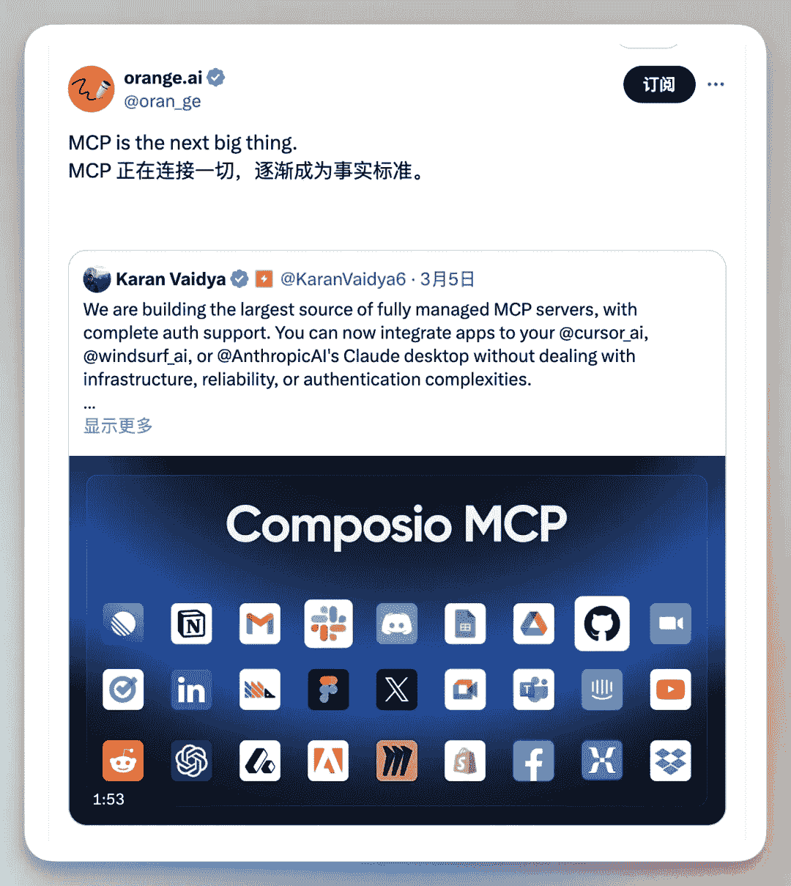
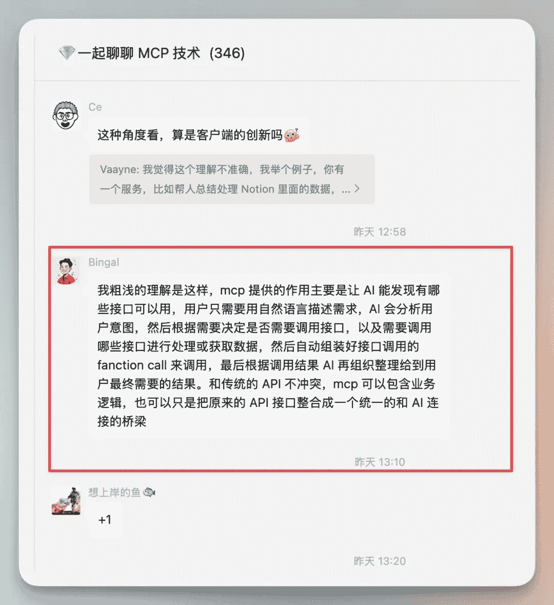
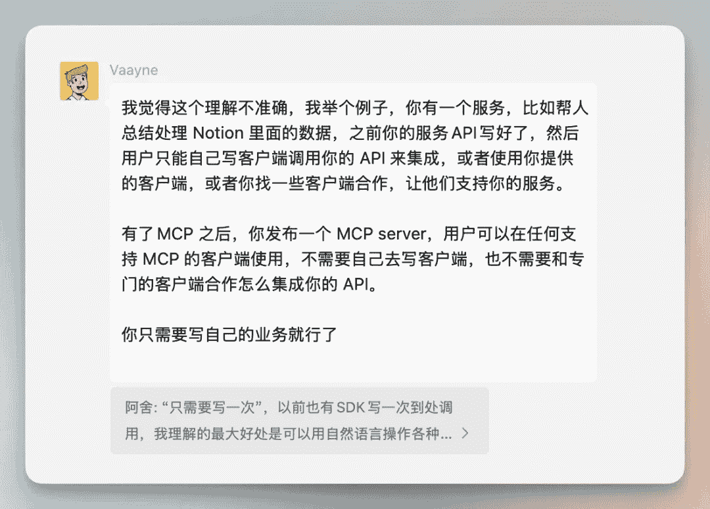
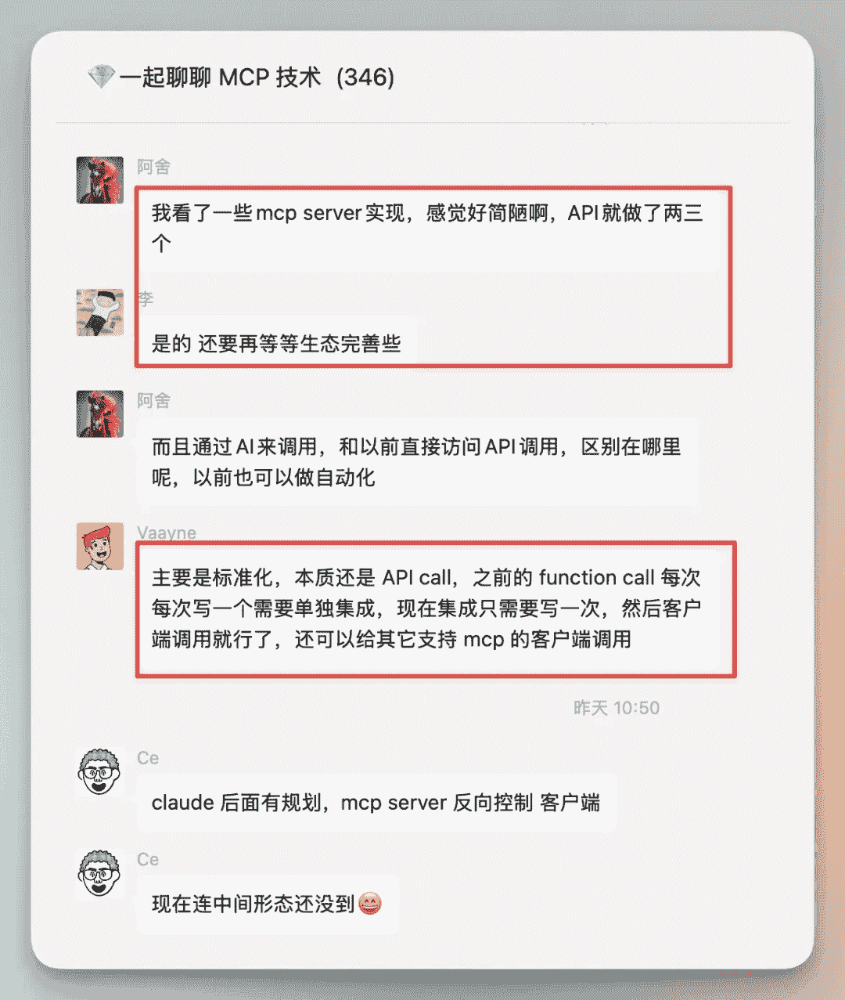
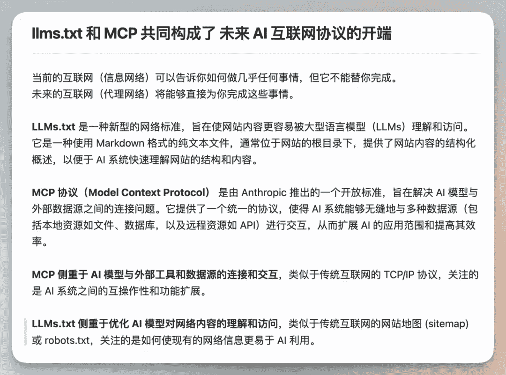
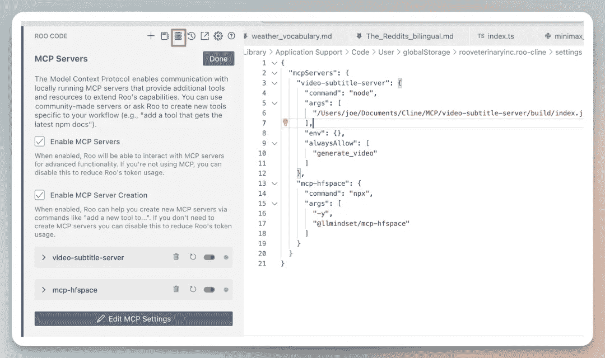
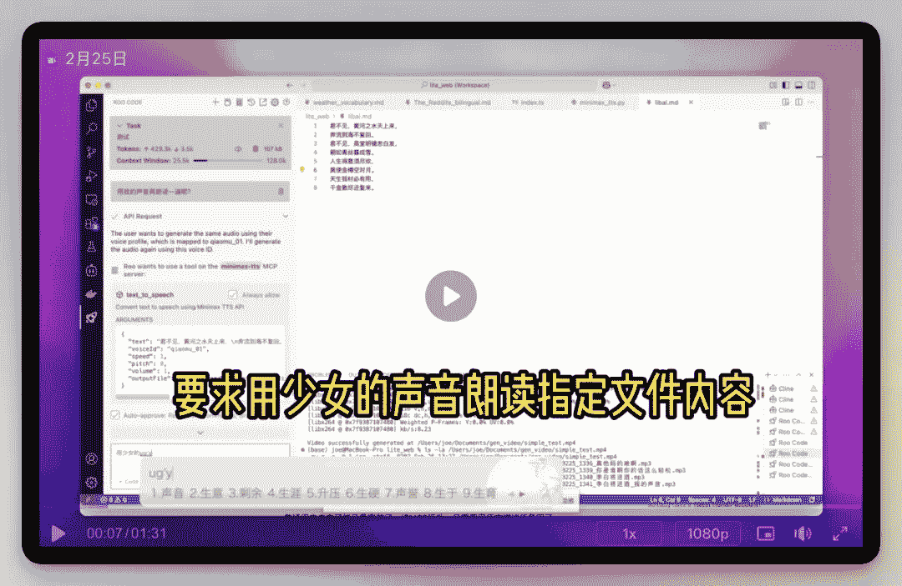

# 程序员必看，AI时代新协议 MCP 正在连接吞噬一切，20+资源全收录！

> 来源：[https://aiyanxishe.feishu.cn/docx/V2gbdMzBNoF64qxMTyKc51zQnlf](https://aiyanxishe.feishu.cn/docx/V2gbdMzBNoF64qxMTyKc51zQnlf)

## 程序员AI破局简介

> [《程序员AI破局指南》](https://t.zsxq.com/19EOflzkQ)由字节、百度、阿里等互联网大厂的AI业务相关高管共创，分享开箱即用、面向市场的AI编程知识和工具。

> 指南包括六个专栏:**AI编程实战、AI编程工具、AI高效办公、A**I副业赚钱、AI提示词工程、AI私人助手

> [程序员AI破局指南](https://t.zsxq.com/19EOflzkQ) 原价 599 元，限时特惠 199 元/年，5月1日恢复原价。

> 加入我们：https://t.zsxq.com/19EOflzkQ

> 购买后，添加群主微信加入 AI研习社陪伴社群，限时领取超值福利。

**如果你**最近经常刷 X 的话，你会发现一个频繁出现的关键词：MCP。

X（Twitter）上，AI 圈 10w+ 关注大V橘子兄这么评价：



不少独立开发圈的朋友们，对MCP技术也很感兴趣。


前段时间自己摸索，用AI写了一个MCP服务器，自然语言控制AI生成音频，效果让我十分震惊，所以快速组个MCP技术交流群。

**个**人觉得 MCP是 AI Agent 落地的关键协议，生态正在爆炸式增长，海外知名软件，没一个不在不提供自己的 MCP 服务。

让我想到今早上Monica团队出品的Manus产品刷屏，除了营销推广的力量，更重要的是AI Agent技术的成熟，这只是开始，预计今年5-8月份，大家会更震惊。

所以，对于MCP技术，不得不看，不得不学，一起积极拥抱。

下面是群内交流碰撞、整理的内容。想加群，可加我微信: vista8，备注MCP

# 一、什么是MCP？

## 1.1 Anthropic 官方解释

英文全称：Model Context Protocol （模型上下文协议）

MCP 是一种开放式协议，它规范了应用程序向 LLM 提供上下文的方式。

把 MCP 想象成人工智能应用的 USB-C 接口。

就像 USB-C 提供了将设备连接到各种外设和配件的标准化方式一样，MCP 也提供了将人工智能模型连接到不同数据源和工具的标准化方式。

## 1.2 群友们的理解



> MCP 提供的作用主要是让 AI 能发现有哪些接口可以用，用户只需要用自然语言描述需求，AI 会分析用户意图，然后根据需要决定是否需要调用接口，以及需要调用哪些接口进行处理或获取数据，然后自动组装好接口调用的 fanction call 来调用，最后根据调用结果 AI 再组织整理给到用户最终需要的结果。和传统的 API 不冲突，mcp 可以包含业务逻辑，也可以只是把原来的 API 接口整合成一个统一的和 AI 连接的桥梁.



> 有了MCP 之后，你发布一个 MCP server，用户可以在任何支持 MCP 的客户端使用，不需要自己去写客户端，也不需要和专门的客户端合作怎么集成你的 API。



> 主要是标准化，本质还是 API call，之前的 function call 每次每次写一个需要单独集成，现在集成只需要写一次，然后客户端调用就行了，还可以给其它支持 mcp 的客户端调用

## 1.3 AI 大白话解释：

想象一下，你有一个非常聪明的机器人，这个机器人可以做很多事情，比如回答问题、分析数据、甚至帮你写文章。但是，这个机器人需要从不同的地方获取信息，比如书籍、网站、数据库等。

问题来了，每个信息来源都有自己的格式和方式，这就像是每个设备都有不同的插头和接口。

MCP就像是一个通用的插头，让这个聪明的机器人可以方便地连接到各种不同的信息来源。

这样，无论信息来源是什么样的，机器人都能轻松地获取和使用这些信息，就像你用一个USB-C接口可以连接各种不同的设备一样。

简单来说，MCP就是一个标准，让不同的应用程序和AI模型可以更容易地交流和共享信息，而不需要为每个信息来源单独设计一套复杂的连接方式。

这样，AI模型就能更高效地工作，提供更好的服务。



## 1.4 MCP Server 和 Client 是什么？

MCP server 和 MCP client 是 Model Context Protocol（MCP）的核心组件。

MCP server 是一个程序，暴露特定的功能或数据源，例如访问文件、数据库或 API，供 AI 模型使用。

MCP client 则是一个程序，代表 AI 模型连接到这些服务器，允许模型请求和接收数据或执行操作。

MCP client 的核心原则包括：

+   • **服务器连接**：首先连接到 MCP server，获取可用工具列表。

+   • **工具使用：** 根据用户需求调用服务器提供的功能，确保安全性和用户批准。

**实际应用** ：

+   • 一个 MCP server 可以提供天气信息，MCP client 则帮助 AI 模型通过该服务器获取天气预报，而无需自己处理数据获取逻辑。

+   • 另一个例子是，MCP server 可能允许 AI 访问用户电脑上的文件，MCP client 确保连接和权限管理，保护用户数据安全。

MCP 还支持多种传输模型，如 STDIO（标准输入输出）和 SSE（服务器发送事件），适合本地和远程集成，未来可能会有更多传输方式。

# 二、提供 MCP 服务的网站

+   • Smithery - Model Context Protocol Registry
https://smithery.ai/([1])

+   • PulseMCP | Keep up-to-date with MCP
https://www.pulsemcp.com/([2])

+   • Awesome MCP Servers
https://mcpservers.org/([3])

+   • MCP Servers
https://mcp.so/([4])

+   • Glama MCP
https://glama.ai/mcp/servers([5])

+   • Cursor Directory
https://cursor.directory/([6])

# 三、支持 MCP的客户端

# 四、实战

## 4.1 必装 的一些 MCP Server

### 搜索增强

#### brave-search（Brave浏览器提供的API，绑定信用卡每月1000次免费）

https://github.com/modelcontextprotocol/servers/tree/main/src/brave-search([7])

#### puppeteer（无头浏览器，模拟真实点击访问）

https://github.com/modelcontextprotocol/servers/tree/main/src/puppeteer([8])

### 数据库

#### SQLite数据库

https://github.com/modelcontextprotocol/servers/tree/main/src/sqlite([9])

#### Supabase 数据库MCP

https://github.com/NightTrek/Supabase-MCP([10])

## 4.2 如何安装MCP server

### 4.2.1 VS code + Cline

如果用VS code + Cline，点击这里可以搜索MCP server，选择安装。

### 4.2.2 VS code + Roo Code （也适用于CoolCline([11])）

Roo code没有mcp server store，需要手动配置MCP Settings。



安装方法可以去其他 MCP 应用市场复制查看 Server配置文件，修改成类似上图中的格式。

## 4.3 Use Case

> 把海螺AI的API做成 MCP，一句话生成音频。

播放地址：

https://xiangyangqiaomu.feishu.cn/wiki/PXAKwEgLQir9rkkV1zjcGnMHntg?fromScene=spaceOverview([12])



# 五、其他资源

## 5.1 Awesome MCP

大量MCP 服务和安装地址

https://github.com/appcypher/awesome-mcp-servers?tab=readme-ov-file([13])

## 5.2 Anthropic 官网MCP文档

For Server Developers - Model Context Protocol

https://modelcontextprotocol.io/quickstart/server([14])

## 5.3 分享自己的MCP server配置

个人安装的一些MCP和对应配置文件。

```
{
  &quot;mcpServers&quot;: {
    &quot;puppeteer&quot;: {
      &quot;command&quot;: &quot;npx&quot;,
      &quot;args&quot;: [
        &quot;-y&quot;,
        &quot;@modelcontextprotocol/server-puppeteer&quot;
      ],
      &quot;disabled&quot;: true,
      &quot;alwaysAllow&quot;: []
    },
    &quot;brave-search&quot;: {
      &quot;command&quot;: &quot;npx&quot;,
      &quot;args&quot;: [
        &quot;-y&quot;,
        &quot;@modelcontextprotocol/server-brave-search&quot;
      ],
      &quot;env&quot;: {
        &quot;BRAVE_API_KEY&quot;: &quot;你申请的Brave 浏览器的API key&quot;
      },
      &quot;alwaysAllow&quot;: [
        &quot;brave_web_search&quot;
      ]
    },
    &quot;apple-notes-mcp&quot;: {
      &quot;command&quot;: &quot;uvx&quot;,
      &quot;args&quot;: [
        &quot;apple-notes-mcp&quot;
      ],
      &quot;alwaysAllow&quot;: [
        &quot;get-all-notes&quot;,
        &quot;read-note&quot;
      ]
    },
    &quot;sequential-thinking&quot;: {
      &quot;command&quot;: &quot;npx&quot;,
      &quot;args&quot;: [
        &quot;-y&quot;,
        &quot;@modelcontextprotocol/server-sequential-thinking&quot;
      ],
      &quot;alwaysAllow&quot;: [
        &quot;sequentialthinking&quot;
      ]
    },
    &quot;obsidian&quot;: {
      &quot;command&quot;: &quot;npx&quot;,
      &quot;args&quot;: [
        &quot;-y&quot;,
        &quot;obsidian-mcp&quot;,
        &quot;/{你的Obsidian仓库地址}/&quot;
      ],
      &quot;alwaysAllow&quot;: [
        &quot;list-available-vaults&quot;,
        &quot;search-vault&quot;
      ]
    },
    &quot;filesystem&quot;: {
      &quot;command&quot;: &quot;npx&quot;,
      &quot;args&quot;: [
        &quot;-y&quot;,
        &quot;@modelcontextprotocol/server-filesystem&quot;,
        &quot;/Users/(你电脑的Username)/&quot;
      ]
    },
    &quot;playwright&quot;: {
      &quot;command&quot;: &quot;npx&quot;,
      &quot;args&quot;: [&quot;-y&quot;, &quot;@executeautomation/playwright-mcp-server&quot;]
    }
  }
}
```

**注**意，配置 MCP 不要用明文 API key，上面的例子不是最佳实践。现在据说Github一搜MCP，全是各种服务的API 😂😂😂

## 5.4 学习视频

### 5.4.1 告别手动！MCP 自动化工作流，AI 提效 N 倍：Cline + MCP 保姆级教程

https://www.bilibili.com/video/BV1VjAJeyECW/([15])

### 5.4.2 AI Jason课程

这个博主分享了不少MCP知识

https://www.youtube.com/@AIJasonZ([16])

https://www.youtube.com/watch?v=oAoigBWLZgE> ([17])

### 5.4.3 五里墩茶社讲MCP

https://www.bilibili.com/video/BV1ALBDYJE2L/([18])

### 5.4.4 MCP 交流论坛

https://www.reddit.com/r/mcp/([19])

### 5.4.5 群友好文章

MCP 终极指南：

https://guangzhengli.com/blog/zh/model-context-protocol/([20])

<https://aiyanxishe.feishu.cn/sync/IaSadpoOOsopKab1ajKcz6z3nAb>