# 借助GPT10分钟完成业务模块全流程开发

> 来源：[https://aiyanxishe.feishu.cn/docx/YHJVd4C6HonpPUxo5UwcrzLAn8e](https://aiyanxishe.feishu.cn/docx/YHJVd4C6HonpPUxo5UwcrzLAn8e)

## 程序员AI破局简介

> [《程序员AI破局指南》](https://t.zsxq.com/19EOflzkQ)由字节、百度、阿里等互联网大厂的AI业务相关高管共创，分享开箱即用、面向市场的AI编程知识和工具。

> 指南包括六个专栏:**AI编程实战、AI编程工具、AI高效办公、A**I副业赚钱、AI提示词工程、AI私人助手

> [程序员AI破局指南](https://t.zsxq.com/19EOflzkQ) 原价 599 元，限时特惠 199 元/年，5月1日恢复原价。

> 加入我们：https://t.zsxq.com/19EOflzkQ

> 购买后，添加群主微信加入 AI研习社陪伴社群，限时领取超值福利。

## 一.前言

首先，我们问一下GPT，软件开发的整体流程

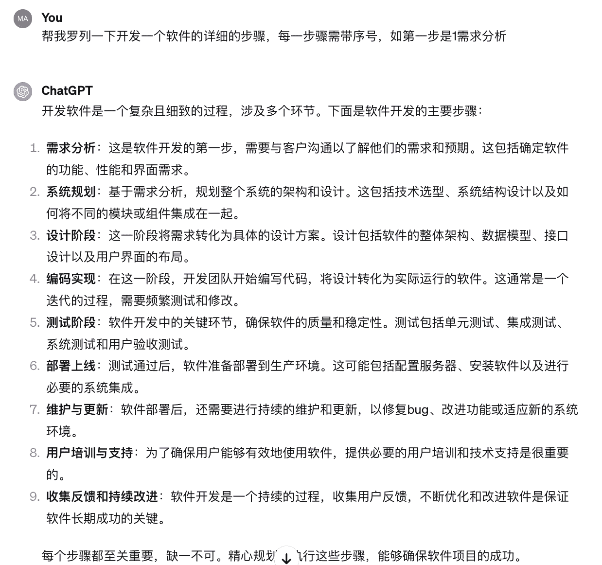

然后，我们找出其中核心的几步，借助GPT来辅助我们设计开发。这里我们以登录模块为例，因为大家都知道，一个软件或者系统也是由一个个的功能模块实现的，把一个功能模块实现了，其他的模块只是实现的功能不同，实现思路也是大同小异，如果一次性实现一个大的系统，由于涉及的内容过多，反而会没有重点，不利于大家的理解。

这里我直接问GPT：

我现在要做一个登录模块，希望你从需求分析、数据库建模、接口文档、代码实现、单元测试这五个方面分别描述一个登录模块需要实现的内容

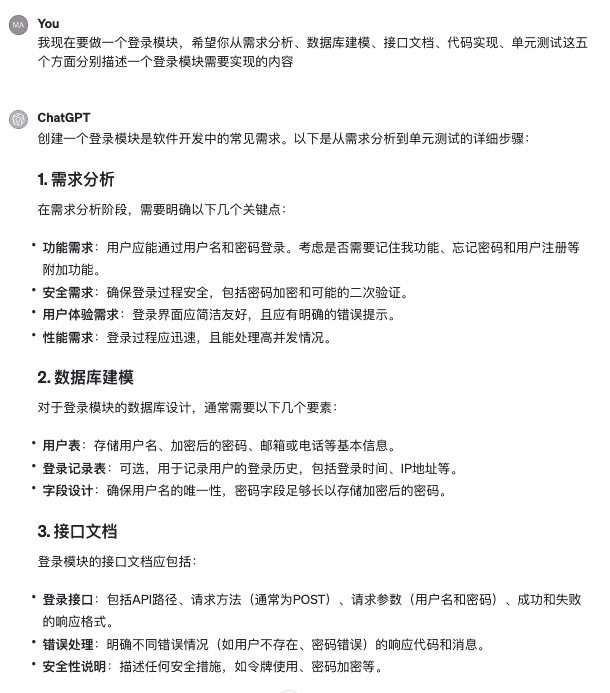

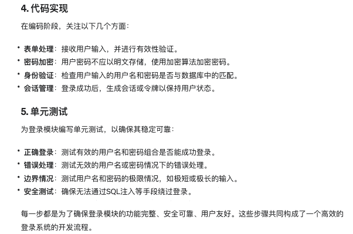

然后，针对每一部分单独提问，生成我们需要的内容

## 二.需求分析

针对以上内容中的需求分析部分，帮我生成一个登录模块的PRD，包括概述、用户使用流程、相关页面、功能详细描述、流程图、类图等。

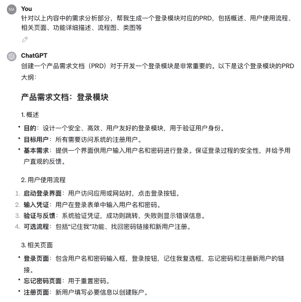

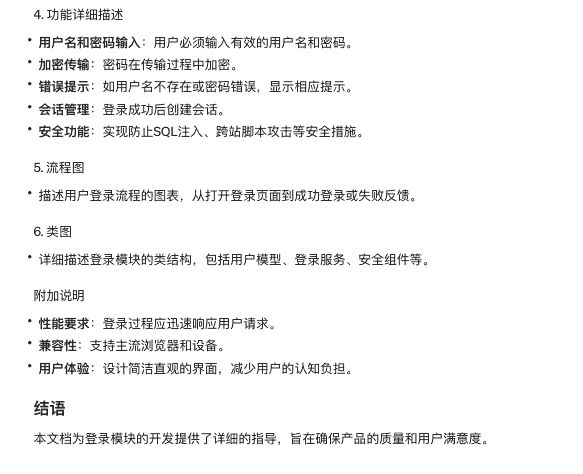

## 三.数据库建模

针对上述内容中的数据库建模部分，我希望你针对登录模块的功能，按照业内数据库建模规范和最佳实践给我写一份数据库建模表格文档，包含表名、列名、数据类型、约束条件、描述、枚举值（用数字代替），ID不是自增，使用雪花ID算法生成，标准字段：create_time、update_time、deleted，我的数据库是MySQL8，相关的字段comment注释、表comment注释、需要建立索引的也需要加上，建表语句和索引语句也请告诉我。

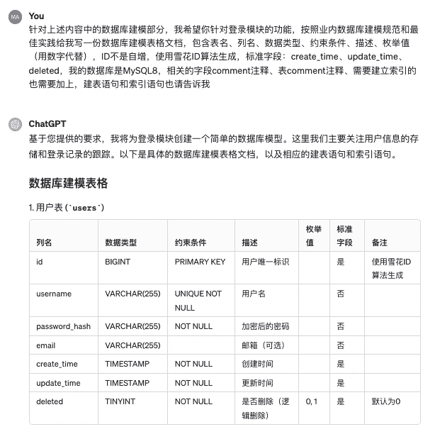

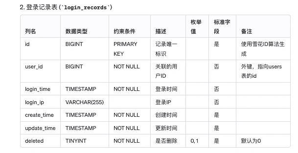

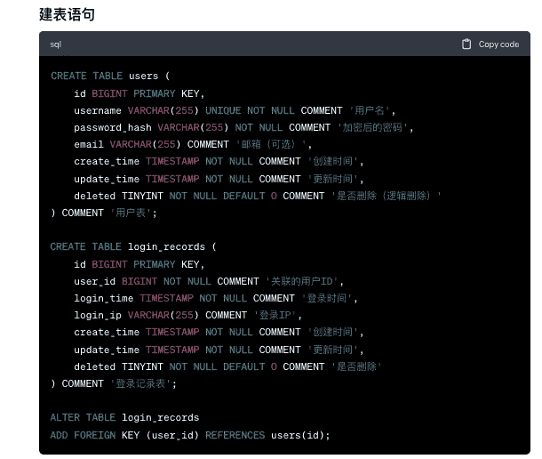

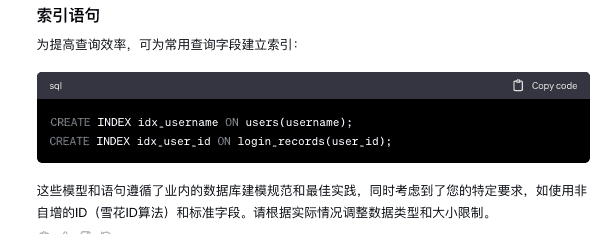

## 四.生成接口文档

接口文档记录了API的用法和限制，确保客户端和服务器端正确地交互，提高代码重用性和可维护性。

按照前面生成的表结构来分析，如果需要你设计一份标准的登录模块的基于RESTful接口文档，每一个接口都需要

进行分析和论证必要性和设计合理性，请列出所需的接口。要求：返回OpenAPI规范JSON格式，描述信息需要中文

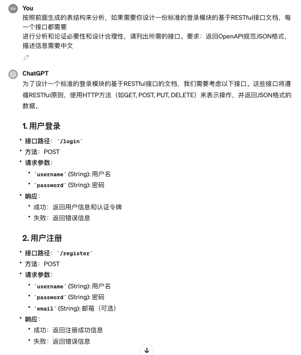

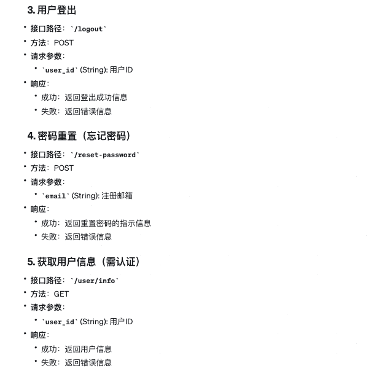

```
以下是这些接口的OpenAPI规范JSON格式的一个示例概要：
{
  &quot;openapi&quot;: &quot;3.0.0&quot;,
  &quot;info&quot;: {
    &quot;title&quot;: &quot;登录模块API&quot;,
    &quot;description&quot;: &quot;为登录模块提供的RESTful API接口。&quot;,
    &quot;version&quot;: &quot;1.0.0&quot;
  },
  &quot;paths&quot;: {
    &quot;/login&quot;: {
      &quot;post&quot;: {
        &quot;summary&quot;: &quot;用户登录&quot;,
        &quot;description&quot;: &quot;用户使用用户名和密码进行登录。&quot;,
        &quot;requestBody&quot;: {
          &quot;required&quot;: true,
          &quot;content&quot;: {
            &quot;application/json&quot;: {
              &quot;schema&quot;: {
                &quot;type&quot;: &quot;object&quot;,
                &quot;properties&quot;: {
                  &quot;username&quot;: {
                    &quot;type&quot;: &quot;string&quot;
                  },
                  &quot;password&quot;: {
                    &quot;type&quot;: &quot;string&quot;
                  }
                }
              }
            }
          }
        },
        &quot;responses&quot;: {
          &quot;200&quot;: {
            &quot;description&quot;: &quot;登录成功&quot;
          },
          &quot;401&quot;: {
            &quot;description&quot;: &quot;认证失败&quot;
          }
        }
      }
    },
    &quot;/register&quot;: {
      &quot;post&quot;: {
        &quot;summary&quot;: &quot;用户注册&quot;,
        &quot;description&quot;: &quot;新用户注册。&quot;,
        &quot;requestBody&quot;: {
          &quot;required&quot;: true,
          &quot;content&quot;: {
            &quot;application/json&quot;: {
              &quot;schema&quot;: {
                &quot;type&quot;: &quot;object&quot;,
                &quot;properties&quot;: {
                  &quot;username&quot;: {
                    &quot;type&quot;: &quot;string&quot;
                  },
                  &quot;password&quot;: {
                    &quot;type&quot;: &quot;string&quot;
                  },
                  &quot;email&quot;: {
                    &quot;type&quot;: &quot;string&quot;
                  }
                }
              }
            }
          }
        },
        &quot;responses&quot;: {
          &quot;200&quot;: {
            &quot;description&quot;: &quot;注册成功&quot;
          },
          &quot;400&quot;: {
            &quot;description&quot;: &quot;请求参数错误&quot;
          }
        }
      }
    },
    // 其他接口的定义类似
  }
}
```

## 五.完成后端服务

接下来我们就进入开发环节，我希望的技术栈是使用PHP的laravel框架进行开发，你可以一步一步教我如何搭建一个项目吗？请帮我实现上述中的用户登录接口

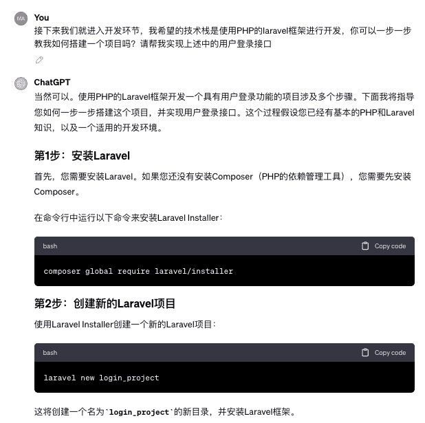

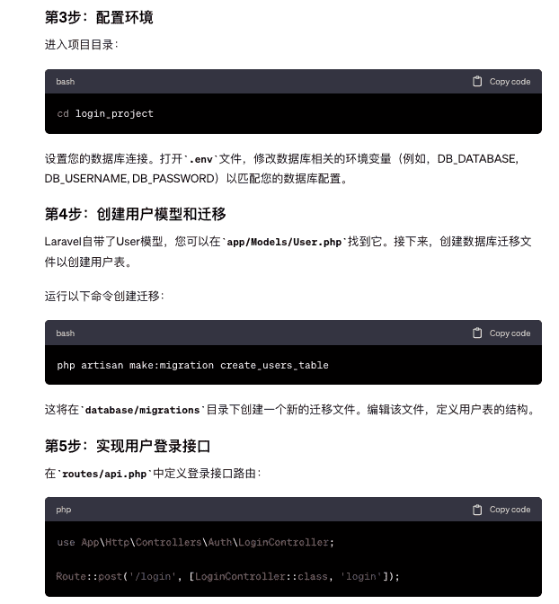

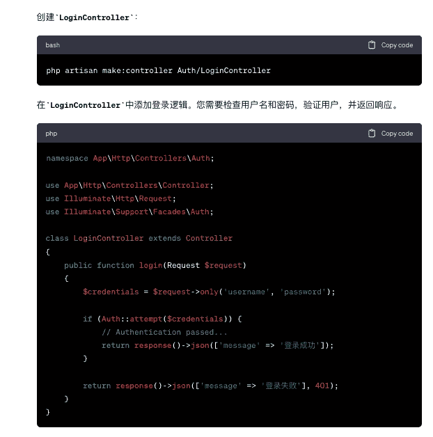

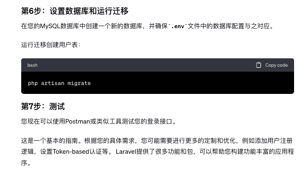

## 六.单元测试

做过开发的朋友都知道，其实单元测试是非常耗费时间的一个环节。有时候开发一个功能可能1小时就能完成，但写单元测试可能会远超开发时间，现在有了GPT，单元测试就so easy了！

针对上述的login方法，帮我写一个单元测试用例，要求：核心代码需要加上适当的中文注释。

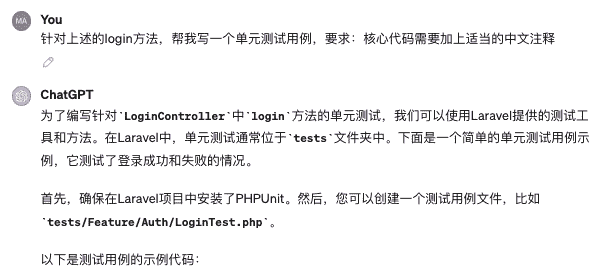

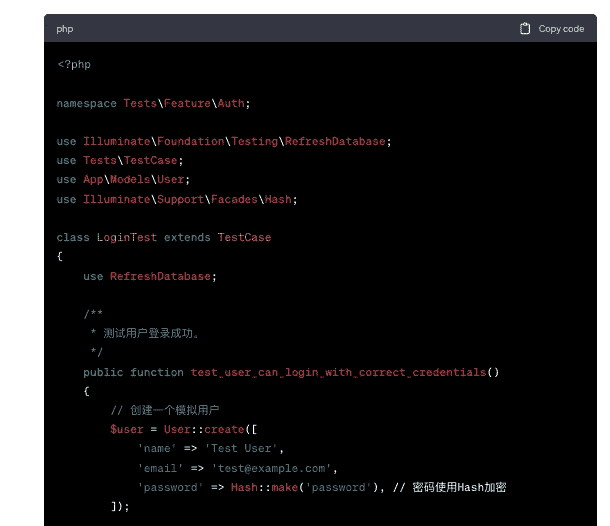

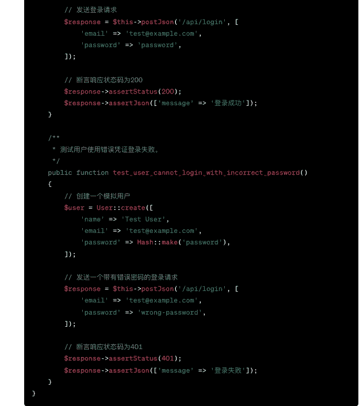

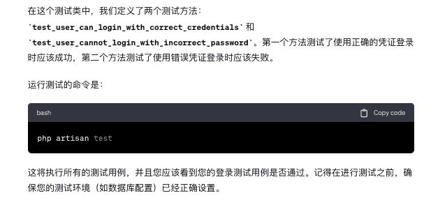

更多内容可以点击目录： [手册内容汇总](https://aiyanxishe.feishu.cn/wiki/LBXcwPv6UiZgdfkp14Xc1Wo1n3b)

✨ 如果觉得有收获，请点一点下方的“有启发” ✨

🌱 我也会及时优化迭代内容，给大家更好的阅读体验 🌱

<https://aiyanxishe.feishu.cn/sync/IaSadpoOOsopKab1ajKcz6z3nAb>