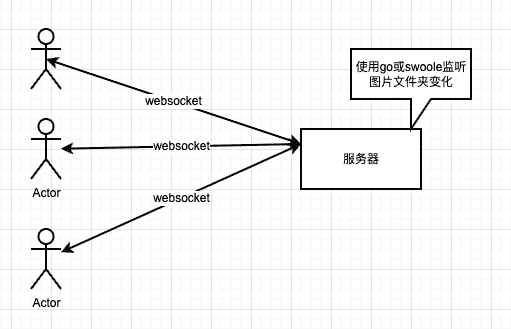
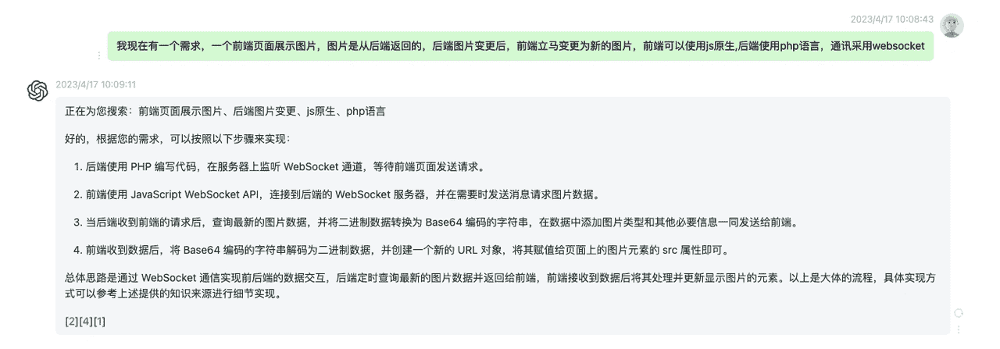
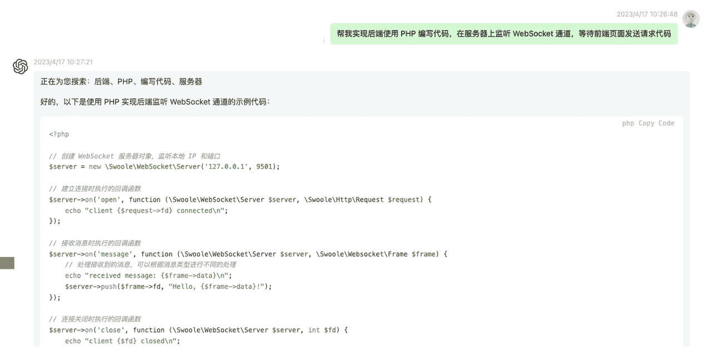
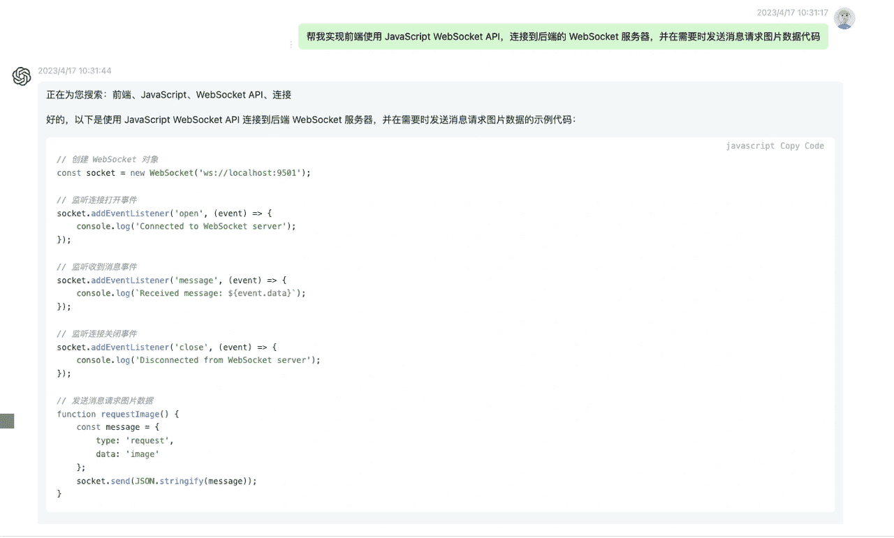
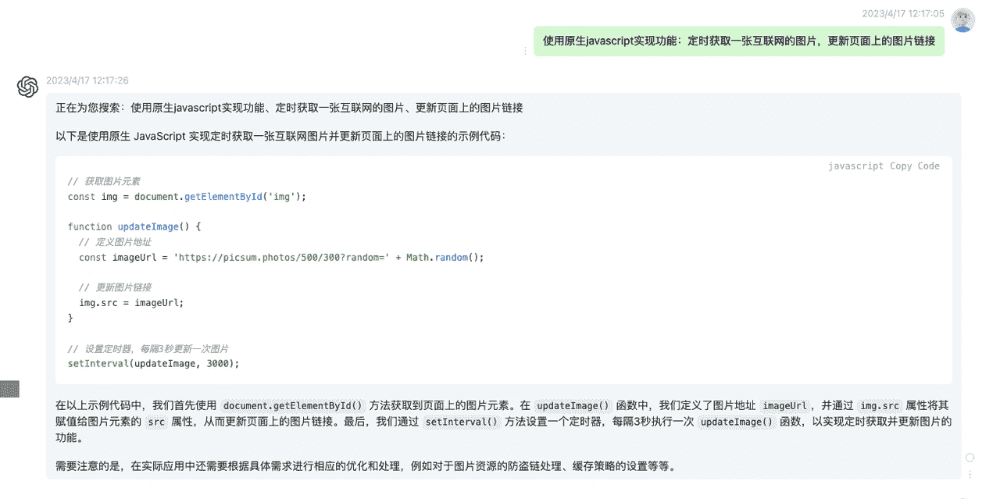
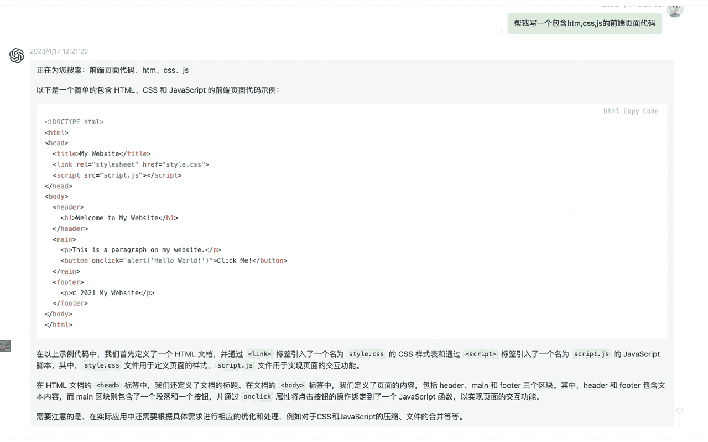
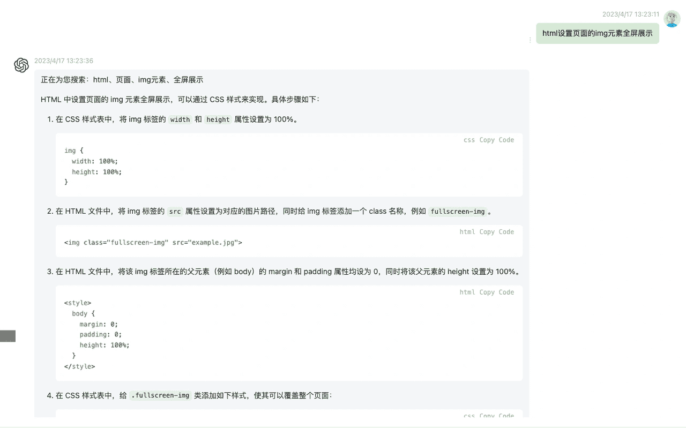
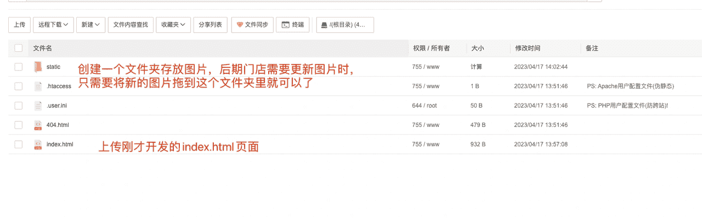
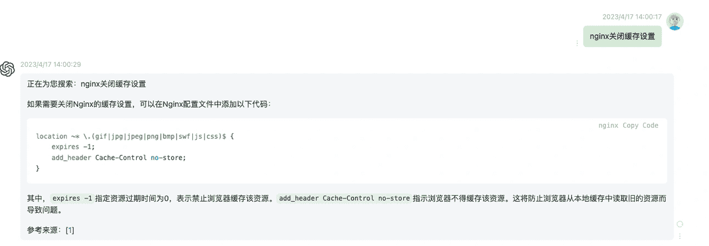
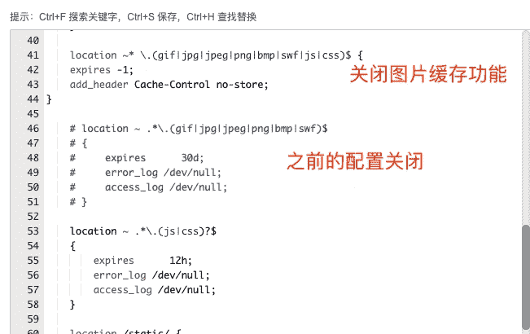

# 借助GPT30分钟为2500家连锁店做了一套系统

> 来源：[https://aiyanxishe.feishu.cn/docx/M9npd1RCzocE1YxHAMbcp3pHn5e](https://aiyanxishe.feishu.cn/docx/M9npd1RCzocE1YxHAMbcp3pHn5e)

## 程序员AI破局简介

> [《程序员AI破局指南》](https://t.zsxq.com/19EOflzkQ)由字节、百度、阿里等互联网大厂的AI业务相关高管共创，分享开箱即用、面向市场的AI编程知识和工具。

> 指南包括六个专栏:**AI编程实战、AI编程工具、AI高效办公、A**I副业赚钱、AI提示词工程、AI私人助手

> [程序员AI破局指南](https://t.zsxq.com/19EOflzkQ) 原价 599 元，限时特惠 199 元/年，5月1日恢复原价。

> 加入我们：https://t.zsxq.com/19EOflzkQ

> 购买后，添加群主微信加入 AI研习社陪伴社群，限时领取超值福利。

今天接到一个连锁店朋友的需求，需求是这样的：门店里有一个电子屏设备，用来给客户展示门店售卖的产品，总部希望能控制屏幕上展示的商品，不然每个店里自己独立替换一方面很耗精力，另外总部也不好把控是否有没替换的门店。所以，他想在电子屏设备上安装一个浏览器，浏览器上展示一副图片，当总部服务器的图片库已更新，对应的终端设备上浏览器的图片也同步更新。

其实这个需求本质上是非常简单的，我当时理解的是要做成下图这样：

一个客户端，一个服务端，两端需要像微信那样双向通信，服务器监听一个文件中图片的变化，当上传新图片时，会触发相应的事件并发送到监听器中，读取图片，进行编码，通过websocket传到客户端，客户端进行解码，解出图片，展示到图片标签上。思路很清晰，不过我评估了一下，如果后端用php的swoole框架或者go语言写，怎么也要一天的时间，而我最近确实没这个时间。就在我左右为难时，突然想到了我的AI小助理:ChatGPT（以下简称C老师）。对呀，这么明确的需求，交给他是再合适不过了，于是乎就答应了下来，答应这周五给他，其实我从开始做到服务器部署好，也就半小时，真正让C老师帮我生成代码的时间也就10分钟。



由于我一开始对这个问题理解的误区， 我先基于上面的方案让C老师给我相应的实现代码

# **Round1:**

**我先提问：**

我现在有一个需求，一个前端页面展示图片，图片是从后端返回的，后端图片变更后，前端立马变更为新的图片，前端可以使用js原生,后端使用php语言，通讯采用websocket

**C老师给了我四个步骤：**

1.  后端使用 PHP 编写代码，在服务器上监听 WebSocket 通道，等待前端页面发送请求。

1.  前端使用 JavaScript WebSocket API，连接到后端的 WebSocket 服务器，并在需要时发送消息请求图片数据。

1.  当后端收到前端的请求后，查询最新的图片数据，并将二进制数据转换为 Base64 编码的字符串，在数据中添加图片类型和其他必要信息一同发送给前端。

1.  前端收到数据后，将 Base64 编码的字符串解码为二进制数据，并创建一个新的 URL 对象，将其赋值给页面上的图片元素的 src 属性即可。

PS:跟我之前的思路是一致的，那就按照他的步骤一步步实现就行了



# **Round2:**

我让C老师先帮我实现他给我建议的第一步：生成后端的代码

C老师也给我生成了对应的代码，这里由于篇幅限制，就不贴代码了。



使用php的swoole框架生成的代码

# **Round3:**

我让C老师先帮我实现他给我建议的第二步：生成前端代码



这是gpt生成的客户端使用websocket请求服务器的方法

其实后面还有很多轮交互（篇幅原因，就不贴了），都是基于我一开始的方案实现的，基本上基于以上思路的代码都实现了。不过做了一会以后，我突然灵魂出窍了，不对，是开窍了，有必要搞的这么麻烦吗？这样服务器也要装一堆的服务。

**这个不就是前端浏览器每隔一个固定的时间去请求一下服务器上放的静态图片，不管图片有没**有更新，都重新返回服务器的图片，对啊，就是浏览器定时轮训去请求服务器，仅此而已。

好吧，现在需求的难度降到了0，不过让我自己写，没个两小时也搞不定，毕竟代码量在哪放着呢？肿么办，交给C老师继续吧，后面的就比较顺利了，不过也遇到了一点小坑。

# **RoundN+1:**

**我问C老师：**

请使用原生javascript实现功能：定时获取一张互联网的图片，更新页面上的图片链接

PS:截图里有C老师给我生成的代码，其实做前端的朋友能看出这段代码是有点问题的，updateImage函数引用了外部的img变量，这里由于变量的作用域问题其实是获取不到img标签的，也就没办法给这个标签绑定图片地址，最终，运行页面时看到的就是不展示图片。



这段代码其实有一点问题

# **RoundN+2：**

我问：页面、样式我也懒得写，让C老师继续帮我生成页面代码



让C老师帮我生成,设置图片全屏展示的样式：



最终，我把C老师给我的前端代码进行了一下合并，简单删减了两行代码，运行了一下，没展示问题，后来排查到就是上面提到的变量局部作用域的问题，所以，要用好C老师，还是需要多多少少懂一点点代码的。

然后从百度上下载了一张图片，放上去试了一下，可以展示，附上最终的前端代码和效果图：

中间就是那个定时器，每隔30秒请求一次服务器，当服务器上有新的图片，就会替换到浏览器上的图片。

```


    
   
   
           
              
                
              
                      
 
```


浏览器呈现的效果图

至此，浏览器端搞定了，服务器上使用Nginx新建一个server,然后替换一下index.html首页，创建static文件夹存放图片，纯静态的一个服务器就搭建好了，真香！

需要门店更新图片时，需要更新一下static文件夹中的图片，期待30S后门店客户端中的图片自动更新。



结果客户端浏览器的图片没有更新，一想应该是Nginx开启了缓存配置,改一下配置，强制浏览器每次刷新都重新从服务器获取新图片

这里问C老师如何关闭Nginx缓存功能



然后替换Nginx的配置文件，重启Nginx使其生效



**后记：**

其实这个地方还可以做很多优化，比如前端做成轮播图的效果，后端可以上传多种图片。这种定时请求对服务器其实还是有一定压力的，不过因为毕竟请求的终端不多，最多也就2000台设备，而且是30S一次，所以这块服务器肯定是没问题的，就没有进一步优化了。

中途其实是遇到了一点小小的困难的，不过还好，很快解决了，如果顺利的话，10分钟时间足够交付上面的小项目，所以C老师真的是我的良师益友，遇事不决，先问C老师！

更多内容可以点击目录： [手册内容汇总](https://aiyanxishe.feishu.cn/wiki/LBXcwPv6UiZgdfkp14Xc1Wo1n3b)

✨ 如果觉得有收获，请点一点下方的“有启发” ✨

🌱 我也会及时优化迭代内容，给大家更好的阅读体验 🌱

<https://aiyanxishe.feishu.cn/sync/IaSadpoOOsopKab1ajKcz6z3nAb>