# AI 时代更高效的阅读代码方式

> 来源：[https://aiyanxishe.feishu.cn/docx/ZsTJdwiy2oq27YxCwpbcy0W6njh](https://aiyanxishe.feishu.cn/docx/ZsTJdwiy2oq27YxCwpbcy0W6njh)

## 程序员AI破局简介

> [《程序员AI破局指南》](https://t.zsxq.com/19EOflzkQ)由字节、百度、阿里等互联网大厂的AI业务相关高管共创，分享开箱即用、面向市场的AI编程知识和工具。

> 指南包括六个专栏:**AI编程实战、AI编程工具、AI高效办公、A**I副业赚钱、AI提示词工程、AI私人助手

> [程序员AI破局指南](https://t.zsxq.com/19EOflzkQ) 原价 599 元，限时特惠 199 元/年，5月1日恢复原价。

> 加入我们：https://t.zsxq.com/19EOflzkQ

> 购买后，添加群主微信加入 AI研习社陪伴社群，限时领取超值福利。

前两天在知乎上看到一个问题：程序员读别人的代码是一种什么样的心理体验？

阅读别人的代码，难不了心态爆炸，一看代码太长又繁琐，看不下去了

传统的方法不仅耗时长，而且效率低下，这时我想到了使用 Al 来辅助这一过程，简直太高效了

读代码很枯燥，读图就很开心了，毕竟一图胜千言，从代码到图，整个过程分三步走

# **一、AI 解读代码**

AI 解读代码实际上是利用了 AI 的总结能力，也就是生成代码注释，目前有很多代码辅助相关的大模型都实现了这个功能

比如 Baidu Comate 的底层模型：文心一言 4.0、清华开发的 CodeGeex 大模型、GitHub Copilot 的底层模型：OpenAI 的 CodeX

可能有的人会问，为什么不通过 GPT 直接生成注释呢？

GPT 是一个通用大模型，可以做很多事情，写文章、写代码、写小说等；如果只写代码，不如专有代码大模型，更加专一，只专注在代码领域，解读代码更准确，生成的代码注释更精准

这里介绍一个使用 Comate 解读代码的例子：

比如下面这段代码有 200 行，核心就是订单打包，比如 10 个订单聚类后生成 8 个包裹

聚类的细节太多，想着用 AI 提取并绘制流程图，更加直观，首先使用 AI 编程工具 Baidu Comate，解读这段代码

安装插件 Comate 后，在函数代码上方，找到代码解释菜单

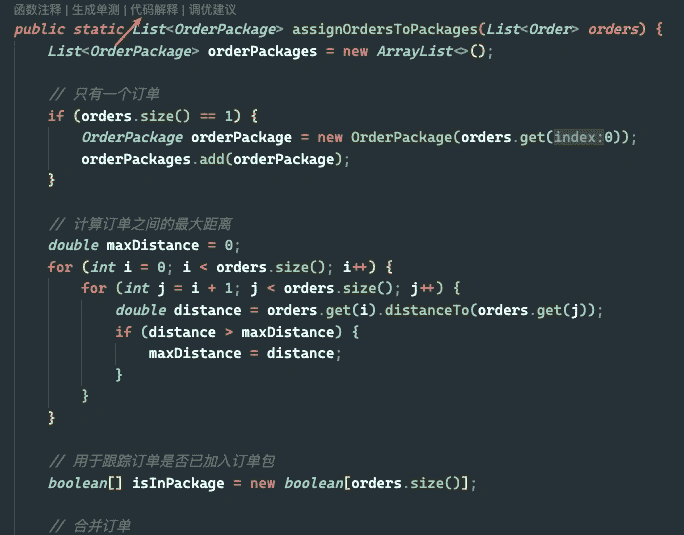

点击代码注释，将会打开百度 AI 助手聊天框，显示代码解释

# **二、AI 生成可视化代码**

不论是给领导汇报，还是写周报，如果你能将的文字或者代码可视化，给人的感觉就立马不一样了，所以学会可视化非常重要

代码可视化一般需要创建 UML 图，这样的工具有很多，从使用文本描述来生成 UML 图的角度，我选择的是 PlantUML

PlantUML 是一个强大的工具，用于快速创建多种类型的图表。这些图表广泛用于软件开发和文档编写中，以下是 PlantUML 支持的一些主要图表类型：

1、序列图（Sequence Diagram）：用于展示对象之间交互的时间序列，常用于展示系统内部组件或对象之间的消息传递。

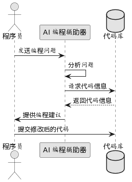

2、用例图（Use Case Diagram）：描述系统的功能和外部用户（参与者）之间的交互。

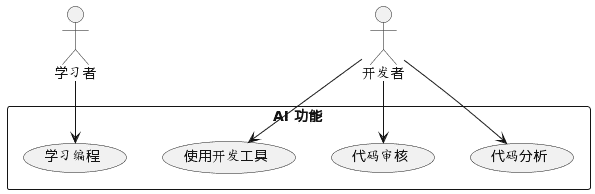

3、类图（Class Diagram）：展示系统中类的结构和类之间的关系，如继承、接口实现、依赖关系等。

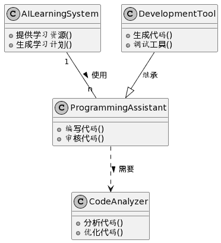

4、活动图（Activity Diagram）：类似于流程图，用于展示从一个活动到另一个活动的控制流。

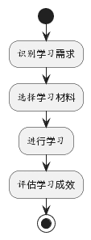

5、组件图（Component Diagram）：展示系统的组件如何组合在一起工作。

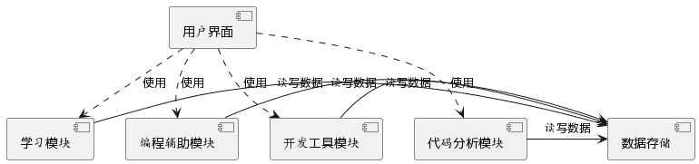

6、状态图（State Diagram）：展示一个对象在其生命周期内经历的状态以及状态间的转移。

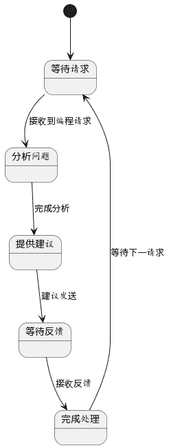

7、对象图（Object Diagram）：类图的一个实例，显示了系统中对象之间的关系。

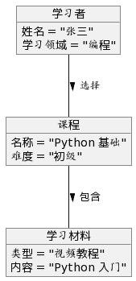

8、包图（Package Diagram）：展示代码的包结构，有助于理解代码的模块化组织。

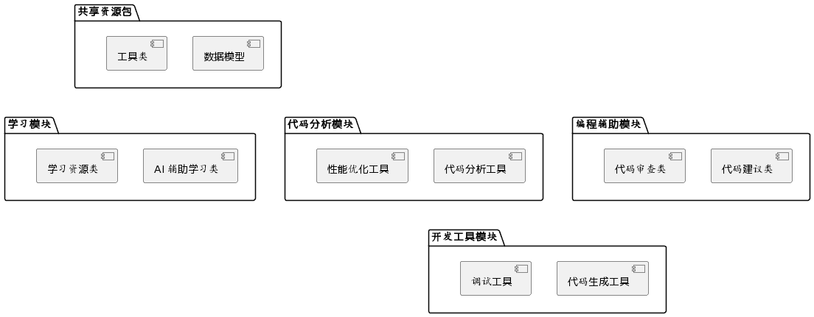

9、组织结构图（Wireframe Graphic Interface）：用于描述图形组织结构组成

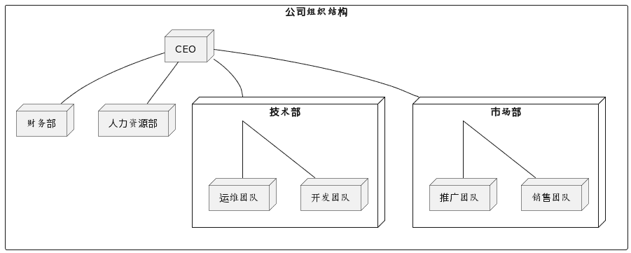

10、甘特图（Gantt Diagram）：用于项目管理中，展示项目的时间线和进度。

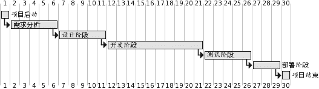

不知道大家发现没有，好像没看到流程图，其实 PlantUML 中的活动图就是流程图，左边是代码语法，右边是可视化图形

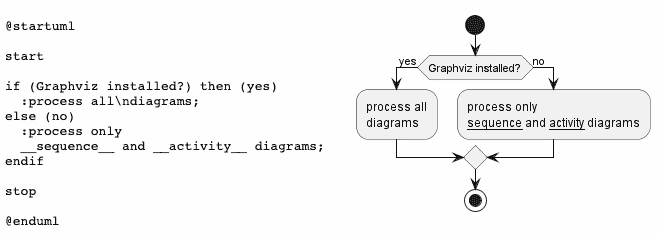

将步骤一种拿到的代码注释，询问 ChatGPT：请基于下面这段代码注释，生成 PlantUML 活动图代码

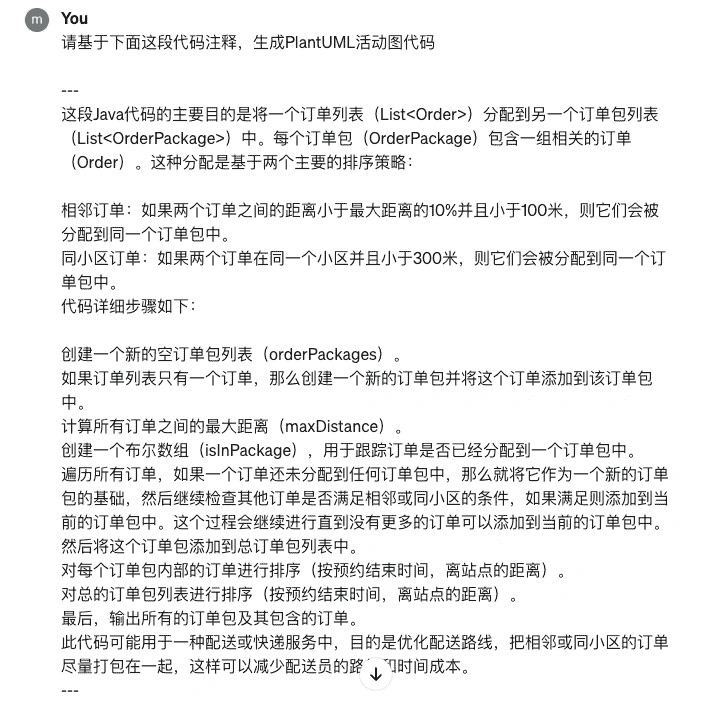

# **三、流程图可视化**

将步骤二中生成的流程图代码，复制到 plantuml 可视化网站 网址：

http://www.plantuml.com/plantuml

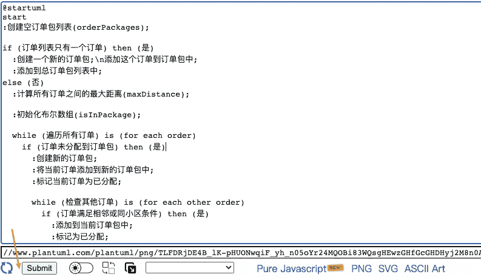

点击 Submit 按钮，就可以获取到图片了

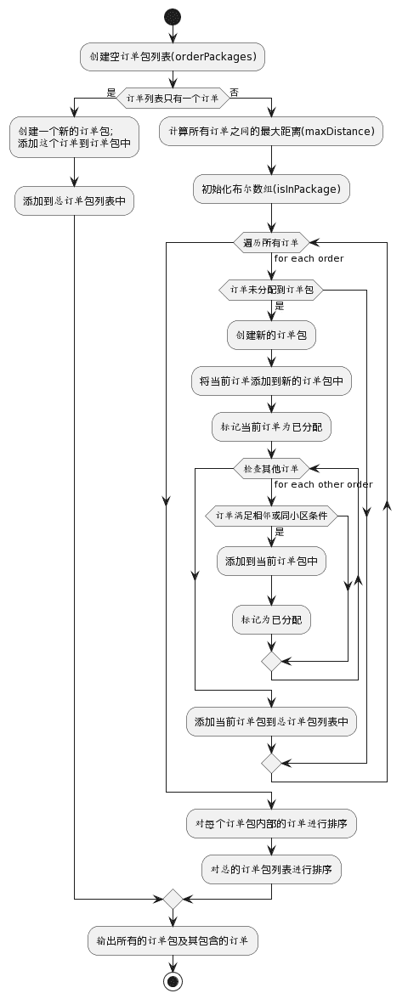

看流程图就大概知道这段代码的含义了，AI 解读代码可视化图，真的很方便

# **四、总结**

以上通过代码 -> 注释 -> 绘制流程图的方法，就得到了想要的效果，相比传统方式阅读完代码自己手动绘制图形，确实效率高了很多

最后分享一个小技巧：代码的可视化呈现方式有很多种，为什么必须是流程图，而不是其它类型的图，可以问 AI 这段代码生成什么图比较好，选择最优呈现方式可视化

比如基于上面的代码，我也可以生成类图

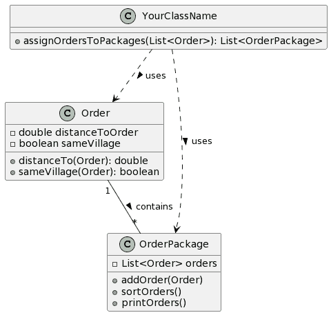

像这样的图，我生成了很多，比如我主要是写 Go 的，我写了很多文章，然后用 AI 进行了可视化

比如 Go 可重入锁，一张图解释通俗易懂

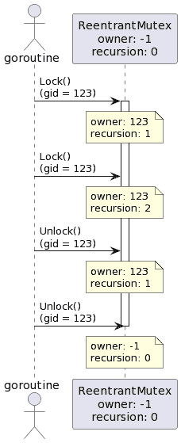

比如 Go 内存管理，一张图诠释内存分布组件

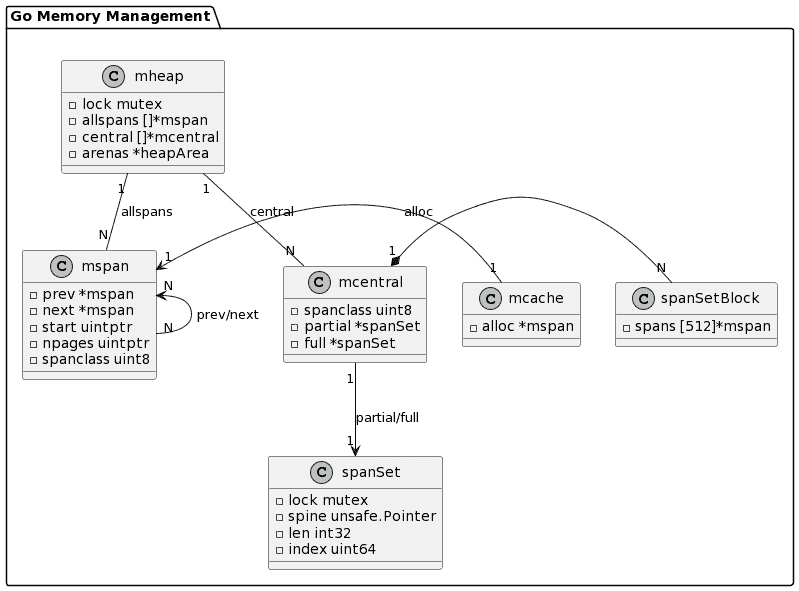

比如 go.sum 文件，一张图描述内部结构

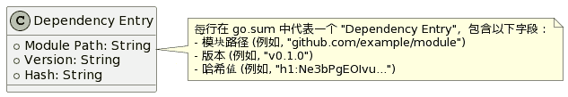

上面的图都是使用 AI 生成的，AI 可以让不懂编程的人，完成一个工具或者插件的开发，大大降低了软件开发的成本

AI 可以让懂编程的人，更高效地完成日常工作，更快地完成应用开发，大大提高了工作和学习效率

我一直秉承一个观点：如果你不会写作，你也不会 AI 写作；如果你不会编程，你也不会 AI 编程。

如果想通过 AI 生成代码流程图，首先你得知道，什么是代码流程图，有哪些方式可以可视化，然后利用 AI 加速这个过程。

本文来源于好朋友木川大佬，木川公众号【木川AI编程】，欢迎关注！

更多内容可以点击目录： [手册内容汇总](https://aiyanxishe.feishu.cn/wiki/LBXcwPv6UiZgdfkp14Xc1Wo1n3b)

✨ 如果觉得有收获，请点一点下方的“有启发” ✨

🌱 我也会及时优化迭代内容，给大家更好的阅读体验 🌱

<https://aiyanxishe.feishu.cn/sync/IaSadpoOOsopKab1ajKcz6z3nAb>