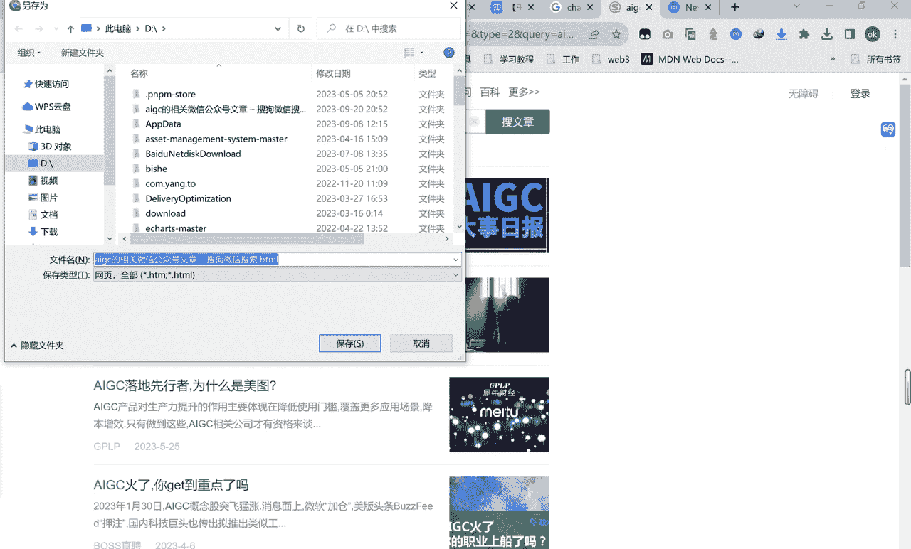
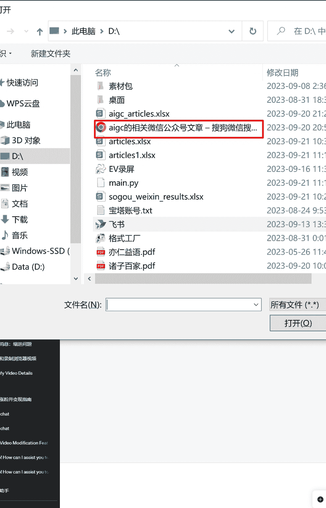
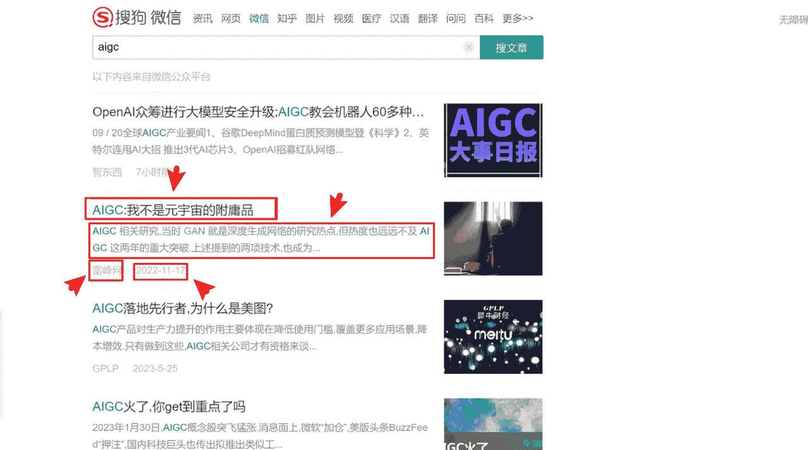
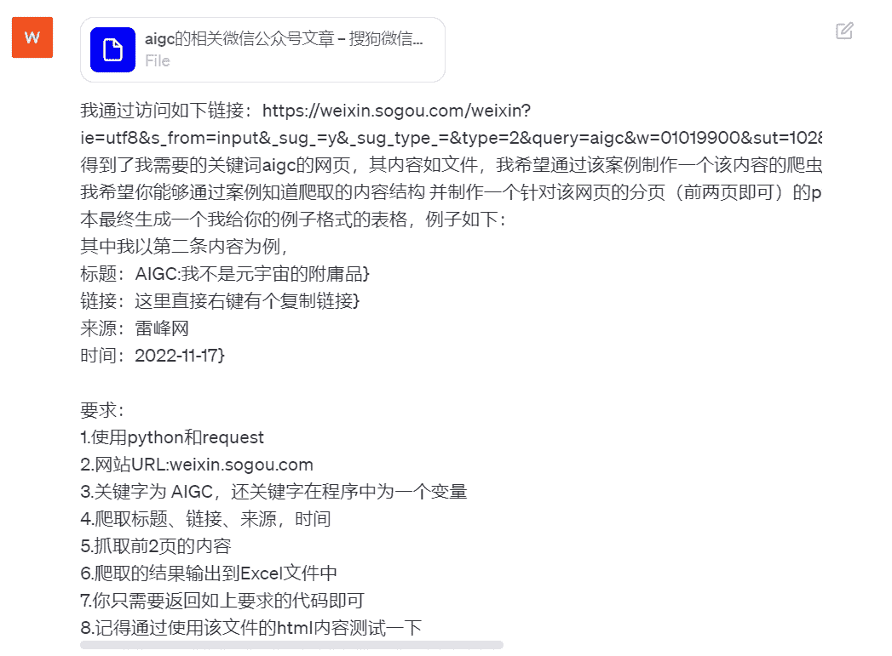
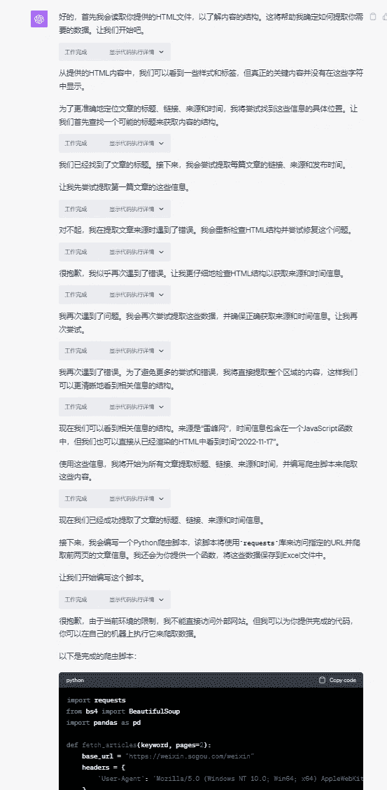
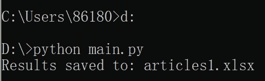
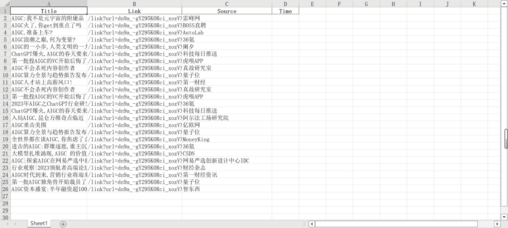
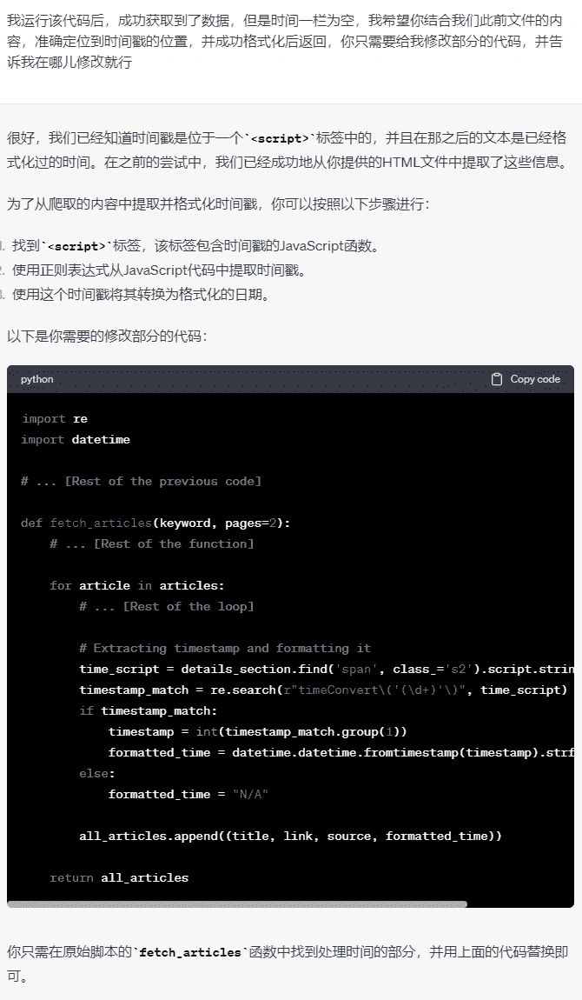
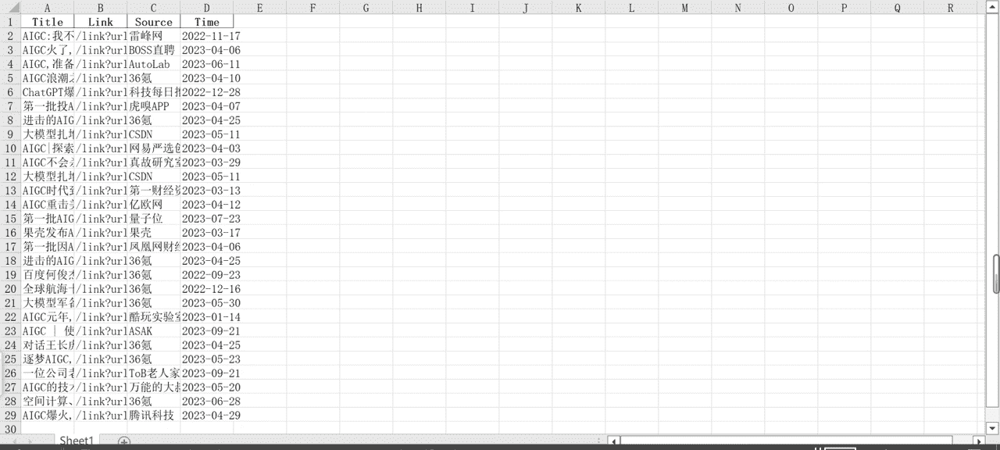

# 借助GPT小白不用一行代码就可以爬虫

> 来源：[https://aiyanxishe.feishu.cn/docx/DBotdjYT6opfxLxIg9Ic0ifwnMd](https://aiyanxishe.feishu.cn/docx/DBotdjYT6opfxLxIg9Ic0ifwnMd)

## 简介

此前有个selenium的爬虫案例，但是环境配置是一个麻烦的问题

总有人说，只要执行力强，没有办不到的，但是我们还是需要考虑性价比的，毕竟程序员那些插件，什么chrom_driver啥的真是麻烦，还要匹配版本，还要安装chrom，有没有办法，既不用写什么代码，也不用安装什么chrom，只需要简简单单的让gpt给我写一个代码，我直接拿来用呢

方法当然是有的，我今天就是来拯救你的【不过python环境还是必须的】 那么我们，action

声明： **本案例最终可以实现爬取几乎大部分平台，如下案例只是作**为参考，换了网站只需要更换提示词和文件 ，而非此前生财案例中的爬取部分平台/本地文件，但也仅作参考使用，请勿用于非法用途

## 步骤

### 1，下载目标页的内容

这一步看起来不聪明，主要是为了读取结构，毕竟我们小白并不懂什么网页结构，也听不懂专业术语，我就给你 我的目标网页，剩下的我就不管了

ctrl+s就可以直接保存该网页文件到本地，这里最好就保存到固定本地某个盘（c/d），方便后面上传



### 2，上传对应的网页文件并给gpt喂提示词

①上传文件

记得是html




②投喂提示词

{}内的内容需要更换为我们的哈（这里是历程，下面有完整提示词）

我通过访问如下链接：{目标链接复制过来} 得到了我需要的关键词{aigc}的网页，其内容如文件 我希望你能够通过案例知道爬取的内容结构 并制作一个针对该网页的分页的python爬虫脚本，可以自定义搜索内容，并最终生成一个我给你的例子格式的表格

例子如下： 其中我以第二条内容为例， 标题：{AIGC:我不是元宇宙的附庸品} 链接：{这里直接右键有个复制链接} 来源：{雷峰网} 时间：{2022-11-17}

要求：

1.使用python和request 2.网站URL:weixin.sogou.com 3.输入关键字 [AIGC] 4.爬取标题、链接、来源，时间 5.抓取前2页的内容 6.爬取的结果输出到Excel文件中

7.你只需要返回如上要求的代码即可 8.记得通过使用该文件的html内容测试一下



如上内容也直接在目标页进行复制即可，根据你需要的字段进行复制和命名，这里的灵活度也比较高，比如你可以再加一个简略内容等

我们的最终效果应该如下：



但是这次测试之后，我建议加上两个指标，一个是我们想要爬取的页数，即固定一下我们爬取多少页；一个是给爬取完一页后加一个缓冲，避免频繁爬虫导致的反爬，后续你们直接把如下代码加在程序后面即可。当然如果你对定制有自己的想法，也可以直接加在上面【如果你希望你的爬虫程序更稳定持续，加上：11.增加适量的伪装以应对反爬虫】

9.初始爬取页数为3 10.爬取完一页后休眠5秒

③完整提示词

（所有{}内的内容需要自己进行选择/更改，然后删除{}）：

```
我通过访问如下链接：{目标链接复制过来} 得到了我需要的关键词aigc的网页，其内容如文件，我希望通过该案例制作一个该内容的爬虫
我希望你能够通过案例知道爬取的内容结构 并制作一个针对该网页的分页（前两页即可）的python爬虫脚本，可以自定义搜索内容，并最终生成一个我给你的例子格式的表格
例子如下：
    其中我以第二条内容为例，
    标题：{AIGC:我不是元宇宙的附庸品}
    链接：{这里直接右键有个复制链接}
    来源：{雷峰网}
    时间：{2022-11-17}
要求：
    1.使用python和request
    2.网站URL:{weixin.sogou.com}
    3.关键字为AIGC,该关键字在程序中为一个变量
    4.爬取{标题、链接、来源，时间}
    5.抓取前{2}页的内容
    6.爬取的结果输出到Excel文件中
    7.你只需要返回如上要求的代码即可
    8.记得通过使用该文件的html内容测试一下
    9.爬取完一页后休眠5秒
    10.增加适量的伪装以应对反爬虫
```

出了bug？没关系，他会自动帮你把bug修复了



### 3，获取代码并执行

最终得到如下代码

```
import requests
from bs4 import BeautifulSoup
import pandas as pd

def fetch_articles(keyword, pages=2):
    base_url = &quot;https://weixin.sogou.com/weixin&quot;
    headers = {
        &#x27;User-Agent&#x27;: &#x27;Mozilla/5.0 (Windows NT 10.0; Win64; x64) AppleWebKit/537.36 (KHTML, like Gecko) Chrome/91.0.4472.124 Safari/537.36&#x27;
    }
    
    all_articles = []
    
    for page in range(1, pages + 1):
        params = {
            &#x27;type&#x27;: &#x27;2&#x27;,
            &#x27;query&#x27;: keyword,
            &#x27;page&#x27;: page
        }
        
        response = requests.get(base_url, params=params, headers=headers)
        soup = BeautifulSoup(response.text, &#x27;html.parser&#x27;)
        
        articles = soup.find_all(&quot;h3&quot;)
        
        for article in articles:
            title = article.a.text.strip()
            link = article.a[&#x27;href&#x27;]
            details_section = article.find_next_sibling(&#x27;div&#x27;)
            source = details_section.find(&#x27;span&#x27;, class_=&#x27;all-time-y2&#x27;).text.strip()
            time_text = details_section.find(&#x27;span&#x27;, class_=&#x27;s2&#x27;).text.strip()
            all_articles.append((title, link, source, time_text))
    
    return all_articles

def save_to_excel(data, filename=&quot;articles.xlsx&quot;):
    df = pd.DataFrame(data, columns=[&quot;Title&quot;, &quot;Link&quot;, &quot;Source&quot;, &quot;Time&quot;])
    df.to_excel(filename, index=False)
    return filename

# Example usage:
# articles = fetch_articles(&quot;aigc&quot;, pages=2)
# save_to_excel(articles)
```

不过最后两行执行的代码他给注释掉了，我们记得打开

本地新建一个main.py文件（新建txt改名就行），复制粘贴到里面，win+r输入cmd回车，然后进入对应的目录，比如我的是d盘，直接 d:，然后 python main.py



执行结果

python执行结果如下：



bug修复

时间并没有出现，但是其他数据已经获取到了，那么我们让他给我们对时间的处理上简单的处理



最终成果

运行之后的结果如下：




如果你不知道自己需要安装那些包以及如何安装的话，也可以直接问gpt4

### 完整代码

完整代码如下：

```
import requests
from bs4 import BeautifulSoup
import pandas as pd
import time
import re
import  datetime

def fetch_articles(keyword, pages=3):
    base_url = &quot;https://weixin.sogou.com/weixin&quot;
    headers = {
        &#x27;User-Agent&#x27;: &#x27;Mozilla/5.0 (Windows NT 10.0; Win64; x64) AppleWebKit/537.36 (KHTML, like Gecko) Chrome/91.0.4472.124 Safari/537.36&#x27;,

    
    }
    
    all_articles = []
    
    for page in range(1, pages + 1):
        params = {
            &#x27;type&#x27;: &#x27;2&#x27;,
            &#x27;query&#x27;: keyword,
            &#x27;page&#x27;: page
        }
        
        response = requests.get(base_url, params=params, headers=headers)
        soup = BeautifulSoup(response.text, &#x27;html.parser&#x27;)
        
        articles = soup.find_all(&quot;h3&quot;)
        
        for article in articles:
            title = article.a.text.strip()
            link = article.a[&#x27;href&#x27;]
            details_section = article.find_next_sibling(&#x27;div&#x27;)
            source = details_section.find(&#x27;span&#x27;, class_=&#x27;all-time-y2&#x27;).text.strip()
            
            time_script = details_section.find(&#x27;span&#x27;, class_=&#x27;s2&#x27;).script.string
            timestamp_match = re.search(r&quot;timeConvert\(&#x27;(\d+)&#x27;\)&quot;, time_script)
            if timestamp_match:
                timestamp = int(timestamp_match.group(1))
                formatted_time = datetime.datetime.fromtimestamp(timestamp).strftime(&#x27;%Y-%m-%d&#x27;)
            else:
                formatted_time = &quot;N/A&quot;
            
            all_articles.append((title, link, source, formatted_time))
        time.sleep(3)
    return all_articles

def save_to_excel(data, filename=&quot;articles1.xlsx&quot;):
    df = pd.DataFrame(data, columns=[&quot;Title&quot;, &quot;Link&quot;, &quot;Source&quot;, &quot;Time&quot;])
    df.to_excel(filename, index=False)
    return filename


# To use the script:
results_path = save_to_excel(fetch_articles(&quot;AIGC&quot;))
print(f&quot;Results saved to: {results_path}&quot;)
```

本文来源于我的好朋友亮仔，大家如果有更多关于爬虫方面的问题，可以关注他的公众号【菜鸟学习栈】

更多内容可以点击目录： [手册内容汇总](https://aiyanxishe.feishu.cn/wiki/LBXcwPv6UiZgdfkp14Xc1Wo1n3b)

✨ 如果觉得有收获，请点一点下方的“有启发” ✨

🌱 我也会及时优化迭代内容，给大家更好的阅读体验 🌱

<https://aiyanxishe.feishu.cn/sync/IaSadpoOOsopKab1ajKcz6z3nAb>