# 使用 ChatGPT 辅助开发自动生成文章目录的工具

> 来源：[https://aiyanxishe.feishu.cn/docx/RqCTdEIoLocVTtxbQNXcvw7Dnoc](https://aiyanxishe.feishu.cn/docx/RqCTdEIoLocVTtxbQNXcvw7Dnoc)

## 程序员AI破局简介

> [《程序员AI破局指南》](https://t.zsxq.com/19EOflzkQ)由字节、百度、阿里等互联网大厂的AI业务相关高管共创，分享开箱即用、面向市场的AI编程知识和工具。

> 指南包括六个专栏:**AI编程实战、AI编程工具、AI高效办公、A**I副业赚钱、AI提示词工程、AI私人助手

> [程序员AI破局指南](https://t.zsxq.com/19EOflzkQ) 原价 599 元，限时特惠 199 元/年，5月1日恢复原价。

> 加入我们：https://t.zsxq.com/19EOflzkQ

> 购买后，添加群主微信加入 AI研习社陪伴社群，限时领取超值福利。

很多人可能了解 AI 编程，但不知道究竟能做什么？

AI 可以让不懂编程的人，完成一个工具或者插件的开发，大大降低了软件开发的成本；AI 可以让懂编程的人，更高效地完成日常工作，更快地完成应用开发，大大提高了工作和学习效率

这次分享的主题是《零基础使用 AI 开发自动生成文章目录的工具》，解决一个痛点问题

不知道大家有没这样的问题？文章多了，为了方便检索，需要添加目录，但每次写完一篇文章，需要手动添加目录，还是挺麻烦的，属于重复性的动作，这个目录能不能自动生成呢？

于是，我想到了利用 AI 开发一个自动生成文章目录的工具

做一个工具，最重要的确定输入和输出，你不用关心 AI 是怎么做的？AI 根据你的输入和输出，自动帮你写出代码

所以使用 AI 辅助做一款工具，最主要的 2 点：

1、写好提示词（主要是输入和输出）

2、运行代码（主要是安装运行环境）

本文将从 0 到 1，带你实现一个 自动生成文章目录的工具

# **一、如何提问**

写好的提示词的前提是懂得如何提问，然后设计出自己的提示词，最后根据输出结果进行迭代优化

当你不清楚该怎么提问时，可以直接向 AI 请教

## **一）提示词**

## **二）GPT 回复**

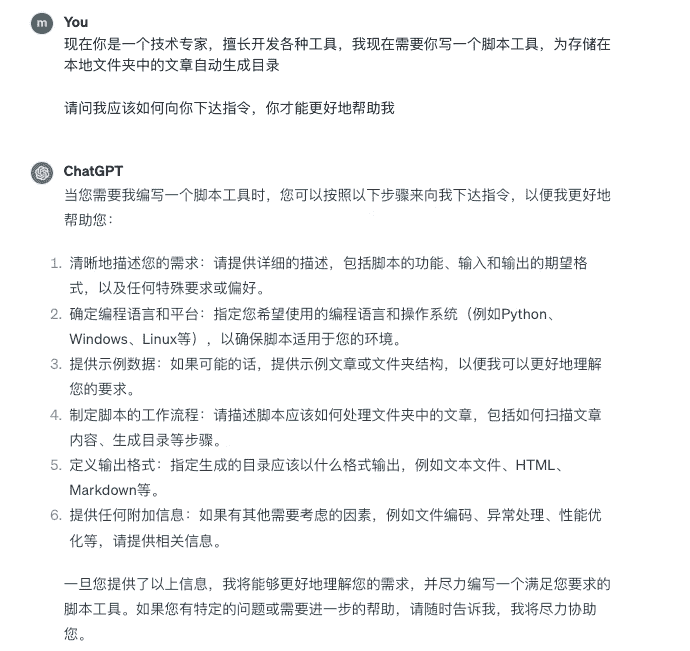

# **二、设计提示词**

## **一）提示词**

上面告诉我们一些细节了，我们需要明确上面的细节，设计出提示词

目录文件推荐使用 Markdown 格式，结构清晰（包含一、二、三级标题），具体看下官网，关于 Markdown 的介绍具体可以看官网： https://markdown.com.cn/

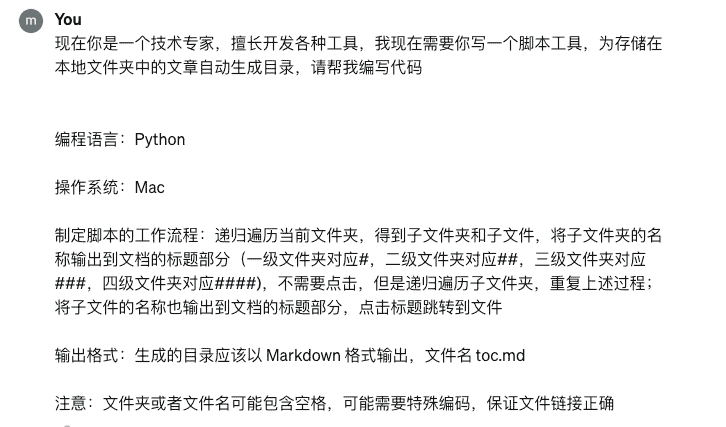

## **二）GPT 回复**

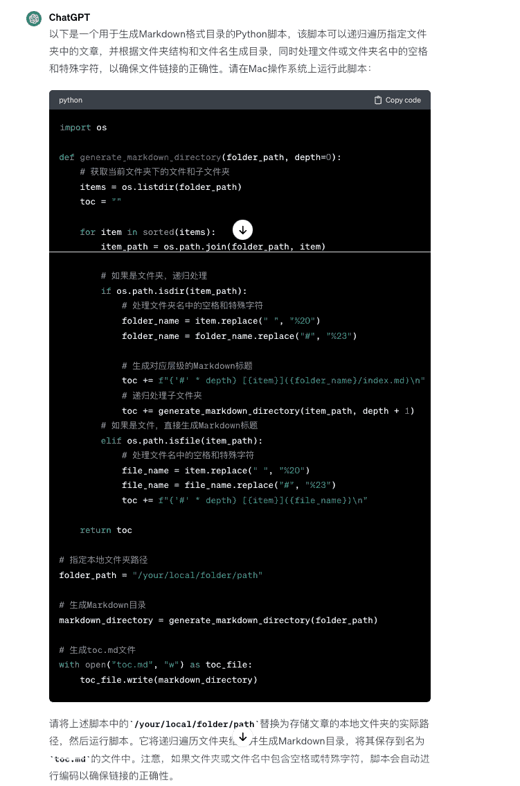

# **三、优化提示词**

直接按照这个输出的目录格式可能不符合自己的要求，下面进行优化下，最简单有效的方式就是少样本提示，提供一个示例

## **一）提示词**

输入示例：文件结构示例，让 AI 了解你的文件目录结构，是一层还是二层还是三层，可以使用 tree 命令获取

输出示例：生成的目录文档示例，让 AI 了解你想输出什么样的目录格式

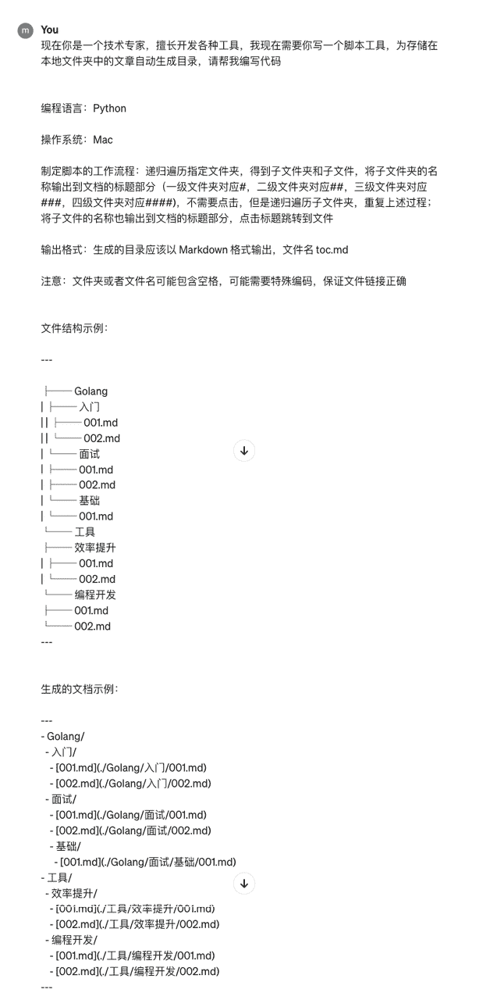

## **二）GPT 回复**

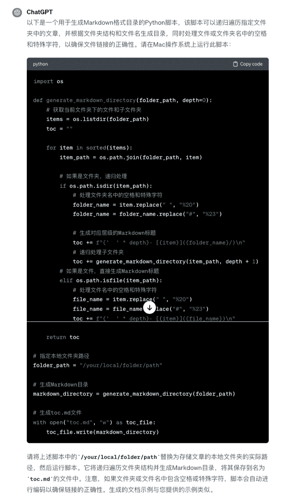

## **三）运行代码**

一定要给 AI 明确的上下文：我是个小白，没有编程基础和编程环境，如何在 Mac 上运行这个代码？

这样 AI 回答更加准确

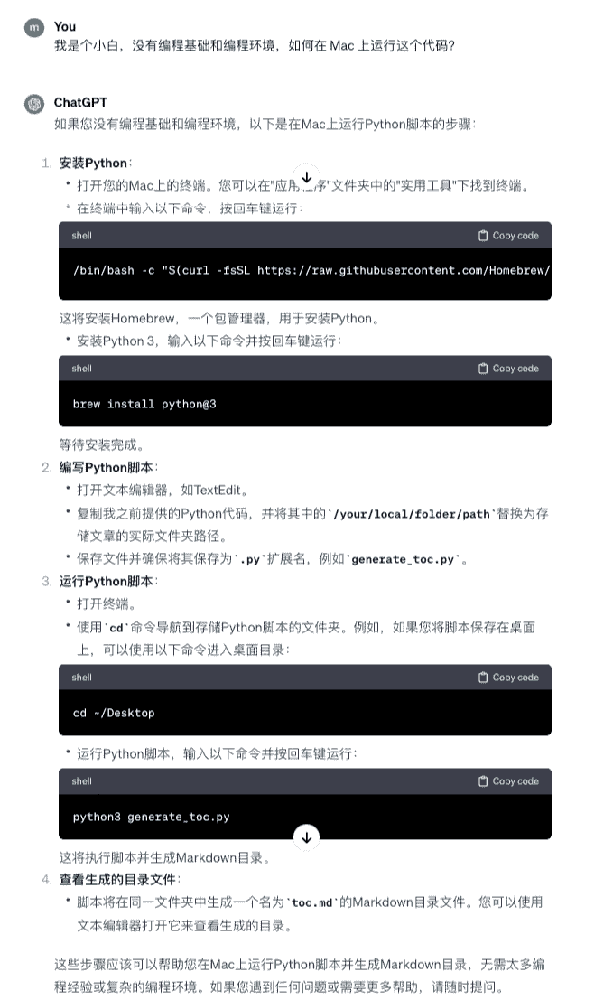

1、按照上面的步骤安装 Python 环境

2、替换代码中 folder_path = ["." 即当前路径，并将代码保](http://generate_toc.py/)存为文件 generate_toc.py

3、将 generate_toc.py 拷贝到实际文章所在路径

[4、在命令行执](http://toc.md/)行 python3 generate_toc.py 命令，即可在当前路径查看生成的 toc.md 文件

## **四）运行效果**

查看 [toc.md ](http://toc.md/)内容：

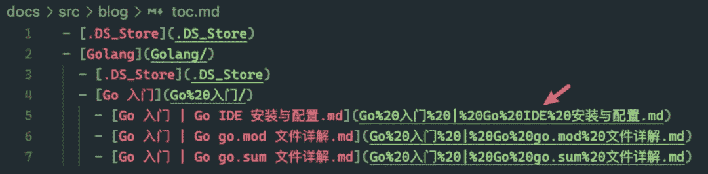

Markdown 预览：

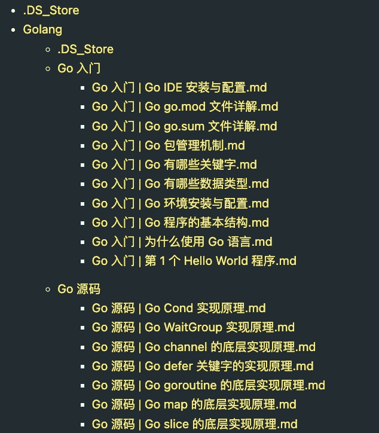

# **四、多轮对话优化**

目前的 AI 对于复杂的任务，很难通过一个提示词得到完美的结果，所以需要多轮对话迭代

上面的运行截图中，可以发现问题：文件的链接不对，打开找不到文件

## **一）修复文件不能正确打开**

发现文件打不开，看了下 [toc.md ](http://toc.md/)文件，没有带上路径

查看 [toc.md ](http://toc.md/)内容：

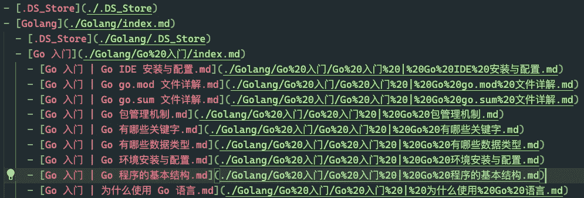

如果文件仍然打不开，可以看看文件名或文件夹是否包含空格，如果包含，让 GPT 遇到空格等特殊字符对文件路径进行编码

## 二）只展示后缀名为 .md 结尾的文件

上面可以看到 隐藏文件也被展示出来了，只展示 Markdown 文档

查看 [toc.md ](http://toc.md/)内容：

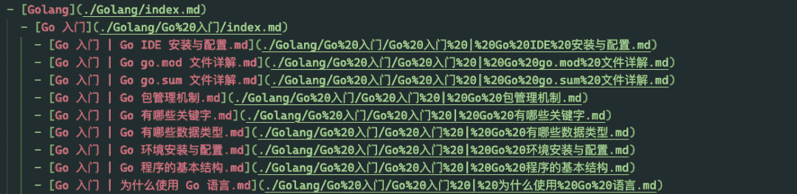

Markdown 预览效果：

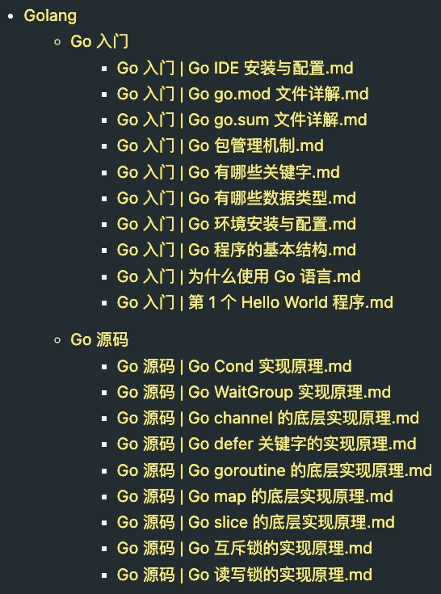

以上就完成了一个自动生成目录的工具，写完文章后，执行下 python generate_toc.py 这可以自动生成目录，非常方便，不用手动维护目录

# **五、总结**

在使用 AI 辅助编程时，我们只需明确我们的需求（输入和输出），AI 就能帮助我们实现这些目标。正如本文所展示的，即便是编程新手也能利用 AI 的力量来创建有用的工具和应用。

本文来源于好朋友木川大佬，木川公众号【木川AI编程】，欢迎关注！

更多内容可以点击目录： [手册内容汇总](https://aiyanxishe.feishu.cn/wiki/LBXcwPv6UiZgdfkp14Xc1Wo1n3b)

✨ 如果觉得有收获，请点一点下方的“有启发” ✨

🌱 我也会及时优化迭代内容，给大家更好的阅读体验 🌱

<https://aiyanxishe.feishu.cn/sync/IaSadpoOOsopKab1ajKcz6z3nAb>