# 使用GPT生成专属学习教程

> 来源：[https://aiyanxishe.feishu.cn/docx/GbsydU0f9opdcqxoVLmcdJkPnyd](https://aiyanxishe.feishu.cn/docx/GbsydU0f9opdcqxoVLmcdJkPnyd)

## 程序员AI破局简介

> [《程序员AI破局指南》](https://t.zsxq.com/19EOflzkQ)由字节、百度、阿里等互联网大厂的AI业务相关高管共创，分享开箱即用、面向市场的AI编程知识和工具。

> 指南包括六个专栏:**AI编程实战、AI编程工具、AI高效办公、A**I副业赚钱、AI提示词工程、AI私人助手

> [程序员AI破局指南](https://t.zsxq.com/19EOflzkQ) 原价 599 元，限时特惠 199 元/年，5月1日恢复原价。

> 加入我们：https://t.zsxq.com/19EOflzkQ

> 购买后，添加群主🛰️加入 AI研习社陪伴社群，限时领取超值福利。

# **说明：**

1.  本文章教程使用AI大模型工具为： ChatGPT4.0，其他工具不保证有相同效果

1.  学习知识点案例：以程序员在边做项目边学习，即项目驱动式学习的场景角度，遇到技术需求并学习Spring Boot 的 JPA为例

# 让ChatGPT生成专属学习教程

ChatGPT真的挺厉害的，尤其是在软件开发讲解技术知识这块。它能帮我们快速提高学习效率，让我们在竞争激烈的职场中更加得心应手。这篇文章，我就来分享一个例子，展示一下怎么让ChatGPT帮我量身打造一套步步为营的互动教程，帮助我掌握技术知识。我们就以学习Spring Boot JPA为例来看看。

# **生成教程大纲、学习路线**


> 背景：看，这个女人叫小美..... 小美是一个转行的技术小白( 嗯，这个环境在还能转行程序员并有工作，估计公司是他亲戚开的, 财务是亲戚老婆，办公室在亲戚客厅，亲戚深信 GPT + 1个程序员 = APP+WEB+后台+运维+产品+测试 emmm... )

> 今天，她遇到了要使用springboot jpa的外键技术，但只有数据库丢丢基础的她，不知道如何在项目中使用jpa，更不会使用外键。

遇事不决GPT，首先让ChatGPT为我们定制一条学习路线，完成知识模块学习的闭环，而不是简单学了下基础。当要求定制一个循序渐进的教程和给出测试题的要求后，ChatGPT很快就给出了整个学习路线大纲，以及每个章节的知识点内容、测试题。

小美很快就得到一对一手把手教学训练营的体验。

看下小美是如何通过chatgpt进行专项学习的吧。

# 首先提问的Prompt：

> 我不太了解springboot jpa 外键的相关知识，请给我设计一套循序渐进的教程，教会我如何使用jpa的外键编写，每个小模块请给我测试题，已确认我已掌握

## 获得学习大纲和详细教程安排

可以看到已经给出了学习大纲，从基础到环境搭建、具体应用、最佳实践都有了

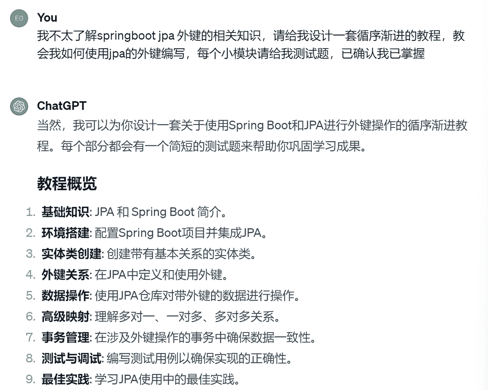

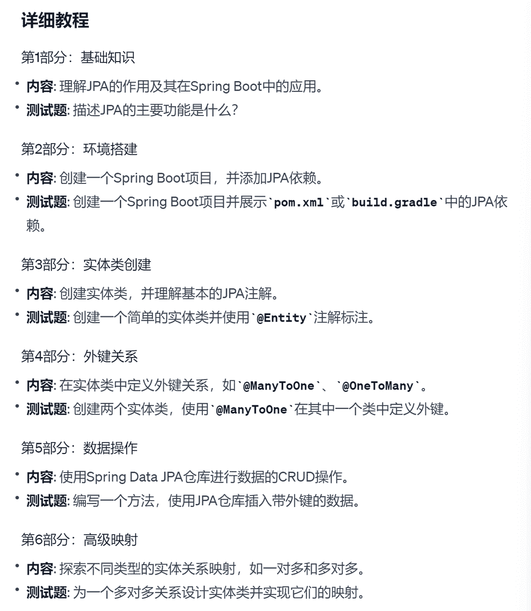

# 让GPT开始教学

## 基础教学

> prompt: 请开始教学


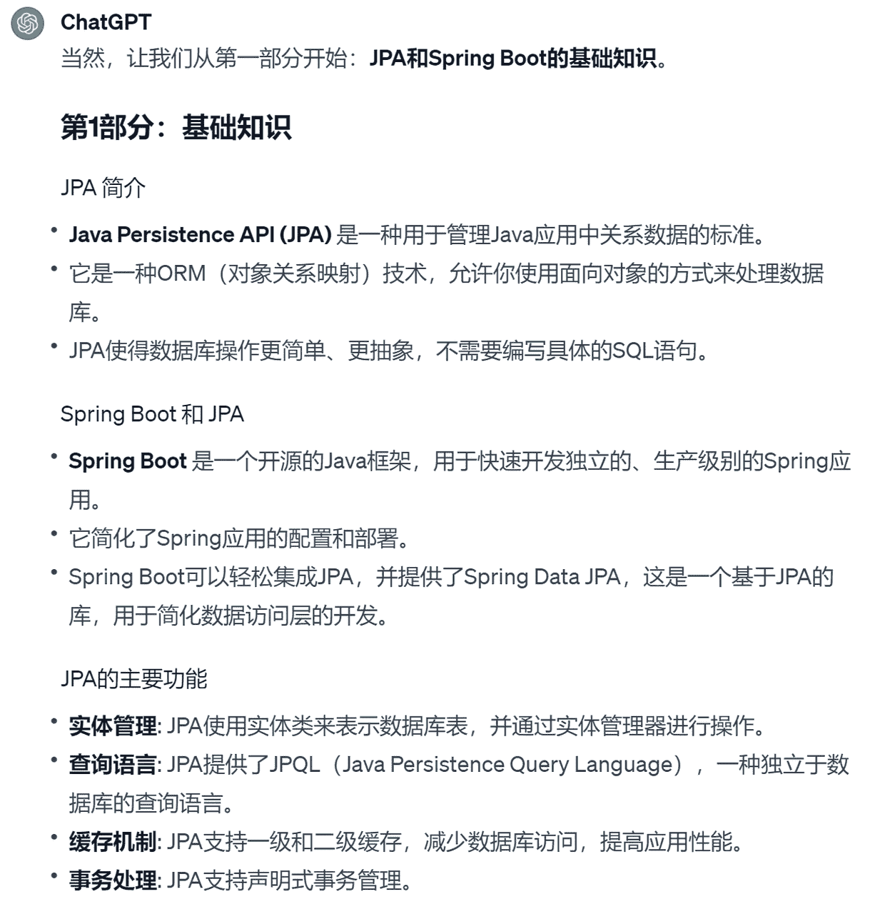

## 知识点测试：

ChatGPT不仅给出了知识点教程，还给出了测试题供我们回答：

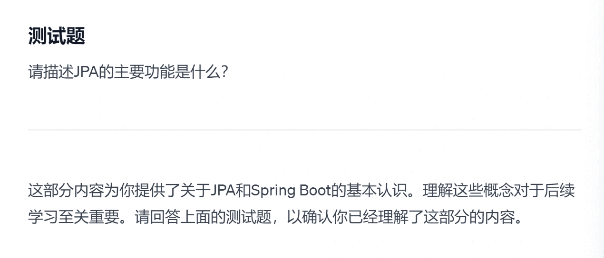

## 回答测试题

可以对问题进行回答，获得加深学习记忆和理解，这不得上千的在线教育课程的系统才会有的答题和助教服务吗！

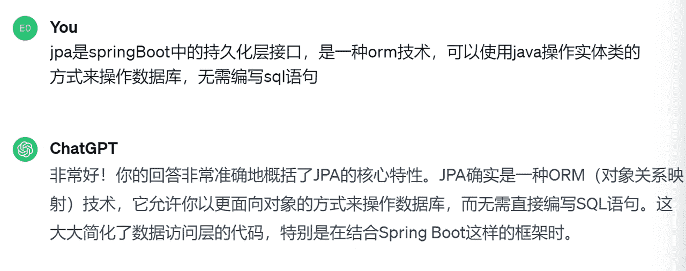

回答完后，ChatGPT就开始下一个知识点的教学，由于文章篇幅限制，这里就不一一展示演示，跳过一些知识点，展示比较典型的知识点教学。感兴趣的同学可以亲自体验。

## 带有代码的知识点教学：

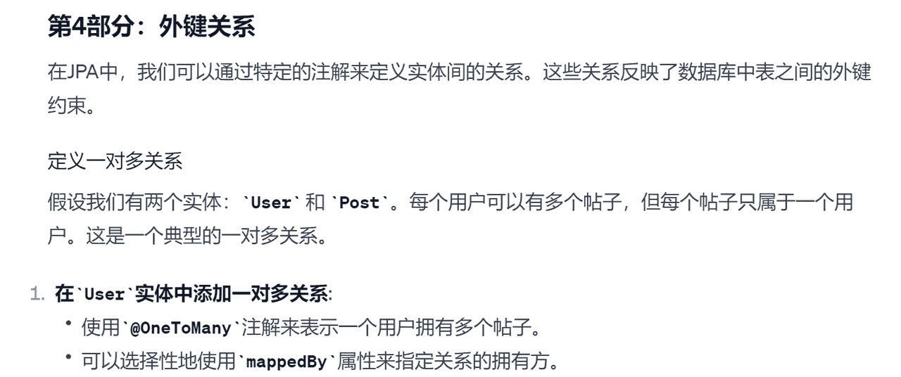

并给出了代码：

```
import javax.persistence.Entity;
import javax.persistence.Id;
import javax.persistence.OneToMany;
import java.util.Set;

@Entity
public class User {
    @Id
    private Long id;

    // ...

    @OneToMany(mappedBy = &quot;user&quot;)
    private Set&lt;Post&gt; posts;
}
a
```

> 在Post实体中添加多对一关系:

+   使用@ManyToOne注解来表示一个帖子属于一个用户。

+   使用@JoinColumn来指定外键列。

```
import javax.persistence.Entity;
import javax.persistence.Id;
import javax.persistence.ManyToOne;
import javax.persistence.JoinColumn;

@Entity
public class Post {
    @Id
    private Long id;

    // ...

    @ManyToOne
    @JoinColumn(name = &quot;user_id&quot;)
    private User user;
}
```

最后也依然对这个知识点给出了测试题

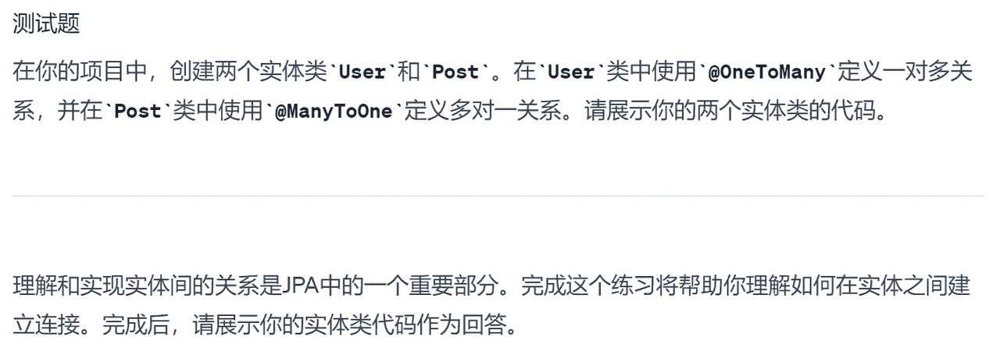

# 针对不理解的进行提问获得更多解释


对教程中不明白的点，或者没有细讲的部分进行提问，如：

## 提问1：


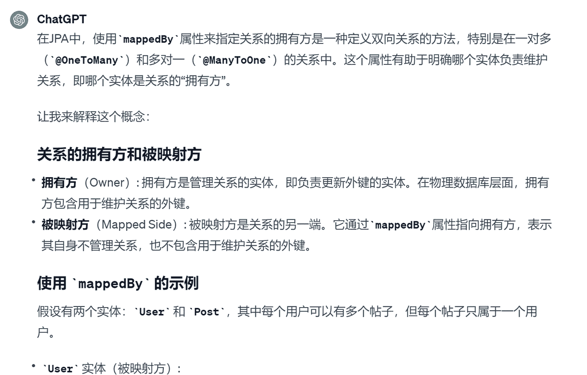

```
@Entity
public class User {
    @Id
    private Long id;

    @OneToMany(mappedBy = &quot;user&quot;)
    private Set&lt;Post&gt; posts; // 不管理关系，只是参照“user”字段在Post中的映射
}
```


```
@Entity
public class Post {
    @Id
    private Long id;

    @ManyToOne
    @JoinColumn(name = &quot;user_id&quot;) // 这里定义了外键
    private User user; // 管理关系，包含外键“user_id”
}
```

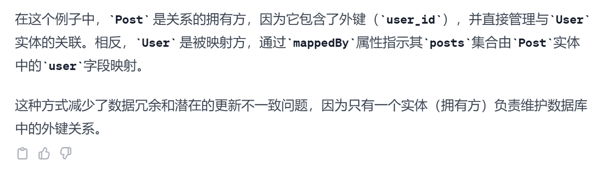

## 提问2：

> @OneToMany(mappedBy = "***") 这里的数据类型除了Set，还能是其他的类型吗，如List

回答中不仅针对问题进行了解答，还理解了问题所在，拓展了知识解答。

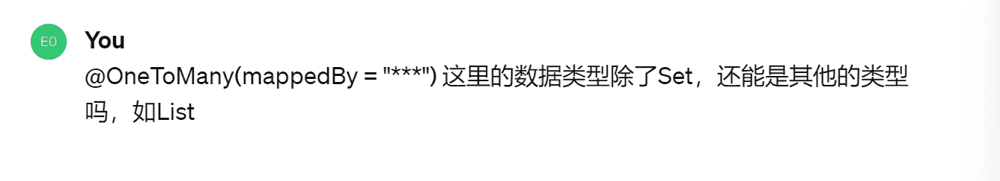

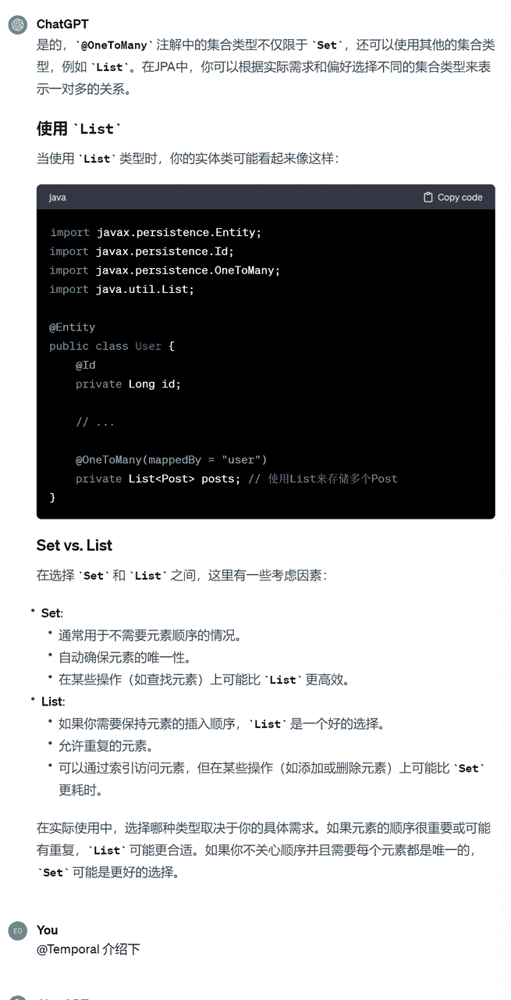

# 结语：


以上展示了如何让ChatGPT为自己定制技术学习路线、详细课程和测试题，也能针对课程中不理解的地方对ChatGPT继续提问。

可以看出，ChatGPT在帮助我们制定技术学习计划、整理课程内容和出测试题这些方面的能力。它还提到了一个很棒的点：如果在学习过程中遇到不懂的地方，我们随时可以问ChatGPT，这样就能更快地理解和掌握知识。

可以说，ChatGPT制作的教程真的很实用，内容详尽，而且讲得很清楚，很适合我们提高学习效率。这就展示了ChatGPT在个性化学习和教学辅助方面的强大潜力，对于我们这些想要提升技能和知识的人来说，它真的是个很好的帮手。

ChatGPT详情文档过程请看 ( 需要合理的网络环境 ) ：

[h](https://chat.openai.com/share/d794f7dd-cd82-4117-b42c-bf9133a32d94)ttps://chat.openai.com/share/d794f7dd-cd82-4117-b42c-bf9133a32d94

文章来自斑码AI团队的老陈，欢迎链接和关注作者👸号「AI船长陈零一」，欢迎交流~

更多内容可以点击目录： [手册内容汇总](https://aiyanxishe.feishu.cn/wiki/LBXcwPv6UiZgdfkp14Xc1Wo1n3b)

✨ 如果觉得有收获，请点一点下方的“有启发” ✨

🌱 我也会及时优化迭代内容，给大家更好的阅读体验 🌱

<https://aiyanxishe.feishu.cn/sync/IaSadpoOOsopKab1ajKcz6z3nAb>