# AI开发网页插件(无需编程)

> 来源：[https://aiyanxishe.feishu.cn/docx/BAP6dvXzFoKCyexAdmmckAFyn9c](https://aiyanxishe.feishu.cn/docx/BAP6dvXzFoKCyexAdmmckAFyn9c)

## 程序员AI破局简介

> [《程序员AI破局指南》](https://t.zsxq.com/19EOflzkQ)由字节、百度、阿里等互联网大厂的AI业务相关高管共创，分享开箱即用、面向市场的AI编程知识和工具。

> 指南包括六个专栏:**AI编程实战、AI编程工具、AI高效办公、A**I副业赚钱、AI提示词工程、AI私人助手

> [程序员AI破局指南](https://t.zsxq.com/19EOflzkQ) 原价 599 元，限时特惠 199 元/年，5月1日恢复原价。

> 加入我们：https://t.zsxq.com/19EOflzkQ

> 购买后，添加群主微信加入 AI研习社陪伴社群，限时领取超值福利。

### **前言**

当下社会，无论是职场奋斗、学术研究还是日常生活，网络已成为我们不可或缺的一部分。有效地从网络中汲取关键信息与知识，对我们每个人都至关重要。如果存在一种方案，能够让我们随时掌握所需的信息，那将是多么令人振奋的体验。接下来，我将分享一篇文章，它通过两个实际案例展示了如何让信息获取变得更加便捷。

### **案例一：自动抓取数据**

准备工作：需要用到的几款工具

+   浏览器开发者工具：用于帮助开发人员分析、调试和优化网页应用程序，本案例场景中主要用于元素定位取值

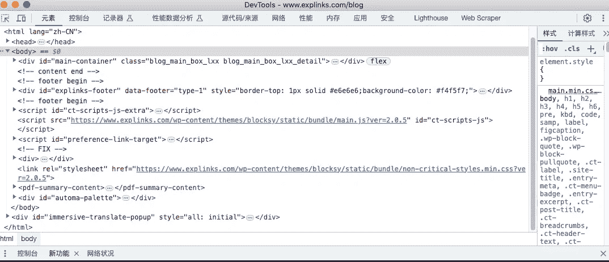

+   Chatgpt：人工智能聊天工具，本案例中主要用于根据Prompt提示语生成对应的JS脚本

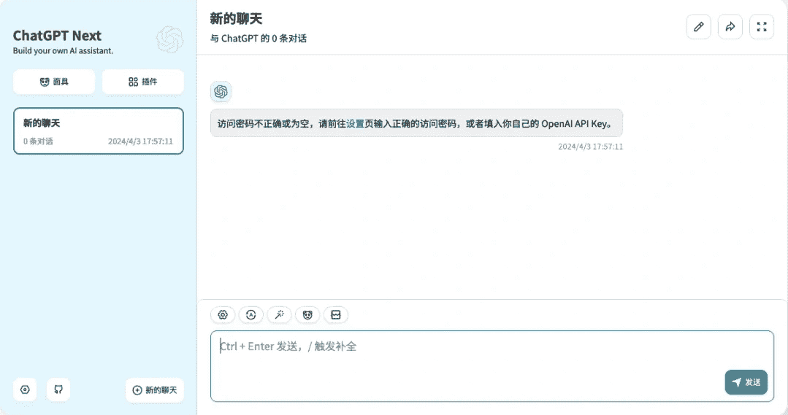

+   Tampermonkey：非常流行的一款脚本管理器、可以在网页上运行自定义的 JavaScript 脚本。支持多个主流浏览器，包括 Chrome、Firefox、Safari、Edge 等

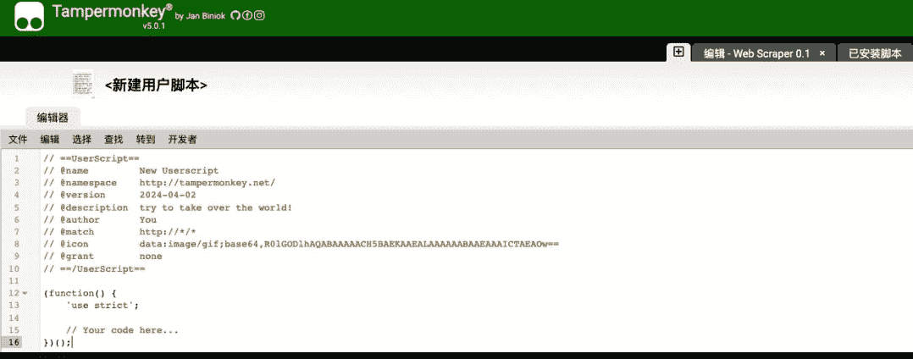

+   需求：获取幂简集成博客的img图片、博客标题、博客描述这三个字段的信息。

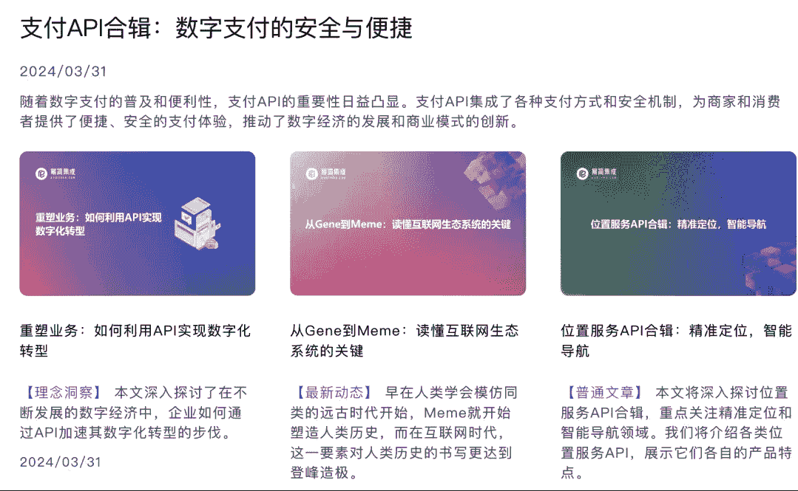

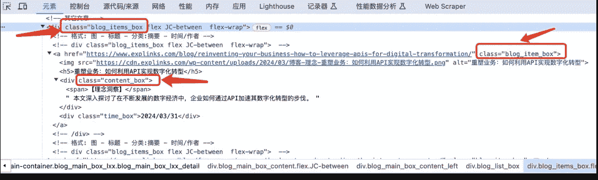

实现步骤：

1.  构思提示语

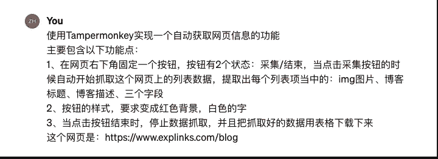

1.  粘贴到脚本管理器中调试

```
// ==UserScript==
// @name         Web Data Scraper
// @namespace    https://your.namespace.com
// @version      0.1
// @description  Scrapes data from a webpage and allows downloading in a table format.
// @author       Your Name
// @match        https://www.explinks.com/blog
// @grant        none
// ==/UserScript==

(function() {
    &#x27;use strict&#x27;;

    let collectingData = false;
    let scrapedData = [];

    function scrapeData() {
        const items = document.querySelectorAll(&#x27;.blog-item&#x27;);
        const data = [];
        items.forEach(item =&gt; {
            const img = item.querySelector(&#x27;img&#x27;).src;
            const title = item.querySelector(&#x27;.blog-title&#x27;).innerText;
            const description = item.querySelector(&#x27;.blog-description&#x27;).innerText;
            data.push({img, title, description});
        });
        return data;
    }

    function updateButtonUI() {
        const button = document.getElementById(&#x27;scrapeButton&#x27;);
        if (collectingData) {
            button.innerText = &#x27;结束&#x27;;
            button.style.backgroundColor = &#x27;red&#x27;;
            button.style.color = &#x27;white&#x27;;
        } else {
            button.innerText = &#x27;采集&#x27;;
            button.style.backgroundColor = &#x27;&#x27;;
            button.style.color = &#x27;&#x27;;
        }
    }

    function downloadData() {
        const csvContent = &quot;data:text/csv;charset=utf-8,&quot; 
            + scrapedData.map(e =&gt; Object.values(e).join(&quot;,&quot;)).join(&quot;\n&quot;);
        const encodedUri = encodeURI(csvContent);
        const link = document.createElement(&quot;a&quot;);
        link.setAttribute(&quot;href&quot;, encodedUri);
        link.setAttribute(&quot;download&quot;, &quot;scraped_data.csv&quot;);
        document.body.appendChild(link);
        link.click();
    }

    function toggleDataCollection() {
        collectingData = !collectingData;
        if (collectingData) {
            scrapedData = scrapeData();
        } else {
            downloadData();
        }
        updateButtonUI();
    }

    function addButton() {
        const button = document.createElement(&#x27;button&#x27;);
        button.innerText = &#x27;采集&#x27;;
        button.id = &#x27;scrapeButton&#x27;;
        button.style.position = &#x27;fixed&#x27;;
        button.style.bottom = &#x27;20px&#x27;;
        button.style.right = &#x27;20px&#x27;;
        button.style.padding = &#x27;10px&#x27;;
        button.style.border = &#x27;none&#x27;;
        button.style.cursor = &#x27;pointer&#x27;;
        button.addEventListener(&#x27;click&#x27;, toggleDataCollection);
        document.body.appendChild(button);
    }

    addButton();

})();
```

第一次提供的脚本运行不起来，因为元素定位不正确，修改一下定位元素

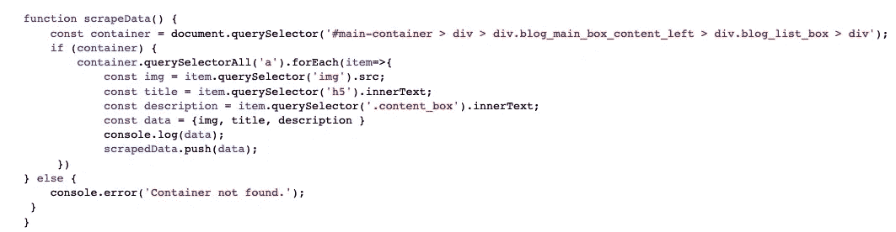

1.  修改定位元素后再次调试 根据控制台查看已经打印出获取到的数据信息

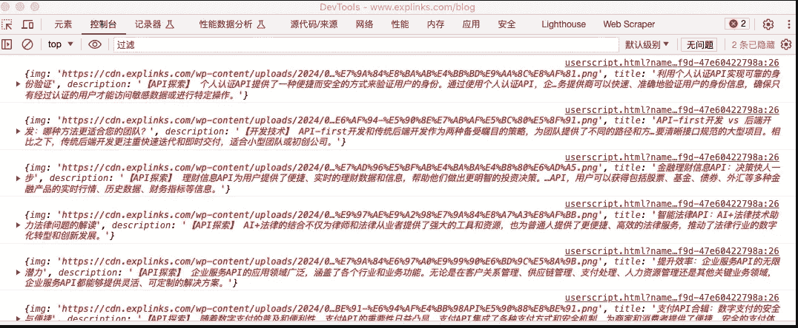

1.  检查下载后的csv文件数据

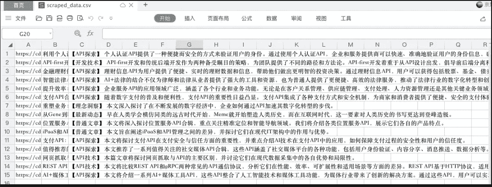

### **案例二：自由复制文本**

需求：对于个别付费的网页比如知识星球、小报童无法使用复制的情况，实现可复制。

实现步骤：

1.  构思提示语

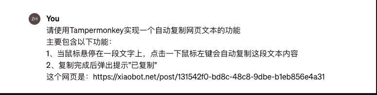

1.  粘贴到脚本管理器中调试

```
// ==UserScript==
// @name         Auto Copy Text
// @namespace    http://tampermonkey.net/
// @version      0.1
// @description  Automatically copy text when clicked
// @author       You
// @match        https://xiaobot.net/post/131542f0-bd8c-48c8-9dbe-b1eb856e4a31
// @grant        GM_setClipboard
// ==/UserScript==

(function() {
    &#x27;use strict&#x27;;

    // Function to handle click event
    function handleClick(event) {
        const text = event.target.innerText.trim();
        GM_setClipboard(text);
        alert(&#x27;已复制&#x27;);
    }

    // Attach click event listener to all elements
    document.body.addEventListener(&#x27;click&#x27;, handleClick);
})();
```

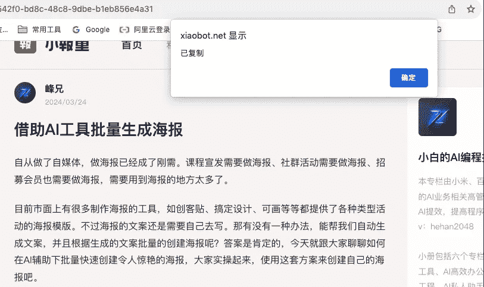

1.  增加显示复制后的文案再次调试

这里非常简单增加个变量text即可，对原来的代码稍作调整[alert('已复制' + text);]然后再看下效果

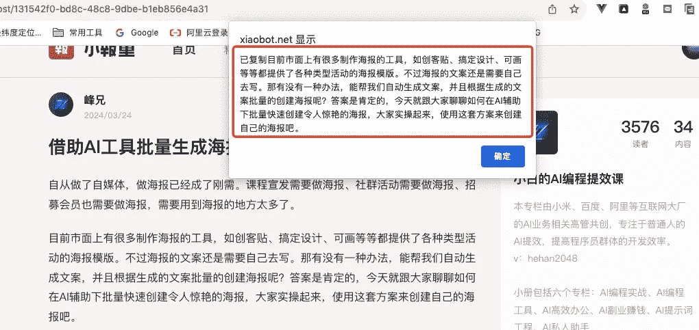

文章来自斑码AI团队的京楚樊客，欢迎链接和关注作者公众号「樊客AI之路」，欢迎交流~

更多内容可以点击目录： [手册内容汇总](https://aiyanxishe.feishu.cn/wiki/LBXcwPv6UiZgdfkp14Xc1Wo1n3b)

✨ 如果觉得有收获，请点一点下方的“有启发” ✨

🌱 我也会及时优化迭代内容，给大家更好的阅读体验 🌱

<https://aiyanxishe.feishu.cn/sync/IaSadpoOOsopKab1ajKcz6z3nAb>