# 使用 ChatGPT 辅助开发一个好文收藏扩展

> 来源：[https://aiyanxishe.feishu.cn/docx/AzKtddKAro2OYnx2qVWcdsKknNb](https://aiyanxishe.feishu.cn/docx/AzKtddKAro2OYnx2qVWcdsKknNb)

## 程序员AI破局简介

> [《程序员AI破局指南》](https://t.zsxq.com/19EOflzkQ)由字节、百度、阿里等互联网大厂的AI业务相关高管共创，分享开箱即用、面向市场的AI编程知识和工具。

> 指南包括六个专栏:**AI编程实战、AI编程工具、AI高效办公、A**I副业赚钱、AI提示词工程、AI私人助手

> [程序员AI破局指南](https://t.zsxq.com/19EOflzkQ) 原价 599 元，限时特惠 199 元/年，5月1日恢复原价。

> 加入我们：https://t.zsxq.com/19EOflzkQ

> 购买后，添加群主微信加入 AI研习社陪伴社群，限时领取超值福利。

# 一、什么是 Chrome 扩展

Chrome 扩展，官方名称 extensions（扩展程序），是安装在 Chrome 浏览器中的一个程序，可以增强浏览器的功能。

插件示例： [https://www.freecodecamp.org/news](https://www.freecodecamp.org/news/content/images/2022/01/covid_report.gif)/content/images/2022/01/covid_report.gif

官方教程： [h](https://developer.chrome.com/docs/extensions?hl=zh-cn)ttps://developer.chrome.com/docs/extensions?hl=zh-cn

我们可以通过插件标签页：查看已安装插件 chrome://extensions/

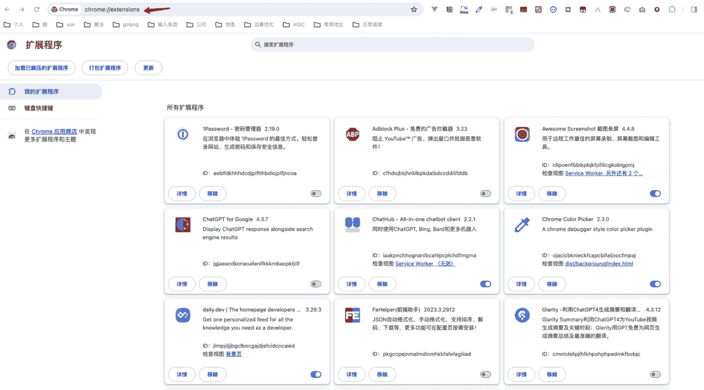

**chrome扩展程序有两种：**

弹出窗口：点击按钮后有弹出窗口页面，可用于交互操作。

后台程序：常驻在后台运行的脚本程序，随浏览器的关闭而关闭。

**用户界面一般也有两种：**

浏览器按钮：Browser Actions，附着于浏览器整体的功能，比如 Awesome Screenshot

页面按钮：Page Actions，附着于单独标签页面的功能，在特定的页面上才能使用，比如 Monica

# 二、为什么是 Chrome 扩展

1.  Chrome占有率更高，更多人用

Chrome 在 8 月凭借 63.52% 的全球份额排名第一

Safari 在 8 月凭借 13.02% 的全球份额排名第二

Edge 在 8 月凭借 11.15% 的全球份额排名第三

Firefox 在 8 月凭借 6.18% 的全球份额排名第四

Opera、360 安全浏览器、IE 等瓜分了剩余市场份额。

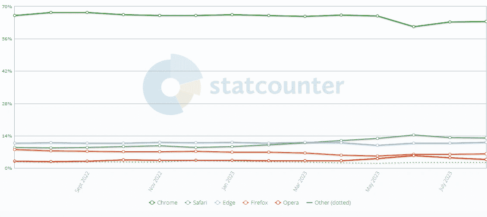

1.  **开发更简单**

你可以使用 HTML、CSS 和 JavaScript 等 Web 技术轻松构建一个扩展。

# 三、 如何创建一个 Chrome 扩展

文件目录结构：

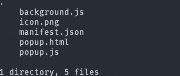

通过上图，可以看到，文件结构比较简单：

+   manifest.json：插件的资源和功能配置文件

+   popup.html：插件窗口页面入口文件，弹窗页面

+   popup.js：对应功能处理的 js 代码

+   popup.css：css代码

+   icon.png：图标资源，用于配置插件程序和按钮图标

这几个文件是开发 chrome 插件所需要的最基本的文件

# **四、Notion 插件开发**

## 一）编码

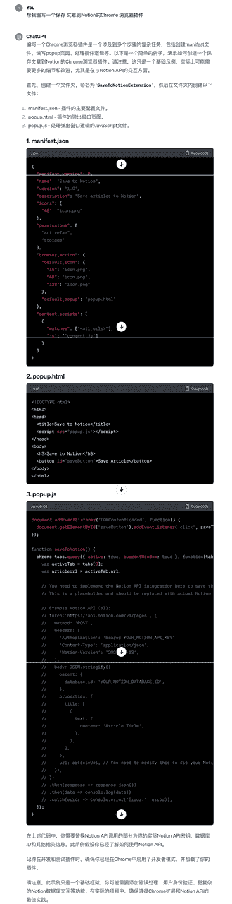

批判性思维：通过 Notion API 官网，看下AI 写的代码，接口字段是否正确

[https://developers.notion.com](https://developers.notion.com/reference/post-page)/reference/post-page

## 二）创建文件夹

在你的计算机上创建一个新的文件夹，命名为 save_notion_ext

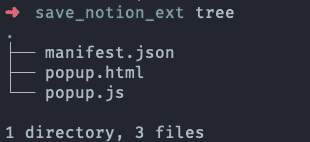

## 三）创建manifest.json文件

打开文本编辑器（如Sublime、Visual Studio Code等），复制上面的 manifest.json 代码，并将其保存为 manifest.json 文件，放入 save_notion_ext 文件夹中。

## 四）创建 popup.html 文件

同样在文本编辑器中，复制上面的 popup.html 代码，并将其保存为 popup.html 文件，也放入 save_notion_ext 文件夹中。

## 五）创建 popup.js 文件

复制上面的 popup.js 代码，并将其保存为 popup.js 文件，同样放入 save_notion_ext 文件夹中。

1.  替换 Notion API KEY：

1.  打开 popup.js 文件，找到注释部分的Notion API 调用

1.  替换 YOUR_NOTION_API_KEY 你的Notion API KEY

1.  使用真实的 Notion 数据库：

1.  打开 popup.js 文件，找到注释部分的Notion 数据库设置

1.  在Notion中创建一个数据库，并在代码中替换 YOUR_NOTION_DATABASE_ID 为你的数据库ID。。

## 六）添加图标

如果你想为插件添加图标，将图标文件（例如 icon.png）也放入 save_notion_ext 文件夹中。确保图标文件在 manifest.json 文件中正确引用

推荐图标网站： https://www.iconfont.cn/

根据关键词，搜索 并选择 icon 进行下载

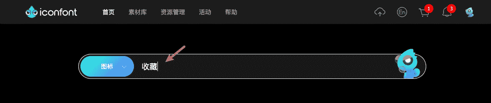

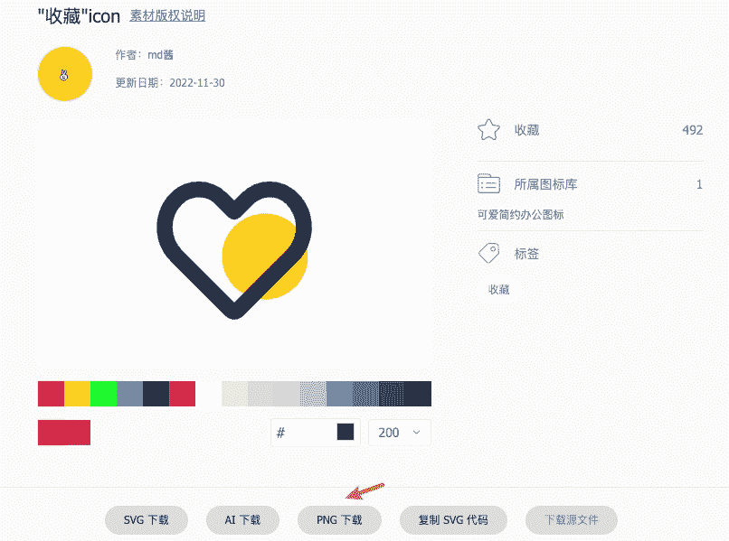

## 七）代码优化

优化插件标题、插件描述、按钮标题

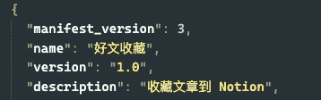

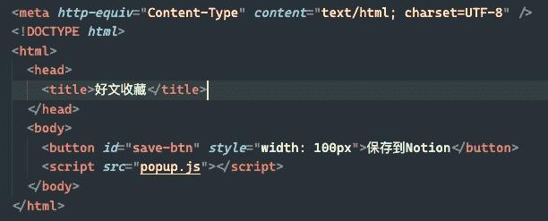

## 八）加载插件到 Chrome

首先看下效果：

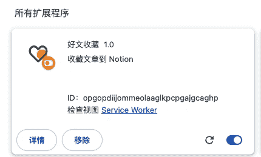

加载步骤如下：

+   打开 Chrome 浏览器。

+   在地址栏中输入 chrome://extensions/ 并按回车键。

+   在打开的页面上启用 "开发者模式"。

+   点击 "加载已解压的扩展"，然后选择 save_notion_ext 文件夹。

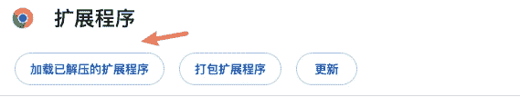

AI 目前还没有那么智能，生成出来的代码可能有错误，就出现以下几个错误：

### 1、加载错误1： 未能成功加载扩展程序

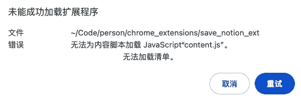

解决方案： content.js 不存在，应该是 popup.js，将 manifest.json 中的 content.js 改成 popup.js

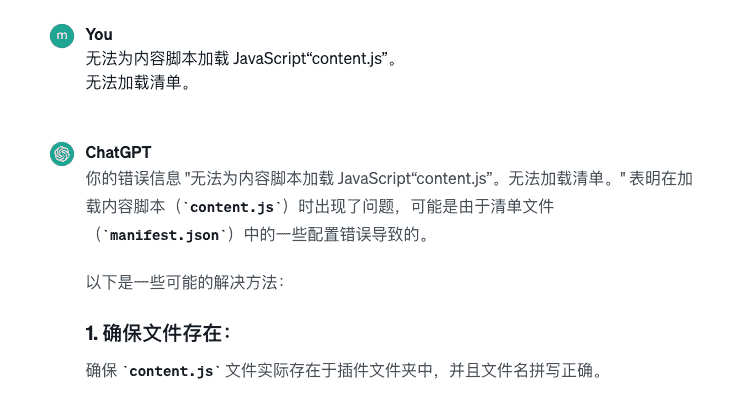

### 2、加载错误2：版本不对

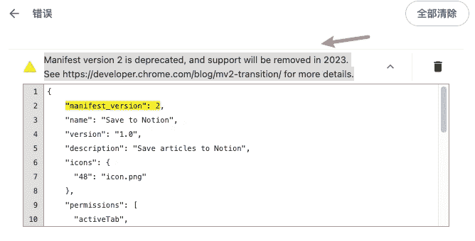

解决方案：将 manifest.json 中的 manifest_version 改成 3，点击刷新按钮

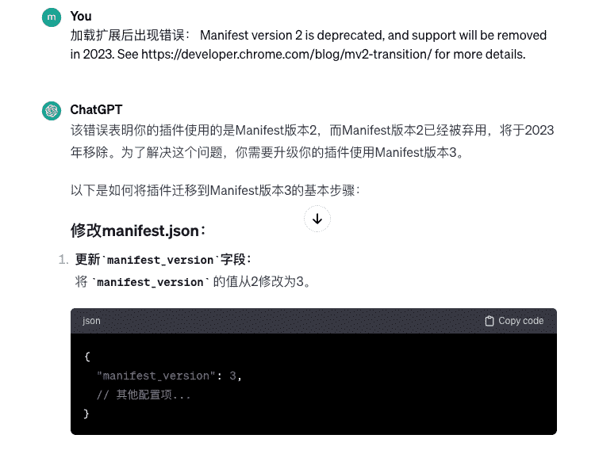

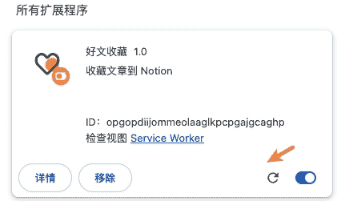

### 3、加载错误3：字段不兼容

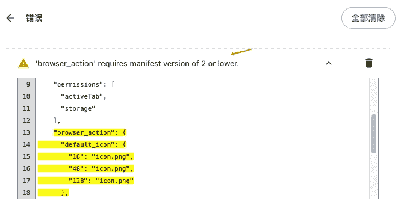

解决方案：将 manifest.json 中的 browser 改成 action，点击刷新按钮

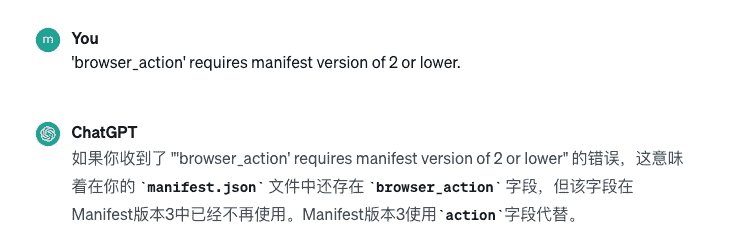

## 九）测试插件

打开任何网页，点击浏览器工具栏中的插件图标，弹出一个小窗口，其中包含 "保存到Notion" 按钮。点击 按钮，然后查看插件是否输出错误信息

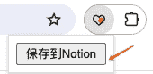

毫无意外出错了：

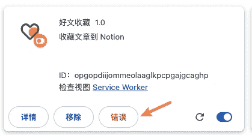

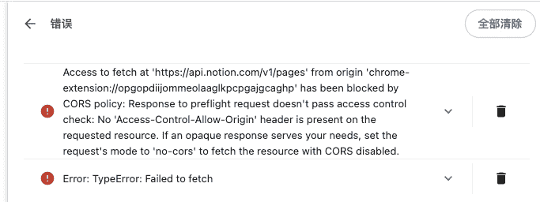

问题的原因是尝试从一个源（chrome-extension://[o](https://api.notion.com/v1/pages%EF%BC%89%E5%8F%91%E8%B5%B7%E8%AF%B7%E6%B1%82%EF%BC%8C%E4%BD%86%E6%98%AF%E7%94%B1%E4%BA%8E%E7%BC%BA%E5%B0%91%E5%BF%85%E8%A6%81%E7%9A%84CORS%E5%A4%B4%E9%83%A8%EF%BC%8C%E8%AF%B7%E6%B1%82%E8%A2%AB%E9%98%BB%E6%AD%A2%E4%BA%86)pgopdiijommeolaaglkpcpgajgcaghp）向另一个源（ https://api.notion.com/v1/pages）发起请求，但是由于缺少必要的CORS头部，请求被阻止了

CORS（跨域资源共享）是一种安全机制，用于限制从一个源加载的资源能否被另一个源访问

解决方案：

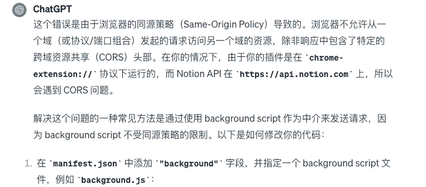

在这个修改后的代码中，当点击按钮时，popup.js 向 background script 发送了一个消息，包含了当前标签页的 URL。然后，background script 接收到消息后，执行了对 Notion API 的请求。这样就绕过了同源策略的限制。

并且 manifest.json 添加如下代码，允许扩展访问任何网站

```
&quot;host_permissions&quot;: [&quot;*://*/*&quot;],
```

刷新你的插件（在 chrome://extensions/ 页面中，找到插件，点击 "刷新" 按钮，再次打开任何网页，点击插件图标，点击 按钮，如果一切正常，代码会尝试将当前页面的URL发送到Notion数据库

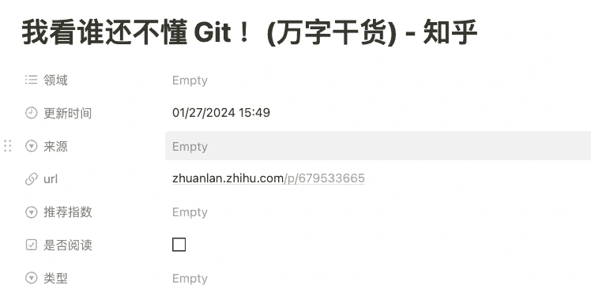

## 十）完整代码

manifest.json

```
{
  &quot;manifest_version&quot;: 3,
  &quot;name&quot;: &quot;好文收藏&quot;,
  &quot;version&quot;: &quot;1.0&quot;,
  &quot;description&quot;: &quot;收藏文章到 Notion&quot;,
  &quot;action&quot;: {
    &quot;default_popup&quot;: &quot;popup.html&quot;,
    &quot;default_icon&quot;: {
      &quot;16&quot;: &quot;icon.png&quot;,
      &quot;48&quot;: &quot;icon.png&quot;,
      &quot;128&quot;: &quot;icon.png&quot;
    }
  },
  &quot;icons&quot;: {
    &quot;16&quot;: &quot;icon.png&quot;,
    &quot;48&quot;: &quot;icon.png&quot;,
    &quot;128&quot;: &quot;icon.png&quot;
  },
  &quot;host_permissions&quot;: [&quot;*://*/*&quot;],
  &quot;background&quot;: {
      &quot;service_worker&quot;: &quot;background.js&quot;,
      &quot;type&quot;: &quot;module&quot;
  },
  &quot;permissions&quot;: [&quot;activeTab&quot;, &quot;bookmarks&quot;, &quot;background&quot;]
}
```

popup.html

```


  
    
  
  
    保存到Notion
    
  
```

popup.js

```
document.addEventListener(&#x27;DOMContentLoaded&#x27;, function () {
  document.getElementById(&#x27;save-btn&#x27;).onclick = function () {
    saveToNotion()
  }
})

function saveToNotion() {
  chrome.tabs.query({ active: true, currentWindow: true }, function (tabs) {
    var activeTab = tabs[0]
    var articleUrl = activeTab.url
    var articleTitle = activeTab.title // 获取网页标题

    chrome.runtime.sendMessage({ action: &#x27;saveToNotion&#x27;, url: articleUrl, title: articleTitle }, function (response) {
      if (response.success == true) {
        // alert(JSON.stringify(response.data, null, 2))
        // alert(response.data.id)
        if (response.data.id != undefined) {
          alert(&#x27;保存成功&#x27;)
        } else {
          alert(&#x27;保存失败:&#x27; + response.data.message)
        }
      } else {
        alert(&#x27;Error saving to Notion: &#x27; + response.data.message)
      }
    })
  })
}
```

background.js

需要将 API_KEY 替换成自己的 Notion API_KEY

需要将 DataBase_Id 替换成自己的 Notion 数据库ID

```
chrome.runtime.onMessage.addListener(function (message, sender, sendResponse) {
  if (message.action === &#x27;saveToNotion&#x27;) {
    saveToNotion(message.url, message.title, sendResponse)
    return true // 保持消息通道打开
  }
})

function saveToNotion(pageUrl, pageTitle, sendResponse) {
  fetch(&#x27;https://api.notion.com/v1/pages&#x27;, {
    method: &#x27;POST&#x27;,
    headers: {
      Authorization: &#x27;Bearer API_KEY&#x27;,
      &#x27;Content-Type&#x27;: &#x27;application/json&#x27;,
      &#x27;Notion-Version&#x27;: &#x27;2021-05-13&#x27;
    },
    body: JSON.stringify({
      parent: {
        database_id: &#x27;DataBase_Id&#x27;
      },
      properties: {
        标题: {
          title: [
            {
              text: {
                content: pageTitle
              }
            }
          ]
        },
        url: {
          url: pageUrl
        }
      }
    })
  })
    .then(response =&gt; response.json())
    .then(data =&gt; {
      sendResponse({ success: true, data: data })
    })
    .catch(error =&gt; {
      sendResponse({ success: false, data: error })
    })
}
```

本文来源于好朋友木川大佬，木川公众号【木川AI编程】，欢迎关注！

更多内容可以点击目录： [手册内容汇总](https://aiyanxishe.feishu.cn/wiki/LBXcwPv6UiZgdfkp14Xc1Wo1n3b)

✨ 如果觉得有收获，请点一点下方的“有启发” ✨

🌱 我也会及时优化迭代内容，给大家更好的阅读体验 🌱

<https://aiyanxishe.feishu.cn/sync/IaSadpoOOsopKab1ajKcz6z3nAb>