# 编程小白也能用Copilot Chat开发一个网站

> 来源：[https://aiyanxishe.feishu.cn/docx/Ctxgd7IjToLyoWx54kScJWHenSh](https://aiyanxishe.feishu.cn/docx/Ctxgd7IjToLyoWx54kScJWHenSh)

## 程序员AI破局简介

> [《程序员AI破局指南》](https://t.zsxq.com/19EOflzkQ)由字节、百度、阿里等互联网大厂的AI业务相关高管共创，分享开箱即用、面向市场的AI编程知识和工具。

> 指南包括六个专栏:**AI编程实战、AI编程工具、AI高效办公、A**I副业赚钱、AI提示词工程、AI私人助手

> [程序员AI破局指南](https://t.zsxq.com/19EOflzkQ) 原价 599 元，限时特惠 199 元/年，5月1日恢复原价。

> 加入我们：https://t.zsxq.com/19EOflzkQ

> 购买后，添加群主🛰️加入 AI研习社陪伴社群，限时领取超值福利。

**Copilot Chat简介**

Github Copilot官方介绍： https://github.com/features/copilot

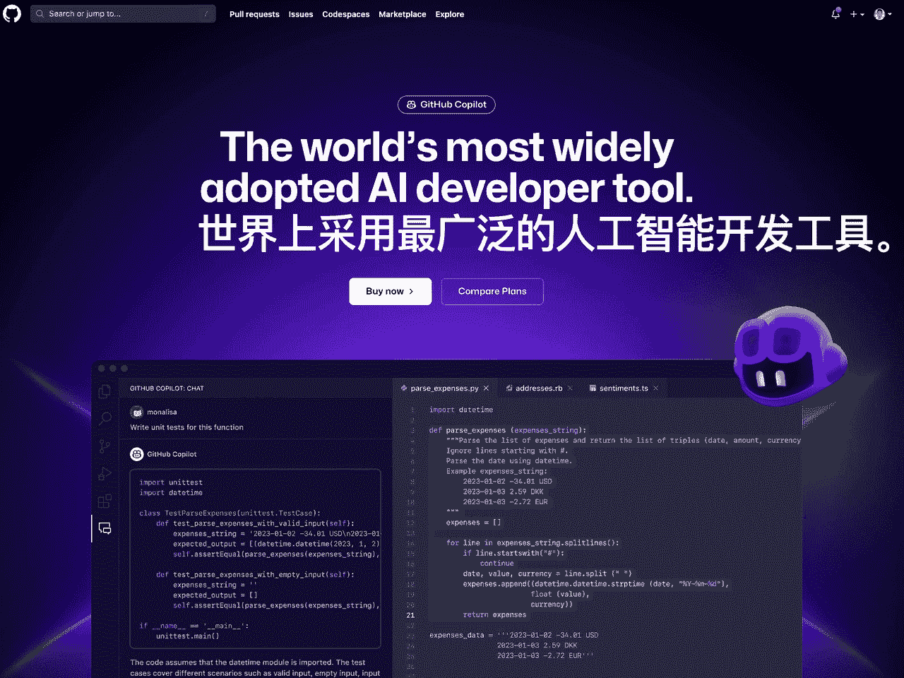

GitHub Copilot可以提供代码行内建议来帮助程序员提效。它是一款AI辅助程序员的工具。你可以使用GitHub Copilot在你的编辑器中获取整行或整个函数的建议。

Copilot **就像你的编程路上的「副驾驶」，你是主驾**驶负责把控方向，它负责帮你完整具体任务。

Copilot Chat是Copilot的升级版本 ，目前正处于公测阶段。

Copilot Chat是一个类似ChatGPT的聊天界面，可以直接在IDE中使用自然语言和Copilot进行交互，并且可以分多步。这一点比 只有代码补全功能的Copilot的 功能要强大很多。

Copilot Chat可以回答与编码相关的各种问题，包括语法、编程概念、测试用例、调试等。Copilot Chat不适用于回答非编码问题。

详细功能介绍： [https://docs.github.com/en/copilot/githu](https://docs.github.com/en/copilot/github-copilot-chat/about-github-copilot-chat)b-copilot-chat/about-github-copilot-chat

# **Copilot Chat安装**

官方文档： [ht](https://docs.github.com/en/copilot/github-copilot-chat/using-github-copilot-chat-in-your-ide)tps://docs.github.com/en/copilot/github-copilot-chat/using-github-copilot-chat-in-your-ide

## **开通Copilot**

使用CopilotChat首先得开通Copilot。

订阅分为个人版和企业版。企业版本19美金一个月，个人版本10美金一个月。

我们使用个人版就可以，当然也可是使用学生版，或者去万能的某宝上找找。

个人版也会有一定的免费试用时间

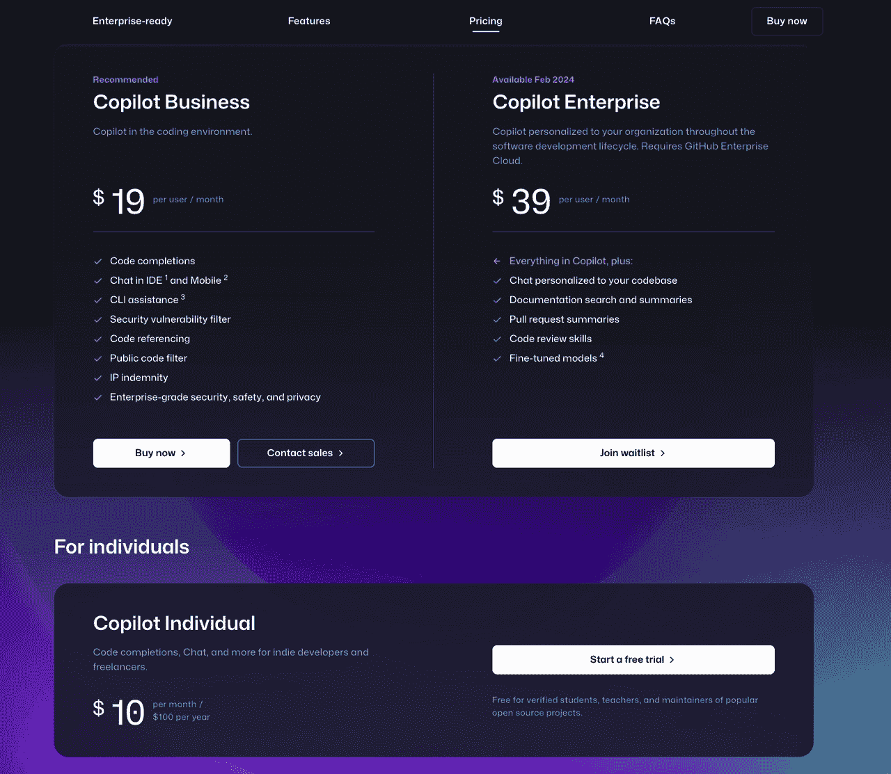

订阅链接： [https://github.com/g](https://github.com/github-copilot/signup)ithub-copilot/signup

开通流程：

1.  点击设置页中的开通链接： [https://github.com/g](https://github.com/github-copilot/signup)ithub-copilot/signup

1.  在GitHub Copilot设置页面，点击 启用GitHub Copilot 。

1.  选择您是要按月付费还是按年付费，然后点击 继续以获取Copilot访问权限 。

1.  如果您的个人账户符合免费GitHub Copilot订阅的条件，而不是试用或付费订阅，您将自动进入第5步。

1.  **按照步**骤确认您的付款详情，然后点击 提交 。

1.  选择您的偏好设置，然后点击 **保存并开始使用 **。

## **开通Copilot Chat**

Copilot Chat目前需要waitlist等待官方开放。

申请链接： [h](https://github.com/github-copilot/chat_jetbrains_waitlist_signup/join)ttps://github.com/github-copilot/chat_jetbrains_waitlist_signup/join

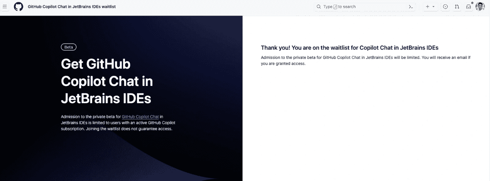

## **安装IDE插件**

我们这里使用微软自家的Visual Studio Code插件来做示范。

1.  下载微软自家的IDE Visual Studio Code

1.  下载链接： https://code.visualstudio.com/

1.  安装插件

1.  在扩展里搜索「Copilot」，点击安装即可。安装完成后右下角会有个小飞行员的图标就安装完成了。

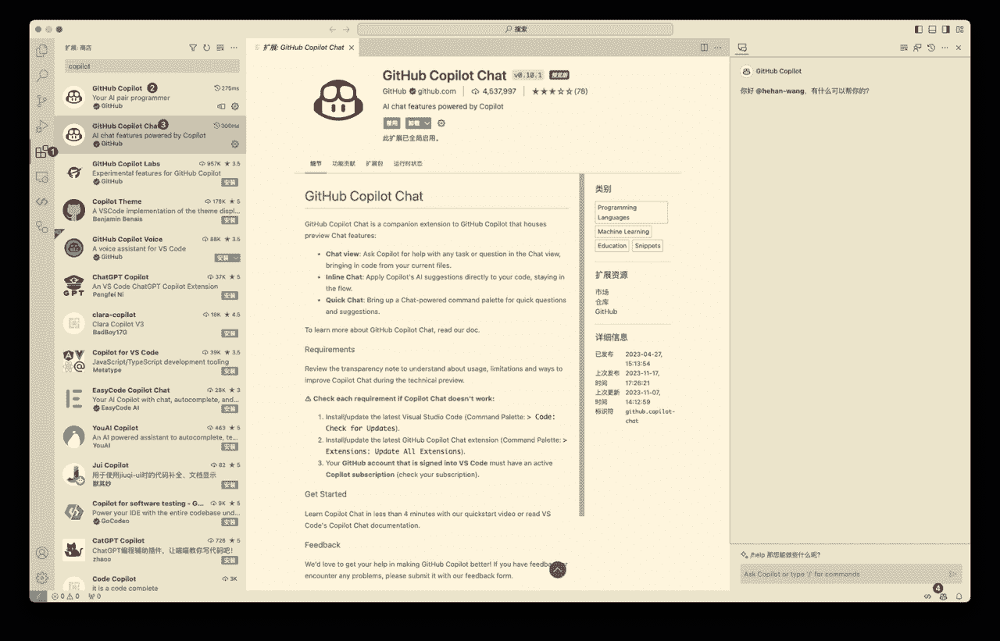

1.  点击飞行员图标登录你开通订阅的Github账户即可

## **开始使用**

如果开通了Copilot Chat权限，就可以打开一个类似ChatGPT的聊天界面。

输入”/” 即可触发自带AI命令，也可以在聊天框中进行含有上下文的连续对话。

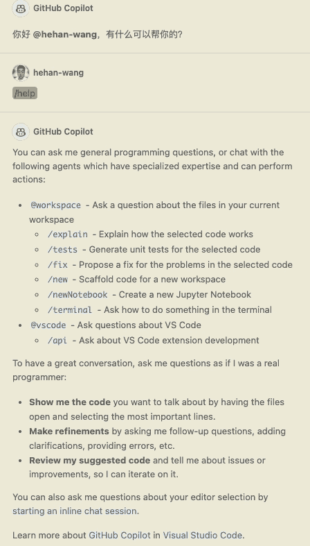

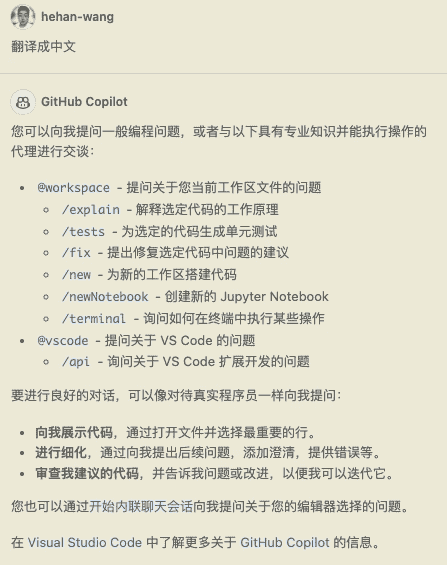

# 用Copilot Chat实战开发一个网站

## **代码生成**

NextJs是一个基于NodeJs的前后端全栈一体项目，这里我就选这个技术让一个小白也可以建立自己的网站。

我们使用 「/new」命令，直接创建一个完整的NextJs工程。

首先他列出来了需要生成的文件，点击「Create Workspace」生成这一堆文件（时间可能会稍长）。

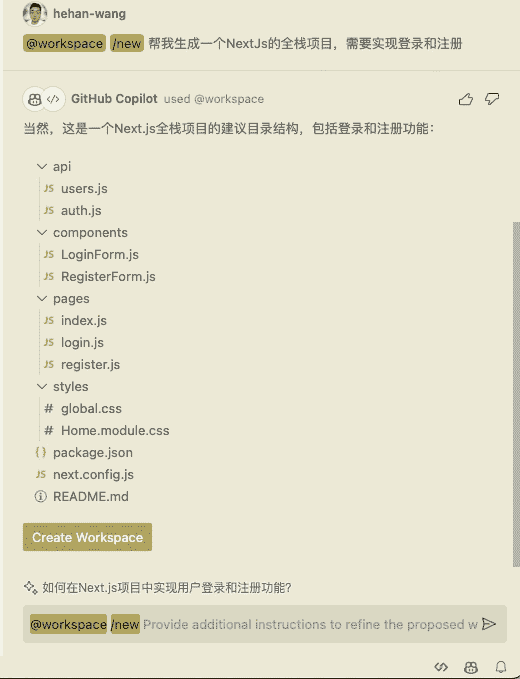

## **代码运行**

我是个小白不懂NextJs，也不懂NodeJs咋办呢？

额~继续让Copilot大佬教教我

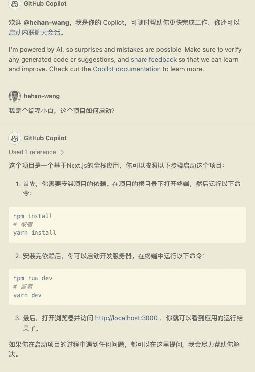

那么我们打开终端原神启动！

运行npm install居然报错了

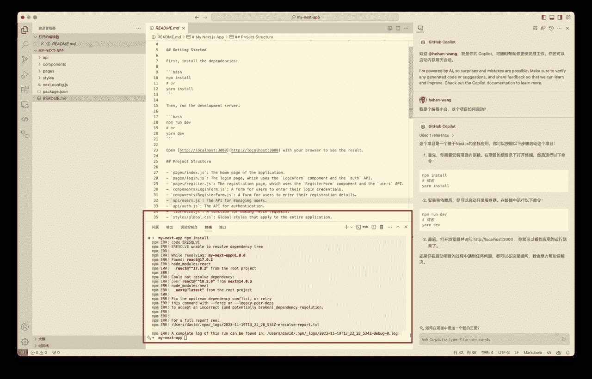

## **代码修复**

继续借助Copilot老师修复代码。

把上面的报错发给Copilot去让它协助我修复问题。

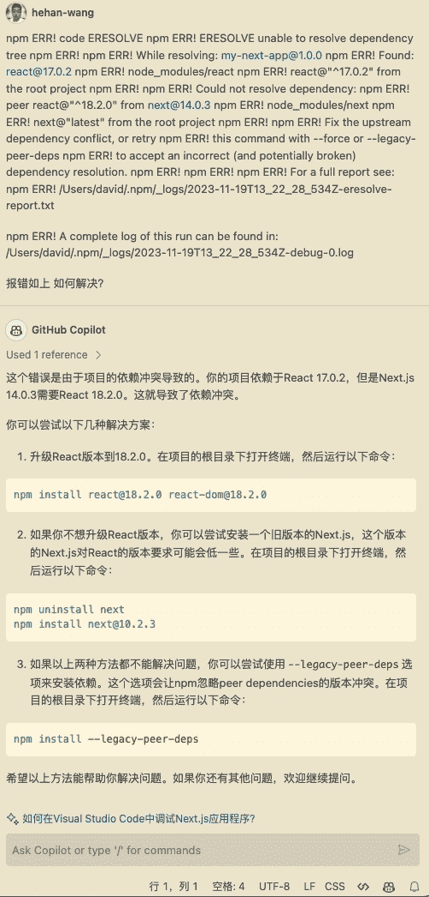

中间遇到的问题都可以继续去提问，让Copilot帮我排查问题。

经过一系列的排查最终运行npm run dev 启动服务，浏览器打开 http://localhost:3000/ 进行访问。

## **成果展示**

首页：

注册：

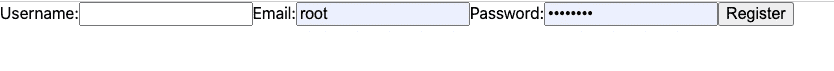

登陆：

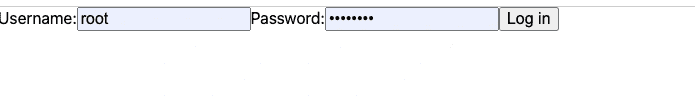

代码完整github链接： [https://github.com/hehan-wang](https://github.com/hehan-wang/nextjs-copilot-demo)/nextjs-copilot-demo

这个代码还比较初级，页面样式，后端数据库等还有很多功能需要逐渐完善。

也都是根据我们的「根本需求」，在聊天框与Copilot不断对话进行代码编写。

**做一个系统再也不是先都学会对应技术才**开始开发。而是先开发，再去学习对应技术。

更多内容可以点击目录： [手册内容汇总](https://aiyanxishe.feishu.cn/wiki/LBXcwPv6UiZgdfkp14Xc1Wo1n3b)

✨ 如果觉得有收获，请点一点下方的“有启发” ✨

🌱 我也会及时优化迭代内容，给大家更好的阅读体验 🌱

<https://aiyanxishe.feishu.cn/sync/IaSadpoOOsopKab1ajKcz6z3nAb>