# 21世纪的终端工具WARP

> 来源：[https://aiyanxishe.feishu.cn/docx/IYaDdOYH2oqlNFxRNqkcKxTenif](https://aiyanxishe.feishu.cn/docx/IYaDdOYH2oqlNFxRNqkcKxTenif)

## 程序员AI破局简介

> [《程序员AI破局指南》](https://t.zsxq.com/19EOflzkQ)由字节、百度、阿里等互联网大厂的AI业务相关高管共创，分享开箱即用、面向市场的AI编程知识和工具。

> 指南包括六个专栏:**AI编程实战、AI编程工具、AI高效办公、A**I副业赚钱、AI提示词工程、AI私人助手

> [程序员AI破局指南](https://t.zsxq.com/19EOflzkQ) 原价 599 元，限时特惠 199 元/年，5月1日恢复原价。

> 加入我们：https://t.zsxq.com/19EOflzkQ

> 购买后，添加群主微信加入 AI研习社陪伴社群，限时领取超值福利。

最近我在一个大佬的直播分享中看到一个特别牛的工具。当时大佬在自己电脑终端，噼里啪啦，行云流水的操作，把我震惊了，这不就是我一直追求的终端操作流吗？只看见大佬的终端工具上显示了“warp”几个大字。于是乎，我像抓住了救命稻草，搜索了一下，一个新世纪向我打开，原来终端工具不止zsh + ohmyzsh好用，还有更牛的全面支持AI的终端工具：warp

这里我认**为把wa**rp称为21世纪最牛的终端工具也不为过，可能有些朋友又觉得我标题党了，其实之前有位大哥在我文章评论里提过标题党的问题后，我已经很注意了，现在轻易不会说最、史上、第一等等这样的词汇，不过我愿意为了warp再标题党一次（虽然我个人确实不认为这次是标题党）好了，接下来开始我们的正文：我认为的21世纪最牛逼的终端工具： warp

官网地址： https://app.warp.dev/

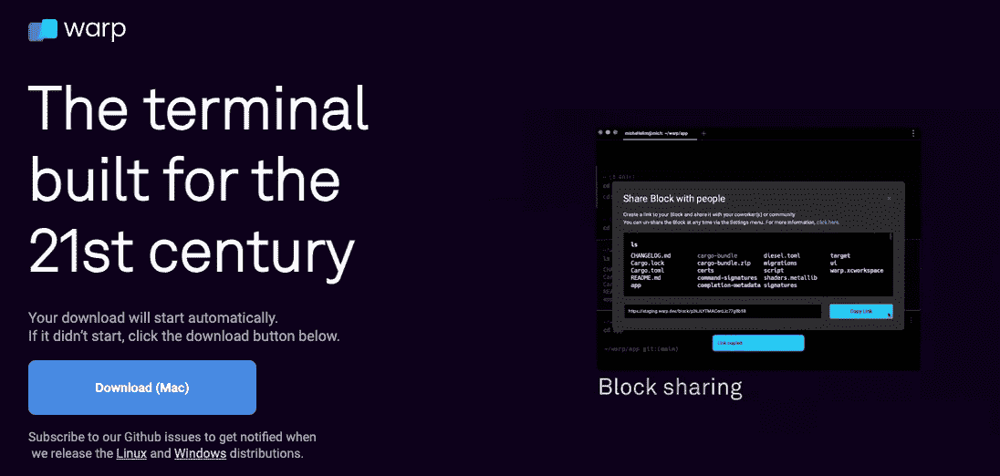

官网上也有介绍自己是21世纪的终端工具哦

做开发的朋友应该最不陌生的就是IDE(集成开发环境，非IT开发的朋友可以理解成写代码的工具)和Terminal（终端，非IT开发的朋友可以理解成让代码跑起来的工具），现在开发用的IDE已经百花齐放，针对不同语言的IDE层出不穷，如大名鼎鼎的JetBrains系列、VSCode等，智能到都不需要写代码，跟他说一句，直接整个功能就可以完成的程度。

但针对Terminal终端，近40年却没有太大的进步，还是停留在vim的时代，虽然现在有了zsh + ohmyzsh，但智能程度还是跟IDE不在一个层次。谷歌的一个程序员也意识到了这个问题，毅然辞职，誓要做一款21世纪最好用的终端工具：warp，如果你体验过warp，你会觉得他做到了，大家给这个敢于尝试的程序员一点掌声👏🏻

Warp的理念与Notion相似，它将所有内容视为区块（Block），从而消除了终端使用中的一些长期痛点。具体来说，这种以区块为核心的思想解决了输入和输出结果难以交互的问题，大大提高了使用的便利性和效率。除此之外，Warp还具有一些强大的功能。首先，它自带了命令自动补全功能（Auto Suggestions），这使得在终端中输入命令变得更为便捷和高效。其次，Warp还拥有AI功能，即用户可以通过聊天的方式快速解决遇到的问题，这使得终端的使用体验更加接近于IDE。

相信通过上面的介绍，大家对warp是做什么的有一定的了解，非程序员群体不太建议继续看了，因为为了一辈子都用不到的内容投入时间，是对自己的不尊重，程序员或者希望加入这个队伍的群体我们继续。

**文本的内容分为以下几部分内容：**

**一.warp的安装**

**二.warp的使用介绍**

**三.总结**

## 一. **warp的安装**

大家直接登录warp的官网，根据自己的操作系统（Mac、Window、Linux）选择适合自己系统的版本即可。

下载下来后点击安装，最后可以看到如下界面，表示安装成功，这里我以Mac系统为例

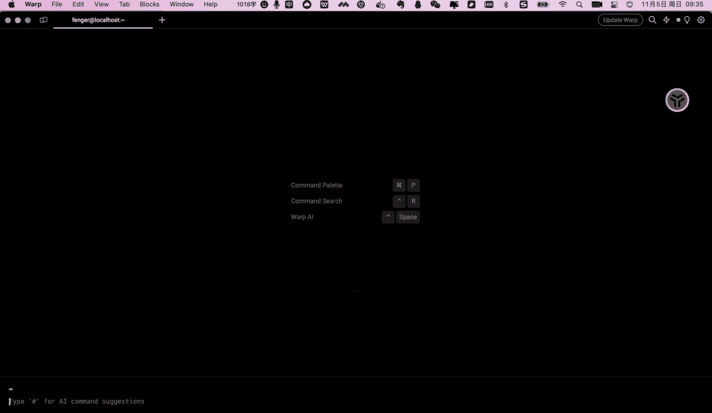

## 二. **warp的使用介绍**

warp的功能非常强大，这里我重点说几点跟其他传统终端不同的点，其他的大家可以自行体验。

1.  输入框内容可随意编辑

之前传统的终端工具，我们某个命令如果打错了，只能通过键盘上的左右移动键找到对应打错的字符后删除修改，而warp的输入框其实是一个小型的编辑器，支持鼠标控制光标到任意位置，这样极大的提高了编辑效率。

而且支持语法高亮哦，看下图的git 和clone的颜色

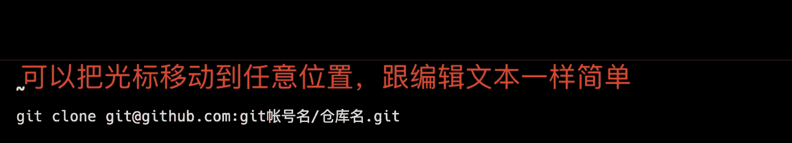

1.  命令智能提示

比如我输入git后忘记添加命令怎么写的，可以按一下tab键，所有跟git相关的子命令就提示了出来，选一个自己需要的即可，按键盘的右键表示接受这个命令。

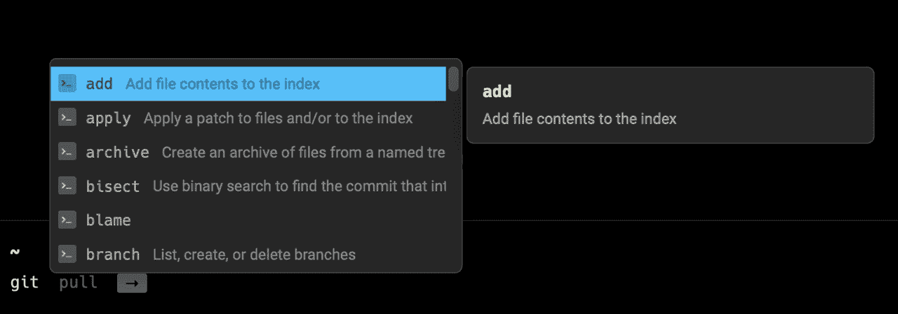

而且这个支持级联操作

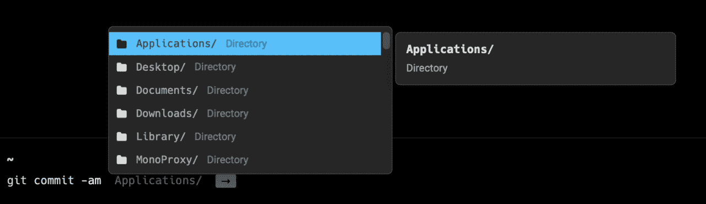

1.  命令智能纠错

比如我把git commit命令打错为git comit,之前可能只有大家对这个命令比较了解才知道报错原因，现在warp可以智能的识别到错误的命令，并告诉你修改建议。

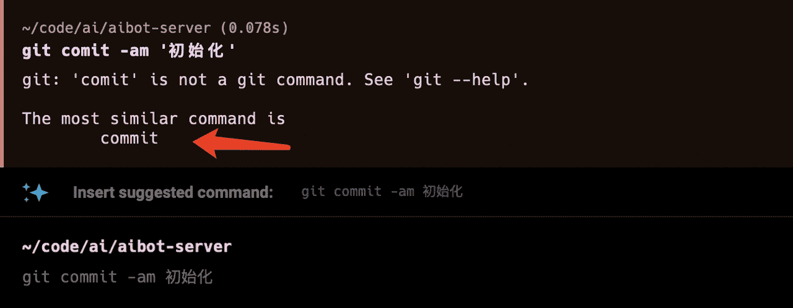

1.  Warp AI 使用体验

（1）如何获得一个我们不知道的命令

比如不清楚一个具体命令的写法，如查看当前目录下有哪些文件，可以直接在warp软件底部的交互界面中输入

```
井号# +要提问的问题
举例：
# 显示当前目录下的文件的命令

看下图，warp给了我们具体的查看文件的命令：ls
```


我们再来一个常用的命令：

git代码提交的命令，可以看到warp也智能的给到了相关的命令，以后也在不用去背那些晦涩枯燥的命令了，直接用自然语言交互即可，so easy!

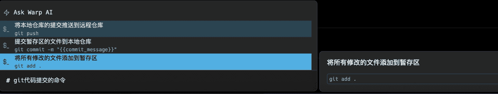

（2）命令执行报错如何解决

之前我们如果在终端执行一条命令，如在iTerm终端一旦报错，只能去谷歌百度查询报错原因，现在我们再也不用来回搜索了，warp终端可以提示我们报错原因，并给我们优化建议。

比如这里将查看当前目录下的文件的命令故意输错为ls home

大家看到 终端提示 ：No such file or directory

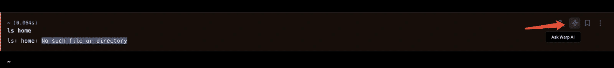

这个时候，我们点击右方的闪电按钮，进入AI交互界面

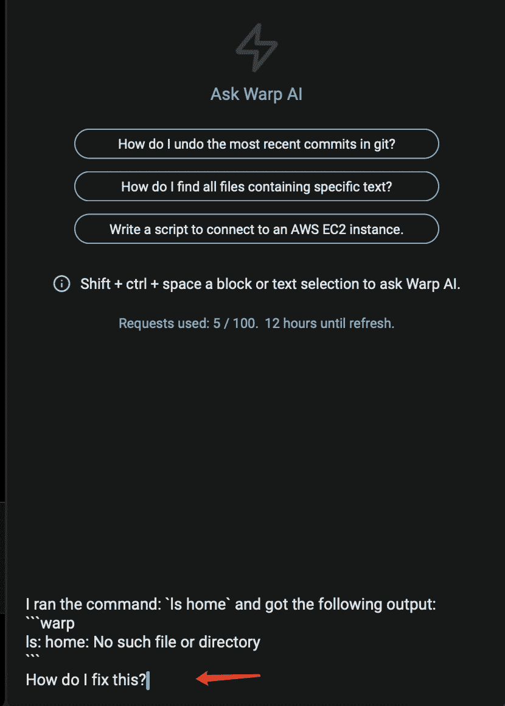

这个界面，其实可以看到每天我们有100次免费跟Warp AI对话的权限，超了就要付费了，不过100次足够使用了。

大家把最下面的 How do I fix this?改成汉语"我怎么解决这个问题？",不然Warp AI可能用英语回复你答案，对一个英语都不如四岁孩子的人，这个绝对是个灾难😭

warp给的提示还是很贴心的，按照步骤排查，一般都能找到问题出在哪。我们看到第一步，Warp AI让我们检查一下当前目录是否有home目录，我当前目录下确实没有，所以才报错，看到第一步问题就解决。

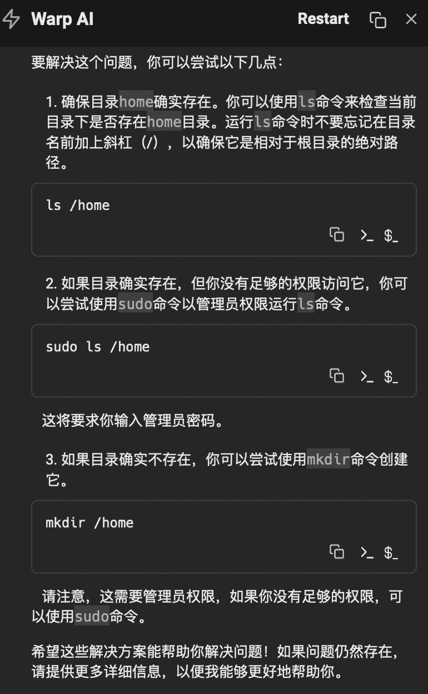

这里只是举一个最简单的例子，更多复杂的场景，大家可以自己实践，有问题也可以随时跟我交流。

1.  命令块相关操作

我们每输入一条命令，会在warp的界面上创建一个独立的内容块，如下图蓝框中的部分。

这个内容块包括当前的目录、输入的命令、及命令的返回结果，如果返回的结果是一个文件或者目录，我们甚至可以点击跳转，做的非常人性化。

点击右侧三个点的链接，可以看到一系列针对这个内容块的操作，如生成分享页面，跟Warp AI交互，将命令保存为workFlow,方便快捷调用等等。

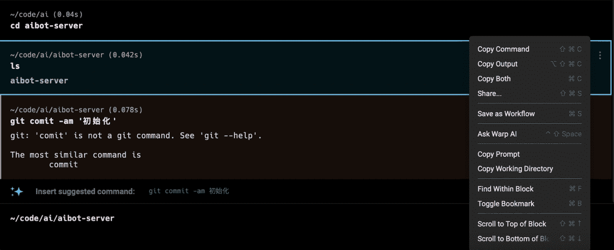

一次交互会生成一个内容块

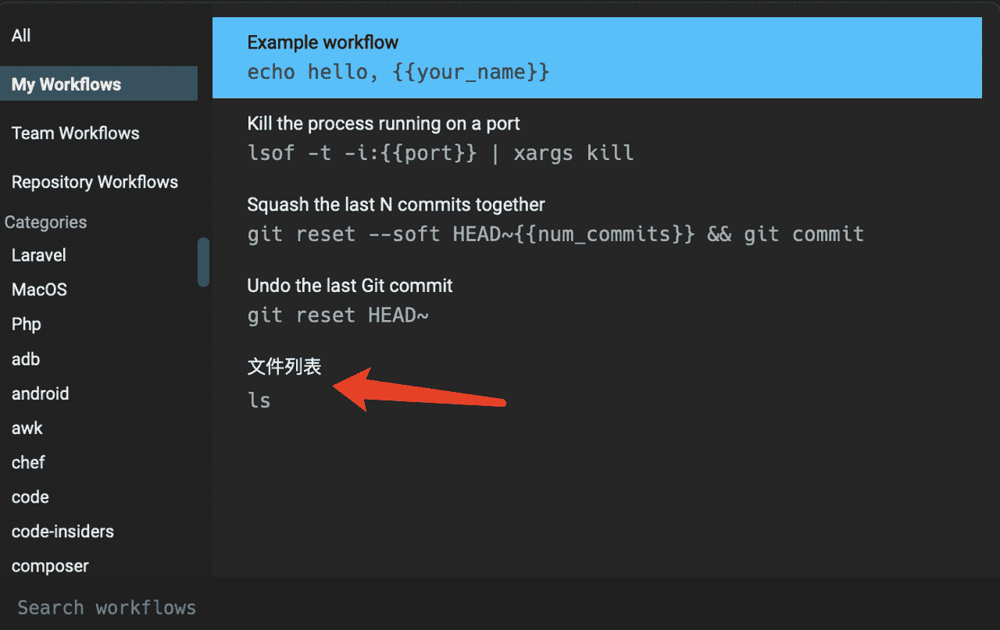

将命令保存为workflow,方便后期迅速调用

1.  固定命令行头，内容展示更加人性化

我们这里输入一条返回特别长内容的命令seq 1 20,展示1-200，一共200行，这里一个屏幕肯定展示不开，当我们滑动屏幕的时候，发现头部的命令并没有跟着滑动，只是返回的内容进行了滚动，就跟excel固定表格头是一个道理，这样更符合我们的查看习惯。

另外，按ctrl+F,可以对内容进行检索，比如我这里搜返回的内容中有1的部分，全部标黄展示了。

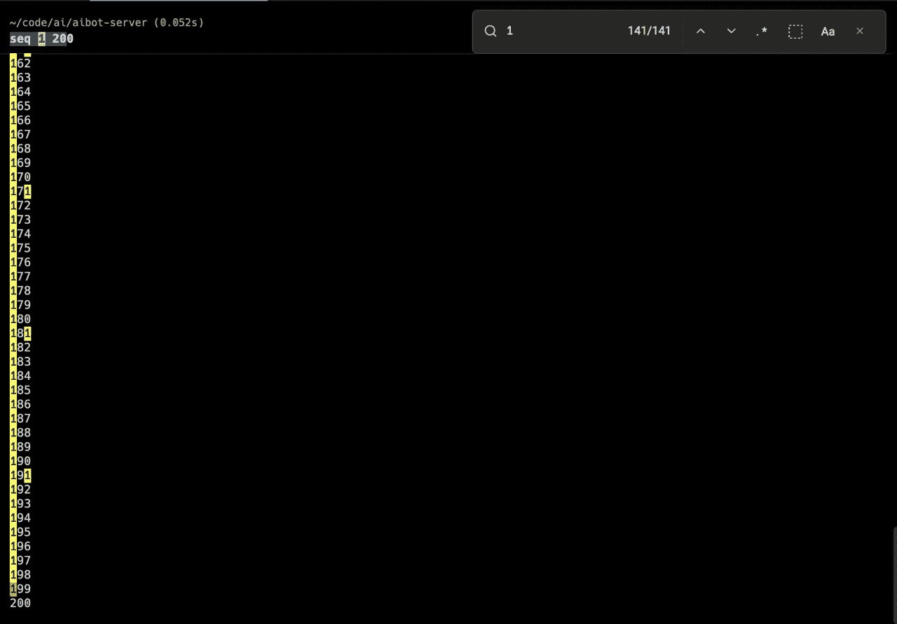

1.  更换主题和配置

如果您对当前的页面样式不满意，或者之前使用的终端有一套个性化的配置，您可以继续沿用到warp终端，无需改变您之前的使用习惯，增加使用成本。

我们点击warp->Preferences->Settings,进入配置页面。

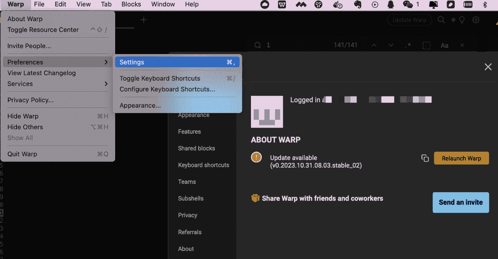

可修改主题

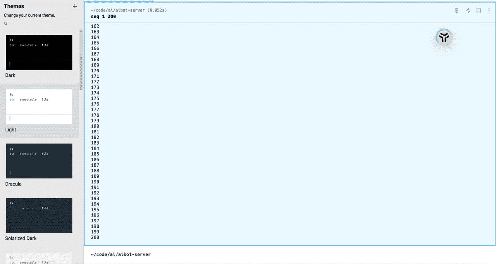

修改快捷键

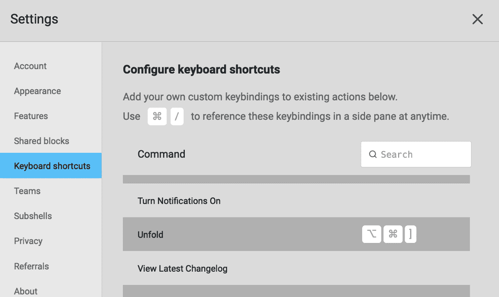

另外，还支持类似编辑器的搜索命令操作

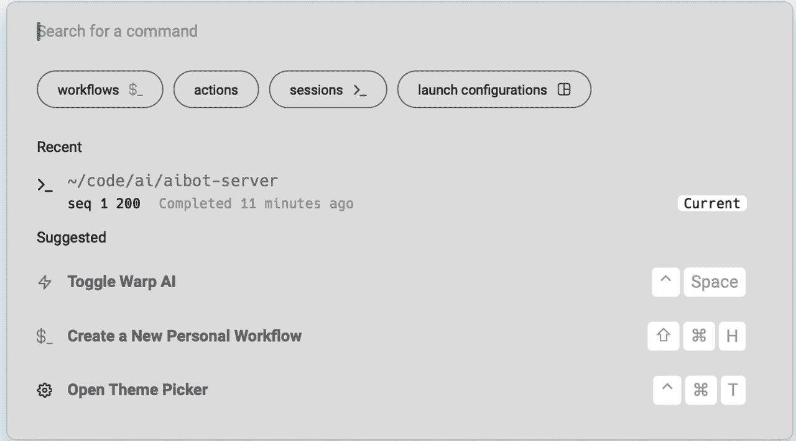

针对Session的操作，warp也做了大量的优化，大家自行探索吧。

## **三.总结**

这里我用Warp AI总结warp终端的十大优点，希望有一点能打动屏幕前的你。

Warp 是一款基于终端的桌面应用程序，它提供了一些优点和功能，使其在与其他终端相比具有一定的优势。

1.  **快速导航 **：Warp 允许你通过自定义的快捷键快速导航到你的常用目录，无需手动输入完整的路径。

1.  **书签管理 **：Warp 具有内置的书签管理功能，可以轻松地保存和访问你的常用目录。

1.  **多终端支持 **：Warp 可以同时管理多个终端会话，你可以轻松地在不同的终端之间切换。

1.  **自动 SSH 连接 **：Warp 可以自动建立 SSH 连接，使你能够快速访问远程服务器。

1.  **自动完成 **：Warp 提供了自动完成功能，可以帮助你更快地输入命令和路径。

1.  **自定义外观 **：Warp 允许你自定义终端的外观，包括主题、字体和颜色。

1.  **分屏支持 **：Warp 支持在同一个终端窗口中进行分屏操作，方便同时查看和操作多个终端会话。

1.  **命令历史记录 **：Warp 会自动记录你执行过的命令，方便你在需要时进行查找和重复使用。

1.  **跨平台支持 **：Warp 可以在多个操作系统上运行，包括 macOS、Windows 和 Linux。

1.  **插件扩展 **：Warp 支持插件扩展，你可以根据自己的需求添加额外的功能和定制化选项。

更多内容可以点击目录： [手册内容汇总](https://aiyanxishe.feishu.cn/wiki/LBXcwPv6UiZgdfkp14Xc1Wo1n3b)

✨ 如果觉得有收获，请点一点下方的“有启发” ✨

🌱 我也会及时优化迭代内容，给大家更好的阅读体验 🌱

<https://aiyanxishe.feishu.cn/sync/IaSadpoOOsopKab1ajKcz6z3nAb>