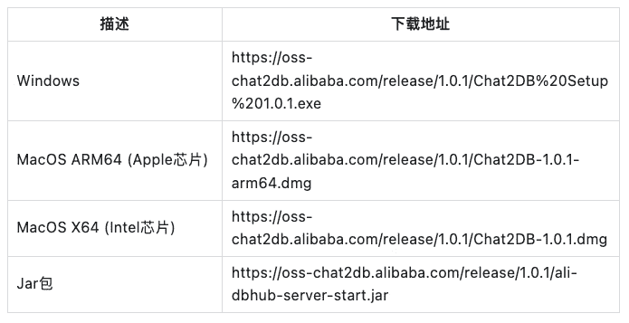
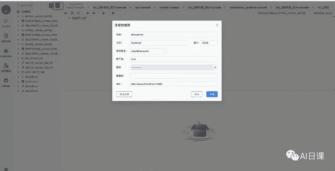
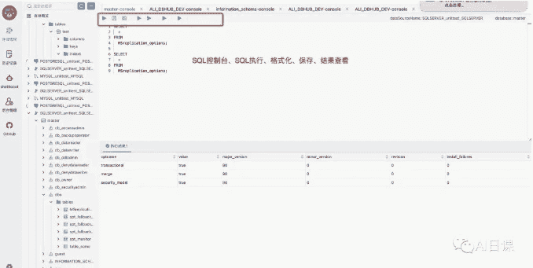
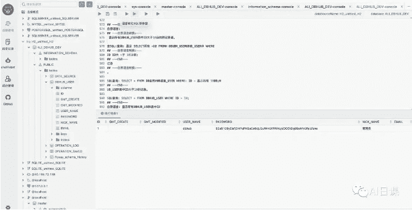
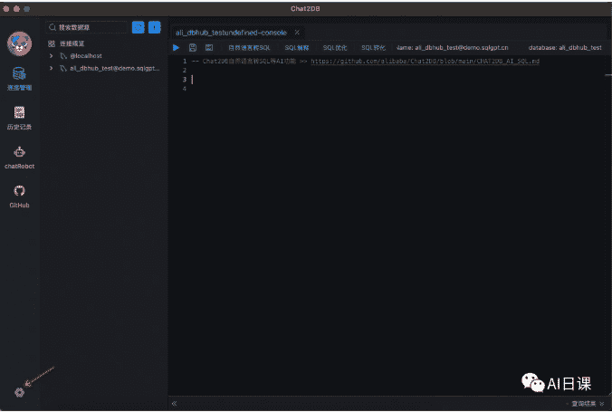

# AIGC数据库客户端Chat2DB

> 来源：[https://aiyanxishe.feishu.cn/docx/PDB9dV6NRoR9kTxZ2RccZVd3nxd](https://aiyanxishe.feishu.cn/docx/PDB9dV6NRoR9kTxZ2RccZVd3nxd)

## 程序员AI破局简介

> [《程序员AI破局指南》](https://t.zsxq.com/19EOflzkQ)由字节、百度、阿里等互联网大厂的AI业务相关高管共创，分享开箱即用、面向市场的AI编程知识和工具。

> 指南包括六个专栏:**AI编程实战、AI编程工具、AI高效办公、A**I副业赚钱、AI提示词工程、AI私人助手

> [程序员AI破局指南](https://t.zsxq.com/19EOflzkQ) 原价 599 元，限时特惠 199 元/年，5月1日恢复原价。

> 加入我们：https://t.zsxq.com/19EOflzkQ

> 购买后，添加群主🛰️加入 AI研习社陪伴社群，限时领取超值福利。

今天给大家介绍一款强大的集成了AIGC的数据库客户端工具。废话不多说，直接上官方简介：

## 📖 一**.简介**

Chat2DB 是一款有开源免费的多数据库客户端工具，支持windows、mac本地安装，也支持服务器端部署，web网页访问。和传统的数据库客户端软件Navicat、DBeaver 相比Chat2DB集成了AIGC的能力，能够将自然语言转换为SQL，也可以将SQL转换为自然语言，可以给出研发人员SQL的优化建议，极大的提升人员的效率，是AI时代数据库研发人员的利器，未来即使不懂SQL的运营业务也可以使用快速查询业务数据、生成报表能力。

✨ **特性**

+   🌈 AI智能助手，支持自然语言转SQL、SQL转自然语言、SQL优化建议

+   👭 支持团队协作，研发无需知道线上数据库密码，解决企业数据库账号安全问题

+   ⚙️ 强大的数据管理能力，支持数据表、视图、存储过程、函数、触发器、索引、序列、用户、角色、授权等管理

+   🔌 强大的扩展能力，目前已经支持MySQL、PostgreSQL、Oracle、SQLServer、ClickHouse、OceanBase、H2、SQLite等等，未来会支持更多的数据库

+   🛡 前端使用 Electron 开发，提供 Windows、Mac、Linux 客户端、网页版本一体化的解决方案

+   🎁 支持环境隔离、线上、日常数据权限分离

一句话总结：这是一款AI数据库连接工具，可以极大的提高跟数据库打交道的效率，可以将自然语言转换为SQL，也可以将SQL转换为自然语言，可以给出研发人员SQL的优化建议，极大的提升人员的效率，是AI时代数据库研发人员的利器，未来即使不懂SQL的运营业务也可以使用快速查询业务数据、生成报表能力。

## ⏬ **二.下载安装**

## 🌰 三**.使用Demo**

1.创建数据源

2.数据源管理

3.AI智能助手

## **四.使用配置**

**1.点击设置**

2.配置OPENAI_API_KEY

**3.自然语言转SQL**

**(1)功能描述**

输入自然语言，选中执行并传入查询相关的表结构信息，则会返回相应的SQL

+   输入样例：

+   查询学生小明的各科目成绩，并传入关联数据表course,score,student,student_course

+   输出样例：

SELECT score.scoreFROM score INNER JOIN student_course ON score.course_id = student_course.course_idINNER JOIN student ON student_course.student_id = student.idWHERE student.name = '小明'

**4.SQL解释**

**(1)功能描述**

输入SQL，选中执行并传入附加信息，附加信息可以添加希望解释《输入SQL》哪方面的信息，如SQL执行目标，则会返回此条SQL附加信息相关的解释

+   输入样例：

+   SELECT department_name FROM departments WHERE department_id IN (SELECT department_id FROM employees GROUP BY department_id HAVING COUNT(*) > 10)

+   输出样例：这个SQL查询语句的意思是：从departments表中选择department_name列，其中department_id列的值在employees表中department_id列的值分组后，如果该组中的记录数大于10，则返回该department_id。换句话说，这个查询语句返回的是在employees表中有超过10个员工的部门名称。

**5.SQL优化**

**(1)功能描述**

输入SQL，选中执行并传入优化附加信息，附加信息可以添加希望具体优化方面和要求，则会返回此条SQL附加信息相关的优化建议

+   输入样例：

+   SELECT * FROM department ORDER BY gmt_create DESC

+   输出样例：

+   尽量避免使用SELECT *，应该明确指定需要查询的列，以减少不必要的数据传输和提高查询效率。

+   对于ORDER BY语句，如果查询的结果集比较大，可以考虑添加LIMIT限制返回的行数，以减少排序的开销。

+   对于gmt_create字段，可以考虑添加索引以提高排序的效率。

+   如果查询的结果集经常被访问，可以考虑使用缓存技术，如Redis等，以减少数据库的访问次数。

**6.SQL转换**

**(1)功能描述**

输入SQL，选中执行并传入目标SQL类型和附加信息，附加信息中可以添加转换的自定义要求，则会返回目标SQL类型且符合附加要求的SQL语言

+   输入样例：

+   SELECT IFNULL(NULL, "W3Schools.com")，目标SQL类型为Oracle SQL

+   输出样例：

+   SELECT NVL(NULL, 'W3Schools.com') FROM dual;

更多内容可以点击目录： [手册内容汇总](https://aiyanxishe.feishu.cn/wiki/LBXcwPv6UiZgdfkp14Xc1Wo1n3b)

✨ 如果觉得有收获，请点一点下方的“有启发” ✨

🌱 我也会及时优化迭代内容，给大家更好的阅读体验 🌱

<https://aiyanxishe.feishu.cn/sync/IaSadpoOOsopKab1ajKcz6z3nAb>