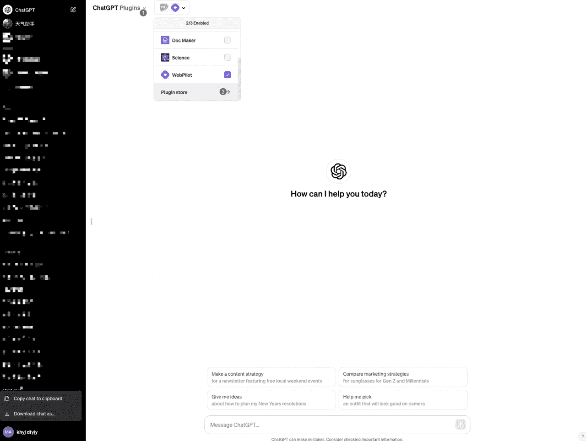
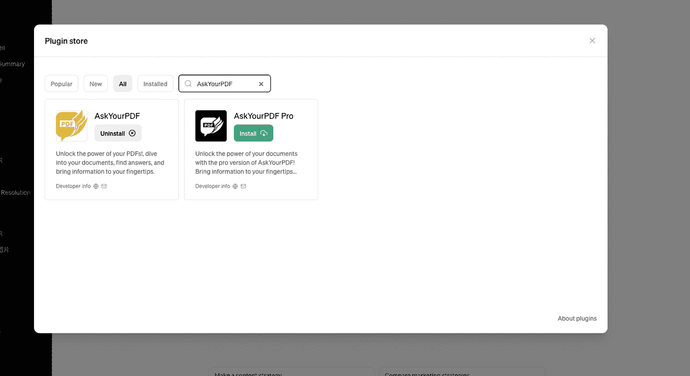
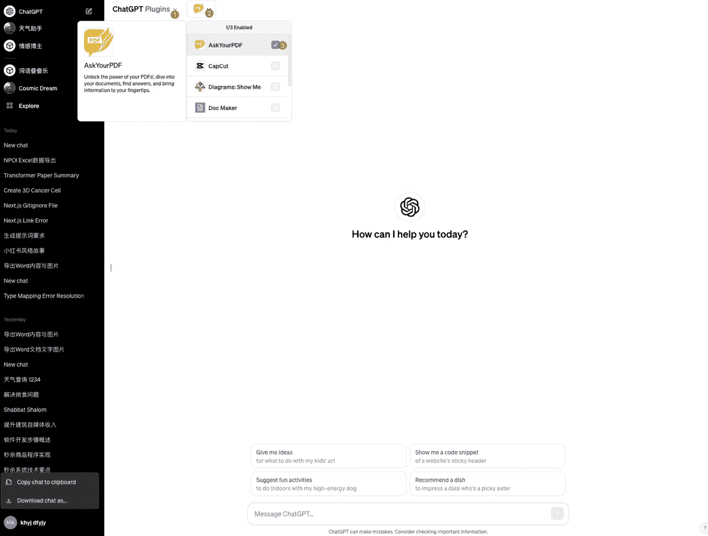
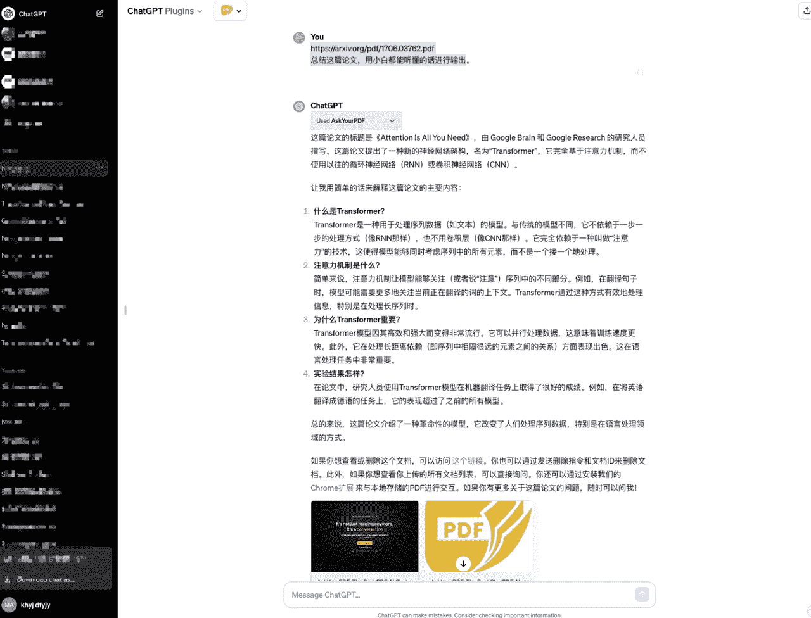

# 借助GPT一分钟读懂一篇英文论文

> 来源：[https://aiyanxishe.feishu.cn/docx/WkRpdfhc5oxrihxE5FHcG1lWnPc](https://aiyanxishe.feishu.cn/docx/WkRpdfhc5oxrihxE5FHcG1lWnPc)

## 程序员AI破局简介

> [《程序员AI破局指南》](https://t.zsxq.com/19EOflzkQ)由字节、百度、阿里等互联网大厂的AI业务相关高管共创，分享开箱即用、面向市场的AI编程知识和工具。

> 指南包括六个专栏:**AI编程实战、AI编程工具、AI高效办公、A**I副业赚钱、AI提示词工程、AI私人助手

> [程序员AI破局指南](https://t.zsxq.com/19EOflzkQ) 原价 599 元，限时特惠 199 元/年，5月1日恢复原价。

> 加入我们：https://t.zsxq.com/19EOflzkQ

> 购买后，添加群主🛰️加入 AI研习社陪伴社群，限时领取超值福利。

面对一篇晦涩难懂的论文，尤其是英文论文，在没有人工智能的时候，理解它的成本非常高（包括英文阅读的困难、专业知识的限制等等），因此大部分人基本上都会放弃阅读。 有了ChatGPT就不一样了，小白也能很快读懂一篇英文论文了。

# **操作流程**

## **开通GPT plus**

参考👸号文章： [https://mp.weixin.qq.com/s/8p](https://mp.weixin.qq.com/s/8pD80_xC3FbNXb5ckbgyoA)D80_xC3FbNXb5ckbgyoA

## **安装AskYourPdf插件**

1.打开插件商店

2.搜索「AskYourPDF」进行安装

## **进行论文阅读**

[我们选一篇transformer](https://arxiv.org/pdf/1706.03762.pdf)的论文： https://arxiv.org/pdf/1706.03762.pdf

1.勾选上我们安装的AskYourPDF插件

2.输入Prompt，进行对话

链接分享： [h](https://chat.openai.com/share/3f9c7d88-eef3-4928-ba53-25d98d2c0478)ttps://chat.openai.com/share/3f9c7d88-eef3-4928-ba53-25d98d2c0478

GPT阅读PDF的技术原理后续章节详细讲解。

<https://aiyanxishe.feishu.cn/sync/IaSadpoOOsopKab1ajKcz6z3nAb>