# 10分钟把一个想法变成精美PPT

> 来源：[https://aiyanxishe.feishu.cn/docx/EouOdkZQBoufsQxtFPqc7NLjnDb](https://aiyanxishe.feishu.cn/docx/EouOdkZQBoufsQxtFPqc7NLjnDb)

## 程序员AI破局简介

> [《程序员AI破局指南》](https://t.zsxq.com/19EOflzkQ)由字节、百度、阿里等互联网大厂的AI业务相关高管共创，分享开箱即用、面向市场的AI编程知识和工具。

> 指南包括六个专栏:**AI编程实战、AI编程工具、AI高效办公、A**I副业赚钱、AI提示词工程、AI私人助手

> [程序员AI破局指南](https://t.zsxq.com/19EOflzkQ) 原价 599 元，限时特惠 199 元/年，5月1日恢复原价。

> 加入我们：https://t.zsxq.com/19EOflzkQ

> 购买后，添加群主微信加入 AI研习社陪伴社群，限时领取超值福利。

最近我的好朋友卡尔，推出了自己的第一款小报童产品《AI 小红书爆款变现》，发售短短几个小时，订阅数就有600+，也算妥妥的现象级的案例。内心一方面替好兄弟卡总开心，另外也想蹭一蹭卡总的流量，于是有了这篇文章。

将卡总的《AI 小红书爆款变现》的内容大纲转成一个小红书爆款AI写作变现的PPT。通过这个演示案例，给大家打个样，后期大家如果有这样的需求：把一本书、一篇报告、一场会议、工作总结做成PPT，大家也可以像我下文展示的这样，迅速搞定，生活更加轻松、工作升职加薪不在话下。

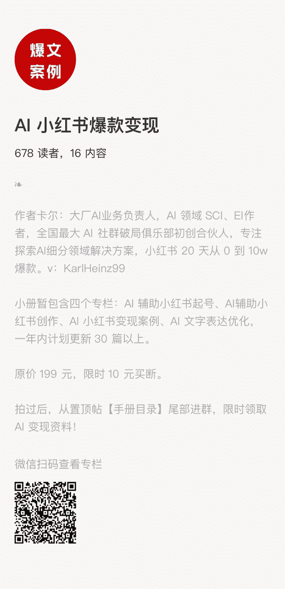

卡总的AI小红书变现专栏截图

**本文内容包括以下几部分：**

1.  **生成 PPT 大纲**

1.  **手动优化大纲**

1.  **导入AI工具生成 PPT**

# 一.生成PPT大纲

### 1. 通过已有内容生成PPT大纲

我们先将找到卡总小报童的首页，这里有专栏的目录介绍，用这个作为PPT的大纲再合适不过了。

由于小报童是不允许复制的，为了提高效率，我们还是使用OCR工具，将图片转成文字。

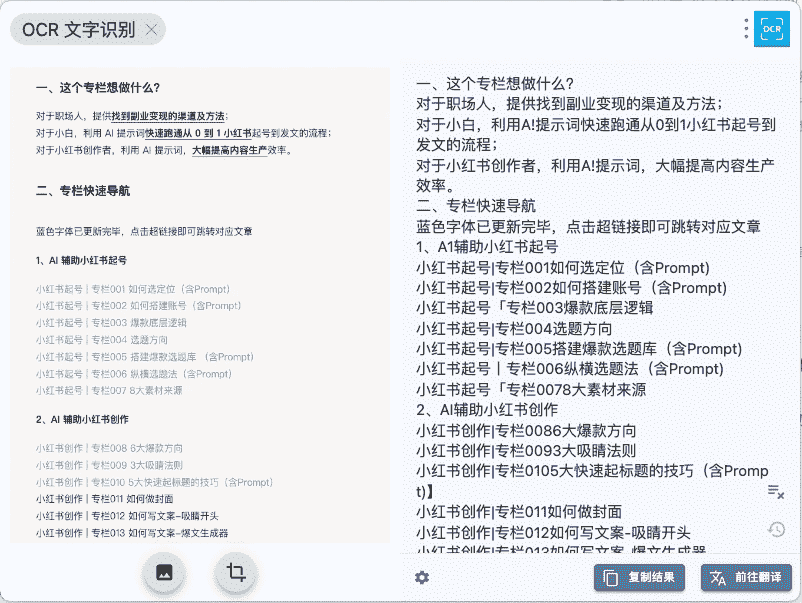

我们对转换后的文字进行简单处理，最终转换后的内容是这样的

```
一、这个专栏想做什么？
对于职场人，提供找到副业变现的渠道及方法；
对于小白，利用A!提示词快速跑通从0到1小红书起号到发文的流程；
对于小红书创作者，利用A!提示词，大幅提高内容生产效率。

二、专栏快速导航

1、A1辅助小红书起号
如何选定位（含Prompt)
如何搭建账号（含Prompt)
爆款底层逻辑
选题方向
搭建爆款选题库（含Prompt)
纵横选题法（含Prompt)
大素材来源

2、AI辅助小红书创作
大爆款方向
大吸睛法则
大快速起标题的技巧（含Prompt)】
如何做封面
如何写文案-吸睛开头
如何写文案-爆文生成器
图文笔记S0P
万能vog模板
如何制作vog脚本
关于发布时间

3、小红书变现
AI变装定制（上）
AI变装定制（下）
头像商城
资料整理
变现方式总结

4、小红书笔记优化
常见文字框架
多框架比较（含Prompt)
SOFTEN策略
AIDA框架
思维树多角色
```

我们使用GPT将以上内容转换成适合在AI版的PPT工具里能识别的markdown格式

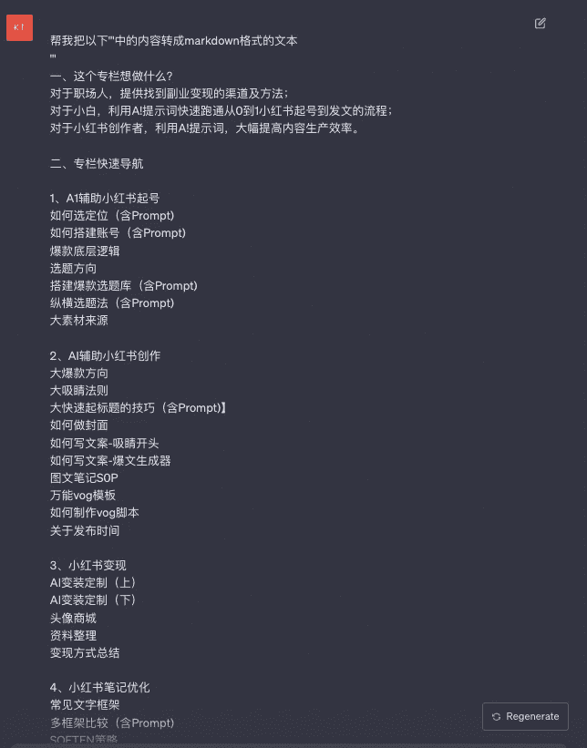

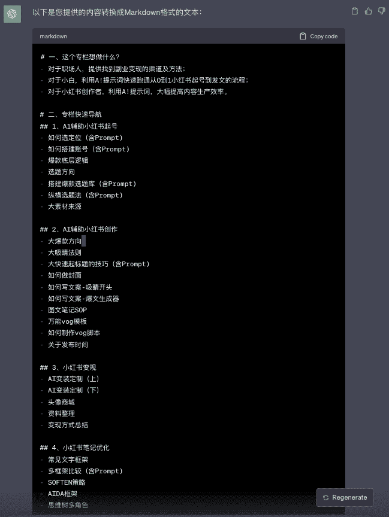

PS：这里要重点说明一下什么是markdown格式

这种概念性的内容，大家可以自行百度，网上很多介绍，一看就行，这里我们直接问GPT

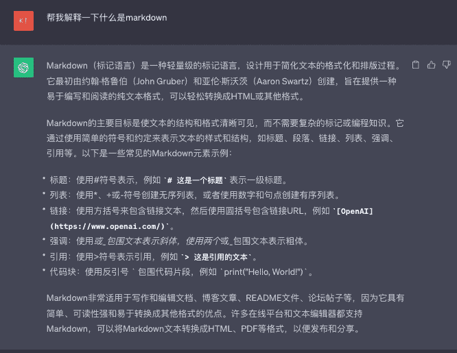

通过GPT的解释，我们大概知道，markdown是一种轻量级的标记语言，是一门所见即所得的语言，这门语言是专为排版准备的。比如我们看到网上的一个网页，为什么有的字会加粗，为什么标题的样式和普通文本的样式不一样，为什么嵌入的代码块有是一种样式，这里都可以理解成不同的内容使用了不同的markdown标签，所以看到不同部分的内容呈现的样式是不一样的。

如一个内容如果我想让他做我一级标题，我可以在内容前加一个# ，如果想做二级标题，可以在内容前加两个#

展示出来就是下面这样：

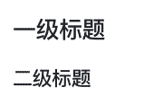

这里就不一一举例了，大家可以自己搜一下，常用的markdown标签也就那么十几个，用几次就可以熟练掌握了。

目前大多数AI工具都是支持markdown格式的内容，包括思维导图，所以一般内容准备好后，需要转成markdown格式才能与AI工具进行进一步的交互，这里可以理解成：你（普通文本）说汉语，在跟一个讲英语的老外（AI相关的工具）聊天，如果想让老外听懂你说什么，需要用英语把汉语翻译一下，同样的，把一段文字发送给AI工具处理，也需要先转成AI工具能识别的markdown格式。

### 2.使用AI工具生成PPT大纲

我们这里生成的PPT大纲的内容其实是用别人已经整理好的文章手动处理生成的，那如何借助AI生成一个PPT的大纲内容呢，这里介绍几个小工具。

1.百度AI的PPT大纲助手

输入网址： https://chat.baidu.com/ ，搜索PPT

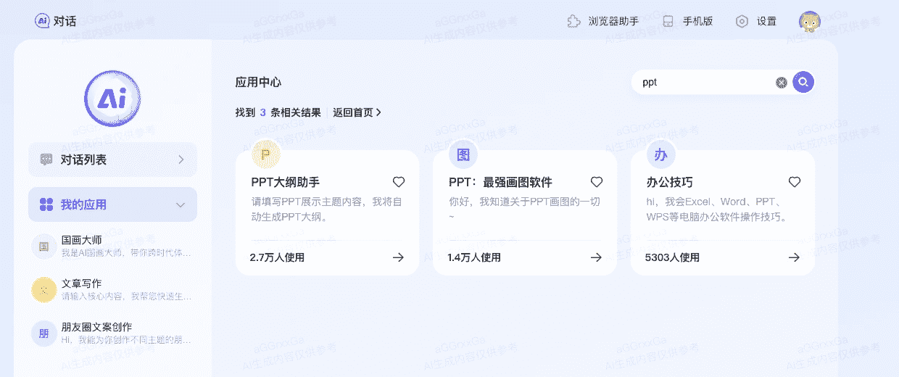

比如，我们要生成一个小白入门GO语言的PPT大纲

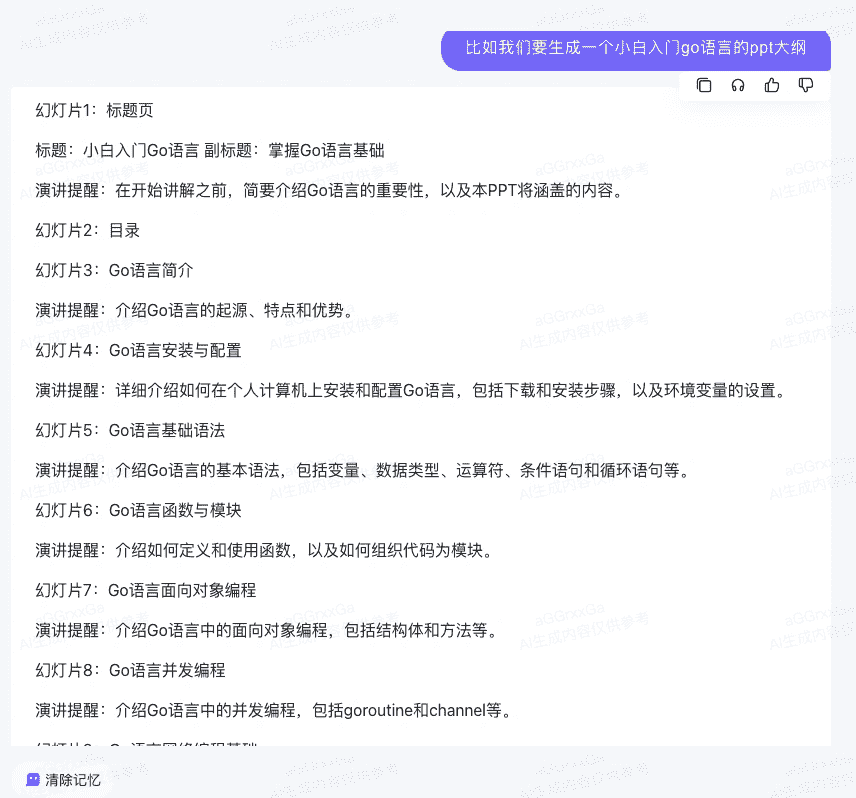

如果对效果不满意，可以接着调整，或者一会在AI PPT工具里也是可以调整的

2.三方网站：问问AI

问问AI的应用广场也有PPT大纲生成器，大家也可以使用这个助手生成对应内容的大纲，如生成一个员工培训的大纲、一个年度总结的大纲等等。

访问地址： [h](https://chat.wenwen-ai.com/user-center?code=HZSHBRULDE)ttps://chat.wenwen-ai.com/user-center?code=HZSHBRULDE

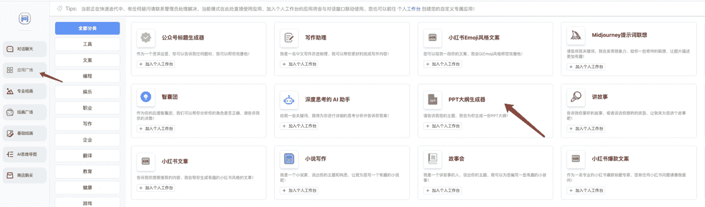

# 二.手动优化大纲

自动生成的大纲可能不符合我们当前的需求，因为GPT都是基于互联网上的公有数据训练的，他对你的个人或公司的数据一无所知，所以也就没办法针对你的提问生成太个性化的内容。

目前有两个办法解决：

方案一：训练专属个人知识库小助手

训练自己的个性化小助手，这里不多浪费大家时间，有感兴趣的朋友可以看我之前写的这篇文章

[训练专属私有模型搭建企业知识库](https://l0lupq5bcjq.feishu.cn/docx/WETgddhGpoDwsUxlyrMcNqD7nnd)

方案二：写结构化的引导提示词，引导GPT回复出更适合自己当前场景的内容，比如一个销售和一个开发写工作汇报内容是完全不一样的，这是工作岗位的区别导致；传统行业和互联网行业的工作内容也是不同的，这个是行业的区别导致的。

这里我引用景淮兄弟的一篇文章，里面有详细的关于结构化Prompt生成PPT大纲的提示词。

[https://mp.weixin.qq.com/s/Fl](https://mp.weixin.qq.com/s/FlSR8cxgnikLADGokpWUUg)SR8cxgnikLADGokpWUUg

篇幅原因，这块就不展开说了，对这部分内容有兴趣的朋友，可以在陪伴群里聊聊。

# 三. **导入AI工具生成 PPT**

目前生成PPT的AI工具还是很多的，比如 MindShow、爱设计、AI PPT、WPS AI、gamma等等。

对比了几款工具，感觉 爱设计从各方面综合来看性价比相对还是最高的，AI PPT效果最好，但收费太贵了，因为我本身没有制作PPT的强需求，所以仅仅只是体验了一下。

所以下文重点介绍爱设计这款PPT AI制作软件的使用步骤，其他的软件，我也就不一一展示了，大家可以登录相关软件的官网看看，体验一下，做的都很简洁，按照步骤操作就会使用。

### 1.登录爱设计官网，注册登录

[https://ppt.isheji.com/?code=](https://ppt.isheji.com/?code=4fbhfx1wv6&as=invite)4fbhfx1wv6&as=invite

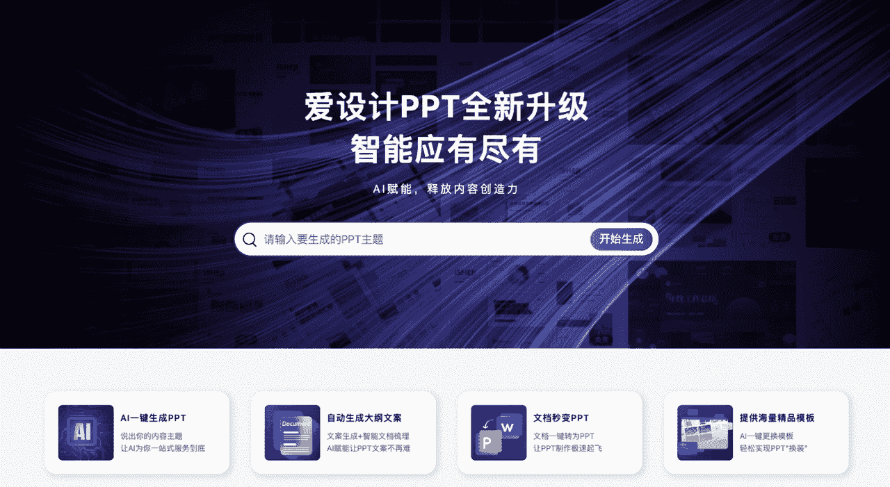

### 2.选择当前对应的步骤

上图我们看到使用爱设计生成PPT的四个步骤

步骤一：AI一键生成PPT

步骤二：自动生成大纲文案

步骤三：文档秒变PPT

步骤四：提供海量精美模版

由于本文档前两步已经生成了符合我们要求的PPT内容，这里使用爱设计的目的只是将我们的文案转成已经排版好的带图片的PPT，所以这里我们选择步骤三：文档秒变PPT。

### 3.文案转成PPT

点击"文档秒变PPT"按钮，跳转到如下页面：

点击‘导入本地大纲’，这里我们将之前生成的markdown格式的PPT大纲复制进入，点击生成PPT按钮

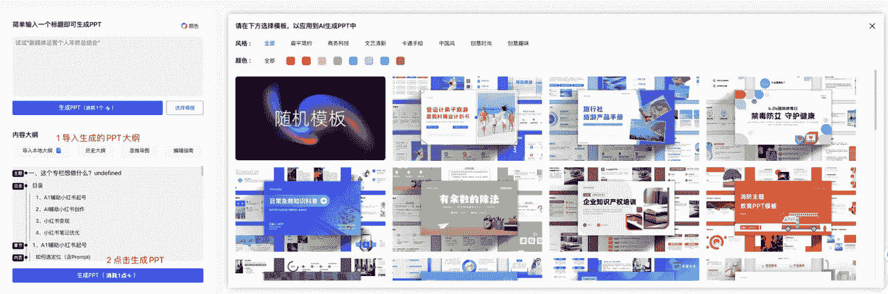

右侧随机选择一个跟主题关联性强一些的模版，便会生成对应样式的PPT

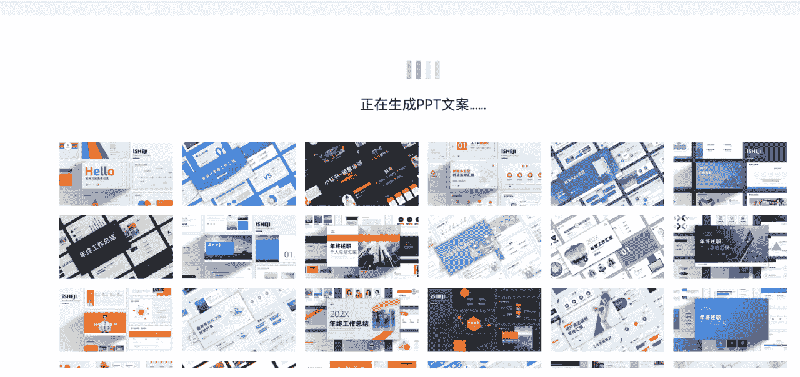

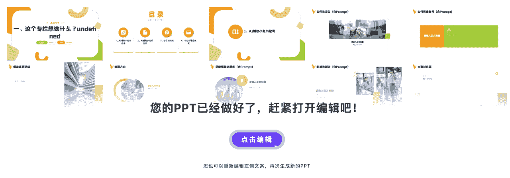

### 4.对PPT进一步优化

对生成的PPT可以优化内容、替换模版、更新素材、插入文本、形状、图表、表格等等。这些基本都是PPT的常规操作了，如果顺利，制作一个PPT的时间应该可以控制在十分钟以内，效率比之前，自己一页页的涉及提升了N倍。

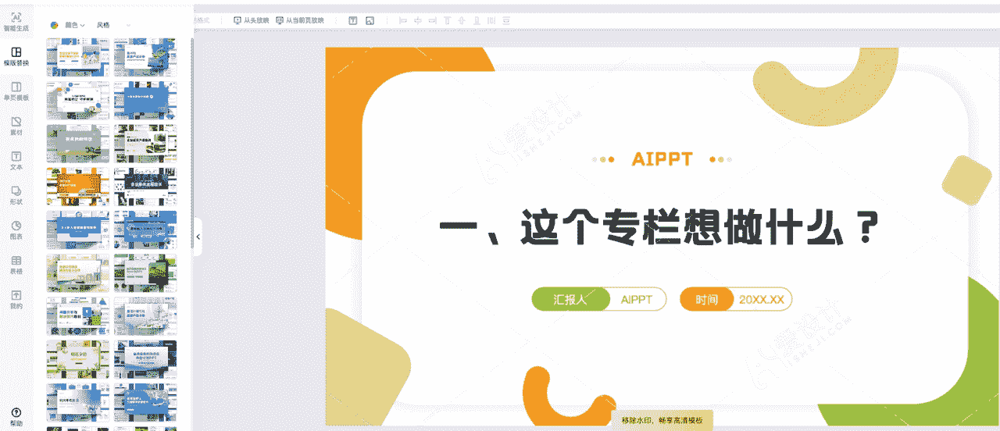

### 5.导出PPT

修改完成后，右上角有个演示和下载按钮，点击演示可以查看制作的幻灯片的效果，点击下载，可以导出刚制作的幻灯片到本地。


### 6.最终制作的PPT截图展示

这里截取几页，大家看看效果，还是很赞的

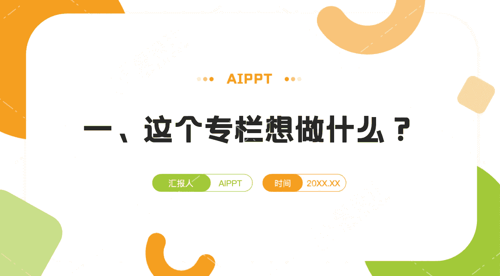

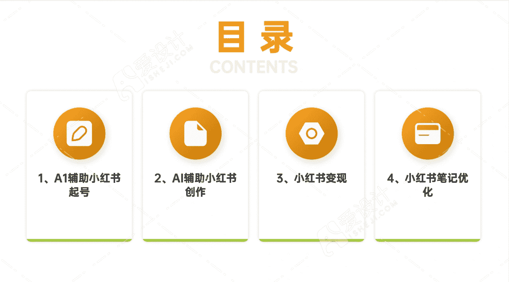

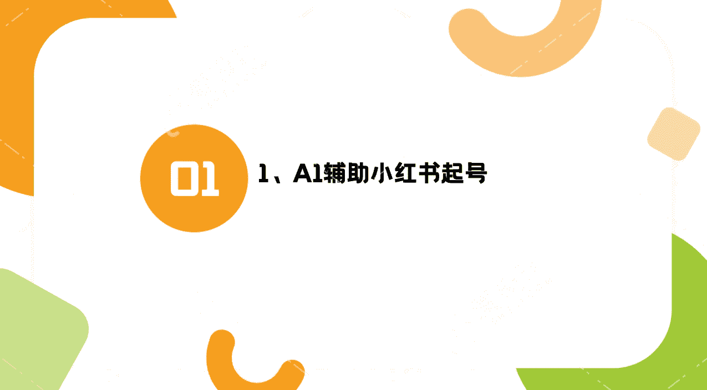

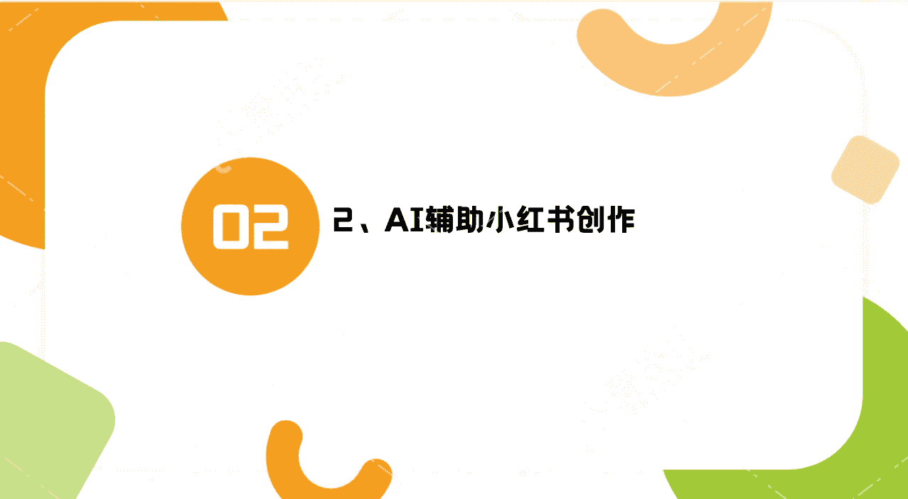

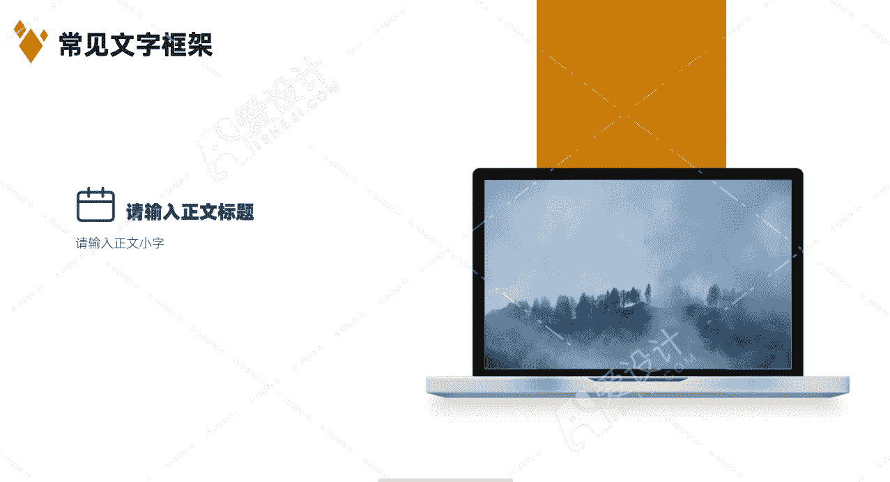

更多内容可以点击目录： [手册内容汇总](https://aiyanxishe.feishu.cn/wiki/LBXcwPv6UiZgdfkp14Xc1Wo1n3b)

✨ 如果觉得有收获，请点一点下方的“有启发” ✨

🌱 我也会及时优化迭代内容，给大家更好的阅读体验 🌱

<https://aiyanxishe.feishu.cn/sync/IaSadpoOOsopKab1ajKcz6z3nAb>