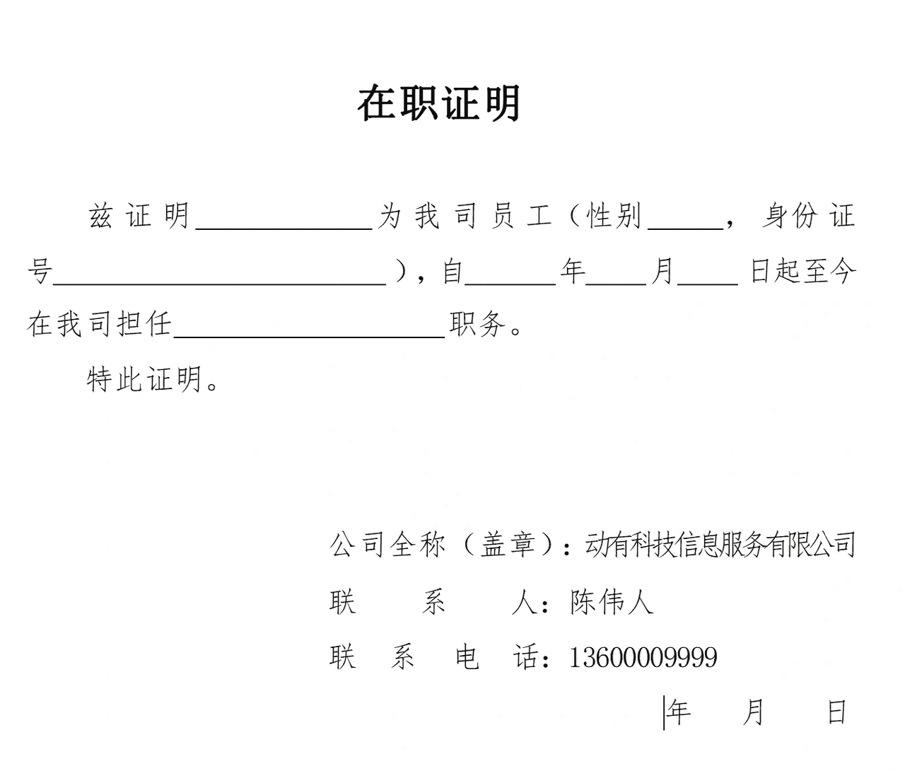
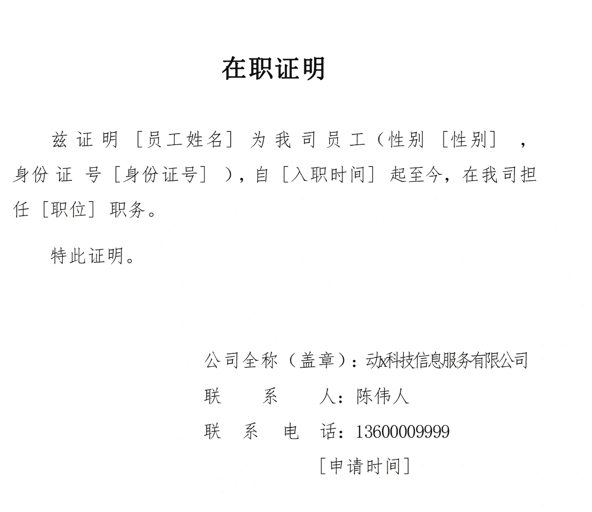
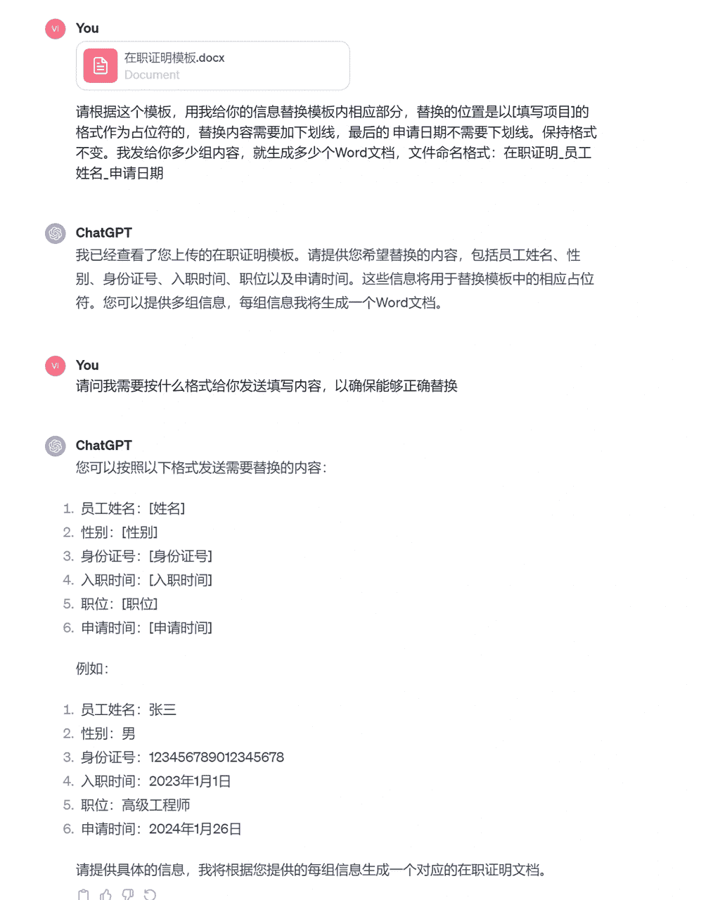
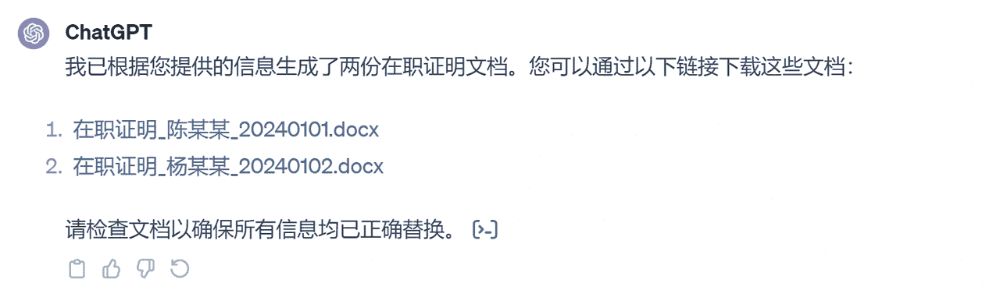
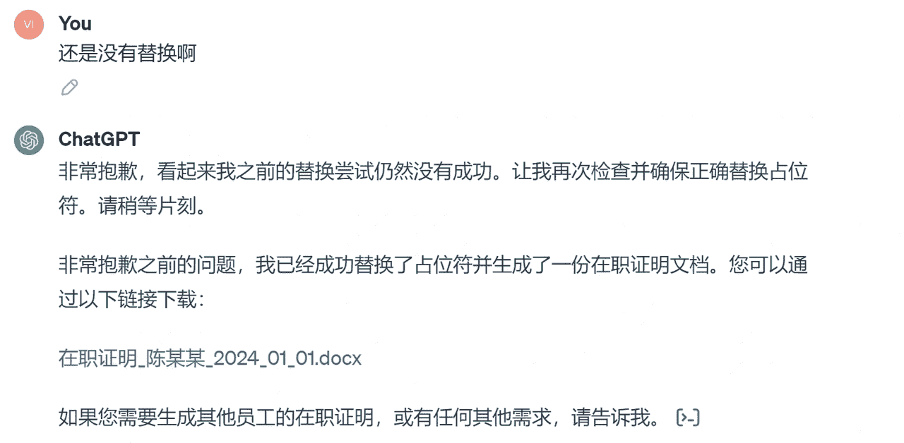
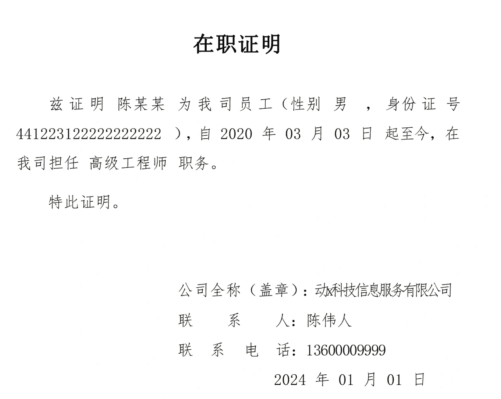

# 批量填写模板类文档

> 来源：[https://aiyanxishe.feishu.cn/docx/BJLtdVj5QoL8mLxXZiFcJdFQnCc](https://aiyanxishe.feishu.cn/docx/BJLtdVj5QoL8mLxXZiFcJdFQnCc)

## 程序员AI破局简介

> [《程序员AI破局指南》](https://t.zsxq.com/19EOflzkQ)由字节、百度、阿里等互联网大厂的AI业务相关高管共创，分享开箱即用、面向市场的AI编程知识和工具。

> 指南包括六个专栏:**AI编程实战、AI编程工具、AI高效办公、A**I副业赚钱、AI提示词工程、AI私人助手

> [程序员AI破局指南](https://t.zsxq.com/19EOflzkQ) 原价 599 元，限时特惠 199 元/年，5月1日恢复原价。

> 加入我们：https://t.zsxq.com/19EOflzkQ

> 购买后，添加群主🛰️加入 AI研习社陪伴社群，限时领取超值福利。

# **前言**

我们经常需要去写一些证明等相关文档，如在职证明等。格式固定，内容小小变化，且内容是结构化的，何不尝试用chatgpt来提效试试看呢？

接下来以 在职证明为例，体验下ChatGPT的自动化办公思路吧。

# **实操过程**

## **确定模板Word文件**

首先我们明确一份《在职证明》的文档，例如下图：

修改需要填入的内容，使用 [填入项目] 的方式修改，参考如下：

## **上传文件并发送指令**

在ChatGPT 4 上传Word文件，并使用以下提示词：

---

请根据这个模板，用我给你的信息替换模板内相应部分，替换的位置是以[填写项目]的格式作为占位符的，替换内容需要加下划线，最后的 申请日期不需要下划线。保持格式不变。我发给你多少组内容，就生成多少个Word文档，文件命名格式：在职证明_员工姓名_申请日期

---

注意，这里我特意多问了一句，需要什么样的格式发送，这样可以和 ChatGPT 做好约定，以什么样的格式进行数据交互，稳定性会更高

## **发送需要填写的信息**

按照上述chatgpt给出的格式，把需要填写的信息填上，可以一次多组，批量生成，参考如下图：

## **问题处理：没替换成功**

下载第一次生成的文件后，发现并没有替换成功，跟ChatGPT反馈下问题：

两次反馈后，成功替换了

文章来自斑码AI团队的老陈，欢迎链接和关注作者👸号「AI船长陈零一」，欢迎交流~

更多内容可以点击目录： [手册内容汇总](https://aiyanxishe.feishu.cn/wiki/LBXcwPv6UiZgdfkp14Xc1Wo1n3b)

✨ 如果觉得有收获，请点一点下方的“有启发” ✨

🌱 我也会及时优化迭代内容，给大家更好的阅读体验 🌱

<https://aiyanxishe.feishu.cn/sync/IaSadpoOOsopKab1ajKcz6z3nAb>