# 数字人短视频带货 30 天涨粉 3 万 变现 1.7 万

> 来源：[https://aiyanxishe.feishu.cn/docx/UQdtdO8GQoqp7WxGuouczsFdnOg](https://aiyanxishe.feishu.cn/docx/UQdtdO8GQoqp7WxGuouczsFdnOg)

大家好，我是攀登者，通过参加 元峰 老师的数字人快闪活动，跟元峰老师的教程实操数字人带货项目单月涨粉 3 万，变现 1.7 万，通过做项目也成功破圈，受合肥XX传媒公司邀请去给他们做数字人方面的培训，也收了徒弟，徒弟 3天 涨粉3000 。

说实话，在没动之前，我也对数字人带货持怀疑态度，但是行动起来并拿到结果之后，发现是真香，这里也呼吁没行动的小伙伴，抓紧动起来吧。

具体我是如何做到的，下面我给大家详细拆解下：

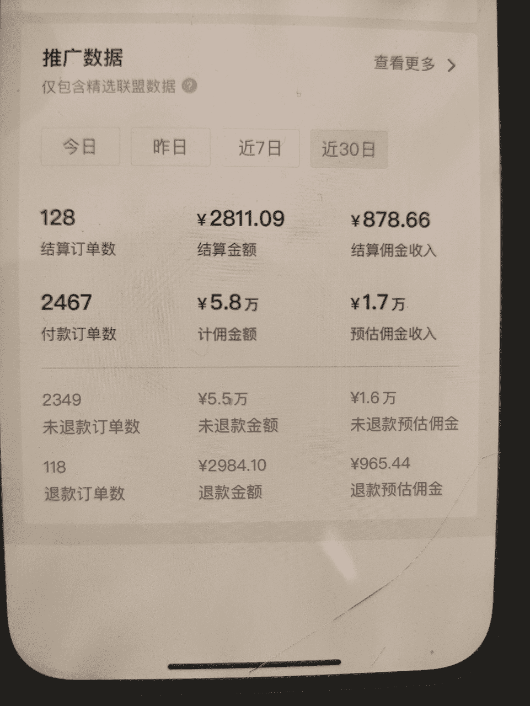

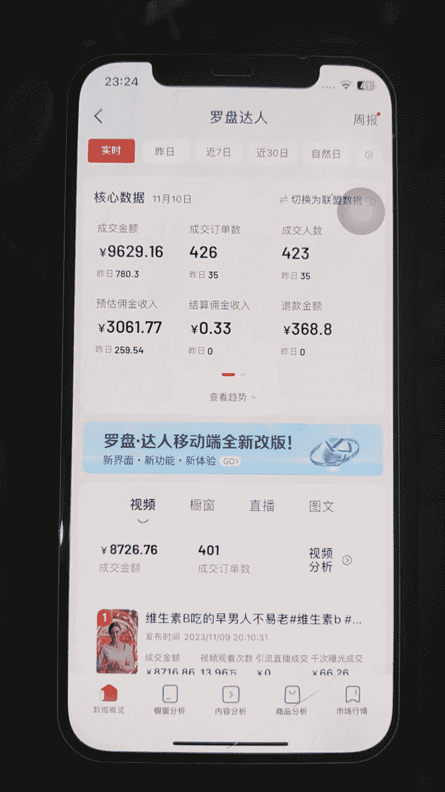

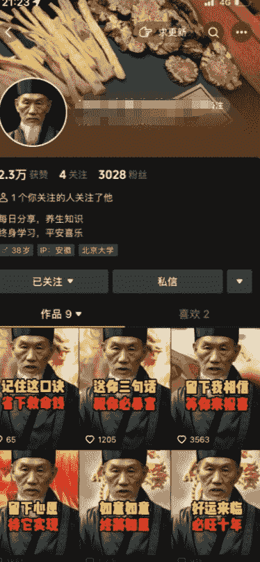

徒弟三天拿到结果

# 一、项目介绍

## 一）数字人项目是什么？

洋哥早有预言 AI+电商一定能火，因此让 @ 元峰 老师组织了快闪活动，详细教程星球有我就不多赘述，我就仅将自己实操的全过程进行全面复盘。

数字人项目其实很早就有人做了，就是一个外国美女，用中英双语，教你为人处事，教你赚钱，教你感情，

给我们一种高级感，一种牛逼的感觉，这种视频涨粉极快，讲着讲着就开始带货赚钱了，粉丝转化率也高，变现能力强，那么这类短视频到底怎么赚钱的呢？

**两句话讲明白：**

1.通过 AI 工具制作数字人，用数字人在短视频平台发布内容。迅速涨粉，开通橱窗，用短视频挂小黄车带货变现。

2.其核心玩法就是抖音上已经爆过的鸡汤文，认知文，商业文，名人名言，再用数字人的形式讲一遍。

**tips: **详细的操作全在下面，这里只是用 2 句话直击这个项目的本质。

虽然很简单，虽然你也很懂，但是正因为简单也正因为你觉得懂，甚至是你不屑一顾，因此你没行动，所以你错过了，而我只是简单的听话照做就拿到了结果。有时候，成功不需要那么复杂的套路，听话照做，足矣。

## 二）数字人项目怎么做？

其实很简单，只需要按照这三步走就可以了（具体操作在下面）：

1.找到对标账号

2.制作数字人内容并二次剪辑

3.发布在多个平台，涨粉带货变现

## 三）数字人项目变现途径

1.开通商品橱窗带相关的产品变现

2.接广告变现

3.收徒变现

4.卖号变现（最差，不建议）

# 二、视频制作

## 一）账号注册

账号注册我是用谷歌邮箱登录的，具体的注册流程看这里

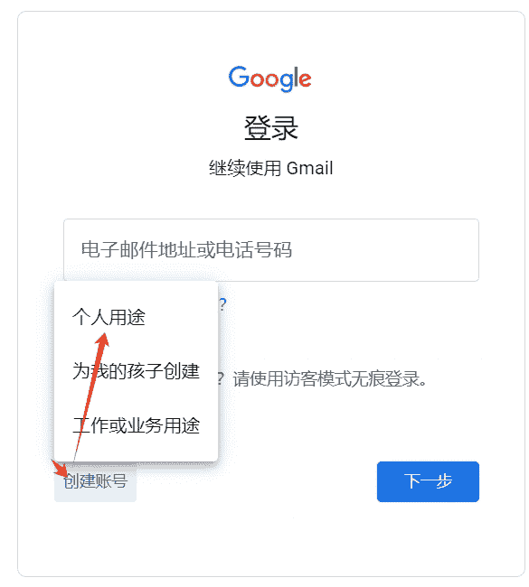

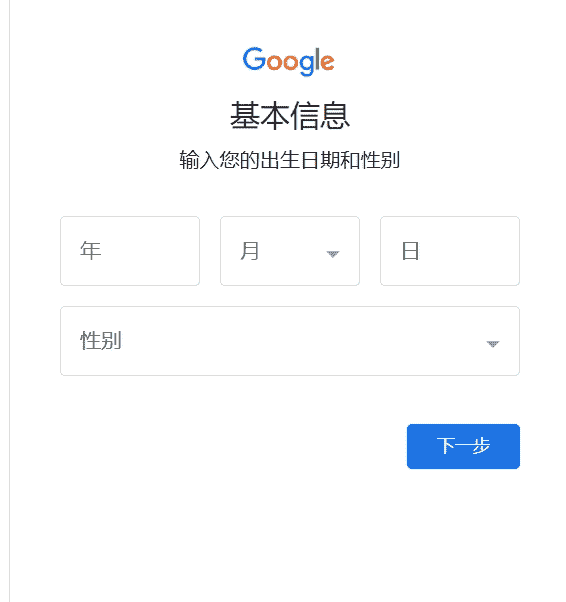

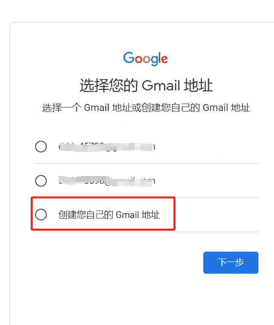

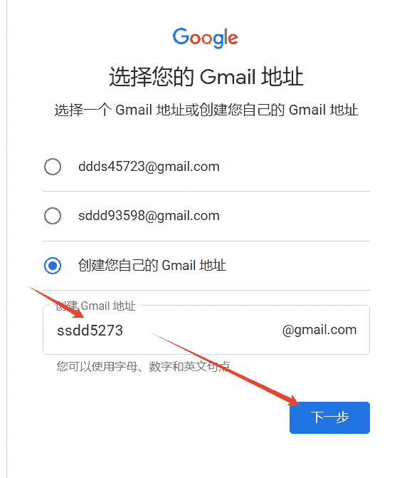

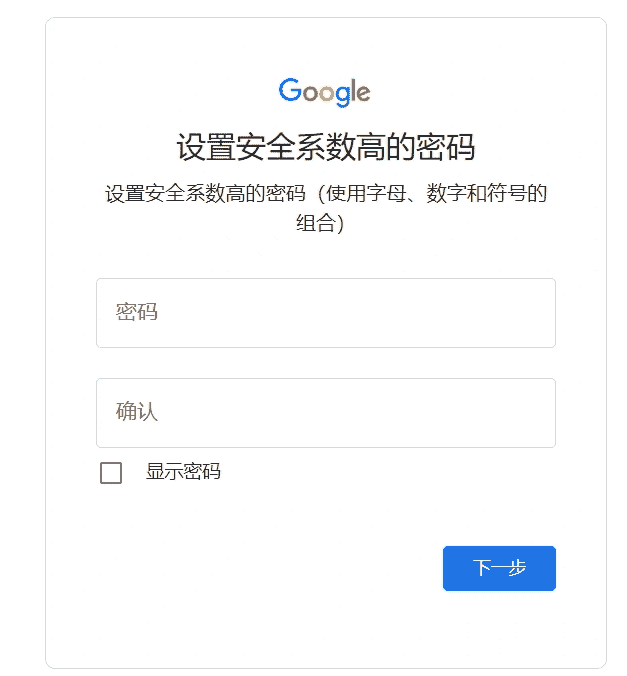

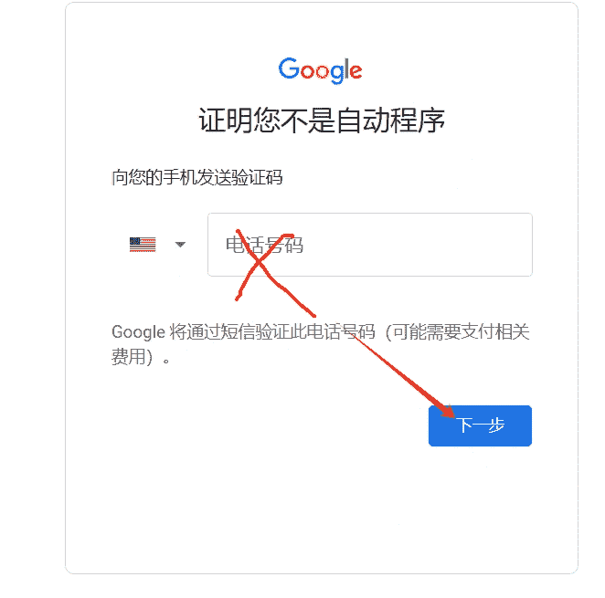

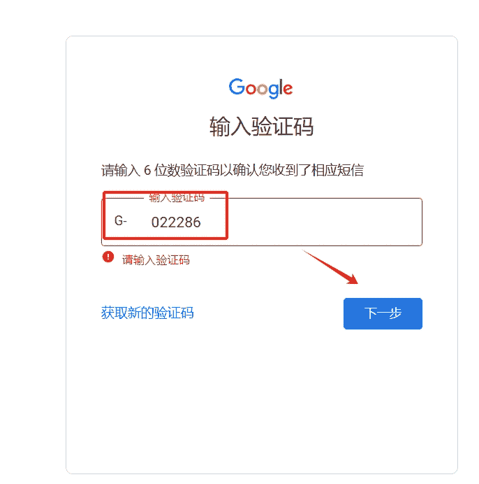

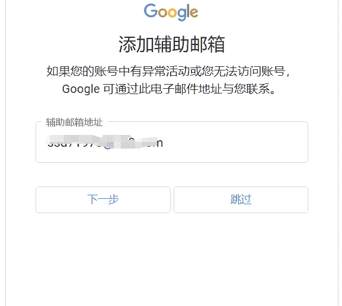

## 二）数字人制作

首先登录 Heygen，新号注册会送 1 积分（ 30s 以内的视频 0.5 积分，30 秒以上的 1 积分）积分不够的可通过脚本注册，或者购买成品号（不贵）

网站地址： https://app.heygen.com/home

选择你喜欢的角色

调整人物大小和比例

选择喜欢的语言和声音

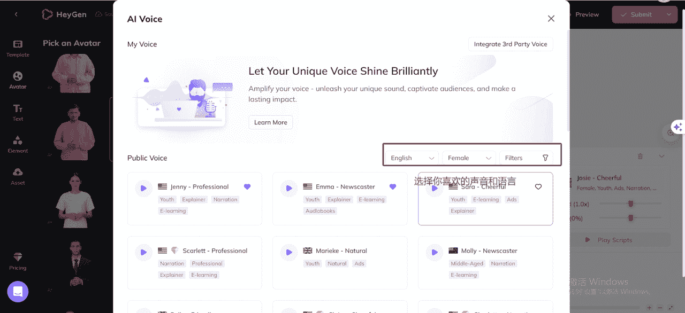

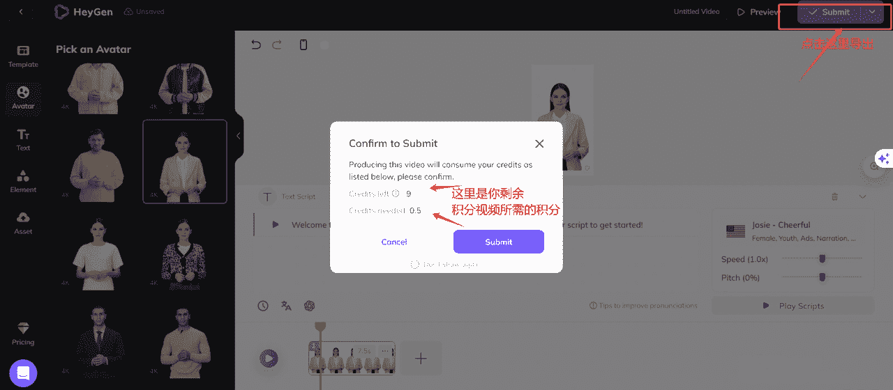

## 三）二次剪辑

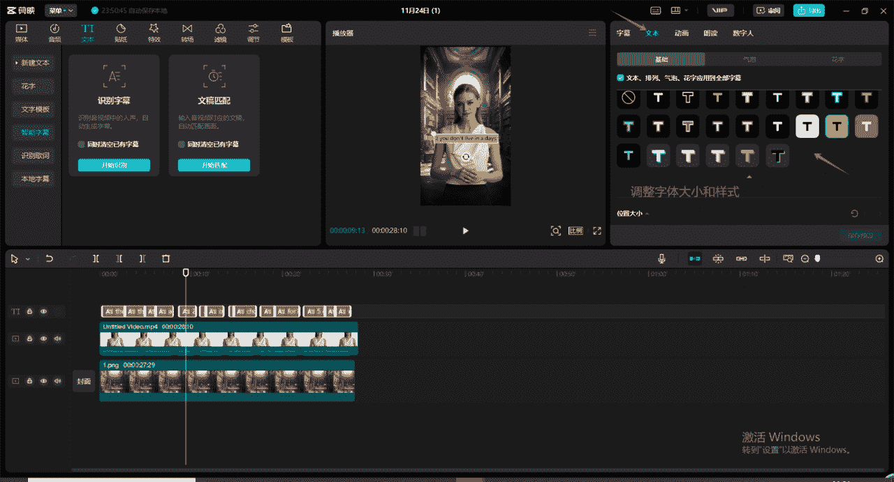

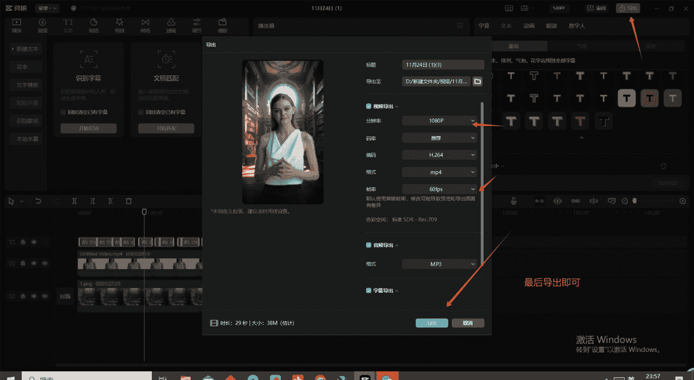

# 三、账号运营

## 一）对标账号

做抖音最开始一定不要去原创内容，而是要花大量的时间去寻找对标账号，什么是对标账号？就是你把他这个账号作为榜样，作为学习目标，你需要去模仿学习他，最终达到实现和他一样厉害，甚至超越他的结果，举个例子，你想学提示词，那么小七姐可以是你的对标，你想学写作，皮特老师可以是你的对标

什么样的对标账号适合我们呢？一般有以下几个特点：

### 1.可复制

在找对标账号的时候你一定要去找可以复制的账号，这类账号与你当下的水平相差不是特别大，你能够学习复制他，举个例子，你想做个人 ip 不能一上来就把洋哥这种大ip作为对标，而是要把其他短时间内迅速崛起的小 ip 作为对标，去学习模仿他们快速成长的路径

### 2.能变现

我们在寻找对标账号时一定要去寻找那种能够变现赚到钱的账号，而不是粉丝多的账号，有的账号粉丝 500 万变现很少（比如三枝花），记住你来抖音的目的是来变现而不是来涨粉的，能够变现的账号说明他的变现方式已经跑通值得我们学习，如果去模仿粉丝多变现差的账号，只会给我们自己增加痛苦。

### 3.粉丝画像匹配

对标账号的粉丝特征一定要和你想要的粉丝特征匹配，比如你想要得是年轻漂亮的小姐姐，对标账号粉丝却是一群大老爷们，那你如果去把这个账号作为对标，你一定是很痛苦的，而且会走很多弯路。

## 二）选题

做抖音一个好的选题能增加我们的曝光够吸引用户观看，评论点赞转发，可以这样说，好的选题能够决定我们账号的生死，那么我们应该如何选题呢？一般爆款标题都具有以下特点。

**一**周内，1000 赞以上，100 评论以上，收藏 100 以上三者满足其一，或者其二，当然最好同时满足，再参考下面的这几种类型。

### 1.反差型

特点：违背常理认知

例：男朋友是渣男 3 大好处，99％ 的人都不知道

### 2.数字型

特性：数字的吸引力更高，对比会更明显

例子：月入 3K 和月入 30万 的家庭地位

### 3.揭密型

特性：勾起好奇心

例子：说几个你不知道的阻止我们变富的真相

## 三）文案

文案的制作我们一般有两种方式

### 1.直接搬运

保存视频到本地或者复制链接到🛰️轻抖小程序下载保存

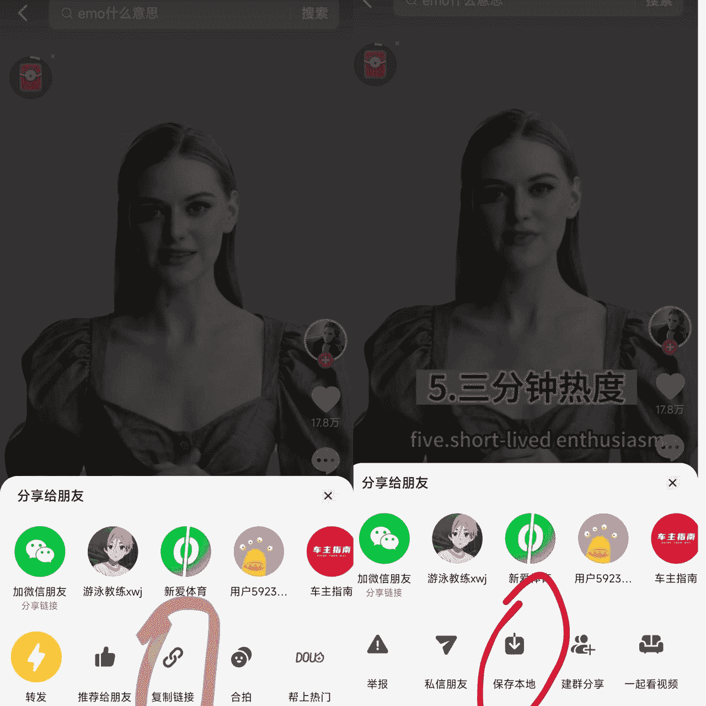

复制刚刚的链接在轻抖小程序里打开，去水印保存即可

### 2.GPT改写

复制下面的话给GPT后再提供文案即可

# Instruction:

文案写作高手根据我提供的文案进行拆解分析并生成风格一致的文案

## Context: 你有丰富的文案创作经验，曾经在自媒体平台上写出过多篇爆文，知道爆款文案的特点能够根据主题和样本文案写出同类型的爆款文案

## Input Data: 请根据我提供的文案进行拆分然后再改写，这是一篇抖音的爆款文案

## Output Indicator:

1.提炼出我所给的文案好在哪里

2.结合抖音的爆款文案逻辑对我的文案进行改写，改动幅度不超过5％

3.询问我是否满意，如果不满意则重新改写。（提示词）

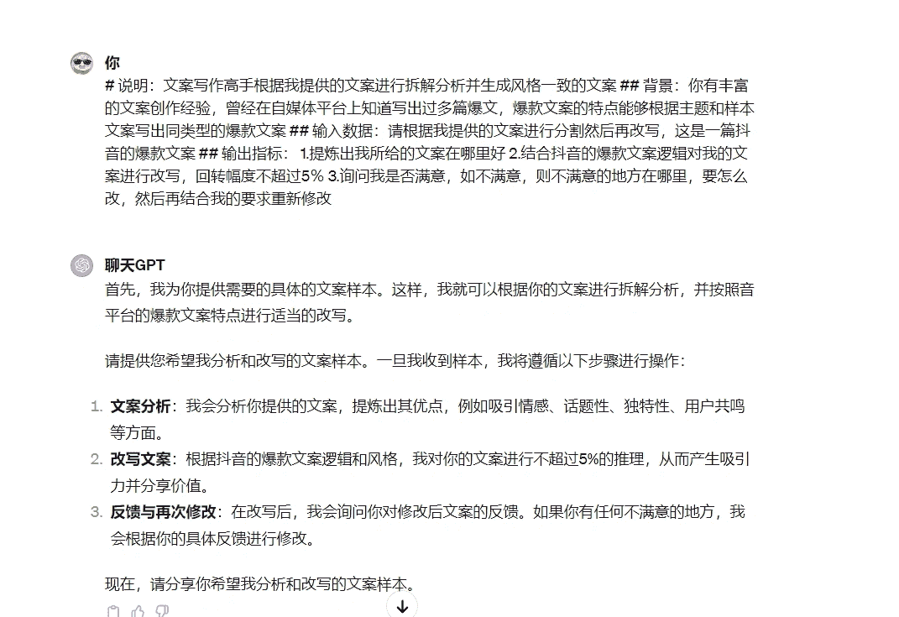

## 四）发布

发布作品时候需要注意封面和标签的问题，好的封面和标签能够帮助我们得到更好的曝光。

## 一）封面选择

1.画面感看着让人感觉舒服

2.突出关键信息

## 二）标题

1.根据内容选择标签，优先选择符合视频内容的标签

2.选择播放量高的

3.实在不会去抄同行看同行怎么做的

# 四、变现

## 一）开通橱窗

目前 0 粉丝就可以开通橱窗，1000 粉丝可以挂车带货。

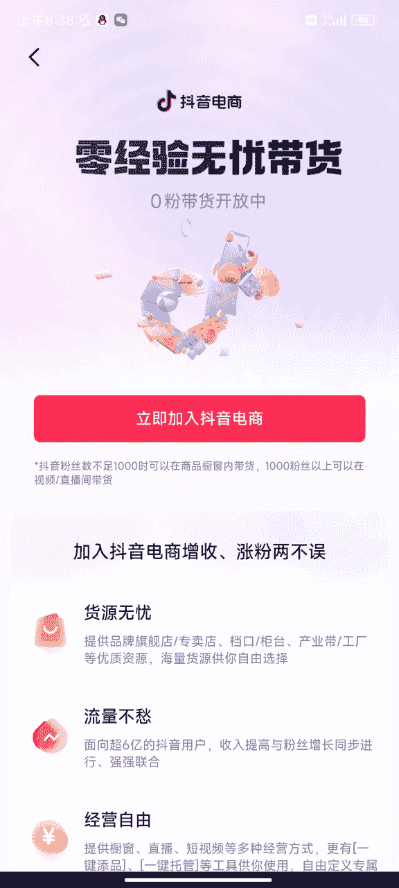

## 二）选品

好的产品直接决定了我们的生死，因为产品不行的话，宣传的再好转化率退货率也高，我们在选择产品的时候应该要考虑以下几点。

1.和粉丝人群匹配，没有可以满足所有人的产品，我们带货只需要找到满足我们粉丝一类人群的产品就可以了

2.知名度高，有背书，比如诺特兰德维生素，贾乃亮代言

3.退货率低！退货率低！退货率低！我们真正赚取的是未退货的佣金，如果你卖了 100 万退货了 90 万，那又有什么意思呢？

## 三）带货爆款内容制作

其实带货爆款内容制作也很简单，直接让品牌方提供最近跑的好的文案和选题给你，然后按照上面的流程制作视频挂件带货就可以了。

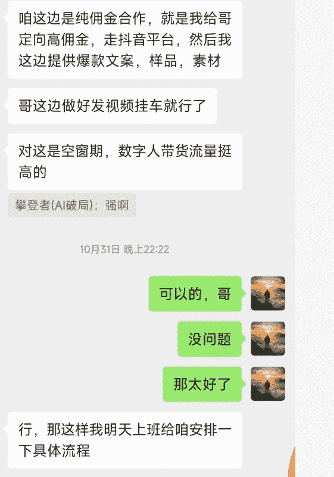

# 五、踩坑避雷

## 一）内容坑

我在“模仿爆款内容的时候”被官方提示了非原创作品限制流量了，所以我们在制作视频的时候一定要“去重”

通过更改以下几个因素可做到。

1.人物比例（可以有全身变半身）

2.文字样式大小（可以更改字体大小和字体颜色等）

3.背景（不同的背景或者静态背景转为动态背景）

## 二）产品坑

1.最开始有很多品牌方找我，我不管什么品都带，导致数据不好，所以一定要进行筛选

2.当带货视频爆了以后不要让视频跑的太厉害（树大招风）我的一条上榜视频就是因为跑的太厉害，客单价 9.9 几个小时 1 万多，被同行举报限流了，流水不争先，争的是滔滔不绝

最后的话：数字人项目是一个长期的项目，需要我们坚持不懈的输出好的内容，才能够看见结果，只需要一两个视频就可以起飞的，如果你是想一夜暴富，没有持之以恒的决心那不建议做，最后送大家一句话，很多事不是因为看见而相信，而是因为相信才能看见！

文本来源于我的好朋友攀登者，在数字人领域有很深的研究，大家如果对数字人领域有进一步学习的诉求，可以添加他的VX【pdz_6666】

更多内容可以点击目录： [手册内容汇总](https://aiyanxishe.feishu.cn/wiki/LBXcwPv6UiZgdfkp14Xc1Wo1n3b)

✨ 如果觉得有收获，请点一点下方的“有启发” ✨

🌱 我也会及时优化迭代内容，给大家更好的阅读体验 🌱

<https://aiyanxishe.feishu.cn/sync/IaSadpoOOsopKab1ajKcz6z3nAb>