# 如何做好一场日入过万的 AI 企业培训？

> 来源：[https://aiyanxishe.feishu.cn/docx/SvondXHjHotIJPxLGQWcDz3gngf](https://aiyanxishe.feishu.cn/docx/SvondXHjHotIJPxLGQWcDz3gngf)

## 程序员AI破局简介

> [《程序员AI破局指南》](https://t.zsxq.com/19EOflzkQ)由字节、百度、阿里等互联网大厂的AI业务相关高管共创，分享开箱即用、面向市场的AI编程知识和工具。

> 指南包括六个专栏:**AI编程实战、AI编程工具、AI高效办公、A**I副业赚钱、AI提示词工程、AI私人助手

> [程序员AI破局指南](https://t.zsxq.com/19EOflzkQ) 原价 599 元，限时特惠 199 元/年，5月1日恢复原价。

> 加入我们：https://t.zsxq.com/19EOflzkQ

> 购买后，添加群主🛰️加入 AI研习社陪伴社群，限时领取超值福利。

# 前言、小白 AI 企业培训劝退警告

## 一）关于 AI 企业培训的高门槛

关于如何拿到订单，其实是一个大家都会非常关心的话题，其实我是很不建议一个小白上来就做企业培训的，企业培训对老师的综合能力要求非常高

背书要求：要看背书、看 title、看工作经验、要看学历、看专业、看行业经验；不用面面俱到，但至少要有其中一个非常亮眼的地方，而且不要有非常明显的短板即可。

能力要求：要公开演讲、要懂 AI 、还要懂客户的业务、还要自信、还要能控场、还要懂领导的想法（要硬控年纪比你大一轮的人，或者是某某某的领导），这个压力还是蛮大的。

渠道资源（信任背书）：企业培训说实话是个信任的生意，因为在讲师开口前，看再多信息，也不知道老师会讲什么，怎么讲，会不会开口跪，或者现场讲了不合适的话，这些都会有极大的信任风险。

客户要选择信任的老师，要么就是有强关系，比如我和某个企业的高管是好多年的老朋友。要么就是渠道强推，那么就是渠道要强信任老师。 因为渠道给客户推，要是推砸了，那么渠道也是会背锅的。

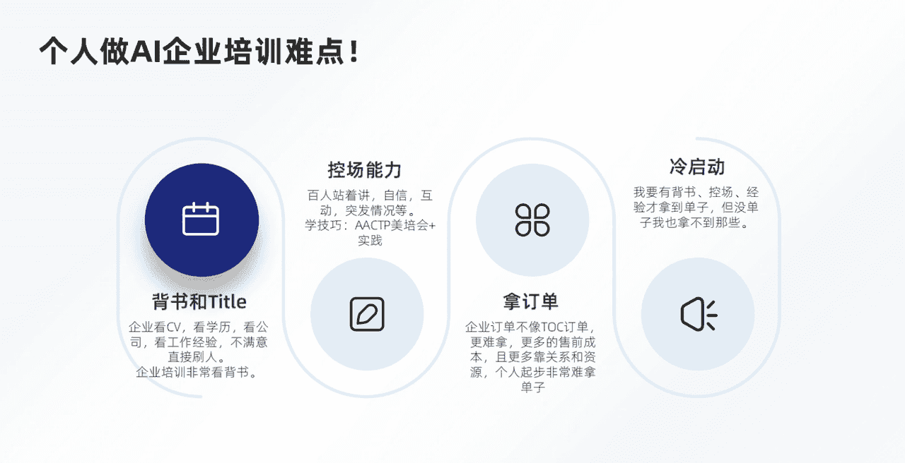

所以大家可以自行评估一下，三者缺一个，可以补，但会有些吃力；但是三缺 2，我建议大家就不要尝试了。

可能有人会说，上边的东西我都可以锻炼呀，但是企业场景下的交付，是很难有锻炼机会的。那就得找到一个有容错率的公司或者品牌，加入他们去锻炼了。

## 二）关于我的情况，为啥我能做？

有人可能会问，那为啥你能做？

其实说实话我也还是有点吃力的，但也算是有一些优势的，算是选择了自己喜欢、擅长、且有市场的事情。

1、门槛：我是刚好够到了门槛，985 的学历，工作履历也算 B 端大厂，IT 同行业，服务客户都是太保、肯德基、宁德时代、上汽集团这种 500 强的大客户，有背书加成；

2、能力这块刚好工作负责的就是数字化转型的培训和咨询，天天就是和一堆企业客户和领导打交道，我们的核心能力就是要在 5 分钟内，看一个可能之前没有见过的 PPT，然后给客户现场讲解决方案。

3、渠道资源也是依托于原有的一些 B 端客户群，以及前公司的一些渠道。

好了劝退完了，说一说我是怎么完成一个这个企培的订单的。

其实 AI 企业培训对于个体讲师来讲不是很复杂，就是拿订单，交付，拿钱。

# 一、如何拿到订单？

企业培训售前流程大概会分为几个阶段：线索、需求沟通、方案报价、合同签订。整个前期的周期可能会很长，至少是 2-3 个月起步，长的话，可能要一年的时间。因为企业的决策链路很长，采购周期也很长，所以及时反馈没有那么快。

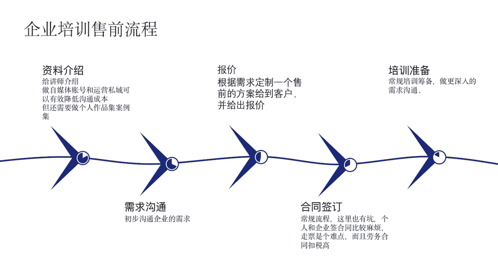

一般拿订单的方式也只有 2 种

1）第一种就是直销，你对接了最终客户卖出去，然后这个最终客户你刚好通过一个活动认识了一个负责培训的负责人或者是老板，然后直接推进。或者是线上通过你的👸号找到你。（几乎不太可能了）

2）第二种是通过渠道，由专门的培训机构、或者是讲师中介，他们来负责商务部分，你来负责交付，这种就是涉及找一些培训机构和渠道，和他们来合作。

但无论如何做 TOB 一定是要有一个团队的，如果一个新手讲师，建议选择第二种和渠道合作，是能比较快速地跑出来的。

那么说说我这个订单是如何拿到的呢？

## 一）起源：一篇半年前的文章被看见

其实说起来也很不可思议，因为这次的培训，是通过我去年 7 月份的文章输出找到我，然后我把自己做好的讲师介绍发给了客户，电话沟通过两次，对方觉得比较信任，所以在线下完全没有见过面的情况下。给我推荐了一个客户，而且达成了合作。

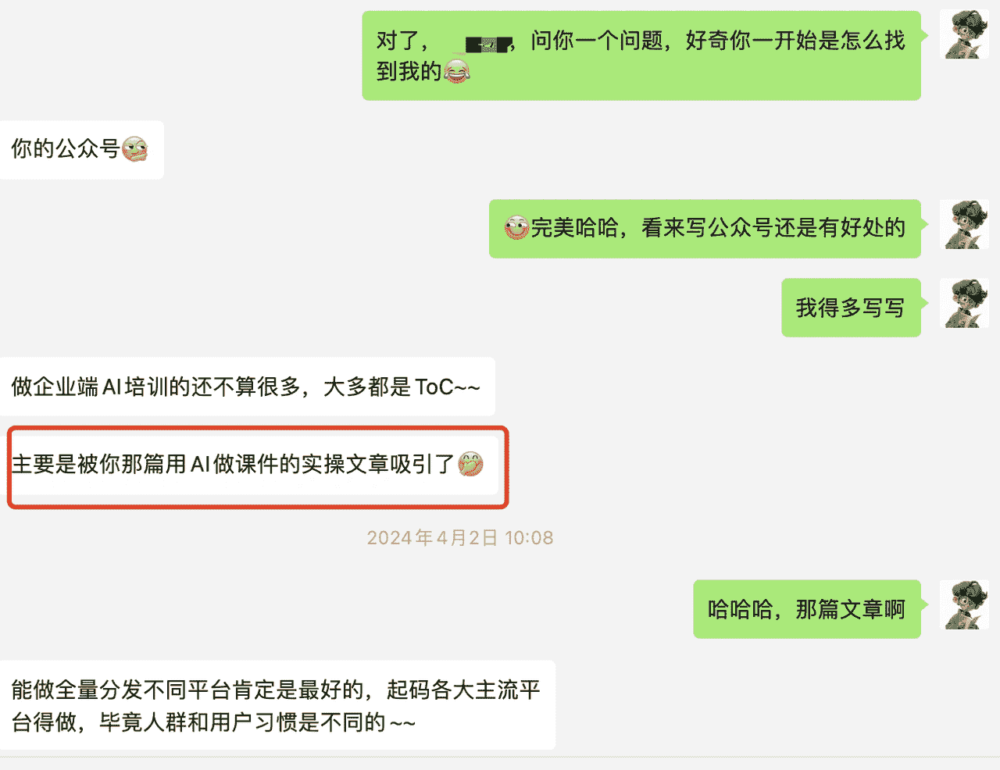

这个说实话是冒着巨大的风险的，因为一个企业合作在没有线下见过面，实际聊过天后，是很难达成合作的，这也说明个人 IP 和专业内容输出的巨大力量。 是可以有效地构建信任的。

## 二）打造专业的私域朋友圈

有了线索过来之后，能不能抓住又是另外一个回事，我觉得这个时候，一定是要构建专业的私域朋友圈的。

### 1、核心就是要多展示你的案例，多在朋友圈分享，让别人觉得你可以的，比如朋友圈的打造。

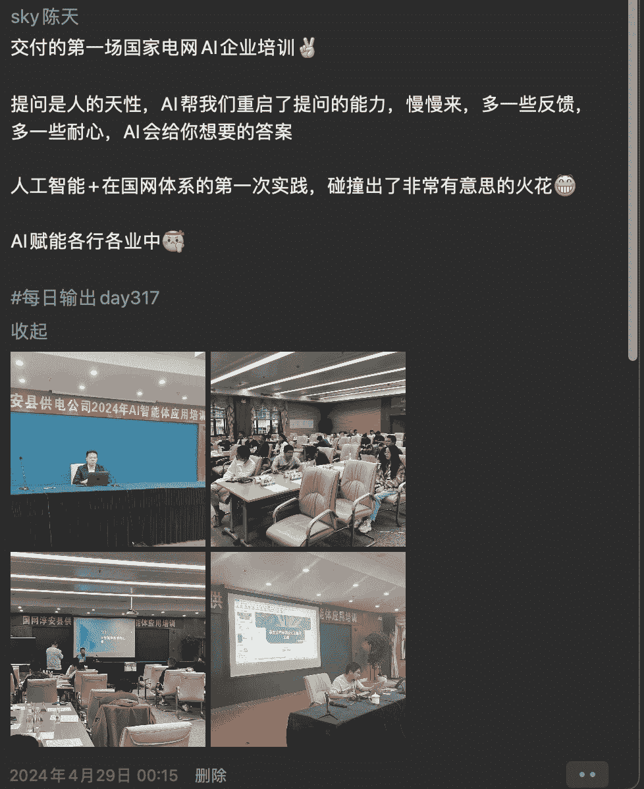

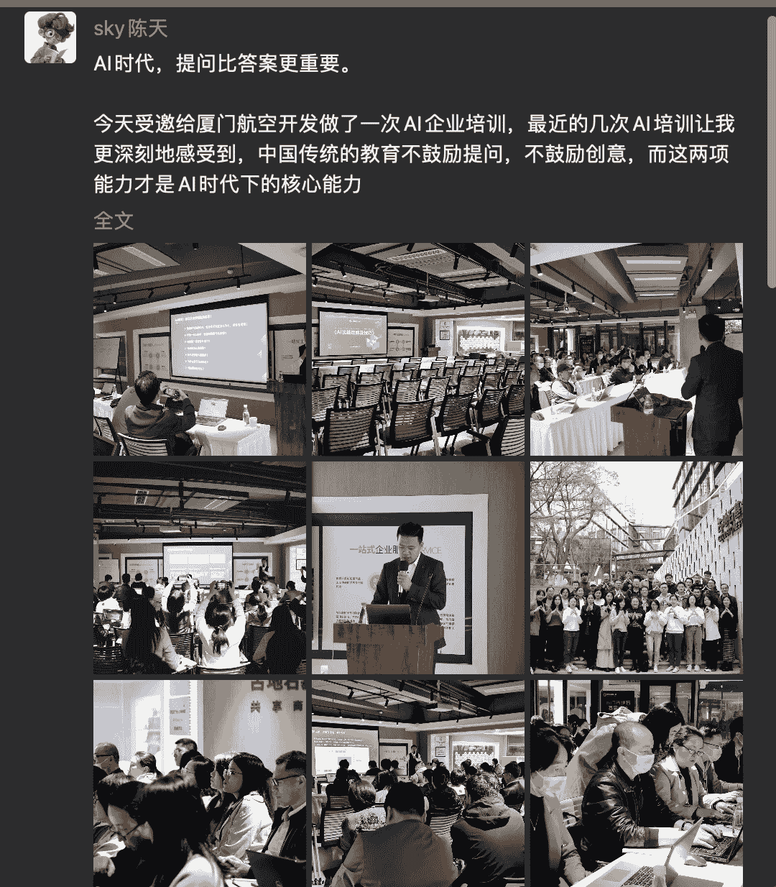

### 2、沟通的专业度

比如说了解对方的需求，了解整个流程，以及不要被客户牵着鼻子走，围绕着业务的需求，提出你自己的解决方案，因为大部分客户都不懂 AI。

## 三）沟通寻求可能性

另外一个建议就是，TOB 的培训一定是要多聊，电话聊，线下聊，但是也要适当判别对方的实力。

TOB 合作的沟通成本一定是远大于 TOC 的，现在 TOC 做个人 IP 讲究的快速用付费筛选，人过来但是如果不成为付费客户，就无法投入太多，因为这个流量对你没有价值。

但是做 TOB 的话，如果一个客户过来、一个渠道过来，一定是要提前投入做沟通，而且对方前期也不可能给你付钱，可能一次没有成交，但是可以慢慢培育线索，最终可能一个 TOB 的大单子，可能就能把一整年的收入给覆盖掉 （半年不开单，开单吃半年），但如果发现对方实力不行，只是想白嫖你，尽快撤退出来。

## 四）提前准备一份标准的讲师介绍和课程介绍

因为现在成熟的客户或者渠道，都会让你提前准备一个讲师介绍和课程介绍，是可以大大地减少我们的沟通成本，以及增加客户信任的。

我每次有需求，都是会先把我的课程和讲师介绍发过去，这个专业的材料可以让别人很快了解你，而且知道你是“有备而来”，不是野路子。

1）讲师介绍要什么：一般就是个人形象照、履历、课程、服务客户、客户案例。

2）课程介绍要什么：主要是详细的课程大纲，需要到二级的目录。（建议这个是准备一份通用的大纲，然后如果客户要定制，再针对性地修改）

这个客户是渠道帮我推的，就是客户有需求，问我能不能做，因为有了前期的文章、简历、沟通专业度的背书，其实信任已经构建起来了，那就是渠道帮我推简历给客户，客户觉得没问题，那么就可以再往下开展了。

# 二、交付前的准备

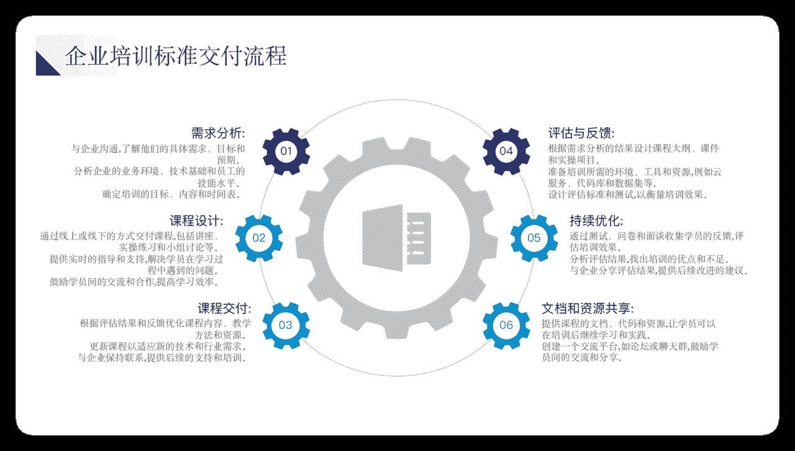

在正式交付前，其实怎么样才能让交付效果出彩呢？一定是要做前期的课程调整和准备，让他能符合客户的需求。

**与我有关，所以喜欢！**

比如 AI 的场景演示，一定是要切入到他的痛点的。那么接到这个需求后，我首先加了客户的领导，做了一次需求沟通，了解了他的场景，他主要是想了解 AI 做海报、AI 写文案、AI 做活动策划方案的实用。

## 一）发放问卷调研，知己知彼百战百胜

其实因为领导站位比较高，可能对一些员工的实际工作内容也不是特别了解，所以我还做了用 AI 做了一份调研问卷，提前发放。

最终问卷链接： [ht](https://www.wjx.cn/wjx/activitystat/verifyreportpassword.aspx?viewtype=1&activity=258738996&type=1)tps://www.wjx.cn/wjx/activitystat/verifyreportpassword.aspx?viewtype=1&activity=258738996&type=1

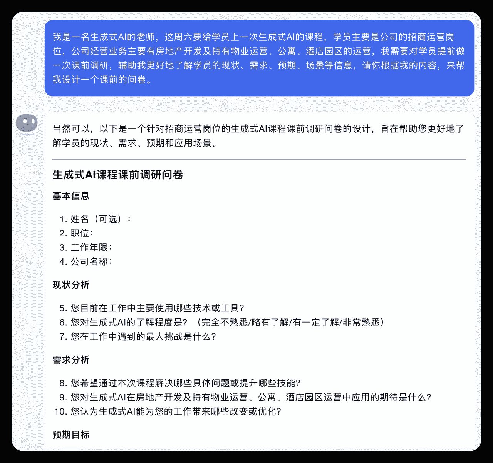

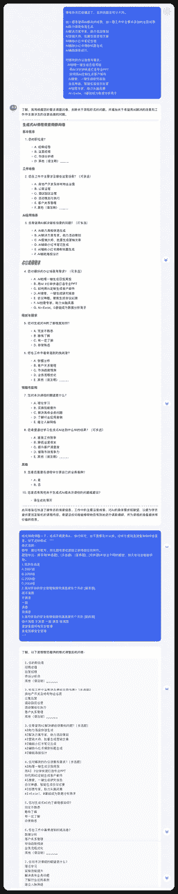

对应的内容可以参考上述的提问，把做好的问卷格式，直接复制到问卷星的文本导入，就可以快速生成问卷了。

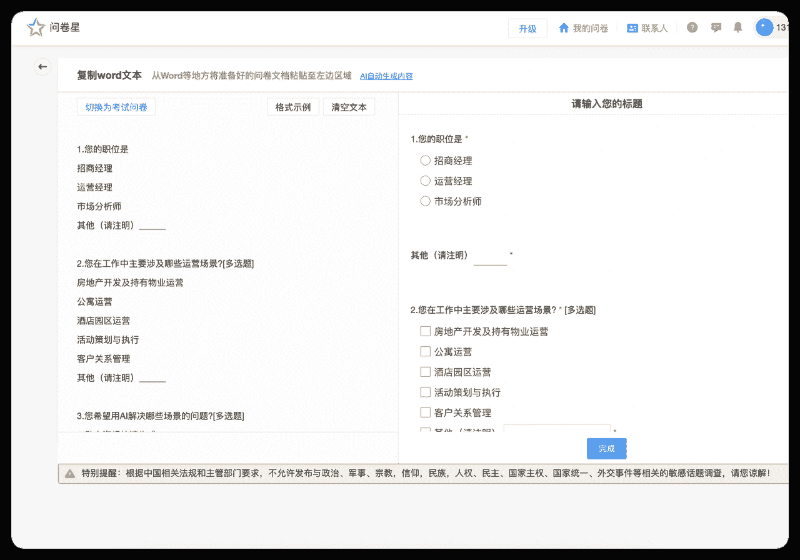

## 二）对课程内容定制调整，与我有关，所以喜欢

### 1、收集客户的需求

根据客户需求开发课程，一般来讲，一个成熟的讲师都会有一套标准的课程课件，这个参考我历史写过的这篇文章，来做课程的开发即可。但是每一次可能都会有一些微调，所以有个标准课件+微调是很重要的。

怎么做课，可以参考历史的文章： AI 辅助企业培训 | 12 小时准备高质量 AI 培训课！

### 2、根据问卷收集到的兴趣，针对性地调整

比如我发现和我自己的预期对比，对 AI 搜索、活动策划、📕笔记的生成的内容需求很高，那我就会把这些场景放到前边去，调整我的内容。

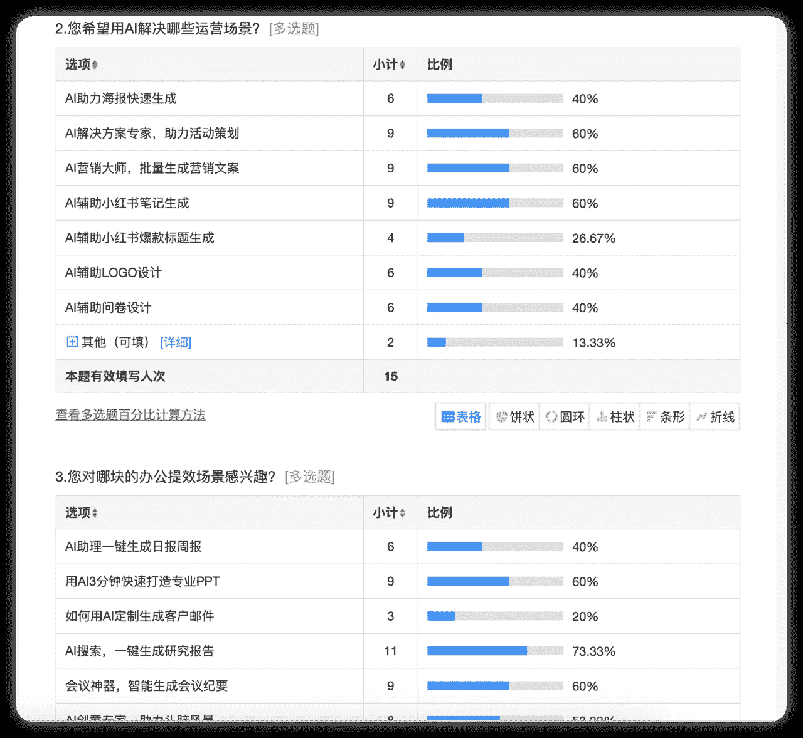

### 3、根据客户的场景贴身定制

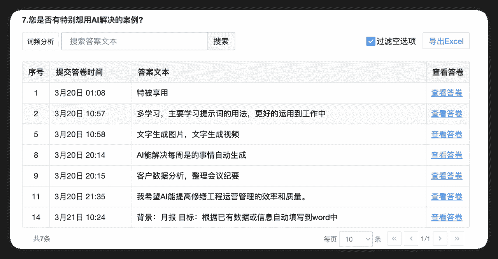

调研问卷里有一题是收集用户的一些用 AI 解决的案例，那么我也让他们留下了🛰️，我会提前加他们，做一些调研，拿到一些场景和案例，做一些场景上的修改和调整。

## 三）提前准备好一份授课文档，降低用户操作门槛

陈天发现，在授课过程中，想要让学员真正去提问是一个门槛很高的事情，包括说注册、打字等等，最好的方式就是无限地降低这个事情的门槛。

我会制作一份课程的手册，把课程中的提问、工具都先放到这个手册中，然后他们现场可以直接点击手册链接、直接复制提示词，这样可以让他们亲自体验 AI 的反馈，比我们演示的效果会好很多。

从效果排名上， 分享>体验>演示>视频>截图>口述 ，

所以我的培训就是，尽量都会让学员动起来、让他们亲自去使用和体验 AI，能演示的就不用视频，能视频的就不用截图，能有图的就不要文字干巴巴地说。

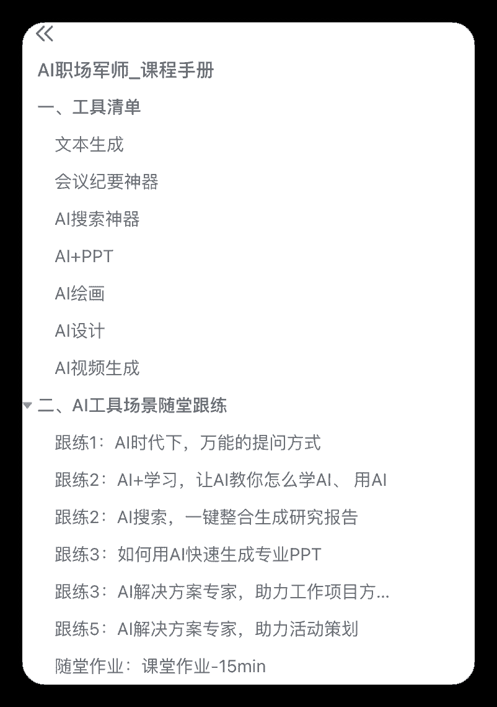

## 四）串一遍流程，头脑沙盘

在课程所有都准备好后，非常重要的是，讲师需要提前串一遍场，也就是到底要怎么讲？从每一大块讲多久，到每一个小块讲多久，每一张 PPT 讲多久，主要讲什么内容，什么时候加上互动，什么时候可能要休息一下等等，这些都是要提前设计好。

[这](https://wx.zsxq.com/dweb2/index/topic_detail/8855841415511252)块可以参考格林老师的 AI 企业培训文章，课程安排写得非常详细： https://wx.zsxq.com/dweb2/index/topic_detail/8855841415511252

并且在设计好的前提下，最终要是要提前做一些预案，在时间超过或者时间缩短的情况下，要怎么办，培训现场会发生很多的突发情况，比如某个领导说，你这快别讲了，那这个时候就是考验我们提前准备的东西，有没有一些预案和积累。

做好 150% 的培训准备，这样才能做到胸有成竹，游刃有余。

## 五）盯着客户完成准备

另外培训准备这块，还有一个点是很重要的，就是你需要客户协助你准备什么。

**像常规的设备、投影**、音响、教师、名牌、纸币、以及他们 通知让学员带电脑！

这些都需要提前让客户准备好。

# 三、交付现场授课

课程培训，最好的方式就是先去参加一个优秀的老师的培训，然后记录他讲的好的点，自己试讲和模仿。再慢慢形成自己的风格。我在这里说明几点，我认为是可以让 AI 企培现场交付效果有显著提升的几个点。

## 一）考虑内容和用户的匹配度，调整讲解难度

现场授课是非常考验一个讲师的功底的，很多人会觉得企业内训对老师的专业度要求会很高很高，难度很大，但其实是大错特错的。

最重要的是匹配度，就是你的内容，是匹配员工的能力。

**说一个企业培训核心的原则，就是**一定要让员工觉得这个 东西对自己有用，且自己能学会 。

### 1、对自己有用

有用所以课程准备要让员工觉得有用，这是一个匹配，如果完全对自己没用，员工肯定就是自己拿着电脑办公，压根不会听你讲了。

### 2、能学会

很多老师就觉得讲的越难越好，越能体现自己专业。但成人学习是这样的，如果你讲的太难了，员工都会有抵触心理，本身学习动力就没那么强，还这么难学，可能就会放弃了。所以一定是要由易到难，不要一上来就讲个太干的东西，把学员都弄懵了。

### 3、看碟下菜

培训前做了再多的准备，培训时也可能会出现信息的误差，因为对接人可能也不了解学员的水平，这个时候最好的方式，就是现场做个互动，比如说，大家有多少人用过 GPT、怎么用的，做一些简单的举手，调研学员的水平，如果说水平都很低，那就要讲简单点，如果人手都是一个 GPT4.0，那对于培训的内容，你也要调整得更专业一些。一些简单的例子就不用讲了。

## 二）一定要带助教

现场实操类的培训，我觉得是非常有必要带助教的。他不同于传统的知识类、理论类的培训，现场会有大量的账号注册、操作的场景，学员在这个过程中，可能会遇到为啥我登录不了，我的什么什么有问题，这个时候，助教就要在下边协助解决大家的使用问题。

另外，我的习惯是开课前提前建立一个群，在我讲到某个工具的时候，助教会协助帮我把工具链接发到群里。在我讲某个提示词的时候，把我的同款提示词发到群里，让学员复制提问。就是尽一切方式，让大家都能跟上使用 AI，降低提问门槛！

## 三）关注和促进AHA 时刻

AI 的培训是很容易给客户 AHA 时刻的，要学会调动学员的情绪和积极性，一个课程中如果出现一个哇的时刻，一定要好好抓住，通过自己的情绪、语言把这个时刻放大，以及提前设计好！ 让场子热起来。

这个对于我来说其实是一个弱项，我也习惯会给的比较多，而忽略了一些情绪上的调动。

## 四）给学员获得感，让他自发朋友圈就是最成功的方式

一个培训，获得感很重要，过往的传统培训，其实获得感是比较低的，因为知识是虚无缥缈的，模型和方法也不一定能转化使用，但是 AI 的特点就是获得感是比较强的。

所以需要给学员获得感，比如给员工的一个全面的 AI 工具清单，他们回去是可以直接用的。学员现场用 AI 做了一个 PPT，他们是用工具马上完成了一个小闭环，有个 PPT，这个也是一个获得。那我们就是要想办法，让学员参与，完成些什么，获得些什么，让他们能够把这些东西拿回去，并且分享出去。我们的培训一定是不会失败的。

以上技巧其实还是要多练多使用，熟能生巧，也欢迎大家多补充！

# 四、其他想说的

## 一）AI 企业培训的价值

谈一谈我对于 AI 企业培训的理解和价值。企业培训和知识付费是一样的，最终也是要交付结果，所以我觉得 AI 企业培训后续一定是对业务的能力、AI 的理解会有更高的要求。

我也需要在这个过程中不断地学习和进步，也希望能够和更多在各行各业的从业者交流，并且向 AI 破局里的 AI 大神学习！

我在把生成式 AI 带来的工作方式的变革，新的思维，通过在最优秀的企业、场景中沉淀的实践经验，带到那些还未实现 AI 化的企业中去，这就是我的价值，这就是AI企业培训的价值。

##

文章来自斑码AI的好朋友陈天老师，欢迎链接和关注陈天老师：wx:cbccb1234，欢迎交流~

更多内容可以点击目录： [手册内容汇总](https://aiyanxishe.feishu.cn/wiki/LBXcwPv6UiZgdfkp14Xc1Wo1n3b)

✨ 如果觉得有收获，请点一点下方的“有启发” ✨

🌱 我也会及时优化迭代内容，给大家更好的阅读体验 🌱

<https://aiyanxishe.feishu.cn/sync/IaSadpoOOsopKab1ajKcz6z3nAb>