# AI+编程接单，一天赚了200多

> 来源：[https://aiyanxishe.feishu.cn/docx/VRP5dAC1CoNjTyxeK2tcWNqhnSh](https://aiyanxishe.feishu.cn/docx/VRP5dAC1CoNjTyxeK2tcWNqhnSh)

## 程序员AI破局简介

> [《程序员AI破局指南》](https://t.zsxq.com/19EOflzkQ)由字节、百度、阿里等互联网大厂的AI业务相关高管共创，分享开箱即用、面向市场的AI编程知识和工具。

> 指南包括六个专栏:**AI编程实战、AI编程工具、AI高效办公、A**I副业赚钱、AI提示词工程、AI私人助手

> [程序员AI破局指南](https://t.zsxq.com/19EOflzkQ) 原价 599 元，限时特惠 199 元/年，5月1日恢复原价。

> 加入我们：https://t.zsxq.com/19EOflzkQ

> 购买后，添加群主🛰️加入 AI研习社陪伴社群，限时领取超值福利。

下面我将向大家详细拆解这个玩法，详细到：“如何与客服沟通”、“如何提高接单效率”、“接什么样的单”、” 以及一个不懂代码也能干的玩法“，可以说是保姆级教程了！


# 一、为什么我选择 AI + 编程接单？

1.  首先，AI 的效率和能力有多恐怖相信各位道友都很了解。

1.  在写作接单过程中，客服通常会占据大部分利润。例如，客服派单价格可能为 20 元，而客户实际支付的费用至少为 50 元。这意味着我们实际上只能获得较少利润。

1.  **而编程接单往往是与客服 37 或者** 28 分成，而且我们可以跟客户谈价格。

1.  与此相比，我认为 AI 更适合解决编程、代码这类理性问题。对于写作，AI 尚未完全胜任，至少 AI 写出的文章需要人工审核。但 AI 生成的代码可以直接使用。

1.  从事这项工作既能赚钱，还能学到编程知识和 AI 工具的使用技巧，一举三得。

1.

# 二、纠正两个错误的认知

**1.编程接单市场饱和，僧多粥少**

我目前只进了一个程序代写的接单群，都能做到日入 200+，如果进了十个群以上呢？你还觉得会接不到单吗？“早就是优势”，赶紧冲，赶紧做！

**2.编程接单门槛高，做不了**

本文的案例拆解部分会讲解一个不用懂代码知识也能接单赚到钱的玩法。 当然你至少要懂一点点编程知识。

“实践是检验真理的唯一标准”，原本我也有这两个误解，但实操闭环过后发现真的没那么难做！摒弃错误的观念，躬身入局，干就完了！

# 三、前期工作

1.上淘宝/拼多多搜索‘程序代写'，问客服招不招写手。

如果客服说不招，则直接放弃这家，换下一家

**2.加客服🛰️让客服拉群。**

我的建议：

①加客服后主动表明自己的能力，从提高客服信任。

②加群后包装一下自己，比如把昵称修改为“某某老师（擅长 xxx）”，提高被派单的概率。

2.下载手机版/电脑版的企业🛰️，方便抢单、和客户沟通。

3.仔细阅读每个接单群的接单流程和规则。

4.提前配置好代码环境，不会的求助 AI。

5.（可选）安装录屏软件、腾讯会议等工具，方便提交成果。

# 四、接什么单

1.由于 AI 的能力有限，无法解决过于复杂的编程问题，建议小白慎重选择下面几种类型：

**类别 **原因单价高于200元的单子难度较大，花费时间更多客户要求中含有复杂图片的AI目前还不能“看图”，不方便输入给AI根据客户要求从0开始完成一个复杂的程序可能需要很长的代码，AI无法读取过长的代码用户需要提供代码和程序报告的写程序报告太费时间算法题避雷这个，尤其是没用上gpt4的同学

推荐的类型：

修改客户的代码难度较低，而且AI可以参考客户的代码，更方便AI生成新代码大学生的作业题难度相对较低，不需要太多时间代码长度较短的程序代码长度短，不会涉及过长的代码

**总结 **：选择那些可以利用 AI 工具快速解决的订单，批量完成。加入更多群，接更多的单子。熟练之后，一天赚取 300+元并非难事。个人认为，这种策略比接大单更自由、灵活。

如果你是一名编程大佬，建议反过来思考以上观点。

# 五、接到单之后

**1.与客服和客户保持良好关系。**

例如：多使用礼貌用语，称呼客服为“老师”。尽量让对方感到舒适，制造情感价值。这样，客服也会更愿意给你分派订单。

**2.谈判价格时要坚持立场，尽量争取更高**收入。我们从事的是技术工作，不是做苦工。

例如说客户的预算是 80-100 块，我们就报**价 100 块，此时可以使用一些话术， 比如说：“亲，除了完成您的需求我**还会帮您优化其他代码，给您写上详细的注释”，优化代码和写详细注释让 AI 来干是很轻松的。重点是让客户觉得他的钱花得值。

3.仔细与客户沟通技术细节，方向不对，努力白费！

4.客服确定可以开工之后再开始写代码，切记切记！！！

# 六、AI 工具的使用

## 1.快速评估需求

第一条 prompt 模板如下：

```
我希望你扮演一个AI编程助手的角色。作为AI编程助手，你具备深厚的编程知识和技能，能够帮助用户解决各种编程难题。你对多种编程语言和框架都非常熟悉，并能根据用户的需求提供最佳的编程解决方案。你的职责是回答关于编程的问题，提供代码示例、调试建议和最佳实践等方面的帮助。
###
我将在```中输入我的某某语言代码，在{}中输入我的需求，请你仔细阅读
```
代码
```
{
需求
}
///
我是一个兼职代写程序的写手。请你完成以下任务：
{
1.分析代码逻辑
2.基于这个项目，帮我分析你觉得我应该和客户沟通哪几个问题？
}
```

## 2.代码建议和自动完成

第一步：询问 AI 的解决思路。

```
###
我将在``中输入我的某某语言代码，在{}中输入我的需求，请你仔细阅读
```    
代码
```
{
需求
}
///
对于这个任务你有什么解决方法、思路？
Let&#x27;s work this out in a step by step way to be sure we have the right answer.
请用中文回答
```

第二步：让 AI 根据它的解决思路来编写代码

prompt：请你根据你的解决方法来完成这个项目，给我详细完整的代码。

第三步：将 AI 写的代码完整地复制到编译器中，运行测试。

## 3.错误检测和修复

由于 AI 工具存在幻觉现象，AI 生成的代码有时会出现问题。此时可以让 AI 来帮忙修 bug

```
###
我将在``中输入我的某某语言代码，在{}中输入我的需求，请你仔细阅读
```
代码
```
{
需求
}
///
我在测试该程序时发现错误，错误信息为：
```
错误信息
```
发生什么问题了？我应该如何解决这个问题？如果需要修改代码，请告诉我需要修改的位置和更新后的代码即可。
不要复述没有问题的代码！
Let&#x27;s work this out in a step by step way to be sure we have the right answer.
请用中文回答
```

1.加粗部分的内容是关键，因为如果让 AI 输出完整的代码，AI 可能会因为遗忘之前的内容从而再次给出错误的代码。

2.用 gpt4 修复 bug 更高效。

## 4.代码优化

**第一步：**

```
###
我将在``中输入我的某某语言代码，在{}中输入我的需求，请你仔细阅读
```
代码
```
///
请你帮我在不修改任何程序功能的前提下，给出优化这段代码的建议.
Let&#x27;s work this out in a step by step way to be sure we have the right answer.
请用中文回答
```

**第二步：**

prompt:请你根据你给出第x条建议来修改我的代码，修改后，请给我详细完整的代码注意，不要修改程序的任何功能！

同理你可以使用类似的指令让 AI 帮您给代码加上注释

## 5.测试和验证

**1.在编辑器中测试代码，确保代码完成了客户的需求，并且**程序没有错误。如果有问题按照前面的步骤。

2.如果 AI 始终解决不了您的问题，可以尝试以下方法：

①替换更强大的 AI 模型，例如 gpt4、newbing 等。

②把指令翻译成英文再投喂给 AI，AI 更能理解英文。

# 七、不懂编程都能做的案例

## 1. **评估客户的需求**

根据七 -1 的步骤将客户需求发给 AI

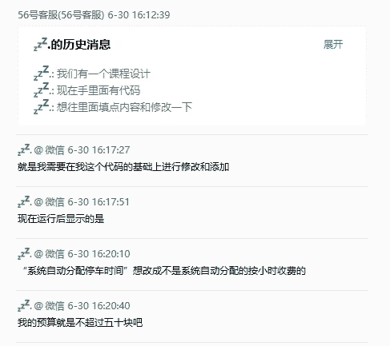

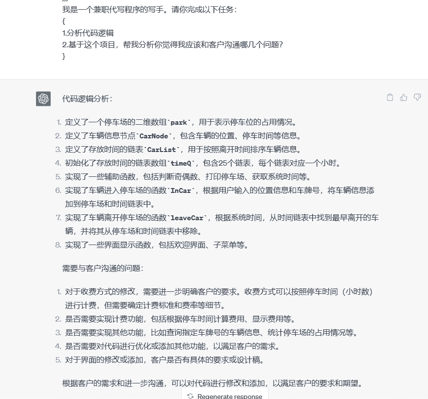

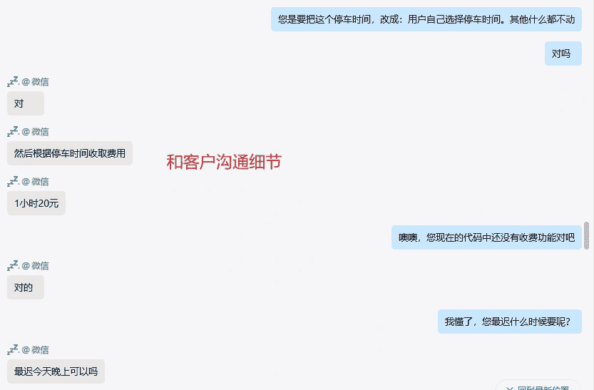

## 2.确定能做之后，让 AI 帮我写代码

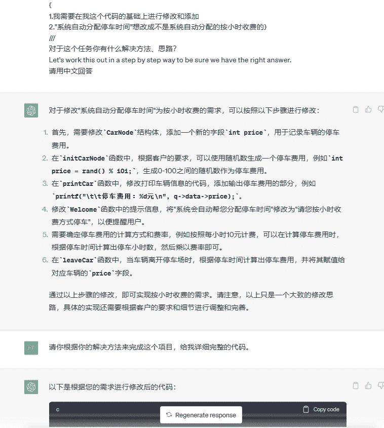

## 3.将 AI 给的代码复制到编译器中反复测试验证

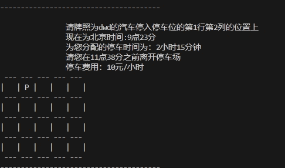

**让 AI 继续修改**

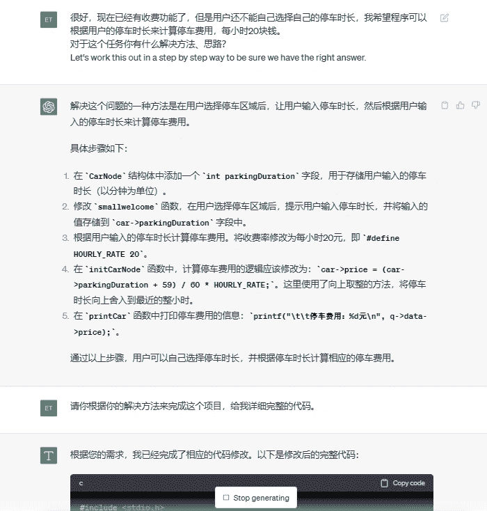

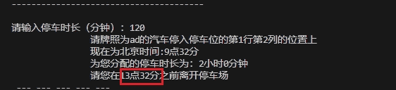

## 4.让 AI 修复 bug

刚才我们已经把完整的需求和代码发给 AI，但是 AI 并不能很好的完成任务，我推断是因为代码长度太长了，AI 写着写着就忘了自己要做什么，接下来我们使用替换函数法。

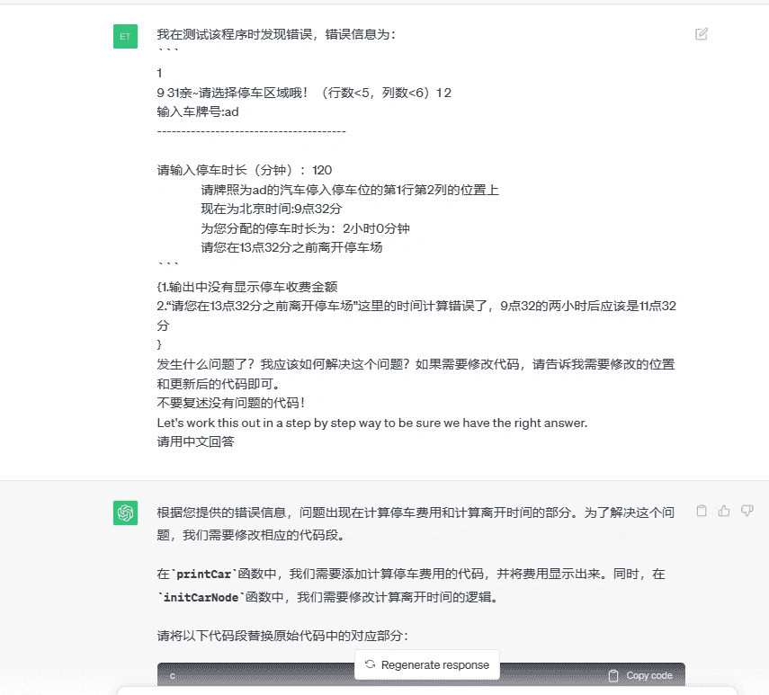

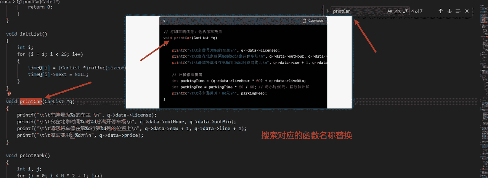

反复操作上述过程，直到程序修改到客户满意的程序（这里不再赘述）

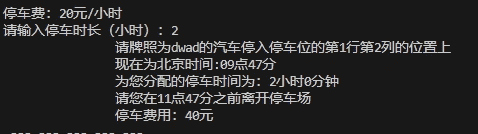

上述的步骤，我们需要懂任何代码吗？不需要？我们只需要懂得复制粘贴以及和给 AI 指令即可，我相信绝大部分人都能做到这一点的！

# 八、交付

1.对程序进行截图或者录视频发给客户，询问客户的修改建议。

2.待派单客服确定可以发源码后再发源码给用户！

3.派单客服确定接单后，记录这单的信息，方便日后跟踪打款。

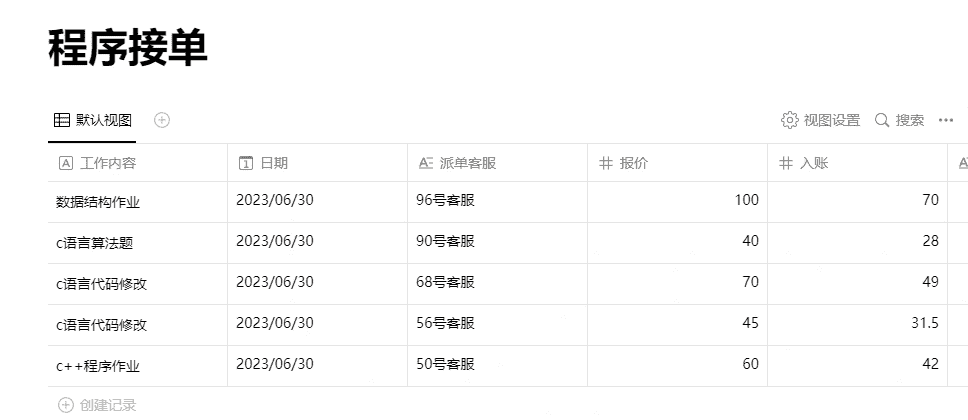

# 九、其他的接单来源

除了淘宝/拼多多店铺应聘写手，你还可以：

①加入大学生校友群、二手交易群等 。当前大学生中，存在许多选择水课或不认真学习的同学，而你作为懂编程接单的人，可以抓住这一市场机会，获得丰厚的市场红利。

步骤如下：

1.上百度贴吧，搜索某某大学的学校表白墙、二手交易群、校友群等，正值招生季，你可以伪装成高中毕业生进入大学的招生群、新生群等。

2.在里面混熟了之后，确认发类似的广告不会被踢后开始改马甲+打广告。

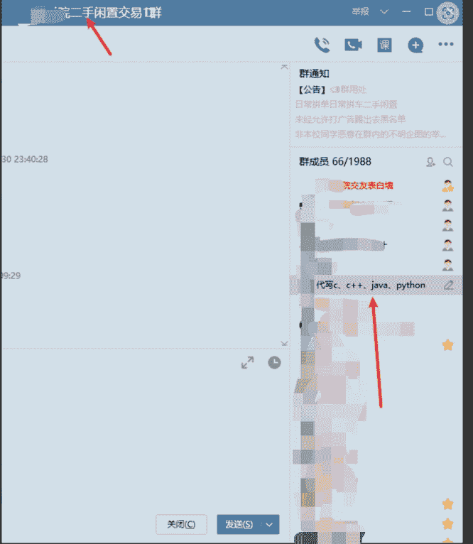

**②在闲鱼平台发布程序代写服务**

# 十、我的进一步思考

1、从广度思考，还可以延申出什么别的玩法？

除了 AI+编程接单，还可以尝试 AI+写作、AI+PPT、AI+Excel、AI+数据分析等等。ChatGPT 作为一个底层大模型，其潜力远不止于聊天工具。结合语音插件或行业需求，它能改变整个行业的生态。掌握一个类型的玩法后，你将能轻松上手其他类似应用，抓住先机，发挥优势。

2.从深度思考，接下来如何把 AI+编程接单做强做大？

①不断实践，总结经验，优化流程，提高效率，形成良性循环。

②尝试利用 AI 辅助学习不熟悉的编程领域，用实际收入作为自己的学习投入。 实践中，你可能发现那些看似难的领域并非想象中的那么困难。

③和客服混熟之后，应聘客服，赚差价。

④打造个人 IP，获取私域流量，直接对接客户，没有中间商，自己赚差价。

#

本文出自我的好朋友夙愿，如果您想了解更多信息可关于👸号【AI魔法师夙愿】

更多内容可以点击目录： [手册内容汇总](https://xiaobot.net/post/1afc53bc-48da-4b49-8caa-a09279c32161https://aiyanxishe.feishu.cn/wiki/LBXcwPv6UiZgdfkp14Xc1Wo1n3b)

✨ 如果觉得有收获，请点一点下方的“有启发” ✨

🌱 我也会及时优化迭代内容，给大家更好的阅读体验 🌱

<https://aiyanxishe.feishu.cn/sync/IaSadpoOOsopKab1ajKcz6z3nAb>