# 10 分钟制作微信表情包 SOP | 每个人都可以拥有自己的专属表情包

> 来源：[https://aiyanxishe.feishu.cn/docx/TEuIdp8xyoo5xixCmZQcmeEEn6e](https://aiyanxishe.feishu.cn/docx/TEuIdp8xyoo5xixCmZQcmeEEn6e)

## 程序员AI破局简介

> [《程序员AI破局指南》](https://t.zsxq.com/19EOflzkQ)由字节、百度、阿里等互联网大厂的AI业务相关高管共创，分享开箱即用、面向市场的AI编程知识和工具。

> 指南包括六个专栏:**AI编程实战、AI编程工具、AI高效办公、A**I副业赚钱、AI提示词工程、AI私人助手

> [程序员AI破局指南](https://t.zsxq.com/19EOflzkQ) 原价 599 元，限时特惠 199 元/年，5月1日恢复原价。

> 加入我们：https://t.zsxq.com/19EOflzkQ

> 购买后，添加群主微信加入 AI研习社陪伴社群，限时领取超值福利。

本篇文章，重点是记录分享下以下部分内容：

1.  了解微信表情包上架审核规范

1.  使用 Midjourney 制作微信表情包素材图

1.  抠图、切图技巧

1.  制作表情包图片

1.  制作上架需要的封面、横幅等

1.  提交审核指引

## 一）成品展示区

首先展示下最终的成果 --- 成功上线啦～

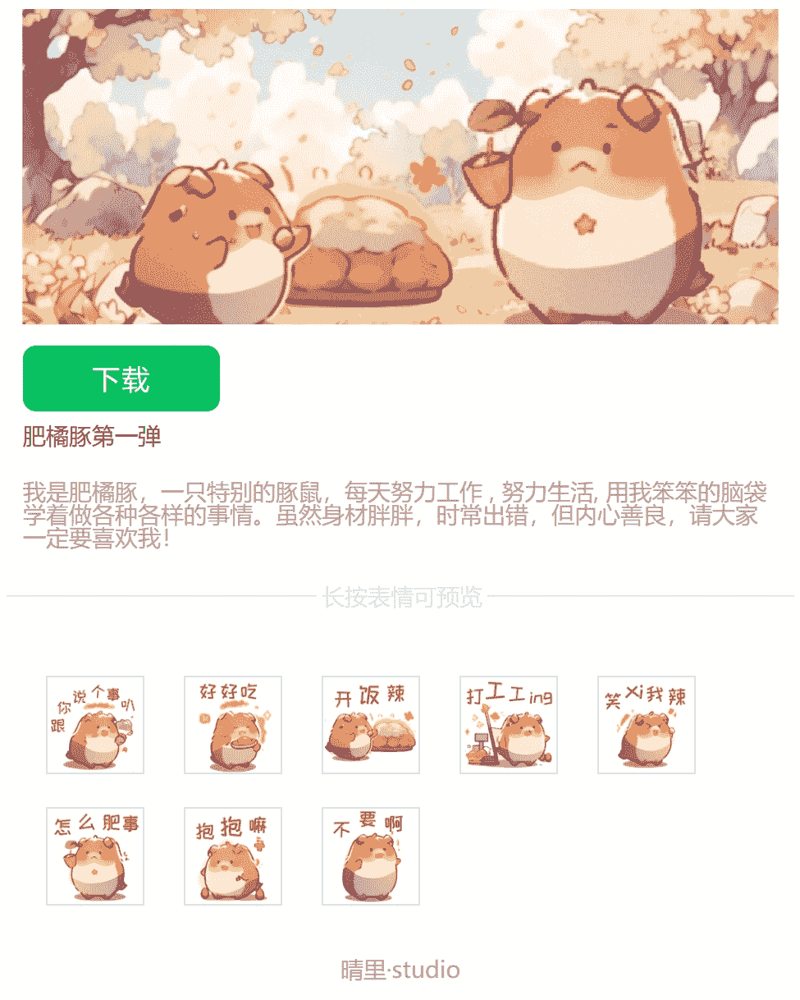

## 二）了解微信表情包上架审核规范

想要自己制作的表情包在微信中可以使用，需要到“微信表情开放平台”按规范提交作品并审核通过后，才可以哦。

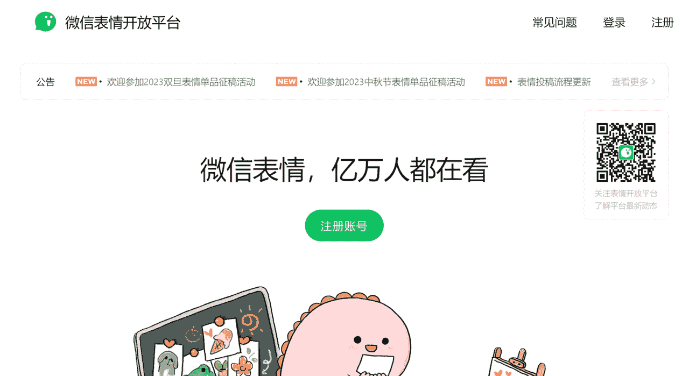

1.  [首先，进入“微信表情开放平台”，进行账号注册： https](https://sticker.weixin.qq.com/cgi-bin/mmemoticon-bin/readtemplate?t=guide/index.html#/makingSpecifications#specifications_stickers)://sticker.weixin.qq.com/，我们使用个人注册，按照指引完成注册；

1.

1.  查看表情包 [制作规范 ](https://sticker.weixin.qq.com/cgi-bin/mmemoticon-bin/readtemplate?t=guide/index.html#/makingSpecifications#specifications_stickers)。根据平台文档可知，审核规则是一套表情包要求风格统一、表情足够差异，而且是图的数量为 8 的倍数，如 8、16、24 张。

1.

## 二） 使用 Midjourney 制作微信表情包

AI 绘画实操的目标：使用 Midjourney 生成同一形象的不同表情、动作的表情图片。如果打算上架 8 个一组的表情包，则生成的表情数量大于 8 个，以便筛选掉不合适的后，还能有 8 个，我经验是最好大于 16 个哈哈。

### 1、设置 Midjourney 的 settings，主要是切换模型引擎为动漫风格

设置下 Midjourney 的默认参数，主要是要设置使用的模型为 Niji Model V5，这个模型可以实现动漫风格，当然可以在 Prompt 中手动指定。

在对话框中输入 /settings 后回车，进入设置模式，具体操作如下图所示：

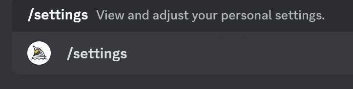

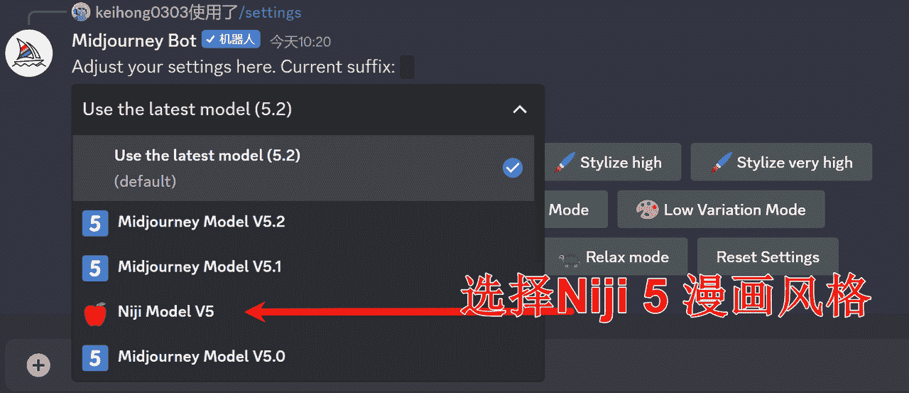

其他的选项可以参考下图：

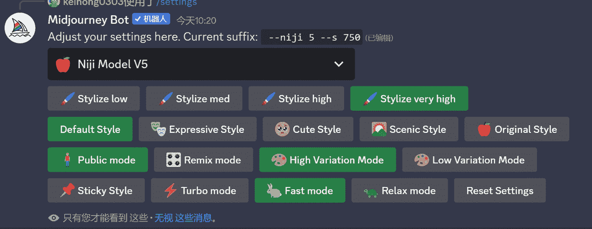

各项设置的注释如下图所示：

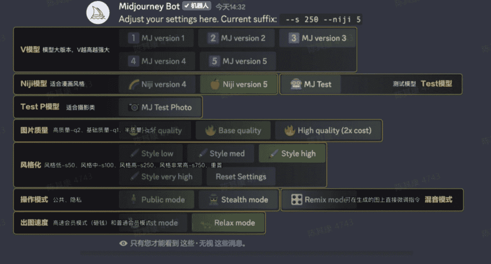

### 2、 **/describe 找一张对标的表情包集**合图，获得相应的 Prompt 作为参考

在输入框敲入 /describe 指令，会提示上传一张图片，建议上传与下图类似的表情集合，方便出表情图

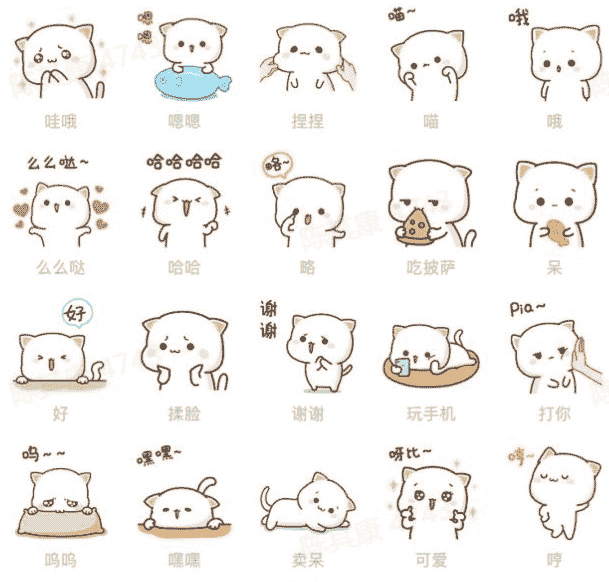

等分析完后，可以得到 4 个 Prompt ：

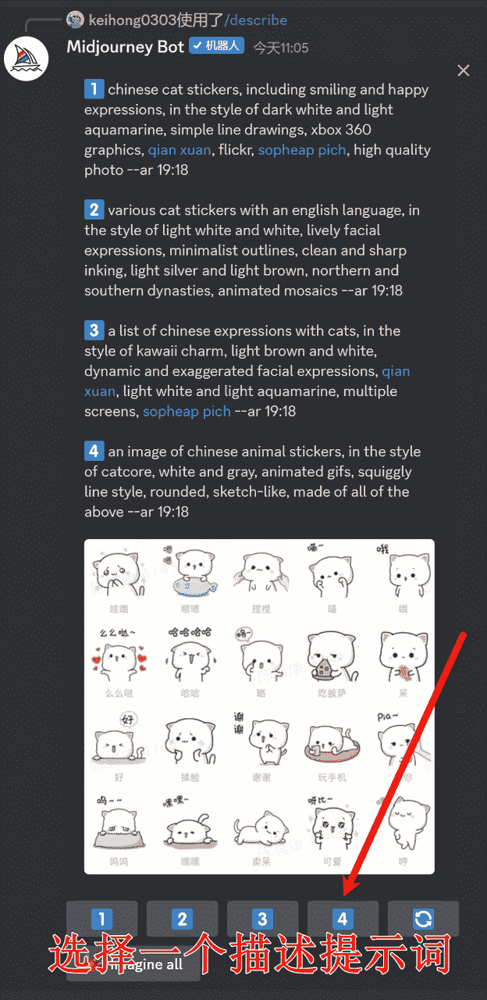

英文不好的咱也不怕，咱还有翻译软件嘛。翻译一下，看下哪个比较合适，就用哪个

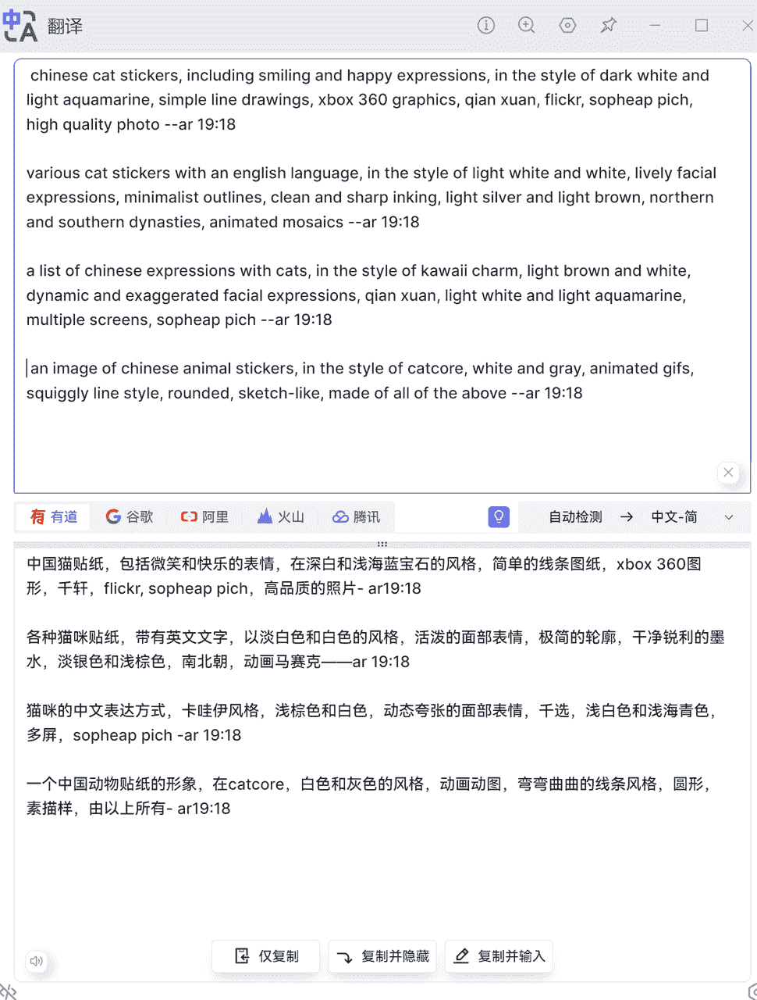

### 3、 使用生成得到的 Prompt 进行改造成自己的 Prompt

参考通过/describe 获得的 Prompt ，加入 关键词"多个动作和表情 --- " -multiple poss and expressions " + 自己的主角名称的英文单词，举个栗子：我想要做的表情包的主角是卡皮巴拉，并选择了第三个 Prompt 进行改造 --- 即把 cat 换成 capybara ：

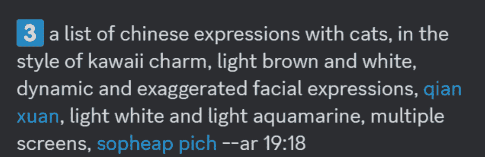

（原 Prompt ）

最终的 Prompt：

```
a list of  expressions sticker  with cartoon capybara, in the style of kawaii charm, light brown and white, dynamic and exaggerated facial expressions, qian xuan, light white and light aquamarine, multiple screens, sopheap pich --ar 19:18 --q 2
```

使用 /imagine 指令 + 提示词 进行图生成（我这里没有默认添加 --q 2 的质量描述，就手动添加下）

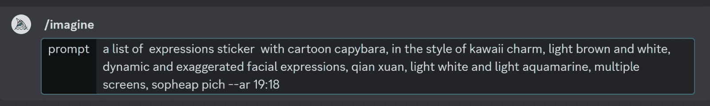

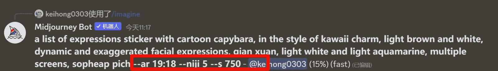

### **4、通过 Mid**journey 得到的结果表情图

emm ... 都好满意啊哈哈

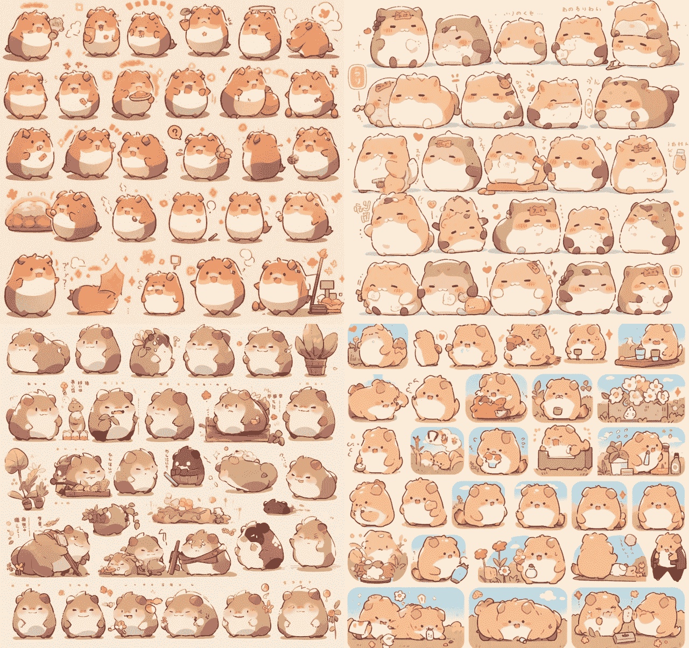

### 5、抠图、切图

> 使用到的工具：

+   没有设计基础的童鞋，工具参考：

+   抠图和制作表情包图片：定稿设计 https://www.gaoding.com/

+   或者使用 MasterGo ，也算比较简单

+   有设计基础的童鞋，当然使用 Adobe 系列或其他专业设计工具啦

可以先用定稿设计，把整个 Midjourney 生成的图片总体抠图，得到一张去掉背景的表情集合图；使用 Adobe Illustrator 或者 MasterGo 的切图功能，快速把自己想要的表情包切出来，再放置到 240 * 240 的画布上，就比较便捷。

我是使用 MasterGo 的，操作重点如下：

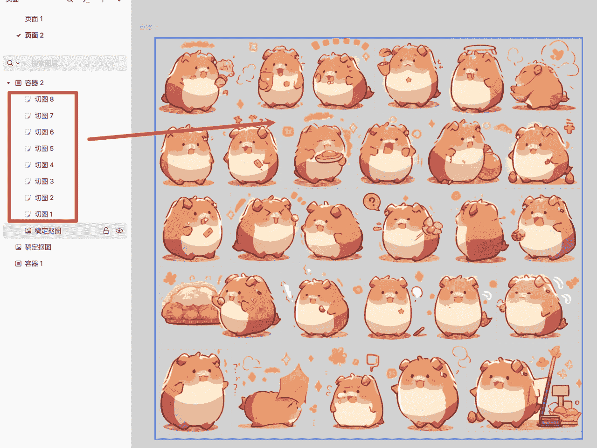

导出切图：

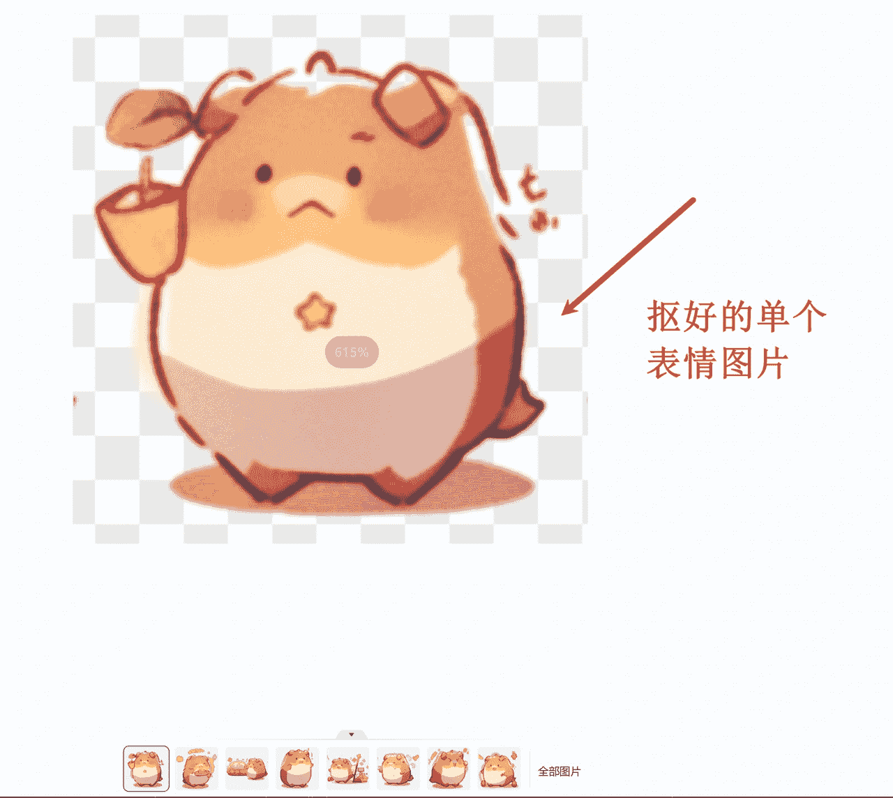

### 6、灵魂配文环节 ---- **配脑洞文案、制作作表情包**

+   使用定稿设计或 MasterGo 设置尺寸 240 * 240 像素的画布，并把切好的透明背景的图尽量最大化放到画布上

+   添加上灵魂文字，把画布背景设置为透明，导出即可

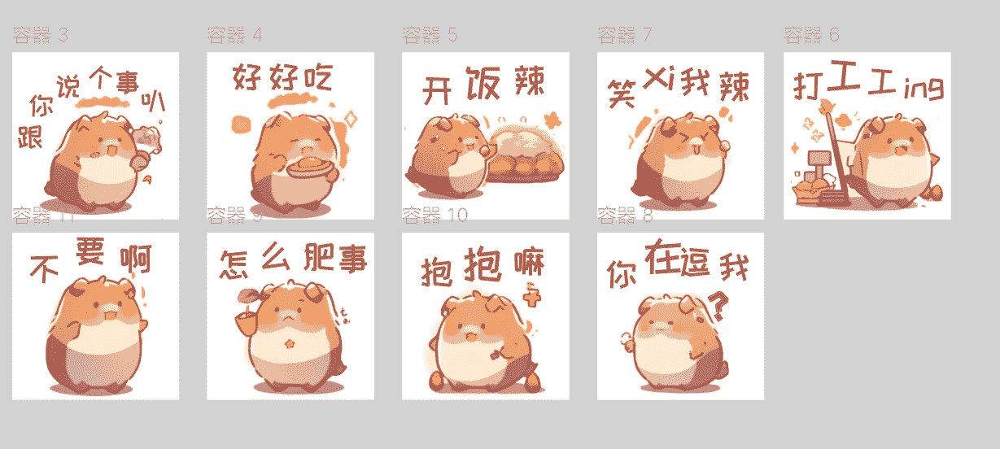

### 7、根据要求，制作横幅、封面、聊天面板图标等

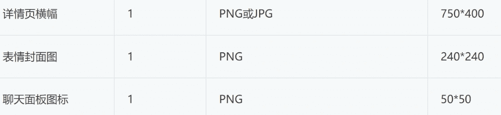

1.  需要注意的是，除了根据尺寸要求制作外，横幅背景不要为白色或白色边框，封面图、聊天面板图标要透明背景，聊天面板图标不要有表情文字、装饰且尽量放大或裁剪出角色头像。做好这些，审核就快些，不然会被打回。

1.  聊天面板图标可以在提交界面看到模拟图，点击聊天面板就能确认能否看清会不会太小。如果太小就裁剪出角色头像。

### 8、提交到 **微信表情开放平台进行审核**

[https://sticker.weixin.qq.com，进入微信表情开放平台，注](https://sticker.weixin.qq.com/cgi-bin/mmemoticon-bin/readtemplate?t=guide/index.html#/makingSpecifications#specifications_stickers)册后提交作品即可。注意：审核通过后，还需要自行到后台进行上架，不然是搜索不到滴。

### 9、 补充分享：使用 Midjourney 制作横幅

1.  找个喜欢的背景，用 Midjourney 去生成叭

1.  还是制作表情包的那个套路，使用/describe获得 Prompt 后进行生成。

第一次生成的是没有垫图的效果，不是我想要的风格，后面垫图后效果就不错了：

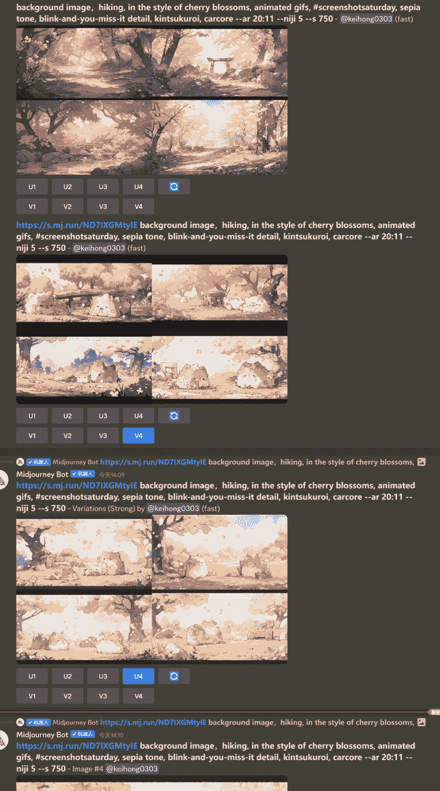

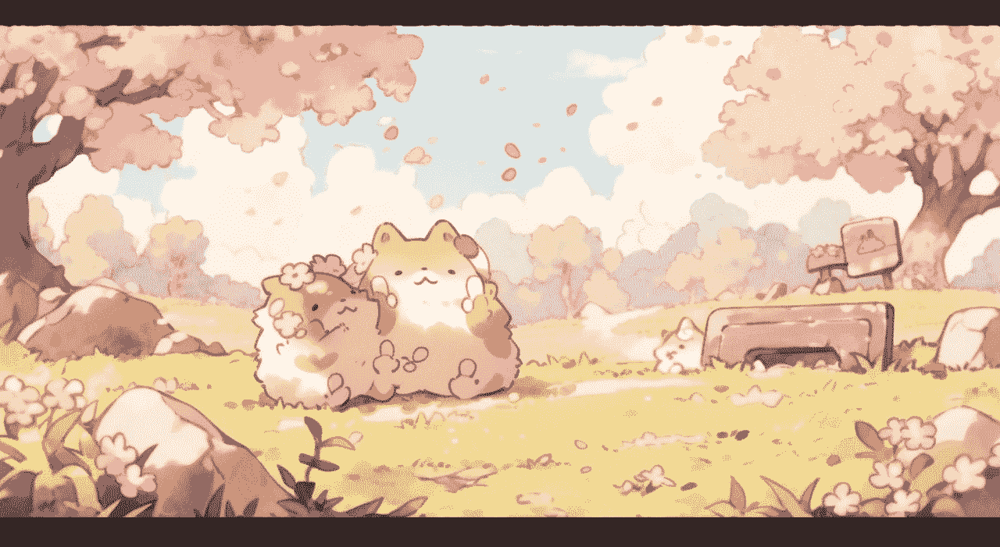

用 PS 或一些 AI 工具，去掉不要的部分，再加上自己表情包的元素

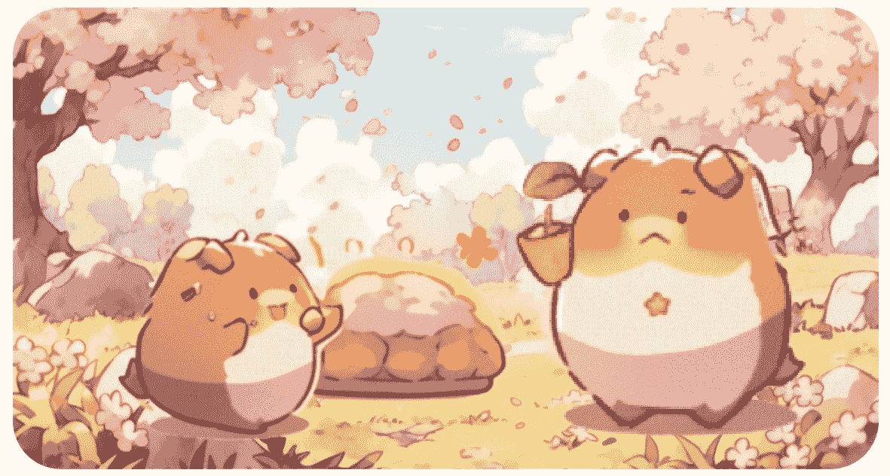

# 三、微信表情包小成绩

12 月 6 日发布，到 13 日，已经有 106 次下载，目前打赏的基本都是亲朋，赚不赚钱是小事，毕竟还有长尾效应。重点是在 AI 践行这条路，完成了一次小闭环，也输出了文章，而且创造自己喜欢的角色形象能够被大众看到，确实是一件快乐的小事！

人生，就该积累各种各样高质量的小快乐！~

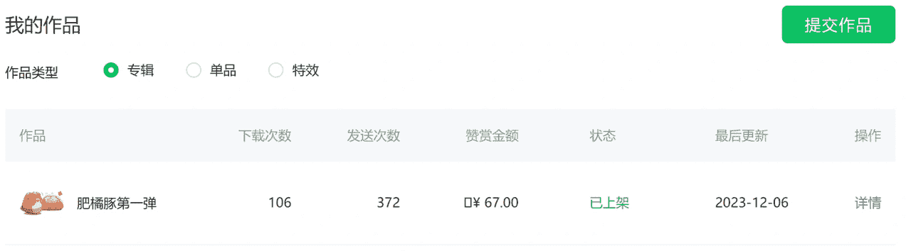

如果想交流学习如何通过AI制作自己的表情包，可关注作者公众号获取联系方式：「AI船长陈零一」

更多内容可以点击目录： [手册内容汇总](https://aiyanxishe.feishu.cn/wiki/LBXcwPv6UiZgdfkp14Xc1Wo1n3b)

✨ 如果觉得有收获，请点一点下方的“有启发” ✨

🌱 我也会及时优化迭代内容，给大家更好的阅读体验 🌱

#AI副业赚钱

<https://aiyanxishe.feishu.cn/sync/IaSadpoOOsopKab1ajKcz6z3nAb>