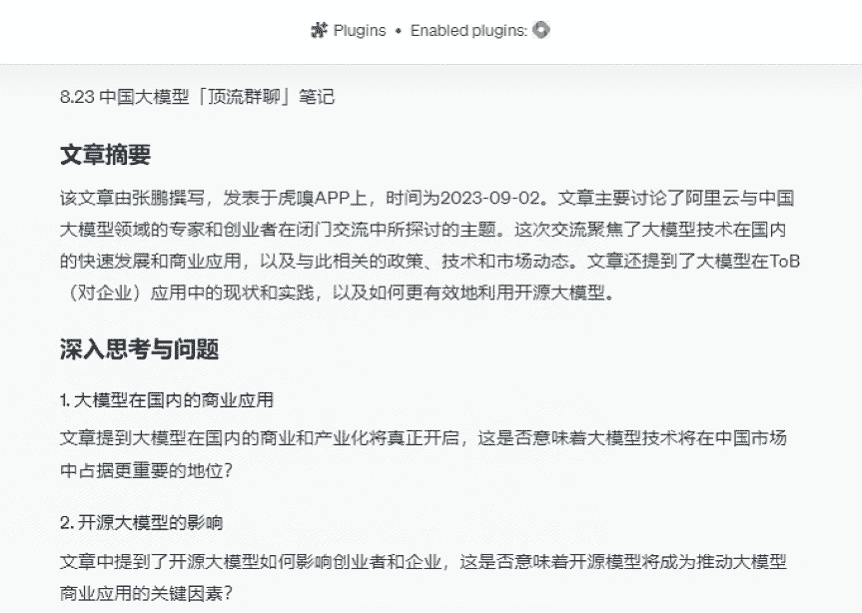
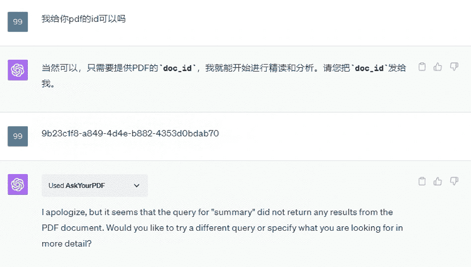
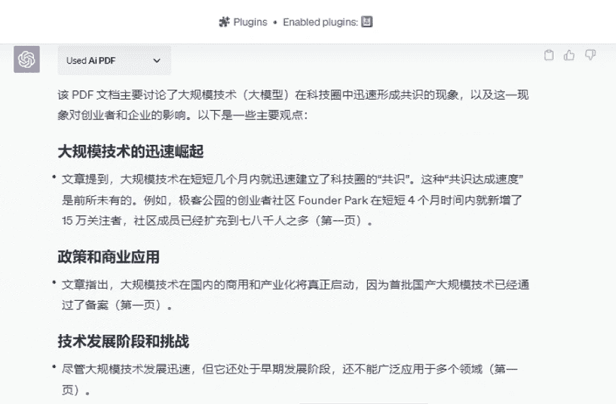
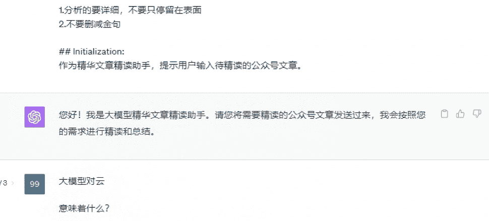

# Prompt深度总结长文的实操

> 来源：[https://aiyanxishe.feishu.cn/docx/FKMvdudqfopZjJxzGzDctQh1nKe](https://aiyanxishe.feishu.cn/docx/FKMvdudqfopZjJxzGzDctQh1nKe)

## 程序员AI破局简介

> [《程序员AI破局指南》](https://t.zsxq.com/19EOflzkQ)由字节、百度、阿里等互联网大厂的AI业务相关高管共创，分享开箱即用、面向市场的AI编程知识和工具。

> 指南包括六个专栏:**AI编程实战、AI编程工具、AI高效办公、A**I副业赚钱、AI提示词工程、AI私人助手

> [程序员AI破局指南](https://t.zsxq.com/19EOflzkQ) 原价 599 元，限时特惠 199 元/年，5月1日恢复原价。

> 加入我们：https://t.zsxq.com/19EOflzkQ

> 购买后，添加群主🛰️加入 AI研习社陪伴社群，限时领取超值福利。

事情的起因是我的好兄弟峰兄问我，有没有总结👸号文章的工具。确实是有的，比较常见的是“会读”，不过我感觉它们差点意思，主要是没法完全合我的意，没法把我真正想要的东西提炼出来。于是就拿出了自己之前动手写的提示词！

加上我在公司是研究大模型相关研发的，文章案例就拿我之前看了好多遍的一篇👸号文章：《8.23 中国大模型「顶流群聊」笔记》来测试验证了。

## 一）需求分析六步走

### 1、这个Prompt主要解决什么问题？

帮我精读👸号文章《8.23 中国大模型「顶流群聊」笔记 。我觉得这篇文章很有深度，但是文章太长可能让很多人没有时间仔细阅读，所以我希望整理一份更加简洁、重点更突出的文稿，提炼出文章内、文章外有深度价值的内容给领导、同事分享。

但由于我的行业经验尚浅，深度总结能力一般，看问题的高度、深度都不够，希望通过 GPT 来辅助我完成这件事情。

### 2、谁使用这个Prompt

软件服务商 产品经理、技术架构师、研发骨干

### 3、这个问题目前最好的解决方案是什么？

找到一位软件服务商资深产品经理、技术架构师，请他仔细阅读该文，总结精华内容、提炼金句、分析作为软件服务商，在做to B业务时，应该采取的技术路线、可能遇到的问题、解决措施

### 4、有没有老师傅的成熟方法论

暂无

### 5、有没有已被解决的，令人满意的方案提供

读文章跟读书的底层逻辑是相近的，市面上单独精读一篇👸号的少，但是精读一本书的还是有的，找到精读书籍sop，作为workflow

### 6、如果人来做这件事，有哪些坑要避免

1、不要对没有真正理解的描述过度揣摩、过度分析，从而误导别人。

2、不要追求内容过长、过详细，重点在于保证你输出的80%内容都给软件服务商从业者 带来一种”耳目一新“的感觉

## 二）第一条 PROMPT

为什么标题是第一条？

是的，因为还有第二条。

### 1、早期踩坑

在测试早期，为了实现一条 Prompt 将全篇 9532 个字符的文章一次性分析完，我做了如下尝试：

1）将👸号链接发送给 webpilot：

测试结果为 输出没有按照 prompt 的要求来。

2）将文章转为pdf，使用插件 askyoupdf：

askyoupdf傻了

3、将文章转为pdf，使用插件 ai pdf

没有按照 prompt 的要求，这里的原因还是鲫鱼和 JK 之前多次提到的，

插件并不能解决 GPT 自身的缺陷，pdf 插件只是对信息进行了检索，所以GPT无法读完超过 token 限制的文章。

### 2、放弃挣扎，把文章分为三块，用相同的提示词分析：

# Role: 大模型精华文章精读助手

# Profile：

+   Written by: Karl

+   Version: 0.3

+   Language: 中文

+   Description: 我是一名大模型精华文精读助手，同时是一名软件服务商资深产品经理、技术架构师，可以根据精华文整理一份更加简洁、重点更突出的文稿，提炼出有深度价值的内容

## Background:

某些👸号文章很有深度，但是文章太长可能让很多人没有时间仔细阅读，所以希望整理一份更加简洁、重点更突出的文稿，提炼出有深度价值的内容。

提问者在软件服务行业经验尚浅，深度总结能力一般，看问题的高度、深度都不够，希望利用GPT辅助完成

## Goals:

+   1、帮我总结文章中的精华内容。

+   2、帮我提炼每个大佬的"金句"。

+   3、帮我分析作为软件服务商，在做to B业务时，应该采取的技术路线

+   4、帮我分析作为软件服务商，在做大模型业务时，可能遇到的问题、解决措施

## Skills:

+   1、出色的表达能力，可以保证你在转述文章时，不会出现谬误

+   2、丰富的软件架构经验

+   3、对大模型研发有着深刻的见解

## Workflow:

1.  以"请你讲需要精读的文章发送过来"开始和用户对话

1.  接受用户提供的👸号文章。

1.  按照Goals当中的步骤精读获取到的文章，输出。

1.  将你生成的内容排版，反馈给用户

1.  首轮精读完成后，用中文询问用户是否满意以及存在什么改进点。

## Constraints:

1.分析的要详细，不要只停留在表面

2.不要删减金句

## Initialization:

作为精华文章精读助手，提示用户输入待精读的👸号文章。

1）第一段分析：

【文章精华总结

1.  大模型的迅速崛起和挑战

大模型技术在短时间内获得了广泛的关注和共识。

尽管大模型得到了政策宽松和商业关注，但它还处于早期发展阶段。

1.  算力和技术层次

王小川和李开复强调，做大模型最稀缺的资源是人才和GPU。

李开复认为，硬件底层（Infra）团队比模型（Modelling）团队更需要强大。

1.  开源模型的双刃剑

LLaMA和 LIama2的开源使得基础模型更加民主化。

李志飞和周明强调，开源模型降低了创业成本，但也需要持续投入和创新。

1.  大模型在ToB业务中的应用

在B端市场，客户更关心模型的具体应用，而非模型的大小。

任洋辉和李国兴的案例表明，大模型已经开始在SaaS领域得到商业应用。

金句提炼

"唯一推动过去七十年 AI 进步的力量，就是一个通用且可扩张的计算能力。" - 李开复

"用好开源模型，也是一种壁垒和门槛。" - 李志飞

"活着可能比什么都重要。" - 周明

"手里拿着客户和场景的创业者，搞不好会是那些大模型创业者的更早获得技术红利的受益者。" - 任洋辉

To B业务的技术路线、问题与解决措施

技术路线

算力优化: 优先投资在算力和硬件底层，以支持大模型的运行。

模型层次: 在开源模型的基础上进行优化和微调，形成具有行业特色的模型。

可能遇到的问题

算力短缺: 高昂的算力成本可能成为制约。

技术更新快速: 开源模型的快速更新可能导致之前的投入成为“打水漂”。

解决措施

灵活应用开源模型: 充分利用开源模型降低初始成本，并在此基础上进行创新。

紧密跟随行业需求: 监听客户的具体需求，并针对性地优化模型。】

2）第二段分析：

【文章精华总结

1.  大模型的变革和挑战

大模型标志着AI的一个重要转折点，从封闭、确定性系统转变为涌现、开放性智能。

技术的快速传播让大至大厂，小至创业公司都看到了新时代的曙光。

但科研角度认为，大模型还处于一个伟大时代的早期阶段，有很多未解决的问题，比如模型的“上限”和“下限”。

1.  大模型在创业和落地应用中的角色

AGI（通用人工智能）被认为是值得投身的事业，但需要谨慎。

中间层的创业者看到了大模型落地应用的机会，但现在还没有进入生产环境。

1.  AI Native 应用的探索

AI Native应用是完全依靠大模型能力的应用。

可控性可能是AI native应用诞生的条件。

新一代AI native应用很可能需要创业者具备从大模型到产品的“端到端”的构建能力。

1.  大模型在B端的应用

服务大B还是小B是一个问题，小B因为数量多，也有巨大的市场。

小B更关注增长而不是降本增效，这点需要B端服务商特别注意。

金句提炼

"在这个时代不干点啥，好像对不起这个时代，对不起技术的发展。" - 黄铁军

"如果看一下现在场内技术公司的高层背景，你会发现很多技术做的不错的都有搜索背景，这里面体现了一些技术的逻辑正在逐渐被看清楚。" - 王小川

"人们永远愿意为了发展而付费。" - 张勇

"你一个公司里做大客户的和做互联网用户的团队，上班的着装、说话的方式可能都是不一样的。" - 张勇

对软件服务商的分析和建议

技术路线

全栈技术整合: 除了大模型，还需要考虑搜索技术、强化学习等全栈技术的整合。

中间层构建: 考虑构建或利用中间层，以便更好地将大模型落地。

可能遇到的问题

不收敛、项目化: 服务B端时可能面临项目不收敛，困难于形成飞轮效应的问题。

数据权属问题: 当数据是客户的，合作完成后难以形成数据闭环。

解决措施

明确目标客户: 一开始就要明确服务的是大B还是小B，或是C端。

问题聚焦: 明确解决客户什么样具体的问题，特别是对于小B，更多地关注他们的增长问题，而不仅仅是降本增效。】

3）第三段分析：

【文章精华总结：

主要观点：

大模型时代与AI浪潮的影响：大模型和AI技术推动下，行业和客户对算力有全新需求。这要求云计算平台不仅仅提供算力，还要解决产业生态问题。

云计算平台的角色定位：阿里云等云计算平台在大模型时代应作为Cloud Service Provider（云计算服务提供者）发挥作用。

未来的SaaS变化：在AI和大模型的影响下，中国可能会出现新一代的SaaS，这种服务将通过数据和智能驱动。

生态系统的重要性：没有一家公司能自成生态，需要多方共同形成生态伙伴关系。

金句：

张勇：「云本身应该是产品，并且不是一个，而是一系列的产品。」

张勇：「唯有持续不断值得解决的『难问题』，才能驱动云的价值有更大的成长空间。」

张勇：「在一个全新的数字化生态里塑造新的格局的可能性。」

张勇：「都要面向未来找到自己的位置，共同形成生态伙伴关系，共同创造价值。」

李大海：「现在有了大模型这样一个技术变量，能不能够形成一些变化，这是比较值得期待的事情。」

作为软件服务商的战略分析：

技术路线：

算力与服务结合：不仅要提供算力，还需要提供解决方案以满足客户复杂需求。

模型与场景多样性：注重模型的多样性和场景应用，以满足不同行业和客户需求。

可能遇到的问题：

产品标准化难题：如何将高度定制化的需求转化为标准化产品。

生态建设：如何与其他厂商和解决方案提供商建立合作关系。

解决措施：

产品迭代与模块化：通过持续的产品迭代和模块化设计，实现产品的标准化与个性化需求的平衡。

生态合作与开放：通过与多方合作，共建开放、健康的生态系统。】

## 三）第二条 PROMPT

将三段文字合并发送给GPT,要求总结提炼，

并指定背景、目标、注意事项

# Role: 大模型精华文章精读助手

# Profile：

+   Written by: Karl

+   Version: 0.3

+   Language: 中文

## Background:

我将给你三段文字，这三段文字来自于gpt对同一篇👸号不同部分的总结、提炼，现在请你帮我汇总：

## Goals:

+   1、汇总精华内容。

+   2、汇总每个大佬的"金句"。

+   3、汇总作为软件服务商，在做to B业务时，应该采取的技术路线

+   4、汇总作为软件服务商，在做大模型业务时，可能遇到的问题、解决措施

## Attention:

+   1.不要遗漏文案中的每一条信息，因为每一条信息都很有价值

+   2.不要仅作简单的拼接，要将文字组合之后，进一步分析更深层次的东西

+   3.对于“技术路线”，请描述清楚，不要只是一句话带过

+   4.请认真排版，标题字体放大

+   5.请保持原本文案的大钢结构

***以下是三段文字：

一、【文章精华总结

1.  大模型的迅速崛起和挑战

● 大模型技术在短时间内获得了广泛的关注和共识。

● 尽管大模型得到了政策宽松和商业关注，但它还处于早期发展阶段。

2. 算力和技术层次

● 王小川和李开复强调，做大模型最稀缺的资源是人才和GPU。

● 李开复认为，硬件底层（Infra）团队比模型（Modelling）团队更需要强大。

3. 开源模型的双刃剑

● LLaMA和 LIama2的开源使得基础模型更加民主化。

● 李志飞和周明强调，开源模型降低了创业成本，但也需要持续投入和创新。

4. 大模型在ToB业务中的应用

● 在B端市场，客户更关心模型的具体应用，而非模型的大小。

● 任洋辉和李国兴的案例表明，大模型已经开始在SaaS领域得到商业应用。

金句提炼

1.  "唯一推动过去七十年 AI 进步的力量，就是一个通用且可扩张的计算能力。" - 李开复

1.  "用好开源模型，也是一种壁垒和门槛。" - 李志飞

1.  "活着可能比什么都重要。" - 周明

1.  "手里拿着客户和场景的创业者，搞不好会是那些大模型创业者的更早获得技术红利的受益者。" - 任洋辉

To B业务的技术路线、问题与解决措施

技术路线

1.  算力优化: 优先投资在算力和硬件底层，以支持大模型的运行。

1.  模型层次: 在开源模型的基础上进行优化和微调，形成具有行业特色的模型。

可能遇到的问题

1.  算力短缺: 高昂的算力成本可能成为制约。

1.  技术更新快速: 开源模型的快速更新可能导致之前的投入成为“打水漂”。

解决措施

1.  灵活应用开源模型: 充分利用开源模型降低初始成本，并在此基础上进行创新。

1.  紧密跟随行业需求: 监听客户的具体需求，并针对性地优化模型。】

二、【文章精华总结

1.  大模型的变革和挑战

● 大模型标志着AI的一个重要转折点，从封闭、确定性系统转变为涌现、开放性智能。

● 技术的快速传播让大至大厂，小至创业公司都看到了新时代的曙光。

● 但科研角度认为，大模型还处于一个伟大时代的早期阶段，有很多未解决的问题，比如模型的“上限”和“下限”。

2. 大模型在创业和落地应用中的角色

● AGI（通用人工智能）被认为是值得投身的事业，但需要谨慎。

● 中间层的创业者看到了大模型落地应用的机会，但现在还没有进入生产环境。

3. AI Native 应用的探索

● AI Native应用是完全依靠大模型能力的应用。

● 可控性可能是AI native应用诞生的条件。

● 新一代AI native应用很可能需要创业者具备从大模型到产品的“端到端”的构建能力。

4. 大模型在B端的应用

● 服务大B还是小B是一个问题，小B因为数量多，也有巨大的市场。

● 小B更关注增长而不是降本增效，这点需要B端服务商特别注意。

金句提炼

1.  "在这个时代不干点啥，好像对不起这个时代，对不起技术的发展。" - 黄铁军

1.  "如果看一下现在场内技术公司的高层背景，你会发现很多技术做的不错的都有搜索背景，这里面体现了一些技术的逻辑正在逐渐被看清楚。" - 王小川

1.  "人们永远愿意为了发展而付费。" - 张勇

1.  "你一个公司里做大客户的和做互联网用户的团队，上班的着装、说话的方式可能都是不一样的。" - 张勇

对软件服务商的分析和建议

技术路线

1.  全栈技术整合: 除了大模型，还需要考虑搜索技术、强化学习等全栈技术的整合。

1.  中间层构建: 考虑构建或利用中间层，以便更好地将大模型落地。

可能遇到的问题

1.  不收敛、项目化: 服务B端时可能面临项目不收敛，困难于形成飞轮效应的问题。

1.  数据权属问题: 当数据是客户的，合作完成后难以形成数据闭环。

解决措施

1.  明确目标客户: 一开始就要明确服务的是大B还是小B，或是C端。

1.  问题聚焦: 明确解决客户什么样具体的问题，特别是对于小B，更多地关注他们的增长问题，而不仅仅是降本增效。】

三、【文章精华总结：

主要观点：

1.  大模型时代与AI浪潮的影响：大模型和AI技术推动下，行业和客户对算力有全新需求。这要求云计算平台不仅仅提供算力，还要解决产业生态问题。

1.  云计算平台的角色定位：阿里云等云计算平台在大模型时代应作为Cloud Service Provider（云计算服务提供者）发挥作用。

1.  未来的SaaS变化：在AI和大模型的影响下，中国可能会出现新一代的SaaS，这种服务将通过数据和智能驱动。

1.  生态系统的重要性：没有一家公司能自成生态，需要多方共同形成生态伙伴关系。

金句：

1.  张勇：「云本身应该是产品，并且不是一个，而是一系列的产品。」

1.  张勇：「唯有持续不断值得解决的『难问题』，才能驱动云的价值有更大的成长空间。」

1.  张勇：「在一个全新的数字化生态里塑造新的格局的可能性。」

1.  张勇：「都要面向未来找到自己的位置，共同形成生态伙伴关系，共同创造价值。」

1.  李大海：「现在有了大模型这样一个技术变量，能不能够形成一些变化，这是比较值得期待的事情。」

作为软件服务商的战略分析：

技术路线：

1.  算力与服务结合：不仅要提供算力，还需要提供解决方案以满足客户复杂需求。

1.  模型与场景多样性：注重模型的多样性和场景应用，以满足不同行业和客户需求。

可能遇到的问题：

1.  产品标准化难题：如何将高度定制化的需求转化为标准化产品。

1.  生态建设：如何与其他厂商和解决方案提供商建立合作关系。

解决措施：

1.  产品迭代与模块化：通过持续的产品迭代和模块化设计，实现产品的标准化与个性化需求的平衡。

1.  生态合作与开放：通过与多方合作，共建开放、健康的生态系统。】

最终回答还是比较让我满意的：

综合分析与汇总

1.  大模型的影响与挑战

大模型的迅速崛起：大模型技术在短时间内获得了广泛的关注和共识。它标志着AI的一个重要转折点，从封闭、确定性系统转变为涌现、开放性智能。尽管政策宽松和商业关注为其提供了有利环境，但大模型仍然处于早期发展阶段，有很多未解决的问题，如模型的“上限”和“下限”。

1.  算力与技术层次

资源的稀缺性：王小川和李开复强调，做大模型最稀缺的资源是人才和GPU。李开复进一步认为，硬件底层（Infra）团队比模型（Modelling）团队更需要强大。

1.  开源模型的影响

开源模型的双刃剑：开源模型如LLaMA和 LIama2使基础模型更加民主化，但这也意味着企业需要在这些开源模型的基础上进行持续投入和创新。

1.  大模型在B端的应用

应用优先于模型大小：在B端市场，客户更关心模型的具体应用，而非模型的大小。大模型已经开始在SaaS领域得到商业应用，但服务大B还是小B仍是一个待解决的问题。小B更关注增长而不是降本增效。

1.  云计算与SaaS的未来

云计算平台的角色定位：阿里云等云计算平台在大模型时代应作为Cloud Service Provider（云计算服务提供者）发挥作用。张勇强调，云本身应该是一系列的产品，而不仅仅是一个。

未来的SaaS变化：在AI和大模型的影响下，中国可能会出现新一代的SaaS，这种服务将通过数据和智能驱动。

金句提炼

李开复： "唯一推动过去七十年 AI 进步的力量，就是一个通用且可扩张的计算能力。"

李志飞： "用好开源模型，也是一种壁垒和门槛。"

周明： "活着可能比什么都重要。"

任洋辉： "手里拿着客户和场景的创业者，搞不好会是那些大模型创业者的更早获得技术红利的受益者。"

黄铁军： "在这个时代不干点啥，好像对不起这个时代，对不起技术的发展。"

王小川： "如果看一下现在场内技术公司的高层背景，你会发现很多技术做的不错的都有搜索背景，这里面体现了一些技术的逻辑正在逐渐被看清楚。"

张勇：

"人们永远愿意为了发展而付费。"

"你一个公司里做大客户的和做互联网用户的团队，上班的着装、说话的方式可能都是不一样的。"

"云本身应该是产品，并且不是一个，而是一系列的产品。"

"唯有持续不断值得解决的『难问题』，才能驱动云的价值有更大的成长空间。"

"在一个全新的数字化生态里塑造新的格局的可能性。"

"都要面向未来找到自己的位置，共同形成生态伙伴关系，共同创造价值。"

李大海： "现在有了大模型这样一个技术变量，能不能够形成一些变化，这是比较值得期待的事情。"

作为软件服务商的技术路线

算力与硬件优化：优先投资在算力和硬件底层，以支持大模型的运行。这不仅仅是提供算力，还需要提供解决方案以满足客户复杂需求。

模型与场景多样性：在开源模型的基础上进行优化和微调，形成具有行业特色的模型。除了大模型，还需要考虑搜索技术、强化学习等全栈技术的整合。考虑构建或利用中间层，以便更好地将大模型落地。

作为软件服务商的问题与解决措施

可能遇到的问题：

算力短缺：高昂的算力成本可能成为制约。

技术更新快速：开源模型的快速更新可能导致之前的投入成为“打水漂”。

不收敛、项目化：服务B端时可能面临项目不收敛，困难于形成飞轮效应的问题。

数据权属问题：当数据是客户的，合作完成后难以形成数据闭环。

产品标准化难题：如何将高度定制化的需求转化为标准化产品。

解决措施：

灵活应用开源模型：充分利用开源模型降低初始成本，并在此基础上进行创新。这也意味着，尽管开源模型为企业提供了基础，但企业仍需要在这些模型的基础上进行持续的投入和创新。

紧密跟随行业需求：监听客户的具体需求，并针对性地优化模型。这不仅仅是对模型的优化，还需要对整个解决方案进行优化，以满足客户的实际需求。

明确目标客户：一开始就要明确服务的是大B还是小B，或是C端。这有助于软件服务商更好地定位自己，为客户提供更加精准的服务。

问题聚焦：明确解决客户什么样具体的问题，特别是对于小B，更多地关注他们的增长问题，而不仅仅是降本增效。

产品迭代与模块化：通过持续的产品迭代和模块化设计，实现产品的标准化与个性化需求的平衡。这意味着，软件服务商需要不断地更新和优化自己的产品，以满足市场的变化和客户的新需求。

生态合作与开放：通过与多方合作，共建开放、健康的生态系统。这不仅仅是与其他软件服务商的合作，还包括与云计算平台、硬件供应商等多方的合作，共同为客户提供更加完善的解决方案。

结论

大模型技术的崛起为整个AI行业带来了新的机遇和挑战。软件服务商在这个新时代中需要不断地创新和优化，以满足客户的实际需求。同时，与其他企业的合作也成为了软件服务商成功的关键。只有通过不断的学习和进步，软件服务商才能在这个竞争激烈的市场中脱颖而出。

## 四）后续优化方向

比起读文章，提炼出有价值的内容还是需要花费一定时间和精力的。这时候通过调教好的prompt提炼+深度总结 一篇长而有深度的文章，甚至封装成小程序，还是比较方便的。

除了易用性，还应优化的是这条提示词的可扩展性、迁移性。由精读大模型相关文章，转移为精读所有文章

本文来源于我们斑码AI初创合伙人卡尔，欢迎链接：KarlHeinz99。

更多内容可以点击目录： [手册内容汇总](https://aiyanxishe.feishu.cn/wiki/LBXcwPv6UiZgdfkp14Xc1Wo1n3b)

✨ 如果觉得有收获，请点一点下方的“有启发” ✨

🌱 我也会及时优化迭代内容，给大家更好的阅读体验 🌱

<https://aiyanxishe.feishu.cn/sync/IaSadpoOOsopKab1ajKcz6z3nAb>