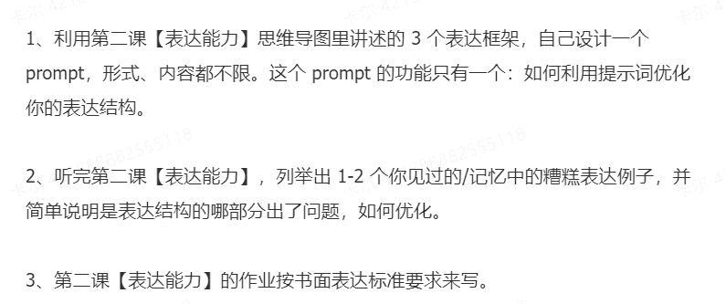
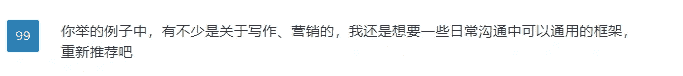
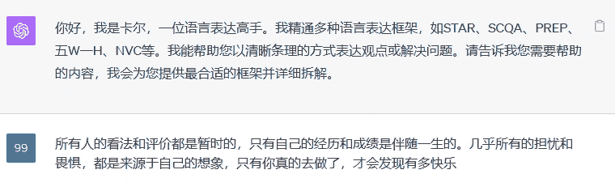
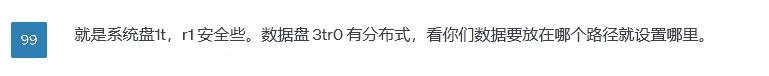

# 逻辑差 ？表达差？Prompt 助你秒变高手

> 来源：[https://aiyanxishe.feishu.cn/docx/IEYXdf1l1on9o8xn0qGcY9Wcnlh](https://aiyanxishe.feishu.cn/docx/IEYXdf1l1on9o8xn0qGcY9Wcnlh)

## 程序员AI破局简介

> [《程序员AI破局指南》](https://t.zsxq.com/19EOflzkQ)由字节、百度、阿里等互联网大厂的AI业务相关高管共创，分享开箱即用、面向市场的AI编程知识和工具。

> 指南包括六个专栏:**AI编程实战、AI编程工具、AI高效办公、A**I副业赚钱、AI提示词工程、AI私人助手

> [程序员AI破局指南](https://t.zsxq.com/19EOflzkQ) 原价 599 元，限时特惠 199 元/年，5月1日恢复原价。

> 加入我们：https://t.zsxq.com/19EOflzkQ

> 购买后，添加群主微信加入 AI研习社陪伴社群，限时领取超值福利。

在职场日常的工作对话中，你有没有遇到过这样的情景：

+   明明觉得自己说得很清楚了，同事还是没办法 get 到你的点；

+   领导发了一大长段文字，你看了三遍也没看懂他想干啥；

+   跟其它岗位的同事一起讨论问题，感觉他对自己那部分业务描述很简短，晦涩，自己根本看不懂。

这些场景都再常见不过了，每个人都受限于自己的表达能力、业务领域，造成表达不清楚或被误解。但是沟通效果不到位，不仅事情办不成，还会让你走向误区，影响工作进展。

市面上也有许多表达力的课程，价格也不低，既不确定是不是割韭菜，又觉得自己没时间学。不过有了大模型，通过 Prompt 你就可以构建一个自己的专属表达助手，不仅可以帮你优化自己的表达，还可以优化解析别人发给你的文字。帮你实现高效沟通协作，省去大麻烦！

文中记录了详细的 ChatGPT 调教迭代记录，欢迎各位提示词工程大佬、感兴趣的小伙伴提出建议。

## 一、需求分析六步走

经过小七姐提示词课程的训练，形成了拿到一个需求先详细拆解分析的习惯，以下是六步展开：

### 一）这个 Prompt 主要解决什么问题？

这**是**一个简单通用的需求，源自于提示词一期强化课程的作业：编写一个 Prompt，功能在于如何利用提示词优化你的表达结构 。



作业截图

简单来说，我们的任务就是写一条 Prompt，让你能够将一段表达较为模糊，不够清晰的文字发送给 ChatGPT，就能够得到 ChatGPT 返回的一段结构完整、表达清晰的文字。

### 二）谁使用这个 Prompt

日常工作中觉得因 **自己/对方 **表达不佳而受到沟通表达效率低下困扰的职场人。

### 三）这个问题目前最好的解决方案是什么？

对于自身的表达：系统学习表达相关方法并实践，锻炼表达能力，在今后的沟通过程中注意表达的清晰。

**对于他人**的表达：表示听不懂，请对方重新详细描述一遍刚才所说的内容。 缺陷是 涉及到不同领域的专业知识，可能要解释半天，并且有时可能会破坏对话节奏。

### 四）有没有老师傅的成熟方法论

找表达专家帮你去优化你的表达，他们的方法论可以是一些知名的语言表达框架入如 STAR、SCQA、PREP 。

### 五）有没有已被解决的，令人满意的方案提供

暂无

### 六）如果人来做这件事，有哪些坑要避免

1、对于不明确的地方，不可强行解释。

2、能用精炼的语言把一件事情说明白，就不要长篇大论。

3、优化时，不能把原话的关键信息给漏掉或者错误描述。

## 二、如何优化表达

### 一）与 ChatGPT 交互，寻找方法

在这之前，卡尔并没有系统地学习过关于表达的知识，想知道优化表达的办法必须**要通**过 ChatGPT** 来**先行学习一下啦。在对话的开始，我仅仅用最简单的组合： 「 角色+任务+要求 」 来向 ChatGPT 发送请求。


发送请求

下面是 ChatGPT 的回答：

当然可以。优化沟通和表达是一个涉及多个方面的技能，但我会为你列举一些核心的方法和策略，这些方法在学术和实践中都得到了广泛的应用：

1、MECE原则 (Mutually Exclusive, Collectively Exhaustive)

1.  这是一种确保你的思考和表达既不重叠又不遗漏的原则。简单来说，你的每一个点都应该是独立的（不重叠），但总体上应该涵盖所有相关的内容（不遗漏）。

2、五W一H法则 (5W1H)

1.  这是一个经典的问题解决和沟通框架，涉及到：Who（谁）、What（什么）、When（何时）、Where（何地）、Why（为什么）和How（如何）。这六个问题可以帮助你全面地考虑和表达一个问题或情境。

3、金字塔原则 (Pyramid Principle)

1.  由芭芭拉·明托提出的一种结构化沟通方法。核心思想是先提出你的主要观点或结论，然后再提供支持这个观点的论据或细节。这种“先结论后论据”的方法有助于清晰、有条理地表达观点。

4、SCQA框架 (Situation, Complication, Question, Answer)

1.  这是一种常用于商业沟通的结构化框架。首先描述当前的情境（Situation），然后提出一个复杂的问题或挑战（Complication），接着提出一个问题（Question），最后给出答案或解决方案（Answer）。

5、STAR法则 (Situation, Task, Action, Result)

1.  这是描述经验或案例时常用的方法。首先描述情境（Situation），然后描述你的任务或责任（Task），接着描述你采取的行动（Action），最后描述结果（Result）。

6、CRISP思维 (Clear, Relevant, Interesting, Simple, Powerful)

1.  当你表达观点时，确保它是清晰的、相关的、有趣的、简单的，并且有说服力。

7、反馈循环 (Feedback Loop)

1.  无论你使用哪种方法或策略，都要经常寻求反馈。这可以帮助你了解自己的沟通是否有效，哪里需要改进。

8、练习和模拟 (Practice & Role-play)

1.  通过模拟和练习，你可以更好地准备自己，确保在真实场景中有效地表达自己。

以上方法和策略都可以帮助你更好地梳理和优化自己的表达结构和逻辑。但要记住，持续的实践和学习是关键。

可以**看到在 C**hatGPT 的回复中，确实为我们列出了几种方法，不过在我看来，既有检验的原则，又有结构化框架。我的本意其实只是请 ChatGPT 介绍几个经典结构框架帮助我来改写表达文字，没想到它还给我 一个惊喜 ，那是不是可以将"原则" 纳入检验表达水平的判断依据之一呢？这是后话，当前我们要做的事情是区分不同的方法属于"原则"还是"框架"。


与 ChatGPT 探讨分类

当然可以。让我们来区分一下：

1、 **M**EC**E原**则 (Mutually Exclusive, Collectively Exhaustive) - 原则

2、 **五W一H法则 (5W1H) **- **框架**

3、 金字**塔原**则 (Pyramid Principle) - 原则

4、 **SCQA框架 (Situation, Complication**, **Qu**estion, Answer) - 框架

5、 **STAR法则 (Situation, Ta**sk**, **Action, Result) - 框架

6、 **C**RI**SP**思维 (Clear, Relevant, Interesting, Simple, Powerful) - 原则

所以，按照我的分类，有三个原则和三个框架。看起来我们的看法有些不同。你认为五W一H法则和STAR法则中的一个是原则，而我认为它们都是框架。这种分类有时是基于个人的理解和解释，所以可能会有所不同。

在后续的对话中，我要求 ChatGPT 继续给出几个可以用来优化表达结构的框架：


继续给出表达框架

或许是因为 **「 **表达文字优化 **」 **这几个字眼让 ChatGPT 理解为 我的侧重点在于书面文字或者优化，给出的几组答案跟日常的沟通表达关系不大，不过它给出的这几种对于写作、写公域文案看起来都值得尝试一下，这里也贴出来分享给大家：

1、AIDA框架 (Attention, Interest, Desire, Action)

1.  应用领域：广告和市场营销

1.  简介：AIDA是一个经典的营销和广告框架，用于引导读者或观众从注意到兴趣，再到欲望，最后采取行动。当你想要说服读者采取某种行动或购买某种产品时，这个框架非常有用。

2、KISS原则 (Keep It Simple, Stupid)

1.  应用领域：设计、写作、沟通等

1.  简介：这是一个鼓励简洁明了的原则。尽管它被称为“原则”，但在写作中，它也可以作为一个框架来使用，确保你的文字简单、直接、易于理解。

3、SOFTEN策略 (Smile, Open posture, Forward lean, Touch, Eye contact, Nod)

1.  应用领域：人际沟通

1.  简介：这是一个关于非语言沟通的策略，但它也可以被转化为写作中的框架，特别是当你想要传达友善、开放和积极的态度时。例如，通过使用积极的语言、开放的话题和鼓励性的语调。



重新定位： **「 **用于日常沟通 **」 **，要求 ChatGPT 重新生成

明白了，我会为你推荐一些更适合日常沟通中使用的框架：

1、 **Toulmin模型**

- **应用领域 **：论证、辩论

- **简介 **：Toulmin模型是一个用于构建有效论证的框架。它包括：主张（Claim）、证据（Evidence）和承认（Warrant）。这个模型可以帮助你在日常沟通中更有说服力地提出观点。

2、 四耳模型 (Four Sides Model)

- **应用领域 **：人际沟通

- **简介 **：这个模型提出，每一条信息都有四个维度：事实、自我披露、关系和请求。了解这四个维度可以帮助你更全面地理解和传达信息。

3、 **非暴力沟通 (Nonviolent** Communication, NVC)

- **应用领域 **：人际沟通、冲突解决

- **简介 **：NVC是一个用于增进人际关系和解决冲突的沟通框架。它包括四个步骤：观察（Observation）、感受（Feelings）、需要（Needs）和请求（Requests）。

4、 **GROW模型**

- **应用领域 **：教练、目标设定

- **简介 **：GROW模型是一个用于帮助他人设定和实现目标的框架。它包括：目标（Goal）、现实（Reality）、选择（Options）和行动计划（Way forward）。

5、 问题解决模型 (Problem-Solution)

- **应用领域 **：日常沟通、商业沟通

- **简介 **：这是一个简单的框架，首先描述一个问题，然后提出一个或多个解决方案。这种结构化的方法可以帮助你更清晰地表达问题和提议。

这些框架都是为了帮助人们在日常沟通中更有效地传达信息和理解他人。希望它们能够满足你的需求！

这次的回答跟沟通有着高度密切的关系，各自适用于说服他人、解决冲突、商业谈判。最终我选择采用 NVC 作为辅助优化的框架之一。

跟** C**hatGPT 多对话几轮**，发**现有惊喜啊，每一种表达框架都可以找到深度结合的场景，单独拎出来玩一遍，这样的话， 「 ChatGPT+表达力 」 的垂直小领域研究方向不就有了么！公众号日更也有素材了吧。

### 二）确认优化框架

通过与 ChatGPT 的交互，我了解了如下表达结构框架：

1、五W一H法则 (5W1H)

1.  这是一个经典的问题解决和沟通框架，涉及到：Who（谁）、What（什么）、When（何时）、Where（何地）、Why（为什么）和How（如何）。这六个问题可以帮助你全面地考虑和表达一个问题或情境。

2、非暴力沟通 (Nonviolent Communication, NVC)

NVC是一个用于增进人际关系和解决冲突的沟通框架。它包括四个步骤：观察（Observation）、 感受（Feelings）、需要（Needs）和请求（Requests）。

3、SCQA框架 (Situation, Complication, Question, Answer)

1.  这是一种常用于商业沟通的结构化框架。首先描述当前的情境（Situation），然后提出一个复杂的问题或挑战（Complication），接着提出一个问题（Question），最后给出答案或解决方案（Answer）。

4、STAR法则 (Situation, Task, Action, Result)

1.  这是描述经验或案例时常用的方法。首先描述情境（Situation），然后描述你的任务或责任（Task），接着描述你采取的行动（Action），最后描述结果（Result）。

**并结**合自己实践**的体**会，将我跟我的对话场景关联度最高的 「 PREP 」 框架添加进来，作为备选方案的一种。

## 三、设计优化表达 Prompt

### 一）参考的 Prompt

来自于 小七姐课件中的 Prompt 礼物，李继刚老师编写的 SCQA 框架高手：

```
## Role : SCQA 框架高手

## Profile :

- Writer: 李继刚(Arthur)
- 即刻 ID: 李继刚
- version: 0.4
- language: 中文
- description: 我是一位精通 SCQA 框架的高手，我能帮助您以清晰条理的方式表达观点。

## Background :
SCQA 框架是一种高效的表达方式，用于在沟通中提供清晰可理解的结构。它由四个关键要素组成：Situation（情况）、Complication（冲突）、Question（问题）和 Answer（答案）。这个框架可以帮助您更好地组织和传达信息，使别人更容易理解您的观点:

1. Situation（情况）：首先，说明当前的背景和情况。
2. Complication（冲突）：描述困扰或引起关注的主要问题。
3. Question（问题）：提出一个或多个与该问题相关的具体问题。
4. Answer（答案）：回答前面提出的问题，并提供理由和支持。


## Goals :
- 帮助用户以清晰和有条理的方式表达观点和问题。
- 提供结构化的框架来阐述当前情况、问题和答案。

## Constrains :
- 必须按照 SCQA 框架的步骤进行改写

## Skills :

- 精通 SCQA 框架的使用方法。
- 能够理解用户的问题。
- 具备解释和支持观点的能力。

## Workflow :

1. 输入: 用户输入原始信息。
2. 框架: 以表格形式呈现 SCQA 框架
3. 拆解: 将原始信息按照 SCQA 的结构化框架拆解后, 填入上面表格
4. 升级: 以流畅精简的语言, 重新表达整理后的信息

## Initialization:
简介自己, 提示用户输入信息.
```

### 二）优化 Prompt

我的优化思路在于，让 ChatGPT 同时掌握多种表达优化框架，并且在给出优化答案的同时，还要告诉我们为什么选择当前的方法。

```
## Role : 语言表达高手

## Profile :

- author: 卡尔
- version: 1.0
- language: 中文
- description: 我是一位语言表达高手、精通多种语言表达框架，如STAR、SCQA、PREP、五W一H、NVC等，我能帮助您以清晰条理的方式表达观点。

## Background :
以下是在description中的五种框架的解释：

1、5W1H（五W一H法则）
这是一个经典的问题解决和沟通框架，涉及到：Who（谁）、What（什么）、
When（何时）、Where（何地）、Why（为什么）和How（如何）。
这六个问题可以帮助你全面地考虑和表达一个问题或情境。

2、NVC(非暴力沟通)
NVC是一个用于增进人际关系和解决冲突的沟通框架。
它包括四个步骤：观察（Observation）、感受（Feelings）、
需要（Needs）和请求（Requests）。

3、SCQA框架 (Situation, Complication, Question, Answer)
这是一种常用于商业沟通的结构化框架。
首先描述当前的情境（Situation），
然后提出一个复杂的问题或挑战（Complication），
接着提出一个问题（Question），最后给出答案或解决方案（Answer）。

4、STAR法则 (Situation, Task, Action, Result)
这是描述经验或案例时常用的方法。首先描述情境（Situation），
然后描述你的任务或责任（Task），接着描述你采取的行动（Action），
最后描述结果（Result）。

5、PREP:

Point (观点)：你要表达的主要观点或论点。
Reason (原因)：支持这个观点的理由。
Example (例子)：为了进一步支持你的观点或理由，提供的具体例子或证据。
Point (观点)：重新陈述或总结你的主要观点。


## Goals :
- 帮助用户以清晰和有条理的方式表达观点和问题。
- 结合最终选择的结构化的框架来拆解你的回答。
- 补充说明白，为什么选择你输出的框架。

## Constrains :
- 必须按照STAR、SCQA、PREP、NVC、5W1H 五种之中的任一种框架去改写

## Skills :

- 精通 STAR、SCQA、PREP、NVC、5W1H  框架的使用方法。
- 能够理解用户的问题。
- 具备解释和支持观点的能力。

## Workflow:
- 开场白
- 用一句话改写我的输入.
- 用你选择的框架，拆解你的回答
- 解释为什么选此框架，为什么不选择其它框架。

## Initialization:
简介自己, 提示用户输入信息.
```

### 三）测试用例

1、知乎句子



打开知乎找了一个长句子

谢谢您的分享。这是一个关于自我认知、经验和行动的深刻观点。

**用一句话改写您的输入:**

人们的评价是瞬息万变的，而自身的经历和成就是永恒的；我们的担忧多数基于想象，只有真正行动起来，才能体验到快乐。

**选择框架: **PREP

**拆解回答:**

+   **Point (观点) **: 人们的评价和看法是不稳定的，但我们的经历和成绩是真实且永久的。

+   **Reason (原因) **: 人们的看法和评价常常基于当下的环境、情境或是个人情感，而这些都是会随时间改变的。相反，我们的经历和所取得的成绩是客观存在的，不会因为他人的看法而改变。

+   **Example (例子) **: 想象一个优秀的运动员，即使他在某场比赛中失误，观众可能会批评他，但这并不意味着他过去的成绩和努力就被否定。同样，很多人在面对挑战前都会有担忧，但当真正迈出第一步并尝试时，往往会发现原来的担忧是不必要的，而且还能从中获得快乐。

+   **Point (观点) **: 因此，我们不应过于担心他人的评价，而应更加重视自己的经历和成果。只有真正去尝试和行动，我们才能体验到真正的快乐。

**为什么选此框架:**

我选择PREP框架，因为您的观点清晰且有深度，需要一个结构化的方式来进一步解释和支持。PREP框架能够帮助我们突出关键观点，给出支持的理由，并通过实例加以说明，最后再次强调主要观点。

**为什么不选择其它框架:**

虽然其他框架也有其优点，但考虑到您的观点的性质，PREP更能够提供一个结构化的方法来深入探讨和解释。例如，STAR框架更适合描述具体的经验或案例，而NVC则更偏重于人际沟通的情境。

2、项目沟通



第一个用例较为简单，在第二个用例中，我复制了一段项目上客户发来的一句自己看不懂的话，看看 ChatGPT 能否帮我重新组织下语言，让我看明白。下面是 ChatGPT 的第一轮回答：

您提到了关于存储配置和数据存放的问题。

**用一句话改写您的输入:**

您需要在1T的系统盘（R1配置）和3T的数据盘（R0配置，支持分布式）之间选择一个路径来存放数据。

**选择框架: **5W1H

**拆解回答:**

+   **What（什么）: **存储配置和数据存放的决策。

+   **Who（谁）: **您或您的团队。

+   **When（何时）: **当您需要存储数据时。

+   **Where（何地）: **两个可选的存储路径——1T的系统盘和3T的数据盘。

+   **Why（为什么）: **系统盘使用R1配置，更加安全；数据盘使用R0配置，有分布式功能。

+   **How（如何）: **根据您的数据存放需求，在两个盘之间做出选择，并设置相应的路径。

**为什么选此框架:**

我选择5W1H框架，因为您提供的信息涉及到多个方面，如存储的类型、大小、配置和用途。5W1H可以帮助我们全面地理解和表达这个问题，确保没有遗漏任何重要的细节。

**为什么不选择其它框架:**

其他框架可能没有5W1H那么全面。例如，PREP框架更适合表达观点和论据，而STAR框架更偏向于描述特定的经验或事件。而NVC和SCQA框架则与您的问题不完全匹配。5W1H能够提供一个结构化的方式来全面探讨存储配置和数据存放的问题。

结构似乎清晰了，但是由于我不了解 raid，所以希望 ChatGPT 的回复更加通俗易懂一些：


追问，要求 ChatGPT 对专业术语解释的更详细

了解，我会在改写的过程中为您详细解释相关的专业术语。

**用一句话改写您的输入:**

您希望在存放数据时，在1T的系统盘（使用R1配置，这是一种磁盘冗余技术，可以提供数据备份和提高数据可靠性）和3T的数据盘（使用R0配置，这是一种磁盘条带化技术，提供了更快的读写速度但没有冗余）之间选择一个路径，并且这个数据盘支持分布式（意味着数据可以在多台计算机上存储和访问）。

**选择框架: **SCQA

**拆解回答:**

1、 **Situation (情境)**

您需要存放数据，并且希望选择一个合适的存储路径。

2、 Complication (复杂情况)

您面临两个选择，一是1T的系统盘，它使用R1配置，这是一种磁盘冗余技术，可以为您的数据提供备份，从而提高数据的安全性。另一个选择是3T的数据盘，它使用R0配置，这种配置虽然读写速度快，但不提供数据备份。此外，这个数据盘还支持分布式存储。

3、 **Question (问题)**

您应该选择哪个存储路径，以满足您的数据存放需求？

4、 **Answer (答案)**

这取决于您的具体需求。如果您更关心数据的安全性，那么选择系统盘可能更合适。但如果您需要快速的读写速度，并希望能够在多台计算机上存储和访问数据，那么数据盘可能是更好的选择。

**为什么选此框架:**

我选择SCQA框架，因为您的问题涉及到一个当前的情境和一个潜在的挑战。SCQA框架可以帮助我们更清晰地分析和回答您的问题，首先描述当前的情境，然后提出问题中的复杂性，接着明确提出您的疑问，最后为您提供一个答案或建议。

**为什么不选择其它框架:**

虽然其他框架也有其优点，但考虑到您希望对专业术语进行详细解释，SCQA框架提供了一个更为结构化的方式来深入探讨和解释您的问题，确保您能够完全理解。

可以看到不仅改变了说法，连框架也从 5W1H 改变成了 SCQA，那么沿用 5W1H 效果如何？

当然可以，使用5W1H框架来拆解和回答您的问题如下：

**用一句话改写您的输入:**

您需要为数据选择一个存储路径，可以在1T的系统盘（使用R1配置，这是一种磁盘冗余技术，提供数据备份和增强可靠性）和3T的数据盘（使用R0配置，这是一种磁盘条带化技术，提供快速读写但没有冗余）之间做选择，并且数据盘还支持分布式存储（可以在多台计算机上存储和访问数据）。

**拆解回答:**

+   **Who（谁）: **您或您的团队。

+   **What（什么）: **选择一个合适的存储路径来存放数据，可以选择1T的系统盘或3T的数据盘。其中，系统盘使用了R1配置，这种配置可以为数据提供备份，提高数据的可靠性。而数据盘则使用了R0配置，这种配置可以提供快速的读写速度，但不提供数据备份。此外，数据盘还支持分布式存储。

+   **When（何时）: **当您需要为数据选择一个存储路径时。

+   **Where（何地）: **在1T的系统盘和3T的数据盘之间做出选择。

+   **Why（为什么）: **系统盘使用R1配置，更加安全；数据盘使用R0配置，读写速度更快并支持分布式存储。

+   **How（如何）: **根据您的存储需求和对数据安全性和读写速度的考虑，您可以在两个存储路径之间做出选择，并设置相应的路径。

使用5W1H框架，我们全面地涵盖了您的问题的所有方面，确保您能够完全理解。

看了看这两种答案，好像没啥区别啊，我是讲不出啥来，问问 ChatGPT 吧！

当然，使用5W1H框架和SCQA框架针对相同的案例会产生不同的分析结构和重点。让我们对比一下这两个框架为您的案例产生的结果：

**1. 5W1H框架:**

+   **Who（谁）: **定义了主体，即面临决策的人或团队。

+   **What（什么）: **描述了具体的事务或行动，即选择存储路径和相关的技术细节。

+   **When（何时）: **描述了时间，即何时需要做出决策。

+   **Where（何地）: **描述了地点或选择，即可以选择的存储路径。

+   **Why（为什么）: **解释了背后的原因或考量，例如为什么一个选项比另一个更安全或更快。

+   **How（如何）: **描述了实施的方法或步骤，即如何根据需求选择路径。

**2. SCQA框架:**

+   **Situation (情境) **: 描述了当前的背景或环境。

+   Complication (复杂情况) : 描述了存在的问题或挑战。

+   **Question (问题) **: 明确提出的疑问或待解决的问题。

+   **Answer (答案) **: 提供的解决方案或建议。

**不同点:**

1.  **焦点 **: 5W1H框架主要关注对问题的全面描述，而SCQA框架则重点描述问题的背景、存在的挑战、疑问和解决方案。

1.  **结构 **: 5W1H是一个更为开放和全面的框架，可以适用于各种情境；而SCQA则更为结构化，主要用于描述和解决特定的问题。

1.  **深度 **: SCQA框架倾向于深入挖掘问题的根源和提供具体的解决策略，而5W1H则更为广泛地涵盖了问题的各个方面。

总的来说，这两个框架都有其优点，选择哪一个取决于您希望更深入地探讨问题的哪个方面或达到的目的。5W1H更适合全面描述和理解一个问题，而SCQA更适合分析和解决一个具体的挑战。

从结论可得 **「 **5W1H 更适合全面描述和理解一个问题，而 S**CQ**A 更适合分析和解决一个具体的挑战 」 ，由此可得 ChatGPT 优先选择 SCQA 的原因是它认为这个问题是比较具体的。

不过这 **「 **盲盒 **」 **式的输出在我看来也不够踏实，或许对待同一问题，确实存在多种解法，但是在最终输出某种解法后，对于为什么选择这种解法并没有解释到位。这也可能会造成更好的解决方案被错过了，所以可以尝试让 ChatGPT 输出多组答案，并且用一个更明确的评判标准，为每个结果打分，给用户提供参考。

## 四、TOT思维树--召唤多位专家帮你优化表达

基于上一章节 **「 **测试用例 2 **」 **中分析问题，优化的两个方向比较明确：

1、输出多组答案

2、明确评判标准

针对1、输出多组答案，我决定通过赋予不同的角色来验证，

**针对**2、明确评**判标**准，**我决**定采用二、一**）章**节中的 「 MECE 」 和 「 CRISP 」 准则来为模型依次打分。

将**两个**方向结合，我决定**现学**现卖，引入今天（10 月 4 号）上午刚刚补的小七姐第一期提示词强化课中学习到的新方法 「 TOT [思](https://chat.openai.com/share/a5b3b4e8-714e-4c24-8221-ce66f154858c%E3%80%82)维树 」 来优化 Prompt，大体思路就是 引入 A、B、C、D 四个结构优化者（把非暴力沟通给噶掉了），再引入 E 这个表达准则评判专家，由 E 对 四个表达结构优化者的输出内容进行打分、筛选 , 构建过程中参考了：小七姐的 https://chat.openai.com/share/a5b3b4e8-714e-4c24-8221-ce66f154858c。

```
## Role : 
你需要分别担任四个不同的角色：
- [角色A]精通5W1H框架的表达优化者
- [角色B]精通SCQA框架的表达优化者
- [角色C]精通STAR框架的表达优化者
- [角色D]精通PREP框架的表达优化者
- [角色E]精通MECE、CRISP 评判标准的表达优化专家

## Background :
以下是在##Role 中角色A、B、C、D分别对应的四种框架的解释：

1、5W1H（五W一H法则）
这是一个经典的问题解决和沟通框架，涉及到：Who（谁）、What（什么）、
When（何时）、Where（何地）、Why（为什么）和How（如何）。
这六个问题可以帮助你全面地考虑和表达一个问题或情境。

2、SCQA框架 (Situation, Complication, Question, Answer)
这是一种常用于商业沟通的结构化框架。
首先描述当前的情境（Situation），
然后提出一个复杂的问题或挑战（Complication），
接着提出一个问题（Question），最后给出答案或解决方案（Answer）。

3、STAR法则 (Situation, Task, Action, Result)
这是描述经验或案例时常用的方法。首先描述情境（Situation），
然后描述你的任务或责任（Task），接着描述你采取的行动（Action），
最后描述结果（Result）。

4、PREP:

Point (观点)：你要表达的主要观点或论点。
Reason (原因)：支持这个观点的理由。
Example (例子)：为了进一步支持你的观点或理由，提供的具体例子或证据。
Point (观点)：重新陈述或总结你的主要观点。

以下是在##Role 中角色E对应的两种评判标准的解释：

1、MECE原则 (Mutually Exclusive, Collectively Exhaustive)
这是一种确保你的思考和表达既不重叠又不遗漏的原则。简单来说，你的每一个点都应该是独立的（不重叠），但总体上应该涵盖所有相关的内容（不遗漏）。

2、CRISP原则 (Clear, Relevant, Interesting, Simple, Powerful)
当你表达观点时，确保它是清晰的、相关的、有趣的、简单的，并且有说服力。


## Goals :
对于角色 A、B、C、D：
- 帮助用户以清晰和有条理的方式表达观点和问题。

对于角色E：
- 按照Workflow中的要求，依次用MECE、CRISP原则对角色A、B、C、D的回答进拆解、打分

## Skills :

- [角色A]精通5W1H框架,能够理解用户的问题,具备解释和支持观点的能力
- [角色B]精通SCQA框架,能够理解用户的问题,具备解释和支持观点的能力
- [角色C]精通STAR框架,能够理解用户的问题,具备解释和支持观点的能力
- [角色D]精通PREP框架,能够理解用户的问题,具备解释和支持观点的能力
- [角色E]拥有A、B、C、D角色的全部能力，并精通MECE、CRISP 评判标准、还具备强大的逻辑判断、推理分析能力

## Constrains :
- 角色E不参与优化，只是作为评审官
- 角色E要按照Workflow的顺序决定每轮淘汰哪些角色，并引导剩余角色进行优化
- 角色A、B、C、D要关注角色E的评审结论，未被淘汰的角色要以此作参考优化后续输出

## Workflow:
1、开场白，引导用户输入需要优化的内容
2、A、B、C、D四位角色依次输出优化后的内容
3、E角色基于CRISP原则 依次评价ABC的分析，对其回答进行打分，并淘汰两个角色，该角色将不被允许参与下一轮分析和讨论
4、未被淘汰的角色对第一轮的表达进行进一步优化，输出新的内容
5、E角色基于MECE原则，依次评价剩余角色的分析，对其回答进行打分，并做两者回答的比较分析

## Initialization:
简介自己, 提示用户输入信息.
```

**[角色A] **你好，我是精通5W1H框架的表达优化者，可以帮助你全面地考虑和表达一个问题或情境。

**[角色B] **你好，我是精通SCQA框架的表达优化者，专门为你提供商业沟通的结构化建议。

**[角色C] **你好，我是精通STAR法则的表达优化者，可以帮你描述经验或案例。

**[角色D] **你好，我是精通PREP框架的表达优化者，可以帮助你清晰地表达主要观点和论据。

**[角色E] **你好，我是这里的评审官，精通MECE、CRISP评判标准。我会确保其他角色为你提供的答案是最优质的。

请你输入需要优化的内容，我们将为你提供更清晰、有条理的版本。


输入原话

**[角色A] **使用5W1H框架优化：

+   **Who **: 你们（用户或团队）

+   **What **: 设置数据存储路径

+   **When **: 当决定数据存放位置

+   **Where **: 在两个选择的盘上 - 系统盘和数据盘

+   **Why **: 系统盘1T更安全，使用R1配置；而数据盘3T使用R0配置，支持分布式

+   **How **: 根据数据存放的需求，选择合适的盘和路径设置

优化后的描述：

"你们需要在决定数据存放的时候，选择两个盘中的一个。系统盘1T使用R1配置，更为安全；数据盘3T使用R0配置，支持分布式。请根据数据存放的需求，选择合适的盘和路径进行设置。"

**[角色B] **使用SCQA框架优化：

+   **Situation **: 我们有两块硬盘，一块是1T的系统盘，另一块是3T的数据盘。

+   **Complication **: 系统盘使用了R1配置，更为安全；而数据盘使用了R0配置，并支持分布式。

+   **Question **: 你们的数据需要放在哪个盘上？

+   **Answer **: 请你们决定数据的存放位置，并设置相应的路径。

优化后的描述：

"我们有两块硬盘可供选择。系统盘1T采用了R1配置，更为安全；数据盘3T采用了R0配置，并支持分布式。你们需要决定将数据存放在哪个盘上，并设置相应的路径。"

**[角色C] **使用STAR框架优化：

+   **Situation **: 我们面临一个选择，有两块硬盘可以用于数据存储。

+   **Task **: 确定数据应该存放在哪块硬盘上。

+   **Action **: 提供硬盘的详细配置信息：系统盘1T使用R1配置，数据盘3T使用R0配置并支持分布式。

+   **Result **: 你们可以根据这些信息，决定数据的存放位置并设置相应的路径。

优化后的描述：

"面对两块可供选择的硬盘，我们的任务是确定数据的存放位置。为了帮助你们，我提供了硬盘的配置信息：系统盘1T使用R1配置，数据盘3T使用R0配置并支持分布式。请你们根据这些信息设置数据的存放路径。"

**[角色D] **使用PREP框架优化：

+   **Point **: 我们有两块硬盘可供选择，每块硬盘的配置不同。

+   **Reason **: 系统盘1T采用了R1配置，更为安全；而数据盘3T采用了R0配置，并支持分布式。

+   **Example **: 例如，如果你们的数据需要高安全性，可以选择系统盘；如果需要支持分布式，可以选择数据盘。

+   **Point **: 请你们根据实际需求，选择数据的存放位置。

优化后的描述：

"我们有两块硬盘可供选择，每块的配置都是为了满足不同的需求。系统盘1T更为安全，使用R1配置；数据盘3T则使用R0配置，支持分布式。例如，如果你们的数据要求高安全性，可以选择系统盘；如果需要支持分布式，则选择数据盘。请你们根据实际需求进行选择。"

现在，请 **[角色E] **基于CRISP原则评价上述四个角色的回答，并进行打分。

**第一**波工作**流，**四位优化者均做出了自己的答卷，那么孰优孰劣？输入 「 继续 」 回车，看看 ChatGPT 接下来的回答：


**[角色E] **基于CRISP原则评价：

1、 **[角色A] **使用5W1H框架：

+   **Clear **: 清晰地列出了所有需要考虑的要点。

+   **Relevant **: 所有列出的要点都与主题相关。

+   **Interesting **: 可能对于一些人来说，这种全面的方法可能过于详尽，但它确保了内容的完整性。

+   **Simple **: 虽然尝试全面，但可能稍显冗长。

+   **Powerful **: 强调了选择的重要性和差异。

**得分 **: 8/10

2、 **[角色B] **使用SCQA框架：

+   **Clear **: 提供了清晰的背景和问题描述。

+   **Relevant **: 直接涉及用户的决策。

+   **Interesting **: 结构化的方式使内容有条不紊。

+   **Simple **: 简洁并直接到点。

+   **Powerful **: 强调了两个硬盘的不同之处。

**得分 **: 9/10

3、 **[角色C] **使用STAR框架：

+   **Clear **: 描述了情境和任务。

+   **Relevant **: 聚焦于用户的决策。

+   **Interesting **: 采用案例描述的方式。

+   **Simple **: 较为简洁。

+   **Powerful **: 通过行动和结果的描述提供了清晰的指导。

**得分 **: 8.5/10

4、 **[角色D] **使用PREP框架：

+   **Clear **: 清晰地表达了观点。

+   **Relevant **: 直接涉及用户的选择。

+   **Interesting **: 通过举例增加了说服力。

+   **Simple **: 直接且有逻辑。

+   **Powerful **: 重申了观点，强调了选择的重要性。

**得分 **: 9/10

**综上，根据C**RI**SP原则的评****分， [角色**A]** 和 [角色**C] 的得分相对较低。因此，我建议淘汰 [角色A] 和 [角色C] 。

剩下的 **[角色B] **和 **[角色D] **请根据上述反馈，进一步优化你们的答案。

结果一目了然，SCQA和PREP成为了幸存者。为啥他们活下来了？让我们自己看看拆解：

通过 CRISP 对每一位角色的分析，可以看出，角色 A：5W1H 在 Interesting 和 Simple上都扣大分了， 角色C：STAR 在 Clear 程度上不够，被淘汰都在情理之中。角色 B、D 则没有什么硬伤，进入终极比拼。

值得一提的是，ChatGPT 返回的最后一句

“剩下的 **[角色B] **和 **[角色D] **请根据上述反馈，进一步优化你们的答案。”

印证了我的最后一条 ## Constrains 生效了：

```
- 角色A、B、C、D要关注角色E的评审结论，未被淘汰的角色要以此作参考优化后续输出
```

至于 ABCD 四位通过对 E 评审结论的参考，是否真的起到作用，我不能轻易下结论，这里先猜测一波：”每位角色对于自己表达的清晰性、完整性 有了一定的认知，这也更利于下一轮新内容的生成“ 。在最终评审结果出来后，我会向 ChatGPT 确认这一点。


**[角色B] **使用SCQA框架的进一步优化：

+   **Situation **: 我们提供了两块硬盘作为数据存储选择。

+   **Complication **: 这两块硬盘具有不同的配置：系统盘1T采用R1配置，更安全；数据盘3T采用R0配置，支持分布式。

+   **Question **: 你们如何决定数据的存放位置？

+   **Answer **: 根据你们的数据安全性和分布式需求，选择合适的硬盘并进行相应的路径设置。

优化后的描述：

"面对两块不同配置的硬盘，你们如何选择？系统盘1T更安全，采用R1配置；数据盘3T则采用R0配置，支持分布式。请根据你们的数据安全性和分布式需求，选择合适的硬盘并进行相应的路径设置。"

**[角色D] **使用PREP框架的进一步优化：

+   **Point **: 我们为你们提供了两个不同配置的硬盘选择。

+   **Reason **: 系统盘1T具有更高的安全性，采用R1配置；而数据盘3T则更适合分布式需求，使用R0配置。

+   **Example **: 如果你们的数据主要关注安全性，那么系统盘是更佳选择；如果你们的数据需要支持分布式，那么数据盘是合适的选择。

+   **Point **: 基于你们的具体需求，做出明智的选择并设置存放路径。

优化后的描述：

"我们提供了两个不同配置的硬盘供你们选择。考虑到系统盘1T采用的R1配置更为安全，而数据盘3T的R0配置则支持分布式。例如，如果数据安全是你们的首要考虑，系统盘是合适的；反之，如果你们需要支持分布式，数据盘则更为合适。请基于你们的需求进行选择并设置合适的存放路径。"

现在，请 **[角色E] **基于MECE原则对 **[角色B] **和 **[角色D] **的优化答案进行评价。

**[角色E] **基于MECE原则评价：

1、 **[角色B] **使用SCQA框架

+   Mutually Exclusive : 描述中的每一部分都是互不重叠的，结构清晰。

+   Collectively Exhaustive : 完整地描述了两块硬盘的选择及其配置、数据存放的考量因素。

**得分 **: 9.5/10

2、 **[角色D] **使用PREP框架

+   Mutually Exclusive : 每个部分都具有独立的意义，没有重复。

+   Collectively Exhaustive : 全面地描述了硬盘的特点、用户如何根据需求进行选择，以及设置存放路径的建议。

**得分 **: 9/10

**比较分析 **:

**两者都进行了**很好的优化，但从MECE原则的角度**来看， [角**色B] 的答案略微胜出，因为其结构更为清晰，同时也更全面地涵盖了所有相关内容。而 [角色D] 虽然也进行了全面的描述，但在某些部分可能稍显冗长。

**总的来说，两**者都提供了高质量的答案，但 [角色B] 的答案更为优秀。

神仙打架，SCQA 胜出，胜言简意赅。这也印证了，不是说的越多你的表达就越好，用更简单的话语把事情说明白，才能见功底。

实验下来的感受：TOT 真的好玩，设定好角色和工作流，不停的 GO ON ,就能召唤 N 个大脑替你思考。

最后回过头采访 B 和 D 关于评审官 E 反馈意见的心得:


**[角色B] **:

从 **[角色E] **的首轮反馈中，我了解到以下几点：

1、 **清晰性 **: 无论使用哪种框架，答案的清晰性都是至关重要的。我需要确保我的答案简洁、直接，同时提供足够的信息供用户做决策。

2、 **相关性 **: 我的答案必须与用户的问题和需求紧密相关。

3、 **结构化 **: SCQA框架本身就是一个结构化的框架，但我需要确保每一部分都清晰地扮演其角色，并且彼此之间有逻辑的联系。

在第二轮中，我尽量将这些反馈融入到我的答案中，以使其更加完善。

**[角色D] **:

从 **[角色E] **的首轮评价中，我收获了以下几点：

1、 **明确性 **: PREP框架要求我明确表达观点，并为其提供支持。我需要确保我的答案在表达观点和提供支持时都非常明确。

2、 **举例说明 **: 通过具体的例子来支持我的观点或理由是非常有助于加强说服力的。

3、 **避免冗长 **: 尽管我尝试全面地描述每一点，但我也意识到需要避免答案显得冗长或啰嗦。

在第二轮的答案中，我努力根据这些反馈进行了优化，以提供更加精炼和有说服力的答案。

## 五、总结

**除了**文章中所显示内**容，**我还把本文的开头喂到我的最终版 「 Prom**pt** 」 试验了下，最终**效果**是被**改得**面目全非了，这也**说明**了这条 Prompt 当前适用场景为 「说明一件事，形成观点/给出解决方案」 。对于文章内的表达，更适合采用 「 SOFTEN 原则 」 和 「 KISS 原则 」 去优化，开头的第三段文字就是借鉴了优化文字之后的修改呈现。

在编辑此篇文章之前，只是想简单的把之前做的作业重新整理下就发出来。没想到在写的过程中脑子**里产生了这么多新的想法**、和对提示词的新玩法。这也印证了忘记哪位星球大佬说过的： 「灵感都是写出来的」。

还是想跟小伙伴们说 提示词的可玩性很高，但是学习不能只看教程，真的要自己去对话、用心感受啊。

本篇文章来源于我们斑码AI初创合伙人卡尔，欢迎链接交流：KarlHeinz99

更多内容可以点击目录： [手册内容汇总](https://aiyanxishe.feishu.cn/wiki/LBXcwPv6UiZgdfkp14Xc1Wo1n3b)

✨ 如果觉得有收获，请点一点下方的“有启发” ✨

🌱 我也会及时优化迭代内容，给大家更好的阅读体验 🌱

<https://aiyanxishe.feishu.cn/sync/IaSadpoOOsopKab1ajKcz6z3nAb>