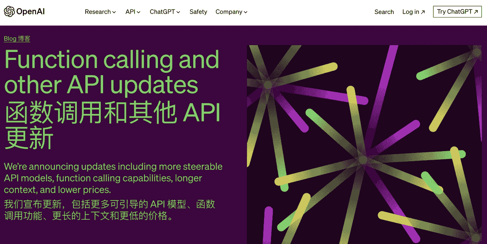
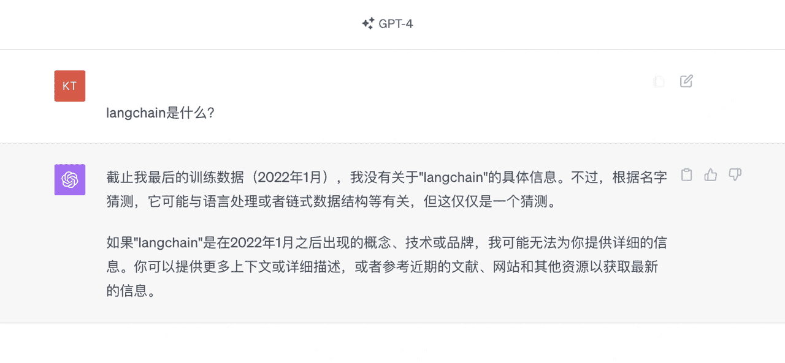
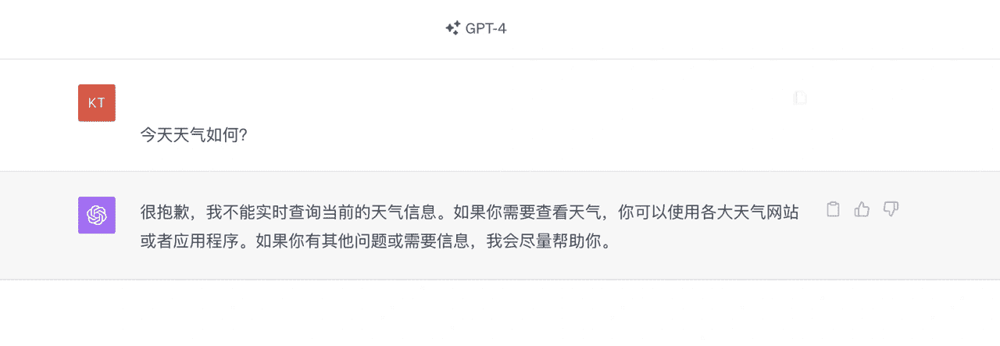
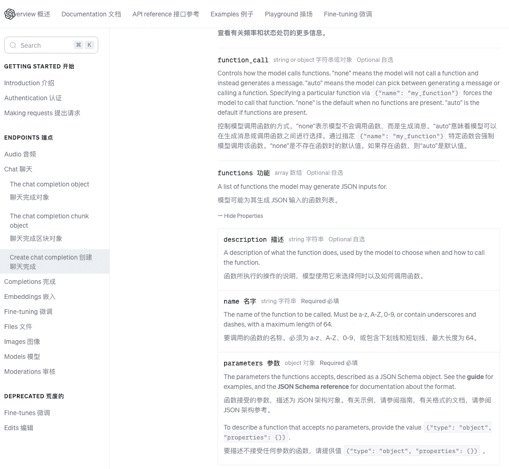

# OpenAI API进阶-Function Calling实现插件

> 来源：[https://aiyanxishe.feishu.cn/docx/NuNMdsno0oRq05xeiftcvJ5WnKj](https://aiyanxishe.feishu.cn/docx/NuNMdsno0oRq05xeiftcvJ5WnKj)

## 程序员AI破局简介

> [《程序员AI破局指南》](https://t.zsxq.com/19EOflzkQ)由字节、百度、阿里等互联网大厂的AI业务相关高管共创，分享开箱即用、面向市场的AI编程知识和工具。

> 指南包括六个专栏:**AI编程实战、AI编程工具、AI高效办公、A**I副业赚钱、AI提示词工程、AI私人助手

> [程序员AI破局指南](https://t.zsxq.com/19EOflzkQ) 原价 599 元，限时特惠 199 元/年，5月1日恢复原价。

> 加入我们：https://t.zsxq.com/19EOflzkQ

> 购买后，添加群主微信加入 AI研习社陪伴社群，限时领取超值福利。

# Function Calling介绍

## Function Calling是什么

[OpenAI C](https://platform.openai.com/docs/api-reference/chat)hat API官方文档： Chat API

Function Calling官方介绍： Function Calling



开发者现在可以向 gpt-4-0613 和 gpt-3.5-turbo-0613 描述函数，并让模型智能地选择输出一个包含调用这些函数参数的 JSON 对象。这是一种更可靠地将 GPT 的功能与外部工具和 API 相连接的新方法。

这些模型经过了微调，既可以检测到何时需要调用函数（根据用户的输入），又可以回复符合函数签名的 JSON。函数调用使开发者能够更可靠地从模型中获得结构化数据。例如，开发者可以：

+   利用外部工具调用的聊天机器人（如 ChatGPT 插件）来回答问题

将查询如“Email Anya看看她下周五是否想喝咖啡”转换为像 send_email(to: string, body: string) 这样的函数调用，或者将“波士顿的天气如何？”转换为 get_current_weather(location: string, unit: 'celsius' | 'fahrenheit')。

+   将自然语言转换为 API 调用或数据库查询

将“这个月我的前十位客户是谁？”转换为内部 API 调用，如 get_customers_by_revenue(start_date: string, end_date: string, limit: int)，或者将“Acme 公司上个月下了多少订单？”转换为使用 sql_query(query: string) 的 SQL 查询。

+   从文本中提取结构化数据

定义一个名为 extract_people_data(people: [{name: string, birthday: string, location: string}]) 的函数，以提取在维基百科文章中提到的所有人物。

这些用例通过我们的 /v1/chat/completions 端点中的新 API 参数 functions 和 function_call 得以实现，开发者可以通过 JSON Schema 描述函数，并可选择要求模型调用特定函数。

一句户解释就是：我们可以把自己的函数集成到GPT里了

## Function Calling解决什么问题

Function Calling本质上就是插件！

插件功能相当于给OpenAI增加了一个武器库，开发者可以随意给它安装武器提升它的能力。

### 数据实时性问题



问他**langc**hain是什么？由于训练集是截止2021年的，他会回答不知道。但是有了Function Callling,我们就可以写一个函数集成谷歌/百度搜索API，给GPT加上 联网能力 ，这样就借助搜索引擎的能力支持了数据的动态更新。

### 跟已有系统集成问题



问他今天天气如何？由于ChatGPT数据集是离线的，无法满足获取实时天气的需求。但是有了Function Calling，我们可以编写一个函数来调用天气获取的API，从而获取实时天气信息，然后再与大模型的对话能力进行自然语言交互。

# Function Calling如何使用

## 使用介绍

与普通chat对话的区别是增加了两个额外参数

+   functions: 声明自定义函数库

+   funcion_call: 控制大模型什么时机使用通Function Calling功能



普通代码：

```
completion = openai.ChatCompletion.create(
    model=&quot;gpt-3.5-turbo&quot;,
    messages=messages
)
Function calling：
completion = openai.ChatCompletion.create(
    model=&quot;gpt-3.5-turbo&quot;,
    messages=messages,
   
    # 增加额外两个参数
    functions=functions,
    function_call=&quot;auto&quot;,  # auto is default, but we&#x27;ll be explicit
)
```

## 实时天气查询实践

整体要经过两次的OpenAI Chat接口调用。

### 调用流程

1.定义函数

定义本地函数get_current_weather实现从API拉取，这里直接写一个简单对参数输出进行模拟。

然后按照OpenAI的文档要求格式定义get_current_weather的接口函数的json参数。

2.第一次调用接口

返回大模型分析出的 **函数名称 **和 **参数。**

结果如下：

```
{
  &quot;id&quot;: &quot;chatcmpl-8EIYxuSvhxmvYRE2UZI19fodbhXGv&quot;,
  &quot;object&quot;: &quot;chat.completion&quot;,
  &quot;created&quot;: 1698418639,
  &quot;model&quot;: &quot;gpt-3.5-turbo-0613&quot;,
  &quot;choices&quot;: [
    {
      &quot;index&quot;: 0,
      &quot;message&quot;: {
        &quot;role&quot;: &quot;assistant&quot;,
        &quot;content&quot;: null,
        &quot;function_call&quot;: {
          &quot;name&quot;: &quot;get_current_weather&quot;,
          &quot;arguments&quot;: &quot;{\n  \&quot;location\&quot;: \&quot;Boston, MA\&quot;,\n  \&quot;unit\&quot;: \&quot;celsius\&quot;\n}&quot;
        }
      },
      &quot;finish_reason&quot;: &quot;function_call&quot;
    }
  ],
  &quot;usage&quot;: {
    &quot;prompt_tokens&quot;: 86,
    &quot;completion_tokens&quot;: 26,
    &quot;total_tokens&quot;: 112
  }
}
```

3.调用本地函数

获取返回值，进行本地python方法调用

4.第二次调用接口

将第一次接口的返回值message与本地函数调用的接口拼装起来，然后再次调用接口。

结果如下：

```
{
  &quot;role&quot;: &quot;assistant&quot;,
  &quot;content&quot;: &quot;The weather in Boston today is 20 degrees Celsius.&quot;
}
```

### 代码实现

完整代码链接： Fuction Calling 示例

```
# function_calling.py
import openai
import json

openai.api_key = &#x27;sk-NYsoG3VBKDiTuvdtC969F95aFc4f45379aD3854a93602327&#x27;
openai.api_base = &quot;https://key.wenwen-ai.com/v1&quot;

# 1. 定义函数
# 1.1 定义模拟获取天气的本地函数
def get_current_weather(location, unit):
    # Call the weather API
    return f&quot;It&#x27;s 20 {unit} in {location}&quot;

# 1.2 定义函数字典方便调用
function_dict = {
    &quot;get_current_weather&quot;: get_current_weather,
}

# 1.3 定义chat接口需要的函数
functions = [
    {
        &quot;name&quot;: &quot;get_current_weather&quot;,
        &quot;description&quot;: &quot;Get the current weather in a given location&quot;,
        &quot;parameters&quot;: {
            &quot;type&quot;: &quot;object&quot;,
            &quot;properties&quot;: {
                &quot;location&quot;: {
                    &quot;type&quot;: &quot;string&quot;,
                    &quot;description&quot;: &quot;The city and state, e.g. San Francisco, CA&quot;,
                },
                &quot;unit&quot;: {&quot;type&quot;: &quot;string&quot;, &quot;enum&quot;: [&quot;celsius&quot;, &quot;fahrenheit&quot;]},
            },
            &quot;required&quot;: [&quot;location&quot;],
        },
    }
]

# 2. 第一次调用chat接口，返回的是函数调用的提示
messages = [
    {&quot;role&quot;: &quot;user&quot;, &quot;content&quot;: &quot;What&#x27;s the weather like in Boston today with celsius?&quot;}]
completion = openai.ChatCompletion.create(
    model=&quot;gpt-3.5-turbo&quot;,
    messages=messages,
    functions=functions,
    function_call=&quot;auto&quot;,  # auto is default, but we&#x27;ll be explicit
)
print(completion)

# 3. 从结果接口的结果中获取函数调用的参数 进行本地函数调用
# 3.1 获取函数调用的参数
response_message = completion.choices[0].message
function_name = response_message[&quot;function_call&quot;][&quot;name&quot;]
function_args = json.loads(response_message[&quot;function_call&quot;][&quot;arguments&quot;])
# 3.2 调用本地函数
function_response = function_dict.get(function_name)(**function_args)
# 3.3 将本地函数的结果作为chat接口的输入
messages.append(response_message)
messages.append({
    &quot;role&quot;: &quot;function&quot;,
    &quot;name&quot;: function_name,
    &quot;content&quot;: function_response,
})

# 4. 第二次调用chat接口，返回的是chat的最终结果
completion_final = openai.ChatCompletion.create(
    model=&quot;gpt-3.5-turbo&quot;,
    messages=messages,
)

print(completion_final.choices[0].message)
上面的代码中的key是我自己维护的，免费给大家使用，代码可以直接运行！
python3.9 function_calling.py
```

更多内容可以点击目录： [手册内容汇总](https://aiyanxishe.feishu.cn/wiki/LBXcwPv6UiZgdfkp14Xc1Wo1n3b)

✨ 如果觉得有收获，请点一点下方的“有启发” ✨

🌱 我也会及时优化迭代内容，给大家更好的阅读体验 🌱

<https://aiyanxishe.feishu.cn/sync/IaSadpoOOsopKab1ajKcz6z3nAb>