# 半小时，帮你实现一个AI版“图片搜索引擎”

> 来源：[https://aiyanxishe.feishu.cn/docx/I6U9d4mUPo3k7KxSpCxcLn4uncf](https://aiyanxishe.feishu.cn/docx/I6U9d4mUPo3k7KxSpCxcLn4uncf)

## 程序员AI破局简介

> [《程序员AI破局指南》](https://t.zsxq.com/19EOflzkQ)由字节、百度、阿里等互联网大厂的AI业务相关高管共创，分享开箱即用、面向市场的AI编程知识和工具。

> 指南包括六个专栏:**AI编程实战、AI编程工具、AI高效办公、A**I副业赚钱、AI提示词工程、AI私人助手

> [程序员AI破局指南](https://t.zsxq.com/19EOflzkQ) 原价 599 元，限时特惠 199 元/年，5月1日恢复原价。

> 加入我们：https://t.zsxq.com/19EOflzkQ

> 购买后，添加群主🛰️加入 AI研习社陪伴社群，限时领取超值福利。

# 一、技术方案

## 一）概览

**我们都**知道搜索引擎「百度」，「谷歌」可以搜索互联网上的所有 文字 内容。

搜索引擎对 **结构化 ****的数据可以**识别的非常精准，但是对于 非结构化 的数据，比如图片，视频，音频却无能为力。

下面这个百度搜索出的图片也是根据图片下面的文字构建的索引，是搜不出图片内的信息的。比如我是个自媒体作者想要引用电影中某个片段，直接用传统搜索引擎完全不行。


**AI时代这里就需要新一代**的搜索引擎了。 Embedding登场 ，它可以把所有非结构化数据统一转化为向量，进行向量搜索进行包含语义的查找。

[关于什么是RAG和Embedding就不赘述了，之前这篇讲](https://mp.weixin.qq.com/s/Onn5AiwZBenvPHxIyYoIXg)的很详细： https://mp.weixin.qq.com/s/Onn5AiwZBenvPHxIyYoIXg

RAG搜索引擎公式：

语料+EmbeddingModel+向量库+LLM（可选）=搜索引擎

图片文件+图片EmbeddingModel+向量库=图片搜索引擎

视频文件+视频EmbeddingModel+向量库=视频搜索引擎

音乐文件+音乐EmbeddingModel+向量库=音乐搜索引擎

其他垂直行业，比如人脸识别，专利文件，病毒特征，只要训练好对应的EmbeddingModel都可以实对应的搜索引擎。

**本次就采用上述**的技术方案来完成 图片搜索引擎 的功能。

拆分成下面几步：选型EmbeddingModel，选型向量库，代码编写，代码示例。

## 二）Embedding Model选型

**E**mbedding 是一个浮点数向量（列表）。两个向量之间的距离测量它们的相关性。较小的距离表示高相关性，较大的距离表示低相关性。

简单来说就是把所有非结构化数据转化成可以让计算机理解的有语义的数据。

图片Embedding，只会调用openai接口可搞不定**了，需要本地运行模型了。**这就不得不了解 huggingface 这个神器了。

[huggingface图片分类相关模型： https://hugg](https://mp.weixin.qq.com/s/Onn5AiwZBenvPHxIyYoIXg)ingface.co/models?pipeline_tag=zero-shot-image-classification

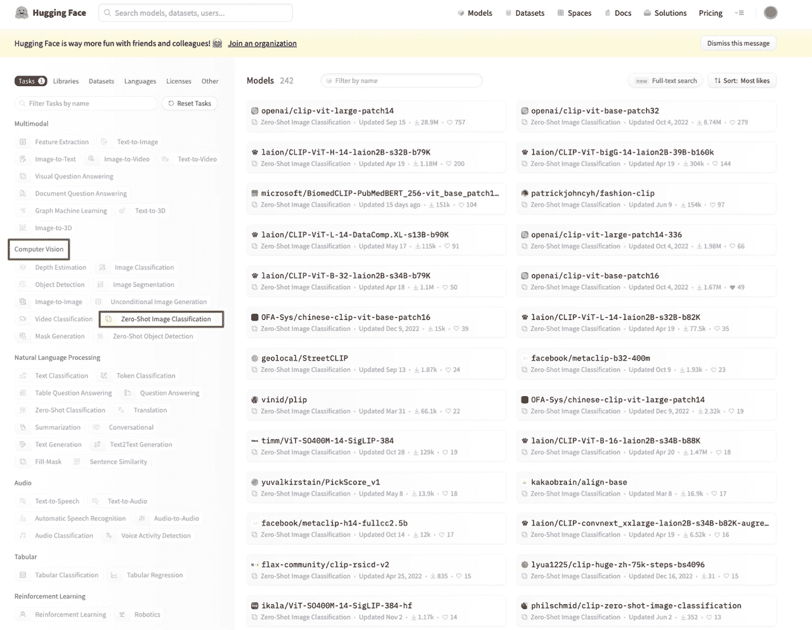

我[们](https://huggingface.co/openai/clip-vit-base-patch16)还是用老大哥openai的[clip]( https://openai.com/research/clip )模型试试水。暂时就用最新的，且资源占用不太多的[openai/clip-vit-base-patch16]( https://huggingface.co/openai/clip-vit-base-patch16 )。

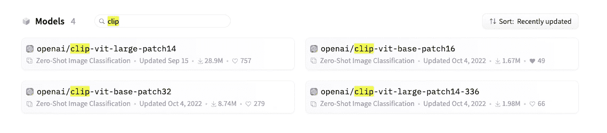

## 三）向量库技术选型

向量数据库简单来说就是用来存储向量，查询向量的数据库。

**1.专用向量数据库**

这些数据库从一开始就设计用于处理和检索向量数据，专门为高效的向量搜索和机器学习应用优化。

**Milvus**

优点: 高效的向量检索，适合大规模数据集。

缺点: 相对较新，社区和资源可能不如成熟的传统数据库丰富。

**Weaviate**

优点: 支持图结构和自然语言理解，适用于复杂查询。

缺点: 作为新兴技术，可能存在稳定性和成熟度方面的问题。

**2.传统数据库的向量扩展**

这些是传统数据库，通过扩展或插件支持向量数据的存储和检索。

**Elasticsearch**

优点: 强大的全文搜索功能，大型社区支持。

缺点: 向量搜索可能不如专用向量数据库那么高效。

PostgreSQL (使用PGVector或其他向量扩展)

优点: 结合了传统的关系数据库强大功能和向量搜索。

缺点: 向量搜索的性能和优化可能不及专用向量数据库。

**Redis**

优点: Redis是一种非常流行的开源内存数据结构存储系统，它以其高性能和灵活性而闻名。Redis通过模块如RedisAI和RedisVector支持向量数据，这使得它能够进行高速向量计算和近似最近邻（ANN）搜索，非常适合实时应用。

缺点: 由于Redis主要是作为内存数据库，大规模的向量数据集可能会受到内存大小的限制。此外，它在处理大量复杂的向量操作方面可能不如专用向量数据库那样高效。

**3. 向量库的云服务**

这些服务提供了向量数据处理和搜索的云解决方案，通常易于扩展和维护。

**Pinecone**

优点: 易于扩展，无需管理基础设施，适合快速部署。

缺点: 依赖于云提供商，可能存在成本和数据迁移方面的考虑。

Amazon Elasticsearch Service

优点: 完全托管，与AWS生态系统紧密集成。

缺点: 可能涉及较高成本，且高度依赖AWS服务。

对于我来说更倾向于使用传统数据库的向量扩展，比如这里我使用 Redis+RedisSearch 来实现向量库。

因为企业级项目很多时候已经维护了一个大的Redis集群，而且很多云厂商也暂时不支持专用向量数据库。

[R](https://mp.weixin.qq.com/s/Onn5AiwZBenvPHxIyYoIXg)edis官方对向量支持介绍： https://redis.com/blog/rediscover-redis-for-vector-similarity-search/

# 二、代码实战

## 一）技术架构

分为导入和搜索两个流程。

导入过程：

把我们需要导入的一篮子图片集通过Clip转成向量，然后把向量导入Redis存储起来。

搜索过程：

搜索过程也是类似，把我们想要搜索的图片和文本同样使用Clip使用也进行向量化，然后去Redis中进行向量检索，就实现图片搜索引擎啦！

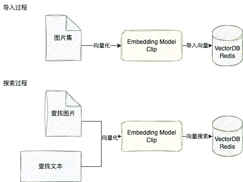

## 二）准备图片

[既然是图片搜](https://github.com/FFmpeg/FFmpeg)索引擎，当然得有海量图片了。处理多媒体文件的神器登场： FFmpeg

### 1、安装ffmpeg

官方下载链接： https://ffmpeg.org/download.html

mac系统安装更简单，直接用homebrew安装

```
brew install ffmpeg
```

其他操作系统（linux，window）安装也比较简单，可以直接去官网下载。

官方下载链接： https://ffmpeg.org/download.html

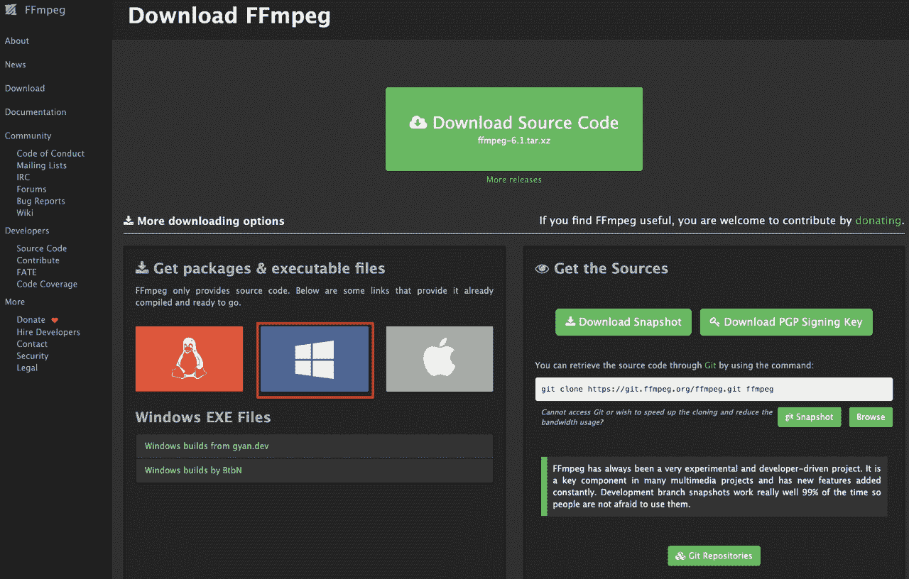

### 2、生成图片

我选了个自己比较喜欢的电影《楚门的世界》，把视频文件进行每秒抽帧来生成图片素材。

```
ffmpeg -i Top022.楚门的世界.The.Truman.Show.1998.Bluray.1080p.x265.AAC\(5.1\).2Audios.GREENOTEA.mkv  -r 1 truman-%3d.png
```

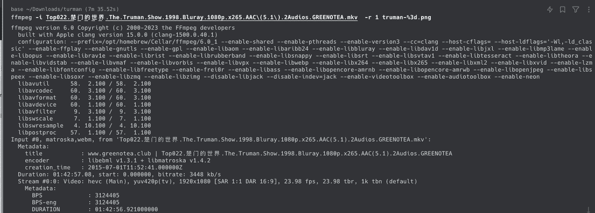

经过一段时间的cpu飞速运转，得到了2000多张图片

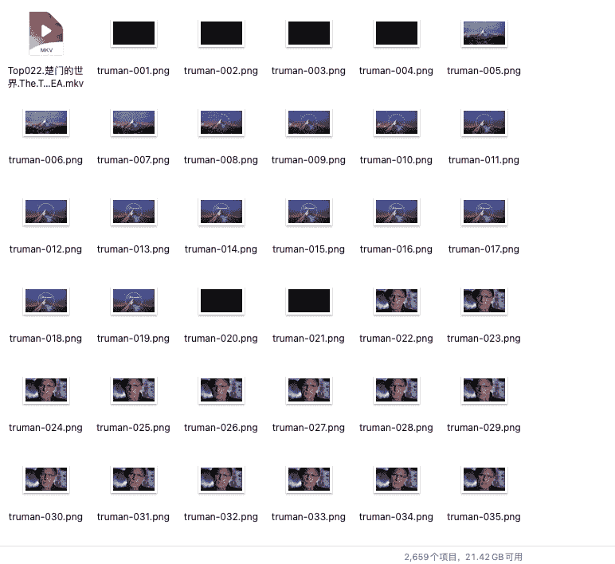

## 三）环境准备

### 1、安装Python

安装python的可以直接去官网 https://www.python.org/downloads/

[英文不太好可以去看这个国人出的菜鸟教程 https://www](https://mp.weixin.qq.com/s/Onn5AiwZBenvPHxIyYoIXg).runoob.com/python3/python3-install.html

### 2、安装redis

推荐使用docker安装redis，我们选用了7.2.0的新版本redis

docker-compose文件参考：

```
version: &quot;2.4&quot;

services:
  redis-server:
    image: redis/redis-stack-server:7.2.0-v6
    container_name: redis-server
    ports:
      - 6379:6379
    volumes:
      - ./redis-data:/data
```

启动redis

```
docker-compose up -d
```

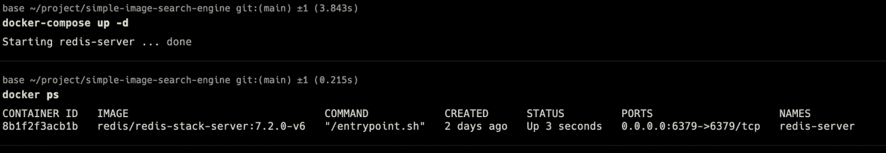

## 四）图片向量化

### 1、导入向量库

指定我们图片的目录，把每张图片使用clip进行向量化，然后存入redis向量库中。

```
import torch
import numpy as np
from transformers import CLIPProcessor, CLIPModel
from PIL import Image
import time
import os
import redis

# 连接 Redis 数据库，地址换成你自己的 Redis 地址
client = redis.Redis(host=&quot;localhost&quot;, port=6379, decode_responses=True)
res = client.ping()
print(&quot;redis connected:&quot;, res)

model_name_or_local_path = &quot;openai/clip-vit-base-patch16&quot;
model = CLIPModel.from_pretrained(model_name_or_local_path)
processor = CLIPProcessor.from_pretrained(model_name_or_local_path)

# 换成你的图片目录
image_directory = &quot;/Users/david/Downloads/turman&quot;

png_files = [filename for filename in os.listdir(image_directory) if filename.endswith(&quot;.png&quot;)]
sorted_png_files = sorted(png_files, key=lambda x: int(x.split(&#x27;-&#x27;)[-1].split(&#x27;.&#x27;)[0]))

# 初始化 Redis Pipeline
pipeline = client.pipeline()
for i, png_file in enumerate(sorted_png_files, start=1):
    # 初始化 Redis，先使用 PNG 文件名作为 Key 和 Value，后续再更新为图片特征向量
    pipeline.json().set(png_file, &quot;$&quot;, png_file)

batch_size = 1

with torch.no_grad():
    for idx, png_file in enumerate(sorted_png_files, start=1):
        print(f&quot;{idx}: {png_file}&quot;)
        start = time.time()
        image = Image.open(f&quot;{image_directory}/{png_file}&quot;)
        inputs = processor(images=image, return_tensors=&quot;pt&quot;, padding=True)
        image_features = model.get_image_features(inputs.pixel_values)[batch_size-1]
        embeddings = image_features.numpy().astype(np.float32).tolist()
        print(&#x27;image_features:&#x27;, embeddings)
        vector_dimension = len(embeddings)
        print(&#x27;vector_dimension:&#x27;, vector_dimension)
        end = time.time()
        print(&#x27;%s Seconds&#x27;%(end-start))
        # 更新 Redis 数据库中的文件向量
        pipeline.json().set(png_file, &quot;$&quot;, embeddings)
        res = pipeline.execute()
        print(&#x27;redis set:&#x27;, res)
```

导入完成后可以看到，我们的2000多张图片都作为key转存储到redis中了。

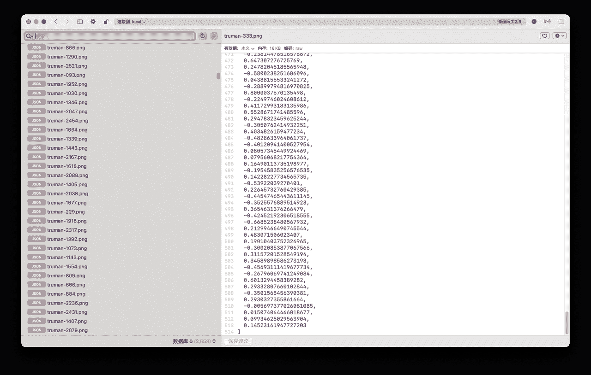

**我们看到每个key的**value都是 512位的浮点数组 ，512位就代表我们向量的维度是512维，维度越高代表着存储的特征越多。

```
import redis

# 连接 Redis 数据库，地址换成你自己的 Redis 地址
client = redis.Redis(host=&quot;localhost&quot;, port=6379, decode_responses=True)
res = client.ping()
print(&quot;redis connected:&quot;, res)

res = client.json().get(&quot;truman-1234.png&quot;)
print(res)
print(len(res))
```

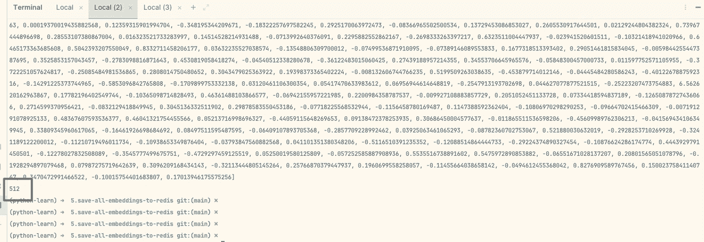

### 2、构建向量索引

使用RedisSearch来把上面的向量构建索引。

```
import redis
from redis.commands.search.field import VectorField
from redis.commands.search.indexDefinition import IndexDefinition, IndexType

# 连接 Redis 数据库，地址换成你自己的 Redis 地址
client = redis.Redis(host=&quot;localhost&quot;, port=6379, decode_responses=True)
res = client.ping()
print(&quot;redis connected:&quot;, res)

# 之前模型处理的向量维度是 512
vector_dimension = 512
# 给索引起个与众不同的名字
vector_indexes_name = &quot;idx:truman_indexes&quot;

# 定义向量数据库的 Schema
schema = (
    VectorField(
        &quot;$&quot;,
        &quot;FLAT&quot;,
        {
            &quot;TYPE&quot;: &quot;FLOAT32&quot;,
            &quot;DIM&quot;: vector_dimension,
            &quot;DISTANCE_METRIC&quot;: &quot;COSINE&quot;,
        },
        as_name=&quot;vector&quot;,
    ),
)
# 设置一个前缀，方便后续查询，也作为命名空间和可能的普通数据进行隔离
# 这里设置为 truman-，未来可以通过 truman-* 来查询所有数据
definition = IndexDefinition(prefix=[&quot;truman-&quot;], index_type=IndexType.JSON)
# 使用 Redis 客户端实例根据上面的 Schema 和定义创建索引
res = client.ft(vector_indexes_name).create_index(
    fields=schema, definition=definition
)
print(&quot;create_index:&quot;, res)
```

## 五）以图搜图

激动人心的时刻到了，终于可以看到结果了！~

运行下方代码

```
import torch
import numpy as np
from transformers import CLIPProcessor, CLIPModel
from PIL import Image
import time
import redis
from redis.commands.search.query import Query

model_name_or_local_path = &quot;openai/clip-vit-base-patch16&quot;
model = CLIPModel.from_pretrained(model_name_or_local_path)
processor = CLIPProcessor.from_pretrained(model_name_or_local_path)

vector_indexes_name = &quot;idx:truman_indexes&quot;

client = redis.Redis(host=&quot;localhost&quot;, port=6379, decode_responses=True)
res = client.ping()
print(&quot;redis connected:&quot;, res)

start = time.time()
image = Image.open(&quot;truman-173.png&quot;)
batch_size = 1

with torch.no_grad():
    inputs = processor(images=image, return_tensors=&quot;pt&quot;, padding=True)
    image_features = model.get_image_features(inputs.pixel_values)[batch_size-1]
    embeddings = image_features.numpy().astype(np.float32).tobytes()
    print(&#x27;image_features:&#x27;, embeddings)

# 构建请求命令，查找和我们提供图片最相近的 5 张图片
query_vector = embeddings
query = (
    Query(&quot;(*)=&gt;[KNN 5 @vector $query_vector AS vector_score]&quot;)
    .sort_by(&quot;vector_score&quot;)
    .return_fields(&quot;$&quot;)
    .dialect(2)
)

# 定义一个查询函数，将我们查找的结果的 ID 打印出来（图片名称）
def dump_query(query, query_vector, extra_params={}):
    result_docs = (
        client.ft(vector_indexes_name)
        .search(
            query,
            {
                &quot;query_vector&quot;: query_vector
            }
            | extra_params,
        )
        .docs
    )
    print(result_docs)
    for doc in result_docs:
        print(doc[&#x27;id&#x27;])

dump_query(query, query_vector, {})

end = time.time()
print(&#x27;%s Seconds&#x27;%(end-start))
```

我们搜索跟这张图类似的5张图片。


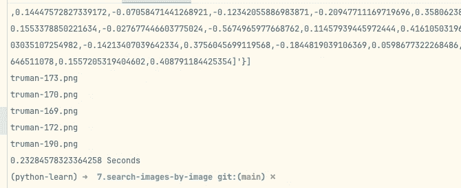

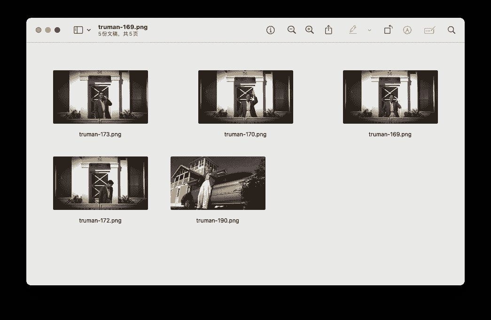

首先原图是被搜出来了，然后搜出特征相似的图片了，感觉还不错的样子。

## 六）文字识图

clip还具有识图能力，可以算出给出词数组和图片相似度的概率密度。这里给他一个图片和一组单词['dog', 'cat', 'night', 'astronaut', 'man', 'smiling', 'wave', 'smiling man wave']，让他给我算算。


```
import torch
from transformers import CLIPProcessor, CLIPModel
from PIL import Image
import time

# 默认从 HuggingFace 加载模型，也可以从本地加载，需要提前下载完毕
model_name_or_local_path = &quot;openai/clip-vit-base-patch16&quot;
# 加载模型
model = CLIPModel.from_pretrained(model_name_or_local_path)
processor = CLIPProcessor.from_pretrained(model_name_or_local_path)

# 记录处理开始时间
start = time.time()
# 读取待处理图片
image = Image.open(&quot;truman-170.png&quot;)
# 处理图片数量，这里每次只处理一张图片
batch_size = 1

# 要检测是否在图片中出现的内容
text = [&#x27;dog&#x27;, &#x27;cat&#x27;, &#x27;night&#x27;, &#x27;astronaut&#x27;,
        &#x27;man&#x27;, &#x27;smiling&#x27;, &#x27;wave&#x27;, &#x27;smiling man wave&#x27;]

with torch.no_grad():
    # 将图片使用模型加载，转换为 PyTorch 的 Tensor 数据类型
    # 相比较第一篇文章中的例子 1.how-to-embededing/app.py，这里多了一个 text 参数
    inputs = processor(text=text, images=image, return_tensors=&quot;pt&quot;, padding=True)
    # 将 inputs 中的内容解包，传递给模型，调用模型处理图片和文本
    outputs = model(**inputs)
    # 将原始模型输出转换为类别概率分布（在类别维度上执行 softmax 激活函数）
    probs = outputs.logits_per_image.softmax(dim=1)
    end = time.time()
    # 记录处理结束时间
    print(&#x27;%s Seconds&#x27; % (end - start))
    # 打印所有的概率分布
    for i in range(len(text)):
        print(text[i], &quot;:&quot;, probs[0][i])
```

**结果smilin**g man wave( 微笑的男人挥手 )这个词的概率最大，确实跟我们图片的特征一致。

```
8.use-clip-detect-element git:(main) ✗ python app.py
0.247056245803833 Seconds
dog : tensor(0.0072)
cat : tensor(0.0011)
night : tensor(0.0029)
astronaut : tensor(0.0003)
man : tensor(0.0200)
smiling : tensor(0.0086)
wave : tensor(0.0117)
smiling man wave : tensor(0.9482)
```

## 七）文字搜图

把文字做Embedding，去redis做向量检索就可以实现文章搜图的能力了。

```
import torch
import numpy as np
from transformers import CLIPProcessor, CLIPModel, CLIPTokenizer
import time
import redis
from redis.commands.search.query import Query

model_name_or_local_path = &quot;openai/clip-vit-base-patch16&quot;
model = CLIPModel.from_pretrained(model_name_or_local_path)
processor = CLIPProcessor.from_pretrained(model_name_or_local_path)
# 处理文本需要引入
tokenizer = CLIPTokenizer.from_pretrained(model_name_or_local_path)

vector_indexes_name = &quot;idx:truman_indexes&quot;

client = redis.Redis(host=&quot;localhost&quot;, port=6379, decode_responses=True)
res = client.ping()
print(&quot;redis connected:&quot;, res)

start = time.time()

# 调用模型获取文本的 embeddings
def get_text_embedding(text): 
    inputs = tokenizer(text, return_tensors = &quot;pt&quot;)
    text_embeddings = model.get_text_features(**inputs)
    embedding_as_np = text_embeddings.cpu().detach().numpy()
    embeddings = embedding_as_np.astype(np.float32).tobytes()
    return embeddings

with torch.no_grad():
    # 获取文本的 embeddings
    text_embeddings = get_text_embedding(&#x27;Say hello&#x27;)
    # text_embeddings = get_text_embedding(&#x27;smiling man&#x27;)

query_vector = text_embeddings
query = (
    Query(&quot;(*)=&gt;[KNN 5 @vector $query_vector AS vector_score]&quot;)
    .sort_by(&quot;vector_score&quot;)
    .return_fields(&quot;$&quot;)
    .dialect(2)
)

def dump_query(query, query_vector, extra_params={}):
    result_docs = (
        client.ft(vector_indexes_name)
        .search(
            query,
            {
                &quot;query_vector&quot;: query_vector
            }
            | extra_params,
        )
        .docs
    )
    print(result_docs)
    for doc in result_docs:
        print(doc[&#x27;id&#x27;])

dump_query(query, query_vector, {})

end = time.time()
print(&#x27;%s Seconds&#x27;%(end-start))
```

这是搜索smiling man的top5结果，确实是可以实现通过我们的语义进行搜索图片了！

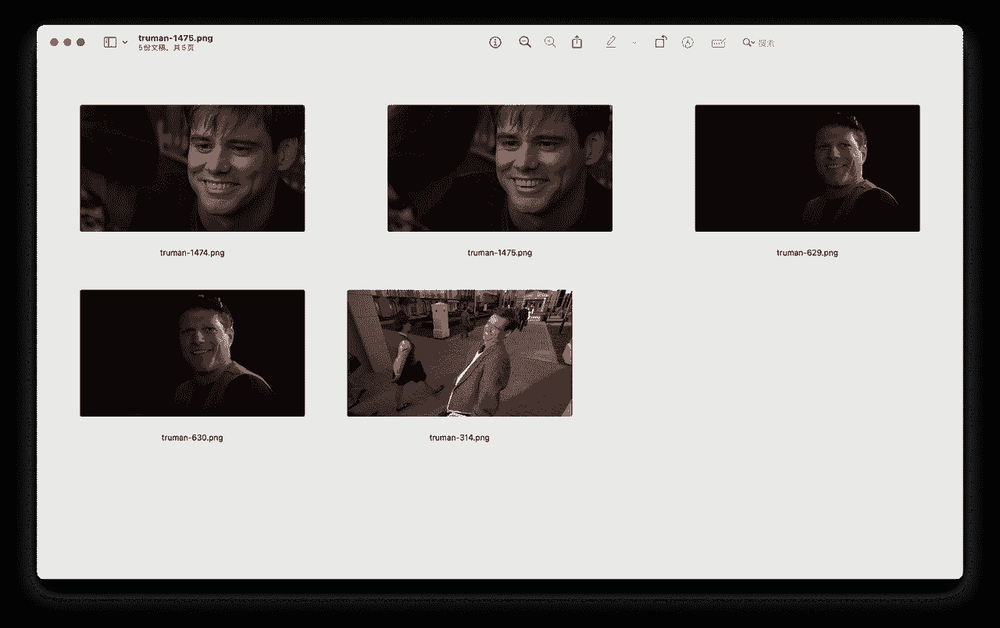

再搜索Say hello，也搜到了上面大笑打招呼的图片。

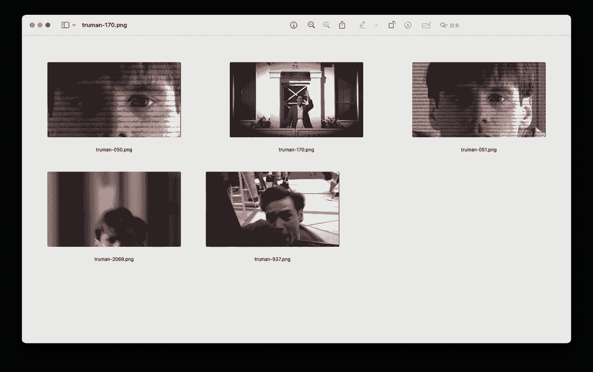

# 三、总结

完整代码链接： [h](https://mp.weixin.qq.com/s/Onn5AiwZBenvPHxIyYoIXg)ttps://github.com/hehan-wang/simple-image-search-engine

AI的快速发展可以让我们一个不是机器学习专业的也可以用模型做出一个有趣又有一些价值的AI项目。

下面是我的几个启发

1.学习AI从调接口开始，但不要只是调接口。

调OPENAI的API是比较简单，上手快，可以快速做出一些案例。但不要把思维框在调接口里，Huggingface上还有大量好玩的模型，也不一定需要gpu，cpu上也可以玩起来，要多上手尝试，其实没想象中那么难。

2.产品化

我们这里只是投喂了一部电影，当我们投喂大量电影，并做出ui界面给普通用户使用，这里还是有很大商业价值的。

更多内容可以点击目录： [手册内容汇总](https://aiyanxishe.feishu.cn/wiki/LBXcwPv6UiZgdfkp14Xc1Wo1n3b)

✨ 如果觉得有收获，请点一点下方的“有启发” ✨

🌱 我也会及时优化迭代内容，给大家更好的阅读体验 🌱

<https://aiyanxishe.feishu.cn/sync/IaSadpoOOsopKab1ajKcz6z3nAb>