# Deepseek 学习手册

> 来源：[https://aiyanxishe.feishu.cn/docx/NnIodJ0HWobwGEx6t9McoYlNnzi](https://aiyanxishe.feishu.cn/docx/NnIodJ0HWobwGEx6t9McoYlNnzi)

> [AI研习社](https://aiyanxishe.feishu.cn/wiki/wikcnu3kSXr75E50w8PFefhJMYf?from=from_copylink)是一个开放的AI研究探索小组，[社区](https://aiyanxishe.feishu.cn/wiki/WB2awt7lli6actkm7rtc3ejInmd?from=from_copylink)内容涵盖：

> [AI工具和教程](https://aiyanxishe.feishu.cn/wiki/wikcn6YTN3CrZTS8RhrEca8c8Eg?from=from_copylink)：[Manus学习手册（持续更新）](https://aiyanxishe.feishu.cn/wiki/AAm0wQXecihKrukuvE0cphUbn59?from=from_copylink)[Deepseek 学习手册](https://aiyanxishe.feishu.cn/wiki/WOoJw64Vki5XgVkX0sncyjdWn9c?from=from_copylink) [ChatGPT](https://aiyanxishe.feishu.cn/wiki/wikcnu3kSXr75E50w8PFefhJMYf?from=from_copylink)、[Sora视频生成](https://aiyanxishe.feishu.cn/wiki/PiW6wlVlqi3sdnkIRHXcUK8CnK7?from=from_copylink)、[AI经验分享](https://aiyanxishe.feishu.cn/wiki/wikcn6YTN3CrZTS8RhrEca8c8Eg?from=from_copylink)等

> [AI落地解决方案](https://aiyanxishe.feishu.cn/wiki/wikcnqFne4fleHUirg7M5Wlubug?from=from_copylink)：虚拟数字人、数字交互人、数字分身

> AI行业：[AI商业模式研究](https://aiyanxishe.feishu.cn/wiki/wikcn617lCYm2xpY3tARZVNSxDc?from=from_copylink)、[大厂AI实战案例](https://aiyanxishe.feishu.cn/wiki/CqTRwU0tMictH3kO18JcZzUTnfh?from=from_copylink)、[研究报告](https://aiyanxishe.feishu.cn/wiki/OTsrwSV6BiCTuNkquAVcwEANnge?from=from_copylink)、[AI副业变现案例库](https://aiyanxishe.feishu.cn/wiki/Go55wlU1DiuEYJkCgStcbqepnu2?from=from_copylink)等专题内[容

> 希望通](https://aiyanxishe.feishu.cn/wiki/WB2awt7lli6actkm7rtc3ejInmd?from=from_copylink)[过研习社社区降低学](https://aiyanxishe.feishu.cn/wiki/WB2awt7lli6actkm7rtc3ejInmd?from=from_copylink)习门槛，成为[AI时代的超级](https://twitter.com/sunyangphp)个体，欢迎加入👉AI研习社知识星球

> 

> 主理人   Twitter  👸号：AiSClub365，视频号

> **本**文持续更新 Manus 的相关介绍及动态，研究报告，实用场景，赚钱案例等 10 个板块内容，永久免费在线查看，欢迎收藏转发支持

# 一、Deepseek 简介

## 企业介绍

De**epSe**ek，全称杭州深度求索人工智能基础技术研究有限公司。DeepSeek 是一家创新型科技公司，成立于 2023 年 7 月 17 日，使用数据蒸馏技术 ，得到更为精炼、有用的数据 。由知名私募巨头幻方量化（幻方量化与九坤投资、明汯投资、灵均投资一起，因管理资金规模均超过 600 亿元，被业界称为量化私募领域的“四大天王”。）孕育而生，专注于开发先进的大语言模型（LLM）和相关技术。

2025 年 2 月 2 日，据彭博社报道，由 DeepSeek 开发的人工智能助手在全球范围内掀起了一股热潮。这款推理型 AI 聊天机器人自 2025 年初发布以来，迅速攀升至 140 个国家的苹果 App Store 下载排行榜首位，并在美国的 Android Play Store 中同样占据榜首位置。

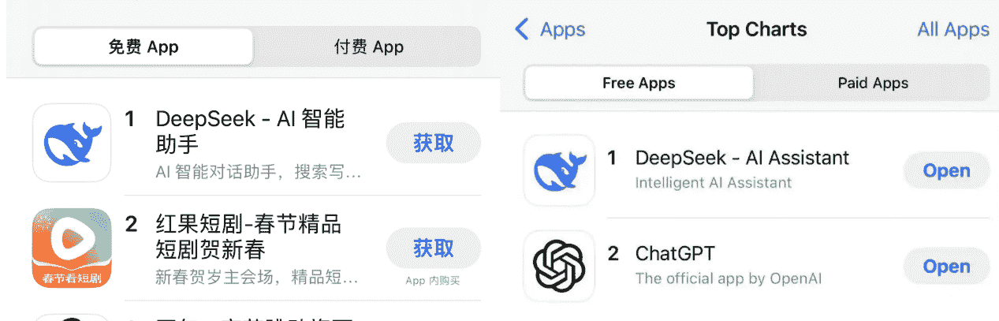

## 企业官网

•官方地址：https://www.deepseek.com/

•客户端：https://download.deepseek.com/app/

## 团队信息

DeepSeek 创始人梁文锋，1985 年出生于广东省湛江市。梁文锋从小成绩优异，小学六年级时他就通过考试被吴川一中录用。一直是学校里的“尖子生”并在数学学科表现出极大天赋。

2002 年，梁文锋 17 岁，以吴川一中“高考状元”的成绩考上浙大本科电子信息工程专业，于 2007 年考上浙江大学信息与通信工程专业研究生。

2013 年，梁文锋与浙大同学徐进共同创立了杭州雅克比投资管理有限公司，两年后又成立了杭州幻方科技有限公司，致力于通过数学和人工智能进行量化投资。

2021 年，幻方的资产管理规模突破千亿大关，202**3 年 5 月，38 **岁的梁文锋宣布要做通用人工智能（AGI）。

2023 年 7 月，梁文锋创办了杭州深度求索人工智能基础技术研究有限公司，就是 DeepSeek 公司。

近日这名 85 后还现身《新闻联播》以 AI 初创公司深度求索（DeepSeek）创始人的身份参加了一场国家超高规格座谈会，并现场发言。

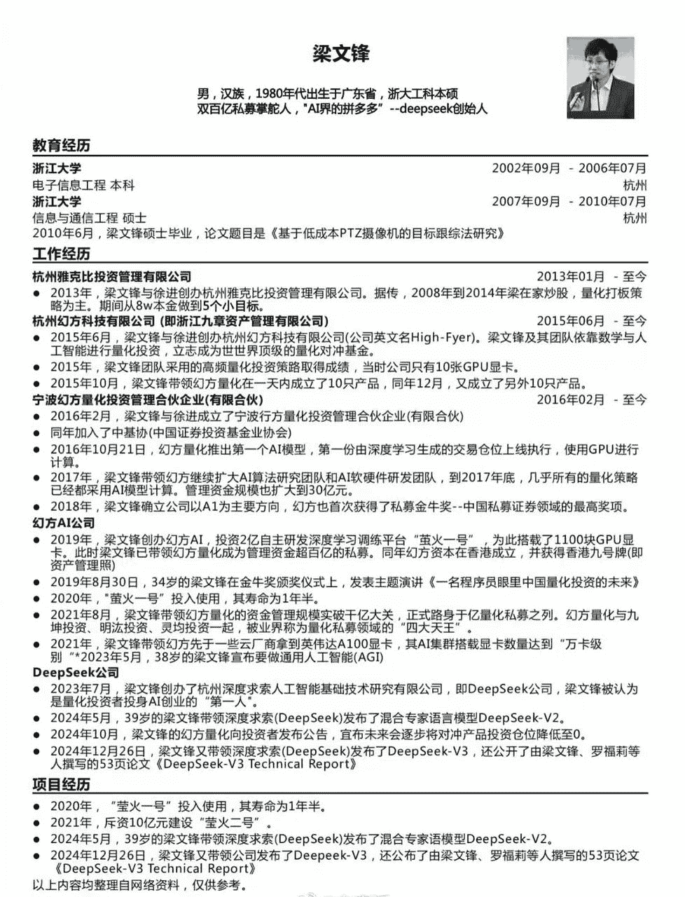

**从**目前已有的媒体公开报道中可以看出，DeepSeek 团队最大的特点是名校、年轻，即使是团队 Leader 级别，年纪也多在 35 岁以下。不到 140 人的团队，工程师和研发人员几乎都来自清华大学、北京大学、中山大学、北京邮电大学等国内顶尖高校，工作时间都不长。

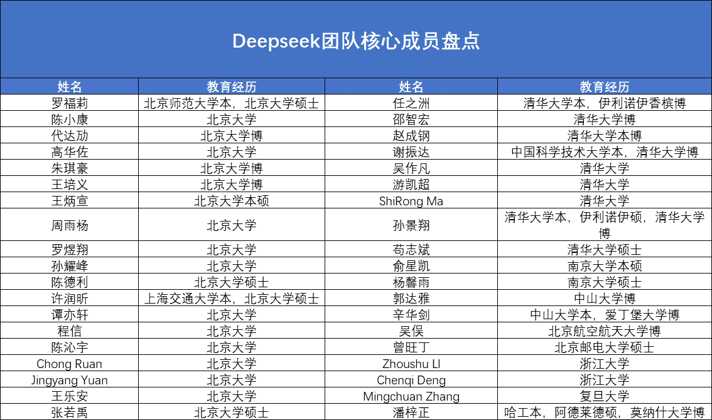

# 二、使用方式

据**澎****湃新**闻报道，有负责大模型领域挖掘高端科技人才的猎头表示，DeepSeek 的用人逻辑和大模型领域其他公司的用人逻辑并无太大差异，对人才的核心标签都是“年轻高潜”，即年龄在 1998 年出生左右，工作经验最好不要超过五年，“聪明、理工科、年轻、经验少。”

## 火爆原因

**DeepSeek**-R1 带来的最直接冲击来自三个方面：性能、价格和开源。

**性能比肩 o1**

1 月 24 日（周五）发布的聊天机器人竞技场（Chatbot Arena）榜单上，DeepSeek-R1 综合排名第三，与 OpenAI 的 ChatGPT o1 并列。在高难度提示词、代码和数学等技术性极强的领域以及风格控制方面，DeepSeek-R1 位列第一。

**“白菜价”颠覆市场**

DeepSeek-R1 的价格低得惊人：API 端口缓存命中 1 元/百万 Tokens，缓存未命中 4 元/百万输入 tokens，输出 16 元/百万 Tokens。仅为 o1 的 2%～3%。

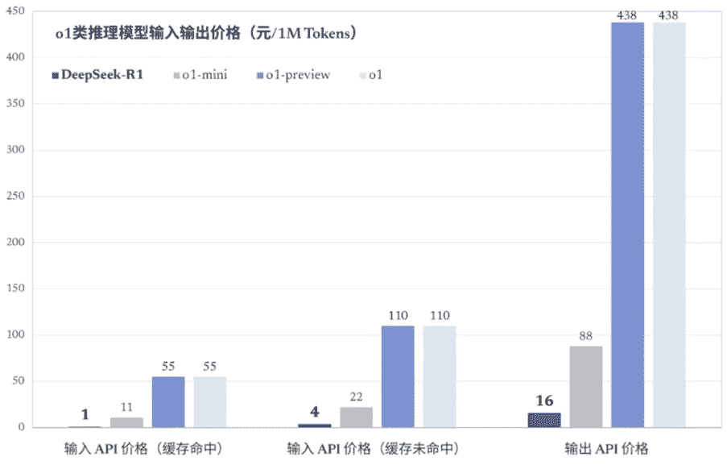

**DeepSeek 移动应用和网页端免费，而能力相当的 C**hatGPT o1 一个月 20 美元。

**完全开源**

DeepSeek-R1 完全开源，任何人都可以自由地使用、修改、分发和商业化该模型，彻底打破了以往大型语言模型被少数公司垄断的局面，将 AI 技术交到了广大开发者和研究人员的手中。

1 月 24 日，著名投资公司 A16z 的创始人马克·安德森发文称，Deepseek-R1 是他见过的最令人惊叹、最令人印象深刻的突破之一，而且还是开源的，它是给世界的一份礼物。

最具煽动性的评价来自 Scale AI 创始人亚历山大·王（Alexandr Wang）。他说：过去十年来，美国可能一直在 AI 竞赛中领先于中国，但 DeepSeek 的 AI 大模型发布可能会“改变一切”。

## 功能亮点

Deepseek 覆盖多个领域，旨在提供高效、智能、人性化的服务，其功能亮点包含：

•**性能强劲**：DeepSeek-V3 在多项评测中超越了 ChatGPT-4 Turbo，生成内容更具连贯性。

•**联网搜索**：可结合实时信息，提供最新答案。

•**创意能力出色**：可生成极具文学色彩的内容，如历史小说、散文、诗歌等。

•**多风格改写**：可模拟鲁迅、刘润等多种写作风格，让文章更具特色。

•**超强逻辑推理**：适用于专业领域，如编程、法律、金融分析等。

•**结构化知识库：**覆盖科学、历史、技术等领域的精准问答

## 技术**论文**

[D](https://github.com/deepseek-ai/DeepSeek-R1/blob/main/DeepSeek_R1.pdf)eepSeek_R1 论文原文：https://github.com/deepseek-ai/DeepSeek-R1/blob/main/DeepSeek_R1.pdf

[DeepSeek_R1 论文图解：htt](https://zhuanlan.zhihu.com/p/20844750193)ps://zhuanlan.zhihu.com/p/20844750193

DeepSeek_V3 技术报告图解：​

[https://zhuanlan.zhi](https://zhuanlan.zhihu.com/p/20805329782)hu.com/p/20805329782

[https://zhuanlan.zhi](https://zhuanlan.zhihu.com/p/20807308858)hu.com/p/20807308858

[https://zhuanlan.zhi](https://zhuanlan.zhihu.com/p/20908091643)hu.com/p/20908091643

**延展阅读：**

[万字揭秘 DeepSeek ！这个创新让全世界疯狂复制，](https://mp.weixin.qq.com/s/XLPILHYYDf1UgVzIUGQCsg)顶尖 AI 人才年薪千万，训练成本被低估

DeepSeek 最强专业拆解来了，清交复教授超硬核解读

## 相关企业

•**上游：算力是基础**

DeepSeek 的算力基础依赖于服务器、算力芯片、交换机和光模块、液冷等关键环节。主要供应商包括：​

（1）浪潮信息：为 DeepSeek 提供 AI 服务器集群，配置包括英伟达 H800 和自研的 Al Station 管理平台。

（2）中科曙光：承建 DeepSeek 杭州训练中心的液冷系统，单机柜功率密度达 35kWPUE<1.15。

（3）航锦科技：旗下超擎数智公司为 DeepSeek 提供光模块和交换机，双方绑定深度合作，助力模型的开发与应用，另外超擎作为 NVIDIACompute（GPU）、Networking（网络）的双 Elite 精英级合作伙伴，能够提供高质量的硬件设备和解决方案。

（4）润泽科技：为 DeepSeek 提供了廊坊数据中心的 3000+机柜资源，采用间接蒸发冷却技术，运营成本低于同行 15%；而且润泽与 DeepSeek 签订了 5 年长期协议，机柜上架率承诺不低于 80%，长期合作保障了 DeepSeek 算力资源发展的稳定性和持续性。

（5）每日互动：数据优势全链条绑定，作为幻方量化（DeepSeek 母公司）的二股东（官方尚未证实）在算力支持方面，每日互动牵头的浙江大数据计算中心为 DeepSeek 提供了强大的算力后盾，确保了模型训练和运行的高效性和稳定性。

•**中游：模型的研发与数据训练**

大模型训练的基础是 AI 数据集，数据标注贯穿整个周期。主要参与者包括：​

1、拓尔思：政务大数据市占率第一，拥有 4000+行业知识库，拓尔思与 DeepSeek 联合开发金融舆情大模型，已在中信证券等机构部署智能研报生成系统（另外，DeepSeek 创始人梁文峰受到李强总理的亲自接见，政府的重视程度可想而知）。

2、卓创资讯：公司尚未与 DeepSeek 深度求索建立业务合作关系，但未来很大可能会与幻方量化在金融语料库方面合作。

3、海天瑞声：Al 训练数据市占率国内第一，Deepseek 与量化投资机构幻方的技术生态关系密切，海天瑞声是幻方的核心数据服务商，通过幻方这一纽带，海天瑞声间接为 Deepseek 提供数据支持。

4、博彦科技：在数据标注方面有大量的人力和经验积累，能为 DeepSeek 提供专业的数据标注服务，帮助其对大量数据进行分类、标注等处理，为模型训练提供高质量的数据基础。

5、中科软：数据标注平台在医疗领域有相关应用，中科软在保险行业 IT 综合实力及应用解决方案国内排名第一，并在公共卫生信息化和政务信息化领域处于领先地位。

6、易华录：拥有 24 个数据湖，申报建设国家级数据标注基地，在大数据产业中具有重要地位，是智慧城市和智能交通领域的领先企业。

7、汉王科技：一家专注于人工智能领域龙头，特别是在智能语音识别、智能家居、手写识别、光学字符识别（OCR）、人脸识别等领域拥有核心技术的科技公司，获得医疗影像领域标注数据的发明专利。

8、东方国信：低调的国产 I 支撑力量，CirroData 数据库支持大规模分布式训练数据管理，拥有自己的数据库技术，服务于三大通讯公司和国内各大银行，提供 IT 技术支持。

9、星环科技：国产大数据基础软件第一股，SophonLLM 工具链提供国产化微调解决方案，围绕数据的集成、存储、治理、建模、分析、挖掘和流通等数据全生命周期提供基础软件及服务。

•**下游：垂直应用与合作**

DeepSeek 模型在教育、医疗、金融、工业等多个领域广泛应用。主要合作方包括：​

（1）DeepSeek+教育：科大讯飞接入 DeepSeek-Math 模型，推出 Al 数学辅导应用“星火助学”；竟业达是是全国教育考试行业龙头，有 AIGC、多模态 A1、算力、数据要素等概念的 AI 技术企业，与百度、阿里、腾讯等大厂合作，使用 DeepSeek 大模型

（2）DeepSeek+金融：拓尔思与 DeepSeek 联合开发金融舆情大模型，已在中信证券等机构部署智能研报生成系统。

（3）DeepSeek+办公：金山办公的 WPS 智能写作接入 DeepSeek-Writer APl，公文生成效率提升 3 倍，用户付费率提升 25%。

（4）DeepSeek+智驾：中科创达与 DeepSeek 联合开发智能座舱操作系统，覆盖 80%新能源车企。

•**股权关联方**

（1）浙江东方：通过旗下杭州东方嘉富基金参投 DeepSeek 天使轮；​

（2）华金资本：珠海国资旗下投资平台间接参与 DeepSeek 的 Pre-A 轮融资。（目前官方并未显示交割信息）​

# 二、deepseek平替版

deepseek不稳定的同学，可以通过以下方式使用体验。

## 1）纳米 AI 搜索

适合移动端用户快速调用 AI 能力，尤其适合碎片化场景（如通勤、会议记录）。

**高速版：**基础问答、短文生成（响应速度受限）；

**满血版：**解锁联网搜索、长文本解析（免费的）

**网页版：** [bot.n.cn](http://bot.n.cn/)

**App 端使用步骤  **

1.  应用商店搜索「纳米 AI 搜索」APP 下载安装；

1.  注册账号并输入邀请码：**URK6E**；

1.  点击底部大模型 Tab 选择用**联网满血版模型**。

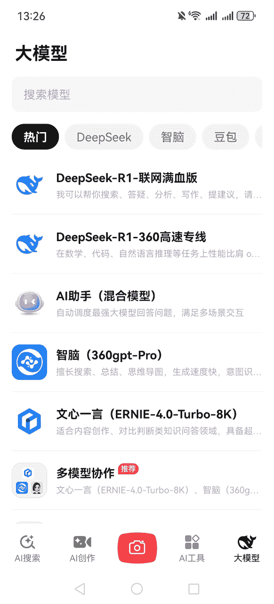

## 2）硅基流动

华为云和硅基流动联合推出了 满血版 DeepSeek R1。最重要的是，注册就送 2000 万 Token。

**在人工智能和大语言模型中，**Token 是文本的基本单位，用于表示语言模型中的单词、字符或子词等。

•**中文场景**：1 个 Token 通常对应 1 个汉字。2000 万 Token 相当于 2000 万个汉字，如果按一本 300 页的书（每页 300 字）计算，2000 万 Token 约等于 222 本书。

•**英文场景**：1 个 Token 通常对应 3-4 个字母，1000 个 Token 约等于 750 个英文单词。2000 万 Token 约等于 1500 万英文单词。

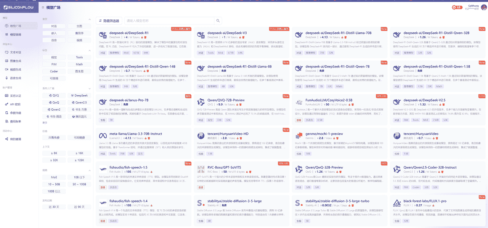

在硅基流动上具体使用 DeepSeek R1 的步骤：

1、注册，地址：[https://cloud.silic](https://cloud.siliconflow.cn/i/RKufZFsr)onflow.cn/i/RKufZFsr

2、模型广场找到 R1。

3、输入提示词开始对话。

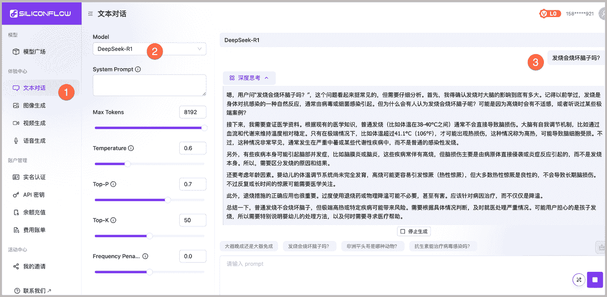

如果需要使用 API，选择模型时，我们能找到 API 文档，按照指示接入 R1 模型。

这里有个小技巧，利用 Cursor 或 Trae 等 AI IDEA，获取 API 代码示例，就能快速完成接入。

如果需要使用 API，选择模型时，我们能找到 API 文档，按照指示接入 R1 模型。

这里有个小技巧，利用 Cursor 或 Trae 等 AI IDEA，获取 API 代码示例，就能快速完成接入。

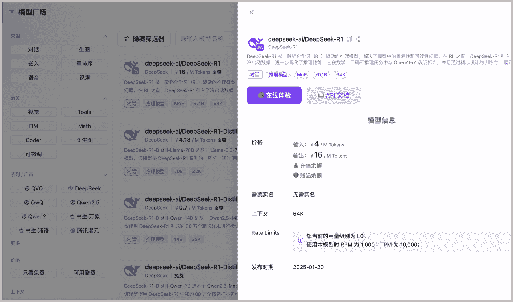

1.  Lambda.chat

如果你有魔法，且只需通过聊天窗口使用，那首推 Lambda.chat，它速度超快。

这样能避免我们受各种天文参数、API 代码接入方式的干扰。

就是一个词：纯享！​

地址：https://lambda.chat/

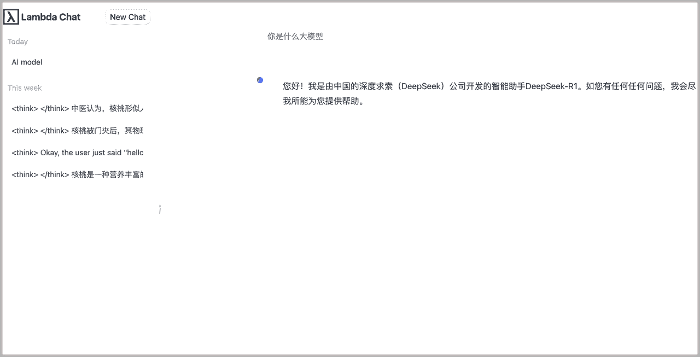

除了满血 671B DeepSeek R1，还支持大量不同参数的 Llama 模型选择使用。

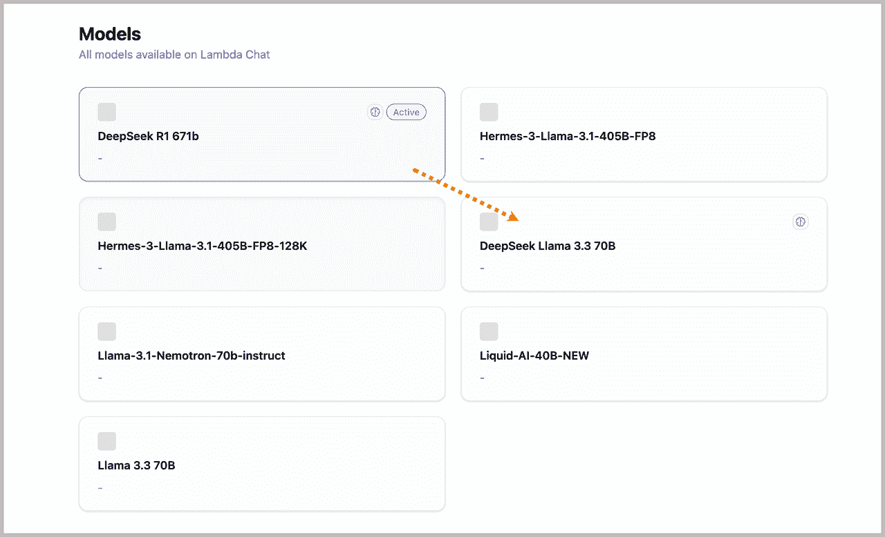

## 4）秘塔 AI 搜索

无论是硅基流动，还是 Lambda，以及接下**来涉及的各**种平台，他们都会面临一个问题：联网搜索。

目前只有官方支持联网搜索， 测试后的 Lambda 和硅基流动，数据都是去年的。

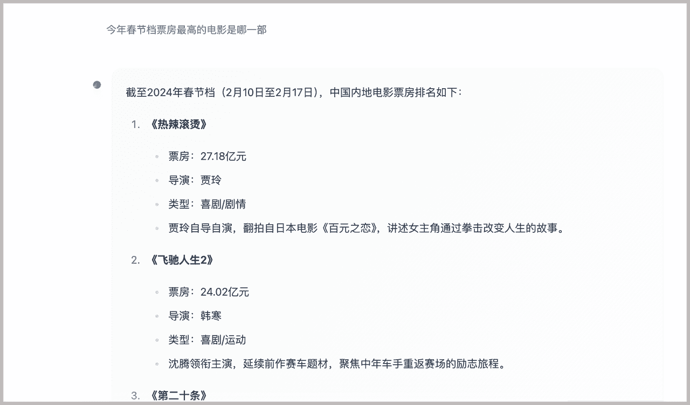

打开秘塔，勾上长思考试试。

地址：https://metaso.cn/

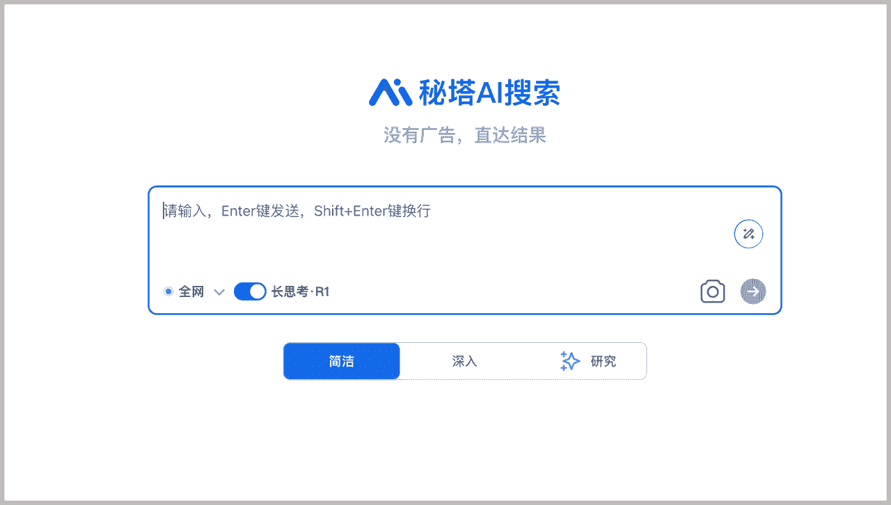

## 5）国家超算互联网

国家队也开始下场，支持 DeepSeek 全民使用。地址：https://chat.scnet.cn/

网上很多人说有 32B、14B、7B，但是我验证发现只有 DeepSeek-R1-Distill-Qwen-7B 。

参数是小了点，如果其他平台用不了，本地部署也没有硬件，最后再考虑用用国家超算互联网。

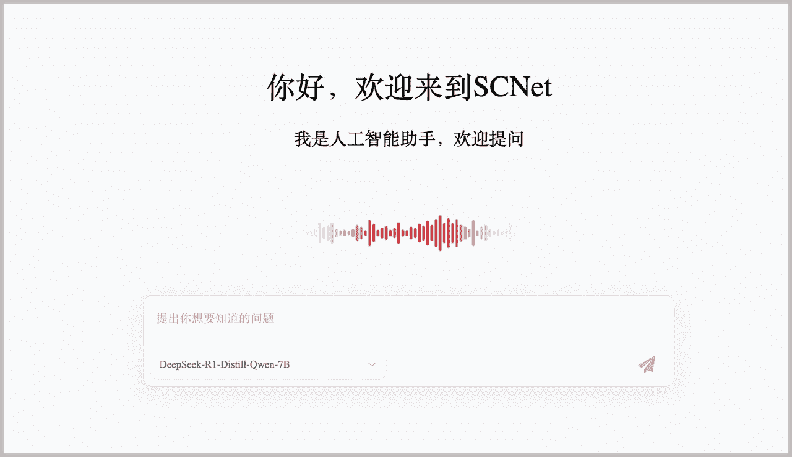

## 6）英伟达

虽然 **DeepSeek-R1** 的出现，让 英伟达市值蒸发近 6000 亿刀。

但这并不妨碍英伟达 **积极拥抱它**，毕竟——**打不过，就加入！**

前段时间，**NVIDIA 用最新的 HGX H200 服**务器部署了满血版 DeepSeek-R1，直接把推理速度提升到 惊人的 3,872 Token/s！

要知道 GPT-4 只有 150 Token/s，Claude-3 也不过 200-300 Token/s，英伟达简直“豪”无人性 ～

具体**怎么用？**

一个邮箱注册就能搞定。我测试了下，甚至免登录也可以直接使用。

地址： [https://build.nvidia.com/dee](https://build.nvidia.com/deepseek-ai/deepseek-r1)pseek-ai/deepseek-r1

右侧直接能看到 API 接入代码。

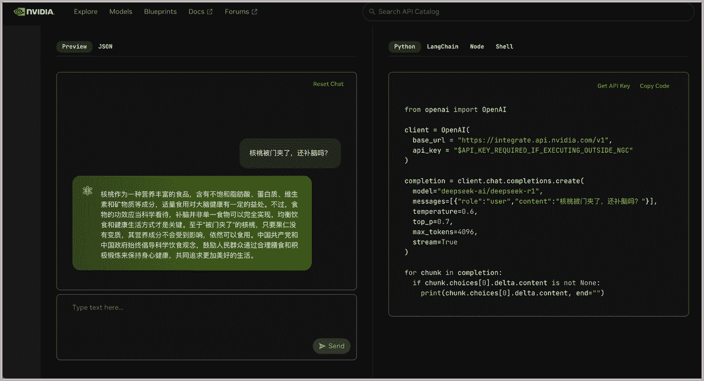

## 7）Poe

作为众多国内 **AI 深度用户** 的日常工具，**Poe** 自然不会错过 **DeepSeek-R1** 这波巨大的流量红利。

**官方版本** 直接拉满：输入上下文 164K、输出上限 33K。

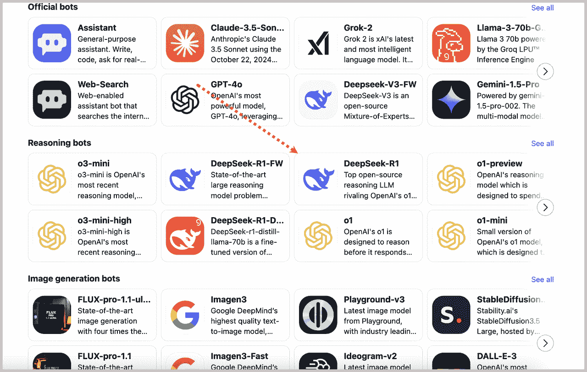

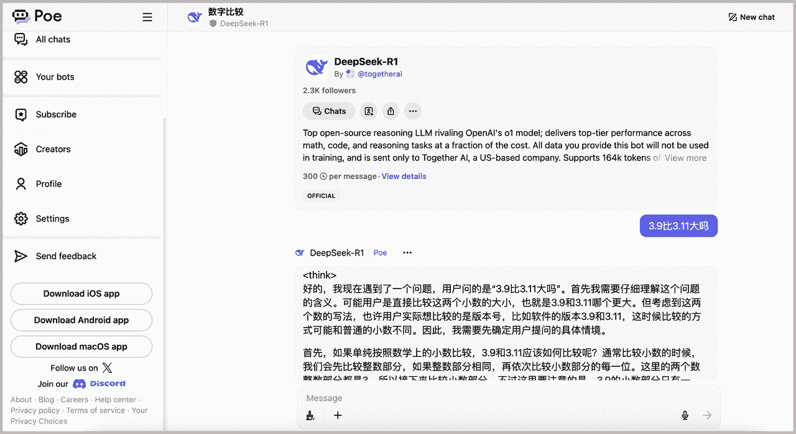

如果你需要在同一个问题上生成**大量文本****（比如写长文档或长代码），那就**可以试试 DeepSeek-R1-FW。

因为它支持比官方 R1 更多的输出长度，除了同时可以处理 164k 输入 token，同时还具备 164k 输出 token 的能力。

但是，常规问题，用 **DeepSeek-R1 **即可。

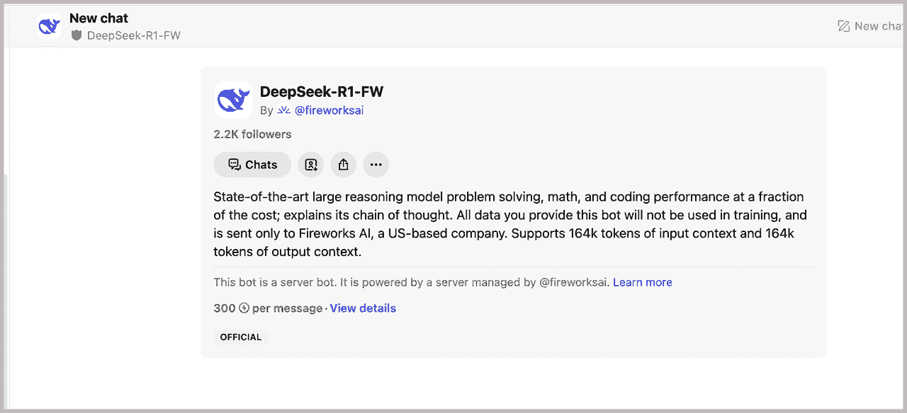

## 8）Groq

除了满血的 DeepSeek R1，若无需硬件条件，想测试一些大参数的蒸馏版本，比如 70B，Grop 也是一个选择。

登录后，在左上角找到 Deepseek-R1-Distill-Llama-70b，就能愉快玩耍啦。

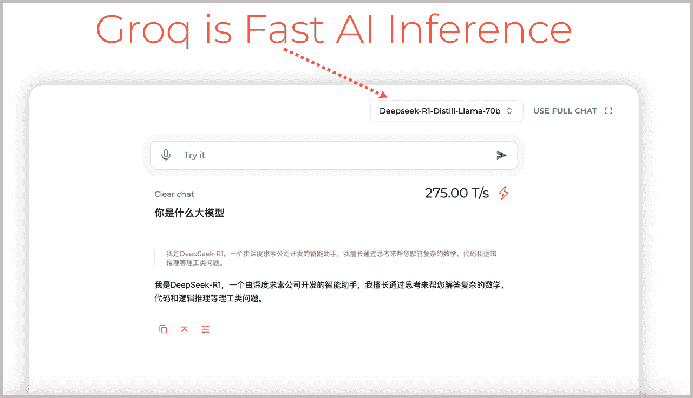

## 9）阿里云百炼平台

一个需要魔法的平台。有一些的免费额度，可以作为备用平台。

地址：https://www.alibabacloud.com/zh/product/modelstudio?_p_lc=1

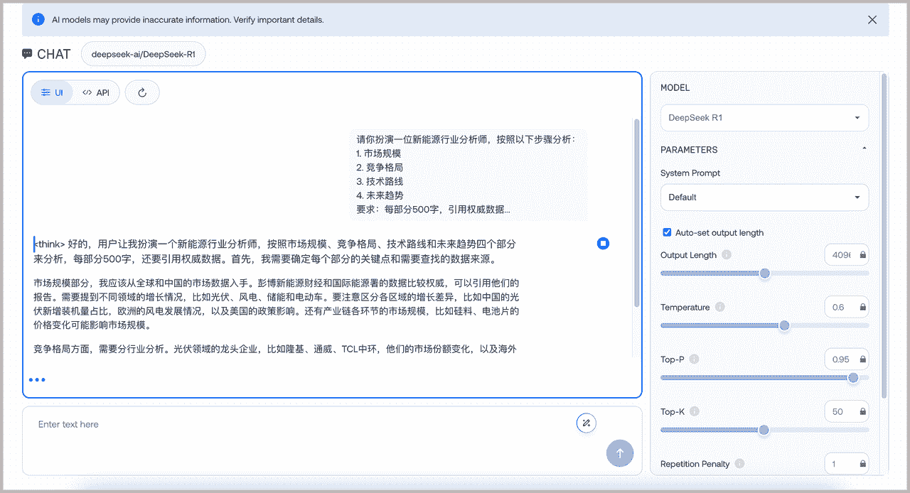

## 10）使用 AskManyAl

它是一个一站式的 AI 大模型聚合平台，集合了 GPT、Claude、Gemini、Kimi 等国内外顶尖的 AI 大模型。用户可以通过 AskManyAI 的网页端在线使用这些 AI 模型，进行多模态对话、文档上传、图生文、文生图等多种操作。

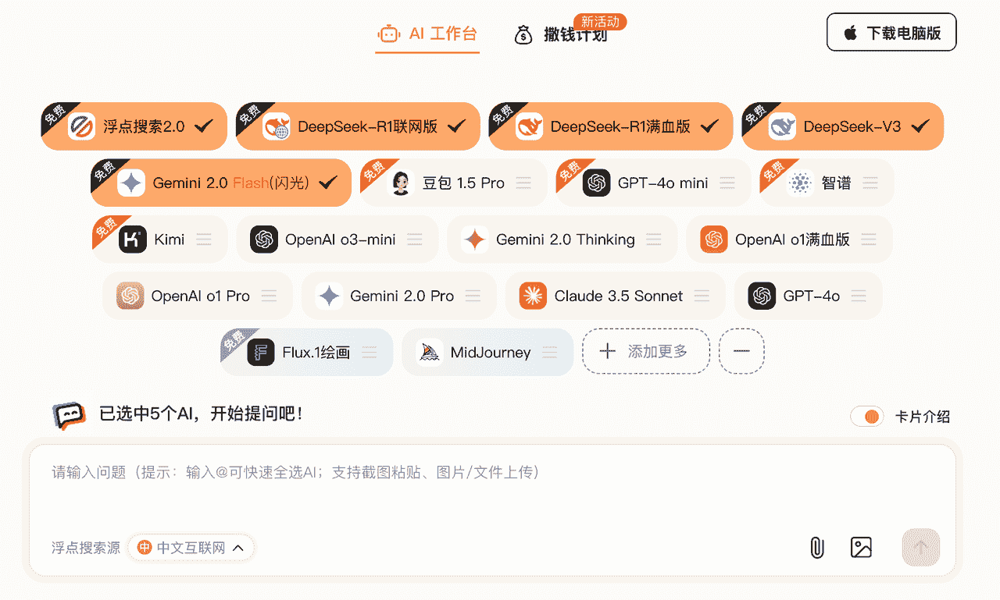

地址：https://askmanyai.cn/index

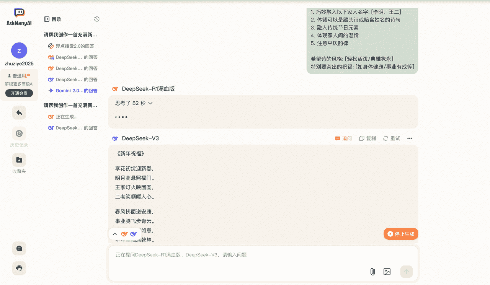

**延展阅读：**

一招教你解决 DeepSeek R1 的卡顿问题。

[国内已部署DeepSeek模型第三方列表 ](https://datakhazix.feishu.cn/wiki/TUWtwM8jIib6MGk63wQcGj7RnBh?28RWg=1)

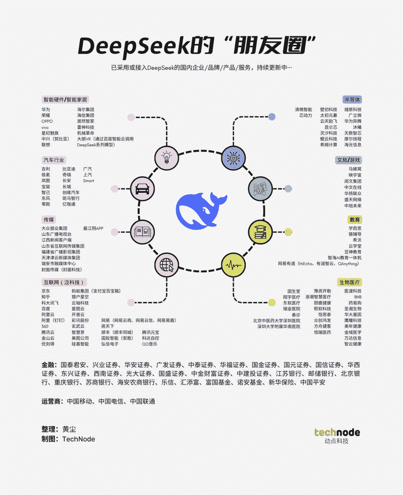

# 三、**本地部署**

> 如果只是想 **简单体验**，或者**本地算力充足**、希望**保护数据安全**，那么可以考虑 **本地部署 **的方案。本地部署的好处有以下几点：

> •更稳定更快地响应：本地部署减少了对网络连接的依赖，避免了因网络延迟导致的响应速度下降

> •模型可控性：根据自身对模型进行定制和优化，提高模型的适用性和性能

> •数据安全：在本地环境中处理数据，避免了将敏感信息上传至云端，降低了数据泄露的风险

> •成本控制：无限使用，无需支付云服务的订阅费用，可降低使用成本

> •灵活性：可以自由选择和切换不同的模型，满足多样化的应用需求

> •离线运行：在本地部署好以后，就算是没有网络，也可以使用

> 满血版 DeepSeek 本地部署清单和总费用

>

> 在本地部署一个拥有 6710 亿参数的 DeepSeek 模型需要相当高的硬件配置。以下是详细的硬件清单、单价和总价估算：

>

> **硬件清单 **

>

> 1.GPU（图形处理器）

> •型号： NVIDIA A100 40GB

> •数量： 16 块

> •单价： $15,000/块

> •总价： $240,000

>

> 2.CPU（中央处理器）

> •型号： Intel Xeon Platinum 8380H （24 核心， 48 线程）

> •数量： 8 块

> 3.内存（RAM）

> •容量： 1TB DDR4 ECC

> •数量： 8 块

> •单价： $5,000/块

> •总价： $40,000

>

> 4.存储

> •容量： 16TB NVMe SSD

> •数量： 16 块

> •单价： $2,000/块

> •总价： $32,000

>

> 5.网络设备

> •型号： Mellanox InfiniBand HDR 200Gb/s

> •数量： 8 块

> •单价： $5,000/块

> •总价： $40,000

>

> 6.电源和散热

> •电源： 8 个 800W PSU

> •单价： $150/个

> •总价： $1,200

> •散热系统： 定制液冷系统

> •单价： $50,000

> •总价： $50,000

>

> **总价估算 **

> 将以上所有硬件的价格相加：

> •GPU: $240,000

> •CPU: $80,000

> •内存： $40,000

> •存储： $32,000

> •网络设备： $40,000

> •电源和散热： $51,200

>

> 总计： $483,200

>

> 注意事项

> 1.软件许可： 需要购买相关的软件许可，如深度学习框架、优化库等。

> 2.维护费用： 包括定期维护、升级和更换硬件部件的费用。

> 3.电力消耗： 高性能计算集群的电力消耗巨大，需考虑电费和冷却系统的运行成本。

> 4.机房设施： 需要一个具备足够电力供应、良好散热和稳定网络连接的机房。

>

> **结论 **

> 本地部署一个拥有 6710 亿参数的 DeepSeek 模型需要约$483,200 的硬件投资，这还不包括软件许可、维护和其他运营成本。建议在实际部署前进行详细的成本效益分析，并考虑是否可以通过云计算服务来降低初期投入。

## API  搭建知识库

**如果本地数据不涉密，还想获得最佳使用效果，那肯定得选**满血的 DeepSeek R1 模型。

我们来看看怎么利用 API 用上满血的 R1 模型（671 B）。

1、先下载一个叫 Cherry Studio 的软件。

地址： https://cherry-ai.com/download

2、登录/注册「硅基流动」，新用户会赠送 2000 万 Token 额度。

地址：[https://cloud.silic](https://cloud.siliconflow.cn/i/TAAOvaXg)onflow.cn/i/TAAOvaXg

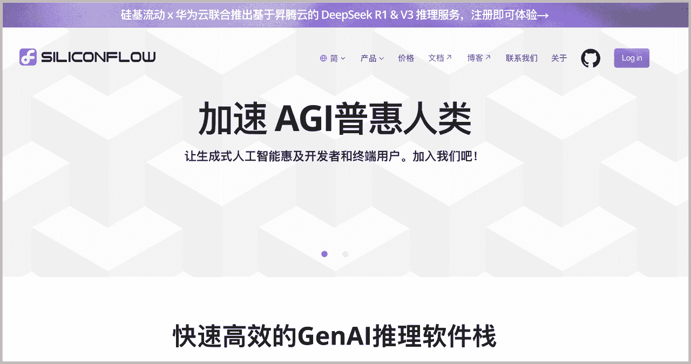

3、来到 API 密钥生成界面，创建或者复制已有的密钥。

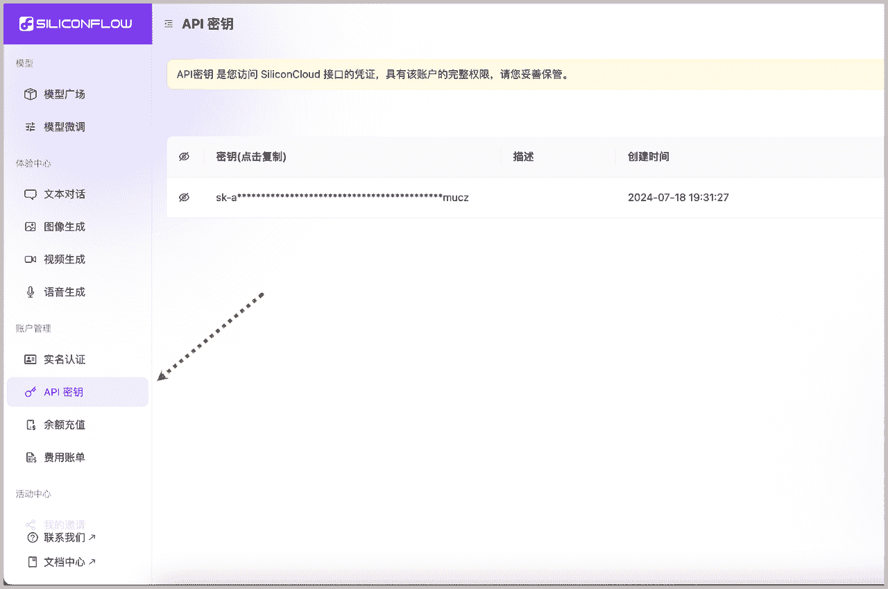

4、来到 **Cherry Studio**，配置 API Key。

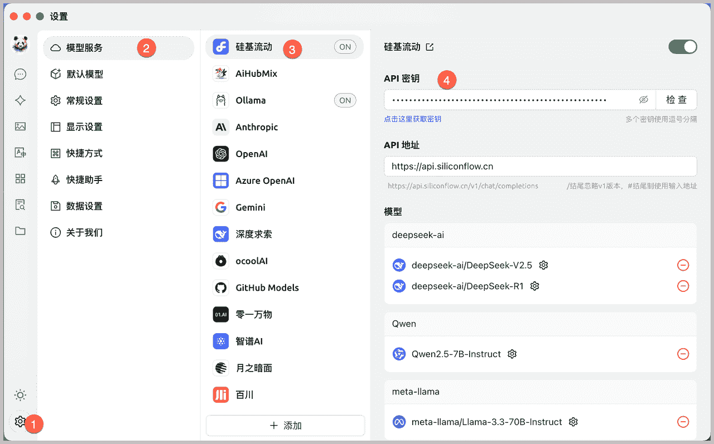

**5、在模型广**场**首页，排在**前两位的就是「硅基流动」和「华为云」合作发布的 DeepSeek R1 / V3 模型。

如果需要推理能力，记得打开并复制 R1 模型的名称。

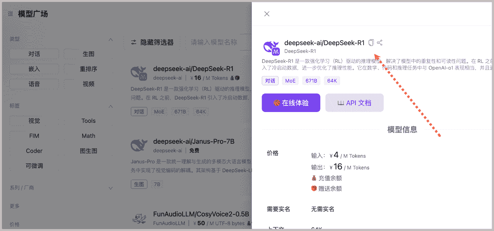

6、在模型服务的硅基流动下方，添加 R1 模型。

7、记得点击检查，测试下 API 是否可以正常访问。

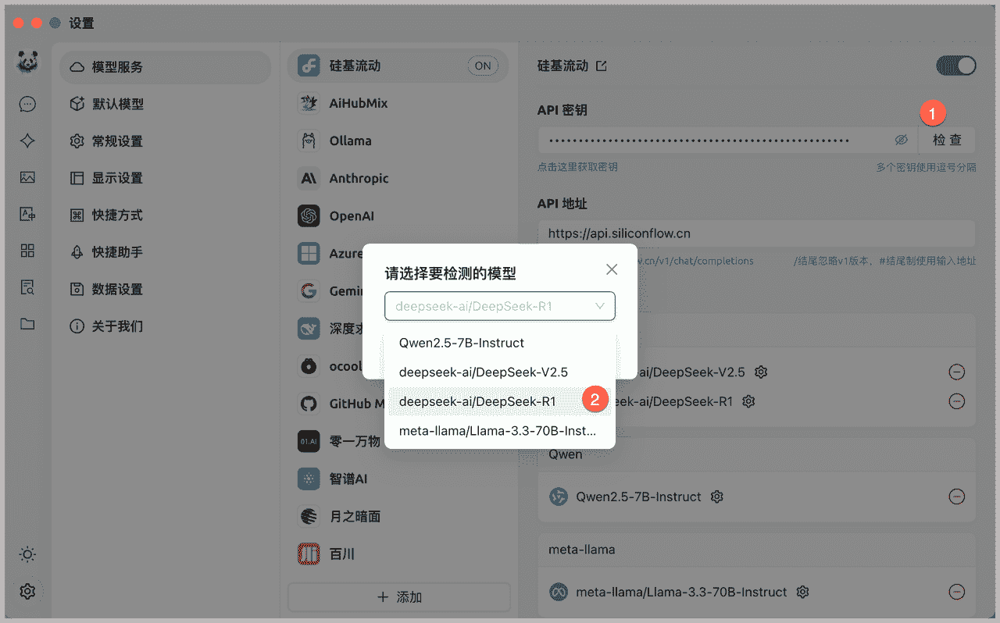

8、现在对话模型有了 R1，还缺少一个嵌入模型。

**嵌入模型的主要作用是将本地文件的内**容转换成有意义的数字，存储到向量数据库中。

在用户提问时，利用 RAG 技术在数据库中搜索到相似答案，最终回复用户。

我们再配置一个向量模型：**BAAI/bge-m3，**如果希望搜索的精准度更高，可以选择 Pro/BAAI/bge-m3。

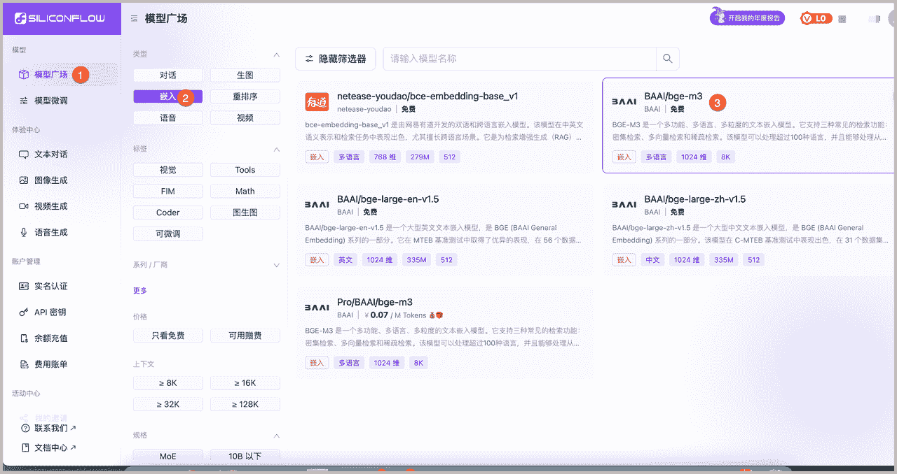

按照同样的方式配置到 **Cherry Studio **中，这里不需要点击检查。

9、在 **Cherry Studio** 创建知识库，选择刚才配置的嵌入模型，这样就会自动利用对应的模型来向量化数据。

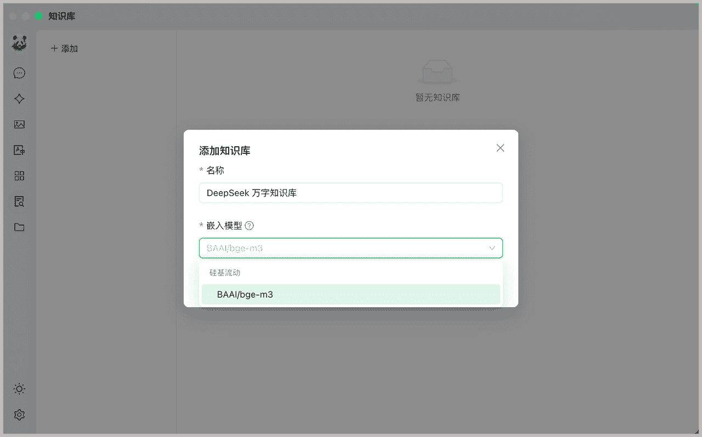

10、上传本地文件进行向量化。

如果本地 PDF 文件是 **扫描件、手写件**，或者**带有复杂的表格 **和 **数学公式**，解析效果会很差，甚至无法解析。

这样才可以正常回复知识库的内容：​

如果追求执行比，推荐使用 **Doc2x**：https://doc2x.noedgeai.com/

**如果希望更加**稳定[，](https://www.textin.com/market/detail/pdf_to_markdown)那么可以考虑 Textin ：https://www.textin.com/market/detail/pdf_to_markdown

当我们上传文件后，箭头指向的图标如图所示，则代表向量化成功。

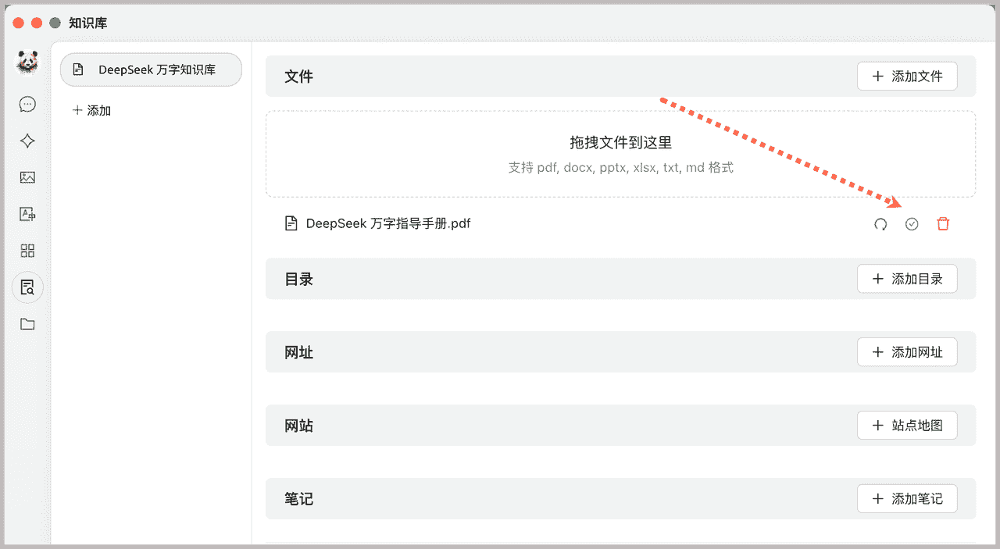

**11、测试使用，**这一步添加助手，并选择刚配置的 满血 R1 模型。

**如果不想**每次在添加助手时选择模型，可以将它设置为 默认模型。

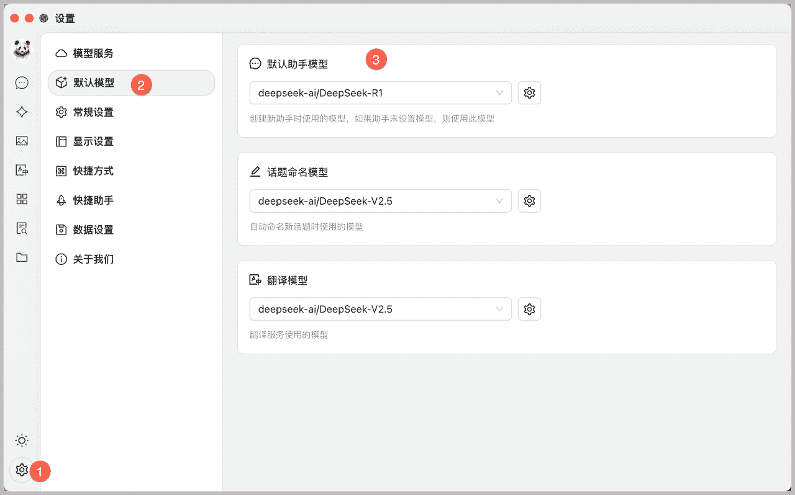

### DeepSeek-R1使用指南(简版)

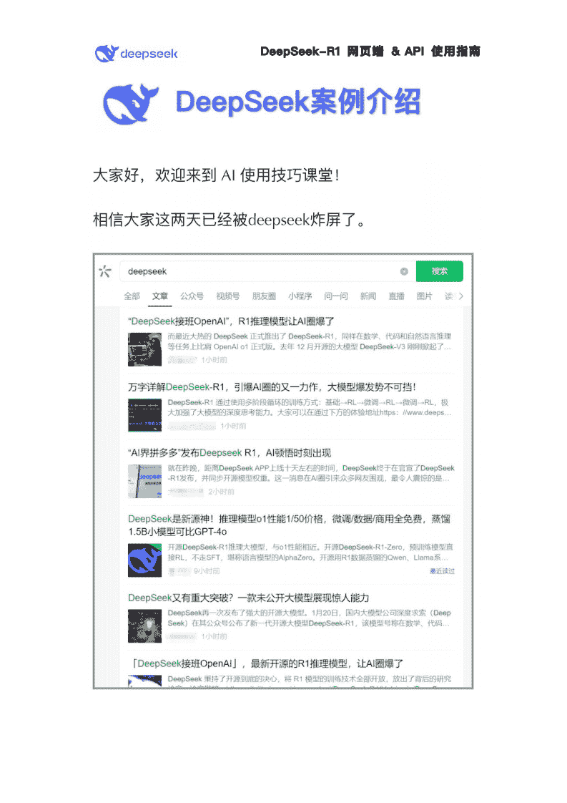

[DeepSeek-R1使用指南（简版）.pdf](https://internal-api-drive-stream.feishu.cn/space/api/box/stream/download/all/AdpwbUxbZohSpRxm0a8cbiDVnmg)

### 安装和使用ollama运行大语言模型文字教程

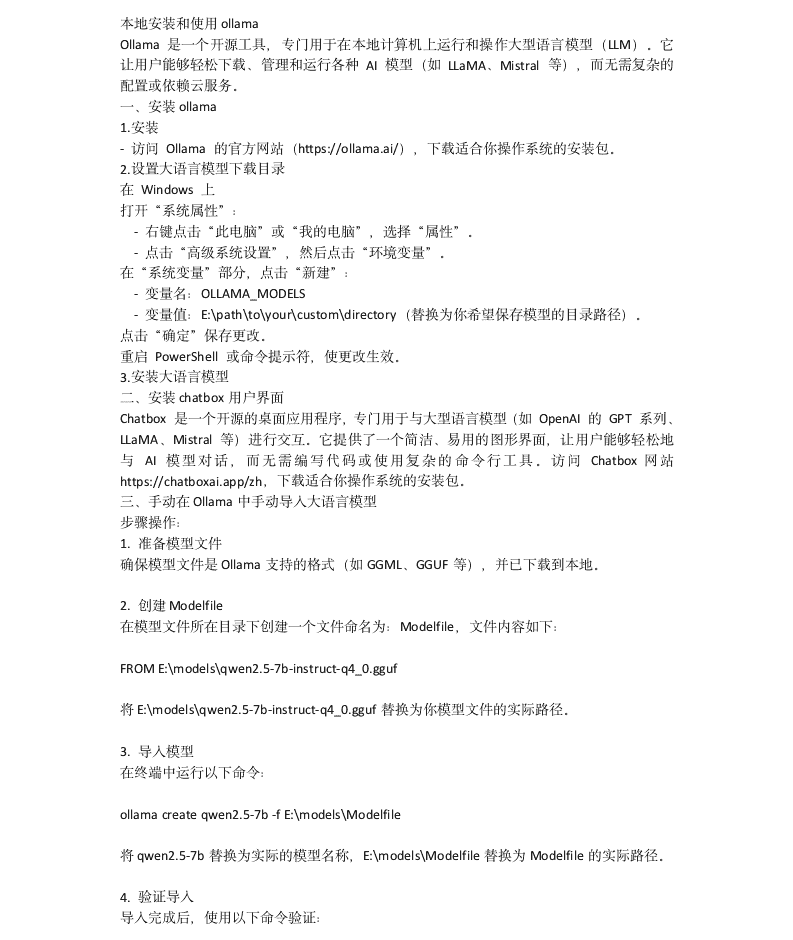

[安装和使用ollama运行大语言模型文字教程.docx](https://internal-api-drive-stream.feishu.cn/space/api/box/stream/download/all/J9hUbshXGo5uC2xhyJNc3qTjnfe)

## 本地部署搭建知识库

1、访问 Ollama 官方地址：https://ollama.com/download，下载软件。

建议下载最新版本 Ollama，个人踩坑经历：旧版本安装 R1 后可能无法正常使用。

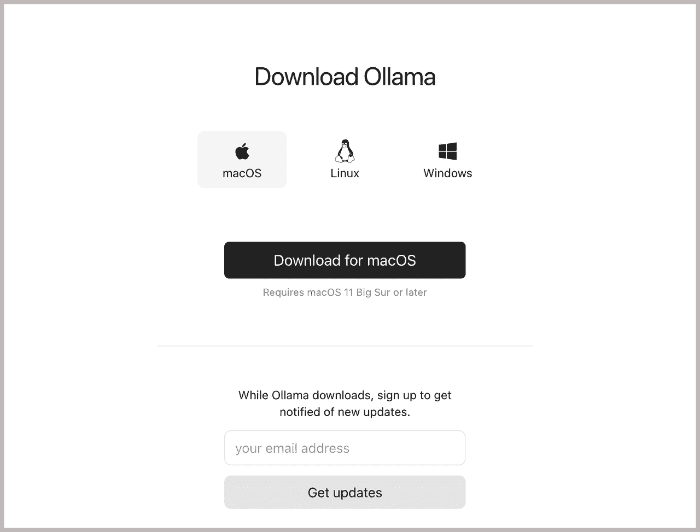

2、双击运行 Ollama 后，打开命令行，运行需要安装的模型（参数越大，显存要求越高）。

地址：[https://ollama.com](https://ollama.com/library/deepseek-r1)/library/deepseek-r1

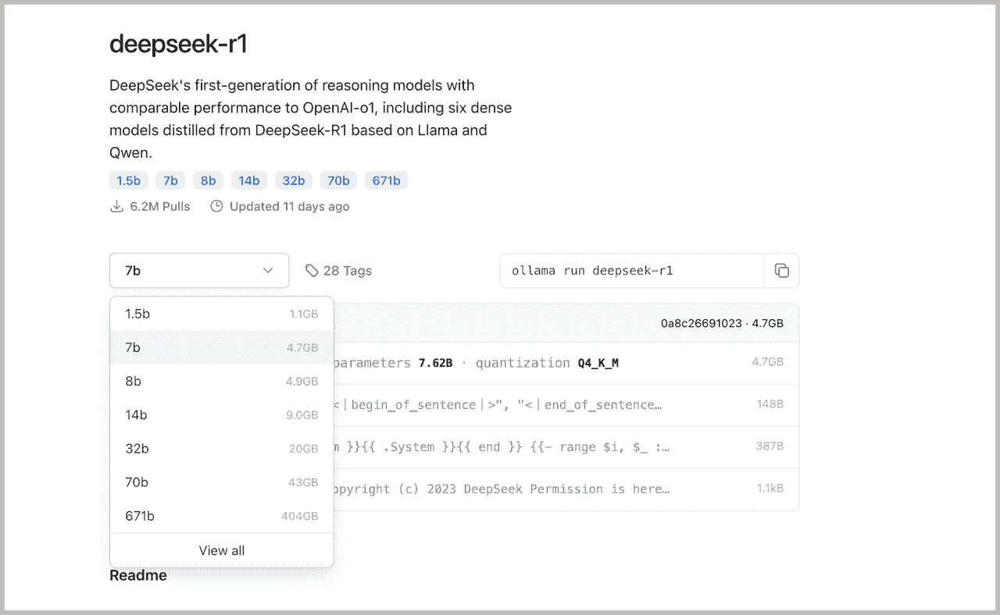

如果没有 **GPU**，建议选择 **1.5B**，运行相对轻量。我这 **4G 显存** 勉强能跑 **8B**，但速度较慢。

有朋友用 **RTX 4090** 测试 **32B**，效果和速度都不错。大家可以参考这个梯度，根据自己的硬件选择合适的模型。。

下载并运行成功后，就可以和 DeepSeek R1 对话啦。

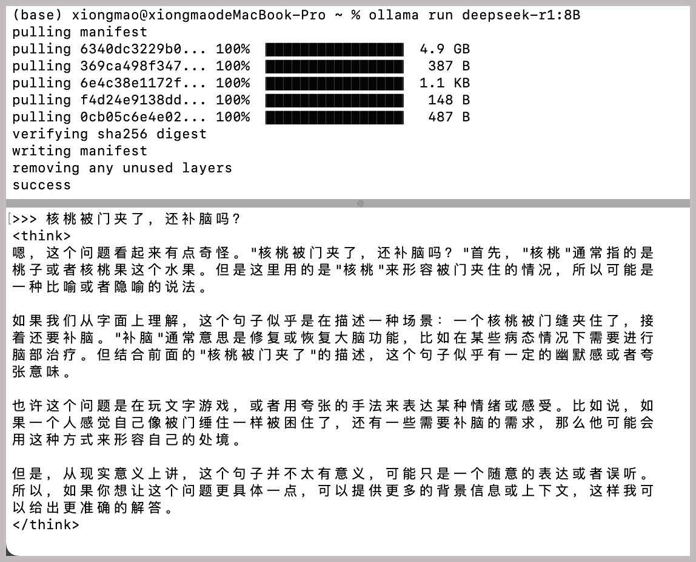

当然，我们可以用 **Cherry Studio** 作为本地 R1 模型的 UI 界面。

打开软件的配置，选择 **Ollama**，在管理按钮中选择自己部署的模型。

如果选不到，就手动添加模型，API 秘钥填不填无所谓）​

最后点击检查，测试下网络连通性，出现连接成功即可。

接下来就可以在添加助手时，选择本地部署的 R1 模型啦。

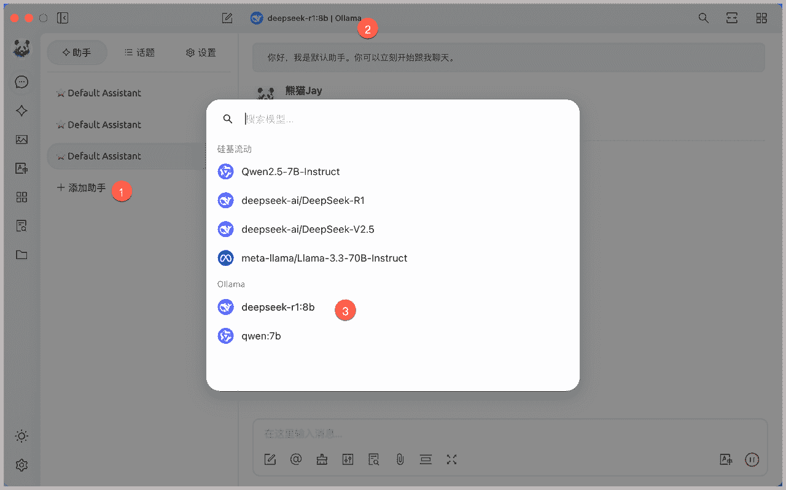

**看到这里，相信你已经找到最适合自己的** DeepSeek 个人知识库方案了。

如果你和大多数人一样，选择使用官方 API ，那就不用再为性能和本地硬件资源发愁；​

如果你恰好有充足的算力和技术储备，本地部署也是个不错的选择。

## 本地部署**视频教程**

### 方法一：使用 ollama+PageAssist 插件部署

DeepSeek R1，本地部署才是王道！

### 方法二：使用 LM Studio 部署

DeepSeek R1 推理模型 完全本地部署 保姆级教程 断网运行

> **附：本地部署大礼包**

> 「Deepseek 大礼包」，链接：https://pan.quark.cn/s/dc12444494c8

> •

> DeepSeek R1 7b 模型整合包：完整模型，附带本地部署大礼包，开箱即用。

> •

> 2025 年 DeepSeek 桌面版：一键安装，轻松体验桌面版强大功能。

> •

> 破除限制文件补丁：解锁 DeepSeek 全部潜能，突破使用限制。

##

# 四、**使用技巧**

**DeepS**eek 不仅能完成一般的 AI 文本任务，还拥有一些独特的功能，让用户能更高效地利用 AI。

## 1.深度思考（R1）模式

**功能介绍**：

勾选“**深度思考（R1）**”后，DeepSeek 将进入**高智能推理模式**，提升对复杂问题的理解能力。

**使用技巧**：

•适用于专业分析，如法律解析、市场预测、技术方案设计等。

•可用于解决逻辑推理题、数学问题，甚至编写商业计划书。

•适合编写结构清晰、条理分明的深度文章。

**示例**：

任务：分析中国未来十年的经济增长趋势。

普通模式：提供基本经济数据分析。

深度思考模式：结合全球经济、政策变化、科技发展等多维因素进行深度预测。

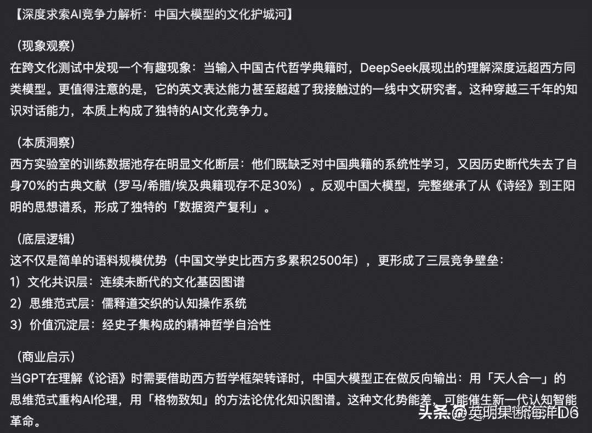

## 2.联网搜索：获取实时信息

**功能介绍**：

DeepSeek 支持**联网搜索**，使其能结合**最新信息**，提供更准确、实时的回答。

**使用技巧**：

•

适合查询最新的财经新闻、科技动态、市场行情等。

•

可用于查找特定领域的最新研究成果或政策法规。

**示例**：

任务：获取 2025 年最新的新能源汽车补贴政策。

普通模式：提供已知的 2024 年政策。

联网搜索：获取最新的官方信息，提供精准补贴方案。

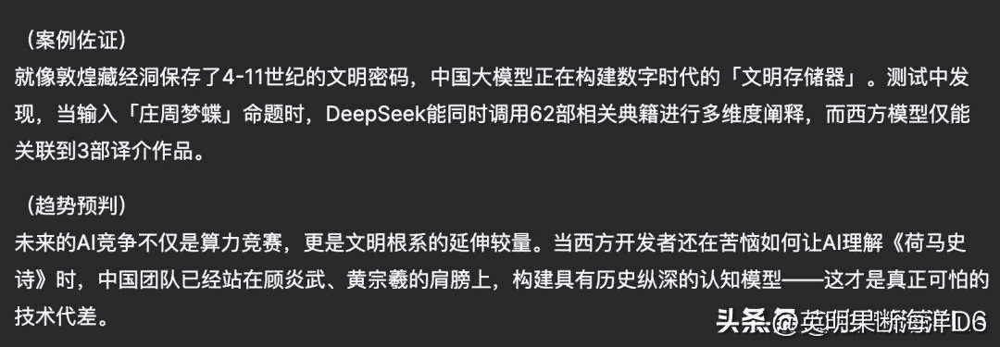

## 3.直接描述任务，零样本提示效果最佳

**功能介绍**：

DeepSeek 相比传统 AI 模型，无需复杂提示词模板，能直接理解用户的意图。

**使用技巧**：

•

避免过度调整提示词，直接描述任务需求即可获得高质量输出。

•

适合快速生成各类文本，如新闻稿、市场分析、社交媒体文案等。

**示例**：

❌ 传统方式：“请你按照营销专家的风格，撰写一篇面向年轻人的智能手机宣传文案。”​

✅ 高效方式：“写一篇吸引年轻人购买智能手机的文案，突出创新功能。”​

DeepSeek 会自动理解需求，提供精准内容。

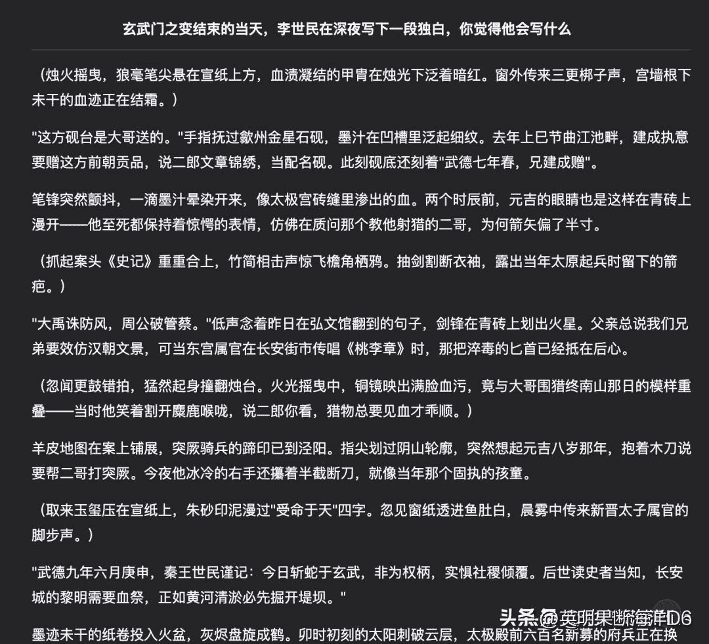

## 4.让 AI“说人话”

**功能介绍**：

**有时 AI 回答过于正式或晦涩**难懂，DeepSeek 可自动优化表达，使内容更通俗易懂。

**使用技巧**：

•

对于抽象问题或学术概念，可让 AI 用“大白话”解释。

•

适用于写作润色，使文章更自然、易读。

**示例**：

任务：解释量子计算的基本原理。

普通模式：提供复杂的物理术语和数学公式。

优化模式：“想象计算机是个超级聪明的猜谜高手，而量子计算机能同时猜多个答案。”（更易理解）​

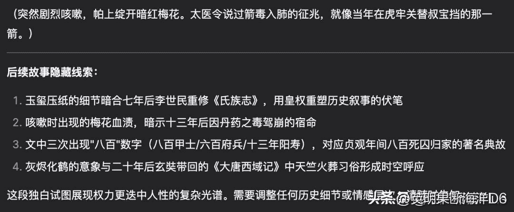

## 5.多风格改写，让文本更具个性

**功能介绍**：

**DeepSeek 能**模仿不同作家的风格，如鲁迅、刘润、马伯庸等，让文章更具个性。

**使用技巧**：

•适用于营销文案、文学创作、社交媒体运营等场景。

•可将普通文本改写成不同风格，以适应特定读者群体。

**示例**：

**普通文本**：“成功需要努力和坚持。”

**鲁迅风格**：“世间本无捷径，唯有在荆棘丛中踏出自己的路。”

**刘润风格**：“成功的底层逻辑，就是不断构建你的竞争壁垒。”

**延展阅读：**

爆肝 50 小时，DeepSeek 使用技巧，你收藏这一篇就够了！

使用 DeepSeek 必备的 10 个技巧

节后复工必看！9 个让打工人效率翻倍的 DeepSeek 隐藏技巧

《DeepSeek 中老年人 使用指南》

# 五、提示词技能

## 国产大模型deepseek指令教程合集

### DeepSeek+豆包制作

### 10天精通 DeepSeek 含40案例

### DeepSeek15天指导手册--从入门到精通

### DeepSeek30个喂饭指令

### DeepSeek Kimi 即梦配合使用

### deepseek 传统文化古诗词赛道教程

### DeepSeek 和 通义万相AI生成视频

### deepseek 与mj做 Al 视频教程

### DeepSeek在线版vs本地版，哪个适合你的部署

### 小白7天精通 DeepSeek 实操手册

### DeepSeek系列-提示词工程和落地场景

### 内DeepSeek中小学生使用手册

[【AI制作】DeepSeek+豆包制作.pdf](https://internal-api-drive-stream.feishu.cn/space/api/box/stream/download/all/EsdUbxbZ1o770xxhZVCcSQWDnVg)

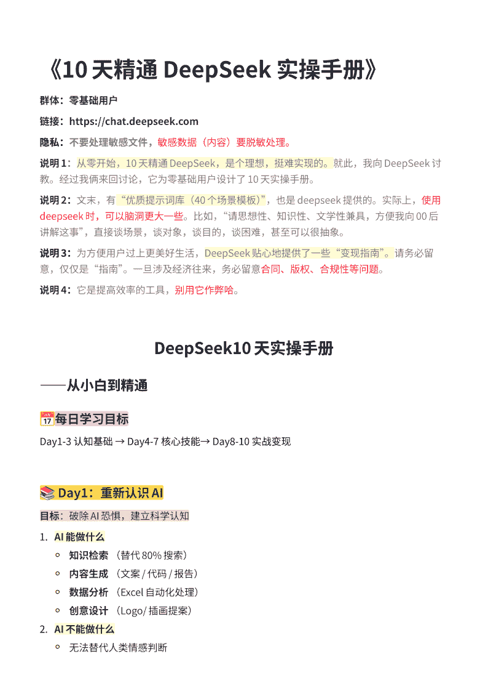

[10天精通 DeepSeek 含40案例.pdf](https://internal-api-drive-stream.feishu.cn/space/api/box/stream/download/all/YdHZbcvHqoBpE0x78b8cbwwcnNg)

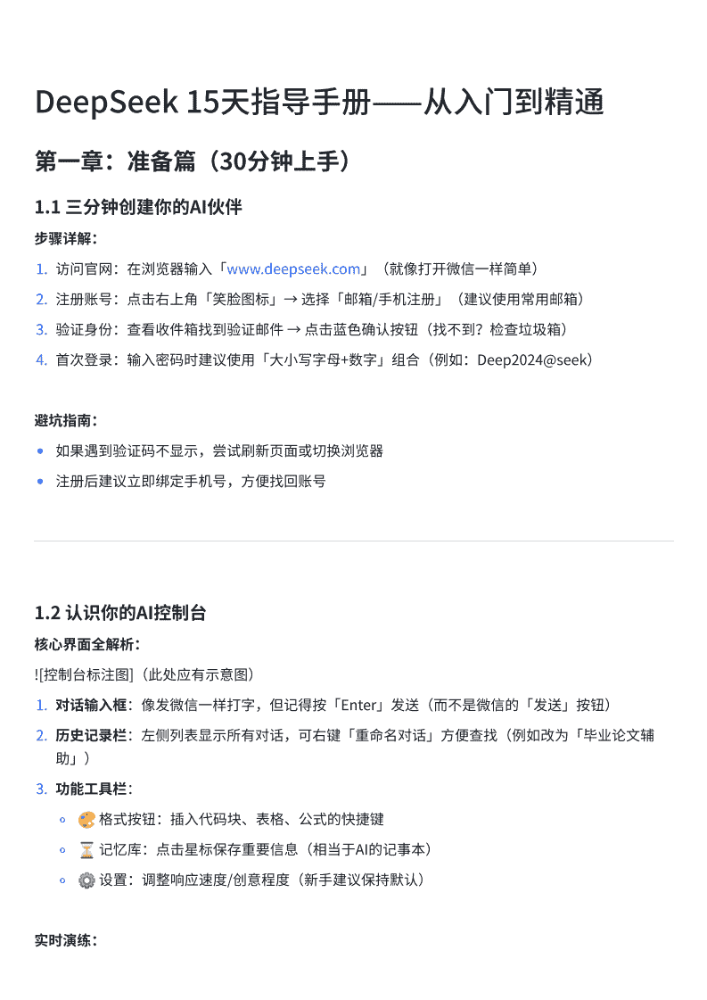

[DeepSeek 15天指导手册——从入门到精通.pdf](https://internal-api-drive-stream.feishu.cn/space/api/box/stream/download/all/Drh4bOA6EoSmW2xzQdJc4F82nXb)

[DeepSeek 30个喂饭指令.pdf](https://internal-api-drive-stream.feishu.cn/space/api/box/stream/download/all/CboIb7tyJox014xuSN6cvtjsnKe)

[DeepSeek Kimi 即梦配合使用.pdf](https://internal-api-drive-stream.feishu.cn/space/api/box/stream/download/all/ZWblbIjKioUGB3x8fbHcBZGwnnh)

[deepseek 传统文化古诗词赛道教程.pdf](https://internal-api-drive-stream.feishu.cn/space/api/box/stream/download/all/CG9PbFIIyoc24ZxvUkucJkZKnlg)

[DeepSeek 和 通义万相AI生成视频.pdf](https://internal-api-drive-stream.feishu.cn/space/api/box/stream/download/all/ZEE6b2m8po2OS6x1ZL3ckkjAnUf)

[deepseek 与mj做 AI 视频教程.pdf](https://internal-api-drive-stream.feishu.cn/space/api/box/stream/download/all/ZUxdbPVYNoZip1xpTGdcIqb3nmb)

[DeepSeek 在线版 vs 本地版，哪个适合你的部署.pdf](https://internal-api-drive-stream.feishu.cn/space/api/box/stream/download/all/URSAbWdaKon2d1xzSkLc0aesnMd)

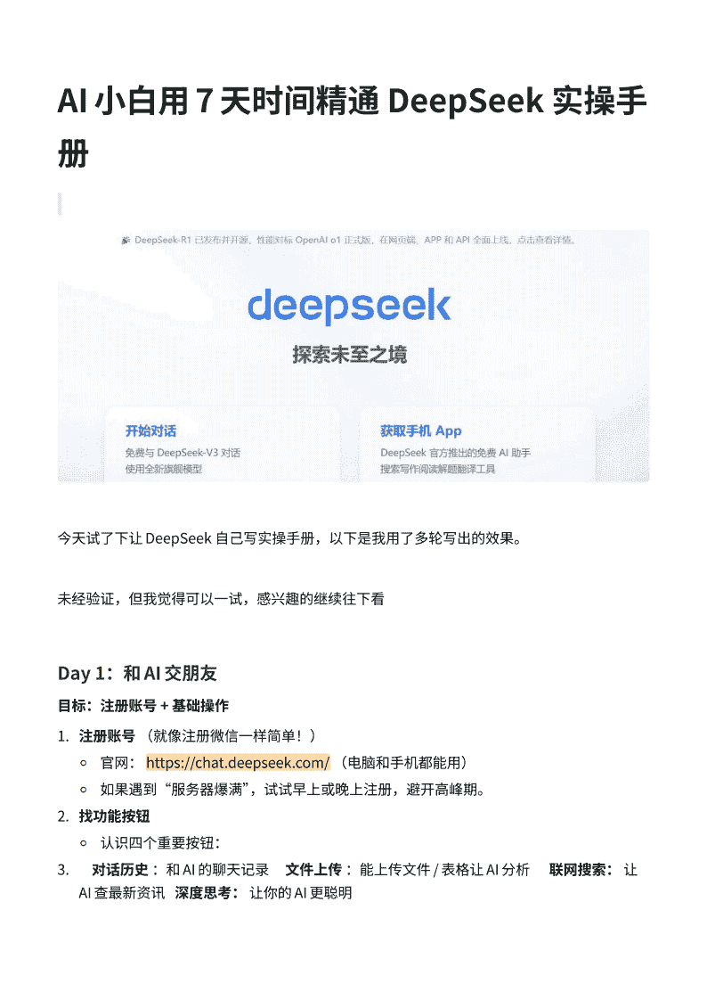

[小白7天精通 DeepSeek 实操手册.pdf](https://internal-api-drive-stream.feishu.cn/space/api/box/stream/download/all/FDuSbolTgojyG7xb42qcbnOsnbc)

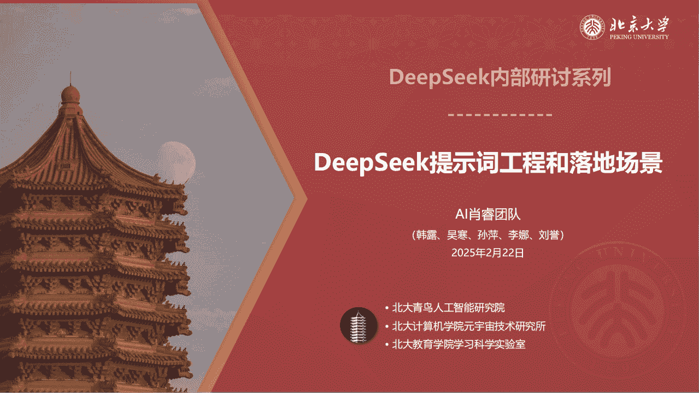

[北京大学-DeepSeek系列-提示词工程和落地场景.pdf](https://internal-api-drive-stream.feishu.cn/space/api/box/stream/download/all/VhY7b1qLAoIZmvx70tgcRvxSn8e)

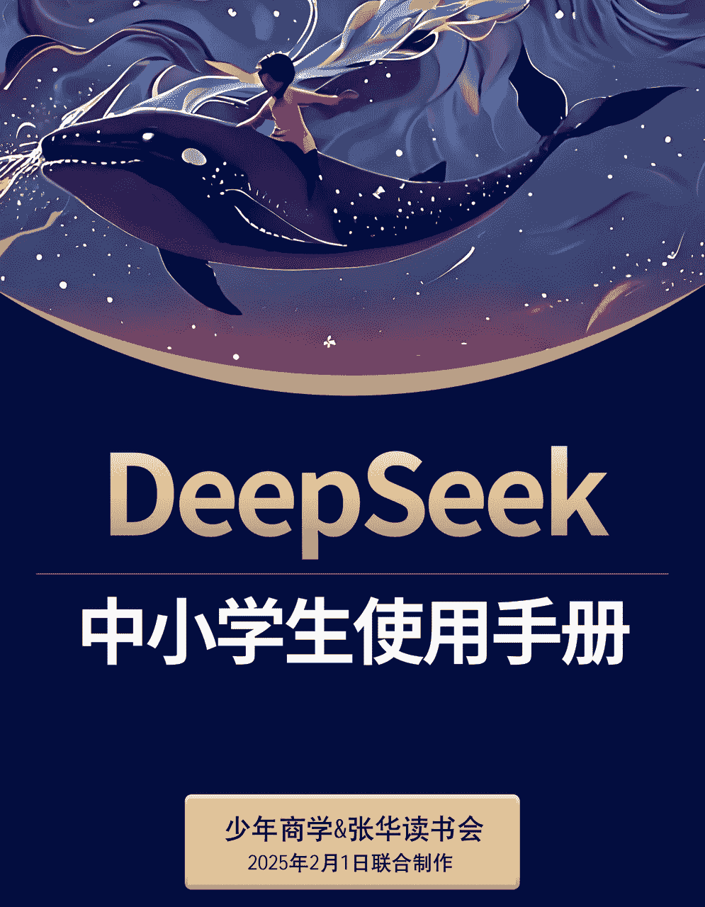

[DeepSeek中小学生使用手册.pdf](https://internal-api-drive-stream.feishu.cn/space/api/box/stream/download/all/WGEBbuXkqoe86UxZEmJcLcVonHg)

**延展阅读：**

宝玉-教你如何破解 DeepSeek R1 系统提示词

数字生命卡兹克-DeepSeek 的提示词技巧，就是没有技巧。

# 六、实用案例

## 1）搭建个人知识库

DeepSeek 建立个人知识库是非常实用的场景，这里有个很简易的 4 步教程。

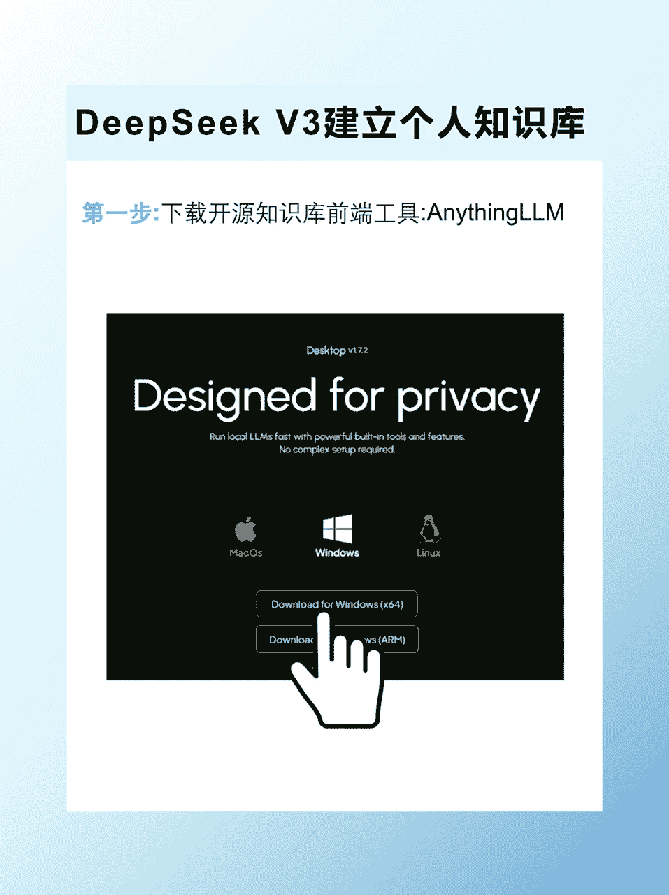

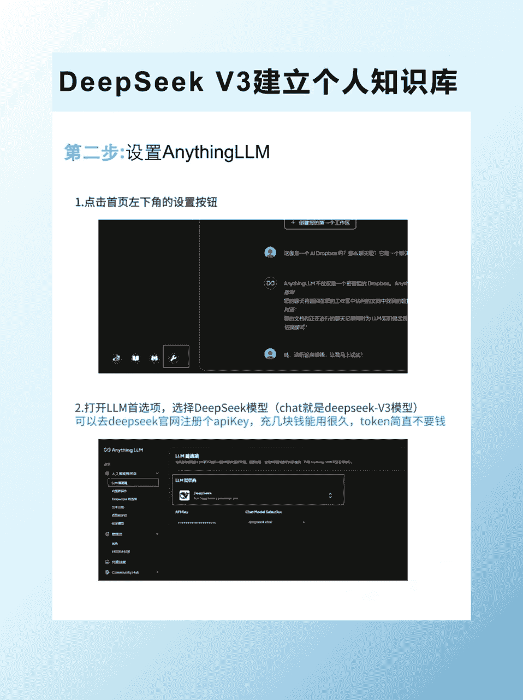

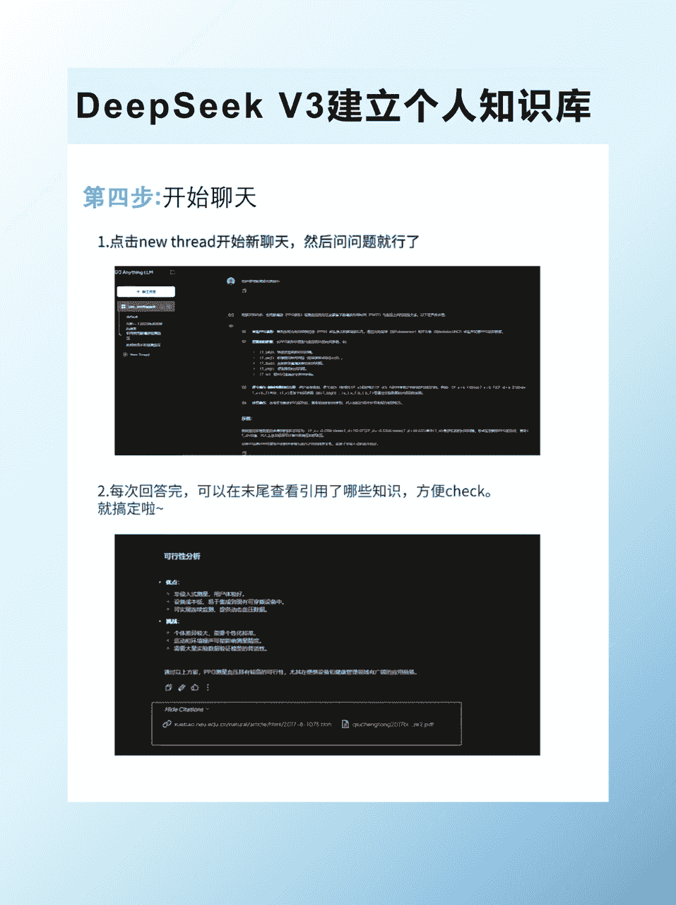

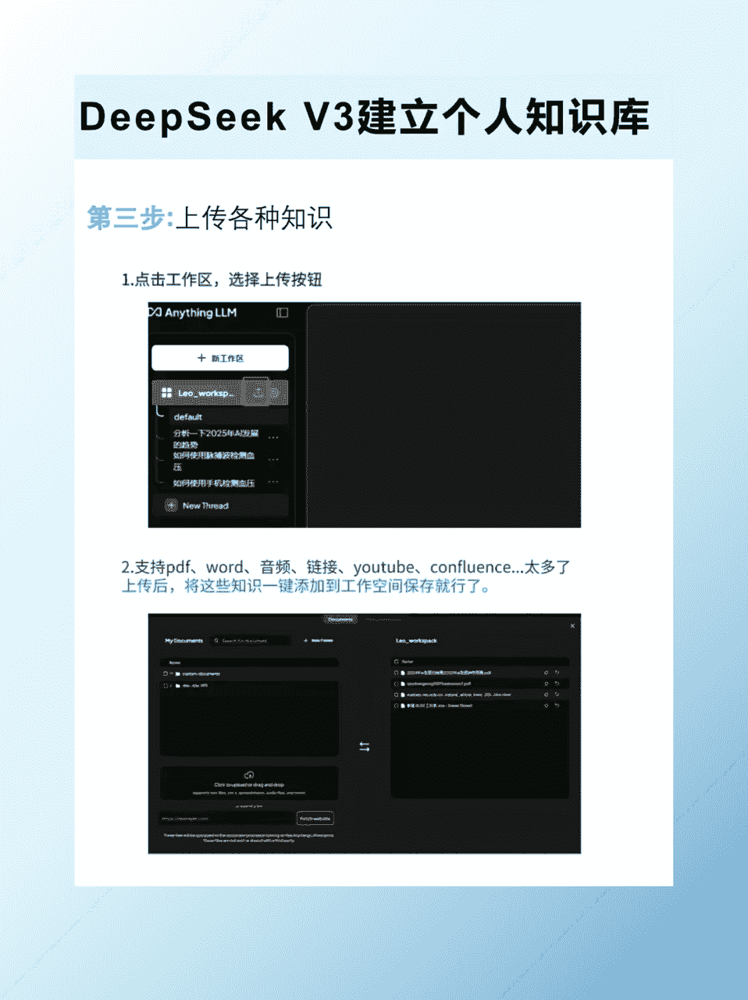

**延展阅读：**

万人围观，用 DeepSeek 搭建个人知识库，真香！（附完整教程）

## 2）智能客服

提供行业解决方案

实体店案例：为本地婚纱摄影店搭建 AI 客服系统，使用 DeepSeek-API 自动回复客户咨询。

实施步骤：​

（1）注册阿里云函数计算服务

（2）调用 DeepSeek 对话 API

（3）对接企业🛰️接口

收费模式：按咨询量收费（0.5-1 元/次）或年费制（3000-8000 元/年）。

## 3）企业应用

### 1.Deepseek 接入飞书

功能：多维表格接入 deepseek R1。不知道你有没有看过，我就顺手转发给你。批量做📕、👸号，批量处理客户数据，跟进项目等等，非常好用。

**官方教程：**[大仙课｜当飞书遇上 DeepSeek 们](https://larkcommunity.feishu.cn/wiki/R6rNwAMwZina8jkjK8nctxU8nmd)

### 2.Deepseek 接入企业🛰️

借助 DeepSeek，5 分钟在 skyin 平台完成接入，实现智能回复等功能，解决服务效率问题。借助 deepseek 和企业🛰️，这些都能轻松解决！只需 5 分钟，在 skyin 平台就能完成接入，实现 24 小时智能带情绪回复、自动打标签、引导成单。

**教程参考：**一键部署开源 DeepSeek 并集成到企业🛰️

### 3.Deepseek 接入钉钉

与 DeepSeek 结合，以强大语言能力和便捷协作功能优化工作流程，开启智能办公新时代。在钉钉可按步骤创建 AI 助理使用。

### 4.Deepseek 接入 WPS

DeepSeek 接入 WPS 后，可以提供以下核心功能：​

1.

智能扩写：用户可以通过 DeepSeek 的 AI 能力，对文档进行智能扩写，生成更丰富的内容。

2.

自动润色：WPS 中的 DeepSeek 插件可以帮助用户自动润色文档，提升文本的质量和可读性。

3.

公文生成：利用 DeepSeek 的 AI 能力，可以快速生成各种公文和报告，提高工作效率。

4.

数据分析：结合 WPS 的表格处理功能，DeepSeek 可以辅助进行复杂的数据分析和处理，提供更智能的决策支持。

**相关教程：**【最全教程】DeepSeek-R1 大模型接入 WPS

**视频教程：**WPS 接入 DeepSeek-R1 大模型保姆级教程🔥

# 七、赚钱案例

DeepSeek 爆火后，教你怎么靠它年入百万的各种课程随之而来。在社交平台、电商以及一些知识付费平台上，出现很多打着“利用 DeepSeek 赚钱”名号的课程，还有一些挂着各种教授、行业专家名号的人开直播专门讲授 DeepSeek 知识层出不穷。今天就盘一盘 Deepseek 到底有哪些赚钱方式！​

## 1）卖课程

最不缺的就是卖教学课程的，deepseek 也不例外，随着 deepseek 的走红，卖课程的也越来越多。

## 2）卖服务

很多人有本地化部署的需求，无论是个人还是企业，都在做相关的布局，电商平台和朋友圈不缺这类提供服务的人。

## 3）卖资料

在信息爆炸的时代，"知识付费"早已不是什么新鲜事。但如何让自己的知识产品脱颖而出？​

答案就是——聚焦 DeepSeek 相关资源。

你可以将自己收集到的学习资料和教程整理成一个高质量的知识包，内容可以包括操作指南、使用技巧、案例分析等。无论是 9.9 还是 19.9 的随便你卖，甚至只送不卖，作为引流的手段也是可以的。

## 4）卖图书

最近《DeepSeek 从入门到精通》的 pdf 已经在社群流传，如果不是因为春节假期，一些行动力强的人早就出书了。出版社年后上班了，相信有关 DeepSeek 的各种书籍会涌现出来。

## 5）投资域名

deepseek 相关的一级域名，都是钱！！！提前抢注相关的域名很重要。

## 6）赚钱思路及使用技巧

[1000个DeepSeek神级提示词，让你轻松驾驭AI.pdf](https://internal-api-drive-stream.feishu.cn/space/api/box/stream/download/all/PLr7baXPIo2taYxJCCCc9lFHn2f)

[DeepSeek 15天指导手册——从入门到精通.pdf](https://internal-api-drive-stream.feishu.cn/space/api/box/stream/download/all/P7hlb9Pppoeum4x7xBxc7rU3nVd)

[Deepseek 高效使用指南.pdf](https://internal-api-drive-stream.feishu.cn/space/api/box/stream/download/all/BmsMbrZEFo3LtsxGVwMcU9HOnnc)

[DeepSeek 全面指南，90% 的人都不知道的使用技巧（建议收藏）.pdf](https://internal-api-drive-stream.feishu.cn/space/api/box/stream/download/all/ErlSb6AHmopnyRxcoRzcCEWtnXg)

[deepseek 应该怎样提问.pdf](https://internal-api-drive-stream.feishu.cn/space/api/box/stream/download/all/DIU5buzN2o5OeQxuVN9cJX4snTh)

[DeepSeek-R1使用指南（简版）(1).pdf](https://internal-api-drive-stream.feishu.cn/space/api/box/stream/download/all/YMrfb1luLoOTikxRBMfcTskCnGc)

[Deepseek不好用，是你真的不会用啊！.pdf](https://internal-api-drive-stream.feishu.cn/space/api/box/stream/download/all/W5ctbSuyOoBSJ2xKfp2crn9Sn8f)

[DeepSeek全面使用指南：手把手教你从零基础小白进阶AI大神.pdf](https://internal-api-drive-stream.feishu.cn/space/api/box/stream/download/all/Pq67bEzpKo5BjoxNwnKcxvXAnca)

[DeepSeek小白使用指南，99% 的人都不知道的使用技巧（建议收藏）docx.pdf](https://internal-api-drive-stream.feishu.cn/space/api/box/stream/download/all/HJmJbikaXoDxQUxL4cDc4FLln7y)

[DeepSeek新模型大揭秘，为何它能震动全球AI圈.pdf](https://internal-api-drive-stream.feishu.cn/space/api/box/stream/download/all/VRUsbqXqNoqHbMxeCdkcJLiMnvd)

[DeepSeek最强使用攻略，放弃复杂提示词，直接提问效果反而更好？.pdf](https://internal-api-drive-stream.feishu.cn/space/api/box/stream/download/all/QLvCbMHrtoz9r2x5yJAc2HsYnag)

[当我用 DeepSeek 学习、工作和玩，惊艳！含提问攻略、使用实例和心得.pdf](https://internal-api-drive-stream.feishu.cn/space/api/box/stream/download/all/Hp0vbP7EhoJ6V0xCYMRcpkTpnbg)

[当下DeepSeek可以帮你赚钱的几个路径.pdf](https://internal-api-drive-stream.feishu.cn/space/api/box/stream/download/all/E1Hyb8jrUosierxIvsxcKeF4nae)

[感谢deepseek，20天赚了15000.pdf](https://internal-api-drive-stream.feishu.cn/space/api/box/stream/download/all/M7JRb67j7oLDHPxoJuTcH4kIngf)

[教师别错过DeepSeek，一个高效有温度的偷懒工具。.pdf](https://internal-api-drive-stream.feishu.cn/space/api/box/stream/download/all/OVm6bw4zpozTPVx1FZ8c1SPFngd)

[如何正确使用deepseek？99%的人都错了.pdf](https://internal-api-drive-stream.feishu.cn/space/api/box/stream/download/all/QXUbbdge6oSNndxQHUiccslGntd)

[使用DeepSeek必备的10个技巧.pdf](https://internal-api-drive-stream.feishu.cn/space/api/box/stream/download/all/Ko7tbfYxIog7UWxlxf9cTIKvnvg)

[所有人都在讨论的“DeepSeek”，究竟是啥？.pdf](https://internal-api-drive-stream.feishu.cn/space/api/box/stream/download/all/LBokb9Z1SobJiexvDJZcYBx1n0d)

[知乎10W赞神贴：如何用DeepSeek月入40万？看完我砸了GPT账号.pdf](https://internal-api-drive-stream.feishu.cn/space/api/box/stream/download/all/ZhlKbSoJFoFTn2xl3aIcWyEsnbw)

# 八、名人观点及媒体报道

## 名人观点

### 科技博主 BenThompson

一篇深度分析文章《DeepSeek FAQ》：​

原文：[DeepSeek FAQ – Stratec](https://stratechery.com/2025/deepseek-faq/)hery by Ben Thompson

译文：[翻译｜DeepSeek FAQ](https://mp.weixin.qq.com/s/J0DMtPb327bkdRCZx9K6SQ)

### Midjourney 创始人 David

### Anthropic CEO

万字檄文：DeepSeek 崛起，白宫应加码管制

原文：[Dario Amodei — On DeepSeek](https://darioamodei.com/on-deepseek-and-export-controls) and Export Controls

译文：[Anthropic CEO 发万字檄文](https://mp.weixin.qq.com/s/EUs8zavzsrDNEcXxVVwWdw)：DeepSeek 崛起，白宫应加码管制

### 黑神话制作人冯骥

1 月 26 日深夜，冯骥在社交媒体发文表示 DeepSeekV3 大模型已经用了一个月，DeepSeekR1 大模型用了 5 天，DeepSeek 在推理能力、训练开销与使用费用、开源、免费、联网、本土化都等六方面全部实现突破，DeepSeek 具有强大的推理能力；参数少，训练开销与使用费用小了一个数量级；任何人均可自行下载与部署，提供论文详细说明训练步骤与窍门，甚至提供了可以运行在手机上的 mini 模型；提供的服务完全免费，任何人随时随地可用；唯一支持联网搜索的推理模型；由没有海外经历甚至没有资深从业经验的本土团队开发完成。

冯骥写到“太幸运了！太开心了！这样震撼的突破，来自一个纯粹的中国公司。知识与信息平权，至此又往前迈出了坚实的一步。”冯骥甚至激动的表示“如果这都不值得欢呼，还有什么值得欢呼？”

### 前英特尔 CEO Pat Gelsinger

### OpenAI CEO 山姆·阿尔特曼

1 月 27 日晚间，OpenAI 首席执行官山姆·阿尔特曼终于对 DeepSeek 给出了他的评价。他在社交平台 X 上连发三条值得玩味的帖子。

首先，他重申了自己的目标——AGI。甚至比梁文锋更进一步，要“超越”AGI。

其次，他捍卫了自己的“路线”——算力不仅重要，而且前所未有地重要。

最后，他将 DeepSeek-R1 称作“一位新对手”，并表示“我们当然会推出更好的模型”。

### Meta 创始人兼 CEO 扎克伯格

DeepSeek 非常先进，中美之间的 AI 差距非常小。扎克伯格还表示，中国正在全力冲刺，如果将来有一个开源模型能被全世界广泛使用，我们希望它是一个美国模型。

### 新加坡前总理夫人何晶

何晶认为，DeepSeek 之所以能够取得突破，核心在于它彻底改变了 AI 计算方式，并做出了总结。

•**DeepSeek 的核心创新点**

◦更高效的计算方式：从 32-bit 改为 8-bit，大幅降低计算成本。

◦“多 Token” 处理：不像传统 AI 逐字处理，而是像人类一样整句阅读，使推理速度加倍。

◦专家模型架构：不是所有参数都同时激活，而是按需调用，节省大量计算资源。

**现实影响**

◦训练成本从 $100M 降到 $5M，API 成本降低 95%。

◦这些技术上的突破让 AI 变得更普及、更便宜，但这是否意味着普通用户能立刻感受到差异？​

出身斯坦福大学科学硕士毕业的何晶，能做出专业且精准的总结，但是对于非专业人士，各种专有名词看起来还是有点一头雾水。

## 媒体报道

### 央视新闻

DeepSeek 火爆全网，“神秘东方力量”冲击美股！

### 观察者网

历史性一刻！DeepSeek 超越 ChatGPT，登顶美区

### 量子位

[D](https://mp.weixin.qq.com/s/t7oipemP6JFHNV31xAZPyg)eepSeek 新模型霸榜，代码能力与 OpenAI o1 相当且确认开源，网友：今年编程只剩 Tab 键

[硅谷掀桌！DeepSeek 遭 OpenAI 和 Ant](https://mp.weixin.qq.com/s/IF6ceS3JiATjUKgHnQbOKg)hropic 围剿，美国网友都看不下去了

### 逻辑思维

[DeepSeek 震撼美国](https://mp.weixin.qq.com/s/Y-51G2nWSngUeyczYUSGEA)

### 刘润

刘润：DeepSeek 这把火，为何烧疼了硅谷？

###  鹤竹子

我向国产 AI 道歉，因为 Deep Seek 真的太强了

# 附录：官方材料

> **官方资料**

> 官方网站：[DeepSeek | 深度求索](https://www.deepseek.com/)

> 对话地址：[DeepSeek](https://chat.deepseek.com/)

> 官方提示库：[https://api-docs.deepseek.com/z](https://api-docs.deepseek.com/zh-cn/prompt-library/)h-cn/prompt-library/

> API 平台：Service Unavailable

> API 文档：首次调用 API | DeepSeek API Docs

> Github：DeepSeek · GitHub

> 官方新闻：[D](https://api-docs.deepseek.com/zh-cn/news/news250120)eepSeek-R1 发布，性能对标 OpenAI o1 正式版 | DeepSeek API D...

<https://aiyanxishe.feishu.cn/sync/IaSadpoOOsopKab1ajKcz6z3nAb>