# 腾讯Ima知识库学习手册

> 来源：[https://aiyanxishe.feishu.cn/docx/Cn1Idpwj3orPloxSJAhcBA0Pn1i](https://aiyanxishe.feishu.cn/docx/Cn1Idpwj3orPloxSJAhcBA0Pn1i)

> **适合人群：**学生党、上班族及关注AI产品应用人群

> **首发时间：**2025年3月11日

> **更新时间：**2025年3月12日

> **出品人：**** **

> **内容出品方：**[AI研习社](https://aiyanxishe.feishu.cn/wiki/wikcnu3kSXr75E50w8PFefhJMYf?from=from_copylink)

> **持续更新Ima知识库相关的资讯动态、应用案例**、玩法大全，免费在线观看，欢迎收藏转发。

> **延伸阅读：**

> [Deepseek 学习手册](https://aiyanxishe.feishu.cn/wiki/WOoJw64Vki5XgVkX0sncyjdWn9c?from=from_copylink)

> [Manus学习手册（持续更新）](https://aiyanxishe.feishu.cn/wiki/AAm0wQXecihKrukuvE0cphUbn59?from=from_copylink)

🔥我**建了I****ma知识库学习交流群**

**每天分享Ima知识库的：**

资讯动态、功能介绍、应用场景、使用技巧、变现案例

扫描右边二维码直接进群👉👉👉👉👉👉👉👉👉👉👉👉👉

**任何问题加微信：****mufansay123**** **

# 一、IMA 知识库简介

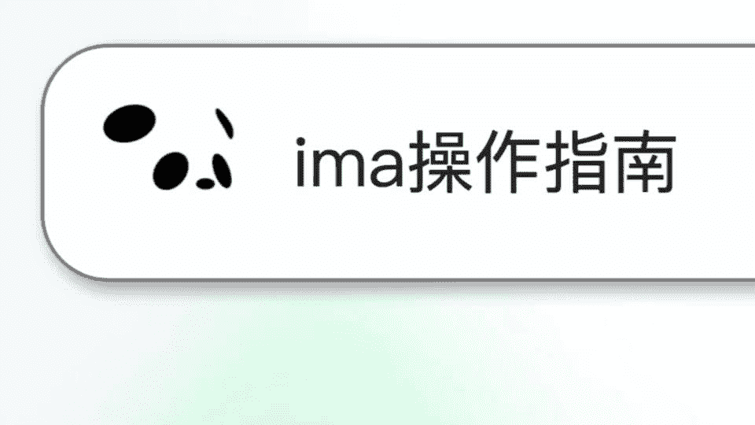

[ima操作指南.mp4](https://internal-api-drive-stream.feishu.cn/space/api/box/stream/download/all/UdfNbjbQdo2z6SxGdiuc6EK0naf)

## 1、什么是 IMA 知识库

Ima（腾讯AI智能工作台）是腾讯推出的一款集成了多种 AI 功能的工具，旨在帮助用户高效管理知识、提升工作效率的 AI 工具。就像给你的微信收藏夹和电脑文件装了个"AI秘书"，它能自动整理你收藏的文章、聊天文件、本地文档，还能用大模型帮你秒搜资料、写报告、做PPT。

## 2、适用人群

**IMA 知识库适用于多种**人群，包括学生、打工人、自媒体创作者等。

+   学生可以用它来整理论文资料、做笔记；

+   打工人可以用它来管理工作报告、会议记录；

+   自媒体创作者可以用它来收集创作灵感、整理素材。

## 3、Ima发布时间线

# 二、使用方法

## 1、注册与下载

1）**电脑端** ：打开 IMA 官网（<https://ima.qq.com/>），选择下载 Windows 或 Mac 版客户端。

2）**手机端** ：目前安卓用户可在应用宝搜索 “IMA 知识库” 下载，iOS 版本暂未上线，但可通过微信小程序搜索 “IMA 知识库” 使用部分功能。

手机端：微信直接搜小程序「IMA知识库」立即使用

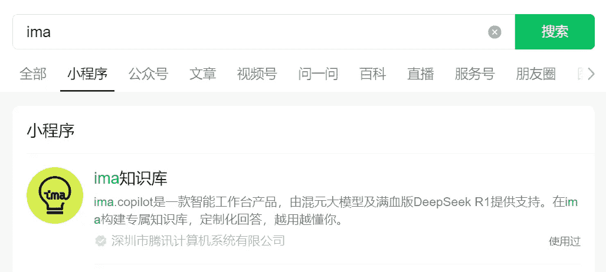

**PC端口：官网（****ima.qq.com****）下载客户端**

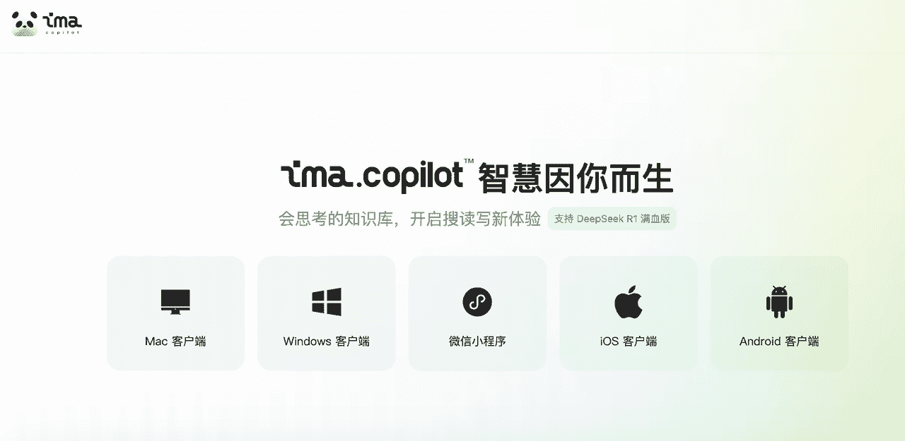

## 2、导入知识库

1）**微信文件导入** ：在微信聊天中长按文件，选择 “用 IMA 打开”，文件将自动解析并导入知识库。

2）**公众号文章收藏** ：阅读公众号文章时，点击右上角 “...”，选择 “保存到 IMA 知识库”，文章即可导入。

3）**本地文件上传** ：直接将 PDF、Word、图片等格式文件拖拽到 IMA 客户端，AI 会自动生成摘要。

4）**网页链接导入** ：复制网页链接，粘贴到 IMA 搜索框，可将网页内容导入知识库。

> 以下演示从公众号文章收藏到ima知识库的方法。

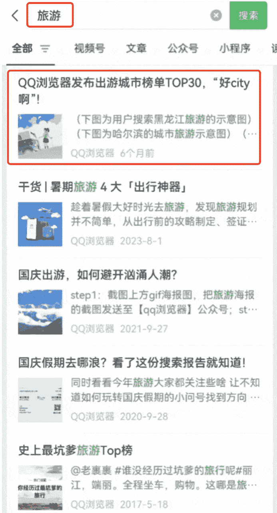

**第一步**

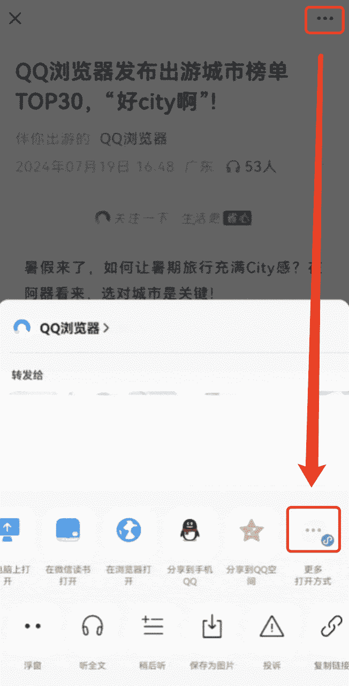

**第二步**

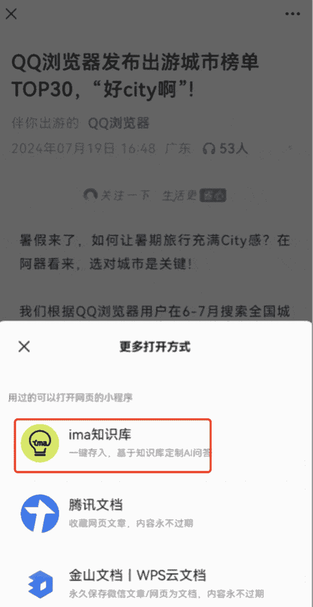

**第三步**

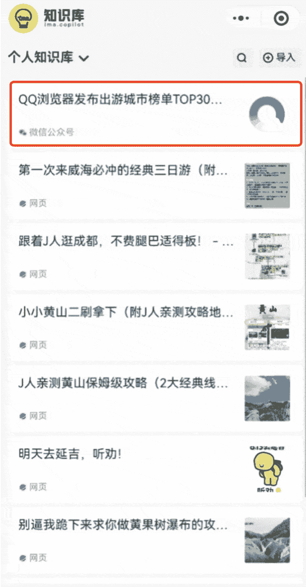

**第四步**

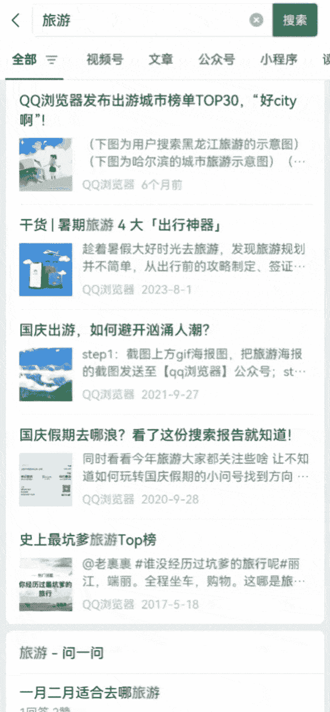

## 3、搜索与问答

1）**全网搜索** ：在 IMA 搜索框输入关键词，可选择腾讯混元大模型或 DeepSeek-R1 模型进行搜索，获取最新论文、公众号干货等内容。

2）**知识库搜索** ：从已导入的知识库中精准定位信息，即使模糊搜索也能找到，如 “那个关于猫的 PPT”。

3）**划词追问** ：选中文字，点击 “AI 解读”，大模型会为你深入讲解。

> **智能搜索（比百度快10倍）**

> • 输入模糊关键词（如"去年销售数据"）

> • 自动从你的文件里定位相关内容

> • 支持中英文混合搜索

## 4、智能写作

1）**论文写作** ：输入 “/” 触发 AI，让它帮你生成大纲、润色语句、整理参考文献。

2）**PPT 制作** ：上传需求文档，AI 提取关键数据，自动生成 PPT。

3）**文案创作** ：提供简单开头或关键词，AI 助你快速生成高质量文案。

> ** AI写作辅助**

> • 输入"/"触发功能：

> • 写邮件："/写催款邮件 语气礼貌"

> • 做PPT："/生成年终总结大纲"

> • 改文案："/把这段话改得更专业"

## 5、笔记功能

1）**记录笔记** ：在与 IMA 对话过程中，可一键将内容添加到笔记中，无需手动复制粘贴。

2）**AI 创作** ：在笔记中输入斜杠，唤起 AI 辅助创作，可进行起草文章大纲、翻译、续写等操作。

3）**AI 解读** ：选中笔记中的部分内容，使用 AI 解读功能深入理解。

> **文档解读黑科技，**上传100页PDF后：

> • 自动生成3句话摘要

> • 点击「生成脑图」得逻辑框架

> • 追问"第三章节数据来源？"

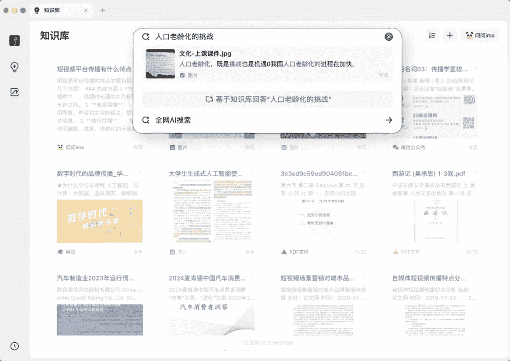

**知识库顶部框输入问题Ai问答**

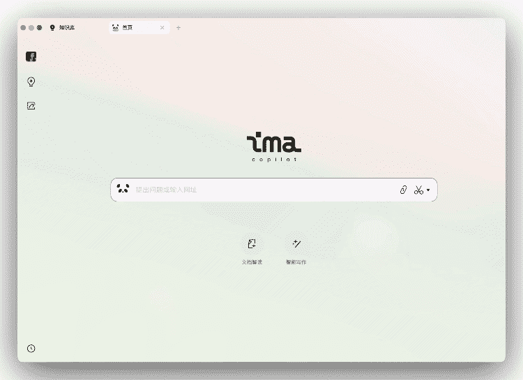

**提取文字内容**

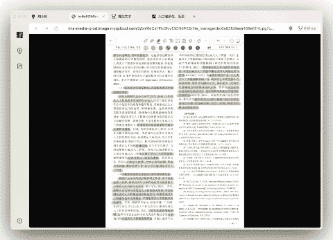

**解读图片内容**

## 6、共享知识库

**1）创建共享知识库 **：进入知识库页面，点击右上角加号，设置名称、封面、描述、问题等，从个人知识库或本地文件中导入内容，构建共享知识库。

**2）分享共享知识库 ：**通过分享链接、二维码，将共享知识库分享给他人，并进行成员管理、设置内容查看权限等。

> 在ima，你可以创建多个知识库，并把自己创建的知识库共享给他人，邀请其他成员加入，一起使用知识库。假如，以一个励志提前规划好25年旅行的 “阿J” 为例，他可以在ima做一个“热门城市旅游攻略”知识库。

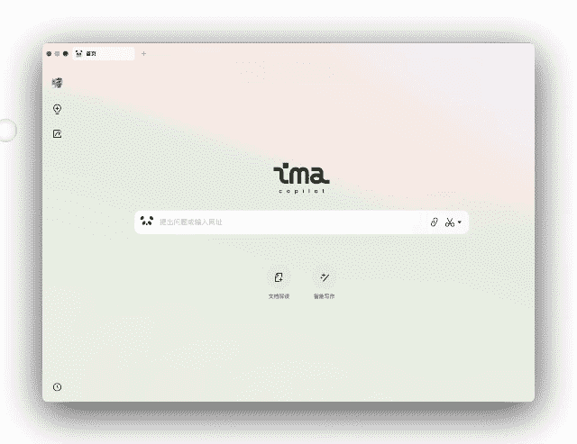

PC端创建共享知识库

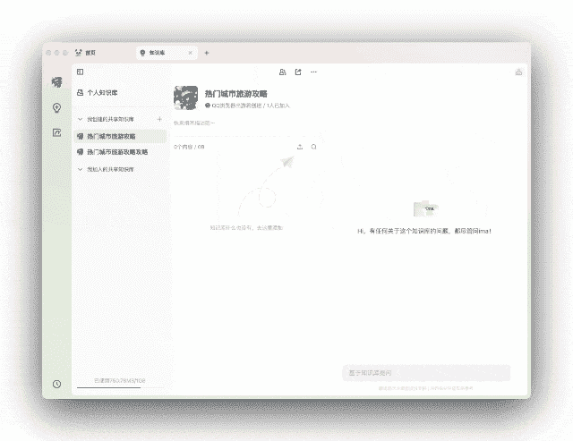

PC端共享知识库上传资料

# 三、使用技巧

## 1、高效整理知识库

1）**多层级分类与标签** ：根据主题、项目或场景灵活搭建知识框架，如将常用资料分为 “法规指南”、“会议文献”、“技术手册” 等类别，并通过标签快速定位内容。

2）**定期维护** ：每周整理归档旧内容，清理冗余，及时修正过时信息，确保准确性。

## 2、充分利用 AI 解读

1）**深入理解知识** ：在阅读文档或网页内容时，遇到不懂的概念或想了解更多相关信息，可选中文字使用 AI 解读功能。

2）**辅助学习** ：对于复杂的专业知识，AI 解读能帮助你快速理解，提高学习效率。

## 3、巧用智能写作

1）**快速生成初稿** ：在写作任务中，先让 AI 根据主题或关键词生成初稿，再进行修改完善，节省时间。

2）**多样化创作** ：利用 AI 的扩写、缩写、翻译等功能，丰富写作内容，提升写作质量。

PC端调用DeepSeek/混元大模型AI改写👇

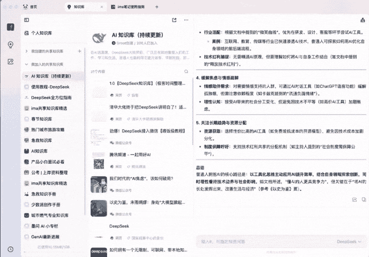

# 四、实操案例

## 1、学生写论文

1）**导入资料** ：将收集到的论文相关 PDF 文档、网页资料等导入 IMA 知识库。

2）**搜索关键信息** ：在写作过程中，通过 IMA 搜索功能快速找到所需的关键信息和引用文献。

3）**生成论文大纲** ：使用 AI 写作功能，输入论文主题和要求，让 AI 帮你生成论文大纲。

4）**润色与修改** ：完成初稿后，利用 AI 的润色功能，对论文进行语言优化，提高论文质量。

## 2、职场人士做 PPT

1）**收集素材** ：将与主题相关的报告、文章等资料导入知识库。

2）**提取关键数据** ：使用 IMA 的文档解读功能，快速提取关键数据和信息。

3）**生成 PPT** ：上传需求文档，AI 根据内容自动生成 PPT，再根据实际情况进行调整和美化。

## 3、自媒体创作者找灵感

1）**收藏爆文** ：将同类型自媒体账号的爆文链接导入知识库。

2）**分析结构与内容** ：利用 AI 解读功能，分析爆文的结构、写作手法和内容特点。

3）**生成选题灵感** ：根据分析结果，让 AI 帮你生成新的选题灵感，为创作提供思路。

# 五、场景应用

## 1、学习场景

1）**课堂笔记整理** ：学生在课堂上使用 IMA 记录笔记，课后利用 AI 功能进行整理和总结，加深对知识点的理解。

2）**文献研究** ：在进行学术研究时，将大量文献导入知识库，通过智能搜索和问答功能，快速找到所需信息，提高研究效率。

## 2、工作场景

1）**会议纪要管理** ：职场人士在会议结束后，将会议纪要导入知识库，方便日后查询和回顾。

2）**项目资料整合** ：在项目执行过程中，团队成员将相关资料导入共享知识库，实现信息共享和协同工作。

**场景案例👇**

[3月12日.mp4](https://internal-api-drive-stream.feishu.cn/space/api/box/stream/download/all/CaAUbsMfro71HLx6T7ccgGCMnlg)

## 3、生活场景

1）**美食推荐整理** ：将喜欢的美食推荐文章导入知识库，创建自己的美食知识库，方便查找和尝试新菜品。

2）**旅游攻略制作** ：在规划旅行时，将收集到的旅游攻略、景点介绍等资料导入知识库，利用 AI 写作功能生成个性化的旅游攻略。

# 六、大模型介绍

## 1、腾讯混元大模型

腾讯混元大模型是腾讯自主研发的预训练模型，具有以下特点：

1）**广泛的应用场景** ：适用于多种自然语言处理任务，如文本生成、问答系统、机器翻译等。

2）**高效的信息抓取** ：能够快速从大量文本中提取关键信息，为用户提供精准的答案。

3）**持续的学习能力** ：随着数据的不断更新和用户的使用反馈，模型能够持续优化和提升性能。

## 2、DeepSeek-R1 模型

DeepSeek-R1 模型是深度探索推出的预训练模型，其优势在于：

1）**长文本解析能力强** ：对于长篇幅的文本内容，能够进行深入的理解和分析，准确把握核心要点。

2）**专业领域优化** ：在特定的专业领域，如学术研究、行业分析等，表现出色，为用户提供更专业的知识支持。

3）**深度语义理解** ：基于先进的深度学习技术，能够更好地理解文本的语义信息，提高问答的准确性和相关性。

👇PC端调用DeepSeek/混元大模型

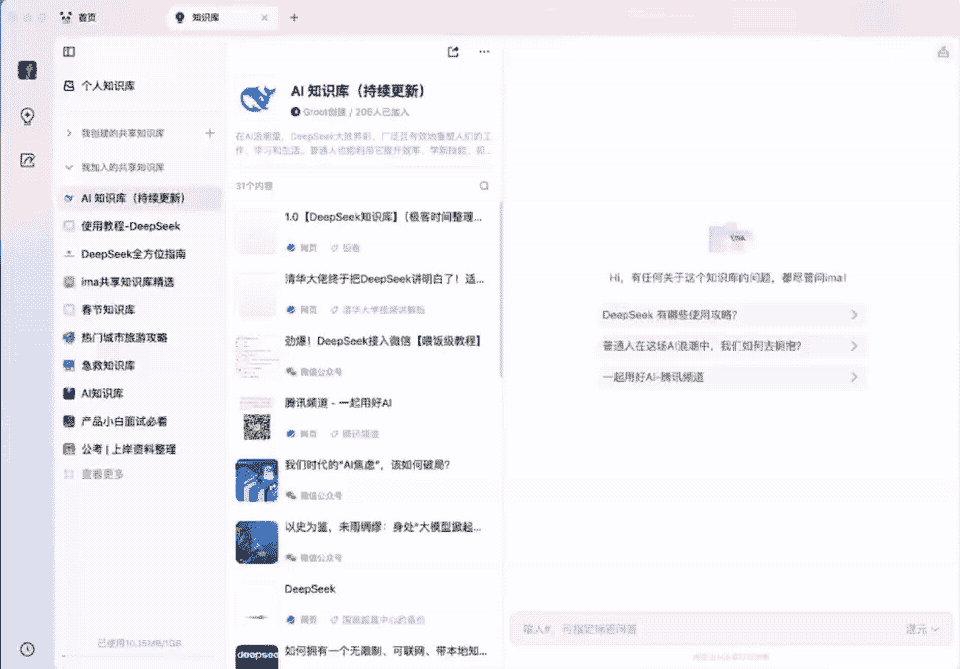

👇PC端调用DeepSeek/混元大模型

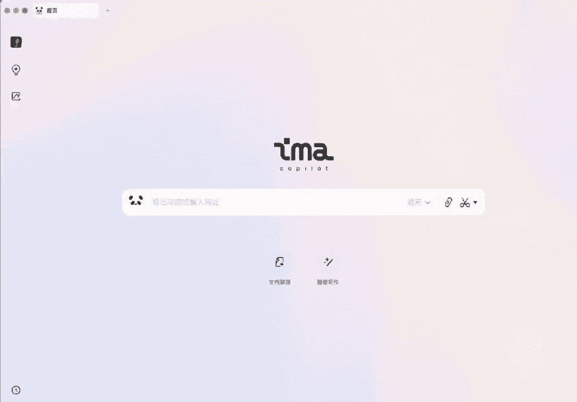

👇手机端调用DeepSeek/混元大模型

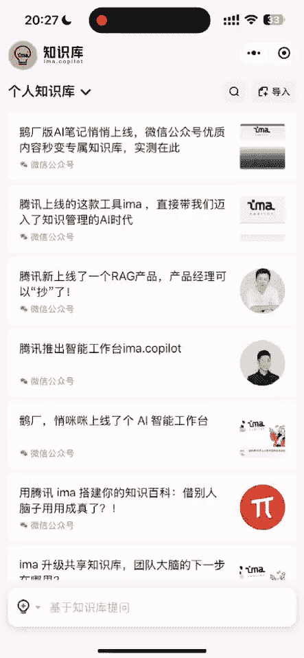

# 七、知识广场

## **1、发现知识库**

## **2、发布知识库**

**进入「知识库广场」可以看到不同领域的知识库**，也可以通过搜索发现自己感兴趣的知识库。

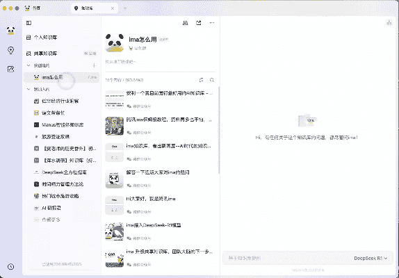

通过修改知识库权限，就可以把知识库发布到广场

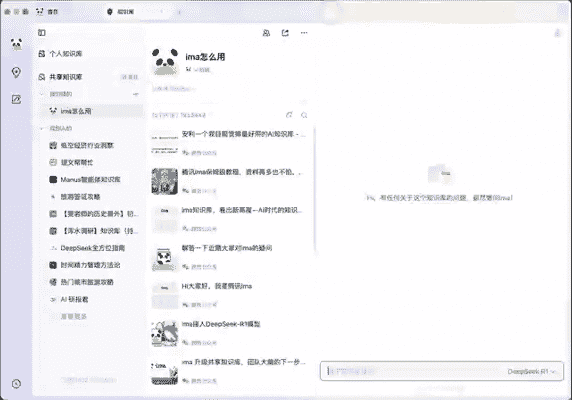

> ① 发布后该知识库将不再占用个人云存储空间；

> ② 单个共享知识库的成员人数上限扩大到100万。

> 「知识库广场」支持Windows、Mac、小程序及App多平台同步访问。

# 八、优质知识库推荐

# 九、数据与隐私安全

## 1、 ima 的知识库为什么要传到云端而不存在本地？

ima 将知识库数据存储在云端而非本地，主要基于以下考量：

**1）多设备同步与协作 **

云端存储支持 Windows、Mac 客户端及微信小程序多端实时同步，解决了传统本地存储跨设

备访问不便的问题。例如用户可在办公室电脑上传文档后，回家通过手机继续处理。

**2） AI 能力深度整合 **

云端架构便于直接调用腾讯混元大模型和 DeepSeek-R1 等 AI 能力，实现文档智能解读、知

识库问答等复杂功能。本地部署难以满足大模型对算力和数据实时更新的需求。

**3）在线内容获取 **

云端存储天然适配丰富的互联网在线内容生态，可以将全网优质内容（公众号、优质站点文章

等）一键加入，这种便捷性是本地存储无法实现的。

**4）降低使用门槛 **

云端方案避免了用户手动配置本地服务器或处理版本冲突，尤其适合非技术背景用户，云端方

案更符合多数用户需求。

## 2、 ima 个人知识库里面的资料是存在哪里的？

是否有丢失、泄露的风险？在存储上有什么安全保障？

1） ima 向用户提供在线知识库服务，用户可以将本地文档、收藏的网址、ima 在线笔记等添

加至知识库；添加至知识库的内容将被存储至云端服务器，以便用户基于知识库进行 AI 搜

索；

2）云端服务器通过对存储数据加密保证用户隐私，加密手段包括精细化权限控制，传输加

密，存储加密等，确保数据可以得到端到端全链路的安全防护，防止信息泄漏、不当使用、未经授权访问和披露，每个用户仅可管理和访问其有权限的数据。

3）腾讯云存储通过技术手段努力保障用户的数据安全，腾讯云 COS 通过对数据进行分布式

存储，以及自动化数据副本巡检和修复，防止数据丢失，文件丢失概率远低于百亿分之

一。

## 3、** 用户上传的资料是否会被用于 AI** 模型的训练？间接造成用户的数据泄漏。

用户上传或者个人知识库中的资料不会被用于 AI 模型的训练，

1）用户在 ima 上传的个人资料仅被用于用户的 AI 检索和 AI 推理使用，不会用于模型的训

练，所以不会造成数据的间接泄漏；

2） 不同用户个人知识库中的数据属于隔离状态，A 用户使用自己的个人知识库进行问答后，

A 用户个人知识库的数据不会被用于 B 用户的问答过程；

3）此外，ima 接入 DeepSeek 模型采用的是私有化本地部署方案，可以确保用户隐私安全，

使用 DeepSeek 模型时产生的相关数据，不会回传到 DeepSeek 模型的所属公司深度求

索。

## 4、 ima 会不会在后台非法获取用户的资料和信息？

不会，腾讯作为国内领先的互联网公司，严格遵守中国《网络安全法》、《个人信息保护法》等

明确的法律法规，在收集、存储和使用用户数据时遵循合法、正当、必要原则，在用户协议和

隐私政策中也明确标注了数据收集范围及用途，用户可以随时查阅。

## **5、用户创建的共享知识库，在共享和**使用过程中如何确保里面的数据文件不被别

## **人获取？ **

用户可以通过共享知识库的权限管理，来调整库中的资料是否可被其他成员获取：

1） 创建者如果不希望共享知识库中的文件被其他成员获取，可以在 PC 端登陆 ima 后，在创

建的共享知识库的权限管理中，关闭“成员可查看文件具体内容”这个选项，这样加入共享知识库的其他成员，可以使用该共享知识库，但无法获取其中的文件；

2） 如果创建者希望不再将共享知识库提供给加入的其他成员使用，也可以在共享知识库的权

限设置中，打开“将知识库转为私密”开关，其他用户将无法查看和使用该共享知识库。

# 十、Ima常见问题Q&A

## **Q：共享知识库是什么？ **

**A：**ima 共享知识库是支持多人加入、共建、使用的知识体系，内容包括创建者与管理员所上

传的文件、图片、浏览时收藏的网页、撰写并收藏的小笔记等。共享知识库成员可以在知识库

内便捷地检索需要的知识资源，也可以随时根据共享知识库中的内容问问 ima，输出个性化的

回答。通过创建/分享/加入共享知识库，ima 助你打造多人共享的知识库体系，让知识流动起

来。

## Q：共享知识库中文件具体内容的查看权限可以设置吗？

**A：**创建者或管理员可以对共享知识库进行权限设置。

具体的设置方式如下：

1.  首先点击共享知识库页面顶部的“···”按键弹出菜单中，选择“权限管理”；

1.  在权限管理菜单栏，可以通过切换开关状态来调整权限。

1.  包括成员是否可查看文件具体内 容、成员加入知识库是否需要确认、知识库是否仅自己可见。

目前权限设置需要在 PC 端或移动 APP 进行。

## Q：共享知识库如何分享给别人？

**A：**共享知识库支持分享，具体的分享方式为：在想分享的知识库页面，点击顶部的分享按

键；

+   若想以链接形式分享，则点击“复制链接“，随后即可粘贴链接到想要分享到的位置；

+   若想以图片形式分享，则点击“生成二维码”，二维码生成成功后点击底部“保存二维码”即可保存下载知识库的二维码分享图。

在复制链接/生成二维码前，还可以点击“权限设置”来设置知识库在分享后，库中内容的查看范

围权限。 你也可以通过 ima 知识库小程序，直接把知识库分享到聊天或者朋友圈。

## Q：在 ima 里如何针对知识库提问？

A：PC 端：在 pc 端，有两种可以针对知识库提问的方式。

+   方式一：进入想要提问的知识库页面，在底部输入框内，输入具体问题并发送，即可基于知识库内容发起提问；

+   方式二：在 ima 首页进行问答时，当输入问题并发送后，在问答页面顶部可以点击选择“基于知识库”按键，即可切换至针对个人知识库进行问答。

**小程序：**打开 ima 知识库小程序，进入想要提问的知识库；在知识库页面底部的输入框内，输入问题并发送，即可开启基于当前知识库内容的问答。

**移动 APP：**打开 ima 移动 APP，进入想要提问的知识库；在知识库页面底部的输入框内，输入问题并发送，即可开启基于当前知识库内容的问答。

## Q：如何针对知识库标签内容提问？

**A：**在 pc 端，对于有标签的知识库，进入知识库后在知识库页面底部输入框内输入符号“#”，

即可唤起标签列表；在标签列表内选择一个或多个想要圈选提问的标签后，再输入具体想提出

的问题，即可针对指定标签内容开启问答。

## Q：ima 知识库小程序可以问全网吗？

**A：**ima 知识库小程序可以切换基于全网或基于知识库提问~

具体的切换方式为：在 ima 知识库小程序页面，点击页面底部输入框左侧的知识库小灯泡图

标，在列表中选择“问全网”后，即可切换至基于全网内容提问。

## Q：ima 笔记支持的 markdown 格式有哪些？

**A：**笔记支持多类 markdown 格式，如标题、列表、字体样式、代码、表格、公式、引用等。

## Q：微信内有想收藏的内容，如何快速导入 ima？

A：

+   首次使用时：

1、在微信搜索“ima 知识库”小程序

2、进入“ima 知识库”小程序后，在小程序页面点击右上角“导入”

3、选择微信文件/本地相册/拍照，完成对应内容的导入

+   首次使用后：

1、若在微信看到好内容，在浏览页面点击右上角“···”按键

2、在系统菜单栏内点击“更多打开方式”3、选择用“ima 知识库”小程序打开，就可以把内容存入你的个人知识库啦

## Q：ima 有网页版/手机 APP/插件版/小程序版本吗？

**A：**ima 目前支持 Mac、Windows、安卓、微信小程序版本，iOS 版本正在苹果审核中，其他更多版本敬请期待~

## Q：怎么在知识库里上传文档/知识库内容如何导入？

**A：**PC 端有两种方式可以将内容加入知识库：

1）上传本地文件：目前支持上传 pdf、docx 格式的内容至知识库；

2）收藏浏览内容：除了本地上传，也可以在网页浏览、AI 对话、笔记写作的过程中随时点击右上角的「加入知识库」收藏有价值的信息。

目前也上线了 ima 知识库微信小程序，可以通过小程序导入内容到个人知识库。

具体方式：

1）在微信搜索“ima 知识库”小程序；进入“ima 知识库”小程序后，点击右上角“导入”，即可选择微信文件/本地相册/拍照，完成对应内容的导入。

2）首次使用后，若在微信看到好内容，点击右上角“···”，点击“更多打开方式”，选择用“ima知识库”小程序打开，就可以把内容存入你的个人知识库。

## Q：怎么添加网页/公众号文章到知识库？

**A：**

1、**ima PC 客户端 **

1）打开网页：可以通过复制网页的 URL 到 ima 首页的输入框并回车打开，或者通过问答结果页的网页来源点击打开。

2）收藏网页：在打开的网页上，点击右上角的小灯泡图标，即可将网页收藏到知识库。

2、**ima 移动 APP **

1）打开网页：可以通过复制网页的 URL 到 ima 首页的输入框打开，或者通过问答结果页的网页来源点击打开；

2）收藏网页：在打开的网页上，点击右上角的图标，可将网页收藏到知识库。

3、**ima 知识库小程序 **

1）在微信看到想收藏的网页，在浏览页面点击右上角“···”按键；

2）在系统菜单栏内点击“更多打开方式”；

3）选择用“ima 知识库”小程序打开，就可以把网页内容存入你的个人知识库。

如果没有找到，可以先在微信中搜索“ima 知识库“小程序，添加到我的小程序中。

通过以上方法，你可以方便地将网页内容导入到 ima 知识库中进行管理和利用。

## Q：为什么在基于知识库回答时，提示没有找到相关内容？

**A：**知识库回答依赖知识库中的内容，可能是当前知识库中，没有问题相关内容。可以试试「问全网」，收集更多相关优质信源，丰富你的知识体系~

## **Q**：知识库内容可以添加标签吗/知识库怎么添加标签/怎么给自己在知识库里的文档进行分类/知识库支持文件夹么？

**A：**目前有两种操作方式，可对知识库内容打标签，单个和批量操作均支持

1、在 PC ima 客户端操作，步骤如下：

a. 找到对应文档

b. 点击文档右上角的更多..图标，或者直接框选想打标的文档

c. 在弹出选项中，选择「编辑标签」即可

2、在 ima 知识库微信小程序中操作，步骤如下

a. 找到对应文档

b. 侧滑或者长按选中

c. 在弹出选项中，点击“标签”图标即可

打标签完成之后，就可以通过在知识库顶部的搜索框中输入标签名，来筛选对应标签下的内容，也可以针对标签内容发起提问。

## Q：如何减少知识库空间占用/如何高效利用知识库容量？

**A：**目前知识库支持 2G 空间，为了高效利用知识库容量，可以采取以下几种方法：

1、**清理不必要的内容：**删除不再需要或过时的内容，删除无知识信息的内容，知识库好的问答输出，依赖于高质量的内容输入；

2、**文件压缩**：上传图片尽量采用 jpg 压缩格式，上传文档尽量采用文本文档，比扫描件更省空间且效果更好；

3、**采用共享知识库**：如果知识库内容是团队共用的，可以考虑设置共享权限，让团队成员共同管理和使用。共享知识库仅占用创建者空间容量，不占用管理员/普通成员空间。后续也会有扩容方案，更好满足使用需求。

## **Q：知识库支持哪些格式？ **

**A：**目前个人知识库支持上传 pdf、docx 文档格式和 png、jpg、jpeg 图片格式，及在 ima 中收藏网页/公众号文章/AI 问答/ima 笔记；共享知识库支持 PDF、doc、docx、png、jpg、jpeg、网页、公众号文章。

## **Q：ima 笔记有哪些功能？ **

**A：**笔记支持基础的文本编辑、字号/格式设置，支持跨设备云端同步，支持 20 余种markdown、表格、图片等内容格式。此外，笔记还支持 AI 缩写、AI 扩写、AI 翻译及自定义指令辅助写作，甚至可以试试/唤起 ima，让 ima 帮你画图哦。

## Q：PC 端问问 ima 侧边栏如何使用？

**A：**在浏览网页、文档、笔记的过程中，可以随时点击右上角的「问问 ima」唤起侧边栏伴读，你可以在侧边栏中对左侧的阅读内容进行问答，让 ima 帮你总结、解读和答疑解惑。

## Q：PC 端 Mac 版和 Windows 版分别支持哪些系统版本？

**A：**

1）PC Mac 端，macOS11 及以上版本即可使用 ima；

2）PC Windows 端，Win10 及以上版本即可使用 ima；

如果你的电脑是低系统版本，升级之后即可正常安装 ima 使用。

## Q：同一个共享知识库成员，是否能看到其他人的提问？

**A：**目前提问和回答仅提问者本人可见，其他人无法看到（包括创建者和管理员），以更好保护用户隐私。

## Q：目前 ima 客户端最新版本是多少？

**A：**PC Mac 端，最新版本号 1.3.2；

PC windows 端，最新版本号 1.3.2；

手机安卓端，最新版本号 1.0.0；

访问官方网站 ima.qq.com，即可查看下载最新版本

希望本手册能够帮助你更好地使用腾讯 IMA 知识库，提高信息管理效率，开启智能工作与学习的新篇章！