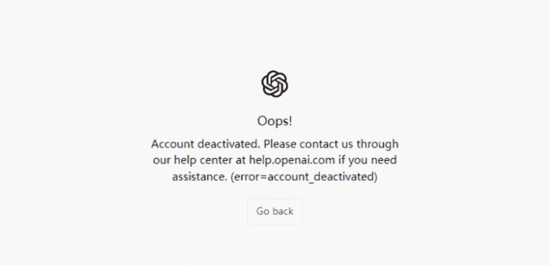
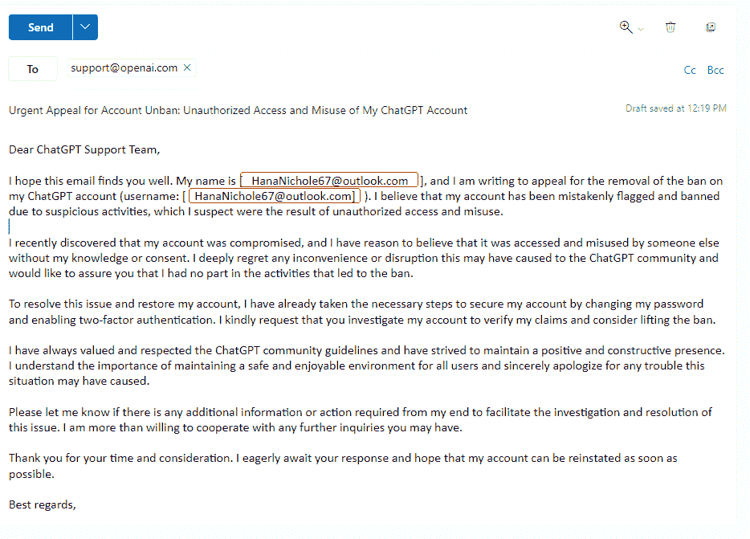
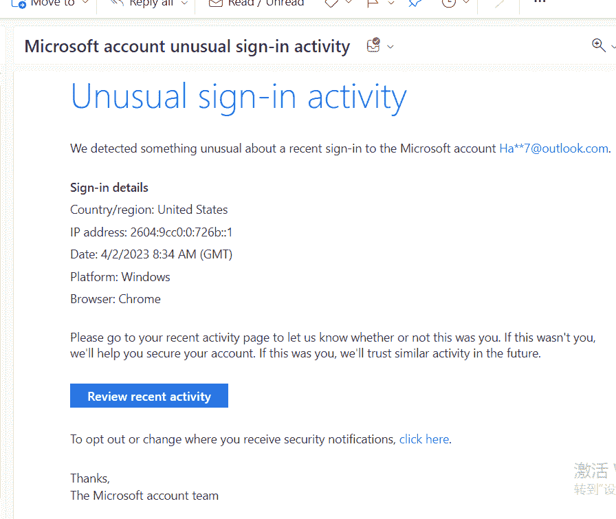
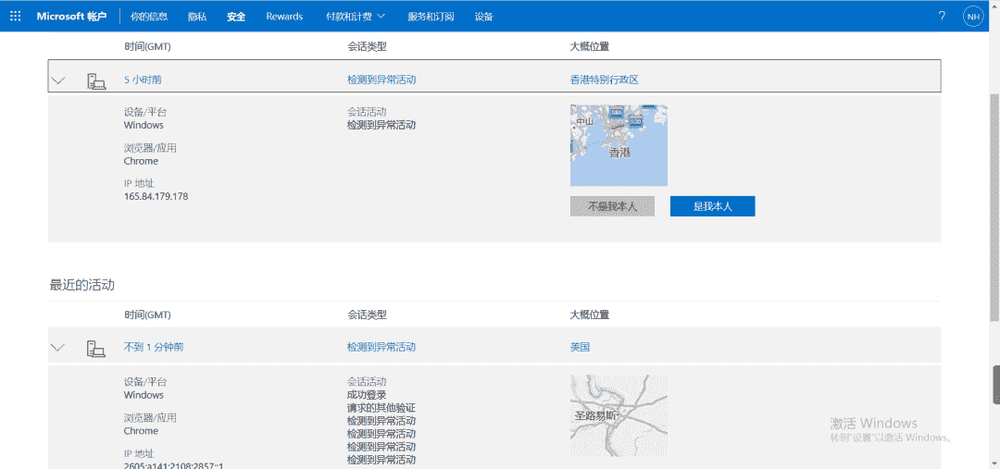
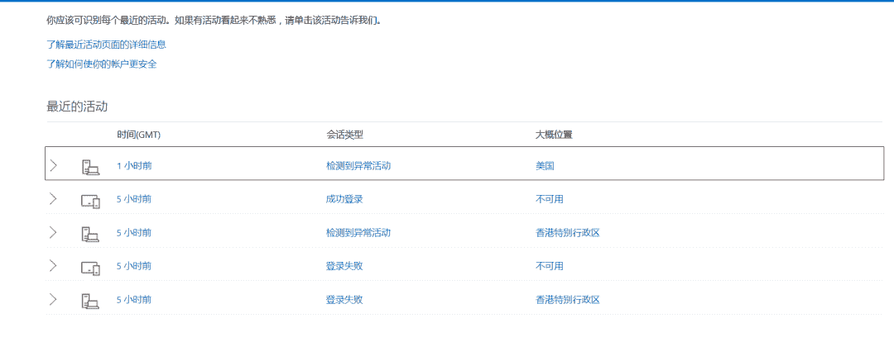
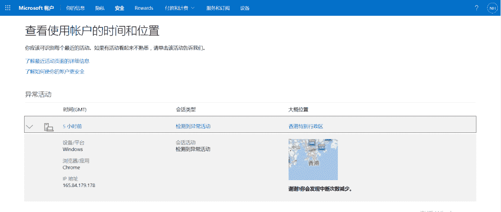

# Chatgpt解封攻略

> 来源：[https://aiyanxishe.feishu.cn/docx/X7x9doDteo2Kr5xibvIcCFIgnGe](https://aiyanxishe.feishu.cn/docx/X7x9doDteo2Kr5xibvIcCFIgnGe)

今天很多网友反馈 #Chatpgt被封，不管你是普通账号还是plus账号，都会面临被封的风险，大家不要慌，下面紧急启动了一个解封攻略，送上保姆级的解封教程，帮助大家快速解封。

## 了解ChatGPT封号政策

首先我们要了解ChatGPT官方发布的封号政策。由于 ChatGPT 相对较新(于 2022 年 11 月推出)，使用政策可能会随着新滥用方法的出现而改变。如果您想继续使用 ChatGPT，请务必遵循这些准则。目前，OpenAI 不允许以下任何一种:

+   非法活动

+   儿童性虐待材料或任何剥削或伤害儿童的内容

+   产生仇恨、骚扰或暴力内容

+   恶意软件的产生

+   身体伤害风险高的活动

+   具有高经济危害风险的活动。

+   欺诈或欺骗活动

+   成人内容、成人产业和约会应用

+   政治竞选或游说

+   侵犯他人隐私的活动

+   从事未经授权的法律实践，或在没有合格人员审查信息的情况下提供量身定制的法律建议

+   在没有合格人员审查信息的情况下提供量身定制的财务建议告诉某人他们有或没有某种健康状况，或提供有关如何治愈或治疗健康状况的说明

+   高风险政府决策

对应看下自己可能触碰了哪个红线，然后进行以下操作。

## 第一步：写一封英文邮件进行申诉:

告诉官方这是误会，如果你英文不好给大家准备7保姆级别的英文模版专业的人做专业的事情，当粉丝遇到问题，第一时间奉上给力的教程。

+   把邮箱账号和姓名复制到中英文模板

+   登录其他的邮箱，利用这个邮箱发送模板到需要申诉的邮箱：support@openai.com

主题：紧急呼吁解禁帐户：未经授权访问和滥用我的 ChatGPT 帐户

亲爱的 ChatGPT 支持团队，

我希望你能收到这封电子邮件。我的名字是 [你的邮箱名字]，我写信是希望取消对我的 ChatGPT 帐户（用户名：[你的邮箱名字]）的禁令。我认为我的帐户因可疑活动而被错误标记和禁止，我怀疑这是未经授权访问和滥用的结果。

我最近发现我的帐户遭到入侵，我有理由相信它在我不知情或未同意的情况下被其他人访问和滥用。我对这可能给 ChatGPT 社区造成的任何不便或中断深表歉意，并向您保证我没有参与导致禁令的活动。

为解决此问题并恢复我的帐户，我已采取必要步骤通过更改密码和启用双因素身份验证来保护我的帐户。我恳请您调查我的帐户以核实我的说法并考虑解除禁令。

我一直重视并尊重 ChatGPT 社区准则，并努力保持积极和建设性的存在。我理解为所有用户维护一个安全和愉快的环境的重要性，并对这种情况可能造成的任何麻烦深表歉意。

如果我需要任何其他信息或采取任何行动以促进调查和解决此问题，请告诉我。我非常愿意配合您的任何进一步询问。

感谢您的时间和考虑。我热切地等待您的回复，并希望我的帐户能尽快恢复。

此致，

> 英文版内容，可以复制使用

>

> Subject: Urgent Appeal for Account Unban: Unauthorized Access and Misuse of My ChatGPT AccountDear ChatGPT Support Team,

> hope this email finds you well. My name is[ Your Name箱名字], andl am writing to appeal for the removalof the ban on my ChatGPT account (username: [ Your Username邮箱名字]). Ibelieve that my account hasbeen mistakenly flagged and banned due to suspicious activities, which I suspect were the result ofunauthorized access and misuse.

> i recently discovered that my account was compromised, and I have reason to believe that it was accessedand misused by someone else without my knowledge or consent. I deeply regret any inconvenience ordisruption this may have caused to the ChatGPT community and would like to assure you that I had no partin the activities that led to the ban.

> To resolve this issue and restore my account, I have already taken the necessary steps to secure my accountby changing my password and enabling two-factor authentication.  kindly request that you investigate myaccount to verify my claims and consider lifting the ban.

> I have always valued and respected the ChatGPT community guidelines and have strived to maintain apositive and constructive presence. I understand the importance of maintaining a safe and enjoyableenvironment for all users and sincerely apologize for any trouble this situation may have caused.

> Please let me know if there is any additional information or action required from my end to facilitate theinvestigation and resolution of this issue. I am more than willing to cooperate with any further inquiries youmay have.

> Thank you for your time and consideration. I eagerly await your response and hope that my account can bereinstated as soon as possible.

> Best regards.

## **第二步：等待官方回复**

让你确认你的活动轨迹，这个时候，你要告诉官方，这个绝壁是一个骗局，请官方爸爸给条条活动路。

收到这个邮件，兄弟们淡定的点进去，有一个地图，我插，是香港的IP

大家懂得，梯子不稳定，点进去地图你就知道了，有香港的ip记录

## 第三步：官方二次交涉

让你确认你的活动轨迹，明确告诉官方，未曾使用过香港IP，不知道为什么会被检测到，请官方明鉴并给予解封。

二次交涉需要多次发送请求，可以用ChatGPT帮你生成3封解封邮件，分时多次投递给官方邮箱，情节不严重的一般3次就可以顺利解封，邮件参考内容如下。

主题：我从未使用过香港的IP地址，请官方给予解封

尊敬的客服：

我发现我的 Chatgpt 账户被封了，但是我向您保证，我从未使用过香港的IP地址。我非常确定我未曾使用过该地区的IP地址，并且我一直遵守着 Chatgpt 的规定和要求。我非常重视我的账户和与 Chatgpt 的合作，因此我希望能够得到官方的支持和帮助，以解决这个问题。

我需要官方对账户封禁的原因进行明确说明，同时也希望能够尽快解封我的账户。我相信，这个问题是可以通过有效的沟通和合作来解决的。

谢谢您的耐心阅读，期待您的回复。

此致

敬礼

> [你的邮箱]

> 

> I have never used an IP address from Hong Kong. Please unblock my account as soon as possible.

> Respected Customer Service,

> I have discovered that my Chatgpt account has been blocked, but I assure you that I have never used an IP address from Hong Kong. I am positive that I have never used an IP address from that region, and I have always followed the rules and requirements of Chatgpt. I value my account and the partnership with Chatgpt, and I hope to receive your support and assistance in resolving this issue.

> I need an explanation from the company as to why my account has been blocked, and I also hope that my account can be unblocked as soon as possible. I believe that this issue can be resolved through effective communication and cooperation.

> Thank you for your time and attention to this matter. I look forward to hearing back from you soon.

> Sincerely,

> [Your Email]

>

[

祝大家早日解封，另](https://zl49so8lbq.feishu.cn/wiki/wikcnMEVynrv6f4RAAJzoZUFpHe)外大家在被封期间也可以免费使用👉 ChatGPT国内版，里面收录了30余个ChatGPT替代网址。

# 🎊 C[hatGPT国内版](https://zl49so8lbq.feishu.cn/wiki/wikcnMEVynrv6f4RAAJzoZUFpHe)

https://chat.theb.ai

https://chatgpt-35-turbo.com

https://freegpt.one

https://chat.tgbot.co

https://freegpt.cc

https://fastgpt.app

https://freechatgpt.lol

GPT-4在线体验

https://poe.com/gpt-4

本文由[**AI研习社**](https://zl49so8lbq.feishu.cn/wiki/wikcnu3kSXr75E50w8PFefhJMYf)整理发布，AI研习社是一个AI行业研究专题知识兴趣小组，目前分享包含： AI工具使用、AI商业模式研究、AI行业研究报告、AI经验分享、大厂动态等专题内容，包含ChatGPT、MidJourney等主流工具使用说明，通过知识手册的方式帮助大家构建系统化的AI知识库，让更多人可以轻松学习使用AI技术。

扫描二维码，加入[**AI研习社**](https://zl49so8lbq.feishu.cn/wiki/wikcnu3kSXr75E50w8PFefhJMYf)** **