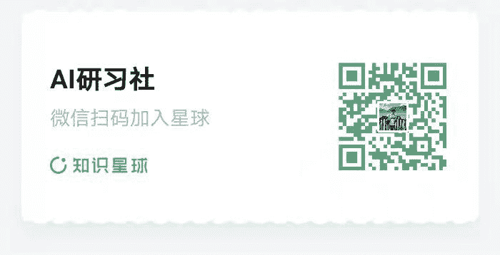

# 22个国内AI绘画网站汇总【免费+付费】

> 来源：[https://aiyanxishe.feishu.cn/docx/Uaaidf4Mro82FFx8ucic8MUOnBf](https://aiyanxishe.feishu.cn/docx/Uaaidf4Mro82FFx8ucic8MUOnBf)

🎨挑战MidJourney和Stable Diffusion，22个国内AI绘画网站汇总，让你画出超级赞的艺术作品！无论你是新手还是老手，都可以轻松上手的哦！赶快看看以下这些AI绘画网站吧！🎨

## 1、6pen art【部分免费】

手机网页版，电脑也可上网址： https://6pen.art

6pen Art 是一款由面包多团队开发的 AI 绘画平台。6pen 基于 AI 技术，让你的文本描述变成绘画艺术作品。并可将你生成的作品投稿到有奖展览，在社区中展示，以创造更多价值。点击上方链接直达即可访问 6pen art 官网！

平台支持中英文，直接输入中文描述词，更简单直接的体验 AI 艺术的魅力。

6pen 能免费使用吗？

可以免费使用，你每天可免费使用西瓜(无论大小)5 次，南瓜次数无限制，其中大西瓜模型因过于耗时而限制了生成图片的尺寸，小西瓜不受影响。免费通道， 一切都是免费的，但不同模型耗时存在比较大的差异，请根据需求选择合适的模 型！如果你有更高的需求，如对生成速度有要求，则需要充值点数进行加速。

在 6pen，你可以任意选用深度优化的 disco diffusion 引擎，广受赞誉的Stable Diffusion 引擎，以及 6pen 自研的小模型引擎，生成精彩的 AI 绘画作品，并在社区和画展中展示。你可自由调配模型，随机种子，参考图，分辨率， 风格修饰，艺术家，以达到更佳效果。在合适的文本描述和风格修饰下，6pen  可以实现不输于 midjourney 甚至 DallE2 的效果。

6pen 生成的图片版权有版权吗？

6pen 不保留任何版权，生成的图片版权都归属生成者，可随意自用商用（但在某些特殊情况下，图片版权可能遵循 CC0 协议，但你仍可自用和商用）

6pen 使用方法：

直接打开网站即可开始使用，注册登录才可以进行 AI 绘画哦！登录后，点击右下角加号，进入创建绘画界面，然后输入描述词，选择模式、画面类型、风格修饰、艺术家等选项即可生成画作！界面如下图所示：

## 2、Draft【目前免费】

手机电脑都可以登录网页使用

网址:https://draft.art/refer=z2omlj

这款国产 Ai 绘画产品中英文都支持，让大家轻松。创作使用非常简单，移动端

/pc 端输入网址即可使用，无需下载。

生成速度也相当不错，快的话，只要十秒就能出图。另外，社区提供瀑布流素材， 可以带来灵感创意。

## 3、KK 画廊【付费】

扫码或微信搜索公众号：KK 画廊 【付费】

KK 画廊便是一个中文 AI 绘画生成程序，你直接输入中文描述就能生成你想要的图片，非常方便，不懂英文，也能愉快玩 AI 绘图！当然，它同样支持英文输入， 有时候中文不好去描述的可以用英文来表达。

注册成功并登录之后，直接点击首页+号即可开始创作！这里可以选择不同的模型，根据你的需求选择！

KK 画廊不同模型的含义：

Novel  SD  不限于生成二次元，人物动物，风景也不错

SD 模型基于 Stable Diffusion，它的生成速度极快，适合生成人物、动物和一些比较写实的景物。

DD 模型基于 Disco Diffusion，它生成速度较慢，但在合适的描述文本下，能实现出很精彩的画面，同时 DD 模型也能

理解更多的描述关键词，艺术家，风格修饰等（不建议画人物和动物）。

CP 模型， 有固定关键词，出图速度快，出图质量很高，适合新人小白。

KK 画廊常见问题解答：

1、KK 画廊生成出来的图片，版权归谁?

所使用的 Al 模型，都采用 MIT 协议开源，在此基础上，我们进行深度定制，并将生成出来的图片版权，完全授权给生成者本人。

2、KK 画廊怎么生成更好看的图片?

如果你使用的是 DD 模型，请选择艺术家以及风格，然后上传参考图如果你使用的是 SD 模型，请输入清晰的文字表达。

3、KK 画廊模型之间的区别是什么?

就是步数的区别。

4、为什么有时候预计生成时间这么长?

基于 AI 去生成的图片是—件极为消耗显卡算力的工作。

如果你想在抖音快手等图片，做一个美图美景账号，可以使用此工具，目前还处于风口期！

## 4、TIAMAT AI【目前公测免费】

Tiamat 是由国内团队研发的一款人工智能绘画工具，目前 Tiamat 小程序版已经公测上线，网页版还没有上线。

直接在微信搜索 TIAMAT AI 小程序，即可使用小程序版 Tiamat 进行 AI 绘画！目前使用小程序注册登录即赠送 500 画力值，可用于 AI 绘画生成图片！

不过据了解，该平台 AI 创作的画作确实不错！过段时间网页版正式上线后，届时大家可以在网页版尝试体验！目前请先使用微信小程序进行 AI 绘画！

Tiamat 其实相当于支持中文的强化版 Disco Diffusion，生成图片的速度非常快，操作也很简单。输入关键词，然后等待 5 分钟就可以一幅不错的艺术画作。同时， 大家还可以调整类似生成数量、图片比例等简单参数指令。

这款工具还有一个更高阶的玩法，可以以某张照片或草稿图作为垫图，让 AI 基于这张垫图进行二次创作。

目前公测阶段画力值免费！

如果你的画力值即将用完，可以填写这个问卷来申请哦： https://wenjuan.feishu.cn/m/cfm?t=sVDO2WsXO7Gi-rt3d 对小 Tia 有什么意见或者建议？欢迎来和我们聊聊！

https://tiamat-ai.feishu.cn/share/base/shrcnKwIai1qs6qhTpajZMlAeOg

想体验 Tiamat 的更多模型？也欢迎来申请我们的专业社群！

https://tiamat-ai.feishu.cn/share/base/form/shrcnozQsZBAzIHDgkX2zjIM7 dc

## 5、百度：文心一格【目前免费】

地址：https://yige.baidu.com/

百度出品，基于百度文心大模型能力的 AI 艺术和倡议辅助平台，不仅使用简单， 图像生成速度也极快。

画作由人工智能生成，用户只需输入语言描述就可以生成不同风格、独一无二的创意画作，为设计提供灵感、为创作带来更多创意。

只需要输入一句话，并选择方向、风格、尺寸，AI 就可以生成画作。不同的文字、方向、风格，会带来不同的效果。

不同方向下 AI 擅长的能力不同，可以结合你的需要选择合适的方向。

如果不知道选什么，大家可以试试【智能推荐】，工具会自动生成多种风格画作供参考。

平台还提供了生成画作的应用场景。

目前百度文心一格还处于公测阶段，需要申请公测权限，大家直接点击申请即可， 一般都会通过！

目前还在公测中，由于使用人数较多，可能生成画作需要排队！

## 6、百度：文心大模型【目前免费】

网址：https://wenxin.baidu.com/moduleApi/ernieVilg

使用：每个账号单日体验上限 100 次，历史累计体验次数 500 次

算是飞浆·文心大模型中的一项简单的功能，操作不复杂，只需要添加关键词、描述和尺寸就能生成 AI 绘画，一次可以生成多张也是一个特点。

##  7、无界版图【每天免费 15 次+付费】

无界版图是一个数字版权在线拍卖平台，此外其提供了强大的 AI 创作能力，可以方便的进行 AI 绘画！也就是最近抖音很火的 AI 绘图壁纸，使用这个工具便可以轻松制作！支持电脑和手机！支持中英文输入。建议使用手机访问，这样随时随地 AI 做图！

每天 15 次免费生成额度，次数用完之后可使用积分购买次数，实名认证送 100

积分，绑定银行卡再送 150 积分。足够你使用很久了！

使用方法：

首先使用手机浏览器或者微信扫描下面的二维码进行注册，注册完成后将提示你下载手机 APP，下载 APP 并安装，然后登录就可以开始使用了！

##  8、盗梦师【免费次数+付费】

网页版：https://printidea.art/

盗梦师 Printidea，是—款基于 Al 算法，可将文字描述转变成高质量图片的 AI 绘画工具，是由西湖大学深度学习实验室和西湖心辰联合出品的国产 AI 绘画工具！超强算力，超快出图。

目前支持微信小程序和网页端等。AI 一下，妙笔生画，只需一句话，让你的文字变成画作！

盗梦师生成速度极快，中文输入，五到十秒钟就可以生成一副画面！不用调节各种参数，不需要漫长的等待即可快速得到结果！每天签到、分享、看广告均可获取盗梦星，盗梦星可用来，生成图片！

我生成的图片版权归谁?

生成的图片版权归生成此图片的平台用户所有。本平台（"“盗梦师小程序)中、所有素材图片作品均是平台用户自行生成、分享并拥有版权或使用权，仅供网友学习交流，未经上传用户书面授权，请勿作他用。平台不拥有此类素材图片的版权，若需商业使用，需获得版权拥有者授权，并遵循国家相关法律、法规之规定。如因非法使用他人生成图片引起的纠纷，一切后果由使用者自负。

## 9、意间 AI 绘画【免费次数+付费】

微信小程序：意间 Ai 绘画

全中文 AI 绘画创意云，激发无限灵感创造新世界支持 stable diffusion 引擎

支持 disco diffusion 引擎

支持 ACGN diffusion 引擎(Animation,Comic,Game,Novel)

意间 AI 绘画是一个全中文 AI 绘画创意云。是属于国内的， 支持 stable diffusion 引擎，支持 disco diffusion 引擎。可快速出图， 支持自由创作。版权待确定核实。

输入对应文字描述，通过 AI 算法生产对应的艺术风格的图片。可以选择多个关键字，艺术家，画面风格，画面与文本的匹配程度，图片比例 等，最后，一键生成图片，速度快。

生成 1 次图片消耗 1 个积分，积分可以每日登录领取，看视频领取，邀请好友领取，也可以付费购买。

## 10、PAI AI 绘画【目前免费】

地址：https://artpai.xyz/

PAI 是一个 AI 绘画生成网站，网站界面很简单，没有花里胡哨无关紧要的东西， 非常容易上手，打开网站输入你想生成的

画面描述，然后进行简单设置，就可以生成画面！麻雀虽小五脏俱全，AI 绘图所用到的各种功能都有！

PAI AI 绘图使用方法：

①输入你想生成的画面关键词！

②根据需求选择不同的分辨率，比如横版、竖版、或者正方形等

③你也可以上传参考图让 AI 以你的图片为参考进行绘图！

④点开高级设置，可以对画面类型、画面风格、画面艺术家进行详细的设置！ 值得一提的是，该网站中的 PAI 绚丽引擎、PAI 人物引擎、PAI 动漫引擎呈现的效果还是不错的！

##  11、YUAN 初【免费次数】

网址：https://yuan.zmoai.cn/ 微信小程序：YUAN 初

Yuan 初和其他 AI 绘画最大的差别就在于，不需要使用复杂的“咒语”，只需简单的正常的人类语言描述即可。

Yuan 初可生成包括漫画、真实图片、插图、3D 渲染等多个类别的作品。

画面类别的设定，会直接影响图片最终生成的质感和风格。同个描述但不同类别的照片，给用户带来的视觉冲击完全不同。

几点要注意：

由于底层算法模型不同，如果一味地在 YUAN 初堆砌其他产品惯常使用的“咒语” 如：辛烷值渲染、等离子，可能起反作用。

同时，你的描述也需和你选择的类别、风格致。比如你选择了“梵高”的风格， 但是你的描述是想要生成一张真实照片，那最后出来的结果可能会不尽人意。

如果想要更丰富人物细节，可以加上 “近景”。太复杂，冗长的描述可能会生成得图不对文。

## 12、即时 AI【目前免费】

网址: https://js.design/

即时 AI ，将设计与 AI 深度结合，让每一位设计师不仅能让 AI 自己作图，还能让 AI 按照你的想法去作图！

几乎无所不能的 AI，让每一个人都能成为“大师”

哪怕你没有任何美术或设计功底，也可以通过AI创作出一张张天马行空的图片， 而且每张图都独一无二，全世界只此一份！

而且它几乎无所不能，可以做到的事情远远超出我们的想象，无论你需要的是头像、壁纸、  海报，还是 PPT 配图、自媒体封面，又或者是任何一张设计稿中的高保真图片……

只要打开「即时 AI」，描述一下你希望这张图片拥有怎样的画面，构建基础图形，控制颜色，调整布局后，AI 就能根据给出的信息，在几秒钟之内完成创作~

##   13、爱作画【每天免费 30 次+付费】

地址：https://aizuohua.com/

手机注册填邀请码 9QW65N62，可得 100 爱币

目前，“爱作画”平台为大家提供了三种作画模型，大家可以根据自己的需求去选择合适的模型：

●「Stable Diffusion 免费版」：该模型可以驾驭各种风格，每天可以免费生成30 张图片

●「Stable Diffusionv1.5」：该模型在免费版的基础上增加了更多专业参数设置， 图片生成效果更好，每次消耗 1 爱币

「Waifu Diffusion」：该模型以二次元创作为主，适合二次元爱好者，每次消耗 1 爱币

##   14、大画家 domo【免费+付费】

网址 ：https://www.domo.cool/

使用：免费基础版 3 次数免费，高级版会员免费次数有限

大画家 Domo 是滴墨 APP 上的一个社区板块，可以按照你的描述生成 AI 绘画。

基础免费和高级会员的区别，高级可以选择多种画质，比如标清、高清、超清等， 还可以添加水印，免费版没有这些功能，普通用户免费标准尺寸 3 张，会

员免费的标准版尺寸 10 张。

滴墨社区，AI 生成绘画作品·大画家 Domo 17+ 年轻人的多元兴趣社区。

在滴墨社区，只和感兴趣的人分享有趣的事。 小贴士：在滴墨社区中， “D/”

开头的是各种兴趣社区的名字，“U/”开头的是滴友的名字。

## 15、飞链云 AI 绘画版图【免费次数】

基于 Stable Diffusion

网址：https://nft.feilianyun.cn/invitereg?id=601 微信公众号：飞链云 3D 数字生态

如  果 没 有        AI        绘 画 次 数 的 ， 注 册 后 进 行 实 名 认 证

（https://nft.feilianyun.cn/user/info） 会赠送 10 次 AI 绘画次数； 如有需求的，可以联系邮箱：fly@feilianyun.cn

目前产品处于内测状态，可以免费送 AI 绘画次数；

或者关注微信公众号：【飞链云 3D 数字生态】，可联系客服，免费领取 AI 绘画次数；（请尽快联系，后续内测后，将不再赠送）

然后在【关键词】输入框，输入需要的关键词，关键词支持中文；描述越详细， 越接近你想要的；艺术家、风格等都可以使用关键词进行描述

## 16、画宇宙【目前免费】

网址：https://creator.nolibox.c[画宇宙 产品使用方法](https://f8y4v1rln8.feishu.cn/wiki/wikcnlHLIsZUOnYsCQc3YQUMA4e)m/

电脑手机，都方便使用，支持中英文

画宇宙集成全球新兴的 AIGC (AI Generated Content)技术，赋予用户随心所欲、自然流畅、高能硬核的 Al 创作力量，致力于一让每个人 都能享受无限的 AIGC 创作乐趣与创作成就!

输入文字自动生成图片，从未想过灵感秒变画作如此简单。

同样无广告、可免费使用的国内 AI 作画产品，联合百度文心 AI 绘画大模型

ERNIE-ViLG 2.0，让 AI 变得无限可能。

无门槛使用，也许是你所需要的，话不多说，旁说无道，亲自试试才知官方 帮 助 文 档 ：

## 17、酷站 AI 创作实验室【每天免费 20 点】

网址：https://www.zcool.com.cn/ailab

用两天时间简单体验了站酷 AI 绘画，分别从科幻天文、虚拟对象、自然风光、建筑景观、美术风格、人物形象等角度进行创意生成，总体感受如下：

整体效果：满足业余爱好者入门体验，简单上手，但同时可自定义得空间比较少，生成效果的随机性比较大

素材丰富度：从描述内容和最终效果的匹配来看，素材元素在建筑、自然景观、服装、动物、交通工具等方面相当充足，然而在人体形象方面未达到自主创作的需要，当然和法律伦理方面的限制有相当大的关系

描述算法：文字转化成功率依赖上一条素材的储量，同时描述用语除主体、细节外，复古风格的描述极大影响输出效果，可以简单理解伪在风格化图像模板上增减替换素材，可喜的是，输入框智能填充还是对业余用户很友好的，复古专业设计师来说没有意义

色彩光效：对于有高光类型素材的图案，光影处理十分准确，对于描述不含明确光效的指示，生成的比较随机，基本从素材的对比色取色

细节审美：整体成图画面还算比较均衡，不对称概率大于对称，描述的主体经常在边角，或者主体数量重复不准确，至于细节，对于不真实的画面细节当然令人眼前一亮，但是对于熟悉的细节逻辑还是有提升空间的

非专业用户，仅片面描述个人感受，欢迎批评指正。

## 18、一帧 AI 作画【每天免费次数】

网址：https://aigc.yizhentv.com/h5/ai-paint?inviteCode=VV2EC54KCVGE81

一帧 AI 作画，是一帧视频全新推出的 AI 绘画工具，随便输入一段文字描述，几秒钟就能生成一幅画作！支持中英文输入，直接在国内就能正常使用的 AI 绘画软件！轻松生成你在抖音、快手等自媒体平台看到的爆款 AI 绘画作品！

你有想要画的画吗？想象中的美人、美景、梦中的场景、从未到过的地方，一帧

AI 作画都可以帮你展现出来！

一帧 AI 绘画使用方法：

方法一，直接打开一帧 AI 作画网站地址进行访问：

https://aigc.yizhentv.com/h5/ai-paint?inviteCode=VV2EC54KCVGE81

打开网站后，可看到如下界面，直接输入你的描述词，然后选择相应的选项即可生成绘画！

方法二，下载一帧视频 APP，在一帧视频 APP 内使用一帧 AI 绘画工具！

下载安装后，直接打开 APP，在首页即可看到一帧 AI 绘画横幅，直接点击横幅进入 AI 绘画工具！如下图所示！

## 19、Freehand 意绘【目前免费】

网址：https://freehand.yunwooo.com/

Freehand 意绘采用的是国外开源的 AI 模型 Stable Diffusion，但是 Stable Diffusion 的英语门槛和使用难度劝退了不少人。

Freehand 意绘可以使用中文，操作相对也没那么复杂，降低了使用门槛就是为了让更多人体验这种用咒语创作的乐趣，

你只需要输入一句话，选一下风格，再选一下图片尺寸，接下来就可以等魔法生效了~

## 20、画 der【每天免费点数】

微信小程序：画 der 或扫下面二维码

大场景动漫风很不错！可惜点数有限，每天给的也很少。

## 21、数画 app【每天免费 10 次】

国产 AI 绘画工具”数画”，可以使用中文和英文或语音生成 AI 艺术作品，每天都可以拥有免费的创作次数，大大的降低了人们使用 AI 绘画工具的门槛。不仅使用简单，图像生成速度也极快。或将你的梦境、脑海里想浮现的情景告诉 AI 机器人。仅需几秒，机器人就把你想象的场景画出来呈现在你的面前。

地址：扫下面图片二维码注册下载

## 22、Ai 画廊【Ai 描述关键词生成器】

微信小程序：Ai 画廊

网页版：https://www.aigallery.top/tool

写在最后：

AI 绘图平台价格为何都很高？但我是刚需，要大量多频次使用该怎么办？

首先，每个平台都有免费次数可使用，但高级选项和更快更多的制作速度和次数需要付费，因为 AI 绘图需要强大的 GPU 算力支持！而顶级 GPU 的价格少则几万块，多则几十万块。所以成本本身就比较高！

就好比 AE 软件一样，AE 是做特效的，但非常吃显卡和内存，一般的显卡根本跑不动 AE,渲染几秒钟的视频，甚至需要几个小时，那你受得了吗？而 AI 绘图比 AE 要求的更高！

这就是 AI 绘图平台价格高的原因，成本太高了！如果你是刚需，比如你是做壁纸号的，那么你可以开通会员购买次数，否则建议你尝试一下罢了，因为你不是AI 绘图的目标用户！不要再浪费时间了！

本文由[**AI研习社**](https://zl49so8lbq.feishu.cn/wiki/wikcnu3kSXr75E50w8PFefhJMYf)整理发布，AI研习社是一个AI行业研究专题知识兴趣小组，目前分享包含： AI工具使用、AI商业模式研究、AI行业研究报告、AI经验分享、大厂动态等专题内容，包含ChatGPT、MidJourney等主流工具使用说明，通过知识手册的方式帮助大家构建系统化的AI知识库，让更多人可以轻松学习使用AI技术。

扫描二维码，加入[**AI研习社**](https://zl49so8lbq.feishu.cn/wiki/wikcnu3kSXr75E50w8PFefhJMYf)** **