# Midjourney常用技巧

> 来源：[https://aiyanxishe.feishu.cn/docx/LNzHdbLhLoS1fVxF9OectwX1n9c](https://aiyanxishe.feishu.cn/docx/LNzHdbLhLoS1fVxF9OectwX1n9c)

## 常用技巧

本篇主要讲述MJ的常用技巧，围绕相关的常用指令来拓展一些使用方法。

### 版本切换

最常用的是版本切换，其实也可以通过在 `prompt` 后添加 `--v` 加数字

一般我都默认 MJ 4 ，偶尔用 3 或 Niji 。 V4 对生物、地方、物体等有更多了解，在正确处理小细节方面要好得多，并能处理有多个人物或物体的复杂提示。 V4 有两种略有不同的“风格”，对模型的风格调整进行了细微调整。通过在 V4 提示末尾添加 `--style 4a` 或 `--style 4b` 来试验这些版本。

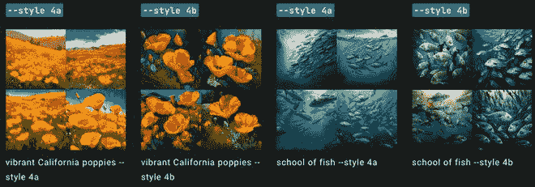

然后是 Niji ，它是 [Midjourney](https://link.zhihu.com/?target=https%3A//17yongai.com/tag/midjourney) 和 Spellbrush 合作的，可以制作动漫和插画风格。 niji 模型在动漫、动漫风格和动漫美学方面有大量的知识，它在动态和动作镜头以及以人物为中心的一般构图方面非常出色。

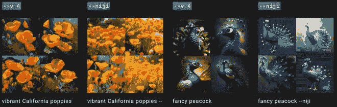

MJ Test 是临时发布新的模型，供社区测试和反馈，偶尔可以试试。

### 绘图质量

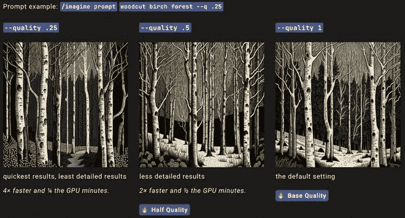

质量的设置并不总是越高越好，有时，较低的质量设置可以产生更好的效果，这取决于你试图创建的图像。较低的画质设置可能最适合表现抽象的姿态，较高的质量值可能会改善受益于许多细节的建筑图像的外观，选择最符合你希望创建的图像类型的设置。

```
Half Quality = --q .5
Base Quality = --q 1
High Quality = --q 2
```

需要注意， V4 和 Niji 目前不支持 High Quality

### 风格切换

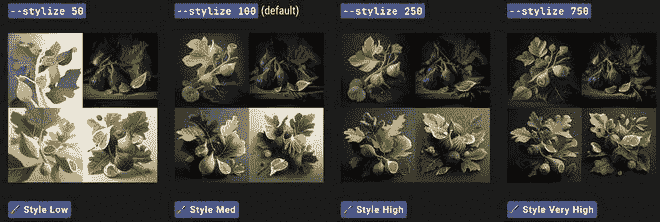

Midjourney 已经被训练成产生有利于艺术色彩、构成和形式的图像。 `--stylize` 或 `-s` 参数影响了这种训练的强度。低风格化值产生的图像与提示密切相关，但艺术性较差。高风格化值产生的图像非常有艺术性，但与提示的联系较少。

```
Style Low = --s 50
Style Med = --s 100
Style High = --s 250
Style Very High = --s 750
```

`--stylize` 的默认值为 100，并且在使用默认 [V4 模型] 时接受 0-1000 的整数值。

| Version | Stylize default | Stylize Range |
| --- | --- | --- |
| Version 4 | 100 | 0–1000 |
| Version 3 | 2500 | 625–60000 |
| Test / Testp | 2500 | 1250–5000 |
| niji | NA | NA |

### Upscale

Midjourney 开始生成的是低分辨率的网格图像，然后需要试用升格来增加尺寸和添加额外的细节。

| Model Version | Starting Grid Size | Default Upscaler | Detail Upscale | Light Upscale | Beta Upscale | Anime Upscale | Max Upscale |
| --- | --- | --- | --- | --- | --- | --- | --- |
| V4 | 512 x 512 | 1024 x 1024 | 1024 x 1024 | 1024 x 1024 | 2048 x 2048 | 1024 x 1024 | - |
| hd | 512 x 512 | - | 1536 x 1536* | 1536 x 1536 | 2048 x 2048 | - | 1024 x 1024 |
| v1–v3 | 256 x 256 | - | 1024 x 1024* | 1024 x 1024 | 1024 x 1024 | 1024 x 1024 | 1664 x 1664 |
| niji | 512 x 512 | 1024 x 1024 | 1024 x 1024 | 1024 x 1024 | 2048 x 2048 | 1024 x 1024 | - |
| test / testp | 512 x 512 | - | - | - | 2048 x 2048 | 1024 x 1024* | - |

**Regular (Default) Upscaler** 在平滑或细化细节的同时增加了图像尺寸，一些小的元素可能在初始网格图像和完成的升格之间发生变化。

**Light Upscaler** 创建一个1024px x 1024px的图像，并添加适量的细节和纹理。在使用旧的Midjourney模型版本时，Light Uspscaler对脸和光滑的表面很有用。

Detailed Upscaler 细节升标器，创建一个1024px x 1024px的图像，并在图像上增加许多额外的精细细节。用细节升格器升格后的图像，可以用升格到最大按钮再次升格，最终分辨率为1664px x 1664px。只有在快速模式下才可以升格到最大。详细升频器是Midjourney模式V1, V2, V3, 和hd版本的默认设置。

**Beta Upscaler** Beta Upscaler可以创建一个2048px x 2048px的图像，而不需要添加很多额外的细节。Beta升档器对脸部和光滑的表面很有用。使用`-upbeta`参数来改变U1 U2 U3 U4升档按钮的行为，以使用Beta升档器。

**Anime Upscaler** 动漫升频器是`--niji`模型的默认升频器。它将图像升格为1024px x 1024px，并进行了优化，以便与插图和动漫风格很好地配合。使用`--upanime`参数来改变U1 U2 U3 U4升档按钮的行为，以使用动漫升档器。

**Remaster** 重塑是一个额外的选项，适用于以前用V1、V2或V3模型版本制作的上标图像。重制将使用`--测试`和`--创意`参数再次提升图像的比例，混合原始[图像的组成和较新](https://link.zhihu.com/?target=https%3A//17yongai.com/tag/discord)的`--测试`模型的一致性。通过点击在原始升标处发现的重塑按钮，可以重塑任何先前升标的作业。如果要对非常老的作业进行重铸，可以使用`/show`命令在 Discord 中刷新该作业。

### Mode

`/stealth` 和 `/public` 命令在隐匿模式和公共模式之间切换。 试用版只能选Public,Pro Plan 的订户可以访问隐身模式，以防止他们的图像在 Midjourney 网站上被其他人看到。

Fast and Relax Modes 标准和专业计划的用户每月可以在放松模式下创建无限数量的图像,Relax模式不会花费GPU时间，但工作将根据你使用该系统的程度被放入一个队列中。

**Remix 模式**值得重点看看，可以改变提示、参数、模型版本或变体之间的长宽比。Remix将采用起始图像的总体构图，并将其作为新工作的一部分。Remix可以帮助改变图像的设置或照明，发展一个主题，或实现棘手的构图。Remix是实验性的功能，可能会在任何时候改变或被删除。

用 `/prefer remix` 命令或通过使用 `/settings` 命令和切换️ Remix Mode 按钮来激活。 Remix 改变图像网格下的变体按钮（V1、V2、V3、V4）的行为。当 Remix 被启用时，它允许你在每次变奏时编辑你的提示。若要对一个上级进行混音，请选择制作变体。

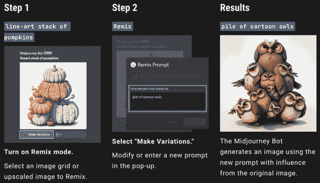

你可以在使用Remix模式时添加或删除参数，但你必须使用有效的参数组合。将 `/imagine prompt illustrated stack of pumpkins --version 3 --stylize 10000` 改为 `illustrated stack of pumpkins --version 4 --stylize 10000` 将返回一个错误，因为 MJ4 与 Stylize 参数不兼容。

### 自定义设置

Custom Preferences

可以用 `prefer` 命令创建自定义选项，自动将常用参数添加到提示末尾。

- `/prefer auto_dm` 完成的任务自动发送到私信
- `/prefer option` 创建或管理自定义选项
- `/prefer option list` 查看当前的自定义选项
- `/prefer suffix` 指定要添加到每个提示末尾的后缀
- `/prefer option set` 创建一个自定义参数，你可以用它来快速添加多个参数到提示语的末尾。最多可以设置20个option

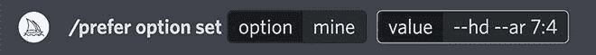

PreferOptionSet

`/prefer option setmine--hd --ar 7:4` 创建一个名为 "mine "的选项，代表 `--hd --ar 7:4` .

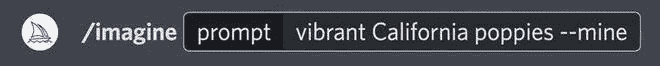

PreferOptionSet_Used

使用 `/imagine promptvibrant California poppies --mine` 就等于 `/imagine promptvibrant California poppies --hd --ar 7:4` .

把 value 设置为空就相当于设置改选项删除

`/prefer suffix` 会自动在所有提示后附加指定的后缀，使用没有数值的命令来重置。

比如: `/prefer suffix--uplight --video`

## MidJourney 参数解析

参数可以添加到 prompt 中，可以改变图像生成效果。

### 基础参数

**Aspect Ratios：**

`--aspect` , 或 `--ar` 改变生成图像的长宽比。

不同的 Midjourney 版本模型有不同的最大长宽比

| Version | Max Aspect Ratio |
| --- | --- |
| Version 4 | 1:2 or 2:1 |
| Version 3 | 5:2 or 2:5 |
| Test / Testp | 3:2 or 2:3 |
| niji | 1:2 or 2:1 |

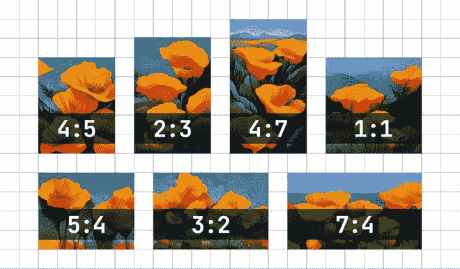

`--ar` 参数将接受从1:1（方形）到每个模型的最大长宽比的任何长宽比。然而，在图像生成或升格过程中，最终的输出可能会略有修改。例如：使用 `--ar 16:9(1.78)` 的提示，创建的图像的长宽比为 7:4(1.75)

- `--aspect 1:1` 默认长宽比
- `--aspect 5:4` 常见的画面和打印比例
- `--aspect 3:2` 常见于印刷摄影
- `--aspect 7:4` 接近于高清电视屏幕和智能手机屏幕

**Chaos：**

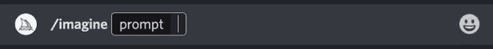

`--chaos <数字0-100>` 改变结果的变化程度，更高的值会产生更多不寻常的和意外的结果和构图，较低的 `--chaos` 值输出更可靠、可重复的结果。

**No：**

`--no` 负面的提示，如果不想在生成的结果中出现某物就可以使用这个参数。

**quality：** 上节讲过了，不赘述

**Seed：**

`--seed <在0-4294967295之间的整数>` 玩机器学习的同学都懂，使用相同的提示词和随机种子可以保证输出相同的结果（限 V4 和 Niji ）。

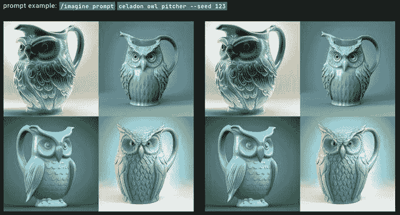

如何找到生成图像对应的seed值呢？看下图

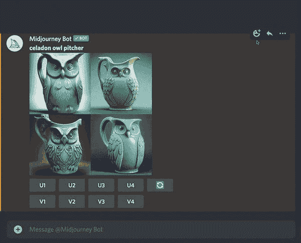

**Stop：**

`--stop <在10-100之间的整数>` 使用 `--stop` 参数可以在指定的比例停止生成，这会产生一个更柔和、细节更少的初始图像，

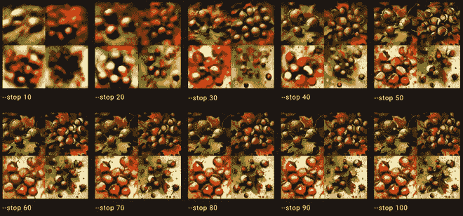

`--stop` 会影响最终 Upscaler 结果的细节水平

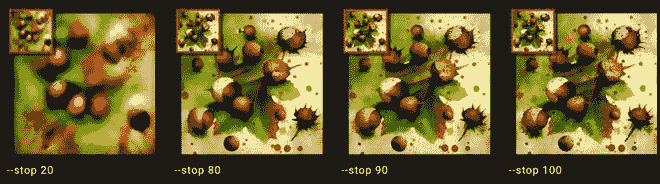

**Style：**

`--style <4a or 4b>` 在 MJ4 的版本之间进行切换。

**Stylize：**

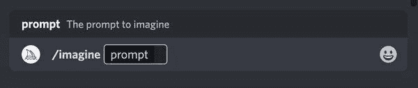

`--stylize` , or `--s` 参数影响 Midjourney 的默认美学风格在作业中的应用程度。前面讲过了，不赘述。

**Tile：**

`--tile` 参数生成的图像可以作为重复的瓷砖，用于创建织物、壁纸和纹理的无缝图案。仅对 V1，2，3 有效。

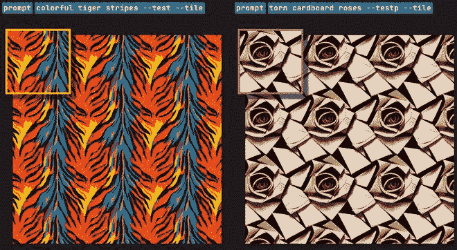

### Upscaler 参数

**Uplight：**

`--uplight` 当选择U按钮时，使用另一种 "光 "的升频器。其结果更接近于原始网格图像。上调后的图像细节较少，且更平滑。

**Upbeta：**

`--upbeta` 在选择U按钮时，使用另一个 beta 升频器。结果更接近原始网格图像。升级后的图像增加的细节明显减少。

### 其它参数

**Creative**

`--creative` 修改 test or testp 版本，使其更加多样和有创意。注：无需加value

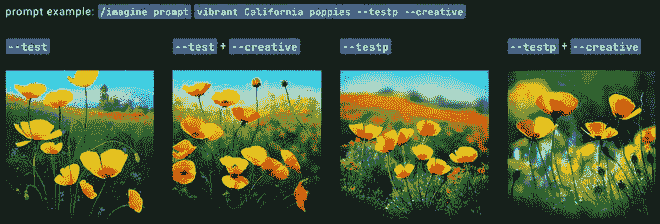

**Image Weight**

`--iw` 设置相对于文本权重的图像提示权重，默认值是 `--iw 0.25` 具体用法见4.1章

**Sameseed**

`--sameseed` 种子值创建一个大的随机噪声场，应用于初始网格中的所有图像。当指定`--sameseed`时，初始网格中的所有图像都使用相同的起始噪声，并将产生非常相似的生成图像。

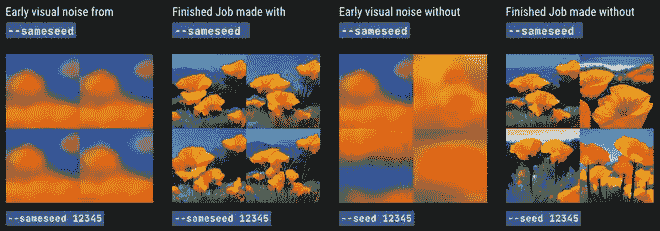

**Video：**

使用`--视频`参数来创建一个初始图像网格生成的短片。用信封✉️ 表情符号对完成的工作做出反应，让 Midjourney Bot 在你的直接信息中发送一个视频链接。

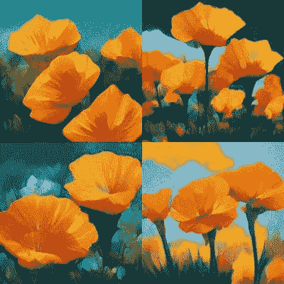

`--video` 仅在 V1, 2, 3, test, testp 中有效

获取视频的具体步骤：

1. 在提示语的末尾添加 `--video`
2. 任务完成，点击 Add Reaction
3. 选择✉️ emoji（搜索框搜 envelope）

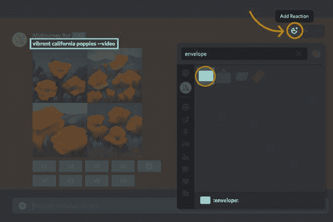

4. Midjourney 将发送一个视频链接到你的 Direct Messages 中（见下图）
5. 点击该链接，在浏览器中查看，右键单击下载视频

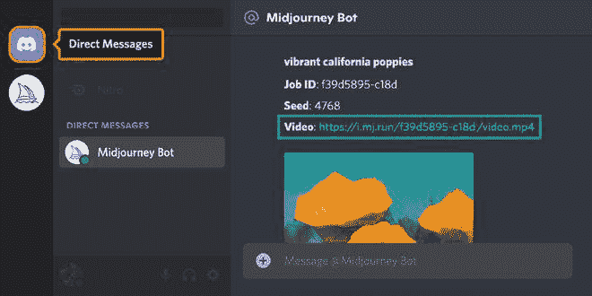

### 已被弃用参数

下面的参数已被弃用，大家看 [教程 ](https://link.zhihu.com/?target=https%3A//17yongai.com/tag/%25e6%2595%2599%25e7%25a8%258b) 或学习他人 prompt 时留意一下：

```
--width and --w (replaced with --aspect)
--height and --h (replaced with --aspect)
--fast (replaced with --quality)
--vibe (now known as V1)
--hq
--newclip
--nostretch
--old
--beta
```

## MidJourney 高级提示

### Image Prompts

你可以使用图像作为提示的一部分来影响作业的构成、风格和颜色。图片提示可以单独使用，也可以与文字提示一起使用--尝试将图片与不同的风格相结合，以获得最令人兴奋的结果。

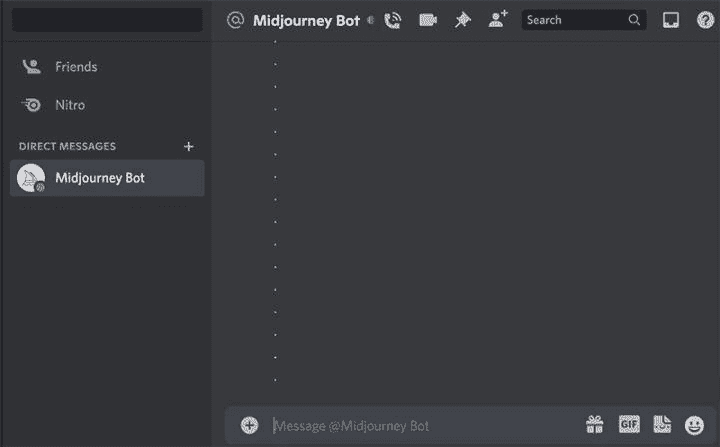

要将图像添加到提示中，请输入或粘贴图像在网上存储的网址。该地址必须以 `.png`、`.gif`、`.jpg` 等扩展名结束。添加图像地址后，添加任何额外的文本和参数以完成提示。

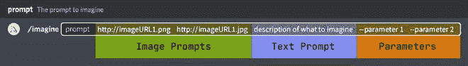

注意事项：

- 图片提示要放在提示的前面。
- 提示必须有两张图片或一张图片和附加文字才行。
- 图像的 URL 必须是一个在线图像的直接链接。
- 在大多数浏览器中，右击或长按一个图像，选择复制图像地址以获得 URL。
- `/blend` 命令是一个简化的图像提示过程，为移动用户优化。

在早期的 Midjourney 模型版本中，图像提示比目前的模型更抽象的灵感。图像提示不等于建立在（或 "初始化"）一个起始输入图像之上。图像提示是作为视觉灵感使用的，而不是作为起点。

早期的 Midjourney Model 版本（V3）可以使用图像权重参数 `--iw` 来调整图像 URL 与文本的重要性。 `--iw 0.25` 是默认值，更高的 `--iw` 值意味着图像提示将对完成的工作产生更大的影响。 `--iw` 接受整数-10,000-10,000

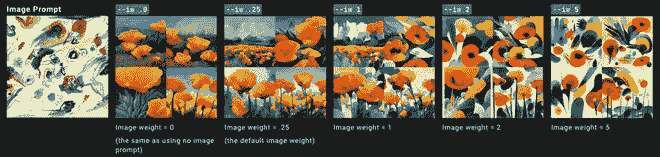

这里顺便提一嘴 `/blend`

`/blend` 命令允许快速上传2-5张图片，然后查看每张图片的概念和美学，并将它们合并成一张新的图片。


输入`/blend`命令后，会提示你上传两张照片。从你的硬盘拖放图片，或者在使用移动设备时从你的照片库中添加图片。要添加更多的图像，请选择**可选/选项**字段，并选择图像3、图像4或图像5。`/blend`命令的启动时间可能比其他命令长，因为你的图像必须在 Midjourney Bot 处理你的请求之前上传。

混合后的图像有一个默认的1:1长宽比，但你可以使用可选的尺寸字段来选择方形长宽比（1:1）、纵向长宽比（2:3）或横向长宽比（3:2）。

自定义后缀被添加到`/blend`提示的末尾，就像任何其他`/imagine`提示一样。作为`/blend`命令的一部分指定的长宽比会覆盖自定义后缀中的长宽比。

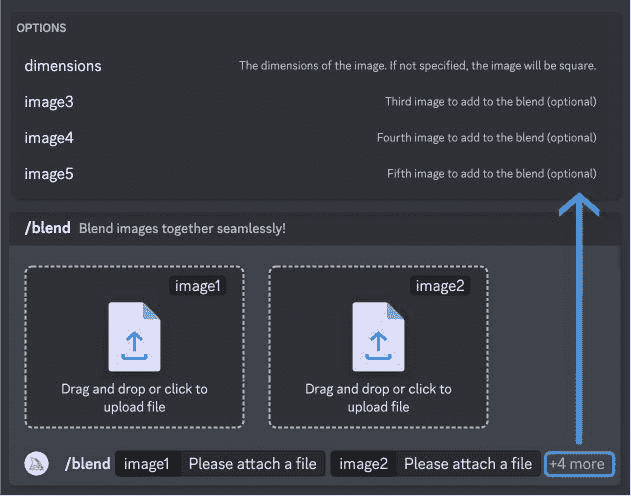

注意事项：

+ `/blend`与使用`/imagine`的多个图片提示相同，但界面经过优化，便于在移动设备上使用。
+ `/blend`不与文本提示一起使用，要同时使用文本和图像提示，请使用图像提示和文本的`/imagine`。
+ 图片尺寸最好一致。


## 4.2 Multi Prompts 多重提示

**基础知识**

在提示中加入双冒号`::`表示 Midjourney Bot 应该分别考虑提示的每一部分。在下面的例子中，对于热狗的提示，所有的词都被放在一起考虑，而 Midjourney Bot 产生了美味的热狗的图像。如果将提示分成两部分，`hot:: dog`这两个概念被分开考虑，产生一个温暖的狗的图片。


**提示权重**

当用双冒号`::`将一个提示分成不同的部分时，可以在双冒号后面紧接着添加一个数字，以指定该部分提示的相对重要性。

在下面的例子中，提示`hot:: dog`产生了一只热狗。将提示改为`hot::2 dog`后，`hot`一词的重要性是`dog`一词的两倍，产生的图像是一只非常热的狗。

[模型版本]1、2、3只接受整数作为权数。

[模型版本]4可以接受小数位的权重。

非指定的权重默认为1。

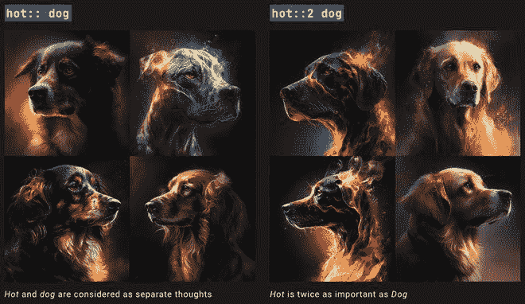

**Negative Prompt Weights**

负的权重可以被添加到提示语中，以去除不需要的元素。

所有权重的总和必须是一个正数。

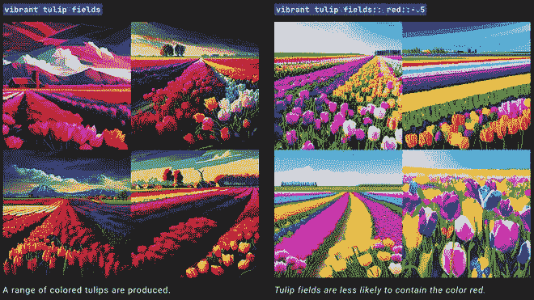
