# Midjourney进阶：高分图像生成

> 来源：[https://aiyanxishe.feishu.cn/docx/Wz0Jds9bbo0SwJxS0x8cKJYcnAW](https://aiyanxishe.feishu.cn/docx/Wz0Jds9bbo0SwJxS0x8cKJYcnAW)

# 场景1：Stock Photo

Text Prompt 的部分，我删除重写了 3 遍，每次写完都不太满意。前两遍，我都希望通过一个或几个万能模板教会大家写 Midjourney 的 Text Prompt，但实际试了很多遍后，我发现：

1.  图片信息量非常大，万能模板的确让你生成一张及格的图片，但很难让你生成一个完全满意的图片。

1.  要想生成一张高分图片，需要的不仅仅是 prompt engineering，甚至还需要一些美学知识，不同场景参数的使用都是不一样的，所以有些时候，用模板反而有点死板。

所以，我不想直接教大家所谓的万能模板，而是通过一个个实际场景教大家如何写好 text prompt ，因为不同场景，你告知给模型的信息是不一样的。

而且我认为，知道为什么，远比知道怎么做更重要。当你知道为什么后，遇到新的场景，你也能很好地解构出 prompt 里需要什么，而不是盲目套模板。最后，图片场景有非常多，我会尽量分享一些大家日常工作中能用上的。希望能让 AI 提高你的工作效率，而不是用完即弃的玩具。

Text Prompt 开篇介绍一下 Midjourney V5 提升较大的 Stock Photo 场景。

## 什么是 Stock Photo？

Stock Photo 直译为图库图片。一般你能在一些图库网站上找到，这些图片通常来自一些摄影师或设计师。部分图片因为版权的原因，如果你需要使用则需要付费。

大部分使用 Stock Photo 的用户都是一些设计公司，或者广告公司。你应该常常能看到这类图片，比如最经典的两人握手照片：


我认为 AI 生成图片对图片库冲击非常大，V5 版本基本上满足了我的 Stock Photo 需求。

## 技巧一：临摹

我认为学习图片类的 prompt，跟学习画画是类似的，最好的学习方法不是直接用模板。

而是拿真图，或者别人生成的图来临摹。英文不好，也可以先写中文，然后让 ChatGPT 翻译。当你临摹了几张后，你就会慢慢搞懂如何做出类似的图了。

拿上面的那个握手图为例，我们仔细观察上面那张图，图中元素有什么：

1.  第一主体是两个手，然后握在了一起，并且看起来是两个亚裔男人。

1.  第二两人都穿着西装。

1.  第三背景看上去像是在办公楼的大门，两人可能是在握手告别。并且背景刻意进行虚化了，或者是使用照相机拍摄的。

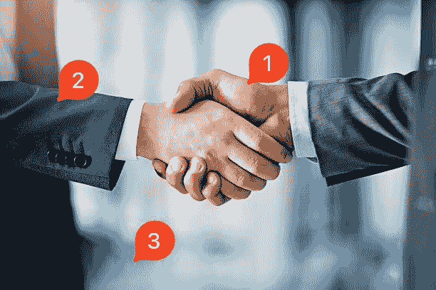

再归纳总结下，大概的信息：

+   主体：两个穿着西装的亚裔男人在握手告别

+   场景：办公楼大门

+   图像风格：stock photo，照相机拍摄，

这时候，我们就能尝试写一下 prompt 了（如果你觉得自己英文水平还不太行，也可以尝试用翻译软件翻译）。

```
stock photo of two Asian men in suits shaking hands,say goodbye in front of the main entrance of the office building,taken with Canon
```

Midjourney 生成的结果如下所示。

Emm 🤔 好像跟我们的预期不一样。不要慌，刚开始用 Midjourney 一定会遇到这种问题，重要的是多尝试。

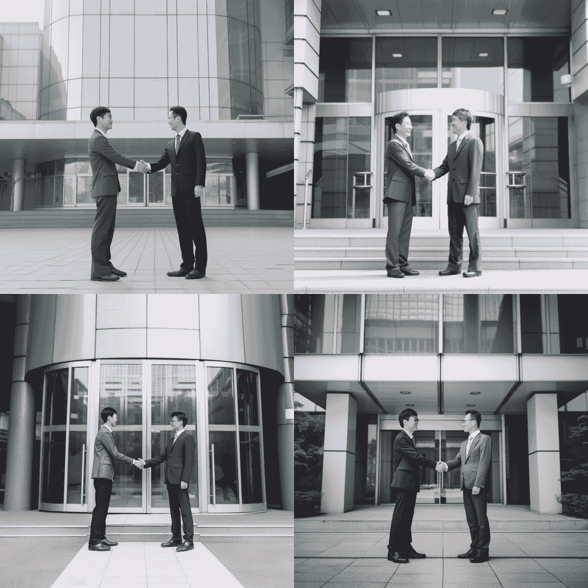

我们再来分析下 Midjourney 为何生成了这样的图片？复盘下：

1.  首先图片的主体，或者说焦点，我们只需要「握手」，而不是两个人。

1.  照相模式好像并不能实现背景虚化？更像是一种图像风格，图四就像是一种老照片的风格。

那我们调整下 prompt，增加焦点和背景虚化关键词：

```
stock photo of two Asian men in suits shaking hands,say goodbye in front of the main entrance of the office building, focus on two hands, taken with Canon, background bokeh
```

再来看看生成的结果，结果好很多，图 1 和 图4 基本满足需求了，图 2 和图 3 裁剪一下，也能满足我们的需求。不过需要注意，Midjourney 在人手的生成上，暂时还有点问题，你细看图 2和图 4，其中有一个人的手有 6 个手指 😂，但我认为未来应该会修复：

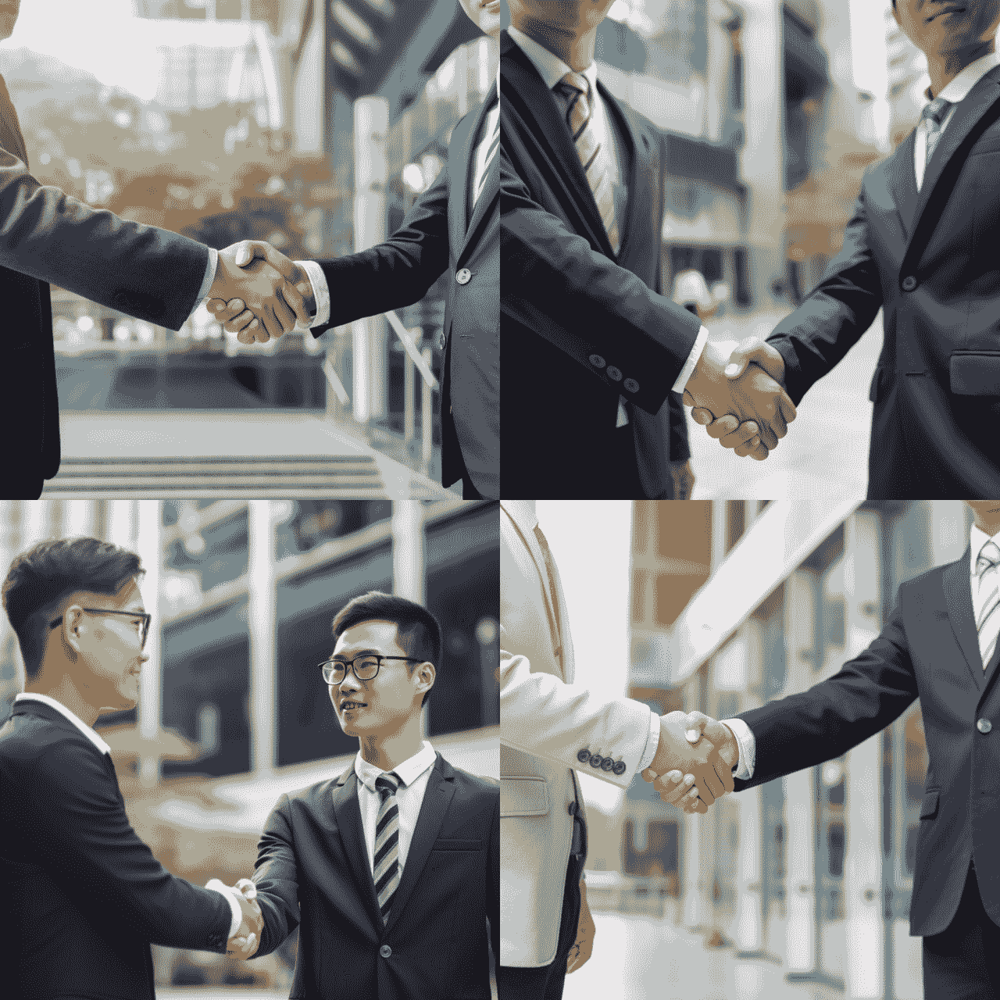

那我们来总结一下 prompt ，该 prompt 分成以下几个部分：

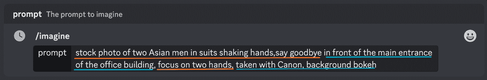

+   第一部分（红色线）：描述你想要的内容主体。

+   第二部分（蓝色线）：描述主体背景/环境。

+   第三部分（黄色线）：照片的焦点位置。

+   第四部分（绿色线）：照片的风格或者说是特殊要求。

总结下之后，你是不是就总结出了一个模板了？😁

## 技巧二：多实验

上述的案例，我还想教给各位第二个技巧：多试验。

图片生成遇到不符合预期的情况，不要慌，分析问题，然后使用控制变量法，一个个调整图片，不要急，上面我写的 prompt 还有一个地方，不知道各位有没有注意，就是开头的 stock photo，试试将这两个词删掉会怎样？

```
two Asian men in suits shaking hands,say goodbye in front of the main entrance of the office building, focus on two hands, taken with Canon, background bokeh
```

生成结果也依然满足需求，而且手指的数量也准确了，说明这个 Stock Image 对模型的影响不是很大。

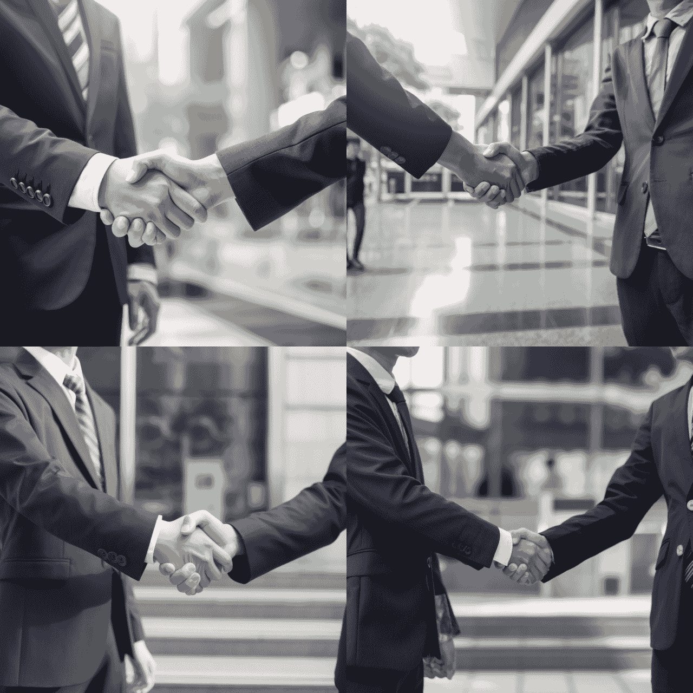

## 技巧三：善用 Image2Image 功能

在 Stock Photo 场景里，还有一个非常厉害的技巧，这个方法我一开始觉得不太适合教，因为这个对 Stock Photo 库影响太大了 😂

但本着工具中立的原则，并且这个技巧，其实在很多场景都能用（比如生成头像等），所以还是觉得有必要教给大家。

各位一般用 Stock Photo 库会遇到以下几个问题：

1.  图有版权，没法商用，或者说需要付费。

1.  有些图，被很多人用过，其他人一眼就看出来这是 Stock Photo。

1.  图里的内容大体符合要求，但细节不符合要求，比如上图两个亚洲男性握手，可能换成一男一女，且其中一人是黑人会好一些。

要解决这三个问题，最好的方式就是让 AI 改一改原来的图片。让 AI 改图，只需要用到 Image2Image（或者叫 Blend） 功能即可。操作步骤如下：

信息

后来在某书刷到类似的教程，我才知道这个方法大家一般叫垫图。老外好像一般都叫 Image2Image，或者 img2img。

1.  将你看到的不错的 stock photo 发给 Midjourney Bot（我还是以前面的那张握手照为例）

1.  右键复制该图片的链接，然后黏贴到输入框

1.  在链接后加个空格

1.  接着输入你想要的内容，比如将其中一个人的手换成黑人，一个人换成女性：

```
one Afican-American hand and one Asian woman hand
```

生成的结果是这样的，我在 prompt 里没有提任何西装，以及场景背景信息，就说我要一个非裔的手，一个亚裔女性的手：

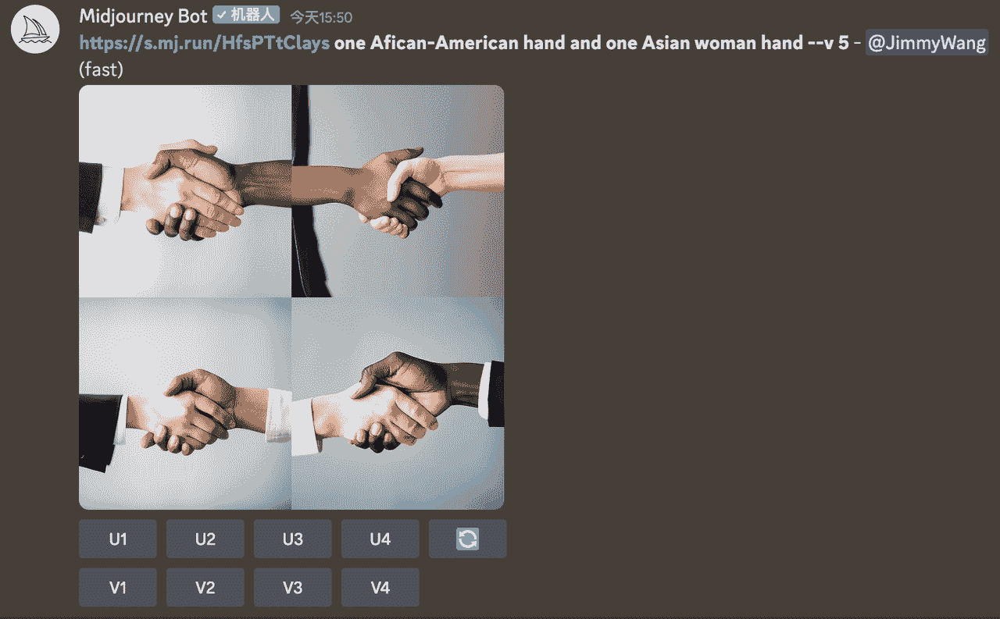

抛开6 根手指的问题，这个技巧是不是很高效？不过需要注意，blend 功能（这个后续教程会讲到）我发现更适合两张图融合，图片+文字不是很稳定，各位要有耐心，多测试一下。

# 场景2：品牌 Logo

## 我们需要学习提示词吗？

前一章各位搞懂了基础 prompt 后，从本章开始就会教大家更多垂直场景的 prompt。关于垂直场景，我看到大量的教程和分享都是分享各种提示词，比如 Logo 相关的提示词有：

+   modern

+   minimalist

+   vintage

+   cartoon

+   geometric

坦率地说，在我学习如何使用 Midjourney 的过程中，我一开始也以为只要看了别人的 prompt 用了别人的提示词，就能生成好的图片。

但对于新手来说，我不建议各位直接上来就记模版，记这些词。

因为写好一段 prompt ，你缺的不是提示词，而是对设计的理解，甚至是想象力。

比如本章节的 Logo 设计，如果你根本不知道 Logo 包含哪些元素，适合什么风格，你懂再多的提示词也没法生成满意的 Logo。正如我 Midjourney 教程前面提到的那样，Midjourney 跟 ChatGPT 不一样，ChatGPT 是声明式的，你甚至可以让它扮演某个角色，但 Midjourney 是指令式的，你只能用指令然它画出你想象中的图片。当你能很稳定地出图后，再研究这些词不迟。

对于普通人来说，真正阻碍我们的可能不是学会这些词语，而是我们的审美。

## 常见的品牌 Logo

常见的品牌 Logo 一般分成以下 4 种形式：

+   Graphic Logo：一般以图形为主，像 Apple、Twitter 以及 Midjourney 就是这种 logo。

+   Lettermark Logo：一般用公司名字的首字母作为 logo 主体，像 Facebook、Tesla 还有 IBM （IBM 全称是 International Business Machines）都是用公司名的首字母作为 logo。

+   Geometric Logo：几何图形组成的 logo，比如 Nike、百事可乐、万事达卡就是这个类型。

+   Mascot Logo：以公司吉祥物为 logo 的相对来说比较少见，像米其林的 logo 就是吉祥物轮胎人，我最喜欢的烤鸡餐厅 Nando’s 就是一只🐔

其实常见的品牌 Logo 里其实还有一种，是文字组合式的，文字加上面任意一种，比如 Tesla 的 完整 Logo 就是 Tesla 加一个 T。但因为 Midjourney 在文字的生成上，有非常多的问题，所以不在本章进行介绍。

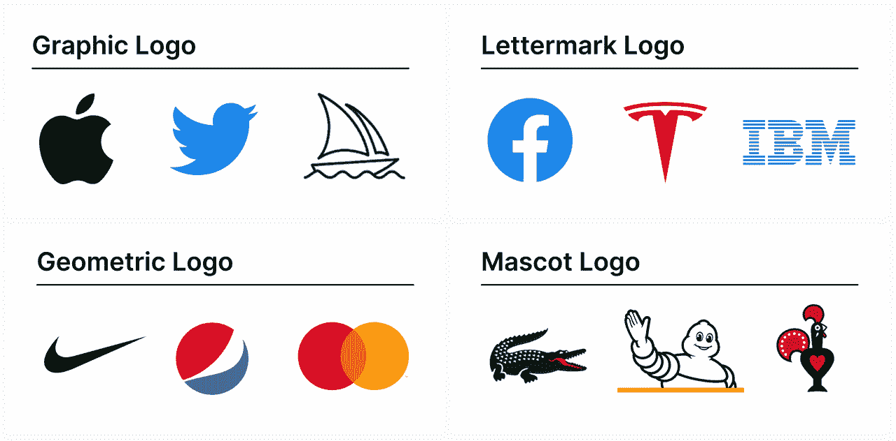

## Graphic Logo

当你想用 AI 生成 Logo 的时候，我建议你选一个你认可的方向，然后再让 AI 生成。

首先我们来分析一下 Graphic Logo 的特性：

1.  Logo 类型：graphic logo

1.  Logo 图形描述：比如猫

1.  风格：

1.  多为扁平化设计：flat

1.  多为矢量图形：vector graphic

1.  简洁：simple

根据特性撰写的 prompt ，核心的关键就是将风格描述清楚：

```
flat vector graphic logo of cat, simple minimal
```

Graphic Logo 还有一种常见的设计，比如前面的例子里 Midjourney 的 Logo 就是这种，只需要在 graphic 后加一个 line 即可：

```
flat vector graphic line logo of cat, simple minimal
```

下方左边 4 个是没有加 line 的版本：

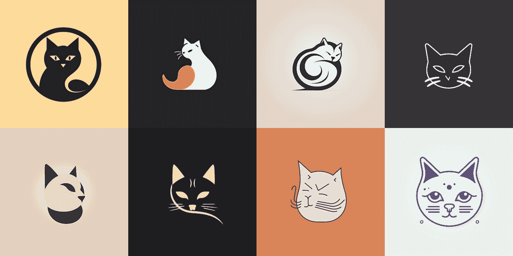

## Lettermark Logo

这个根据我的实验，也试用了很多人写的 prompt，我个人的感受是，这种类型的 Logo 看起来简单，就一个字母进行变形，但让 AI 生成反而效果很一般，而且有一个算是比较有意思的发现，用 A 字母做出来的 Logo 质量比其他字母做出来的 Logo 质量要好很多（非严格按照数据统计，仅个人感受）。这个类型的 Logo 有以下特点：

1.  Logo 类型：lettermark

1.  Logo 图形描述：

1.  纯字母

1.  字体样式：可以按需加上喜欢的字体

1.  风格：

1.  矢量

1.  简洁：simple minimal

根据特性撰写 prompt（最后生成的是 A 和 C 的 logo，我个人感觉 A 的好很多），另外需要注意，这个例子其实是想说明，在 Midjourney 里，语法并不重要，lettermark 不一样要按照语法要求，写成 lettermark logo of letter A ：

```
letter A logo, lettermark, typography, vector simple minimal
```

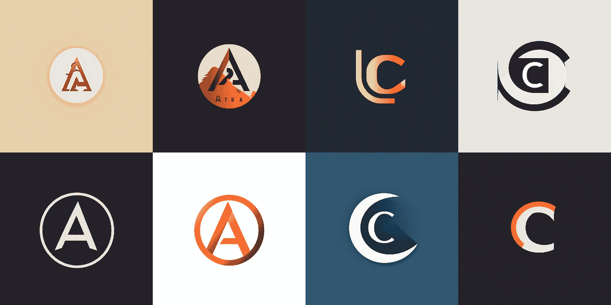

## Geometric Logo

这个类型的 Logo 相对来说，虽然只有图形，但有很多玩法，介绍两个常用玩法：

+   循环重复

如果你用的是 iPhone ，可以看看 iPhone 里的照片应用的 Logo，它也是一个 Geometric Logo ，而且它是椭圆图形旋转重复，最后组合成了一朵花的形状。拆解一下，关键词是：

1.  Logo 类型：geometric logo

1.  Logo 图形描述：

1.  旋转重复：radial repeating

1.  风格：

1.  简洁：simple minimal

让我们来写一个类似的 prompt：

```
Flat geometric vector geometric logo of flower, petals radial repeating, simple minimal
```

+   渐变

另一个常见玩法就是渐变色，如果你用的是电脑的浏览器是 Edge，可以去看看它的 Logo，它的 Logo 就是一个渐变色，然后是个浪的外观。拆解一下，关键词是：

1.  Logo 类型：geometric logo

1.  Logo 图像描述

1.  浪的形状：curved wave shape

1.  蓝绿渐变：blue green gradient

1.  风格：

1.  简洁：simple minimal

让我们来写一个类似的 prompt：

```
Flat geometric vector graphic logo of curved wave shape, blue green gradient ,simple minimal
```

最后生成的结果是这样的，我很喜欢花的第三个，浪的第二个：

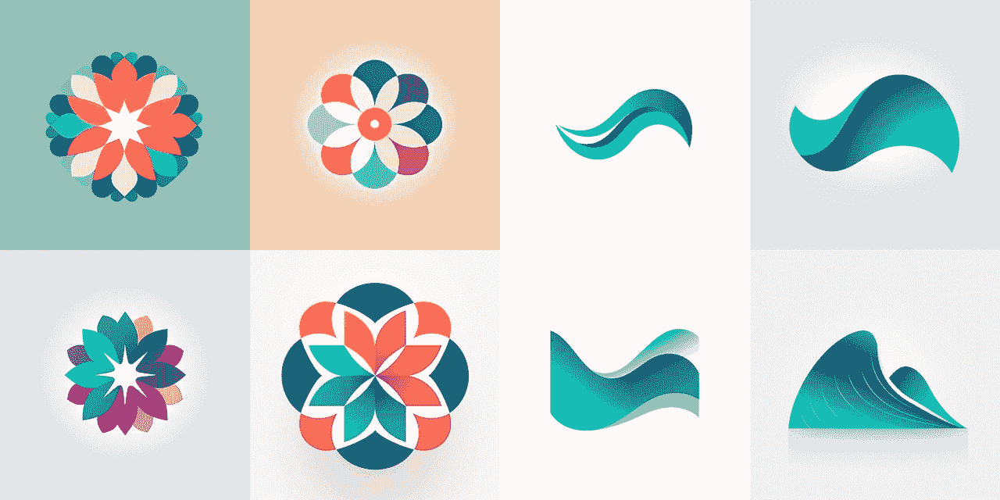

## Mascot Logo

这种吉祥物类型的 Logo，我认为是 Midjourney 最擅长的 Logo 风格。但也非常考验我们的想象力，当然我们也可以仅提供一些比较简单的词语，让 AI 帮我们生成，让我们一起来为一个机器人公司写一个 Mascot Logo ，拆解一下 prompt 关键词：

1.  Logo 类型：mascot logo

1.  Logo 主体描述：比如机器人 robot

1.  风格：

1.  简洁：simple

最后 prompt：

```
a mascot vector logo of a robot, simple,
```

还有给一家泡面公司生成一个吉祥物又会怎样：

```
simple mascot logo for a Instant Noodles company
```

以下是生成的结果，我很喜欢泡面公司的 logo：

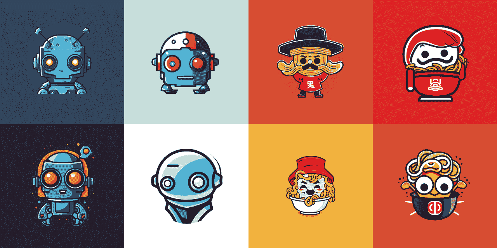

## 技巧四：增加风格——艺术运动

> [因为篇幅的](https://www.xiaohongshu.com/user/profile/6073d38d00000000010068a6?xhsshare=CopyLink&appuid=6073d38d00000000010068a6&apptime=1679646639)原因，本教程不会介绍特别多的风格，我会在我的小红书账号上更新。感兴趣的朋友可以去关注下。

前面生成的 logo ，有一些估计各位会觉得平平无奇，比如 Lettermark Logo，原因并不是 Midjourney 能力不强，而是我们给的指令太少了，只要在 prompt 里加几个单词，就能生成不一样的 Logo： 左边四个的 prompt 是这样的，我仅仅在原来的 prompt 上加了两个单词 Pop Art：

```
letter A logo, lettermark, typography, vector simple, Pop Art
```

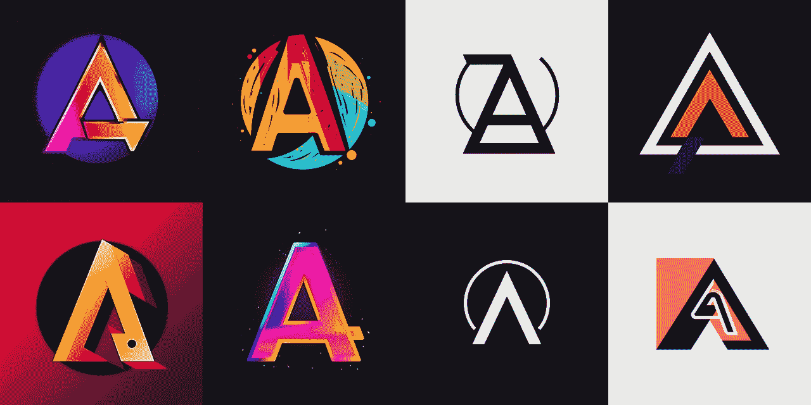

Pop Art 是什么？

波普艺术（Pop Art，又译为普普艺术或通俗艺术），是一种起源于20世纪50年代和60年代的艺术运动，它强调对大众文化、大众媒体和消费主义文化的反思和表达。Pop 来自“流行艺术”（popular art）一词里的 popular，由1956年英国艺术评论家罗伦斯·艾伟（Lawrence Allowey）所提出。

Pop Art 的特点是：

+   它的内容主体一般是大众日常生活中常见的物品和图像，如广告标语、杂志封面、食品包装等。

+   一般用色比较大胆，同时线条比较简洁，强调物品本身的视觉效果和意义。

右边边四个的 prompt 是这样的，我在 prompt 里加上了 De Stijl 。

```
letter A logo, lettermark, typography, vector simple,De Stijl
```

De Stijl 是什么？

它是一个荷兰艺术运动，始于 1917 年，致力于简化视觉元素，包括直线，平面和基本色彩。

它的成员包括画家 Piet Mondrian 和 Theo van Doesburg 等人。De Stijl 的成员致力于将艺术与设计融合，以创造出具有实用性和功能性的美学。

De Stijl 的特点有：

+   常常用几何图形进行设计，如矩形和直线。

+   用色基本只用基本色彩，比如黑、白、灰、红、黄、蓝。

+   追求平衡和和谐，强调形式和结构，不注重细节和表现力。

看完这些介绍，再看看 Midjourney 输出的 Logo 是不是有那味了？

# 场景3：App & 徽章 Logo

## App Logo

其实 App Logo 可以使用前一章提到的品牌 Logo，加上一个矩形边框就 OK 了，用 Figma 几步就能完成 😂，但如果你实在不想用 Figma ，也可以用 Midjourney 生成。

不放看看你手机上的 App，想想 App Logo Prompt 应该怎么写？

我用前一章的案例，写了两个 prompt ，输出的结果如下：

关键是：

1.  Logo 类型：mobile app logo

1.  Logo 图形描述：

1.  iOS 的都是圆角矩形：squared with round edges

1.  Logo 图形描述，比如 an icon for a Instant Noodles company

1.  风格：

1.  延续使用上一章提到的方法即可，我这加了个 prp art

```
squared with round edges mobile app logo, an icon for a Instant Noodles company, pop art
```

另外我发现在 Logo 图形描述前加 an icon for ，生成的 Logo 会更符合预期一些，右边是加了 an icon for ，左边是没有加的：

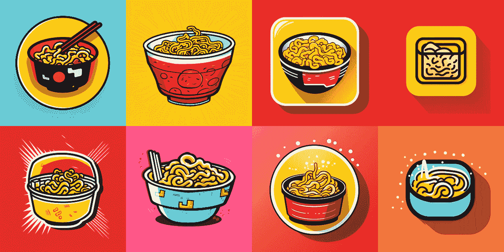

另外，Logo 图案是 Graphic 、Lettermark 还有 Geometric 的，会更符合预期：

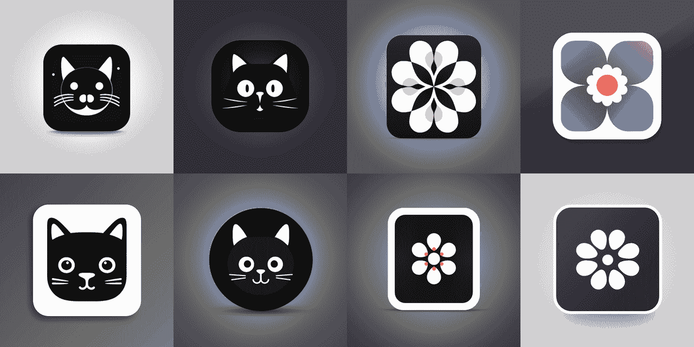

## 技巧五：增加风格——艺术家

前一章介绍了增加艺术运动，从而使得生成的图片更加特别，本章再教大家一个方法，是增加艺术家的名字。 首先需要注意，Midjourney 支持大部分[的艺术运动，但在艺](https://zh.wikipedia.org/zh-tw/%E4%BF%9D%E7%BD%97%C2%B7%E5%85%B0%E5%BE%B7)术家的[支持上，相对来说比](https://zh.wikipedia.org/zh-tw/%E7%B4%A2%E7%88%BE%C2%B7%E5%B7%B4%E6%96%AF)较少，经过网友们的不懈努力，截止到 3 月 31 日，V4 已知支持的艺术家有 2000 多位，V5 有 100 多位。 其中在榜的 Logo 设计师，只有 Paul Rand 和 Saul Bass，Paul 是 IBM、英孚、NeXT logo 的设计师，Saul 是美国联合航空、AT&T logo 的设计师。 使用方法很简单，在 prompt 最后加上 by Paul Rand 即可：

```
letter A logo, lettermark, typography, vector simple, by Paul Rand
```

当然也不是说只能加 Logo 设计师，加上没有设计过 Logo 的设计师名字，也很有意思。比如右边四张图我加的就是 Piet Cornelies Mondrian，第三张 logo 有 Composition II in Red, Blue, and Yellow 那味了。左边四张则是 Paul 的，第二张红色框加黑色 A，有他的经典眼镜 logo 那味，非常喜欢：

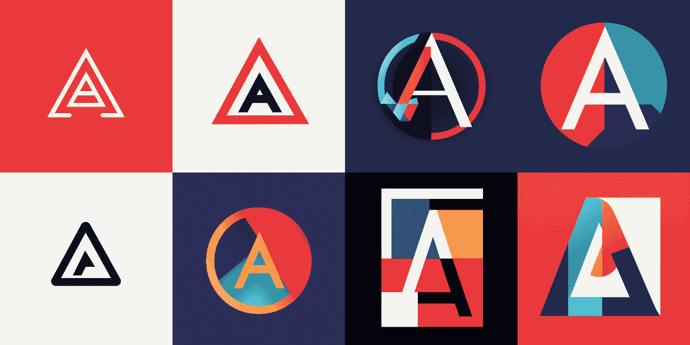

最后需要注意，增加艺术家名，有可能出现以下情况：

1.  多长图的风格都很像：这是因为某些艺术家有非常强烈的标志性风格，比如我很喜欢的 Piet Mondrian，你用他的名字，会发现可能生成的很多张图都是 Composition II in Red, Blue, and Yellow 的风格。

1.  生成的图看上去不太像该艺术家的风格：我自己测试，发现有两种可能，一种是模型并没有学习这个艺术家的作品（特别新的艺术家我感觉一般都不会收录），另一种可能是你的 prompt 里的一些词，跟该艺术家的风格有冲突，比如用了达芬奇 Leonardo da Vinci，但主体是个日本二次元小姑娘。

PS：在本教程里的 Artist List 可以看到我比较喜欢的艺术家。

## 徽章 Logo

学校的校徽就是典型的徽章 Logo，使用方法也非常简单，只需要调整 Logo 类型为emblem 就可以，另外，跟徽章很搭的风格是 Vintage，两个都加上后 prompt 是这样的：

```
emblem for a Instant Noodles company, vintage, simple minimal
```

右边四个是加了 vintage 的，是不是很复古，我非常喜欢：

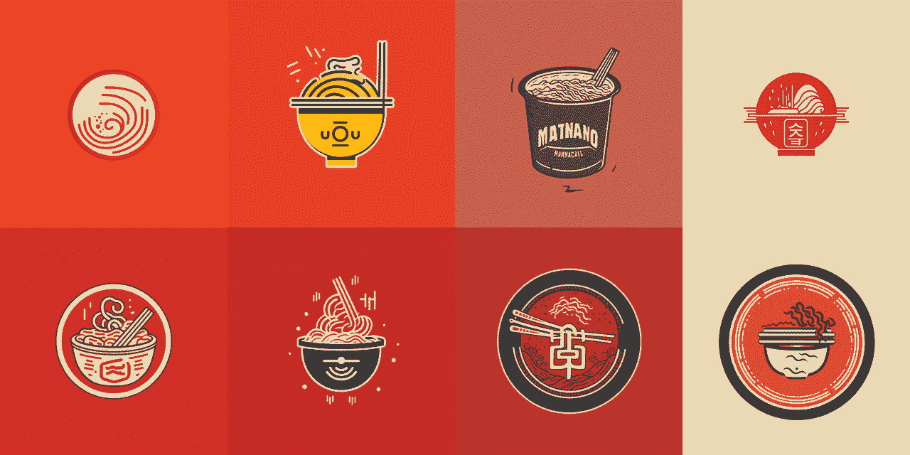

## 技巧六：善用 no 参数，去掉不想要的元素

在徽章 Logo 的案例里，你应该还看过单色的徽章，比如校徽。但 Midjourney 有个习惯就是倾向于生成复杂的内容，生成单色内容，你可以在 prompt 里加入颜色，背景等等词，让其变得简洁。

还有一个技巧是用 no 参数。比如我想制作一个单色校徽，校徽主体是一本书，同时因为 Midjourney 对文字不是很擅长，我还要去掉 text。以下是我的 prompt，我在最后加了 no realistic color（没有颜色）text（字）。

```
emblem for a university with large book, vintage --no realistic color text
```

然后我把上面那个 Instant Noodles company 的 prompt 也加了 no text，最后生成的两组图片是这样的（最后需要注意，no 参数在 logo 里使用时，no text 有的时候会失效，但如果你去掉 — 直接输入 no text 就会生效，很神秘，估计是个 bug）：

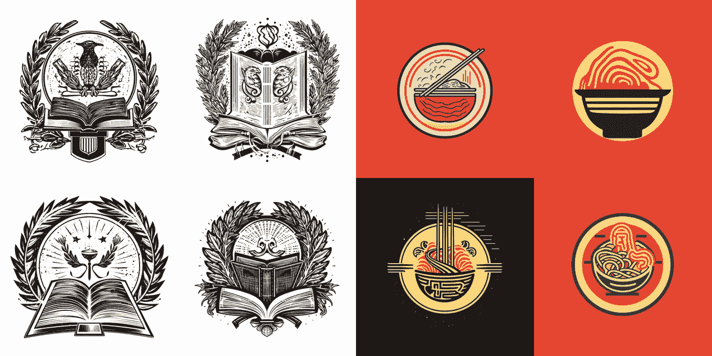

# 场景4：插画

通过前面的学习，你应该或多或少都临摹了几个图片。如果没有，我建议你多练练，纸上得来终觉浅。

稍微总结下我们所学：

+   撰写 prompt 核心是「描述清楚你想要的画面」，「越详细」生成的图片就约符合你的要求。

+   要想提高 prompt 撰写能力，最好的方法是临摹别人的作品，然后自己尝试写一写，最后再看看别人的 prompt。

+   要想描述清楚画面，可以从以下几个角度进行解构：

+   在风格这块，有两个小技巧，可以使用艺术运动，以及艺术家名字。

## 水彩

从本章开始，我们会进行一些更复杂的设计。水彩插画相对来说，应该会是小朋友比较喜欢的风格。

我们按照之前所学的模板来一步步写一下：

然后再写一个带场景的：

以下是生成的图片：

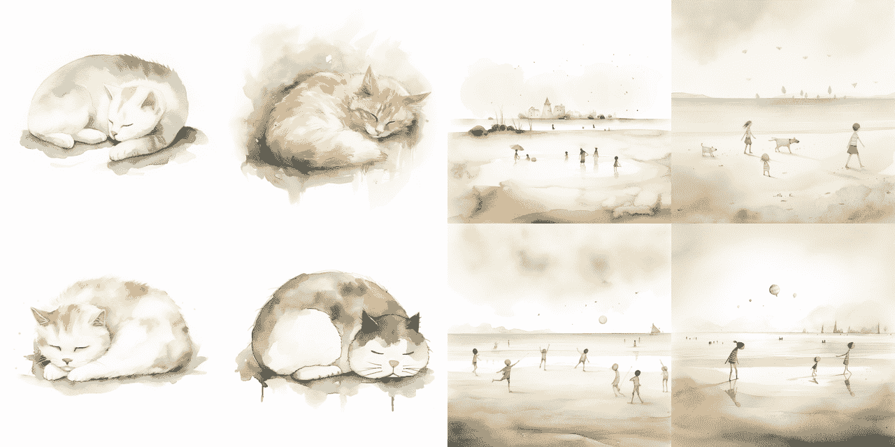

## 百科插画

除了水彩外，我很喜欢的另一种插画是百科全书手绘插画。我们一起画一副玫瑰：

再画一组恐龙：

以下是生成的图片，看起来，Midjourney 并不知道霸王龙只有两只脚，哈哈哈，不过第一张真的非常像 Andrey 的风格：

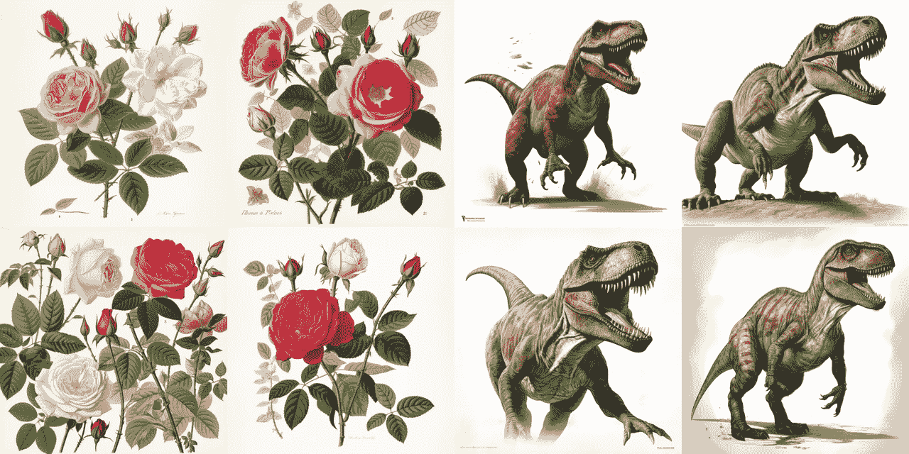

## 绘本插画

我个人觉得绘本插画只要用好技巧五：增加风格——艺术家，基本上就能做出一些不差的插画。我绘本看得不算多，但应该不少人知道彼得兔，我们试试画一副和彼得兔类似风格的小猫：

另外我们也试试小熊维尼的插画师 E.H. Shepard 的风格（右边四张）。这里要额外说明下，为了让生成的结果更倾向于该作者的风格，我没在 prompt 里加入太多背景信息：

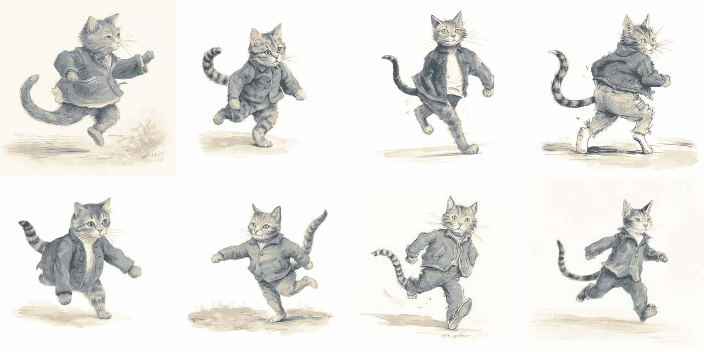

## Behance 风科技插画

坦率说来，这个并不是一种插画风，但作为互联网行业从业人士，我觉得这个还挺刚需的，但需要注意，经过我的测试，只要在最前面加入 tech illustration 也能生成类似的风格插画，但效果比较一般，当我加上 behance style 后（Behance 简单理解是一个设计师分享作品的网站，分享的作品多与科技产品有关，如 App 设计等），就变得精致和漂亮了：

另外，我还做了一个大家比较熟悉的咖啡馆场景：

最后的结果：

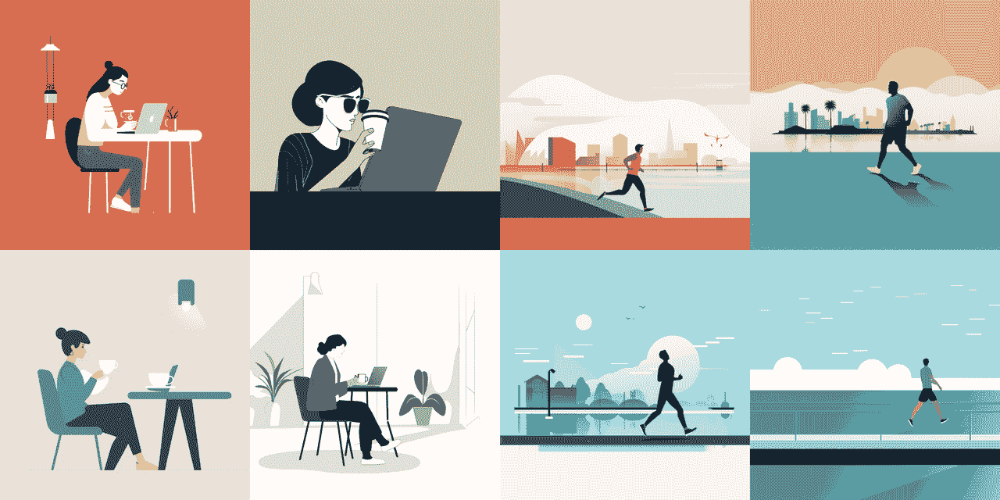

最后，这里面还有一个神秘参数，就是加上一些公司（比如 by Microsoft），我目前测试过像 Slack、Dropbox、Microsoft、Apple 感觉是有一点点差异，但我不知道 Midjourney 是怎么理解或处理这个词的，下面是两组案例，左边是微软的，右边是苹果的，除了苹果的第四个有个苹果 logo 外，我是看不太出来还有什么地方体现苹果的，个人觉得可能是在用色上会用该品牌的品牌色？

感兴趣的朋友可以去探索下。

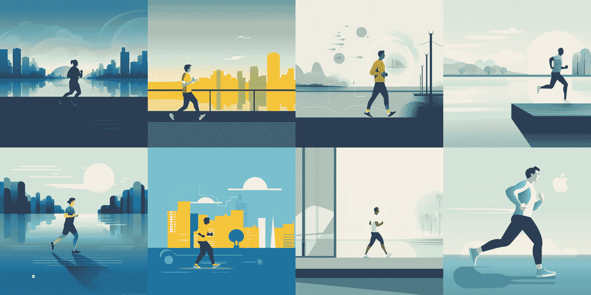

## 填色插画

最后一个要介绍的也不知道是不是插画，但可能不少朋友见过，就是那种可以让你在上面用蜡笔，或水笔填色的填色插画。我觉得非常适合让小朋友自己生成填色插画，然后打印出来，让小朋友上色。以下是霸王龙的例子：

白雪公主的版本只要将主体改成「Snow White」即可，以下是生成的图片：

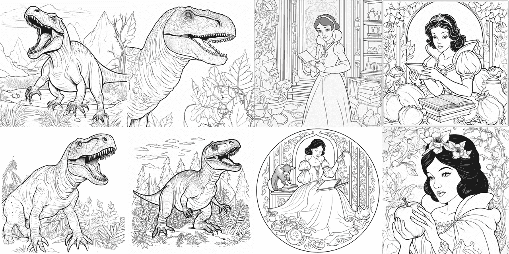

# 场景5：头像

在 Stock Photo 一章中，介绍了 img2img 的方法，这个方法除了解决 Stock Photo 的那几个问题外，还很适合多个场景。

本章会着重介绍用这个方法生成的头像的 prompt。并且从本章开始会逐步丰富我们的 prompt 结构，使其更加完整。

## 注意事项

在介绍 img2img 的应用前，我想强调一下：

1.  不要在 Discord Midjourney 公开群上传自己的照片！这样你的照片会被公开群里的所有人看见。建议使用 Midjourney Bot。

1.  另外，非 pro 付费会员，生成的图片都会被其他会员看见。但你可以在生成完头像后，删掉生成的图片。如果还不知道如何使用 Bot ，及删除照片，请看基本操作篇。

1.  img2img 的操作我就不过多赘述了。如果你还不太清楚，可以看基本操作篇，以及 Stock Photo 那篇。

## 3D 卡通头像

第一个要分享的是卡通头像。首先跟大家强调下：

1.  我基本上把国内国外的生成头像教程都看过，并试过一遍，还跟 Midjourney 社群的人也交流过。我的理解是，以目前 V5 的能力，不管你如何调整 prompt ，想用 img2img 方法生成一张非常像原图的图片，基本靠运气，即使用了前面介绍的技巧七方法，也只是提高概率。如果你有令头像非常像的方法，不妨通过 Issue 分享给我，我会署下你的名字，并分享给大家。

1.  各位在学习的过程中，如果发现生成的图片不像原图，也不需要气馁。这是正常的。

1.  **你可以通过我分享的方法，生成一张有原图**神韵的卡通头像。注意肯定不会非常像原图。

在 prompt 里加上原图链接（建议使用证件照，或者背景比较单一的照片，这样成功率会高一些），然后用我前面提到的框架设计一个 prompt：

最后，还有三个技巧：

1.  如果你生成的照片并不像预设的照片，可以在四张图里，挑一张比较像的，然后点 V（Variation），让模型继续生成，再继续挑一张像一点的照片，然后继续生成新照片，直到出现一张比较像的。

1.  第二个，我觉得很神奇，如果前两个方法你都试过了，你生成的图片还是跟原图不像，那就在 prompt 里加上「wear glasses（戴眼镜）」，真的很神奇，我只要加上戴眼镜就像非常多，如果你原图戴眼镜了，你试试在参数里加个 —no glasses，你会得到一张更不像你的图。

1.  最后，就是多用一个参数，这个方法会在技巧八中展开说下。

本章最后，有我的证件照的案例。

## 技巧七：多参数同时使用

在使用 img2img 的方法生成头像时，我发现问题是「文字权重比图片权重高」，导致其生成的图片不像原图，iw 参数在 V5 里最多提升图片权重到 2，所以我就在想有没有可能进一步降低文字的权重。

然后我就试了下 s 参数，发现的确好了很多。

如果生成的图片还是不像，你可以在 —iw 2 基础上，再加一个参数 —s 200 ，注意同时用两个参数时，中间不要有逗号。我发现加了 s 参数之后的确像了很多，我个人猜测是 s 和 iw 连用会进步一削弱 text 的权重。

s 是控制生成图片的风格化程度。简单理解，这个值越低会更符合 text prompt 的描述，数值越高艺术性就会越强，但跟 text prompt 关联性就会比较弱。所以如果你生成的图还是不像，就加大这个值，比如调到 500。

我想通过这个案例告诉大家，多个参数一起使用，有可能会形成合力，进一步放大模型的能力。未来有新的参数能力，不妨也想想有没有可能一起用？

## 动漫风头像

与 3D 卡通头像一样，主要的修改是在图片风格上：

## 赛博朋克头像

这是我最喜欢的风格之一，也是只需要改一下风格和背景即可：

上面这几个头像 prompt 最后生成的头像是这样的，坦率地说，我已经尽力了，我的个人特征太少了，人也不帅，生成的图片，都有种东南亚人那味，感觉 Midjourney 对亚洲人的理解还不是很行 😂

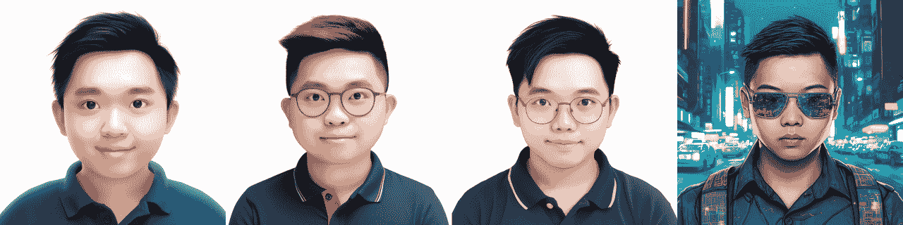

## 技巧八：使用 Seed 参数对图进行二次修改

注意：这个技巧，我个人觉得未来潜力比较大，但目前 Midjourney 的实现效果还比较一般，效果得不到保证。官方的社区的帮助文档也提到这个功能在 V5 非常不稳定。详细可以看看我整理的 Midjourney 官方 FAQ 一章。

你可能遇到类似这样的场景：

1.  你输入一段 prompt，机器生成了 4 张图片

1.  你看了下4张照片，发现其中有一张还行，但其余不是很满意，然后改了下 prompt，机器又生成了一些

1.  但这次生成的照片你都不满意，你就很烦恼为何会这样

1.  然后你就像为啥不能在第一次生成图上做修改呢？

基于某一次生成的结果进行二次 prompt 修改，理论上我认为是可以的，以赛博朋克头像为例，我先用上述 prompt 生成了四张图片，然后在消息的右上角点击 emoji 按钮（下图1），然后再输入框里（下图2）输入 envelope，然后点击信封 emoji（下图3），接着 bot 就会将 seed 号码发给你。

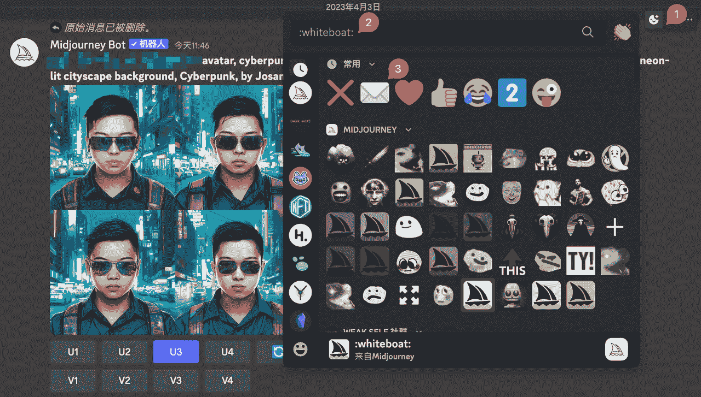

然后我修改上面的赛博朋克头像的 prompt，将其背景改为 China Town，此时需要注意：

1.  新的 prompt 并不是只改 background，你需要将之前的 prompt 都带上。

1.  prompt 仅修改 background 的部分。

1.  最后带上 seed 参数。

以下是我的案例：

原 prompt：

```
{img url}  avatar, cyberpunk robot face, holographic VR glasses,holographic cyberpunk clothing, neon-lit cityscape background, Cyberpunk, by Josan Gonzalez --s 500 --iw 1
```

新 prompt（seed 码只是示例，你要填写自己的 seed）：

```
{img url}  avatar, cyberpunk robot face, holographic VR glasses,holographic cyberpunk clothing, China Town background, Cyberpunk, by Josan Gonzalez --s 500 --iw 1 --seed 758242567
```

以下是生成的效果（左图为原图，右图是用了 seed 后生成的图），可以看到，背景的确换了，但人的外观也有点变化 😂

效果不是很好，但我觉得值得探索，这样能提高渐进优化的成功率：

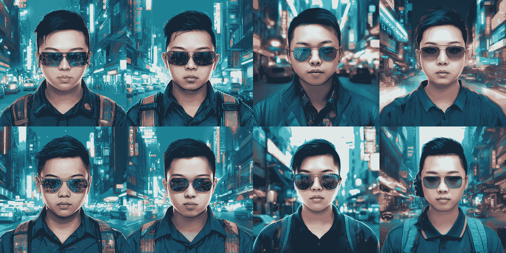

## 技巧九：神秘的 blend 功能

这个技巧，说实话，我感觉不能称其为技巧，但这又是一个 Midjourney 非常重要的 feature，所以在这里着重介绍一下。

这个功能使用起来非常简单，在 Discord 输入框里 /blend，然后点击这个菜单：

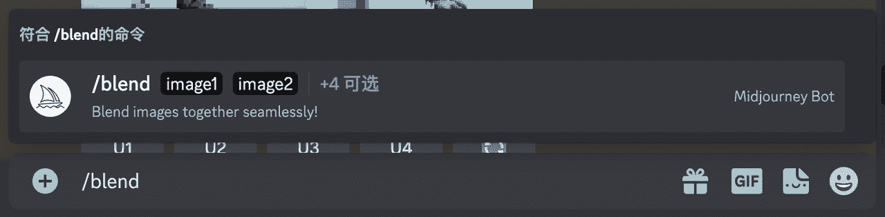

之后你的输入框就会变成这样：

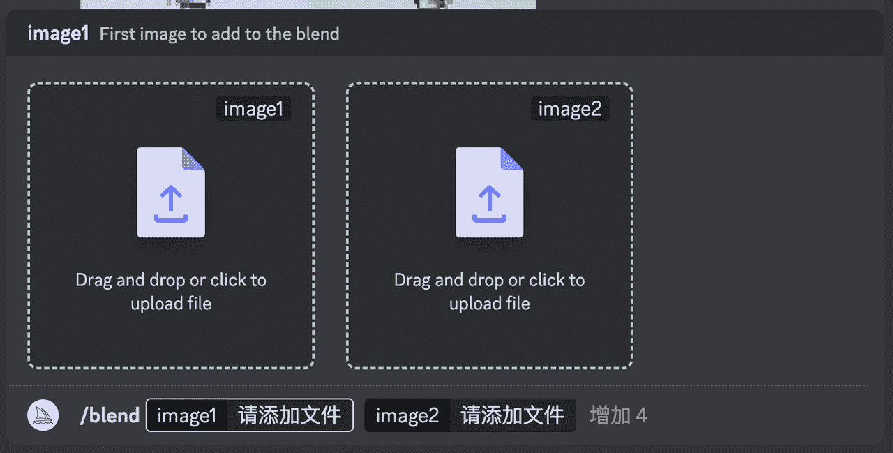

然后你就可以点击这两个框，然后选择你电脑上的照片，添加完成后，大喊一声「使用融合卡」（不是），然后点击回车：

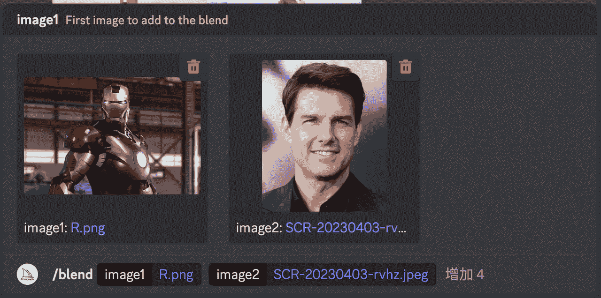

然后 Midjourney 就会生成这样牛逼的结果，左边是融合钢铁侠，右边是融合巴斯光年：

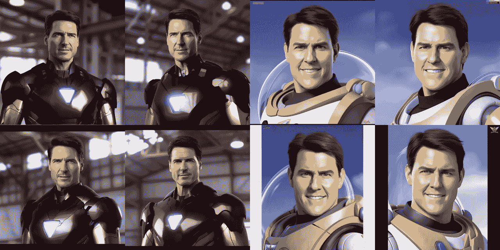

这个功能我第一次看到时，我是非常震惊的，以为是小时候看游戏王里主角们使用「融合卡」的那种效果。可惜并不是，这个功能非常不稳定，仅有在满足多个未知条件才能达到上述的效果。

我本来打算用这个方法用于生成头像，但我发现只要用自己的照片，融合其他风格的照片，效果都不太好，目前实验下来效果最好的是名人头像，我的感觉是因为 Midjourney 喂了不少名人的头像给模型，所以这种融合的效果都很好。

但我觉得它真的很适合做头像，将自己的头像跟另一张图片融合一下，就能生成一张不错的图，方便又快捷。可惜目前这个功能感觉还不太好用。

当然这个功能还不仅仅止于此，它还有很多使用场景，在后续会介绍给大家。

# 场景6：游戏

## Prompt 真的越长越好吗？

按照 Midjourney 的官方文档里的说法，并不一定：

> Prompts can be very simple. Single words (or even an emoji!) will produce an image. Very short prom**pts will rely heavil**y on Midjourney’s default style, so a more descriptive prompt is better for a unique look. However, super-long prompts aren’t always better. Concentrate on the main concepts you want to create.

但你会发现，好像中文社区分享的 prompt 都非常长，但只要各位仔细观察，或者用翻译软件查一查，你会发现很神奇的事情：

1.  有一些词拼写错误。原因是某书，不支持复制黏贴，导致很多人 OCR prompt，然后识别错误，大家都在搬运 prompt ，导致错误一直传递，这也算是新时代的水印了吧。

1.  有一些词非常重复，比如 8k、UHD、Ultra Quality，他们都在说一个事情，就是高清，加多了也不会有叠加作用。

1.  很多词你根本不知道为啥需要，但好像每个人都加了。比如 8K 这些词，你有想过这个词是有必要的吗？是有用的吗？但实际上这些词官方并不推荐使用，这些词甚至对你的图会造成破坏（详见 Midjourney 官方 FAQ 一章）。

如果你看完我的教程，你会发现我讲的例子里，很多图只要很少的 prompt 就能描述清楚，生成的图片也不差。

当然我并不是说，不能写很长的 prompt，如果你生成的内容本来就很复杂，那写长一点也没所谓，但写完问问自己，这有必要吗？

## 像素游戏

说到游戏，我最喜欢的风格是像素风，像素风格一般有：

+   8-bit

+   16-bit

+   32-bit

各位都可以自己试试，介绍一个我写的 prompt，最近塞尔达发布了最新作《王国之泪》，很喜欢他们的天空岛的设定，所以用 Midjourney 生成了一个 16-bit pixel art 版本：

再生成一个宠物小精灵的场景：

这两个 prompt 都很短，但很有意思，可玩性挺强的，各位可以多玩玩：

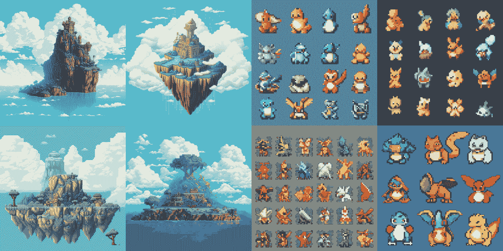

## 3D 游戏——场景

因为篇幅的原因，我无法将所有有关 3D 游戏的 prompt 都介绍完，我只能挑选一些我比较喜欢的风格讲一下，而且我不是专业的 3D 设计师，所以未免会有讲错的地方，望见谅。

在 3D 场景设计里，我最喜欢的应该是像素风 3D 微缩场景，也不知道是不是叫这个名字😂，写一个 prompt 给大家看看：

以下左图是火星工厂，右图是机器人实验室：

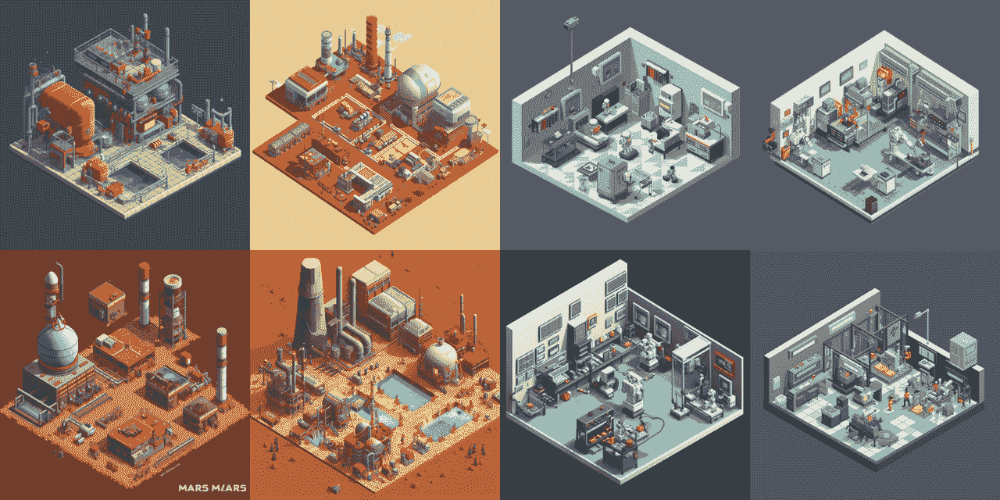

## 3D 游戏——人物

主体描述我就不多说了，更多是分享 3D prompt 的必要的要素：

我用以上 prompt 生成了达斯维达和风暴兵的，我觉得风暴兵还挺可爱的：

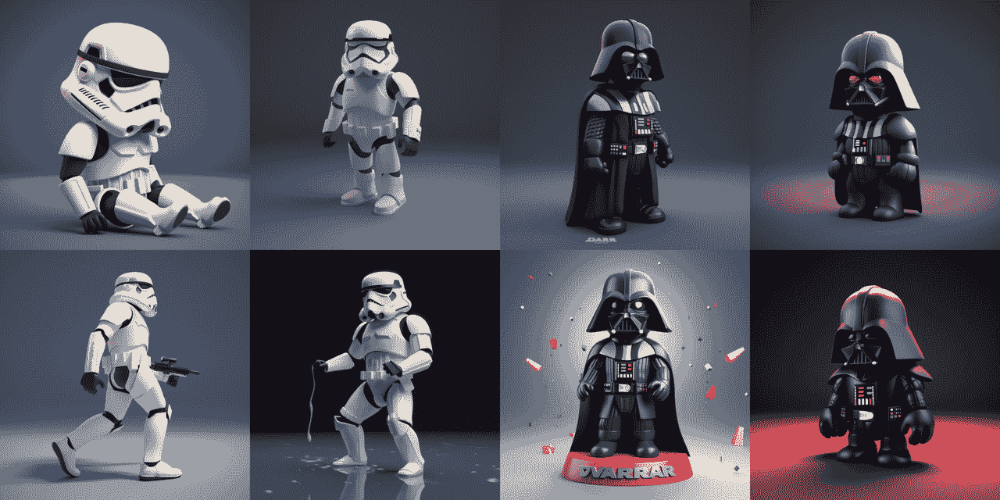

## 3D 游戏——装备

游戏装备非常非常多，我没法一一给大家介绍，只介绍一些我了解的，首先是戒指，多大数的游戏戒指都是那种印章戒指（signet ring），

另外一个可能常见的是装备集（我不确定这个中文是否正确，英文叫 Item Collections），写法是这样的：

最后生成的结果如下，但我对装备集的生成不是很满意，后面我会介绍一个技巧，教大家如何渐进优化生成的图片：

## 技巧十：控制变量法渐进优化

很多人把 AI 生成图片比喻为炼丹，我觉得非常贴切，很多时候，也不知道为啥，在 prompt 里加一点神秘配方，图片就会很不一样。

不过我觉得虽然过程很像炼丹，但并不代表我们需要像古人那样，用撞大运的方式炼制丹药。我认为目前使用 Midjourney 最好的方法是：控制变量渐进优化法。

拿上面那个装备集的图片为例，我希望它生成的是装备，并且是一件件地排布，而且光剑的效果也很奇怪，首先我们来逐条排查 prompt：

从这个表里可以看到，我们发现了三个问题，其中第一个黏土风格问题，跟最后一个问题有关，此时我的建议是：

1.  每次仅修改一个，其余变量不变。

1.  修改完一条，效果符合预期后，再修改下一个。

1.  我的经验优先修改主体内容，因为主体有的时候会影响其余的变量。

1.  如果想确定这个修改是否具有一致性，或者说是否符合要求，而不是恰巧符合，可以用相同的 prompt 再生成一次。不过因为没生成一次都要花钱，所以这个是可选项。

OK，按照以上原则，我们修改一下我们的 prompt，看看生成了什么，的确加了 different types of 后，光剑就多了，问题解决了：

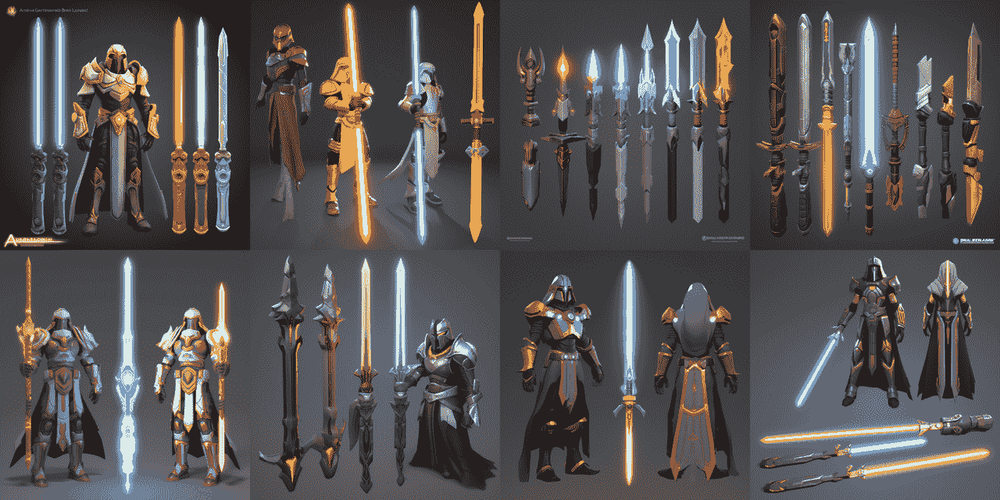

然后我们修改下 blender 3d，将其改为 clay render （黏土渲染），我改完之后发现生成的结果（左边四张），好像质感还是差了一点，于是我又试了下保留 3d blender 加 oily 的效果（中间四张），以及 clay render 加 oily 两个一起用（右边四张）。

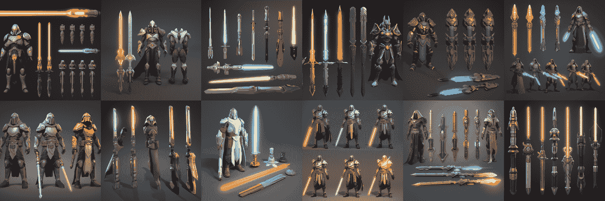

我个人觉得好像两个都改了效果是最好的（右边四张）。

对比一下最开始的 prompt 生成的图片，是不是最终的图片效果更好？所以这个技巧主要想告诉大家，写 prompt 没有必要照抄答案，你也有能力自己写好 prompt。

## 游戏设定稿

游戏这一章，再介绍一个可能会用到的一个场景人物设定稿，prompt 如下：

最后的结果如下：

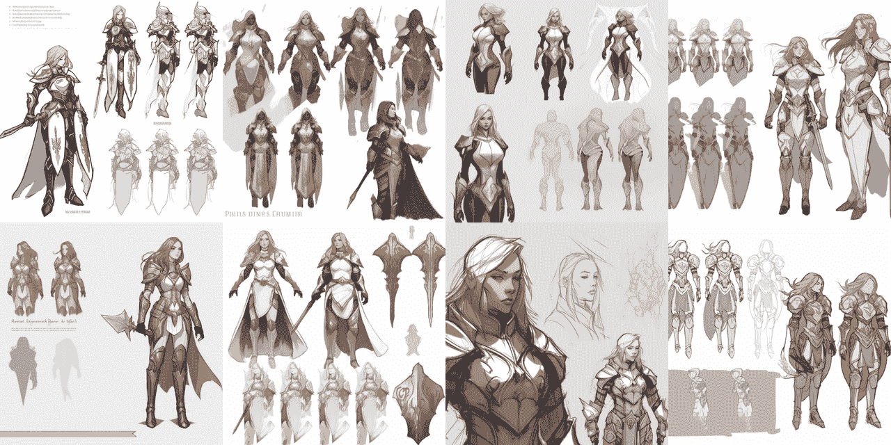

# 场景7：实物

## 让 ChatGPT 生成提示词是不是更好？

我有用 ChatGPT 辅助我生成提示词，但没有用 Role 模式，而是让它：

1.  翻译：我知道我想要的东西，但不知道其英文描述。

1.  解答：我需要一些风格词，但我不知道输入啥时，就会问 ChatGPT ，比如「文艺复兴时期的著名艺术家有哪些？」

我为何没有用 Role 模式？

的确，让 ChatGPT 以 Role 模式帮我生成内容，比较省时省力，但我个人觉得：

1.  使用比较麻烦，需要输入很多提示，即使通过 App 保存，在多次输入后，就会超过 token 限制，又要重新输入。

1.  从 ChatGPT 的原理上看，它只会生成一个「普通」的内容，很难获得超过预期的内容。只是说大多数人甚至连「普通」都达不到，所以才会震惊于它的效果。所以如果你想要生成原创惊艳的图，靠概率是不行的，要靠你的想象力。

不过，这也是我一家之言，如果你觉得这样效率更高，那就用吧~

没啥关系，适合自己的工具才是好工具。

## 玩具

OK 言归正传，从本章开始，我们会逐步丰富我们的 prompt 框架，让图片有更多的细节。实物生成的第一个是场景是玩具，是个非常有意思的场景。

另外，这个场景如果能跟 3D 打印机结合一下，我觉得会非常赞。不知道有没有有志之士能实现一下。

再解释下 prompt 有哪些更新，从实物这张开始，我讲「背景」调整为「环境」，即主体环境，包括背景、灯光等等：

另外一个是游戏王里的蓝眼白龙，可惜 Midjourney 并不知道啥是 Yu-Gi-Oh，只能按字面意思生成了一个：

以下是生成的图片：

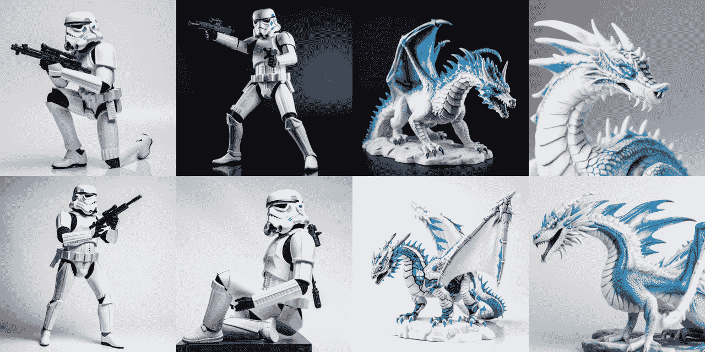

另外，我发现 Midjourney 对美式动漫或电影作品支持会好很多，比如冰与火之歌里的龙妈（只是龙有点诡异），还有圣女贞德：

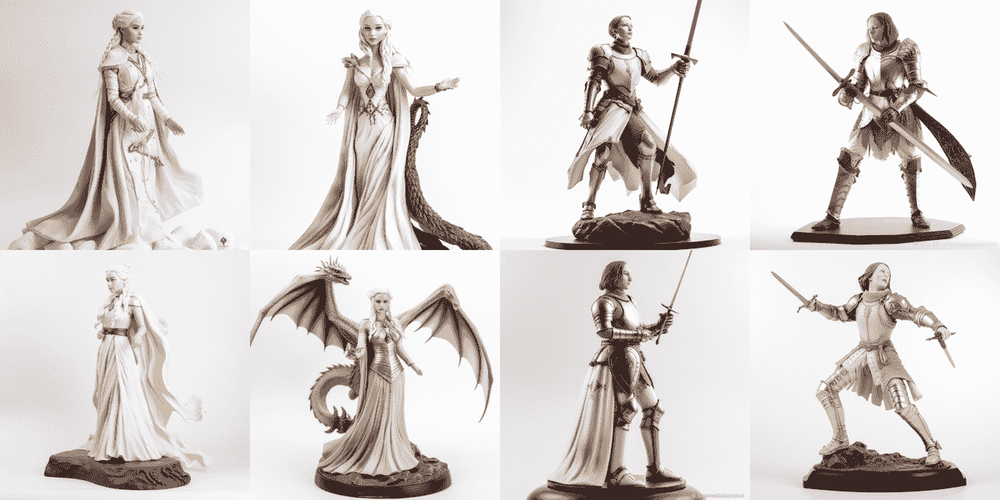

## 技巧十一：增加风格——国家

说到手办，大家应该第一反应会想起日本，再介绍一个技巧，在 prompt 里加入 Japanese style 即可，拿圣女贞德作手办，以及之前做的 logo 作为例子：

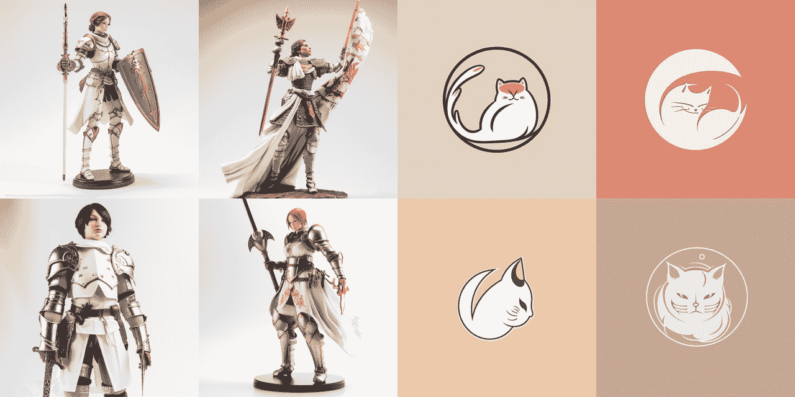

圣女贞德是不是有种 FF 的感觉？Logo 也比较简洁，猫的外观也有点像动漫里猫的外观，当然除了 Japanese 还有 Chinese（左边4张），甚至 African Style：

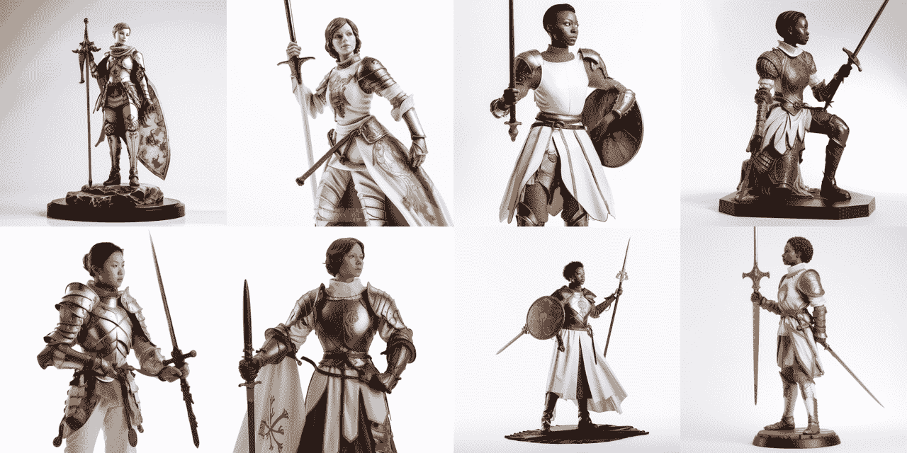

## 技巧十二：增加权重

各位有没有发现，上面那个 Chinese 手办生成的结果好像只有第三张是中国人面孔？原因是 Chinese style 的权重太低，所以仅输出了一个结果。你在实践的过程中，也肯定会遇到，AI 忽略了某些 prompt 词的情况，比如你提到画面中要有一只鸟，但它就是没画出来。

那为何会产生这样的结果？原因 Midjourney 的 prompt 权重是按照顺序逐个降低（详情请见我翻译的 Midjourney 官方 FAQ），在我们上面的 prompt，我们将 Chinese Style 放到了最后，所以生成的结果也是最少的。忽略了某些词，这个原因暂时为止，但应该很可能是权重导致的问题。

增加权重的方法有很多，最简单的方法就是调整顺序，比如将上面的 Chinese Style 放到最前面（然后生成的结果就是眯眯眼 style 了 🤣，我生成了两次，第二次好一些）：

```
product photography, Chinese Style,Joan of Arc, full body, hand painted, plastic, detailed, white background, studio lighting
```

调整下顺序，效果就大不一样，所以各位不要迷信所谓的 prompt 模板，多试试。

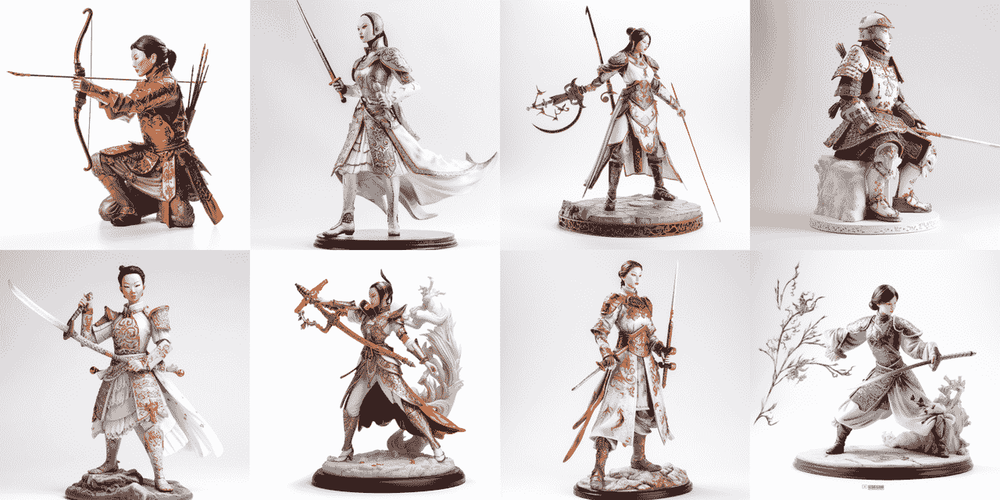

第二种方法是 Slider 方法。

你需要在 prompt 最后加 ，然后加上你需要调整权重的词语，接着再加 ，最后加上权重值。比如还是上面的例子，我想突出 Chinese style 但不想调整顺序，就可以改为：

```
product photography,Joan of Arc, full body, hand painted, plastic, detailed, white background, studio lighting, Chinese Style :: Chinese Style :: 0.5
```

然后你会发现，好像权重太高了，生成了跟 prompt 无关的图（下方左图），那我们可以在原来的基础上，再加以下 Joan of Arc 的权重（下方右图）：

```
product photography,Joan of Arc, full body, hand painted, plastic, detailed, white background, studio lighting, Chinese Style :: Joan of Arc:: 0.25 style of Chinese:: 0.5
```

你可以看到，调整参数后，生成的 4 张图有 2 张具备较强的 Chinese 风格：

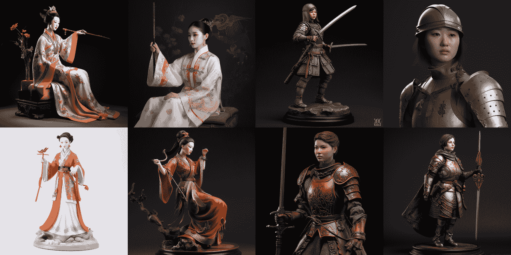

不过坦率说来，这个方法，并不特别适合这个案例，调整主体内容，或者顺序， ROI 会更高一些，这个方法更适合 miss 掉某个 prompt 词时使用，比如官方的案例是这样的：

```
several sad cats watch a crying woman in a home-office environment with laptop
```

生成的图片里（左四张图），猫咪们都看着你（你可能才是 crying woman 😂），如果用 slider 的功能（右边四张），crying woman 就出现在画面里了：

```
several sad cats watch a crying woman in a home-office environment with laptop:: several sad cats::0.5 crying woman::0.6 laptop::0.7
```

另外需要注意，slider 可用的参数有 0.25、0.5、0.6、0.7，也可以用这个方法降低权重，区间是 -0.7、-0.6、-0.5、-0.25：

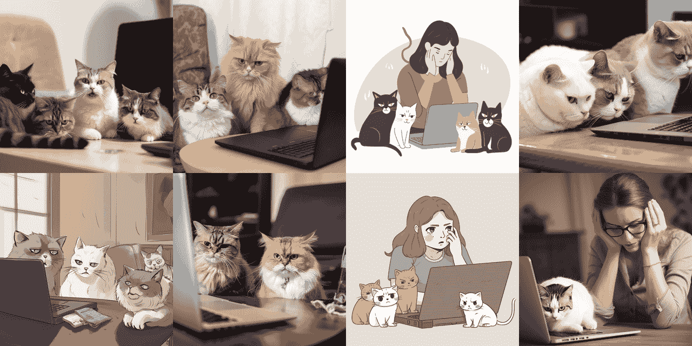

**        如果你用了 s**lider 还是没有出现应该有的画面，那还有一个大招 cowbell，坦率说来，这个并不符合 Midjourney 的官方最佳实践，但的确是个可行的方法，以下面这个 prompt 为例，生成的图片里，woman 看起来并不 shy（左边四张图）：

```
A songbird sits on the shoulder of a shy blonde woman dressed in white.
```

此时你可以重复重复再重复（我觉得这就是为何这个方法叫 cowbell 的原因）：

```
A songbird sits on the shoulder shoulder shoulder shoulder shoulder shoulder of a shy shy shy shy shy shy shy blonde woman dressed in white.
```

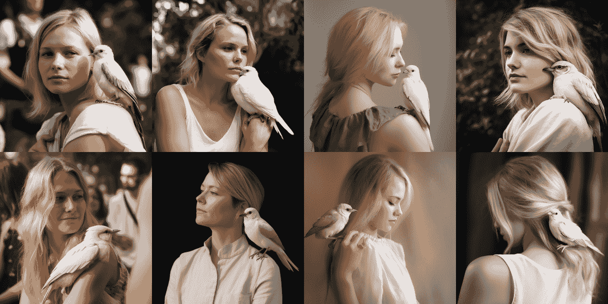

## 食物

另一个我比较喜欢的实物是食物，食物讲究的是「色香味俱全」，所以在描述食物类的 prompt 时，可以往这三个方向想想：

+   色：食物是什么颜色的（可以通过食物的熟度来控制）。

+   香：照片没有香味，但我们可以把香气画出来。

+   味：照片也同样没有味道，那我们加一点细节装饰？比如撒上胡椒、盐、辣椒？

然后再来一碗红烧牛肉面：

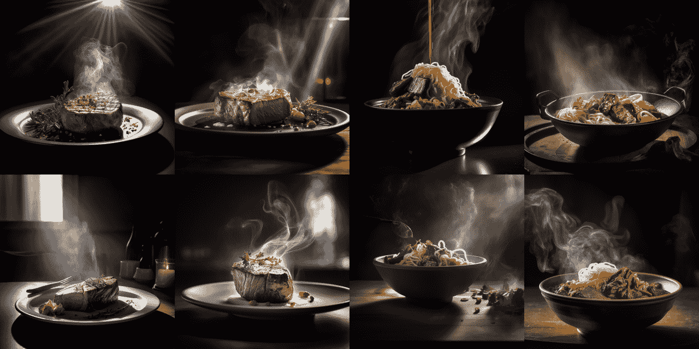

## 技巧十三：善用灯光

坦诚地跟大家说，我不是设计师，也不是摄影师（而且我非常不擅长摄影），所以我仅能跟大家分享一下基础内容，因为这个对我来说，太多过程性知识了，不实际操作过，根本不知道有什么。

言归正传，摄影中，常用摄影灯光有以下几种：

1.  主灯 (Key Light)：主灯是最基本的摄影灯光之一，通常放置在被拍摄物体的正前方或正侧方，用于照明主体，决定拍摄物体的主要明暗度。主灯通常是亮度最高的灯光。

1.  填光灯 (Fill Light)：填光灯用于弥补主灯照射的阴影部分，调整阴影的深浅程度，使照片明亮一些。通常填充光应该比主光暗一些，以避免出现过度曝光。

1.  逆光灯 (Back Light)：逆光灯用于照射被拍摄物体的背面，能够区别出主体和背景，并使物体轮廓变得清晰，常用于拍摄骨感、重物感和逆光效果的照片等。

1.  环境光 (Ambient Light)：环境光就是摄影环境自然产生的光线，包括室内照明、自然光、街灯等，它可以补充被拍摄物体的表面，提升照片的自然度和真实感。

1.  故事性灯光 (Special Light)：通常是为了制造出某种情境或者表达某种意义而使用的，例如烛光、亮光等。它们能够产生温暖、浪漫、神秘等场景和气氛，以探索和表达艺术的想象力和创造力。

基于这些灯进行排列组合，你会得到不同使用场景的灯光。灯光的细节种类，可以去我归纳的 Lighting List 里查看，我这里主要分享一些常用和易用的场景灯光：

# 场景8：人物

## 名人照片

这算是 V5 的新特性，Midjourney 在 V5 版本认识很多名人，你可以在描述主体的时候，加上名人的名字，就可以生成该名人的照片，我们生成几个电影里的经典照片：

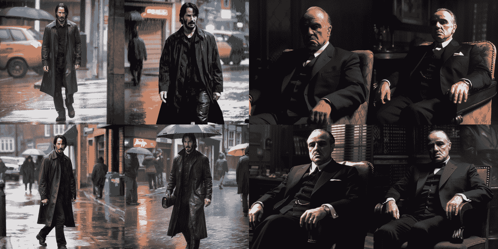

第一个是 Keanu Reeves，第二个是 Vito Corleone（我并没有输入主演人 Marlon Brando），两组图的 prompt 都非常简单，你可以尝试自己写一下😁

本章最后有答案。

## 衣服模特

做衣服类电商的朋友可能会比较需要这个功能：

1.  用 AI 生成一个虚拟人

1.  然后将货物照片（比如某件衣服）传给 AI

1.  AI 将虚拟人和货物的照片融合在一起

坦率说来，我觉得 Midjourney 应该是可以的，但目前的效果还不太好，要想实现这个需求，只需要用到前面介绍的技巧九里提到的 blend 功能，详细方法就不在这赘述了，大致就是我将商品图和人物图用 blend 功能融合了下：

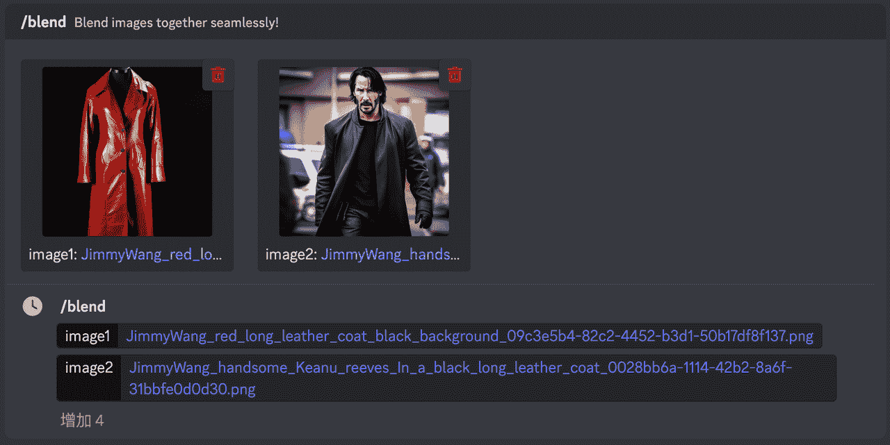

为了验证一致性，我生成了几张 Reeves 的图分别尝试了下，最后输出的结果是这样的：

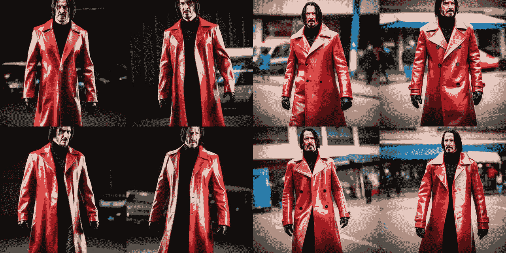

整体来看，好像还行，但真的用在商品描述图里，我觉得还不太可能，因为里面的衣服跟原图差距还比较大（可以细看里面的纽扣）。

但我觉得未来 Midjourney 可能会优化好这个功能，并且我觉得如果可以自己训练模型，这个功能实现起来应该不难。

## 老照片

这个算是名人照片的分支玩法，最近大家应该看到过很多类似的照片，其实 prompt 很简单，主体和背景大家用翻译软件搞搞就行：

用类似的 prompt 生成了两组图片：

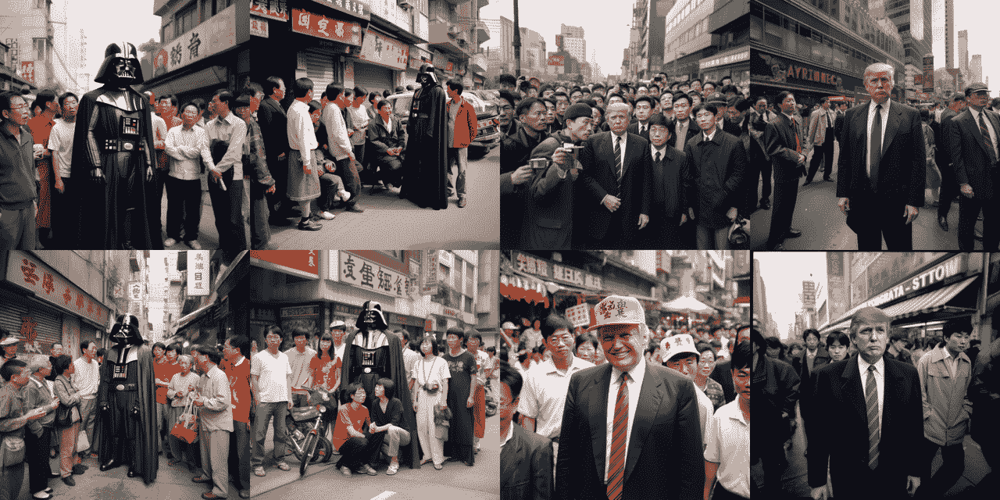

## 技巧十四：增加风格——年份

上面的老照片场景，我们用了 1990s 风格，严格地说，这个 1990s 更适合放在主体，或者环境里，放在风格里也不是不行，因为不仅仅希望主体是 1990s 还希望图片生成的风格也是 1990s。

这就是最后一种风格词用法：年代。

拿插画那一章的两个 prompt 修改一下，我都没在 prompt 里加艺术家的名字，而是改为 style of 1920s，玫瑰的图有点那味，猫的图右上角那张太逗了。

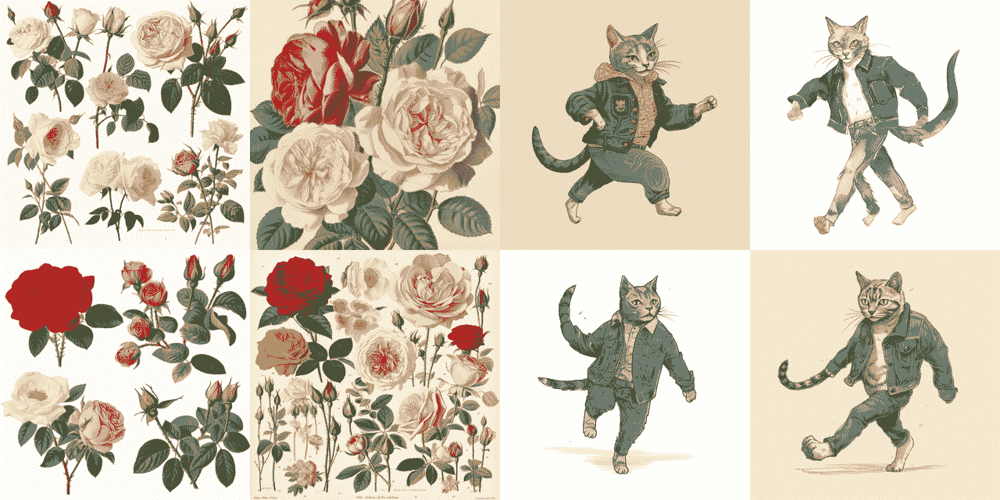

## 名人照片答案

Reeves 很简单，就是说明主体，然后注明穿着标志性的衣服，走在大雨里：

```
Keanu Reeves, wearing a black long leather coat, walking down the street in the rain
```

然后教父的那张就更简单了：

```
Vito Corleone sitting on a chair
```

## 技巧十五：如何让 Midjourney 生成的人更具有多样性？

这里的多样性其实是指人的高矮胖瘦，甚至身体的一些特殊性等。

不知道各位有没有发现，大多数用 AI 生成的图片，人物都非常漂亮和英俊，但这并不好，这其实某种程度上代表了社会的偏见。

所以我想在本章重点介绍下，如何让 Midjourney 生成更多样的人体。

**方法一：Slider 方法**

在上一章，我介绍了增加权重的方法，这个方法还可以帮助你生成不同体型的人物，以下是 Midjourney 官方社区的案例：

```
Plus-sized ginger female dressed in bohemian vest, maxi skirt, espadrilles, walking across autumn campus courtyard, morning atmosphere:: plus-sized::-0.3 --ar 2:3
```

你可以控制 plus-sized 后面的参数，从而使画面中的人物变胖或者变瘦。这里需要注意，并不是负数就是越瘦的意思，而是削弱了 plus-sized 权重，如果你的 prompt 词是 thin 你加个负数 slider 参数那就是变胖了：


**方法二：直接描述**

Midjourney 是知道一些多样性的词语的，比如：

+   blind：失明

+   deaf：聋

+   cerebral palsy：小儿麻痹

+   accessibility：行动不便


[**一**](https://learningprompt.wiki/docs/midjourney/mj-tutorial-text-prompt/scenario-7-substance)

# 场景9：风景

实物和人物介绍完，介绍一下风景。坦率说来，我并不擅长摄影，所以这三章写得可能会不太专业。我更多地是介绍方法，以及告知大家可能性。

如果有不对的地方，请见谅。

## 微缩景观

风景大片，我觉得大家应该都在各大平台看过了，所以本章不会介绍太多常见的风景制作方法。而是介绍一些少见的，我这里介绍一个比较有趣的类型：

另外还制作了一个火星工厂：


另外，我还很喜欢用这个效果制作一些多肉植物的照片，主体只要填写：cute mini Haworthia cymbiformis plant in a pot，或者 cute mini Aloe plant in a pot ：


## 建筑

严格说来，这个不算风景，但因为我实在不知道该放哪里，所以还是放到风景这了。

因为我不是建筑相关的从业者，所以我这里只介绍一种用法：对于人造物件，可以在主体里加入由 某某某 制造。以建筑为例，也不需要在 prompt 里加类型：

右边是 Frank Gehry：


如果你对建筑感兴趣，不妨试试两种风格的建筑融合在一起试试，说不定会碰撞出有意思的设计。

## 技巧十六：改变相机与镜头

前几章节分享了灯光，本章分享下，相机和镜头。

可能有些朋友用过一些手机 App ，它并不像 PS 工具那样，允许你修改图片的白平衡等参数，而是让你体验用旧相机（如胶卷相机）拍照，虽然本质上来说，它也是通过各种参数来模拟当年的相机效果，但的确挺有意思的。

在 Midjourney 里，你也可以通过增加相机或者镜头的名称，从而达到类似的效果。根据我的实验，Midjourney 可以改变以下几类：

1.  相机：支持不同种类的相机，比如运动相机 GoPro

1.  胶卷：比如 8 mm 电影胶卷

1.  镜头：比如 15 mm 镜头

1.  相机设置：比如长曝光、双重曝光

1.  景深 & 焦点：比如深景、浅景，还有消失点

我很喜欢双重曝光的效果，以及长曝光：


不过各位使用时，需要根据自己的场景选择合适的相机和镜头，比如无人机视角，都不太适合拍近物：