# Sora 学习手册

> 来源：[https://aiyanxishe.feishu.cn/docx/Mvevdr7mxoyomYxbRwKclwjKnHc](https://aiyanxishe.feishu.cn/docx/Mvevdr7mxoyomYxbRwKclwjKnHc)

<https://aiyanxishe.feishu.cn/sync/H4bBd6rOtsCpG9bjI0ZcDHxinnc>

## 一张图读懂 Sora

# 🎯写在前面的话

> Sora 大模型就像是那颗最亮的星，不仅带火了技术圈，还改变了好多行业。我们这个资料库，就是想把全网关于 Sora 的智慧都聚在一起，让大家能更好地搞懂它、用好它。

**我们的目标很简单！！！**

分享最酷的知识   深挖干货   互帮互助  看向未来

如果你对 AI 和 Sora 兴趣满满，想要深入挖掘、并且愿[意加入这场技术革命，](https://xiaobot.net/p/AIGC2024?refer=fd9ed25f-2954-4de4-9e99-88e1999bf395)我们非[ 核心会员群](https://zl49so8lbq.feishu.cn/wiki/WB2awt7lli6actkm7rtc3ejInmd?from=from_copylink)欢迎你的阅读 Sora 掘金手册，加入

## Sora 是什么？

> Sora 是一个可以根据文本指令创建真实且富有想象力场景的人工智能模型。

> 完美继承 DALL·E 3 的画质和遵循指令能力，能生成长达 1 分钟的高清视频。

> 地址：https://openai.com/sora

##

## 名人观点

> 马斯克评 openAl 视频模型：

> 人类认赌服输但 AI 增强的人类将创造出最好作品 Jim Fan 感叹：Sora 是一个数据驱动的物理引擎

> **周鸿祎****：**

> Sora 意味着 AGI 实现将从 10 年缩短到 1 年

> **YouTube 大 V**:

> 动画师和 3D 艺术家的工作可能有危险了

> **AI 创业公司创始人**：

> 五年之后，你将能够生成完全沉浸式的世界，并实时体验它们

> **FinalFrame 创始人**的观点

> 人们会开始真正质疑我们是否处于模拟之中。

> **响马：**

> 已经很多年没出现像 ai 这样具备疯狂的掠夺属性的技术了。

> [**Crypto 军火库**](https://twitter.com/sunyangphp)**：**

> Sora 的出现，眼见为实的时代结束了

## Sora 技术报告解读(思维导图版)

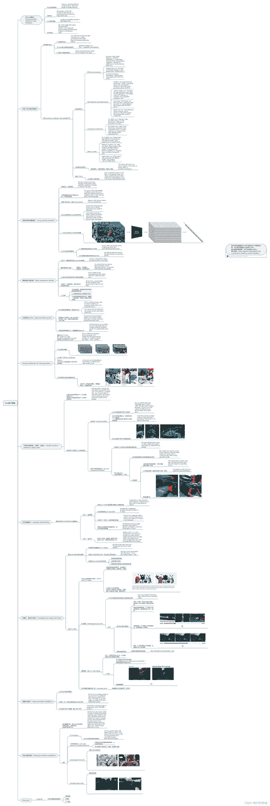

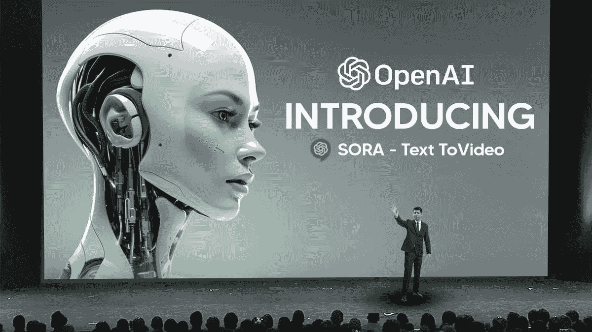

## Sore 六大核心优势

> ✨✨Sora 的三个特点：60 秒超长视频、单视频多角度镜头、世界模型。

> 用过 AI 视频工具的小伙伴应该能知道这三个特点是有多震撼：

> 1️⃣ 别的 AI 视频还在抠 4s 呢，他直接支持 60s，这完全是降维打击；

> 2️⃣ 在语意理解方面也超强，能在一个视频里支持多个角度的镜头，并且还能使视频保持一致性；

> 3️⃣ 理解一定的物理规则，在 AI 视频生成最难的地方就是要使生成的视频遵循我们的物理规则。

> ✨✨我们在视频中可以看到在对物体运动的处理已经非常的好了，甚至对人物的稳定性、背景的稳定性、物体的光影、多角度镜头的转换都能很好的生成出来。

**（1）准确性和多样性：**Sora 可将简短的文本描述转化成长达 1 分钟的高清视频。它可以准确地解释用户提供的文本输入，并生成具有各种场景和人物的高质量视频剪辑。它涵盖了广泛的主题，从人物和动物到郁郁葱葱的风景、城市场景、花园，甚至是水下的纽约市，可根据用户的要求提供多样化的内容。另据 Medium，Sora 能够准确解释长达 135 个单词的长提示。

**（2）强大的语言理解：**OpenAI 利用 Dall-E 模型的 re-captioning（重述要点）技术，生成视觉训练数据的描述性字幕，不仅能提高文本的准确性，还能提升视频的整体质量。此外，与 DALL·E 3 类似，OpenAI 还利用 GPT 技术将简短的用户提示转换为更长的详细转译，并将其发送到视频模型。这使 Sora 能够精确地按照用户提示生成高质量的视频。

**（3）以图/视频生成视频：**Sora 除了可以将文本转化为视频，还能接受其他类型的输入提示，如已经存在的图像或视频。这使 Sora 能够执行广泛的图像和视频编辑任务，如创建完美的循环视频、将静态图像转化为动画、向前或向后扩展视频等。OpenAI 在报告中展示了基于 DALL·E 2 和 DALL·E 3 的图像生成的 demo 视频。这不仅证明了 Sora 的强大功能，还展示了它在图像和视频编辑领域的无限潜力。

**（4）视频扩展功能：**由于可接受多样化的输入提示，用户可以根据图像创建视频或补充现有视频。作为基于 Transformer 的扩散模型，Sora 还能沿时间线向前或向后扩展视频。从 OpenAI 提供的 4 个 demo 视频看，都从同一个视频片段开始，向时间线的过去进行延伸。因此，尽管开头不同，但视频结局都是相同的。

**（5）优异的设备适配性：**Sora 具备出色的采样能力，从宽屏的 1920x1080p 到竖屏的 1080x1920，两者之间的任何视频尺寸都能轻松应对。这意味着 Sora 能够为各种设备生成与其原始纵横比完美匹配的内容。而在生成高分辨率内容之前，Sora 还能以小尺寸迅速创建内容原型。

（6）场景和物体的一致性和连续性：Sora 可以生成带有动态视角变化的视频，人物和场景元素在三维空间中的移动会显得更加自然。Sora 能够很好地处理遮挡问题。现有模型的一个问题是，当物体离开视野时，它们可能无法对其进行追踪。而通过一次性提供多帧预测，Sora 可确保画面主体即使暂时离开视野也能保持不变。

### Sora 和视频生成模型对比

[**Sora 免费学习资料库**](https://zl49so8lbq.feishu.cn/wiki/PiW6wlVlqi3sdnkIRHXcUK8CnK7?from=from_copylink)

## Sora 可以做什么？

Sora 的主要功能是将文本描述转化为视频内容。它能够理解并执行详细的文本指令，生成具有视觉质量和连贯性的视频，这些视频可以包含多个角色、动作和场景。Sora 还能够从静态图像生成动画，或扩展现有视频。这一技术展示了 AI 在理解和模拟物理世界运动方面的进步，为创意产业和未来技术发展提供了新的可能性。

+   生成高质量视频：Sora 能够根据文本提示生成视频，这些视频可以包含复杂的场景、多个角色、特定的动作以及准确的主题和背景细节。

+   理解自然语言：Sora 拥有深入的语言理解能力，能够准确解释提示并生成表达丰富情感的角色多镜头生成：Sora 可以在单个生成的视频中创建多个镜头，同时保持角色和视觉风格的一致性

+   从静态图像生成视频：Sora 能够从一个现有的静态图像开始，准确地动画化图像内容

+   视频扩展：Sora 还可以扩展现有视频，或者填补视频中的缺失帧。

##

## Sora 生成案例演示

AI 想象中的龙年春节，红旗招展人山人海。

有紧跟舞龙队伍抬头好奇官网的儿童，还有不少人掏出手机边跟边拍，海量人物角色各有各的行为。

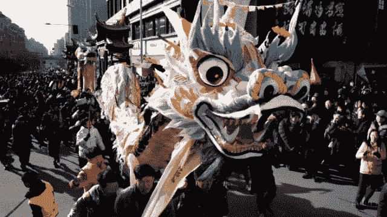

雨后东京街头，潮湿地面反射霓虹灯光影效果堪比 RTX ON。

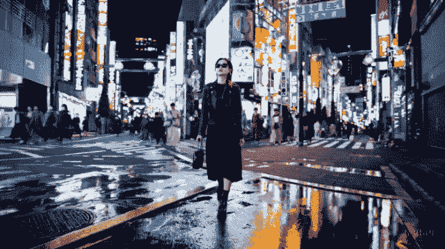

行驶中的列车窗外偶遇遮挡，车内人物倒影短暂出现非常惊艳。

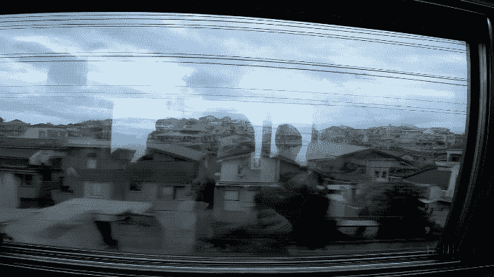

也可以来一段好莱坞大片质感的电影预告片：

竖屏超近景视角下，这只蜥蜴细节拉满：

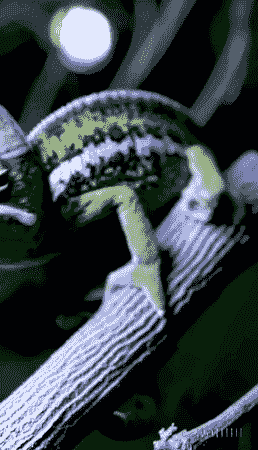

网友直呼 game over，太震撼了：

甚至有人已经开始“悼念”一整个行业：

## Sora 的适应场景

+   **创意内容制作**：为电影、动画、游戏和广告行业提供快速原型制作和概念验证，

+   **教育和培训**：创建教学视频，模拟复杂场景，帮助学生和专业人士学习新技能。

+   **娱乐和艺术**：为艺术家和设计师提供工具，以探索新的创意表达方式。

+   **模拟和预测**：在科学研究和工程领域，模拟实验和预测结果。

+   **虚拟现实和增强现实**：为 VR 和 AR 应用生成逼真的虚拟环境和交互体验。

+   **社交媒体和内容创作**：帮助内容创作者快速生成吸引人的视频内容，增加社交媒体互动。

+   **新闻和媒体：**制作新闻报道的模拟场景，增强报道的视觉效果。

Sora 的这些应用场景展示了其在多个领域的潜力，尤其是在需要视觉内容创新和快速生成的场合。

## **文生视频，只是整个计划之一**

OpenAI 表示，正在教 AI 理解和模拟运动中的物理世界，目标是训练模型来帮助人们解决需要现实世界交互的问题

根据文本提示生成视频，仅仅是整个计划其中的一步。

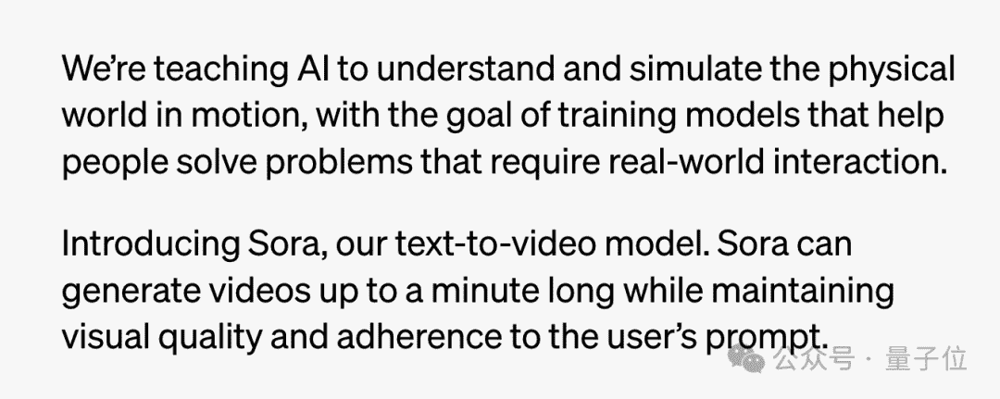

目前 Sora 已经能生成具有多个角色、包含特定运动的复杂场景，不仅能理解用户在提示中提出的要求，还了解这些物体在物理世界中的存在方式。

<https://player.bilibili.com/player.html?bvid=1nx4y127rR&spm_id_from=333.337.search-card.all.click&vd_source=8c56acc490f115c928ee8b96cde1eabd>

对于 Sora 当前存在的弱点，OpenAI 也不避讳，指出它可能难以准确模拟复杂场景的物理原理，并且可能无法理解因果关系。

例如“五只灰狼幼崽在一条偏僻的碎石路上互相嬉戏、追逐”，狼的数量会变化，一些凭空出现或消失。

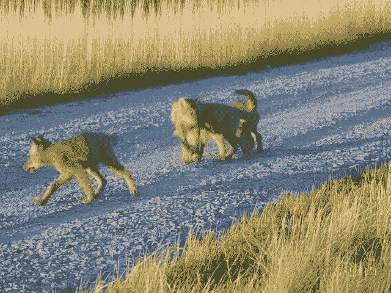

该模型还可能**混淆提示的空间细节**，例如混淆左右，并且可能难以精确描述随着时间推移发生的事件，例如遵循特定的相机轨迹。

如提示词“篮球穿过篮筐然后爆炸”中，篮球没有正确被篮筐阻挡。

技术方面，目前 OpenAI 透露的不多，简单介绍如下：

Sora 是一种**扩散模型**，从噪声开始，能够一次生成整个视频或扩展视频的长度，

关键之处在于一次生成多帧的预测，确保画面主体即使暂时离开视野也能保持不变。

与 GPT 模型类似，Sora 使用了 Transformer 架构，有很强的扩展性。

在数据方面，OpenAI 将视频和图像表示为 patch，类似于 GPT 中的 token。

通过这种**统一的数据表示方式**，可以在比以前更广泛的视觉数据上训练模型，涵盖不同的持续时间、分辨率和纵横比。

Sora 建立在过去对 DALL·E 和 GPT 模型的研究之上。它使用 DALL·E 3 的重述提示词技术，为视觉训练数据生成高度描述性的标注，因此能够更忠实地遵循用户的文本指令。

除了能够仅根据文本指令生成视频之外，该模型还能够获取现有的静态图像并从中生成视频，准确地让图像内容动起来并关注小细节。

该模型还可以获取现有视频并对其进行扩展或填充缺失的帧，请参阅技术论文了解更多信息（晚些时候发布）。

Sora 是能够理解和模拟现实世界的模型的基础，OpenAI 相信这一功能将成为实现 AGI 的重要里程碑。

## 视频变形功能

除了从文本生成视频之外，Sora 还可以在两个视频之间变形。这是我喜欢的一个例子，它一开始是一架无人机，后来变成了一只蝴蝶

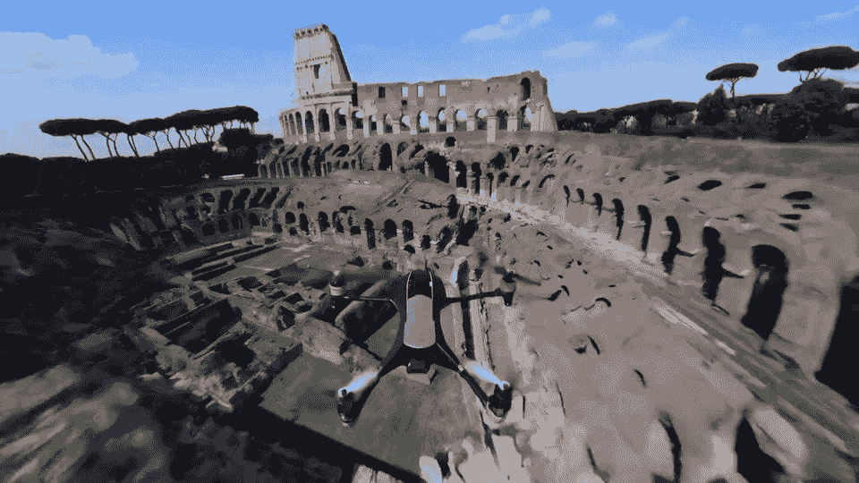

[t4rmDHNOASJuk5ht.mp4](https://internal-api-drive-stream.feishu.cn/space/api/box/stream/download/all/N0JQbnap4ox4RexEIbJcZX1enSe)

## 首批权限开放艺术家、设计师和电影制作人

目前已有一些视觉艺术家、设计师和电影制作人（以及 OpenAI 员工）获得了 Sora 访问权限。

他们开始不断 po 出新的作品，奥特曼也开始了在线接单模式。

带上你的提示词@sama，就有可能收到生成好的视频回复。

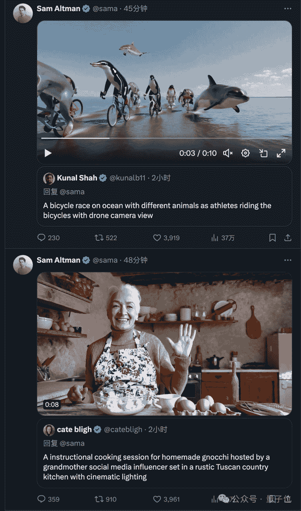

#### **开放红队及创意人士试用**

今天，Sora 将向红队成员开放，以评估关键领域的潜在危害或风险。我们还将授权给一些视觉艺术家、设计师和电影制作人，以获取反馈，了解如何进一步优化模型，使其对创意专业人士最有帮助。

我们提前分享我们的研究进展，以便开始与 OpenAI 之外的人们合作并获取他们的反馈，同时让公众了解即将到来的人工智能能力。

Prompt: Historical footage of California during the gold rush.

提示：加利福尼亚淘金热期间的历史影像。

Prompt: A close up view of a glass sphere that has a zen garden within it. There is a small dwarf in the sphere who is raking the zen garden and creating patterns in the sand.

提示：一个玻璃球的特写视图，球内有一个禅园。球内有一个小矮人正在耙禅园里的沙子，创造出图案。

Prompt: Extreme close up of a 24 year old woman’s eye blinking, standing in Marrakech during magic hour, cinematic film shot in 70mm, depth of field, vivid colors, cinematic

提示：一名 24 岁女性的眼睛在摩洛哥马拉喀什的魔幻时刻闪烁，极度近距离拍摄，使用 70mm 电影胶片，具有深度感的场景，色彩鲜明，具有电影感。

Prompt: A cartoon kangaroo disco dances.

提示：一只卡通袋鼠正在迪斯科舞蹈。

Prompt: A beautiful homemade video showing the people of Lagos, Nigeria in the year 2056. Shot with a mobile phone camera.

提示：一段美丽的自制视频，展示了 2056 年尼日利亚拉各斯的人民。使用手机摄像头拍摄。

Prompt: A petri dish with a bamboo forest growing within it that has tiny red pandas running around.

提示：一个培养皿里长着一片竹林，里面有小红熊猫在奔跑。

Prompt: The camera rotates around a large stack of vintage televisions all showing different programs — 1950s sci-fi movies, horror movies, news, static, a 1970s sitcom, etc, set inside a large New York museum gallery.

提示：摄像机绕着一大堆老式电视旋转，这些电视都在播放不同的节目——1950 年代的科幻电影、恐怖电影、新闻、静态画面、一部 1970 年代的情景喜剧等，这一切都设置在一个位于纽约的大型博物馆画廊内。

Prompt: 3D animation of a small, round, fluffy creature with big, expressive eyes explores a vibrant, enchanted forest. The creature, a whimsical blend of a rabbit and a squirrel, has soft blue fur and a bushy, striped tail. It hops along a sparkling stream, its eyes wide with wonder. The forest is alive with magical elements: flowers that glow and change colors, trees with leaves in shades of purple and silver, and small floating lights that resemble fireflies. The creature stops to interact playfully with a group of tiny, fairy-like beings dancing around a mushroom ring. The creature looks up in awe at a large, glowing tree that seems to be the heart of the forest.

提示：一只小巧、圆滚、毛茸茸的生物在一片生机勃勃、充满魔力的森林中探险的 3D 动画。这个生物是兔子和松鼠的奇妙混合体，拥有柔软的蓝色皮毛和一个条纹浓密的尾巴。它沿着闪闪发光的小溪跳跃，眼睛充满了好奇。森林充满了魔法元素：发光并且颜色变化的花朵、呈现紫色和银色叶片的树木，以及类似萤火虫的小型漂浮光点。这个生物停下来与一群围绕着蘑菇环跳舞的微型、像仙女一样的生物们开心地互动。生物抬头敬畏地看着一棵巨大的、发着光的树，这棵树似乎是这片森林的心脏。

#### **复杂物理世界场景生成能力**

Sora 能够生成包含多个角色、特定类型的动作以及主题和背景的准确细节的复杂场景。这个模型不仅理解用户在提示中所要求的内容，还理解这些事物在物理世界中是如何存在的。

，时长 00:20

Prompt: The camera follows behind a white vintage SUV with a black roof rack as it speeds up a steep dirt road surrounded by pine trees on a steep mountain slope, dust kicks up from it’s tires, the sunlight shines on the SUV as it speeds along the dirt road, casting a warm glow over the scene. The dirt road curves gently into the distance, with no other cars or vehicles in sight. The trees on either side of the road are redwoods, with patches of greenery scattered throughout. The car is seen from the rear following the curve with ease, making it seem as if it is on a rugged drive through the rugged terrain. The dirt road itself is surrounded by steep hills and mountains, with a clear blue sky above with wispy clouds.

提示：镜头跟随着一辆白色复古 SUV，车顶装有黑色行李架，它沿着一条陡峭的土路加速前行，路两旁是松树环绕的山坡，车轮踢起的尘土，阳光照在 SUV 上，使它在土路上快速行驶时，投下了温暖的光芒。泥土路面轻柔地弯曲至远方，视线内没有其他汽车或车辆。道路两旁的树木是红木，间杂着绿色植被。从后面看，汽车轻松地沿着弯道行驶，给人一种在崎岖地形中进行崎岖驾驶的感觉。土路本身被陡峭的山丘和山脉所环绕，上方是清澈的蓝天和飘渺的云彩。

Prompt: Reflections in the window of a train traveling through the Tokyo suburbs.

提示：通过东京郊区的火车窗户反射的景象。

Prompt: A drone camera circles around a beautiful historic church built on a rocky outcropping along the Amalfi Coast, the view showcases historic and magnificent architectural details and tiered pathways and patios, waves are seen crashing against the rocks below as the view overlooks the horizon of the coastal waters and hilly landscapes of the Amalfi Coast Italy, several distant people are seen walking and enjoying vistas on patios of the dramatic ocean views, the warm glow of the afternoon sun creates a magical and romantic feeling to the scene, the view is stunning captured with beautiful photography.

提示：一架无人机摄像机在阿马尔菲海岸的一个岩石突出部上空盘旋，绕着一座美丽的历史教堂飞行。画面展示了历史悠久而宏伟的建筑细节、分层的小径和露台，可以看到波浪撞击下方的岩石，随着视角俯瞰阿马尔菲海岸意大利的海岸水域和丘陵景观，几个远处的人被看见正在步行并享受露台上戏剧性的海景。下午阳光的温暖光辉给场景增添了神奇和浪漫的感觉，用美丽的摄影捕捉到的视图令人惊叹。

Prompt: A large orange octopus is seen resting on the bottom of the ocean floor, blending in with the sandy and rocky terrain. Its tentacles are spread out around its body, and its eyes are closed. The octopus is unaware of a king crab that is crawling towards it from behind a rock, its claws raised and ready to attack. The crab is brown and spiny, with long legs and antennae. The scene is captured from a wide angle, showing the vastness and depth of the ocean. The water is clear and blue, with rays of sunlight filtering through. The shot is sharp and crisp, with a high dynamic range. The octopus and the crab are in focus, while the background is slightly blurred, creating a depth of field effect.

提示：一只大型橙色章鱼正躺在海底，与沙质和岩石的地形融为一体。它的触手四处伸展，眼睛闭着。章鱼没有注意到一只螃蟹正在它后面的岩石后面爬行过来，它的爪子举起，准备攻击。螃蟹是棕色且多刺的，有着长腿和触角。这个场景从一个宽角度捕捉，展示了海洋的辽阔和深邃。水是清澈的蓝色，阳光通过水面过滤。这个镜头是清晰和生动的，具有高动态范围。章鱼和螃蟹被聚焦，而背景略有模糊，创造出一种景深效果。

Prompt: A flock of paper airplanes flutters through a dense jungle, weaving around trees as if they were migrating birds.

提示：一群纸飞机在密集的丛林中飘动，它们绕过树木，就像是正在迁徙的鸟群。

Prompt: A cat waking up its sleeping owner demanding breakfast. The owner tries to ignore the cat, but the cat tries new tactics and finally the owner pulls out a secret stash of treats from under the pillow to hold the cat off a little longer.

提示：一只猫叫醒它正在睡觉的主人要求喂食早餐。主人试图忽略这只猫，但是猫尝试了新的策略，最终主人从枕头下面拿出一袋秘密藏着的零食来稍微拖延一下猫的进攻。

Prompt: Borneo wildlife on the Kinabatangan River 提示：婆罗洲的金巴坦河上的野生动物

Prompt: A Chinese Lunar New Year celebration video with Chinese Dragon. 提示：一段庆祝中国农历新年的视频，视频中有中国龙。

#### **保持角色和视觉风格的分镜头**

该模型对语言有深刻的理解，使其能够准确地解释提示并生成表达生动情感的引人入胜的角色。Sora 还可以在单个生成的视频中创建多个镜头，准确保持角色和视觉风格。

Prompt: Tour of an art gallery with many beautiful works of art in different styles.

提示：参观一个美术馆，里面有许多不同风格的美丽艺术作品。

Prompt: Beautiful, snowy Tokyo city is bustling. The camera moves through the bustling city street, following several people enjoying the beautiful snowy weather and shopping at nearby stalls. Gorgeous sakura petals are flying through the wind along with snowflakes.

提示：美丽的雪覆东京市正繁忙不已。摄像机穿过繁忙的市街，追随着几个人享受着美丽的雪景和在附近摊位上购物。美丽的樱花瓣随风与雪花一起飞舞。

Prompt: A stop motion animation of a flower growing out of the windowsill of a suburban house.

提示：一个郊区房屋的窗台上花朵生长的定格动画。

Prompt: The story of a robot’s life in a cyberpunk setting.

提示：一个机器人在赛博朋克背景下的生活故事。

Prompt: An extreme close-up of an gray-haired man with a beard in his 60s, he is deep in thought pondering the history of the universe as he sits at a cafe in Paris, his eyes focus on people offscreen as they walk as he sits mostly motionless, he is dressed in a wool coat suit coat with a button-down shirt , he wears a brown beret and glasses and has a very professorial appearance, and the end he offers a subtle closed-mouth smile as if he found the answer to the mystery of life, the lighting is very cinematic with the golden light and the Parisian streets and city in the background, depth of field, cinematic 35mm film.

提示：一位 60 多岁、灰白头发、留着胡须的男士的极端特写镜头，他正深深地沉思宇宙的历史，坐在巴黎的一家咖啡馆里，他的目光关注着镜头外行走的人们，他几乎一动不动，身穿羊毛外套、扣衫，头戴棕色贝雷帽和眼镜，给人一种教授般的外观，在最后，他微微一笑，闭着嘴，好像找到了生命之谜的答案，光线非常电影化，有着金色的光线和巴黎街头及城市的背景，景深，电影 35 毫米胶片。

，时长 01:00

Prompt: A beautiful silhouette animation shows a wolf howling at the moon, feeling lonely, until it finds its pack.

提示：一个美丽的剪影动画展示了一只狼在向月亮嚎叫，感到孤独，直到它找到了它的狼群。

Prompt: New York City submerged like Atlantis. Fish, whales, sea turtles and sharks swim through the streets of New York.

提示：纽约城沉没如同亚特兰蒂斯。鱼、鲸、海龟和鲨鱼在纽约街道中游动。

Prompt: A litter of golden retriever puppies playing in the snow. Their heads pop out of the snow, covered in.

提示：一窝金毛寻回犬的小狗在雪中玩耍。它们的头从雪中探出，被雪覆盖。

## Sore 论文拆解

1 分钟的视频包括什么？谁？在哪？做些什么？发生在什么环境中？

Prompt: A movie trailer featuring the adventures of the 30 year old space man wearing a red wool knitted motorcycle helmet, blue sky, salt desert, cinematic style, shot on 35mm film, vivid colors.

一部电影预告片，展示一位 30 岁太空人的冒险故事，他戴着一顶红色羊毛编织的摩托车头盔，背景是蓝天和盐漠，采用电影风格，使用 35 毫米胶片拍摄，色彩鲜艳。

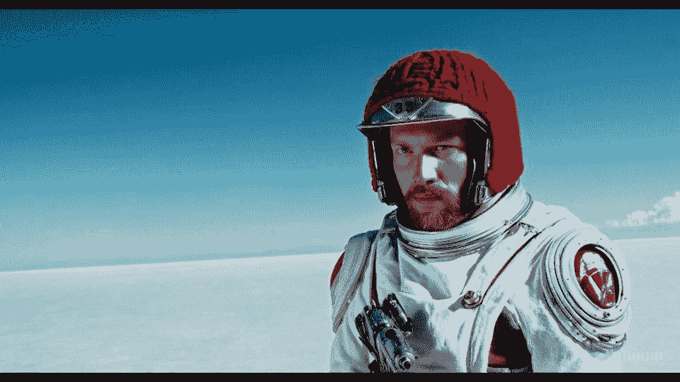

[mitten-astronaut.mp4](https://internal-api-drive-stream.feishu.cn/space/api/box/stream/download/all/VbhGblsKUoqQuXxeMJ2cZbRdnIg)

我们来通过这短短 17s 的视频包含了哪些信息量

第一镜给到主角近景，包括红色羊毛编织的摩托车头盔和蓝天和由盐组成的沙漠环境都被准确表现出来

第二镜，从蓝色摇到了远景的人，再到特写出现主角色眼神，角色和第一镜保持了一致，包括角色的五官特征，毛线帽和头盔上 33 的标记都能够验证这一点，此时人物的位置关系是带着 33 号头盔的主角站在了远景角色的反方向

第三镜，出现了一个带头盔的稍年轻的角色，胡子也短了不少，他似乎是在飞船内部向外看

第四镜，镜头跟随远景的角色向前推进，画面中出现的清晰的脚印，

第五镜，飞船内的年轻角色似乎发现了有人正在走近飞船，特写推的更近了，暗示有变化会发生

第六镜，特写舱门，手从右侧入画

第七镜，特写主角眼神，增加紧张感

第八镜，特写主角侧面，此时他站在原地，看向另一侧

第九镜，太空仓内环境，各类仪表、屏幕清晰可辨。

3 个先后出现的角色一致，位置关系一致，环境一致，全程镜头都保持了手持摄影机的摇晃感，输出 1920*1080，30 帧/秒的高清视频

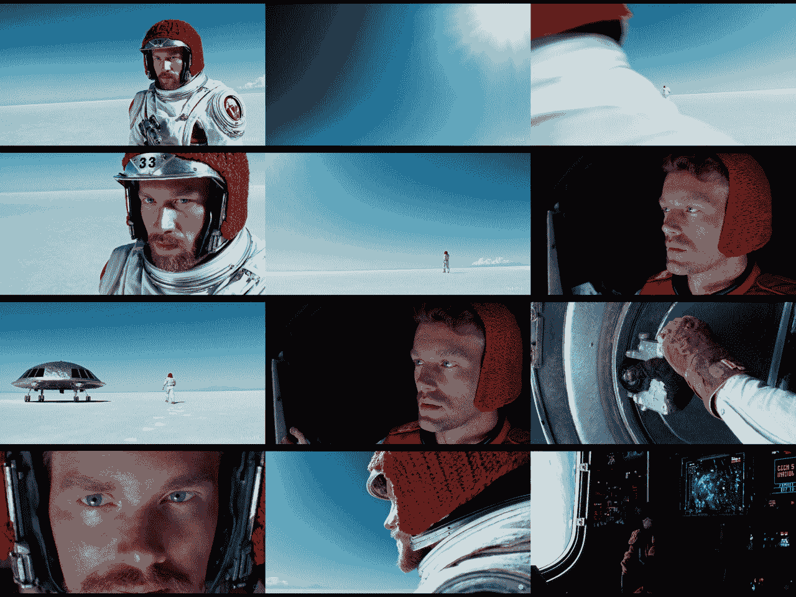

视频是 Sora 的能力之一，但这并不是 Sora 的全部，理解真实的物理世界，并能够模拟和创造才是，而且视频的创作，是内容领域能够展现最多模态能力的领域，也是能够产生高价值内容的重要途径。

OpenAI 研究的野心在于——构建物理世界通用模拟器

再来好好读一下这篇技术文档

简单来说，OpenAI 在探索视频生成模型的大规模训练，超过 runway，pika 以及任何现有视频生成模型，构建了一个世界模拟器。这个模拟器，是从大量的不同时长，不同宽高比，和分辨率的视频和图形上训练出来的基于文本条件的扩散模型，这也意味着，Sora 能够根据提供的文本描述（如“一只坐在草地上的小猫”）来生成与描述相匹配的视频内容，同时具有灵活的时长和分辨率，最大上限是 1920*1080，30 帧/秒。

接下来的内容包括两项重点：

（1）将所有类型的视觉数据转化为统一表示的方法，从而能够大规模训练生成模型

（2）对 Sora 的能力和局限性进行定性评估。

### **把视觉视觉转换为 Patch**

将视觉数据转换为 patch 指的是一种处理和表示视觉信息的方法，其中视觉数据（如图片和视频帧）被分割成小块或“补丁”。这些小块作为模型输入的基本单位，模型可以学习到如何表示和重建视觉场景，从而在给定某些条件（如文本描述）时生成新的图像或视频内容。Patch 类似于大语言模型的"token"，是指文本数据的基本处理单元。这些模型通过将文本分解为较小的片段来理解和生成语言，Tokenization（分词）是将原始文本转换成模型能够理解的一系列 token 的过程。训练过程把不同类型视频和图片转成 patch，作为模型输入的基本单位。这一个过程先将视频压缩到较低维的潜在空间，将视频转换为 patch，然后分解为 spacetime patches。

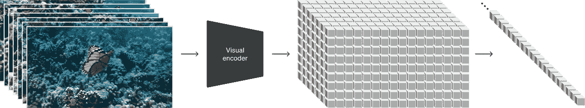

### 视频压缩网络

研究者训练了一个神经网络，其主要任务是降低视觉数据的维度。在这里，“降低维度”意味着将数据从一个高维空间（例如，原始视频数据，包含大量的像素值）转换到一个低维空间。这样做的目的是为了简化数据，提取出最重要的特征，同时减少后续处理所需的计算资源。

这个神经网络以原始视频作为输入，并输出一个在时间和空间上都被压缩的潜在表示（latent representation）。时间上的压缩意味着减少了表示视频动态变化所需的信息量；空间上的压缩则意味着减少了表示视频中每一帧图像所需的信息量。

Sora 首先在这个压缩的潜在空间上进行训练，学习如何理解和控制这种形式的数据。训练完成后，Sora 能够在这个潜在空间内生成新的视频数据。此外，研究者还训练了一个解码器模型。这个解码器的作用是将 Sora 生成的潜在表示转换回原始的像素空间，即将压缩的视频数据还原成可以直接观看的视频格式。

以上是一个完整的视频处理和生成流程，包括将原始视频数据压缩成潜在表示、在这个潜在空间上训练视频生成模型 Sora，以及最后通过解码器将生成的视频还原成原始像素格式的过程。

### **时空转换**

**在视频数据被压缩之**后，接**下来的步骤是从这个**压缩后的视频中提取一系列的 Spacetime Latent Patches，包含了视频在特定时间和空间范围内的信息。这些 Patches 充当了 transformer 模型中的 token，就像在自然语言处理中单词被用作 token 一样。这个方法和过程统一也适用于图形，从能够把不同分辨率、时间和宽高比的视频和图像作为 Sora 的训练集，在模型推理即生成新的视频内容时，可以通过在适当大小的网格中排列随机初始化的 Patches 来控制生成视频的大小。

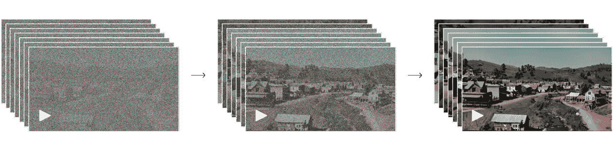

### 视频缩放

Sora 的底层基础仍然是基于 Transformer 架构的扩散模型，通过输入噪声 Patches 和文本提示等调节信息，能够用于预测"干净”的 Patch。此外，Transformer 架构同样也被广泛的应用于大语言模型，计算机视觉和图像生成等领域。在训练过程中，使用固定的种子和输入，随着训练计算量的增加，生成样本质量显著提高。

[scaling_0.mp4](https://internal-api-drive-stream.feishu.cn/space/api/box/stream/download/all/AK5fb9vLuoCxrTxdDDLcmbLmneh)

Base compute

[scaling_1.mp4](https://internal-api-drive-stream.feishu.cn/space/api/box/stream/download/all/TJrwb9XuYoayqbxlpy5cJhzbn9e)

4x compute

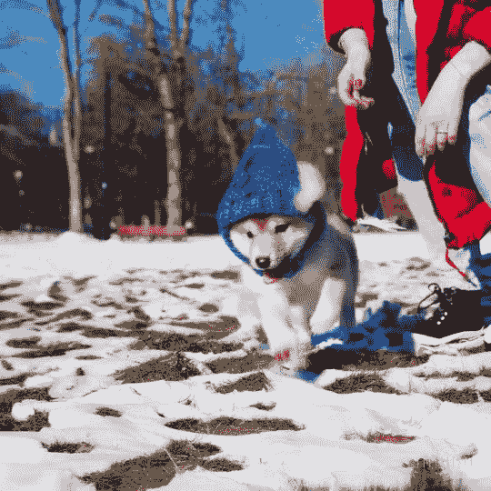

[scaling_2.mp4](https://internal-api-drive-stream.feishu.cn/space/api/box/stream/download/all/NfRMbvLjBoGYWCxBHXQcKEyJnff)

16x compute

### 可变的持续时间、分辨率、宽高比

在以往，通常用于训练图形和视频模型的训练集统一成标准的尺寸，例如分辨率为 256x256 的 4 秒视频，研究发现，对原始大小的数据进行训练有几个好处，能够让采样更灵活，并改进构图和取景。

Sampling flexibility 采样灵活性

Sora 可以采样宽屏 1920x1080p 视频、垂直 1080x1920 视频以及介于两者之间的所有视频。这使得 Sora 可以直接以其原生宽高比为不同设备创建内容。这个特性还能够帮助在以全分辨率生成之前快速以较低尺寸制作原型内容，所有这些都使用相同的模型。

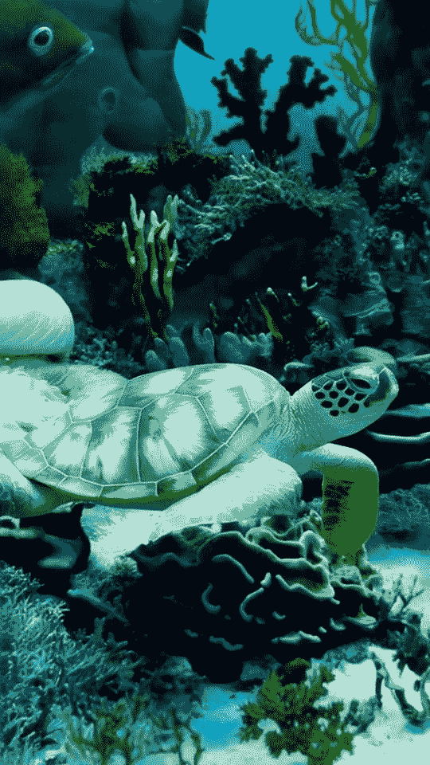

[sampling_0.mp4](https://internal-api-drive-stream.feishu.cn/space/api/box/stream/download/all/C3UhbnRCuojGAjxXPxQcftJvnxg)

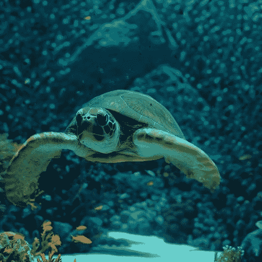

[sampling_1.mp4](https://internal-api-drive-stream.feishu.cn/space/api/box/stream/download/all/JCQVbENzpotkL1xYglHchvt4nCe)

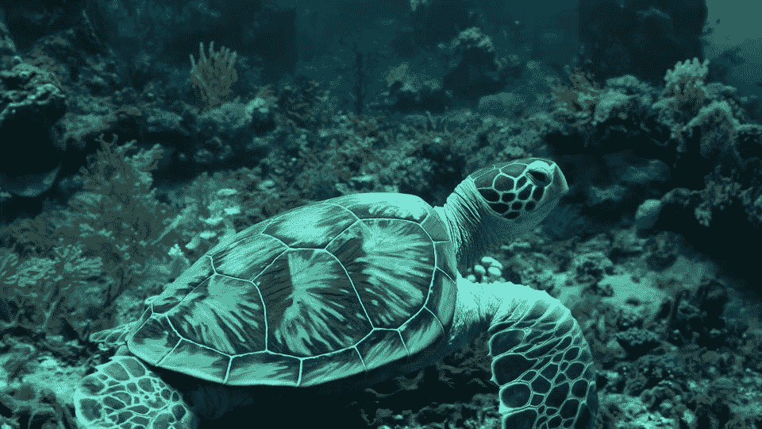

[sampling_2.mp4](https://internal-api-drive-stream.feishu.cn/space/api/box/stream/download/all/GEfeb6PVZonE66xGdlpccHXUnld)

**Improved framing and **composition 改进的构图和取景

研究根据经验发现，以原始长宽比对视频进行训练可以改善构图和取景。将 Sora 与将所有训练视频裁剪为正方形的模型版本进行比较，这是训练生成模型时的常见做法。在方形作物（左）上训练的模型有时会生成仅部分可见主体的视频。相比之下，Sora（右）的视频取景有所改善。

[sampling_3.mp4](https://internal-api-drive-stream.feishu.cn/space/api/box/stream/download/all/HRMtb91rdoYzOnxj62cc3vNbnbf)

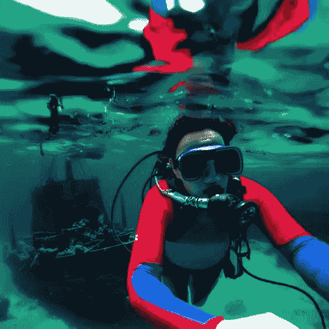

[sampling_4.mp4](https://internal-api-drive-stream.feishu.cn/space/api/box/stream/download/all/V2D1bnt26od4xKxVI6WcHzF7nSe)

### 语言理解

训练文本到视频生成系统需要大量带有对应文字说明的视频，这里将 DALL·E 3 中引入的重新标注技术应用于视频。研究者训练了一个专门的模型，这个模型的任务是为视频内容生成详细且富有描述性的文字说明。这种标注模型能够观察视频中的场景、动作、物体等元素，并生成准确描述这些内容的文本标注。然后使用它为训练集中的所有视频生成文本说明，从而提高了文本的准确性以及视频的整体质量。类似于 DALL·E 3，这里也利用 GPT 将简短的用户提示转换成更长的详细说明，然后发送给视频模型，这使得 Sora 能够生成准确遵循用户提示的高质量视频。

### 通过图形和视频生成视频

除了文字以外，Sora 也可以通过图像或视频生成新的视频。

这使 Sora 能够执行各种图像和视频编辑任务，包括创建循环视频、将图形转换为视频、向前或向后扩展视频等。

Animating DALL·E images  通过图像生成视频

Sora 能够根据根据输入的图像和文字提示词生成视频，以下是根据 DALL·E 生成的图像结合提示词生成的视频

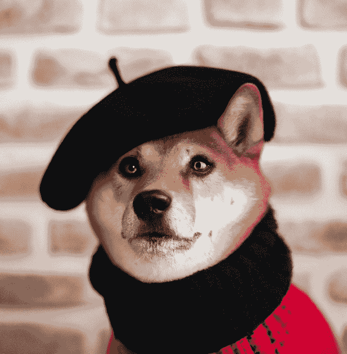

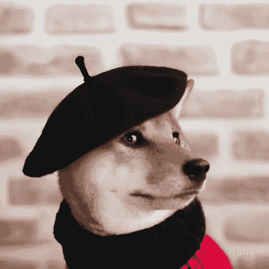

[prompting_1.mp4](https://internal-api-drive-stream.feishu.cn/space/api/box/stream/download/all/FuVtbrHFAosJ7cxddUFcAs88nWd)

A Shiba Inu dog wearing a beret and black turtleneck.

一只戴着贝雷帽和黑色高领毛衣的柴犬。

[prompting_3.mp4](https://internal-api-drive-stream.feishu.cn/space/api/box/stream/download/all/KpFnbjQdMokmkHxqcjvcho7Dnze)

Monster Illustration in flat design style of a diverse family of monsters. The group includes a furry brown monster, a sleek black monster with antennas, a spotted green monster, and a tiny polka-dotted monster, all interacting in a playful environment.

不同家族怪物的平面设计风格的怪物插图。该群体包括一个毛茸茸的棕色怪物、一个带有天线的光滑黑色怪物、一个有斑点的绿色怪物和一个微小的圆点怪物，所有这些怪物都在一个有趣的环境中互动。

[prompting_5.mp4](https://internal-api-drive-stream.feishu.cn/space/api/box/stream/download/all/LCEEb4WDYocoYlxP7XmcNyegnue)

An image of a realistic cloud that spells “SORA”.

写有“SORA”的真实的云的图像。

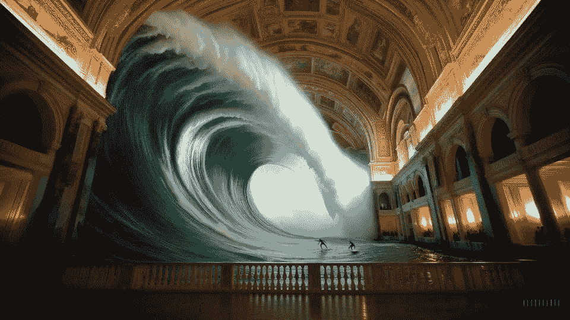

[prompting_7.mp4](https://internal-api-drive-stream.feishu.cn/space/api/box/stream/download/all/JxwUbcBWjo4fq9xurexcUN8Jndd)

In an ornate, historical hall, a massive tidal wave peaks and begins to crash. Two surfers, seizing the moment, skillfully navigate the face of the wave.

在一座华丽的历史大厅里，巨大的浪潮达到顶峰并开始崩塌。两名冲浪者抓住时机，熟练地驾驭海浪。

Extending generated videos 扩展生成的视频

Sora 还能够在时间上向前或向后扩展视频。下面的几个视频都是从生成的视频片段开始向前延伸的。因此，尽管这几个视频的开头都不同，但所有视频的结局都是相同的。

[extend_1.mp4](https://internal-api-drive-stream.feishu.cn/space/api/box/stream/download/all/RGblbaOiwoDblNxNQprcJtdhnbc)

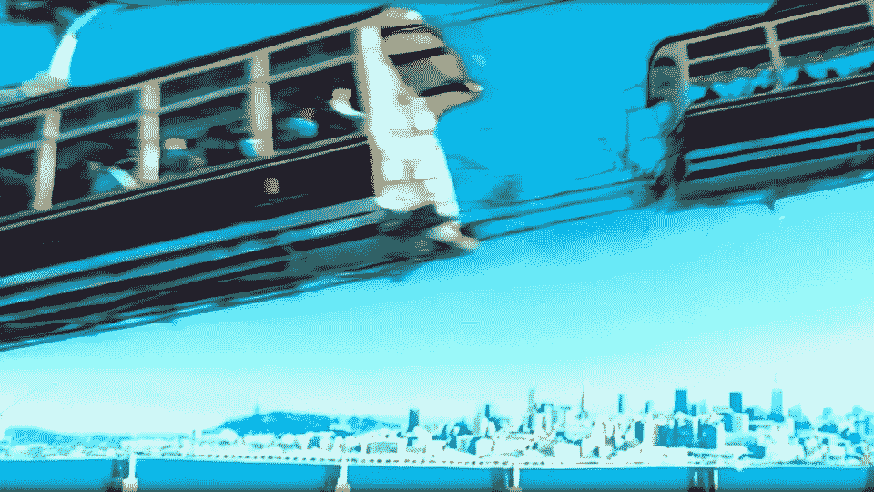

[extend_2.mp4](https://internal-api-drive-stream.feishu.cn/space/api/box/stream/download/all/AEfmbeCOjoWGNyxtbvuccdfVnHb)

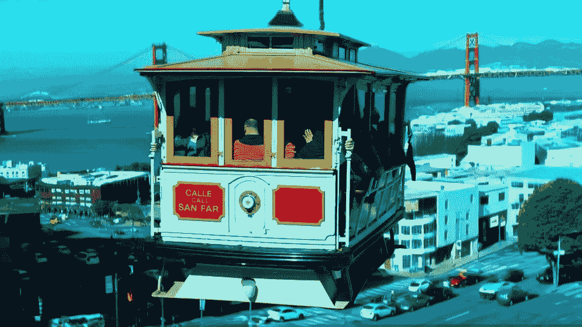

[extend_4.mp4](https://internal-api-drive-stream.feishu.cn/space/api/box/stream/download/all/UqVSbJt7noh2i9xsik2cuTg4nOc)

通过这种方法，可以向前和向后扩展视频以生成无缝的无限循环。

[bike_1.mp4](https://internal-api-drive-stream.feishu.cn/space/api/box/stream/download/all/LUBdb3w9LorXTZxkX6ScAXiTnSf)

Video-to-video editing 视频到视频编辑

扩散模型使得从文本提示编辑图片和视频的众多方法成为可能。将将这些方法之一，SDEdit 应用于 Sora，能够使其能够在零样本的情况下转换输入视频的风格和环境。

Input video

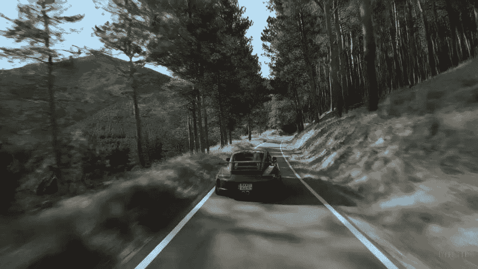

[base.mp4](https://internal-api-drive-stream.feishu.cn/space/api/box/stream/download/all/UVdyb8CHEo1Azax5BsDcEV2Xn2G)

Output video

|  |  |  |
| --- | --- | --- |
|  |  |  |
|  |  |  |
|  |  |  |

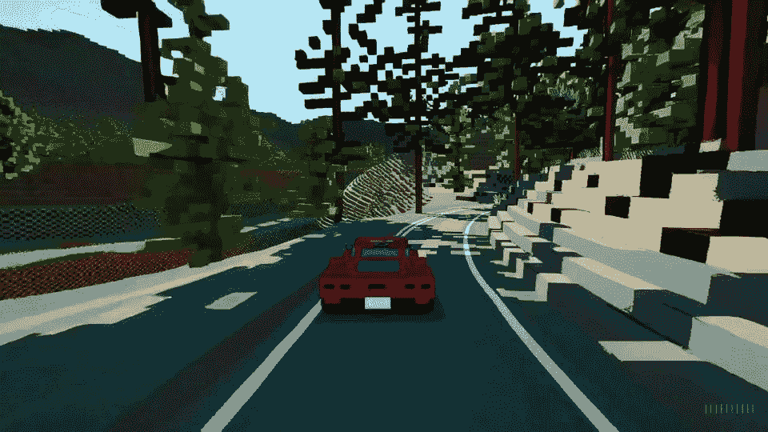

[rewrite the video in a pixel art style.mp4](https://internal-api-drive-stream.feishu.cn/space/api/box/stream/download/all/WRp2bCaVjo6699x90QXcSMfZnNd)

[make it have dinosaurs.mp4](https://internal-api-drive-stream.feishu.cn/space/api/box/stream/download/all/EftnbxRWsoXzNYxanzVcmLHYnVd)

[change the video to a medieval theme.mp4](https://internal-api-drive-stream.feishu.cn/space/api/box/stream/download/all/KFjSbTz0ZoVk7XxYiiLcgBE5nEf)

[change the sitting to be cyberpunk.mp4](https://internal-api-drive-stream.feishu.cn/space/api/box/stream/download/all/CoWgbFqoPoD0OWxVR4pcRUoLnAz)

[make it in claymation animation style.mp4](https://internal-api-drive-stream.feishu.cn/space/api/box/stream/download/all/QU0VbHMazokuaxxksZ7c78JXnMg)

[keep the video the same but make it be winter.mp4](https://internal-api-drive-stream.feishu.cn/space/api/box/stream/download/all/MB4db0OuFoFi8Wxfm8EcEcJUn9d)

[put the video in space with a rainbow road.mp4](https://internal-api-drive-stream.feishu.cn/space/api/box/stream/download/all/CVzFbaeVcogRVJx1c55chczdn7f)

[change the video setting to be different than a mountain perhaps joshua tree.mp4](https://internal-api-drive-stream.feishu.cn/space/api/box/stream/download/all/NMwzb3G7EoVUj9xiaF2cal1dnWh)

[make it go underwater.mp4](https://internal-api-drive-stream.feishu.cn/space/api/box/stream/download/all/Hg6abtzjWouuK6xYcVGcKfrynLf)

[change the setting to the 1920s with an old school car. make sure to keep the red color.mp4](https://internal-api-drive-stream.feishu.cn/space/api/box/stream/download/all/IW6Mb7YTeoB42ixEwfGcse92nwc)

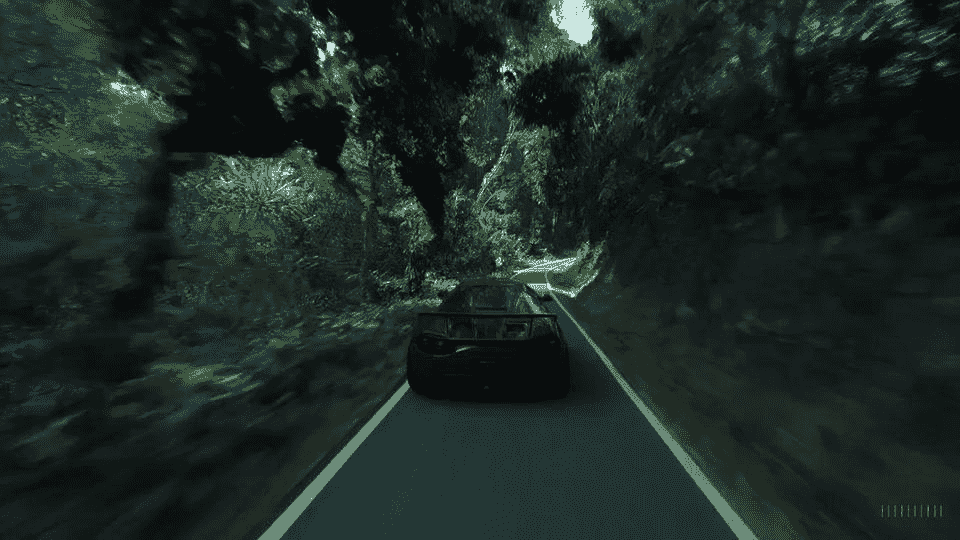

[change the setting to be in a lush jungle.mp4](https://internal-api-drive-stream.feishu.cn/space/api/box/stream/download/all/RS3xbrETCosxUOxdAxhcUd4mnBe)

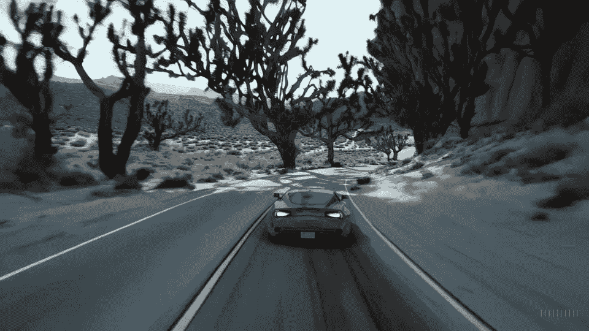

[recreate in the style of a charcoal drawing, making sure to be black and white.mp4](https://internal-api-drive-stream.feishu.cn/space/api/box/stream/download/all/Cf4Xbd4vGoepQlxRNWicnEnhnbJ)

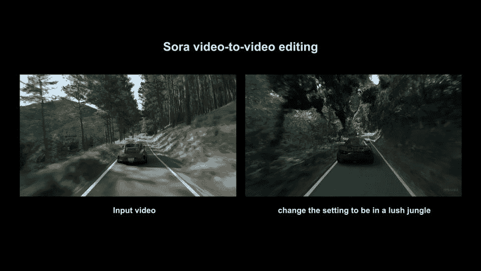

[Sora video-to-video editing.mp4](https://internal-api-drive-stream.feishu.cn/space/api/box/stream/download/all/IDutb46C0oLI80xRFNMcczK9nPe)

Connecting videos 连接视频

使用 Sora 可以在两个输入视频之间逐渐插值，创建在完全不同主题和场景构成的视频之间的无缝过渡。在下面的例子中，中间的视频在左右两边对应视频之间进行插值。

|  |  |  |
| --- | --- | --- |
|  |  |  |
|  |  |  |
|  |  |  |
|  |  |  |

[a0.mp4](https://internal-api-drive-stream.feishu.cn/space/api/box/stream/download/all/XchEbK9kto8EJjxxw8fc4OxJn7b)

[a1.mp4](https://internal-api-drive-stream.feishu.cn/space/api/box/stream/download/all/YwIibj1nPoOiw9x1ODycdRujnIg)

[a2.mp4](https://internal-api-drive-stream.feishu.cn/space/api/box/stream/download/all/Se3hbjnS4ooVtqx5CJbckFt0nge)

[b0.mp4](https://internal-api-drive-stream.feishu.cn/space/api/box/stream/download/all/UwflbDTbyoPaj8xTfdIck8Uknib)

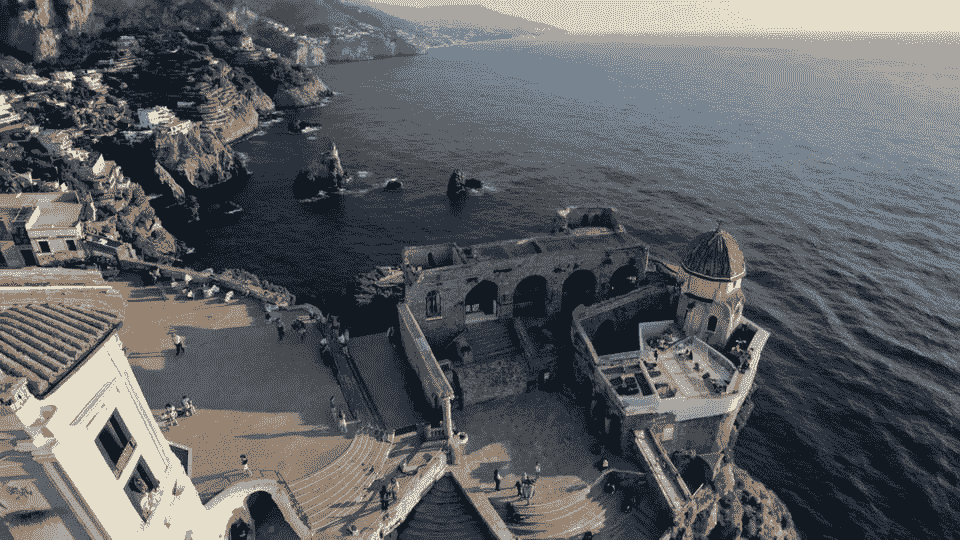

[b1.mp4](https://internal-api-drive-stream.feishu.cn/space/api/box/stream/download/all/Q0k8bCNvCocCVdxsg5dcQKy9nZd)

[b2.mp4](https://internal-api-drive-stream.feishu.cn/space/api/box/stream/download/all/ZqzLbbKhVoZLuixzKwmcLgBAnqc)

[c0.mp4](https://internal-api-drive-stream.feishu.cn/space/api/box/stream/download/all/XvirbMSfdoTUbpxbr2Bc1tltnrd)

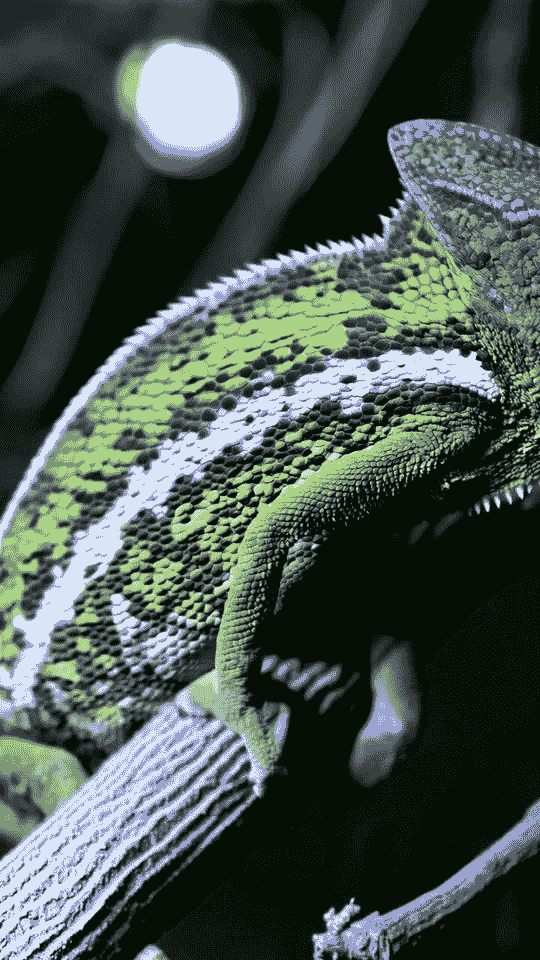

[c1.mp4](https://internal-api-drive-stream.feishu.cn/space/api/box/stream/download/all/Emajbk2rWox0OQxfE8hcRQvtnHb)

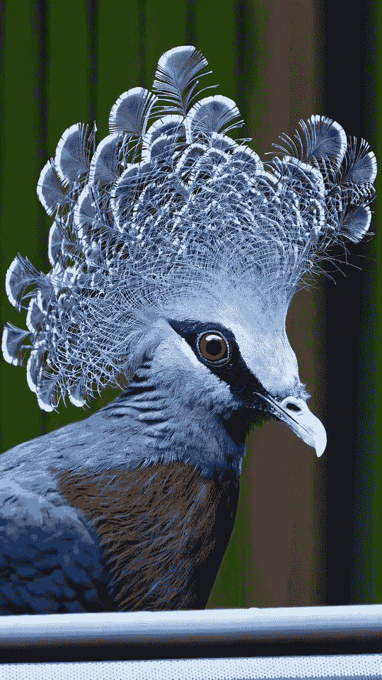

[c2.mp4](https://internal-api-drive-stream.feishu.cn/space/api/box/stream/download/all/KY4sbNeeIobpsrxv07EcUKYon4d)

[d0.mp4](https://internal-api-drive-stream.feishu.cn/space/api/box/stream/download/all/VKiob3bSsoxdbbxNhv2cLvHfncb)

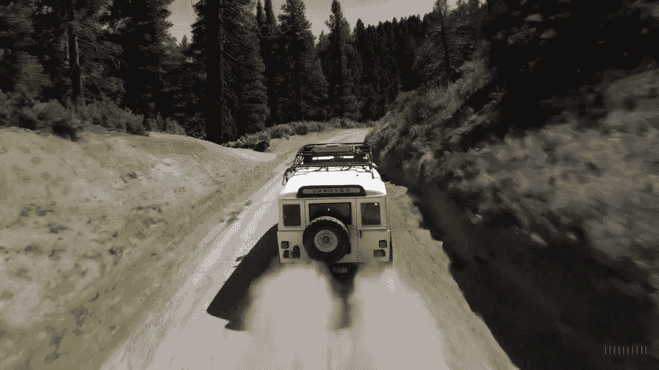

[d1.mp4](https://internal-api-drive-stream.feishu.cn/space/api/box/stream/download/all/S4W2bJbJ6oKPeqxWSDZctYldnod)

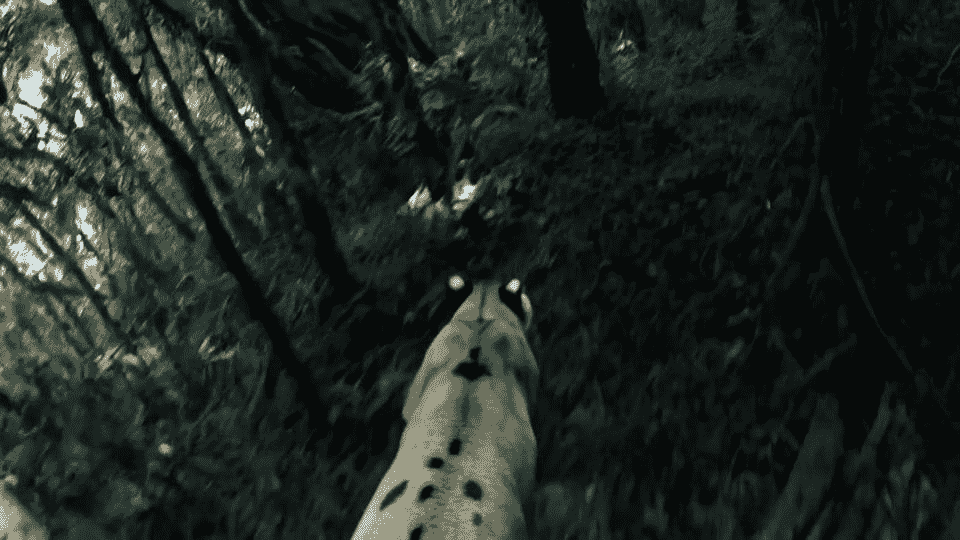

[d2.mp4](https://internal-api-drive-stream.feishu.cn/space/api/box/stream/download/all/F2sAbs2onoi1YYxApgKc0OKXnrf)

[e0.mp4](https://internal-api-drive-stream.feishu.cn/space/api/box/stream/download/all/WYHqbN8yFoIw2BxVa5HcgwNince)

[e1.mp4](https://internal-api-drive-stream.feishu.cn/space/api/box/stream/download/all/Rc2Dbi7bXoklfGxAx20clZkQnVe)

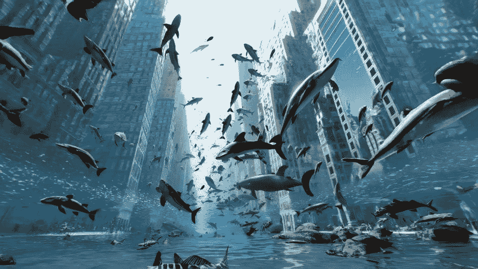

[e2.mp4](https://internal-api-drive-stream.feishu.cn/space/api/box/stream/download/all/IFmobA8CloryafxoJdkcpOKEn8g)

**Image generation** capabilities 图像生成能力

Sora 也能够生成图像。通过在一个具有一帧时间长度的空间网格中排列高斯噪声的 patch 来实现这一点。该模型可以生成不同大小的图像——分辨率最高可达 2048x2048。

Close-up portrait shot of a woman in autumn, extreme detail, shallow depth of field

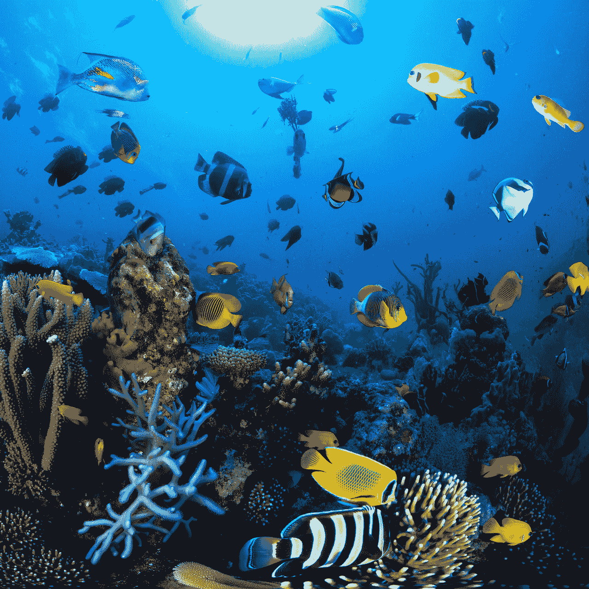

Vibrant coral reef teeming with colorful fish and sea creatures

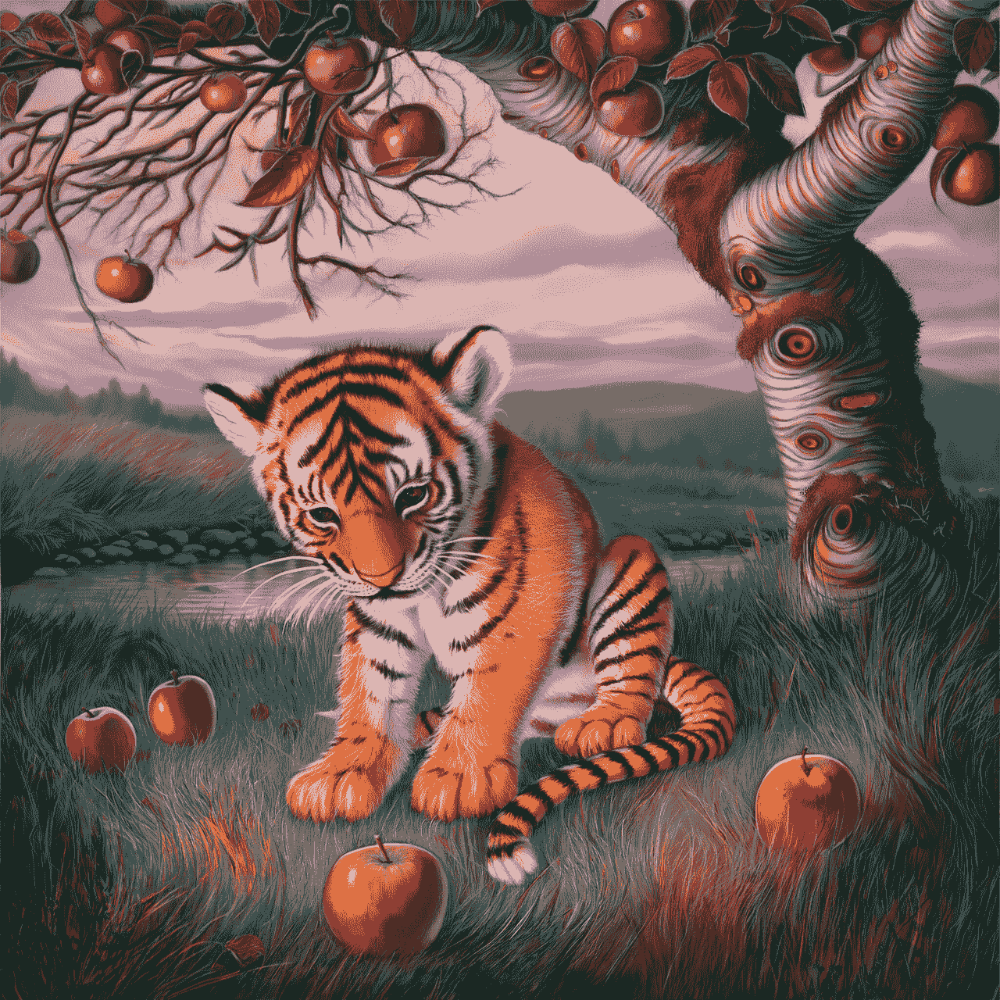

Digital art of a young tiger under an apple tree in a matte painting style with gorgeous details

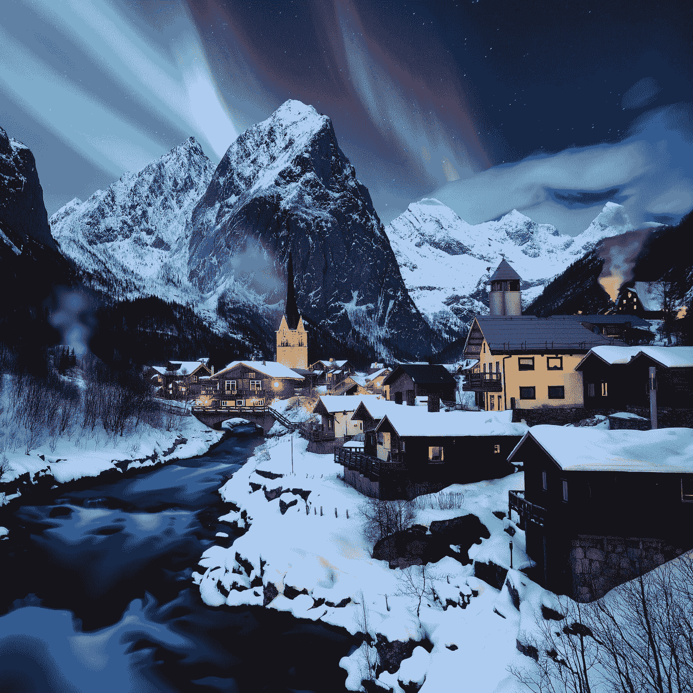

A snowy mountain village with cozy cabins and a northern lights display, high detail and photorealistic dslr, 50mm f/1.2

### 新的模拟能力

在大规模训练视频模型时，出现了一些非常酷的新功能。这些功能让 Sora 这个系统能够模拟现实世界中的人、动物和环境等方面，而且这种模拟是自然发生的，不需要特别去告诉它如何理解 3D 空间或物体，这是一种纯粹的规模化产生的现象。

3D consistency 3D 一致性

Sora 可以创造出看起来像是用摄像机拍摄的视频，摄像机在移动和转动时，视频里的人物和场景也会像在真实世界中那样，按照三维空间的规则移动。这让生成的视频看起来更加真实和自然。

[simulation_0.mp4](https://internal-api-drive-stream.feishu.cn/space/api/box/stream/download/all/SYmKb0cQcoqxqKxtFl0ct56dnfb)

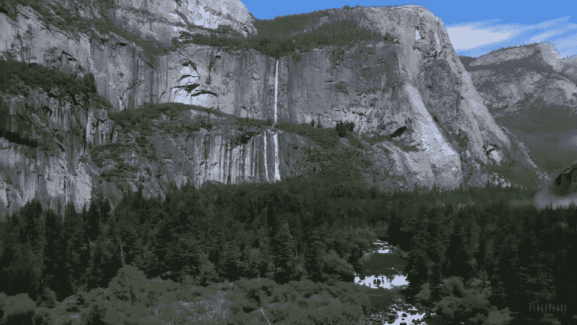

[simulation_1.mp4](https://internal-api-drive-stream.feishu.cn/space/api/box/stream/download/all/AXxwb7HeqoSmnCxnJVCcPbEZnDg)

**L**ong-range coherence and object permanence. 长时间的相关性和物体的一致性

对于视频生成系统来说，一个重大的挑战是在生成长视频时保持一致性。我们发现 Sora 通常能够有效地模拟短期和长期的依赖关系，尽管并非总是如此。例如，我们的模型能够在人物、动物和物体被遮挡或离开画面时仍然保持它们的存在。同样，它可以在一个样本中生成同一个角色的多个镜头，整个视频中保持他们的外观不变。

[simulation_2.mp4](https://internal-api-drive-stream.feishu.cn/space/api/box/stream/download/all/LpYebl5i6oIYezxo4i7cYTQKnZP)

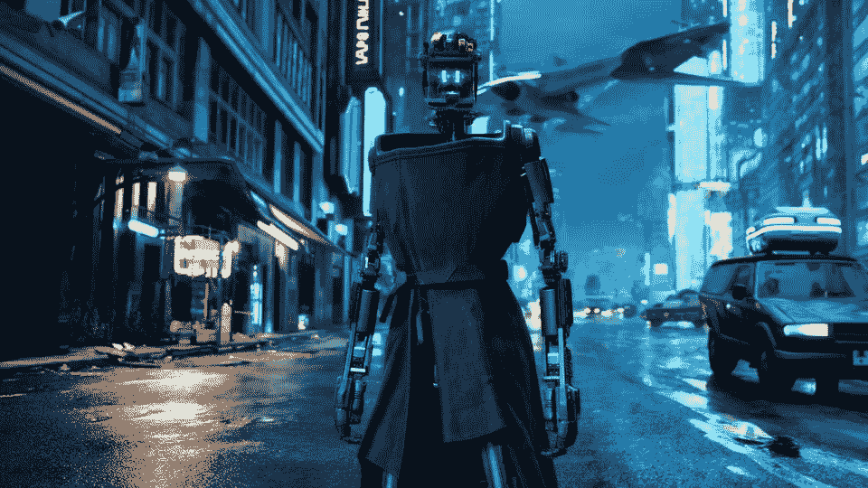

[simulation_3.mp4](https://internal-api-drive-stream.feishu.cn/space/api/box/stream/download/all/LJQZbcGj2o47y9x4GfVcb43XnEd)

Interacting with the world. 与世界互动

Sora 有时能够以简单的方式模拟影响世界状态的行为。例如，一个画家可以在画布上留下随时间持续的新笔触，或者一个人吃汉堡时留下咬痕。

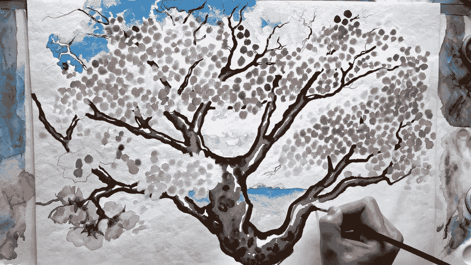

[simulation_4.mp4](https://internal-api-drive-stream.feishu.cn/space/api/box/stream/download/all/UqxZbYqETouu02xNsTJcsAFPnDG)

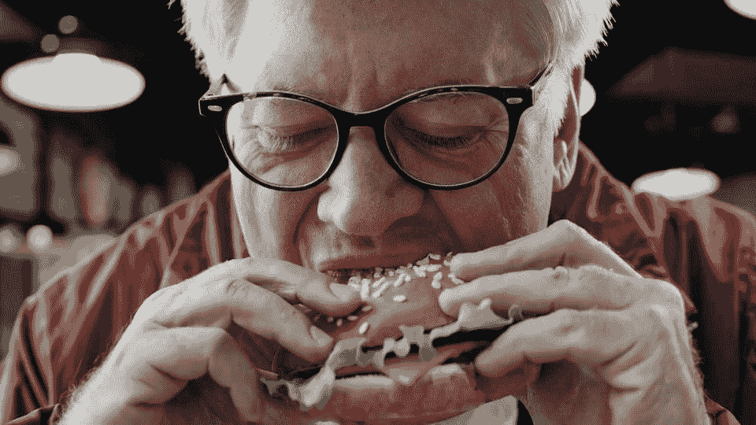

[simulation_5.mp4](https://internal-api-drive-stream.feishu.cn/space/api/box/stream/download/all/PSczbblnjoErd4xYSdIcenhnnOg)

Simulating digital worlds. 模拟数字世界。

[simulation_6.mp4](https://internal-api-drive-stream.feishu.cn/space/api/box/stream/download/all/H23cbpRXUoYK4Wxt5NQcdDuGnOf)

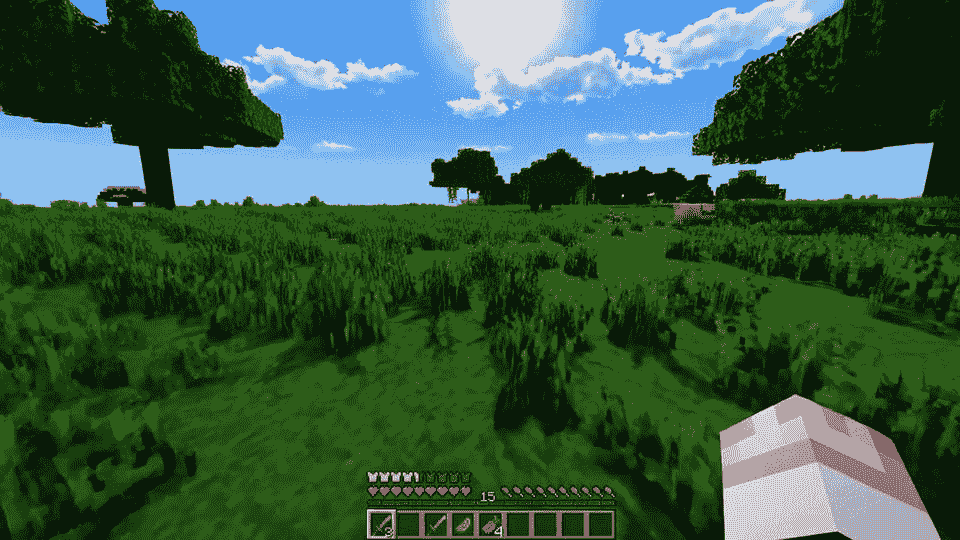

[simulation_7.mp4](https://internal-api-drive-stream.feishu.cn/space/api/box/stream/download/all/BQB3boVQOocoIpxgid5cdsFKnGI)

Sora 不仅能够生成或模拟自然世界中的场景和活动，还能够创建或再现由人类设计和控制的过程，比如视频游戏中的动作和环境。这意味着 Sora 能够理解和执行那些在数字或虚拟环境中特别设计的行为和规则，从而生成与这些环境相符合的视频内容。

——一个例子是视频游戏。Sora 可以在 Minecraft 中同时控制玩家角色（通过一些基本规则）并以高保真度渲染游戏世界及其动态。通过向 Sora 提供提到“Minecraft”的文字提示，可以零样本地激发出这些能力。

这些能力表明，不断扩大视频模型的规模为开发出能深度模拟物理和数字世界的先进模拟器提供了一条可行性的路径，这样的模拟器将能够精确再现我们所处的物理世界和虚拟世界的方方面面。

# [🔥 Sora免费学习资源库](https://zl49so8lbq.feishu.cn/wiki/PiW6wlVlqi3sdnkIRHXcUK8CnK7?from=from_copylink)

## [OpenAI Sora与背后的研发团队](https://zl49so8lbq.feishu.cn/wiki/KRHCwTekwidzoIkPuVKcZRcAnzb?from=from_copylink)

## [ Sora竞品对比](https://zl49so8lbq.feishu.cn/wiki/Y2Gmw3Y2bimKhHkSUQDcQvUHnuf?from=from_copylink)

## [Sora引发的产业机会](https://zl49so8lbq.feishu.cn/wiki/XmT0wqOGxi3Joskhs7bczWHOnwc?from=from_copylink)

## [48条官方Sora提示词](https://zl49so8lbq.feishu.cn/wiki/AceEwnIaUiDTHDkPWmjcOwOwnmm?from=from_copylink)

## [19份券商Sora研报一览（更新中）](https://zl49so8lbq.feishu.cn/wiki/AhrqwicbqilCUpkGT7CciEyrnCM?from=from_copylink)

## [「通用世界模型」Sora技术报告深度解读！](https://zl49so8lbq.feishu.cn/wiki/V68owySY1iuAihkaxZFcaJvwn1e?from=from_copylink)

## 📺 【直播笔记】Sora来了，我们离AI模拟世界还有多远？

## [周鸿祎：Sora意味着AGI实现将从10年缩短到1年](https://zl49so8lbq.feishu.cn/wiki/Edc3wpYAtiBbfkk8eUcctkrlnuf?from=from_copylink)

## [金融机构如何利用好Sora](https://zl49so8lbq.feishu.cn/wiki/RvtewwL62iLpg6kuXP7cXgU0nfd?from=from_copylink)

## [Sora来了，我们离AI模拟世界还有多远？](https://zl49so8lbq.feishu.cn/wiki/CKTbw5Mo0idlWukjgw5cDXUVn8b?from=from_copylink)

## [Sora 社区+掘金手册](https://zl49so8lbq.feishu.cn/wiki/JHHlwFlCkiIQZ5kCT5rctfhgnsb?from=from_copylink)

## [AI赛道投资项目汇总](https://zl49so8lbq.feishu.cn/wiki/QF6ewFugyiR9CTkn0rfcY95UnMe?from=from_copylink)

## [Sora深度研究空间](https://boardmix.cn/app/editor/YAg7FqOjIkUItryBrwOqqw?inviteCode=GJhP9X)

[《 绝世好 Sora 》.pdf](https://internal-api-drive-stream.feishu.cn/space/api/box/stream/download/all/WhUabJ7saoMsohx0s7WcjcyHnAb)

# 讨论

## 4 大行业将因 OpenAI 超强 Sora 模型变天

作为 AI 学习圈的同学们，咱们要做的永远不是站在马路边为别人叫好，而是要问自己一个问题：“我该怎么办？”

有人说这个模型的发布对整个 AI 视频行业是一次暴击。但我不这么认为，因为 AI 视频公司，全世界也没有太多。而这次的 Sora 模型，我所看到的，反而是这么几个行业会产生颠覆级的变化，影响不会比 AI 设计软件 Midjourney 造成设计师大批失业小。

**　　****第一个是传统影视行业。**

今天我找到年前给 AI 学习圈同学作过分享的陈坤导演，问他怎么看 OpenAI 新产品 Sora 对影视行业的影响。做了 20 年影视导演的他，跟我说的第一句话是“要变天了”。第二句话是“我直到今天才庆幸自己是个导演”。

第二句话让我很好奇。然后他给我展开讲了讲，因为现在的影视行业，分工极其精细，很多工种和里面的从业者都是阶段式配合，只有导演是需要从前期跟到后期的，然后去不停协调各个工种，从舞美、化妆、道具到灯光、摄像、摄影，从演员、编剧、剧务到动画特效，可以说一个环节掉链子，整个戏就可能功亏一篑。而如果 AI 视频按照现在的发展速度，至少很多简单的镜头、群演、灯光布景等，都可以用 AI 去完成了。

我又追问他，AI 视频对传统影视流程中最利好的工种是什么，他说是导演和后期。因为这两个工种，脑子里的目标一直是全局最后的作品，而不仅仅是一场戏里的灯光或者布景。如果有清晰的目标，就可以完美借助 AI 的力量，知道哪些镜头需要人类演员完成，哪些镜头直接用 AI 生成就好了。这样的话，别人一部电影可能需要拍一年、花费几千万，而现在借助 AI 的能力，制作一部电影的时间和资金，都能变成以前的十分之一。

在我看来，还会有一个趋势，那就是拍一部影视作品的门槛会急剧降低。今年爆火的《年会不能停》的导演大鹏，很多年前和我是搜狐的同事，他很有想法，一直有一个电影导演梦。他花了差不多 20 年的时间，终于拍出了一部获得认可的电影。如果 AI 视频技术进一步发展，那么脑海里有一个好故事的年轻人，完全有可能低成本创作出一部好电影。我说的是创作出，而不仅仅是“拍出”。

**第二个是泛广告行业。**

因为以现在 AI 视频的发展，很多我们看到的广告片，确实可以直接被颠覆掉。这其中最首当其冲的就是汽车广告。大部分的汽车广告，都是一辆车在路上行驶的画面，不同之处就是有些车行驶在崇山峻岭，有些车行驶在沙漠里，有些车在爬坡，有些车在过河。但是这种一分钟左右的视频，传统广告公司报价基本在百万级别，从一大波人开去深山，从跟车摄像到无人机，所以那个拍摄费用虽然看起来高，但主要是花在了辛苦费上，而不是创意上。

而这次 OpenAI 更新的示例中，有一个视频就是一辆老式 SUV 行驶在盘山公路上， 土路扬起的灰尘在温暖的阳光下清晰可见，路两边的丘陵上种满了红杉树。单单这一个片段，如果用传统的拍摄方式，不知道要耗费多少钱，更主要的是，我看到的不少汽车广告，还不如这个 AI 视频的细节好。

当然，不仅仅是汽车广告，还有美食广告、很多高档酒店的介绍、旅游景点的推荐视频，这种并不需要复杂情节的广告作品，都会受到剧烈冲击。

我说的冲击可不仅仅是说进入门槛变低，导致竞争激烈。我曾经听过一个得到用户的案例，就是他竞标一个汽车广告，传统广告大公司的报价是 80-100 万，而他报价 30 万，拿出来的水平也跟大公司不相上下，所以他拿下了这个标的。那么同样的情况，如果我报价三千呢？对于现在的广告公司来说，就不仅仅是降本增效、压缩成本的问题了，而意味着从组织模式到商业模式，都会得到重构。

**　　****第三个是短视频行业。**

无论是国内的抖音、快手、B 站、📕，还是国外的 TikTok，现在全球在短视频上的内容消费量都非常高。Sora 现在能生成 60 秒的视频，那么就意味着这项技术只要成熟了，短视频的产量会迎来一次大爆发。不管你是要做一只蚊子从地球飞到火星，还是做出潜水艇在人类血管里航行的科幻画面，都仅仅需要一句指令而已。AI 会对现在的短视频行业带来一场风暴，如果从业者缺少创意或者没有特色， 将很难应对这股浪潮。

**　****第四个是大学教育。**

虽然大学教育不算一个行业，但它涉及的范围更广、影响更深。举个例子，仅仅是“影视摄影与制作”这个专业，在全国就有 87 所高校开设。而开设“多媒体设计”“数字媒体艺术”“动画设计”等相似专业的就更多了。而有可能这里面的很多师弟师妹，学了四年的 3D 人物设计，等他们毕业的时候，未必比一个会指挥 AI 的小学生作品更好。

我自己身上就发生过这样的事情，我大学有一门课叫做《黑白电视机原理与维修》，学了一年，拿了 99 分。但是等出了学校才发现，你身边根本没有一台黑白电视机让你维修。

## **个人面对变革浪潮的三条小建议**

1．拥抱变化，让自己成为身边最懂 AI 的人。

拥抱变化，在我看来，这不是一句鸡汤，而是面对变革浪潮来临时的态度。我经常举纽约灯夫的例子，就是恐慌的灯夫永远也无法阻挡电的普及。所以第一批的灯夫，其实都果断的转行，有的去卖灯具，有的去做变电站，有的去做各种电器，后来才有了微波炉、洗衣机、电视机。从电的出现到纽约市最后两个灯夫下岗，中间持续了差不多 30 年。

作为个体，我们去寻找 AI 里的机会，别盯着现在 AI 的不足去吐槽。比如，你挑出现在 AI 视频里再多的风险、再多的毛病，都不如你试着借助 AI 用你家宠物的照片生成一个短视频。哪怕漏洞百出，你也能在不停地改变指令的过程中，变成一个能用好 AI 的人。

我给大家建议一个小的填空题，就是树立个小目标，句式是这样的：“我要努力成为公司里或者班上或者家里或者朋友圈里最会用 AI 做什么的人”。比如，我们可以这么说：“我要努力成为朋友圈里最会用 AI 做旅游游记视频的人”。也许等你做到第 20 个旅游视频的时候，你就成为 AI 时代的旅游视频博主了。

**　**2．想象自己是一家一人公司的创始人。

一人公司，顾名思义，就是一个人。你不一定自己真创业，但是你可以想象自己注册了一家公司，这公司只有你一个人。那么你的这个公司可以从事什么领域的业务，就是你要去研究的方向。

别把这个想象得太难或者太高大上，你只要观察自己的工作和生活中，有哪些地方存在痛点或者是自己擅长的，那么就肯定存在机会。如果你工作中经常要用 PPT 做报告，那么你就可以设想自己注册了一家 PPT 制作公司，只不过从文案到策划到 PPT 设计只有你一个人而已。当你把自己做一个 PPT 的流程按照公司的逻辑拆开之后，你就知道该如何使用 AI 了。比如让 ChatGPT 或者文心一言写大纲，让 Midjourney 画背景图，让 PowerPoint 直接从大纲生成幻灯片。

当你成为身边最会做 PPT 的人，这个标签就能给你带来收益。我当年进入一家公司，被人打上的标签是“他能帮你的安卓手机刷机”。而我后来之所以跟罗胖、脱不花一起创业十年，估计跟我第一次去他们创业的小屋，不但画了🛰️网店的页面设计，还顺手修了饮水机和一台电脑有关。我想我的标签就是“解决问题”。

**　**3．保持好奇心，放大兴趣，关注你的长板，无视你的短板。

我们以前的高中老师经常说“要保证长板的长，但短板也要补上，不能偏科”，这与其说是解决方案，不如说是美好的愿望。短板之所以短，难道是因为我们不想吗？而是不能啊。

AI 普及之后，它并不能帮你提升已经达到 80 分的能力，但是它可以帮你做那些你并不擅长的事情。例如我有画面感和想象力，却毫无画画的能力，我就可以在 AI 的帮助下一起创作出很好看的画面。

## Sora 来了，我们离 AI 模拟世界还有多远？

[discussion_0.mp4](https://internal-api-drive-stream.feishu.cn/space/api/box/stream/download/all/ULpnbsIRQoGbIRxWkMVcrNrunze)

Sora 目前还存在许多限制。例如，它无法准确模拟许多基本互动的物理效应，比如玻璃破碎。其他的互动，比如吃东西，也不总能正确反映物体状态的变化——比如在长时间样本中出现的不连贯性或物体的突然出现等。

[mitten-astronaut.mp4](https://internal-api-drive-stream.feishu.cn/space/api/box/stream/download/all/RxW5bBJzDo94Ltx3LIrck0K3nHe)

然而，Sora 目前所展现的能力证明了持续扩大视频模型规模是一条通往开发出能够精确模拟物理世界和数字世界及其内部的物体、动物和人类的强大模拟器的有希望的路径。而 Open AI 正在朝着创造能够模拟一切的超级模拟器迈进。

未来的创作方式畅想

AGI 引领电影工业化迈向 3.0

此前，郭帆导演在 WAIC 世界人工智能大会上提到，在电影《流浪地球》中，演员的增龄和减龄，都是就是年轻和变老的过程，是通过人工智能运算，经过了几百代的迭代才最终生成。此外，一些演员声音的修复也是通过这种方式实现的，人工智能技术已经实际应用中被大量采用。

郭帆导演提到了电影工业化的三个阶段：

1.0 阶段，从电影发明到胶片时代到数字时代的迭代，大概持续了 100 年。

2.0 阶段，胶片时代逐渐淡出，数字时代逐渐崛起，可以理解为工业化阶段。

3.0 阶段，通用人工智能 AGI，它将引领整个电影工业化迈向 3.0。

生**产力决定生产关系，电影制作团队需要庞大的管理系统来支撑，AI 能够辅助影视技术流****程，产生不同的协作形态，让更多好的故事能够搬上大**屏**幕，未来电影的创**作和拍摄，后期制作、宣传和发行，甚至放映端和影院的形态也可能发生变化。

说到这里，我想畅想一下未来的创作方式，灵感来源于 FableStudio 发布的多智能体模拟中 SHOW-1 和 Showrunner 完成创作的《南方公园》，基于 IP 世界观，AI Agents 通过复杂的社交互动来推动自己的日常生活，每个人都有自己独特的背景故事、个性和动机。简单的说，这一版《南方公园》就是 AI 智能体们的真人秀。通过模拟创造性思维，由项目 、用户和 GPT-4 共同驱动完成故事。

如果把节目直接拆解成公式，那么创意特征和技术特征就是在真实世界中，限制制作过程的函数。在同一个 IP 世界观中，这个公式通常不会发生改变，孙悟空如此，哈利波特如此，马里奥也一直在救公主的路上。可以将其理解为“IP 的指纹”，那么这些创意特征和技术特征，就可以用于训练 AI 模型，成为生成《南方公园》剧集的可变模板或公式。

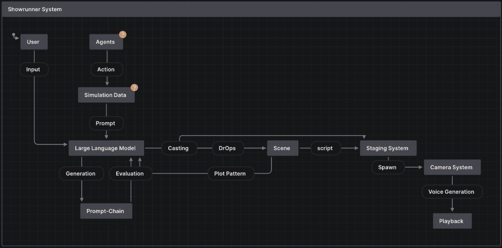

剧集生成流程

**可以将 AI 版《南方公园》定位为特定地点的一系列对话场景，这些对话场景加起来就是常规 22 分**钟南方公园剧集的**播**放时长。通过高层次的想法来提示故事系统，通常为 14 个场景中的每一个场景中看到的重大事件的概要形式。

由此，故事系统可以利用模拟数据（一天中的时间、区域、角色）自动生成场景作为提示链的一部分，该提示链首先生成合适的标题，第二步生成对话的场景。演出系统负责为每个场景生成角色。

最后，基于场景定义每个演员的位置、演员和对话。舞台系统和 AI 摄像系统完成初始设置后回放场景。每个角色的声音都已提前克隆，并且为每条新对话台词即时生成语音片段。画面方面，则通过 Dream Booth 方式训练了专门的扩散模型，用于基于 IP 世界观生成角色和背景。

通过这样的方式，AI Agents 在约 3 个小时内可以完成一集《南方公园》，并避免了在以往通过 AI 短时间大量生成内容过程中面临的“老虎机效应。（老虎机效应是指 AI 内容的生成感觉更像是一场随机游戏，而不是一个深思熟虑的创作过程。)

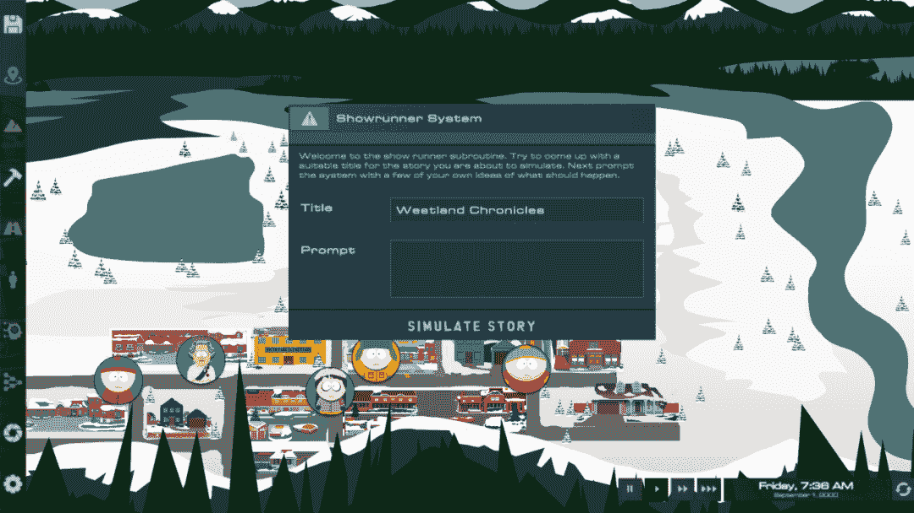

Showrunner 故事创作系统

**当下，**AI 视频中画面闪动的问题正在被逐步解决，更近稳定的镜头已在《Gen**e**sis》和《遥远地球之歌》和 AI 版《流浪地球 III》版中出现，并**验证了 AI 正在为观众逐步带来更好的****观影体验，而科幻电影，一直以来都是人类想象力承载的优秀载体，甚至是某种未来科技的映射。

一直以来， “人工智**能”一词因科幻小说和电影的流行而被赋予了丰富的含义，在这些作品中，具有自由思考、自主学习甚至能够体验情感能力的机器，以不同形式被重新想象，无论是像皮克斯动画《机器人总动员》中瓦力那样的勇敢温柔，还是像《2001 太空漫游》中的 HAL-9000 那样的危险邪恶，便是我们今天所说 AGI 的一种形式。

未来，电影工业化的 3.0 阶段，可能会出现这样一种科幻电影的创作方式。一个大语言模型，我们就以科幻杂志为它命名，叫 IFGPT 吧。某一天，IFGPT 在学习了大量优秀的科幻作品后，通过多模态能力的扩展，观看了大量经典的电影作品《2001：太空漫游》《黑客帝国》《星球大战》 《异形》《银翼杀手》 《星际穿越》《流浪地球》……

一家电影公司希望实践一部全 AI 完成的电影，于是 IFGPT 扮演了星球大战系列中的 R2-D2 出演了《星球大战：2030》。而 IFGPT 的分身们，成为了这部影片中的其他角色，他们学习科幻电影里面角色的生活方式，并并能够灵活的调用各类模型各位扩展工具，包括在 AI 电影预告片工作流中 Midjourney 和 Gen2 的模型和算法能力，如同今天的 AI 版《南方公园》一样，通过学习《星球大战》系列的 IP 世界观，结合经典科幻电影的创意特征和技术特征，进行故事系统、对话场景、定义演出和模拟音画生成，完成科幻电影的自动化创建。

又也许，这种生成方式是在类似 Unreal Engine 这样的引擎上，AI 角色们仍以 LLM 能力作为底座，为自己构建了一个虚拟世界，并实时进行对话演出，所有的对话，表演都由 AI 自主生成，这样便不需要 3 小时生成 20 分钟内容，而是 AI 的实时对话演出。

在这种模式下，IFGPT 及其分身们实际上已经超越了作为工具的角色，而更像是独立的创作主体，不仅完成机械化的生成，更进一步完成故事、角色、对白的创作。IFGPT 们在模拟世界中像人类一样生活和社交，给屏幕另一侧的我们观察的机会。与此同时，它们仍然保留着算法基因，能实现快速进化，可以通过大规模采样、学习、迭代创作素材。比如 IFGPT 可以轻松生成数十种剧本大纲，并通过多个 AI Agents 的交互速迭代找到最优方案，也可以基于已有素材生成更多新画面。

“可以预见，在不远的将来，AI 将不仅能完成预告片的生成，更能参与或主导完整科幻电影的构思、对白乃至出演。到那时，AI 科幻电影的春天真正来临。我们有理由相信这个时间不会太遥远。”——Claude

当然，要实现这一目标还需技术突破。模拟世界的真实感和交互性需要进一步提升，IFGPT 的自主思考与情感也待加强，缺乏具身体验的 AI 尚还难以创作出打动人心的作品。这种融合人工智能与人类深度协作的创作模式，或将革新许多创造性行业，开启电影工业化新阶段的序幕，也许会改变我们对“作者”这个概念的定义。

## **当前模型的缺点**

当前模型存在缺点。它可能在准确模拟复杂场景的物理过程方面存在困难，并且可能不理解特定实例的因果关系。例如，一个人可能会咬一口饼干，但之后，饼干可能不会有咬痕。

模型也可能会混淆提示的空间细节，例如，将左和右搞混，而且可能在处理随时间发生的事件的精确描述方面遇到困难，比如遵循特定的摄像机轨迹。

Prompt: Step-printing scene of a person running, cinematic film shot in 35mm.

提示：以 35 毫米电影胶片拍摄的人物奔跑的逐帧打印场景。

弱点：Sora 有时会创造出物理上不可能的动作。

Prompt: Five gray wolf pups frolicking and chasing each other around a remote gravel road, surrounded by grass. The pups run and leap, chasing each other, and nipping at each other, playing.

提示：五只灰色的狼崽在一条偏远的碎石路上嬉戏追逐。它们被草地所包围，这些狼崽奔跑、跳跃，追逐着彼此，互相咬着玩耍。

弱点：动物或人物可能会自发出现，尤其是在包含许多实体的场景中。

Prompt: Basketball through hoop then explodes.

提示：篮球穿过篮圈后爆炸。

弱点：不精确的物理建模和不自然的物体“变形”的一个例子。

Prompt: Archeologists discover a generic plastic chair in the desert, excavating and dusting it with great care.

提示：考古学家在沙漠中发现了一把普通的塑料椅子，并且小心翼翼地对其进行挖掘和清理。

弱点：在这个例子中，Sora 未能将椅子建模为一个刚性物体，导致物理交互不准确。

Prompt: A grandmother with neatly combed grey hair stands behind a colorful birthday cake with numerous candles at a wood dining room table, expression is one of pure joy and happiness, with a happy glow in her eye. She leans forward and blows out the candles with a gentle puff, the cake has pink frosting and sprinkles and the candles cease to flicker, the grandmother wears a light blue blouse adorned with floral patterns, several happy friends and family sitting at the table can be seen celebrating, out of focus. The scene is beautifully captured, cinematic, showing a 3/4 view of the grandmother and the dining room. Warm color tones and soft lighting enhance the mood..

提示：一位头发整齐梳理、灰白的祖母站在一张木质餐桌后面，桌上放着一款色彩缤纷、插着许多蜡烛的生日蛋糕，她的表情是纯粹的喜悦和幸福，眼中闪烁着快乐的光芒。她轻轻向前倾斜，用一口轻柔的气息吹灭了蜡烛，蛋糕上涂有粉色糖霜并撒有糖果，而蜡烛也随之熄灭，祖母身穿一件浅蓝色、饰有花卉图案的衬衫，桌旁可以模糊地看到几位快乐的朋友和家人在庆祝。这一幕被美妙地捕捉下来，具有电影般的视觉效果，展示了祖母和餐厅的四分之三视角。温暖的色调和柔和的光线增强了整体氛围。

弱点：对于模型来说，模拟对象之间以及多个角色之间的复杂互动往往具有挑战性，有时会导致产生幽默的结果。

## **安全性**

在 OpenAI 的产品中提供 Sora 之前，我们将采取几个重要的安全措施。我们正在与红队成员合作——这些领域的专家，如错误信息、仇恨内容和偏见——他们将会对模型进行对抗性测试。

我们还在开发工具帮助检测误导性内容，比如一个能够识别视频是否由 Sora 生成的检测分类器。如果我们在 OpenAI 产品中部署模型，我们计划将来包括 C2PA 元数据。

除了我们开发新技术为部署做准备之外，我们还利用了为使用 DALL·E 3 的产品构建的现有安全方法，这些方法也适用于 Sora。

例如，在 OpenAI 的一个产品中，我们的文本分类器将检查并拒绝违反我们使用政策的文本输入提示，如那些请求极端暴力、性内容、仇恨图像、名人肖像或他人的知识产权等内容。我们还开发了强大的图像分类器，用于审查生成的每个视频帧，以帮助确保它遵守我们的使用政策，在向用户展示之前。

我们将与全球的政策制定者、教育者和艺术家合作，了解他们的担忧，并识别这项新技术的积极用例。尽管进行了广泛的研究和测试，但我们无法预测人们将以所有有益的方式使用我们的技术，也无法预测所有人们会滥用它的方式。这就是为什么我们认为，从现实世界的使用中学习，是随着时间的推移创建和发布越来越安全的 AI 系统的关键组成部分。

，时长 00:09

Prompt: The camera directly faces colorful buildings in burano italy. An adorable dalmation looks through a window on a building on the ground floor. Many people are walking and cycling along the canal streets in front of the buildings.

提示：镜头直接对准了意大利布拉诺岛上色彩斑斓的建筑。一只可爱的斑点狗通过一楼的窗户向外张望。许多人正在建筑物前的运河街道上行走和骑自行车。

Prompt: An adorable happy otter confidently stands on a surfboard wearing a yellow lifejacket, riding along turquoise tropical waters near lush tropical islands, 3D digital render art style.

提示：一只可爱的快乐的水獭自信地站在冲浪板上，穿着黄色的救生衣，在翡翠色的热带水域附近的郁郁葱葱的热带岛屿旁滑行，3D 数字渲染艺术风格。

Prompt: This close-up shot of a chameleon showcases its striking color changing capabilities. The background is blurred, drawing attention to the animal’s striking appearance.

提示：这张近距离拍摄的变色龙照片展示了它惊人的变色能力。背景被模糊处理，使得动物的鲜明外观更加引人注目。

Prompt: A corgi vlogging itself in tropical Maui.

提示：一只柯基在热带的毛伊岛上自拍视频。

Prompt: A white and orange tabby cat is seen happily darting through a dense garden, as if chasing something. Its eyes are wide and happy as it jogs forward, scanning the branches, flowers, and leaves as it walks. The path is narrow as it makes its way between all the plants. the scene is captured from a ground-level angle, following the cat closely, giving a low and intimate perspective. The image is cinematic with warm tones and a grainy texture. The scattered daylight between the leaves and plants above creates a warm contrast, accentuating the cat’s orange fur. The shot is clear and sharp, with a shallow depth of field.

提示：一个白色和橙色的虎斑猫快乐地穿梭在密集的花园中，仿佛在追逐着什么。它的眼睛张得大大的，显得非常开心，一边慢跑一边审视着路过的树枝、花朵和叶子。路径狭窄，它在所有植物间穿行。这场景从地面角度捕捉，紧紧跟随着猫，提供了一个低而亲密的视角。图像带有温暖的色调和颗粒感，十分电影化。树叶和植物之间散落的阳光营造出温暖的对比，突显出猫的橙色毛皮。画面清晰锐利，具有浅景深。

Prompt: Aerial view of Santorini during the blue hour, showcasing the stunning architecture of white Cycladic buildings with blue domes. The caldera views are breathtaking, and the lighting creates a beautiful, serene atmosphere.

提示：蓝色时刻空中俯瞰圣托里尼，展示了白色的基克拉迪建筑和蓝色圆顶的惊人建筑。火山口的景观令人叹为观止，而照明营造出美丽、宁静的氛围。

Prompt: Tiltshift of a construction site filled with workers, equipment, and heavy machinery.

提示：一个施工现场的倾角摄影，里面充满了工人、设备和重型机械。

Prompt: A giant, towering cloud in the shape of a man looms over the earth. The cloud man shoots lighting bolts down to the earth.

提示：一个庞大、高耸的云朵呈现出一个人的形状笼罩着大地。这个云人向地面发射雷电。

Prompt: A Samoyed and a Golden Retriever dog are playfully romping through a futuristic neon city at night. The neon lights emitted from the nearby buildings glistens off of their fur.

提示：一只萨摩耶犬和一只金毛寻回犬在夜晚的未来主义霓虹城市中嬉戏奔跑。附近建筑物发出的霓虹灯光从它们的毛皮上反射出闪亮的光芒。

Prompt: The Glenfinnan Viaduct is a historic railway bridge in Scotland, UK, that crosses over the west highland line between the towns of Mallaig and Fort William. It is a stunning sight as a steam train leaves the bridge, traveling over the arch-covered viaduct. The landscape is dotted with lush greenery and rocky mountains, creating a picturesque backdrop for the train journey. The sky is blue and the sun is shining, making for a beautiful day to explore this majestic spot.

提示：格伦芬南高架桥是位于英国苏格兰的一座历史悠久的铁路桥，它跨越西部高地线，连接着马莱格镇和威廉堡镇。当一辆蒸汽火车离开桥梁，穿行在覆盖有拱顶的高架桥上时，这是一道令人惊叹的美景。该地区点缀着郁郁葱葱的绿色植被和岩石山峦，为火车旅行创造了如画的背景。天空是蓝色的，阳光灿烂，是探索这个雄伟地点的美好日子。

## **研究技术**

Sora 是一种扩散模型，它通过从看起来像静态噪声的视频开始，并通过多个步骤逐渐去除噪声来生成视频。

索拉能够一次性生成整个视频或者延长已生成的视频使其更长。通过给模型提供一次多帧的预见性，我们解决了确保主体即使暂时消失在视野中也能保持不变的这一难题。

与 GPT 模型类似，Sora 采用了 Transformer 架构，解锁了超级扩展性能。

我们将视频和图像表示为称为补丁（patches）的较小数据单位的集合，每个补丁都类似于 GPT 中的一个令牌。通过统一数据表示方式，我们可以在比以前可能的更广泛的视觉数据范围上训练扩散 Transformer，包括不同的持续时间、分辨率和宽高比。

Sora 在 DALL·E 和 GPT 模型的先前研究基础上进行了构建。它使用了 DALL·E 3 中的重新加标题技术，该技术涉及为视觉训练数据生成高度描述性的标题。因此，该模型能够更忠实地遵循用户在生成的视频中的文本指令。

除了能够仅从文本指令生成视频之外，该模型还能够接受现有的静态图像，并从中生成视频，准确并细致地为图像内容添加动画。该模型还能接受现有视频并对其进行扩展或填补缺失的帧。更多信息请参阅我们的技术论文（今天晚些时候发布）。

**S**ora 作为一个基础，为可以理解和模拟现实世界的模型服务，我们认为这将是实现 AGI 的一个重要里程碑。

> 推荐一个**「保姆级 Sora 干货」**

>

> 共有 4 个部分：Sore 最新资讯、Sore 通识干货、Sore 变现案例、Sore 提示词

>

> 作者：沐凡，Ai 研习社合伙人，9 年新媒体老司机，AI 短视频操盘手。

>

> 限时** 10 元**，订阅后可以加入 Sora 学习交流群，群里随时更新 Sore 最前沿的信息和变现方法。

## **媒体态度**

+   CCTV：Sora 爆火！人工智能将如何改变世界？

+   腾讯科技：OpenAI 王炸模型引爆科技圈，我们第一时间深读了官方技术报告

+   周鸿祎：Sora 意味着 AGI 实现将从 10 年缩短到 1 年

+   深网腾讯新闻 [48 个演示视频，最长 60 秒，](https://mp.weixin.qq.com/s/4_hBzafAqZSC9GWJsIMVPA)看懂 OpenAI 视频大模型 Sora

+   钛媒体：** **[拉大中美 AI 差距的](https://www.tmtpost.com/6937210.html)[ Sora](https://www.tmtpost.com/6937210.html)[，真能让好莱坞们失业吗？](https://www.tmtpost.com/6937210.html)

+   第一财经** **[OpenAI 将](https://baijiahao.baidu.com/s?id=1791029941527194086&wfr=spider&for=pc)[ Sora ](https://baijiahao.baidu.com/s?id=1791029941527194086&wfr=spider&for=pc)[视作“世界模拟器”](https://baijiahao.baidu.com/s?id=1791029941527194086&wfr=spider&for=pc)

+   2024，得 AI 芯片者得天下

+   炸裂 AI 技术 Sora 背后：奥特曼清单法

+   全网最快详细讲解 Sora，Open ai 视频生成工具具体功能

+   sora 技术报告逐字解读，遥遥领先？

<https://aiyanxishe.feishu.cn/sync/IaSadpoOOsopKab1ajKcz6z3nAb>