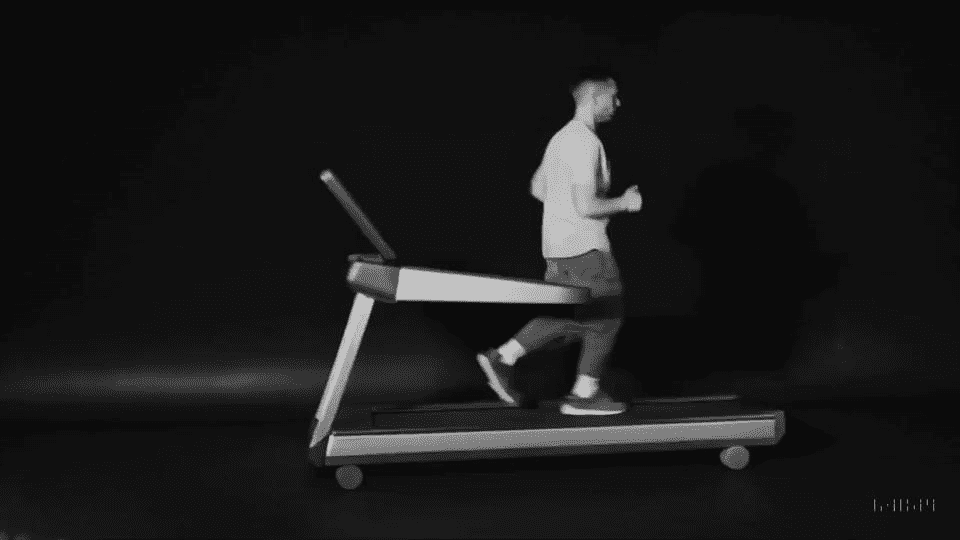
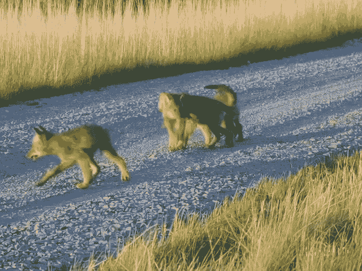
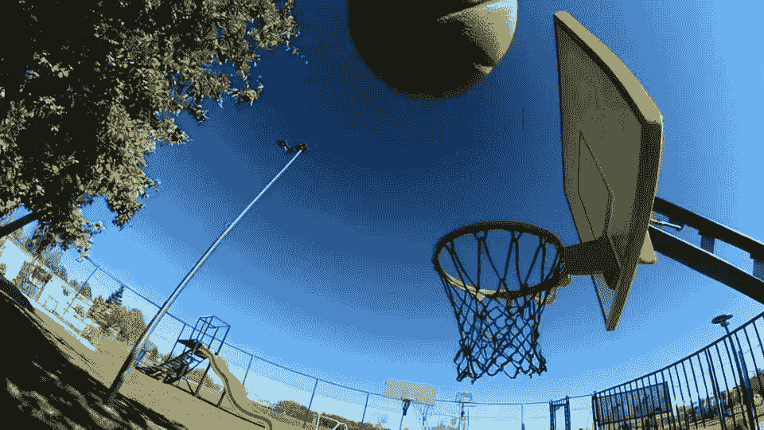
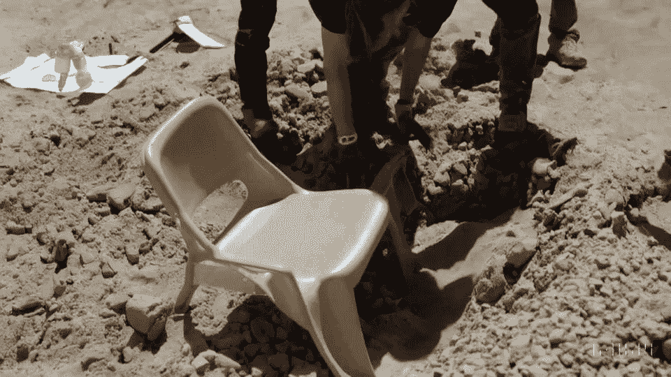
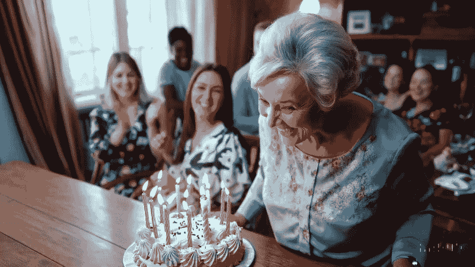

# Sora模型弱点

> 来源：[https://aiyanxishe.feishu.cn/docx/RrZ0dr4iJoreOkxelQOcNgG5nGd](https://aiyanxishe.feishu.cn/docx/RrZ0dr4iJoreOkxelQOcNgG5nGd)

OpenAI表示，**Sora并不是一个完美的模型**，例如这段提示词描述了篮球在入网后的爆炸效果，会出现空间混淆的情况。

[backward-jogger.mp4](https://internal-api-drive-stream.feishu.cn/space/api/box/stream/download/all/MB78bf8CDosWipxrbx2c6fUwnob)

提示：一个人奔跑的步印场景，以 35 毫米拍摄的电影胶片。

弱点：Sora有时会产生身体上难以置信的动作。

[puppy-cloning.mp4](https://internal-api-drive-stream.feishu.cn/space/api/box/stream/download/all/VJDLb4KQDoTlP0xMxKkcSrnsnlb)

提示：五只灰狼幼崽在一条偏远的碎石路上嬉戏和追逐，周围环绕着草地。幼崽们奔跑跳跃，互相追逐，互相啃咬，玩耍。

弱点：动物或人可以自发出现，尤其是在包含许多实体的场景中。

[basketball-explosion.mp4](https://internal-api-drive-stream.feishu.cn/space/api/box/stream/download/all/SCehb6pedo3GLvxTcJRceAiZnpe)

提示：篮球穿过篮筐然后爆炸。

弱点：不准确的物理建模和非自然物体“变形”的例子。

[chair-archaeology.mp4](https://internal-api-drive-stream.feishu.cn/space/api/box/stream/download/all/MVkubySUqoX7nSxN5y0cPiX1nac)

提示：考古学家在沙漠中发现了一把普通的塑料椅子，小心翼翼地挖掘和除尘。

弱点：在这个例子中，Sora未能将椅子建模为一个刚性物体，导致不准确的物理交互。

[grandma-birthday.mp4](https://internal-api-drive-stream.feishu.cn/space/api/box/stream/download/all/E7RVbl5YTo969pxF3g3cKlh3nee)

提示：一位头发梳得整整齐齐的祖母站在木制餐桌旁的五颜六色的生日蛋糕后面，上面摆放着许多蜡烛，表情是纯粹的喜悦和幸福，她的眼睛里闪耀着幸福的光芒。她身体前倾，轻轻地吹灭蜡烛，蛋糕上有粉红色的糖霜和洒水，蜡烛不再闪烁，祖母穿着一件装饰着花卉图案的浅蓝色衬衫，可以看到坐在桌子旁的几个快乐的朋友和家人在庆祝，失焦。这个场景被精美地捕捉，电影般的，显示了祖母和餐厅的 3/4 视图。温暖的色调和柔和的灯光增强了气氛。

弱点：模拟对象和多个角色之间的复杂交互对模型来说通常具有挑战性，有时会导致幽默的生成。

作为全球最知名的人工智能企业，Open AI非常重视模型的安全性。Sora在正式发布之前，还会经过对抗性测试，并加入用于标注人工智能生成内容的CRPA metadata标签。此外，Open AI还会过滤不安全的文本提示，避免生成违反政策的内容。总之在发布该模型之前，Open AI会优先考虑安全性。