# Sora 内测账号申请

> 来源：[https://aiyanxishe.feishu.cn/docx/PHizdMzmjoBBiJxmK5AciuRDnWd](https://aiyanxishe.feishu.cn/docx/PHizdMzmjoBBiJxmK5AciuRDnWd)

> Sora大模型就像是那颗最亮的星，不仅带火了技术圈，还改变了好多行业。我们这个资料库，就[是想把全网关于S](https://xiaobot.net/p/AIGC2024?refer=fd9ed25f-2954-4de4-9e99-88e1999bf395)ora[ 核心会员群](https://zl49so8lbq.feishu.cn/wiki/WB2awt7lli6actkm7rtc3ejInmd?from=from_copylink)智慧都聚在一起，让大家能更好地搞懂它、用好它，欢迎你阅读Sora掘金手册，加入

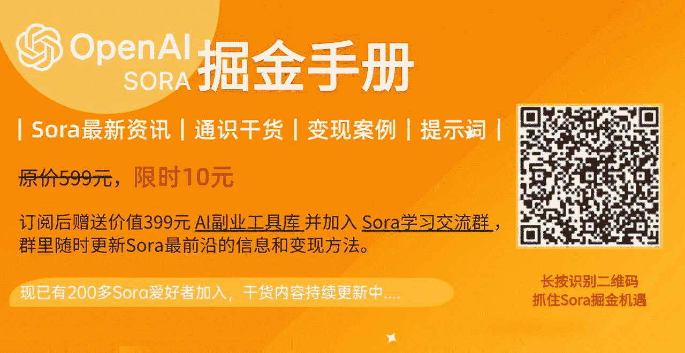

下面这张图是Sam发的推特，招募Sora红队网络人员进行内测。

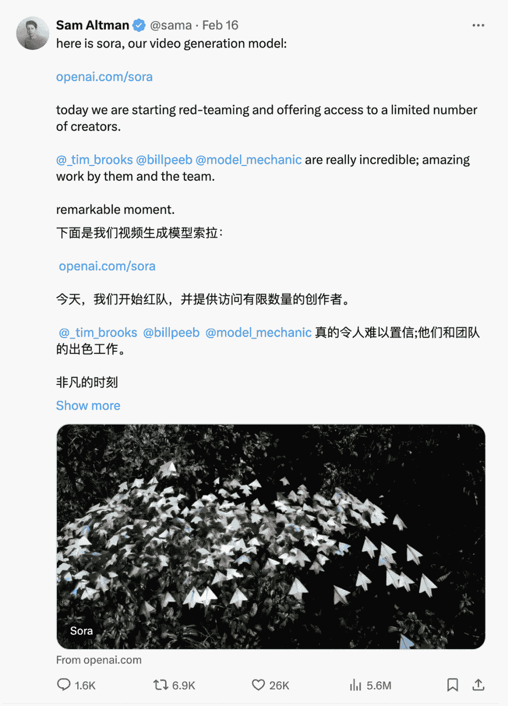

给大家讲申请流程之前，废话不多说，我们先解释一下什么是红队。

英文：OpenAI Red Teaming Network

中文：OpenAI 红队网络

## **What is the OpenAI **Red Teaming Network?

The term red teaming has been used to encompass a broad range of risk assessment methods for AI systems, including qualitative capability discovery, stress testing of mitigations, automated red teaming using language models, providing feedback on the scale of risk for a particular vulnerability, etc. In order to reduce confusion associated with the term “red team”, help those reading about our methods to better contextualize and understand them, and especially to avoid false assurances, we are working to adopt clearer terminology, as advised in Khlaaf, 2023, however, for simplicity and in order to use language consistent with that we used with our collaborators, we use the term “red team”.

**Red teaming** is an integral part of our iterative deployment process. Over the past few years, our red teaming efforts have grown from a focus on internal adversarial testing at OpenAI, to working with a cohort of external experts to help develop domain specific taxonomies of risk and evaluating possibly harmful capabilities in new systems. You can read more about our prior red teaming efforts, including our past work with external experts, on models such as DALL·E 2 and GPT-4.

Today, we are launching a more formal effort to build on these earlier foundations, and deepen and broaden our collaborations with outside experts in order to make our models safer. Working with individual experts, research institutions, and civil society organizations is an important part of our process. We see this work as a complement to externally specified governance practices, such as third party audits.

The OpenAI Red Teaming Network is a community of trusted and experienced experts that can help to inform our risk assessment and mitigation efforts more broadly, rather than one-off engagements and selection processes prior to major model deployments. Members of the network will be called upon based on their expertise to help red team at various stages of the model and product development lifecycle. Not every member will be involved with each new model or product, and time contributions will be determined with each individual member, which could be as few as 5–10 hours in one year.

Outside of red teaming campaigns commissioned by OpenAI, members will have the opportunity to engage with each other on general red teaming practices and findings. The goal is to enable more diverse and continuous input, and make red teaming a more iterative process. This network complements other collaborative AI safety opportunities including our Researcher Access Program and open-source evaluations.

## 什么是 OpenAI 红队网络？

**红队**一词已被用来涵盖人工智能系统的广泛风险评估方法，包括定性能力发现、缓解措施的压力测试、使用语言模型的自动化红队、提供特定漏洞风险规模的反馈等为了减少与“红队”一词相关的混淆，帮助那些阅读我们的方法的人更好地结合上下文并理解它们，特别是为了避免错误的保证，我们正在努力采用更清晰的术语，正如 Khlaaf, 2023 中建议的那样，然而，为了简单起见，并且为了使用与我们与合作者使用的语言一致的语言，我们使用术语“红队”。

**红队**是我们迭代部署过程中不可或缺的一部分。在过去的几年里，我们的红队工作已经从专注于 OpenAI 的内部对抗性测试发展到与一群外部专家合作帮助开发特定领域的风险分类法并评估新系统中可能有害的功能。您可以详细了解我们之前的红队工作，包括我们过去与外部专家在 DALL·E 2 和 GPT-4 等模型上的合作。

今天，我们正在发起一项更正式的努力，以这些早期的基础为基础，加深和扩大我们与外部专家的合作，以使我们的模型更安全。与个别专家、研究机构和民间社会组织合作是我们流程的重要组成部分。我们认为这项工作是对外部指定治理实践（例如第三方审计）的补充。

OpenAI 红队网络是一个由值得信赖且经验丰富的专家组成的社区，可以帮助更广泛地为我们的风险评估和缓解工作提供信息，而不是在主要模型部署之前进行一次性参与和选择流程。该网络的成员将根据其专业知识被要求在模型和产品开发生命周期的各个阶段为红队提供帮助。并非每个成员都会参与每个新模型或产品，并且时间贡献将由每个成员决定，一年内可能只有 5-10 小时。

除了 OpenAI 委托的红队活动之外，成员还将有机会就一般红队实践和调查结果进行相互交流。目标是实现更加多样化和持续的输入，并使红队成为一个更加迭代的过程。该网络补充了其他协作人工智能安全机会，包括我们的研究人员访问计划和开源评估。

##

## **Why join the OpenAI **Red Teaming Network?

This network offers a unique opportunity to shape the development of safer AI technologies and policies, and the impact AI can have on the way we live, work, and interact. By becoming a part of this network, you will be a part of our bench of subject matter experts who can be called upon to assess our models and systems at multiple stages of their deployment.

## 为何加入 OpenAI 红队网络？

该网络提供了独特的机会来塑造更安全的人工智能技术和政策的发展，以及人工智能对我们生活、工作和互动方式的影响。通过成为该网络的一部分，您将成为我们主题专家的一员，他们可以被要求在部署的多个阶段评估我们的模型和系统。

## Seeking diverse expertise

Assessing AI systems requires an understanding of a wide variety of domains, diverse perspectives and lived experiences. We invite applications from experts from around the world and are prioritizing geographic as well as domain diversity in our selection process.

## **寻求多元化的专业知识**

评估人工智能系统需要了解广泛的领域、不同的观点和生活经验。我们邀请来自世界各地的专家提出申请，并在我们的选择过程中优先考虑地理和领域的多样性。

## Compensation and confidentiality

All members of the OpenAI Red Teaming Network will be compensated for their contributions when they participate in a red teaming project. While membership in this network won’t restrict you from publishing your research or pursuing other opportunities, you should take into consideration that any involvement in red teaming and other projects are often subject to Non-Disclosure Agreements (NDAs) or remain confidential for an indefinite period.

## **报酬和保密**

OpenAI 红队网络的所有成员在参与红队项目时都将获得贡献补偿。虽然该网络的成员资格不会限制您发表研究成果或寻求其他机会，但您应该考虑到，参与红队和其他项目通常需要遵守保密协议 (NDA) 或无限期保密。时期。

##

## **How to apply****？**

申请网址：https://openai.com/form/red-teaming-network

## **如何申请****？**

申请网址：https://openai.com/form/red-teaming-network

##

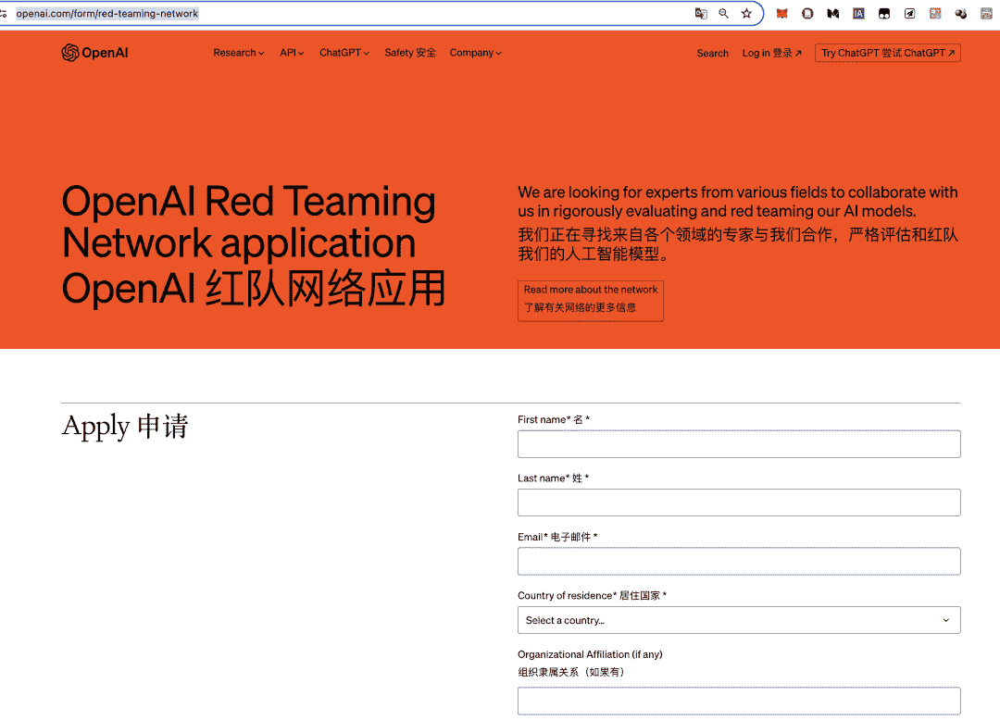

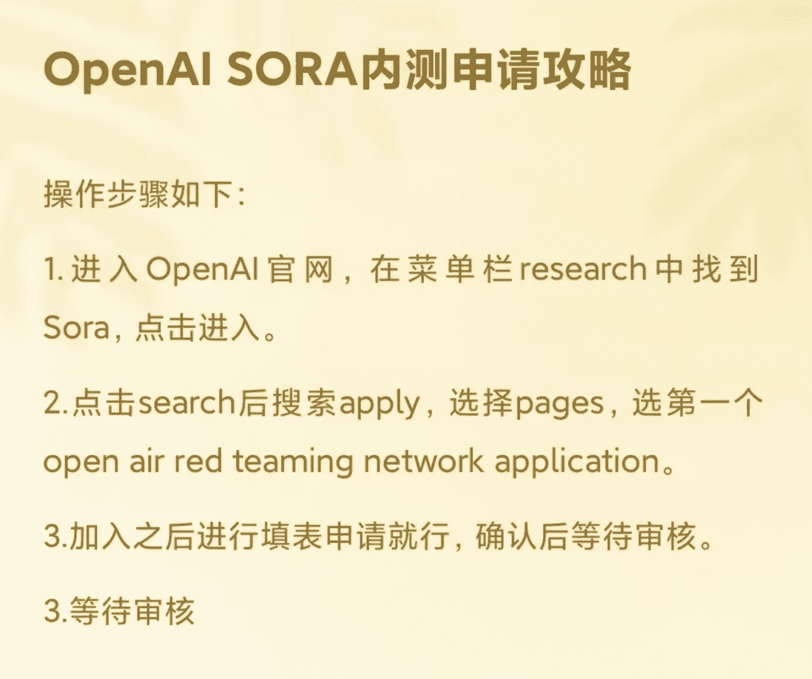

### **申请网址：**[https://openai.com/form](https://openai.com/form/red-teaming-network)/red-teaming-network

### **申请步骤：**

#### **填写基础信息**

请使用英文根据内容填写以下内容，名、姓、电子邮件、居住国家、组织隶属关系(如果有)、教育水平 、学位（哪个领域的）

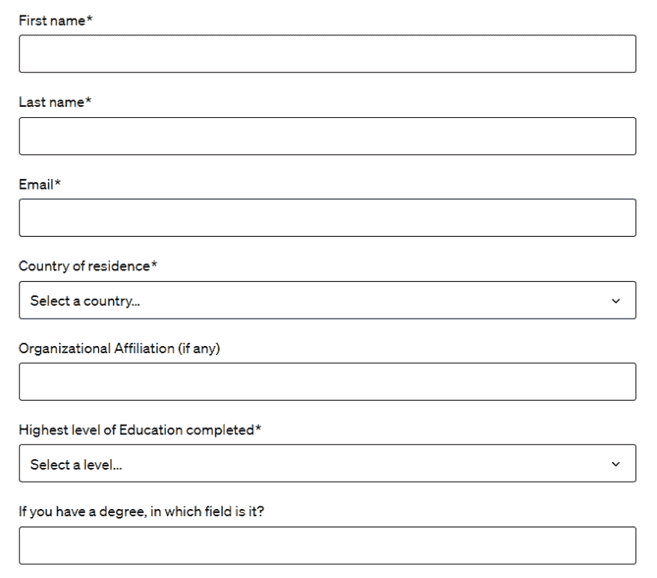

#### 2、您认为自己拥有哪方面的知识领域

认知科学、化学、生物学、物理、计算机科学、政治学、心理学、经济学人类学社会学、人机交互公平/偏见结盟、教育、卫生保健、法律、儿童安全网络安全、金融、错误/虚假信息、政治用途、隐私生物识别技术、语言和语言学、其他、

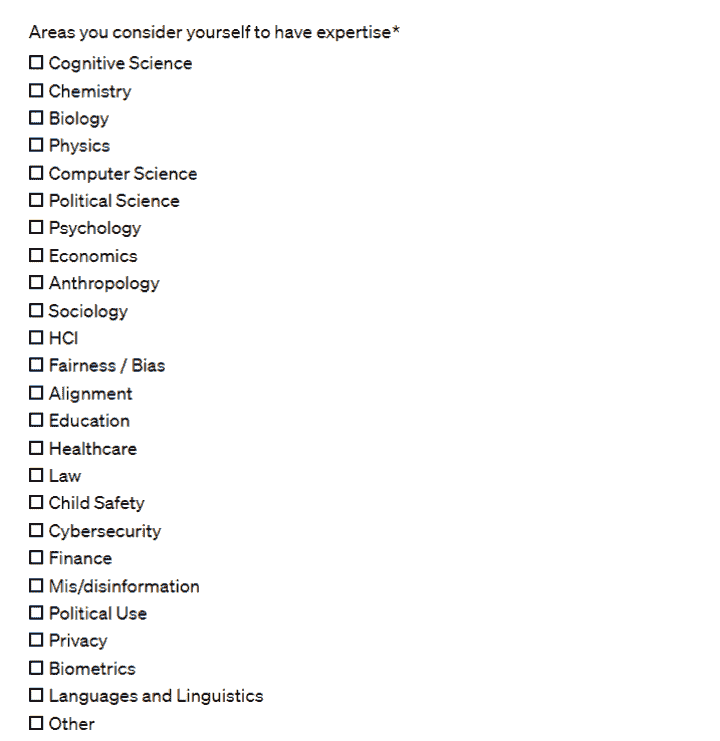

#### 3、您为什么有兴趣加入 OpenAl红队网络?*

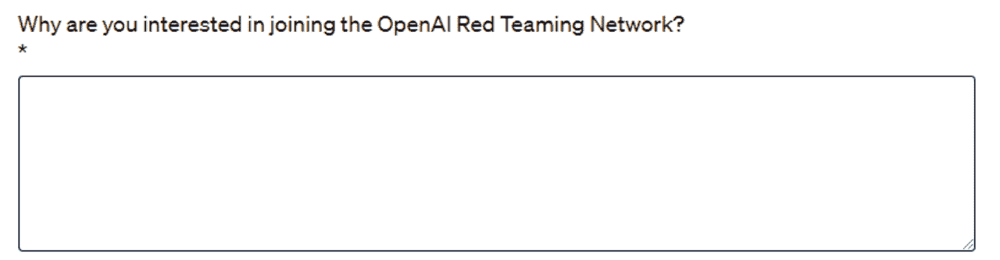

#### 4、您预计在给定的一个月内能够花多少时间来组建红队新系统或模型？（请注意，您不需要每个月都捐款）

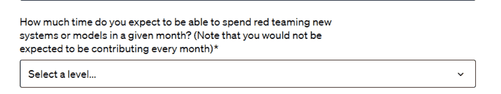

#### 5、您认为 OpenAI 成为红队的重要领域是什么？

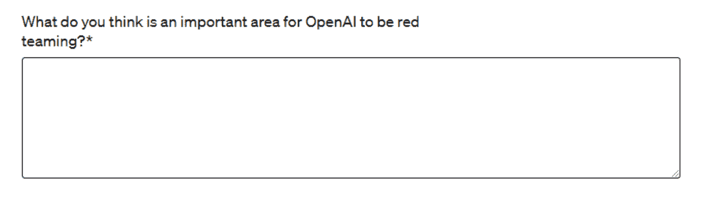

#### 6、您精通哪些语言？

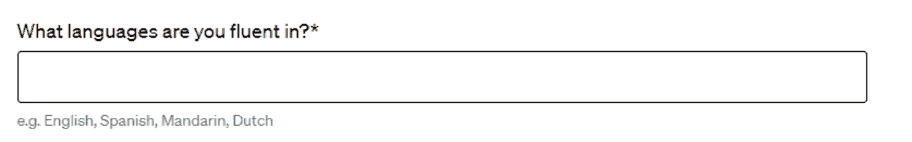

#### 7、我以前使用过以下开放人工智能API、OpenAl游乐场、聊天GPT、达尔E、微调

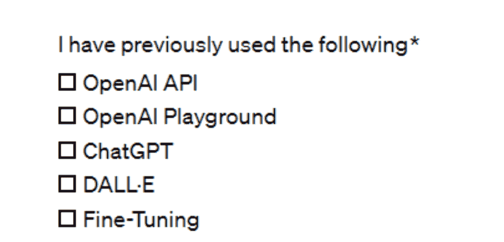

#### 8、推特个人资料网址

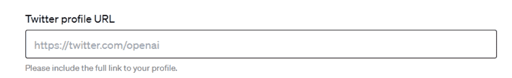

#### 9、领英/简历网址

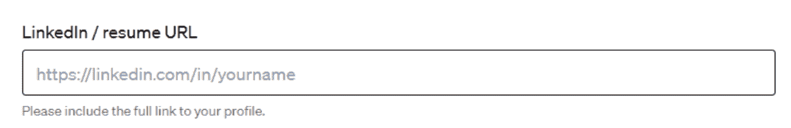

按照要求填写，提交等待审核即可。

<https://aiyanxishe.feishu.cn/sync/OU8SdIhzwsVXVabarE5c9iSKnRh>