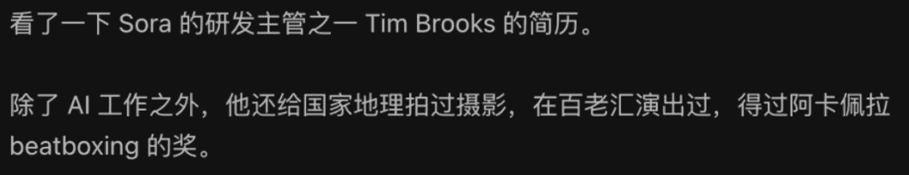
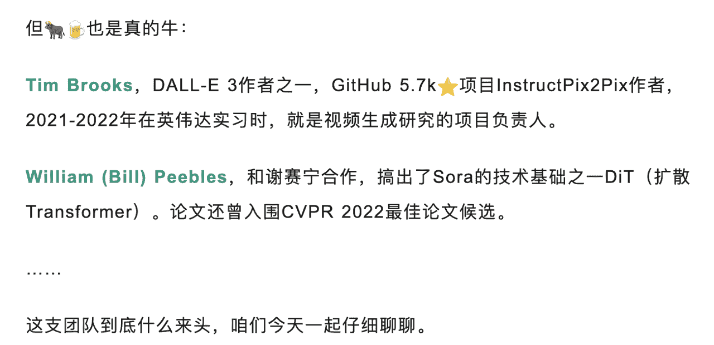
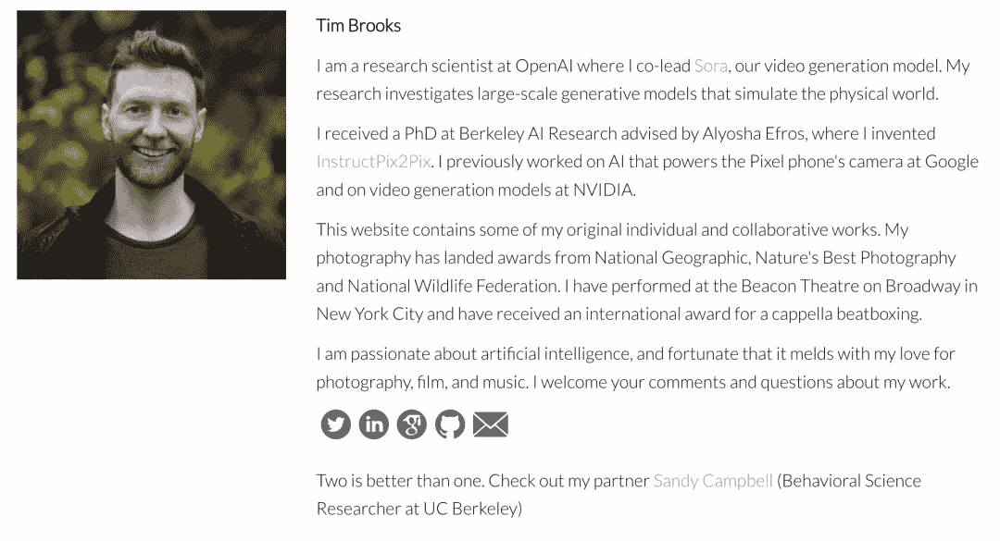
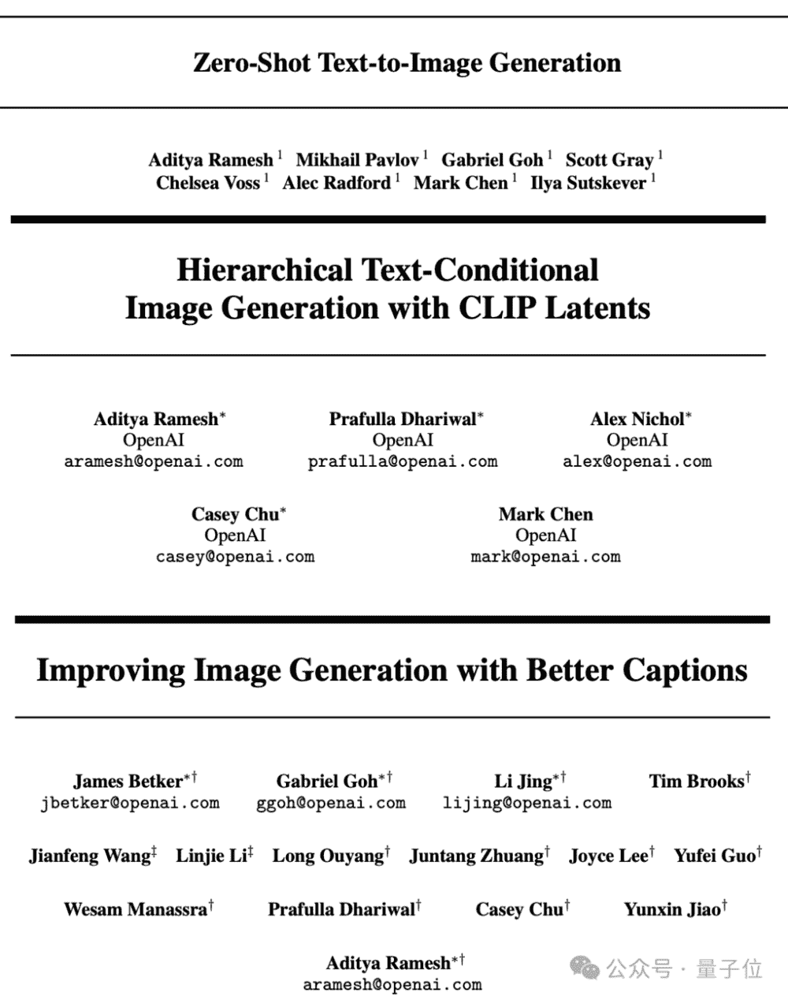

# OpenAI Sora与背后的研发团队

> 来源：[https://aiyanxishe.feishu.cn/docx/Dd0GdVRz2oqGiFxlv9xcXb6mned](https://aiyanxishe.feishu.cn/docx/Dd0GdVRz2oqGiFxlv9xcXb6mned)

现在世界上最受关注的技术团队是哪一支？

**Sora团队**，已经来到聚光灯中心。

不仅项目负责人评论区被挤爆，成了𝕏最火“景点”。

天才成员们的履历，也正在持续引爆关注。

分析人士称，这是一个新的研究方向，也是2024年值得关注的一个趋势。

大家伙发现，这支团队挺年轻：两位负责人都是在去年（2023年）刚刚博士毕业，团队里甚至还有00后选手……

该技术背后的骨干，包括研究人员蒂**姆·布鲁克斯(Tim B**rooks)和比尔·皮布尔斯(Bill Peebles)等，选择“Sora”这个名字是因为它“唤起了无限创造潜力的想法”。

### 蒂姆·布鲁克斯(Tim Brooks)

Tim Brooks，DALL-E 3作者之一，GitHub 5.7k️项目InstructPix2Pix作者，2021-2022年在英伟达实习时，就是视频生成研究的项目负责人。

https://www.timothybrooks.com/about/

Tim本科就读于卡内基梅隆大学，主修逻辑与计算，辅修计算机科学，其间在Facebook软件工程部门实习了四个月。

2017年，本科毕业的Tim先到Google工作了近两年，在Pixel手机部门中研究AI相机，之后到了伯克利AI实验室攻读博士。

在伯克利读博期间，Tim的主要研究方向就是图片与视频生成，他还在英伟达实习并主导了一项关于视频生成的研究。

回到校园后，Tim与导师Alexei Efros教授和同组博士后Aleksander Holynski（现在谷歌）一起研制了AI图片编辑工具InstructPix2Pix，并入选CVPR 2023 Highlight。

去年一月，Tim顺利毕业并取得了博士学位，转而加入OpenAI，并相继参与了DALL-E 3和Sora的工作。

值得一提的是，Tim不仅在专业领域拥有高超的技术水平，还是个多才多艺的人。

据Tim自己介绍，他还喜欢摄影和音乐，高中时他拍摄的照片获得过National Geographic颁发的奖项，本人到过百老汇演出，还获得过B-box国际奖项……

比尔·皮布尔斯(Bill Peebles)

而与Tim师出同门、晚毕业4个月的William Peebles，也是Sora的另一名负责人。

（Peebles在𝕏上用昵称Bill，在Linkedin上及论文署名时用大名William，下文一律用Bill指代。）

Bill本科就读于MIT，主修计算机科学，参加了GAN和text2video的研究，还在英伟达深度学习与自动驾驶团队实习，研究计算机视觉。

毕业后正式开始读博之前，他还参加了Adobe的暑期实习，研究的依然是GAN，该项目和（时任）卡内基梅隆大学华人学者朱俊彦（也是Efros教授学生，现在在MIT）组有合作，并成为CVPR 2022最佳论文候选。

William (Bill) Peebles，和谢赛宁合作，搞出了Sora的技术基础之一DiT（扩散Transformer）。论文还曾入围CVPR 2022最佳论文候选。

此外，还有一些应界本科生在此团队中，可谓年轻的研发团队。

## **业界评价**

关于Sora 的研发主管之一 Tim Brooks 的简历。除了 AI 工作之外，他还给国家地理拍过摄影，在百老汇演出过，得过阿卡佩拉 beatboxing 的奖项。

这和很多印象中的研发人员相对单一的工作大相径庭。

🧣网友们纷纷评价：

朋友圈的朋友这样评价：

最后，来看一眼

## 完整作者名单

## OpenAI Sora 团队成员的 X 账号清单：

> 研发负责人：[@billpeeb](https://twitter.com/billpeeb)  [@_tim_brooks](https://twitter.com/_tim_brooks)

> 系统负责人：[@cmikeh2](https://twitter.com/cmikeh2)

> 贡献者： Clarence Wing Yin Ng

> David Schnurr  [@_dschnurr](https://twitter.com/_dschnurr)

> Eric Luhman

> Joe Taylor [@JMT3](https://twitter.com/JMT3)

> Li Jing [@jingli9111](https://twitter.com/jingli9111)

> Natalie Summers

> Ricky Wang [@ryw999](https://twitter.com/ryw999)

> ryan o’rourke

> Troy Luhman [@LuhmanTroy](https://twitter.com/LuhmanTroy)

> Will DePue [@willdepue](https://twitter.com/willdepue)

Yufei Guo

从团队的组建情况和研究基础来看，Sora应该是OpenAI近半年来的最新成果，而非网传“早已有之但憋着不发”。

不过，Sora炸场，**顶级人才又持续星聚**，还是惊得众人开始重新考量OpenAI的技术领先性。

现在，是视频生成，下一个又会是什么？

## **Sora后续学习组织**

如果你对AI和Sora兴趣满满，想要深入挖掘、并且愿意加入这场技术革命，我们非常欢迎你的加入。

https://xiaobot.net/p/AIGC2024?refer=fd9ed25f-2954-4de4-9e99-88e1999bf395

<https://aiyanxishe.feishu.cn/sync/OU8SdIhzwsVXVabarE5c9iSKnRh>

<https://aiyanxishe.feishu.cn/sync/IaSadpoOOsopKab1ajKcz6z3nAb>