# 「通用世界模型」Sora技术报告深度解读！

> 来源：[https://aiyanxishe.feishu.cn/docx/DGr5dezNEoJSd6xbhADcTYJbnZf](https://aiyanxishe.feishu.cn/docx/DGr5dezNEoJSd6xbhADcTYJbnZf)

<https://aiyanxishe.feishu.cn/sync/KGQ3dArdRsnl77bJBG4camxWnAg>

2月16日一早openAI平地一声雷，悄无声息的发布了**第一个T**ext to Video大模型—SORA。

从演示看，效果还是相当不错的。具体演示案例可以查看

Sora 的强大之处在于其能够根据文本描述，生成长达60秒的视频，其中包含精细复杂的场景、生动的角色表情以及复杂的镜头运动。 这无异于给正在处于春节长假的尾巴国内AI圈丢下了一颗重磅炸弹。这篇文章，我将快速的带大家解读一下openAI在官方release的技术报告，希望本文可以让大家能从一头雾水中，寻找和思考一些未来文生视频和文生图领域的技术发展趋势。另外本文不会逐字逐句的去翻译技术报告原文，对原文感兴趣的读者，可以在以下链接中自行食用。

技术报告原文链接: [h](https://link.zhihu.com/?target=https%3A//openai.com/research/video-generation-models-as-world-simulators)ttps://openai.com/research/video-generation-models-as-world-simulators

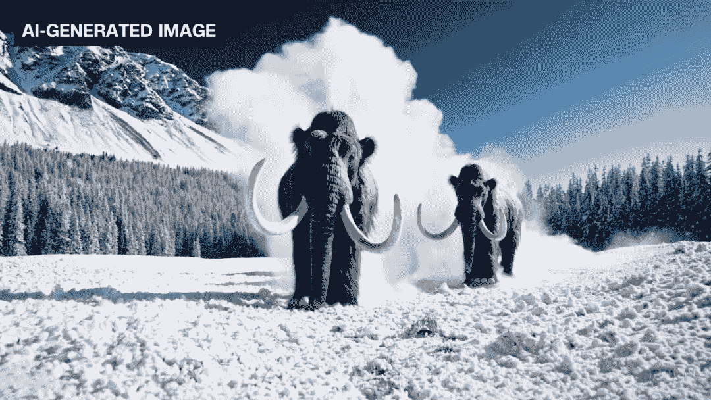

导读：昨天OpenAI发布了正在封闭测试的Sora，其是文本生成图像的大模型产品。本文为它的生成模型技术报告。

OpenAI 探索了视频数据生成模型的大规模训练。具体来说，研究人员在可变持续时间、分辨率和宽高比的视频和图像上联合训练了一个文本条件扩散模型。作者利用对视频和图像潜在代码的时空补丁进行操作的 transformer 架构，其最大的模型 Sora 能够生成长达一分钟的高质量视频。

OpenAI 认为，新展示的结果表明，扩展视频生成模型是构建物理世界通用模拟器的一条有前途的途径。We explore large-scale training of generative models on video data. Specifically, we train text-conditional diffusion models jointly on videos and images of variable durations, resolutions and aspect ratios. We leverage a transformer architecture that operates on spacetime patches of video and image latent codes. Our largest model, Sora, is capable of generating a minute of high fidelity video. Our results suggest that scaling video generation models is a promising path towards building general purpose simulators of the physical world.

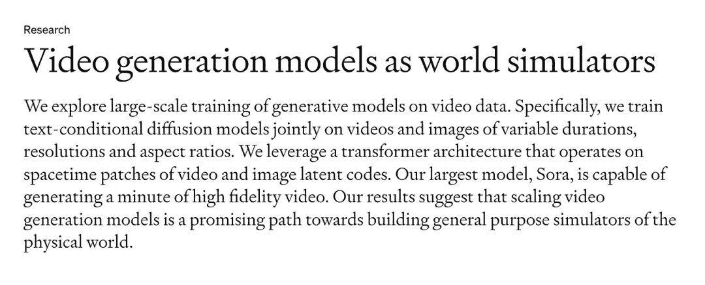

技术报告地址：https://openai.com/research/video-generation-models-as-world-simulators

，时长00:59

**OpenAI 在技术报告中重**点展示了：（1）将所有类型的视觉数据转化为统一表示，从而能够大规模训练生成模型的方法；以及（2）对 Sora 的能力和局限性进行定性评估。This technical report focuses on (1) our method for turning visual data of all types into a unified representation that enables large-scale training of generative models, and (2) qualitative evaluation of Sora’s capabilities and limitations. Model and implementation details are not included in this report.         令人遗憾的是，OpenAI 的报告不包含模型和训练的细节。最近一段时间，视频生成是 AI 领域的重要方向，先前的许多工作研究了视频数据的生成建模方向，包括循环网络、生成对抗网络、自回归 transformer 和扩散模型。这些工作通常关注一小类视觉数据、较短的视频或固定大小的视频。Much prior work has studied generative modeling of video data using a variety of methods, including recurrent networks,generative adversarial networks,4,5,6,7 autoregressive transformers,8,9 and diffusion models.10,11,12 These works often focus on a narrow category of visual data, on shorter videos, or on videos of a fixed size. Sora is a generalist model of visual data—it can generate videos and images spanning diverse durations, aspect ratios and resolutions, up to a full minute of high definition video.            与之不同的是，OpenAI 的 Sora 是视觉数据的通用模型，它可以生成不同时长、长宽比和分辨率的视频和图像，而且最多可以输出长达一分钟的高清视频。视觉数据转为 Patches大型语言模型通过在互联网规模的数据上进行训练，获得了出色的通用能力中，OpenAI 从这一点汲取了灵感。LLM 得以确立新范式，部分得益于创新了 token 使用的方法。研究人员们巧妙地将文本的多种模态 —— 代码、数学和各种自然语言统一了起来。在这项工作中，OpenAI 考虑了生成视觉数据的模型如何继承这种方法的好处。大型语言模型有文本 token，而 Sora 有视觉 patches。此前的研究已经证明 patches 是视觉数据模型的有效表示。OpenAI 发现 patches 是训练生成各种类型视频和图像的模型的可扩展且有效的表示。

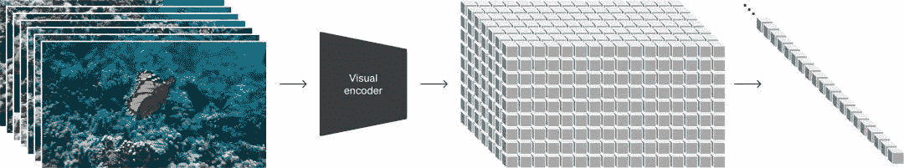

**在更高层面上**，OpenAI 首先将视频**压缩到较低维的潜在空间，**然后将表示分解为时空 patches，从而将视频转换为 patches。We take inspiration from large language models which acquire generalist capabilities by training on internet-scale data.13,14 The success of the LLM paradigm is enabled in part by the use of tokens that elegantly unify diverse modalities of text—code, math and various natural languages. In this work, we consider how generative models of visual data can inherit such benefits. Whereas LLMs have text tokens, Sora has visual patches. Patches have previously been shown to be an effective representation for models of visual data.15,16,17,18 We find that patches are a highly-scalable and effective representation for training generative models on diverse types of videos and images.          视频压缩网络OpenAI 训练了一个降低视觉数据维度的网络。该网络将原始视频作为输入，并输出在时间和空间上压缩的潜在表示。Sora 在这个压缩的潜在空间中接受训练，而后生成视频。OpenAI 还训练了相应的解码器模型，将生成的潜在表示映射回像素空间。We train a network that reduces the dimensionality of visual data.20 This network takes raw video as input and outputs a latent representation that is compressed both temporally and spatially. Sora is trained on and subsequently generates videos within this compressed latent space. We also train a corresponding decoder model that maps generated latents back to pixel space.        时空潜在 patches给定一个压缩的输入视频，OpenAI 提取一系列时空 patches，充当 Transformer 的 tokens。该方案也适用于图像，因为图像可视为单帧视频。OpenAI 基于 patches 的表示使 Sora 能够对不同分辨率、持续时间和长宽比的视频和图像进行训练。在推理时，OpenAI 可以通过在适当大小的网格中排列随机初始化的 patches 来控制生成视频的大小。Given a compressed input video, we extract a sequence of spacetime patches which act as transformer tokens. This scheme works for images too since images are just videos with a single frame. Our patch-based representation enables Sora to train on videos and images of variable resolutions, durations and aspect ratios. At inference time, we can control the size of generated videos by arranging randomly-initialized patches in an appropriately-sized grid.

## Scaling transformers for video generation

扩展Transformer用于视频生成

Sora is a diffusion model21,22,23,24,25; given input noisy patches (and conditioning information like text prompts), it’s trained to predict the original “clean” patches. Importantly, Sora is a diffusion transformer.26 Transformers have demonstrated remarkable scaling properties across a variety of domains, including language modeling,13,14 computer vision,15,16,17,18 and image generation.27,28,29

Sora是一个扩散模型；给定输入的噪声块（和像文本提示这样的条件信息），它被训练来预测原始的“干净”块。重要的是，Sora是一个扩散变换器。变换器在包括语言建模、计算机视觉和图像生成等多个领域展现了显著的扩展属性。

In this work, we find that diffusion transformers scale effectively as video models as well. Below, we show a comparison of video samples with fixed seeds and inputs as training progresses. Sample quality improves markedly as training compute increases.

在这项工作中，我们发现扩散变换器作为视频模型也能有效地扩展。下面，我们展示了训练进展过程中，使用固定种子和输入的视频样本比较。随着训练计算量的增加，样本质量显著提高。

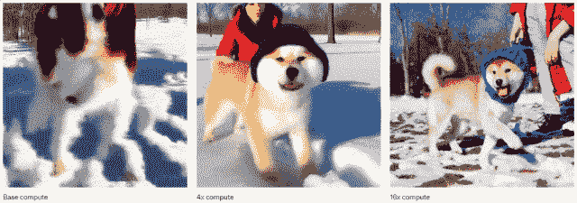

## **Variable durations, resoluti**ons, aspect ratios

**可变持续时间、分辨率、宽高比**Past approaches to image and video generation typically resize, crop or trim videos to a standard size – e.g., 4 second videos at 256x256 resolution. We find that instead training on data at its native size provides several benefits.

过去在图像和视频生成中的方法通常会将视频调整大小、裁剪或剪辑到一个标准尺寸——例如，4秒长的视频，分辨率为256x256。我们发现，直接在数据的原始尺寸上进行训练可以带来几个好处。

### Sampling flexibility

### **采样灵活性  **

**Sora can sample widescreen 1920x1080p videos, vertical 1080x1920 videos and everything inbetween. This lets Sora create content for different de**vices directly at their native aspect ratios. It also lets us quickly prototype content at lower sizes before generating at full resolution—all with the same model.

**Sora可以采样宽屏1920x1080p视频、竖屏1080x1920视频以及介于两者之间的所有格式。这使得So**ra能够直接按照不同设备的原生宽高比创建内容。它还允许我们在使用同一模型生成全分辨率内容之前，快速原型化较小尺寸的内容。

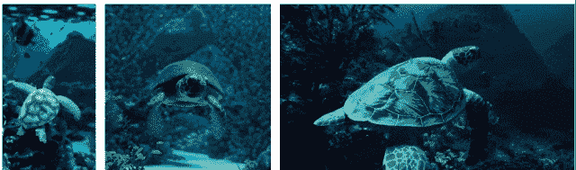

### Improved framing and composition

**改进的构图和画面组成**We empirically find that training on videos at their native aspect ratios improves composition and framing. We compare Sora against a version of our model that crops all training videos to be square, which is common practice when training generative models. The model trained on square crops (left) sometimes generates videos where the subject is only partially in view. In comparison, videos from Sora (right)s have improved framing.

我们通过实证发现，在视频的原始宽高比上进行训练可以改善构图和取景。我们将Sora与一个版本的模型进行了比较，该模型将所有训练视频裁剪成正方形，这是训练生成模型时的常见做法。在正方形裁剪上训练的模型（左侧）有时会生成主体只部分出现在视野中的视频。相比之下，来自Sora的视频（右侧）具有改善的取景。

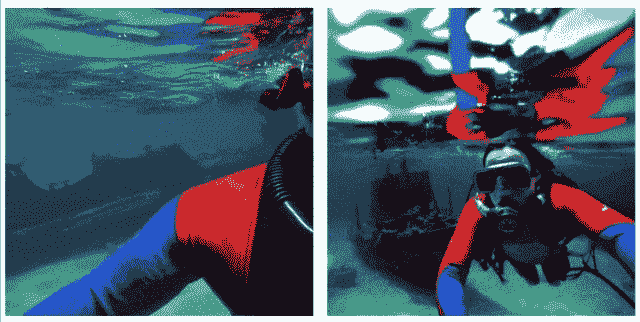

## Language understanding

## **语言理解  **

Training text-to-video generation systems requires a large amount of videos with corresponding text captions. We apply the re-captioning technique introduced in DALL·E 330 to videos. We first train a highly descriptive captioner model and then use it to produce text captions for all videos in our training set. We find that training on highly descriptive video captions improves text fidelity as well as the overall quality of videos.

训练文本到视频生成系统需要大量带有相应文字标题的视频。我们将在DALL·E 3中引入的重新标注技术应用到视频上。我们首先训练一个高度描述性的标注模型，然后使用它为我们训练集中的所有视频生成文字标题。我们发现，在高度描述性的视频标题上进行训练可以提高文本的准确性以及视频的整体质量。Similar to DALL·E 3, we also leverage GPT to turn short user prompts into longer detailed captions that are sent to the video model. This enables Sora to generate high quality videos that accurately follow user prompts.

类似于DALL·E 3，我们也利用GPT将用户的简短提示转换成更长的详细说明，然后发送给视频模型。这使得Sora能够生成高质量的视频，准确地遵循用户的提示。

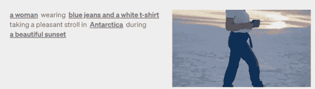

## Prompting with images and videos

**使用图片和视频进行提示**All of the results above and in our landing page show text-to-video samples. But Sora can also be prompted with other inputs, such as pre-existing images or video. This capability enables Sora to perform a wide range of image and video editing tasks—creating perfectly looping video, animating static images, extending videos forwards or backwards in time, etc.

上述结果以及我们的登录页面展示了文本到视频的样本。但是Sora也可以通过其他输入进行提示，例如预先存在的图片或视频。这项能力使得Sora能够执行广泛的图像和视频编辑任务——创建完美循环的视频，为静态图像添加动画，向前或向后延长视频的时间等。

### Animating DALL·E images 制作DALL·E图像动画

Sora is capable of generating videos provided an image and prompt as input. Below we show example videos generated based on DALL·E 231 and DALL·E 330 images.

Sora能够根据输入的图片和提示生成视频。下面我们展示了基于DALL·E 2 31 和DALL·E 3 30 图片生成的示例视频。

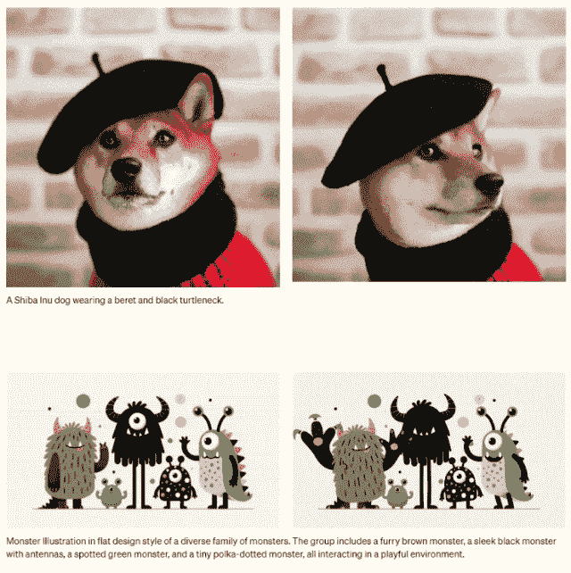

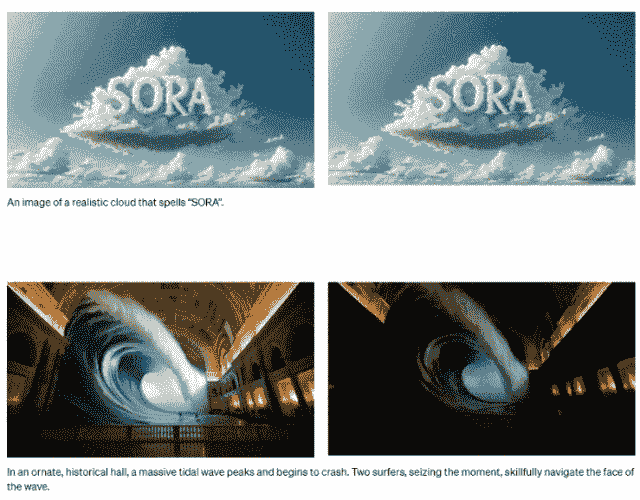

### Extending generated videos

**延长生成的视频**Sora is also capable of extending videos, either forward or backward in time. Below are four videos that were all extended backward in time starting from a segment of a generated video. As a result, each of the four videos starts different from the others, yet all four videos lead to the same ending.

Sora也能够将视频向前或向后延长时间。下面是四个视频，它们都是从生成的视频片段开始向后延长的。因此，这四个视频的开头各不相同，但最终都会达到相同的结局。

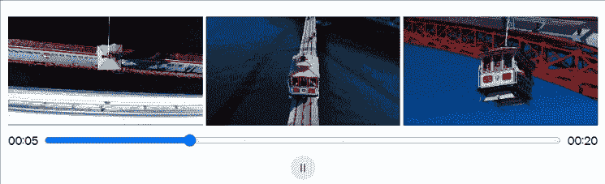

We can use this method to extend a video both forward and backward to produce a seamless infinite loop.

我们可以使用这种方法将视频向前和向后扩展，以制作出无缝的无限循环。

### Video-to-video editing 视频到视频编辑

Diffusion models have enabled a plethora of methods for editing images and videos from text prompts. Below we apply one of these methods, SDEdit,32 to Sora. This technique enables Sora to transform the styles and environments of input videos zero-shot.

扩散模型使得从文本提示编辑图像和视频的方法层出不穷。下面我们将其中一种方法，SDEdit，应用于Sora。这项技术使得Sora能够零次学习地转换输入视频的风格和环境。

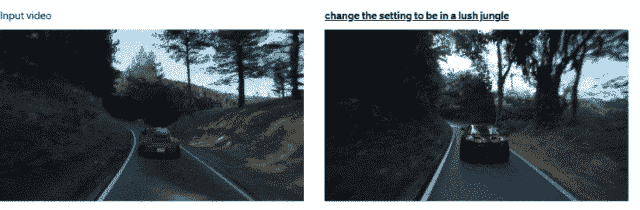

### Connecting videos

### **连接视频  **

We can also use Sora to gradually interpolate between two input videos, creating seamless transitions between videos with entirely different subjects and scene compositions. In the examples below, the videos in the center interpolate between the corresponding videos on the left and right.

我们还可以使用Sora在两个输入视频之间逐渐插值，创建在完全不同主题和场景构成的视频之间的无缝过渡。在下面的例子中，中间的视频在左右两边对应视频之间进行插值。

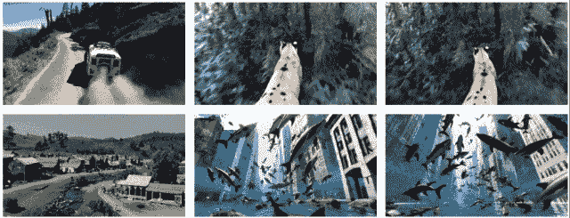

## Image generation capabilities

**图像生成能力**Sora is also capable of generating images. We do this by arranging patches of Gaussian noise in a spatial grid with a temporal extent of one frame. The model can generate images of variable sizes—up to 2048x2048 resolution.

Sora也能够生成图像。我们通过在具有一个帧时间范围的空间网格中排列高斯噪声块来实现这一点。该模型可以生成不同大小的图像——分辨率最高可达2048x2048。

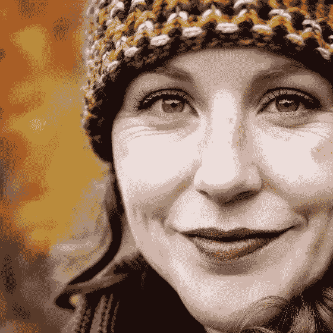

Close-up portrait shot of a woman in autumn, extreme detail, shallow depth of field

秋天里一位女性的特写肖像，极致细节，浅景深

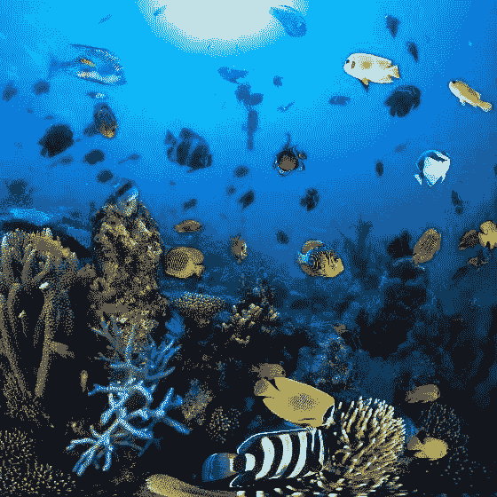

Vibrant coral reef teeming with colorful fish and sea creatures

充满活力的珊瑚礁，挤满了五彩缤纷的鱼类和海洋生物

Digital art of a young tiger under an apple tree in a matte painting style with gorgeous details

数字艺术：一只幼年老虎在苹果树下，采用哑光绘画风格，细节华丽

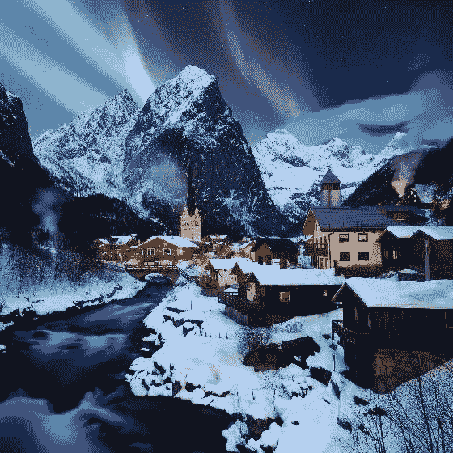

A snowy mountain village with cozy cabins and a northern lights display, high detail and photorealistic dslr, 50mm f/1.2

一个雪山村庄，有着舒适的小木屋和北极光展示，高清晰度和逼真的数码单反相机，50mm f/1.2镜头拍摄。

## Emerging simulation capabilities

**涌现的模拟能力**We find that video models exhibit a number of interesting emergent capabilities when trained at scale. These capabilities enable Sora to simulate some aspects of people, animals and environments from the physical world. These properties emerge without any explicit inductive biases for 3D, objects, etc.—they are purely phenomena of scale.

我们发现，当在大规模上训练时，视频模型展现出许多有趣的新兴能力。这些能力使得Sora能够模拟现实世界中人类、动物和环境的某些方面。这些属性并没有任何针对3D、物体等的明确归纳偏见——它们纯粹是规模效应的现象。    3D consistency. Sora can generate videos with dynamic camera motion. As the camera shifts and rotates, people and scene elements move consistently through three-dimensional space.

3D一致性。Sora能够生成具有动态相机运动的视频。随着相机的移动和旋转，人物和场景元素在三维空间中保持一致地移动。

**Long-range coherence and o**bject permanence. A significant challenge for video generation systems has been maintaining temporal consistency when sampling long videos. We find that Sora is often, though not always, able to effectively model both short- and long-range dependencies. For example, our model can persist people, animals and objects even when they are occluded or leave the frame. Likewise, it can generate multiple shots of the same character in a single sample, maintaining their appearance throughout the video.

长距离一致性和物体恒存性。对于视频生成系统来说，一个重大挑战是在采样长视频时保持时间上的连贯性。我们发现，尽管不总是如此，Sora通常能够有效地建模短距离和长距离依赖关系。例如，我们的模型即使在人、动物和物体被遮挡或离开画面时，也能持续保持它们的存在。同样，它能在单个样本中生成同一角色的多个镜头，并在整个视频中保持其外观。

Interacting with the world. Sora can sometimes simulate actions that affect the state of the world in simple ways. For example, a painter can leave new strokes along a canvas that persist over time, or a man can eat a burger and leave bite marks.

与世界互动。Sora有时可以模拟一些简单的动作来影响世界的状态。例如，画家可以在画布上留下随时间持续存在的新笔触，或者一个人可以吃一个汉堡并留下咬痕。

Simulating digital worlds. Sora is also able to simulate artificial processes–one example is video games. Sora can simultaneously control the player in Minecraft with a basic policy while also rendering the world and its dynamics in high fidelity. These capabilities can be elicited zero-shot by prompting Sora with captions mentioning “Minecraft.”

模拟数字世界。Sora也能够模拟人工过程——一个例子是视频游戏。Sora可以在同时控制《我的世界》中的玩家采用基本策略的同时，还能以高保真度渲染世界及其动态。通过用提到“我的世界”的字幕提示Sora，可以零次尝试地引发这些能力。These capabilities suggest that continued scaling of video models is a promising path towards the development of highly-capable simulators of the physical and digital world, and the objects, animals and people that live within them.

这些能力表明，持续扩展视频模型是朝着开发高度能够模拟物理和数字世界及其内部的物体、动物和人类的有希望的道路。

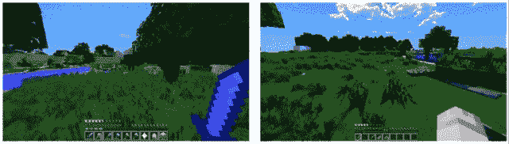

## **Discussion 讨论  **

Sora currently exhibits numerous limitations as a simulator. For example, it does not accurately model the physics of many basic interactions, like glass shattering. Other interactions, like eating food, do not always yield correct changes in object state. We enumerate other common failure modes of the model—such as incoherencies that develop in long duration samples or spontaneous appearances of objects—in our landing page.

Sora作为一个模拟器目前展现出许多限制。例如，它并没有准确地模拟许多基本互动的物理效应，比如玻璃破碎。其他互动，比如吃食物，不总是产生正确的物体状态变化。我们在我们的登录页面列举了模型的其他常见故障模式——比如在长时间样本中发展的不连贯性或物体的自发出现。We believe the capabilities Sora has today demonstrate that continued scaling of video models is a promising path towards the development of capable simulators of the physical and digital world, and the objects, animals and people that live within them.

我们相信，Sora目前的能力表明，持续扩展视频模型是朝着开发能够模拟物理和数字世界及其内部的物体、动物和人类的有能力的模拟器的有希望的道路。

## 看看SORA生成视频的效果究竟如何

提示词: 一位时髦的女士穿行在东京的街头，街道充满了温暖的霓虹灯光和动感的城市标志。她穿着一件黑色皮夹克，一条长红裙和黑色靴子，手拿一个黑色手提包。她戴着太阳镜和红色口红。她走路既自信又随意。街道潮湿且能反射，创造出彩色灯光的镜面效果。许多行人来来往往。

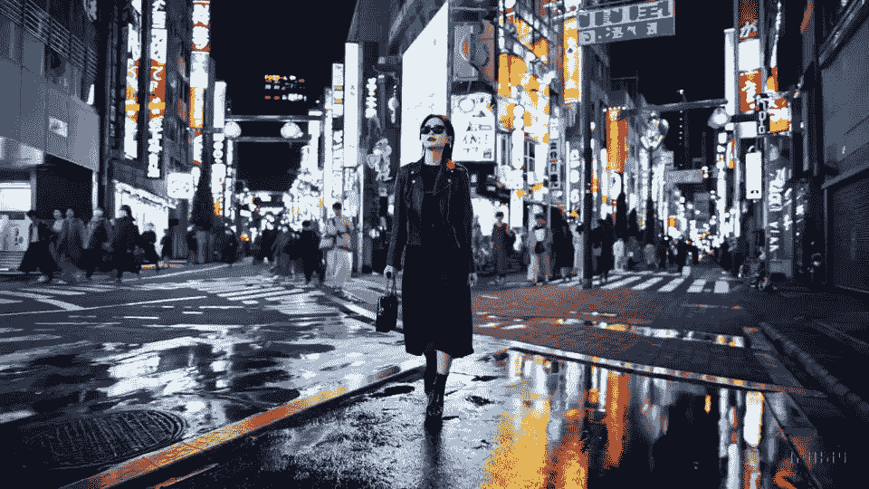

[openai-sora-video (43).mp4](https://internal-api-drive-stream.feishu.cn/space/api/box/stream/download/all/AHpbbG8juosCcJxlX17cL3N4nAc)

openAI在技术报告中提到SORA是在大规模的视频和图像数据上进行联合训练得到的生成模型。具体来说，联合训练了在不同持续时间、分辨率和纵横比的视频和图像上的文本条件扩散模型。openAI利用了一个在视频和图像潜空间上操作的transformer架构。生成一分钟的高清视频。

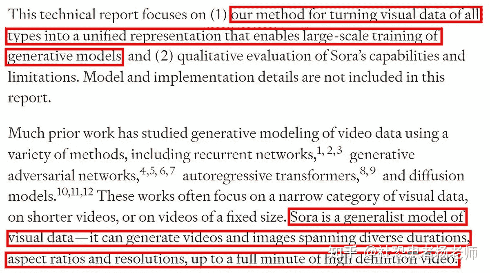

这次openAI训练的Sora 所建立的是一种通用的视觉模型方法，而不再是细分的方式（之前的研究，图像与视频模型是不同的），因此既可生成视频又可生成图像，并且不止如此。当GPT学会语言的时候就学会了语言所传递的一切，同理，Sora也可以学会视觉所传递的一切。

## Diffusion-Transformer模型架构

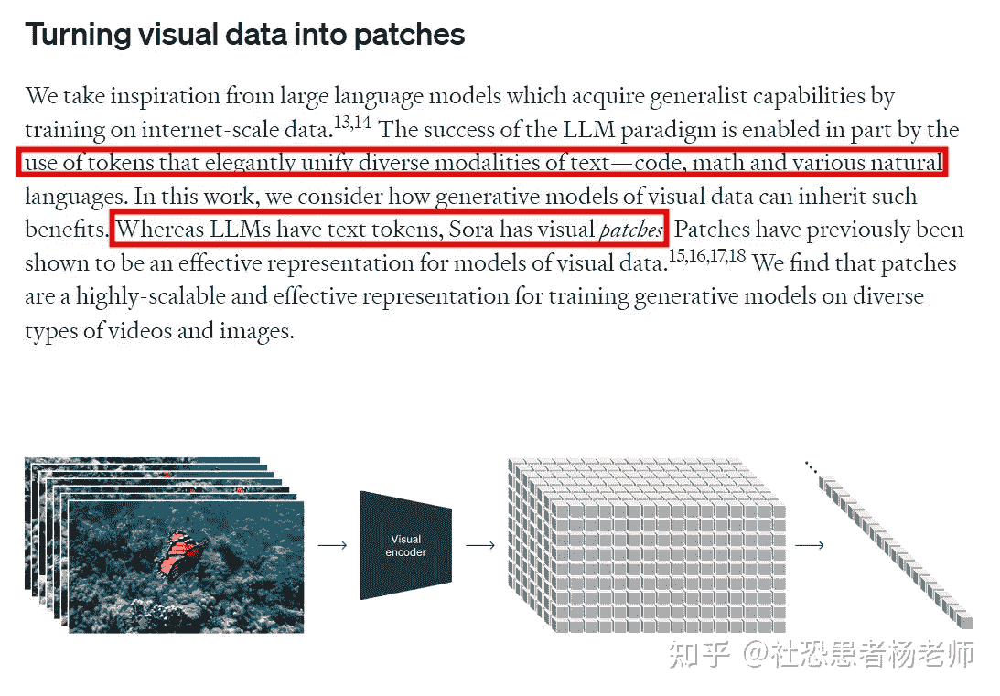

在开始训练模型之前，首先需要解决的是训练数据的结构化，格式统一化以及数据清洗，标注等等一系列数据预处理工作。显然，openAI在做这项工作的时候，首先考虑的很可能是在训练DALLE-3的那些海量的高质量的已经经过预处理的训练数据。那么接下来需要解决的就是如何将不同类型的数据(例如文本、视频、图片等)处理成统一可以被喂进训练器的格式。

Sora设计思路其实和LLM一致，都是先将所有输入数据统一化（LLM是文本/代码等，Sora是各种类型的视觉数据），然后训练模型用于预测下一个“词”（LLM是token，Sora是patch），并且使用原始数据而非修剪后的数据（不同分辨率、时长和高宽比）。学会预测就学会了背后的东西，LLM是知识，Sora是物理世界。

sora定义了视频训练和推理的基本单元是Patches，视频数据和图片数据进行统一是完全没有问题的，本来视频拆分成每一帧就是一张图片。视频的本质就是按照一定序列组织起来的图片。

而Patches的实质就是图片拆成 NxN 的小方格后生成的 embedding，比如一张 256x256 的图片，把它打碎成 256 张 16x16 的小图就叫做 Patches，实际上之前在训练 vision LLM 一直是这么做的。由此可见统一的Patch格式并非是openAI的创新技术，甚至很多人都猜测openAI有可能是使用了 Google 的 Patch n' Pack (NaViT)技术。而Sora 之所以显得如此强大，在于以前的文本转视频方法需要训练时使用的所有图片和视频都要有相同的大小，这就需要大量的预处理工作来裁剪视频至适当的大小。但是，由于 Sora 是基于“Patch”而非视频的全帧进行训练的，它可以处理任何大小的视频或图片，无需进行裁剪。这就让 OpenAI 能够在大量的图像和视频数据上训练 Sora。因此，可以有更多的数据用于训练，得到的输出质量也会更高。例如，将视频预处理至新的长宽比通常会导致视频的原始构图丢失。一个在宽屏中心呈现人物的视频，裁剪后可能只能部分展示该人物。因为 Sora 能接收任何视频作为训练输入，所以其输出不会受到训练输入构图不良的影响。

在文本预测生成中，基本单位是 Token，Token 很好理解，就是一个单词或者单词的一部分。Patch 的概念相对不那么好理解。我们可以想象一下《黑暗骑士》的电影胶片，将一卷胶片绕在一个金属盘上，然后挂在一个老式电影院的投影机上。 你把电影胶卷从盘中展开，然后剪下最前面的 100 帧，再挑出每一帧的图像，比如某一帧是小丑疯狂大笑，另一帧是蝙蝠侠痛苦的表情。接下来进行以下不太常规的操作： 你拿起一把像X光一般精细的刻刀，在第一帧电影胶片上剪出一个变形虫状的图案。你像处理精密仪器一样小心翼翼地用镊子提取这片形似变形虫的胶片，然后安全地保存起来。然后开始再处理下一帧：在接下来的胶片上切出同样位置、同样形状的变形虫图案。你再次用镊子小心地取出这个新的变形虫形状的胶片，形状与前一个完全相同，并将其精确地放置在第一个之上。如此这般重复操作，直到完成所有的 100 帧。 于是现在有了一个色彩斑斓的变形虫，沿着竖直方向的Y轴(这里对应的是时间轴)堆叠扩展。这样就得到了一座可以通过投影机播放《黑暗骑士》的小片段的胶片塔，就好像有人在投影机前握着拳头，只让电影的一小部分影像从拳心通过。 然后，这座胶片塔被压缩并转化为所谓的“Patch”一种随时间变化的色块。最后从每一个存在的视频中剪出的 Patch 堆叠成无尽的胶片塔，再输入到模型中进行训练，想象一下这样的场景就会感到让人震撼。

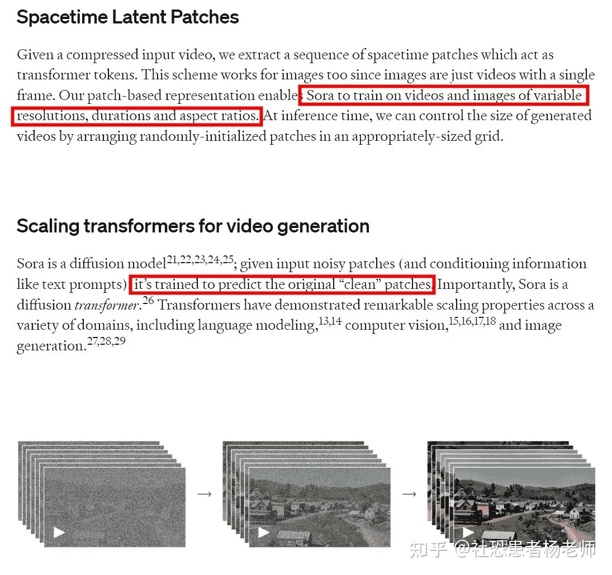

Sora 同时还是一种diffusion扩散模型，能将有噪声的图像块，基于 Prompt 还原出清晰的图像。首先训练一个encoder，将视频从时间和空间2个维度上压缩到低维隐空间里，接着从隐空间里提取出一系列时空patches进行单次训练。

相较于Runway、Stable Video Diffusion和PIKA等纯粹是基于扩散模型（Diffusion Model）架构的

技术路线相比，我觉得Sora最大的区别是使用了Diffusion-Transformer(DiT)架构。

传统的扩散模型（Diffusion Model）的训练过程是通过多个步骤逐渐向图片增加噪点，直到图片变成完全无结构的噪点图片，然后在生成图片的时候，基于一张完全噪点的图片，逐步减少噪点，直到还原出一张清晰的图片。

Sora 则是一个融合了Transformer Diffusion 两者的模型。通过 Transformer 的encoder- decoder架构处理含噪点的输入图像，并在每一步预测出更清晰的图像版本。编码器负责对含噪点的输入进行编码，而解码器则负责生成更清晰图像的预测。

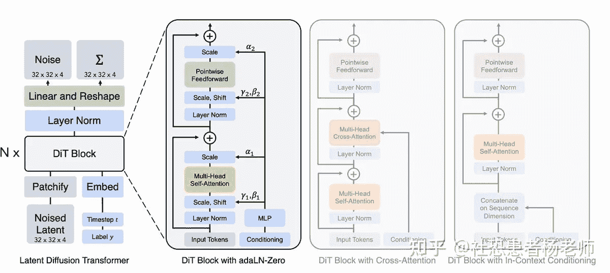

DiT模型结构示意图

毫无疑问，从模型架构上来看，Sora使用的Diffusion-Transformer(DiT)架构，是将在LLM的Transformer[架构和Text to Image领域的Diffus](https://link.zhihu.com/?target=https%3A//arxiv.org/abs/2212.09748)ion架构做了一次融合。并且这项融合模型结构的提出者也不是openAI。而是发表在ICCV 2023的一篇论文《Scalable Diffusion Models with Transformers》中被提出的，但是openAI却是第一个使用这种架构在大规模数据上进行训练的。简单来说，Diffusion-Transformer(DiT)是一个带有Transformer Backbone骨干的扩散模型： DiT = [VAE编码器 + ViT + DDPM + VAE解码器]

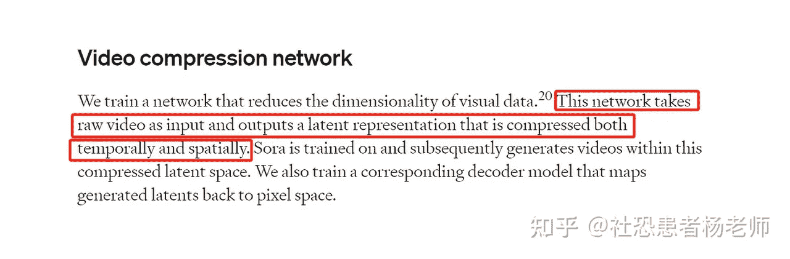

Video compression network（视频压缩网络）看起来它只是一个VAE，但是在原始视频数据上进行了训练。标记化（Tokenization）在获得良好的时间一致性中可能起着重要的作用。顺便说一句，VAE是一个CNN，所以从技术上讲，DiT是一个混合模型。

---

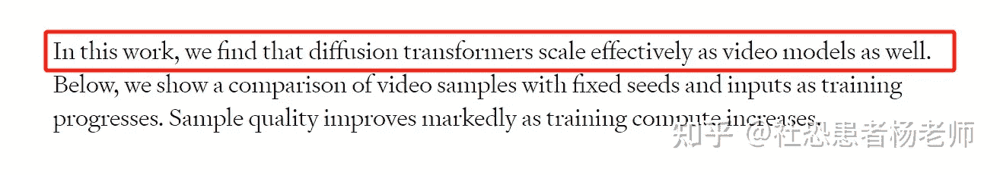

00:04

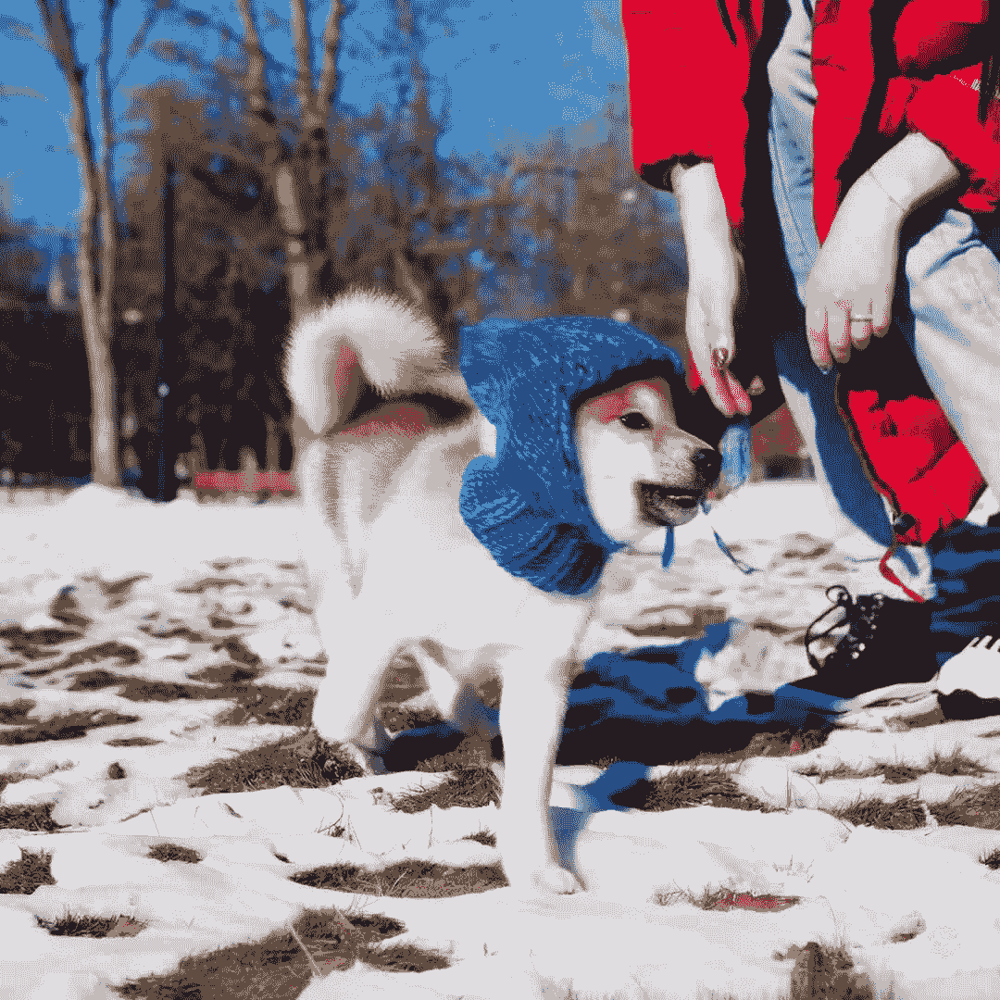

00:04

可扩展性是DiT论文的核心主题。首先，优化后的DiT在每个Flop的时钟时间上运行速度比UNet快得多。更重要的是，Sora证明了DiT的扩展规律不仅适用于图像，现在也适用于视频——Sora复制了在DiT中观察到的视觉扩展行为。

---

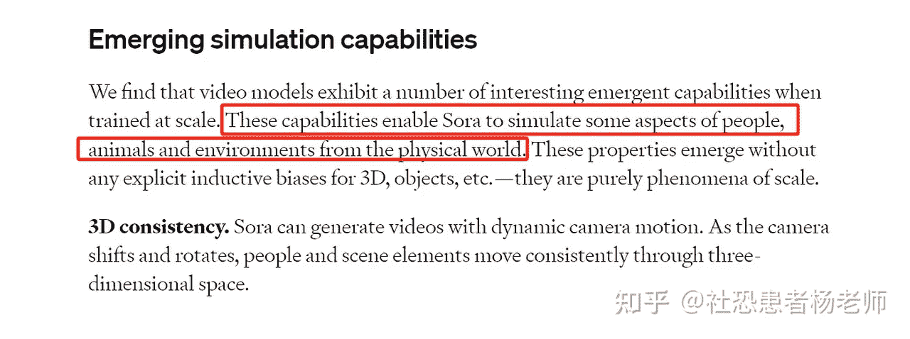

00:17

Sora中非常关键的一点是来自“Emerging simulation capabilities”部分。Sora 可以生成具有动态摄像机运动的视频。随着摄像机的移动和旋转，人和其他场景元素在三维空间中一致地移动。跟大语言模型一样，在大规模训练下，视频模型展示出了一系列引人注目的涌现能力。在 Sora 之前，尚不清楚长时间视频(这里的长时间是指相对于runway或者pika生成的4s左右长度而言)中人物or场景一致性是否可以自行出现，或者是否需要复杂的主题驱动生成pipeline甚至物理模拟器。 OpenAI 已经表明，虽然现在很多场景还并不完美，但这些行为可以通过端到端训练来实现。然而，有两个要点尚未得到讨论。

1.训练数据：技术报告中完全没有谈论Sora的训练数据集信息，这是否在暗示数据可能是Sora成功的最关键因素？ 目前已经有很多关于来自例如UE5或者Unity游戏引擎的数据的推测。技术报告虽然没有明确提到Unreal Engine等game engine，但是不排除隐空间里用到了NeRf或者Gaussian Splatting等3D表征用来更高效地表达物体、环境、镜头之间的关系。大多数人猜测至少会包括电影、纪录片、电影长镜头等。质量真的很重要。非常好奇Sora从哪里得到这些高质量的训练数据。

2.长视频生成：长期关注文生视频领域的朋友可能都知道这样一个事实:保持时间上的连续性一直是个挑战。Sora 通常能够有效处理短距离和长距离的依赖关系。比如，即使人物、动物或物体被遮挡或移出画面，模型也能保持它们的连续存在。同样，它能在同一视频样本中多次展示同一角色，确保其外观贯穿始终。

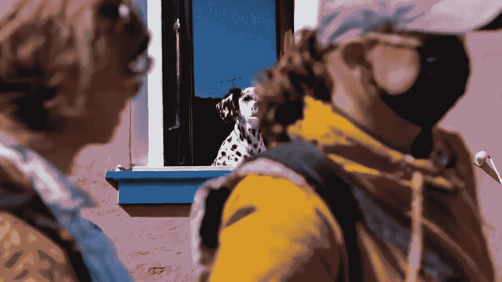

00:10

Sora的一个重大突破是能够生成非常长的视频。产生2秒的视频和1分钟的视频之间的技术差异是巨大的。 在Sora中，这可能是通过联合帧预测实现的，它允许自回归采样。众所周知视频生成模型有一个隐变量是时间序列，我怀疑openAI是否有专门训练一个模型或者一个机制，引导图片按照时间序列进行某种基于文本的定向排序。这个排序如果说一旦可控，那么类似像Nvidia的dlss技术是基于时间序列先确定关键帧然后再插帧，最终生成视频是一个目前看起来更成熟的解决方案。但一个主要的挑战是如何解决单帧的错误累积并保持质量/一致性随时间推移。一个非常长的（和双向的）条件上下文？或者，扩大训练规模是否能简单地减少问题？这些技术细节非常重要，希望未来openAI能够公布相关内容。

## SORA有哪些特别之处?

除了要统一训练数据格式之外，要想使用文本生成高质量符合人类需求的视频，还有一项必不可少的工作——数据标注。为了能够给出大量的视频及其对应的文字说明。openAI采用了 DALL·E 330 中引入的一种重新标注技术，并将其应用于视频。首先，训练了一个能够生成详细描述的模型，然后利用这个模型为训练集里的所有视频创建文字说明。使用描述性强的视频说明进行训练，不仅能提高文字的准确度，还能显著提升视频的整体质量。 就像 DALL·E 3 一样，openAI还使用 GPT 把用户的简短提示转化成详尽的说明，再将这些说明送给视频生成模型。这一过程使得 Sora 能够根据用户的指令，制作出高品质的视频。

openAI在技术报告里面展示了非常多的SORA演示视频，而通过这些演示视频，可以看到Sora的能力远不止是文生视频而已。在下面这个例子中Sora 在语义理解和属性匹配方面表现的非常好，这是一个非常重要的进步！

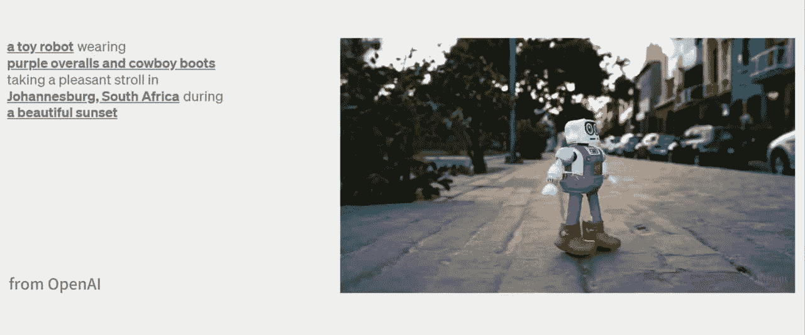

02:03

报告中这一部分也极其让人印象深刻，同一个输入视频，可以做不同的变化，生成结果惊人的稳定！

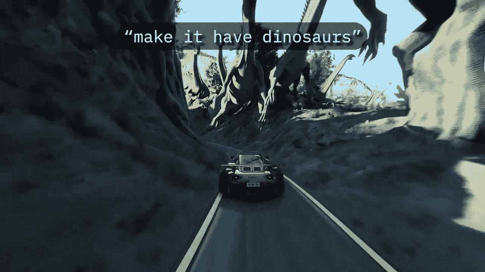

00:15

视频之间的流畅过渡，真的做到了无缝切换可以利用 Sora 把两个风格迥异的视频平滑连接起来，使它们之间能够自然过渡，仿佛融为一体。

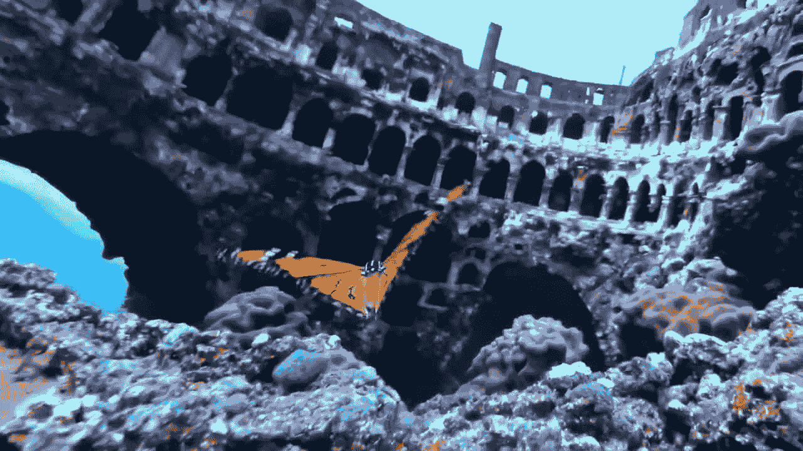

00:20

视频时间延伸 Sora 同样能够把视频往前或往后延伸。下面是四个视频，它们都是从一个生成的视频片段开始，向后延伸。因此，尽管这四个视频的开头各不相同，但它们最终都汇聚于同一个结尾。

[此](https://link.zhihu.com/?target=https%3A//www.yuque.com/shekonghuanzheyanglaoshi/uzl5zl/gfrt813iss1b8h3u%23fLvF7)处为语雀视频卡片，点击链接查看：视频时间延伸Sora 同样能够把视频往前或往后延伸。下面是四个视频，它们都是从一个生成的视频片段开始.mp4

Sora 可以让静态图片动起来只需一张图片和一个提示，Sora 就能创造出视频。下面展示了一些基于 DALL·E 231 和 DALL·E 330 图片生成的视频示例。

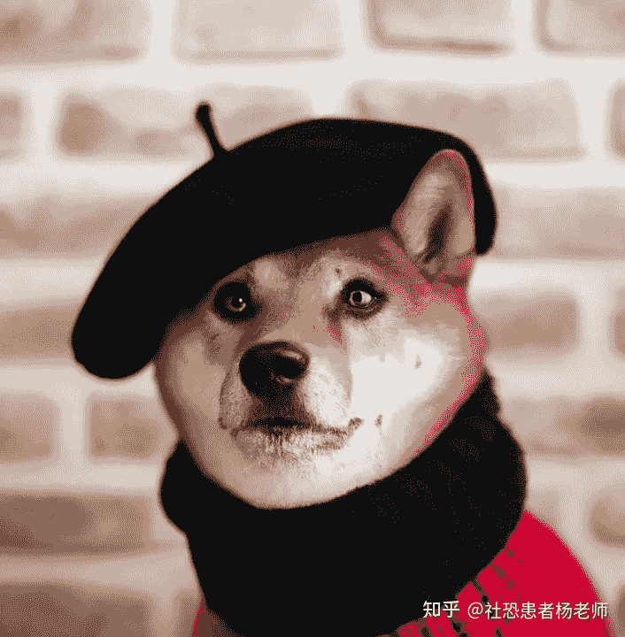

00:08

## SORA还有哪些不足?

虽然Sora是一个目前为止性能最强悍的文生视频模型（很可能短期之内也难逢敌手），但Sora也有一些比较失败案例视频被人讨论。虽然Sora在视频长度、一致性、分辨率以及对世界的理解等方面表现出了许多突破，但是文生视频领域中一个非常非常重要的问题Sora目前并没有给出完美的解决方案，这就是真实世界的事件运行方式需要符合物理定律。比如从手中不慎摔落的玻璃杯掉在地板上，Sora不会把玻璃碎片生成出来。如果是让玻璃杯原地爆炸，散落到地上的碎片也不会是呈正态分布。

00:08

Sora 会取代游戏引擎开发者吗？绝对不会。它对物理的理解虽然是一种新的尝试，但仍然不够成熟，远远达不到完美。它经常会产生一些与我们对物理常识的理解不一致的幻觉。目前，它对物体间互动的理解尚不到位，我想从下面5个视频中的不符合物理规律的错误你就能明白这句话的意思。

1.挖出来的椅子不被认为是硬质物质。椅子的物理原理也有问题，它最终会漂浮在空中。

此处为语雀视频卡片，点击链接查看：

[1️⃣ 椅子.mp4](https://link.zhihu.com/?target=https%3A//www.yuque.com/shekonghuanzheyanglaoshi/uzl5zl/gfrt813iss1b8h3u%23edg0D)[w](https://link.zhihu.com/?target=https%3A//www.yuque.com/shekonghuanzheyanglaoshi/uzl5zl/gfrt813iss1b8h3u%23edg0D)ww.yuque.com/shekonghuanzheyanglaoshi/uzl5zl/gfrt813iss1b8h3u#edg0D

2.当包含大量物体时，动物和人往往会突然出现。 提示指定“5 只灰狼”，但它们一开始有 4 只，最终增加到大约 10 只。

此处为语雀视频卡片，点击链接查看：

[2️⃣ 大量物体.mp4](https://link.zhihu.com/?target=https%3A//www.yuque.com/shekonghuanzheyanglaoshi/uzl5zl/gfrt813iss1b8h3u%23Wa26q)[w](https://link.zhihu.com/?target=https%3A//www.yuque.com/shekonghuanzheyanglaoshi/uzl5zl/gfrt813iss1b8h3u%23Wa26q)ww.yuque.com/shekonghuanzheyanglaoshi/uzl5zl/gfrt813iss1b8h3u#Wa26q

3.Sora似乎不擅长再现多个对象和角色之间的“复杂交互”。该视频使用了演示视频顶部的长提示，但即使它说“吹灭蜡烛以将其熄灭”和“蜡烛的光熄灭”两次，火也没有熄灭。它还没有消失。

此处为语雀视频卡片，点击链接查看：

[3️⃣ 复杂交互.mp4](https://link.zhihu.com/?target=https%3A//www.yuque.com/shekonghuanzheyanglaoshi/uzl5zl/gfrt813iss1b8h3u%23UT1n7)[w](https://link.zhihu.com/?target=https%3A//www.yuque.com/shekonghuanzheyanglaoshi/uzl5zl/gfrt813iss1b8h3u%23UT1n7)ww.yuque.com/shekonghuanzheyanglaoshi/uzl5zl/gfrt813iss1b8h3u#UT1n7

4.物理建模不准确视频直到中间看起来还不错（爆炸本身是由提示指定的），但第二个球却穿过了篮筐。

此处为语雀视频卡片，点击链接查看：

[4️⃣ 物理建模.mp4](https://link.zhihu.com/?target=https%3A//www.yuque.com/shekonghuanzheyanglaoshi/uzl5zl/gfrt813iss1b8h3u%23auXLt)[w](https://link.zhihu.com/?target=https%3A//www.yuque.com/shekonghuanzheyanglaoshi/uzl5zl/gfrt813iss1b8h3u%23auXLt)ww.yuque.com/shekonghuanzheyanglaoshi/uzl5zl/gfrt813iss1b8h3u#auXLt

5.对象挂起。视频大约十秒后，尽管没有具体指示，云巨人还是停了下来。 这在Runway的 Gen2 等模型中也出现过，但似乎也存在主体突然不自然地停止移动的趋势。

此处为语雀视频卡片，点击链接查看：

[5️⃣ 对象挂起.mp4](https://link.zhihu.com/?target=https%3A//www.yuque.com/shekonghuanzheyanglaoshi/uzl5zl/gfrt813iss1b8h3u%23tGkpW)[w](https://link.zhihu.com/?target=https%3A//www.yuque.com/shekonghuanzheyanglaoshi/uzl5zl/gfrt813iss1b8h3u%23tGkpW)ww.yuque.com/shekonghuanzheyanglaoshi/uzl5zl/gfrt813iss1b8h3u#tGkpW

如果我们不考虑交互的话，UE5 就是一个（极其复杂的）生成视频像素的过程。同样，Sora 也是一个过程，它通过端到端的 Transformer 来生成视频像素，这两者在抽象层次上是相同的。 不同之处在于 UE5 是通过手工制作和精确设计的，而 Sora 则是通过数据学习和直观感受来实现的。换言之Sora 必须学习一些隐式的文本到 3D、3D 变换、光线追踪渲染和物理规则，才有可能精确地模拟视频像素。它必须理解游戏引擎的概念，才有可能生成工业生产级别的视频。因此Sora发布之后很多人宣称的电影特效，影视拍摄，短视频等工作岗位失业危机我认为短时间内并不会到来。

OpenAI的Sora的诞生可以说让我们看到离AGI的实现更近了。如果AI可以生成与真实视频没有区别的视频，那么未来我们看到的世界是否可以被AI基本无差异的复刻呢？就在一年前文生视频领域甚至是文生图领域还有很多的问题亟待解决，然而仅仅一年的时间，就取得了如此重要的突破，这充分说明一件很朴实无华的真理。一旦从0到1突破了，那么1到100，甚至10000就只是时间问题，最后让我们用一段由使用OpenAI 的Sora 视频剪辑、David Attenborough 在 Eleven Labs 上的克隆声音以及 iMovie 上 Youtube 上的一些自然音乐样本， 在 15 分钟内制作了这个 20 多秒的电影预告片来结束本文吧！

<https://aiyanxishe.feishu.cn/sync/IaSadpoOOsopKab1ajKcz6z3nAb>