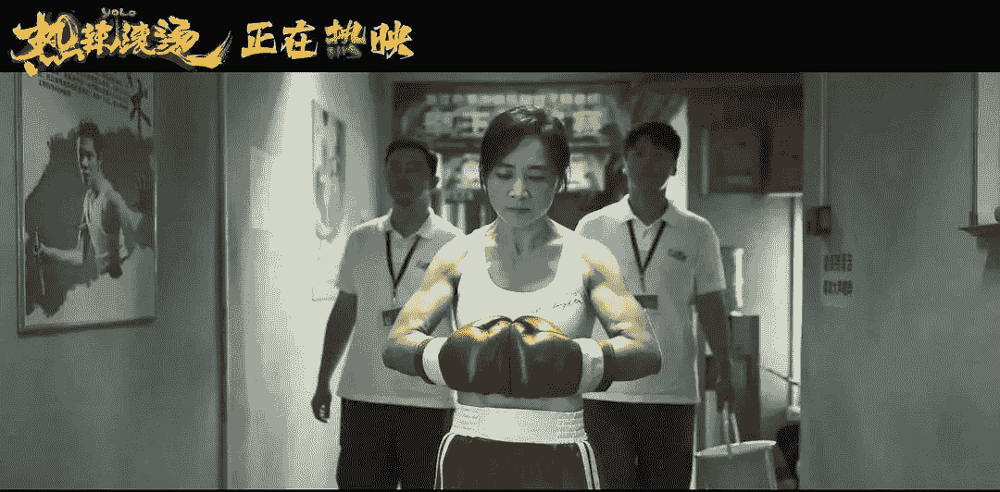
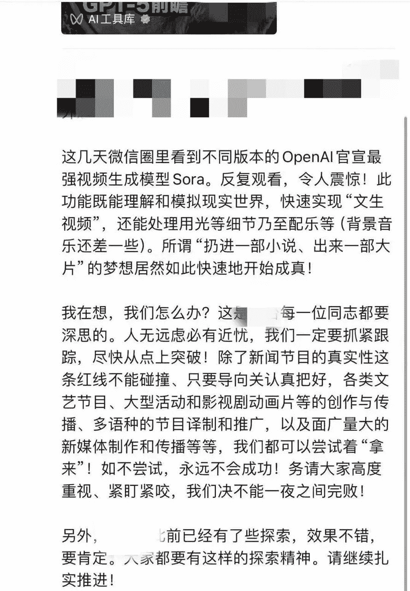

# 金融机构如何利用好Sora

> 来源：[https://aiyanxishe.feishu.cn/docx/YHGMdfiOMoKpolxv0sIcT3LOnEf](https://aiyanxishe.feishu.cn/docx/YHGMdfiOMoKpolxv0sIcT3LOnEf)

<https://aiyanxishe.feishu.cn/sync/KGQ3dArdRsnl77bJBG4camxWnAg>

**有时候生活中的无力感就是，你明知道世界正在发生巨大颠覆，却无法参与这一变**迁，只能旁观他人的狂欢，甚至你还清楚不久的将来，你的生活一定会因此被裹挟着向前。

Open AI正是这么一家改变全人类生活的伟大公司，继文本模型ChatGPT、图像模型Dall-E大杀四方后，OpenAI继续祭出大杀器——Sora，这回他们选择颠覆视频领域。

**简单**点说，Sora可以干的活儿是这样的。我们知道，贾玲为了她的新电影，一年内减肥了100斤，最后影院里展现出的效果，可以清晰的看见腹肌和三角肌，形态接近了综合格斗世界冠军张伟丽，用常识判断，快速大幅减脂后会留下明显的“减肥痕迹”，而要想达到前述的“训练痕迹”，这必然涉及拍摄前的肌肉贴片（类似老炮里的张涵予），以及大量的后期视频美化和修饰，需要一定的工时和成本。而有了Sora之后，未来，你可能只需要输入一段文字，就能达到类似的效果：「请让瘦身后的贾玲，身穿白色运动bra，着红白相间的拳击短裤，戴红白全套，低眉走向镜头，肌肉形态接近张伟丽最后一次参加UFC比赛时的水平，身后两侧，跟着俩教练。」

**视频，对比文**字而言，对人类的洗脑效果要强得多，所以，Sora的问世，比之前ChatGPT这种文字生成模型，对人们的冲击可能还要更大一些。

特别是对于相关的从业人员而言。微信群里流传着一张截图，是央视总台领导看了Sora的几段视频后，在微信工作群的一段评价和工作推进意见，时间是昨天的上午。

这么多感叹号可见，对这种资深的传媒行业从业人员而言，看完Sora的视频，有几点迸发的感悟。

1、文字生成视频的质量令人震惊。

2、非常焦虑。

3、要有相应应对，否则可能一夜之间完败。为什么会如此焦虑？为什么可能一夜之间完败？其实也比较简单。

因为Sora，相当于一张「均富卡」，降低了视频创作的门槛，让所有具备想法、原创能力的人，都有了和央视生产的视频，一决高下，争夺流量的机会。我们还是以央视为例。

央视作为媒体，其过往形成影响力的原因，主要是两个。

一是掌握了流量的入口。在有线电视的时代，你打开电视，怎么转台，都绕不开央视，央视还垄断了很多诸如体育赛事之类的独家转播权。

二是具备很强的内容原创能力。从制作人、采编、记者、主持人、后期，整个产业链，都有全国最强的人才。但从目前传媒行业的发展形态看。

第一，在智能电视、移动互联网、短视频的年代，央视肯定已经失去了流量的入口，即使是春晚，大家进入观看的路径，要么是智能电视首页，给春晚直播的资源位，要么是这回春晚和视频号等一起推出的“竖屏春晚”，相当于都在别人的场子里唱戏。

第二，央视的薪酬体制，不太可能留住第一流的人才，前中后台都是，而类似芒果，就采取了事业部制。今年的春晚，央视一共接了23个广告，但如果我们把纯商业化变现，作为央视的重要考核目标的话，对于其他没有流量入口、内容质量不高的节目而言，广告商是否还愿意去做投放？

所以，真正使得央视焦虑的，是从流量的角度看，央视从裁判员，变成了运动员，需要和千千万万个自媒体横向竞争。而Sora这类文字生成视频的模型的诞生和不断优化，会使得其他竞争者的视频输出质量，不断接近、甚至超过央视这类传统媒体，所以最终会导致其面临不进则退的局面。......

换个视角，讲讲Sora对金融机构做视频的可能影响。

由于这两年，短视频成了C端用户接受信息的最主要渠道，于是，大部分的金融机构，特别是银行、基金公司等，也在发力做各种视频。包括但不限于，产品宣发时的快闪视频、基金经理个人宣传视频、日度/周度/月度观点视频、投教动画、职场小段子、直播片段剪辑，甚至有些有点尬的音乐类视频。

**这些视频的制**作成本普遍不低，而且很多视频制造的供应商，是「按秒计价」的，如果不是预计能卖的好的产品，金融机构可能还不舍得花钱去做视频，因为投产比不高。但是可以这么说，截至目前，业内还没有形成一个有口皆碑、令人心悦诚服的，传统金融机构生产出的视频IP。这里面的原因，大致可以这么剖析一下。

一个好的视频号（我们姑且以去掉水分之后的，点、评、赞，作为参考指标，同时剔除那些专门擦边或搞段子的，信息和知识量不高的号）

**有三个要素**，可能是不可或缺的。

第一，连绵的、优质的、紧抓热点、以撬动C端用户的G点而非领导的关注点为中心的，优质选题的挖取能力，和内容的原创能力。

第二，个人IP强，淡化机构IP，而个人IP又是极其难得的，观众缘、眼缘、耐看是很宝贵的品质，并不是长得好看就适合做视频，AI女主持人可以做得很好看，且成本很低，但最终一定是产生一些没有用户粘性的数字垃圾。

第三，视频的怼脸拍，和生成式动画相结合，一动一静，通过生成式动画，将一些真实的场景和背景音配套，提高视频的完播率（而不是有些真人一镜到底的模式），比如现在财经界，做的比较突出的，小A学财经等个别几个号，基本都是这个套路。所以，Sora的问世，可以有效地解决，第三个要素，就是怼脸拍+生成式动画相结合的问题，而这一块，往往是原先视频制作方面，最烧钱的部分，也就可以极大地压缩金融机构在这块的成本，提升输出的能力和意愿。但要注意的是，Sora只是一种工具，是一种降低视频制作门槛的工具，是一张给中小金融机构，进入视频创作这个领域的「均富卡」，但要想用得好，最终还得靠人。

就好像贾玲的减肥拳击电影。按照成功的三要素。

第一，是内容，得要能蹭到热点，那就是贾玲瘦身100斤，并且抄了一个日本的好剧本，内容和热点都有了。

第二，是个人IP，那得是贾玲瘦100斤，如果是岳云鹏的搭档，孙悦，瘦100斤，票房可能得少2个零。

第三，才是视频美化和修饰，利用工具，弄点三角肌的线条出来，无非是成本高低的问题而已。所以，对金融机构而言，如果意识到，视频这个赛道，是未来抢占客户关注、用户阅读时长的黄金赛道，那么，在未来的Sora年代中，擅长视频创造的人，是越来越宝贵的，需求也是越来越大的。

**主要就是三类人：**

一是擅长持续蹭热点，做内容原创的写手。

二是有眼缘、耐看、口条好、不用靠念提词器的主播。

三是擅长利用Sora等工具，降低制作成本，压缩制作周期的后期制作人员。所以做这块的小伙伴们，空间一定是越来越大的，不应该有职业焦虑，真正应该焦虑的，是对于金融机构而言，如果真正掌握了这些人才，完成了IP的孵化后，如何将之留下来，实现个人IP的机构化？

<https://aiyanxishe.feishu.cn/sync/IaSadpoOOsopKab1ajKcz6z3nAb>