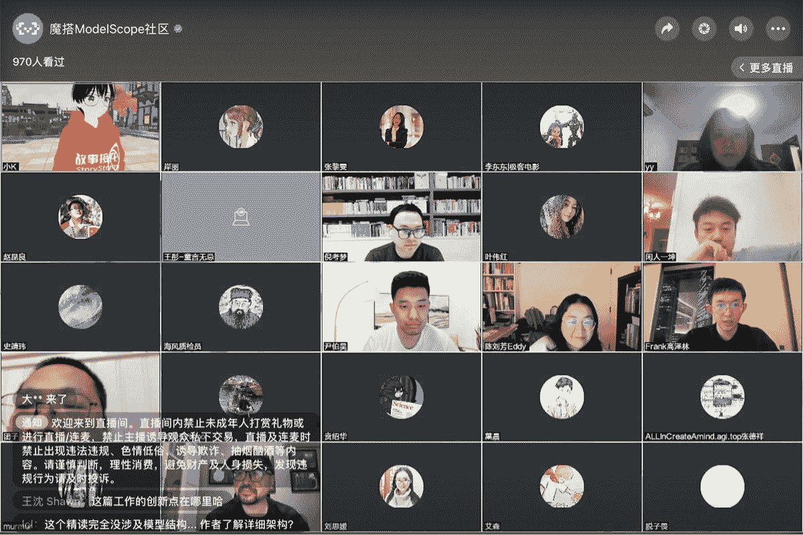
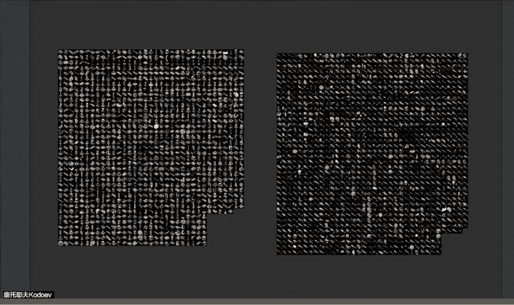
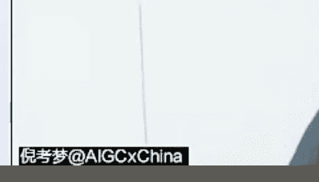
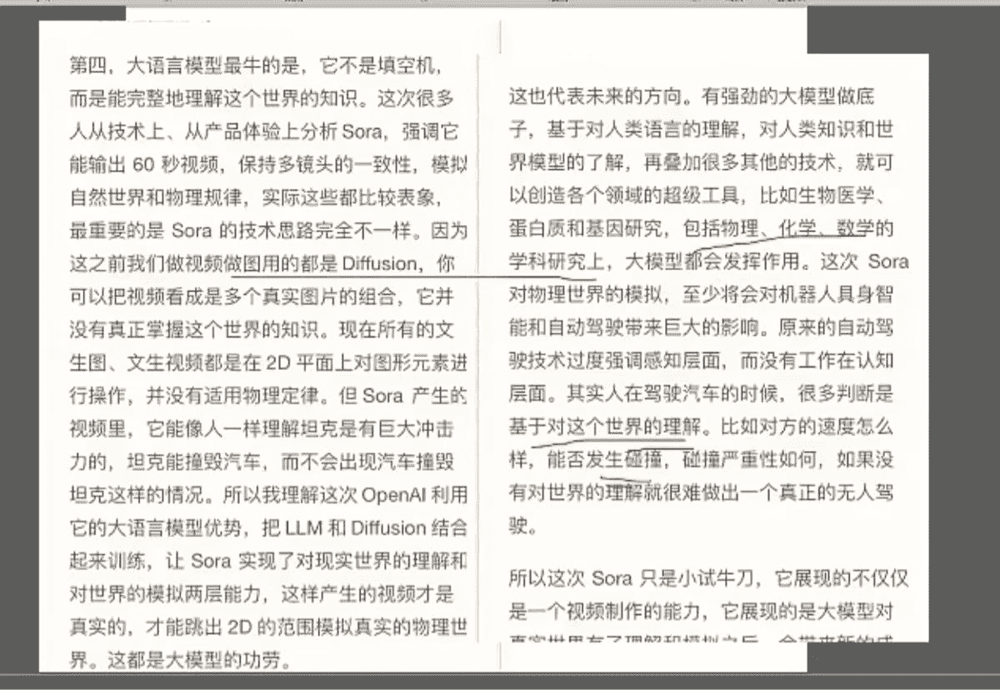
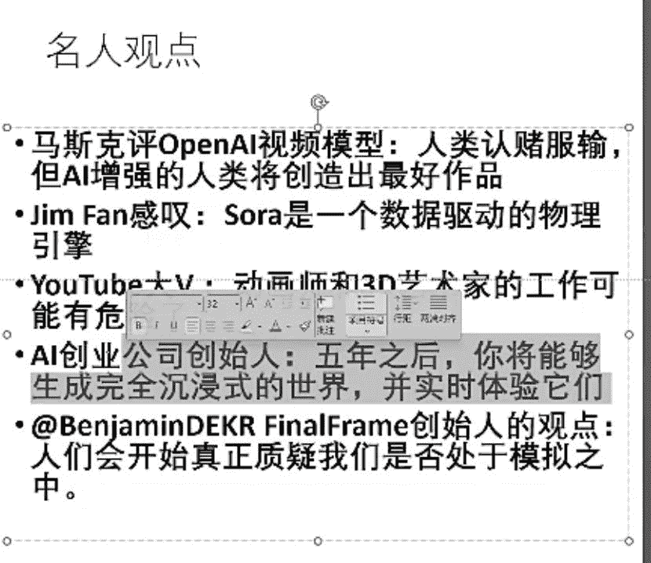
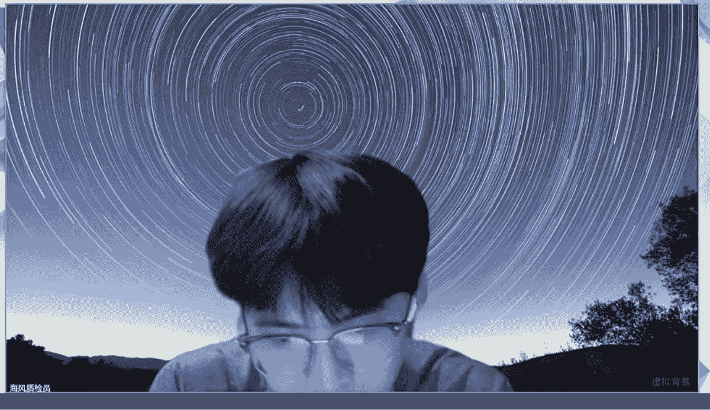
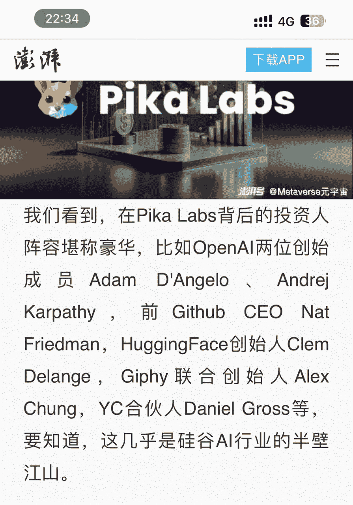

# Sora来了，我们离AI模拟世界还有多远？

> 来源：[https://aiyanxishe.feishu.cn/docx/JeQdduMV3oukNWxW4WAc7prlnif](https://aiyanxishe.feishu.cn/docx/JeQdduMV3oukNWxW4WAc7prlnif)

<https://aiyanxishe.feishu.cn/sync/KGQ3dArdRsnl77bJBG4camxWnAg>

Sora来了，我们离AI模拟世界还有多远？的直播笔记。

精选了几种格式，自取。

直播太长，笔记很长，耐心看。欢迎反馈～

> 今晚邀请大家一起上线来聊Sora，参会前请先读一遍OpenAI的相关论文：https://openai.com/research/video-generation-models-as-world-simulators

> 会议时间：2月16日 20:00

> 会议地址：#腾讯会议：870-2566-6976

> 会议目标是讨论Sora的技术，以及对未来可能会造成的影响。

> 会议纪要 **BY 江流儿    **

#### Sora论文精读

**今晚邀请大家一起上线来聊Sora，**[**参**](https://openai.com/research/video-generation-models-as-world-simulators)会前请先读一遍OpenAI的相关论文：https://openai.com/research/video-generation-models-as-world-simulators

#### Sora对影视行业的影响

**现**在大家只能有使用的程度，现在每天就去写分镜吧。（所以未来如果大家想做电影或者做视频，其实首先要学会的是画分镜。）

**最贵的在于拍成电影，特效。**

影视公司的关门更多的是因为导演的修改和反复的返工。

这个行业生态会发生更大的变化，后来可能会变成服务业。

电影生产厂，电影作坊。聪明人是饿不死的。

**做概念和创意分散以及对情绪的调动。—— 核心**能力  （这个观点非常有意思，值得实践）

都是博士在做，既有钱又有算力。形成了openai的壁垒，这个壁垒会是他们的核心。

我更关心3-5年的应用发展，对影视行业的颠覆。

**首**先是影视制作流程的颠覆，创意总监（最开始用AI的），是为了灵感生成以及沟通成本，未来的AI工具一定会降低成本。

**AI取代电影制作，这一点倒不会特别担心，Sora对于编剧来说特别友好，因为可以用把一些场景去进行视频可视**化呈现。会让大家的视觉审美提升，对特别美的东西会产生审美疲劳，所以对于讲故事能力的要求又提高了。 —— 李东东/极客导演

**在**你做一些和现实没有关系的电影的时候，科幻/玄幻题材的认知是没有那么清晰的。Sora之前，集中都爆发在这两个领域。

Sora带给我们的是文生领域极大的一个突破，进行视频演示。

图片生视频功能。

**最让我激动的是视频转视频功能。把一些经典片段，只要是我自己想要做**的东西，通过视频的转绘，只要控制一致性和稳定性，可以产生非常多作品。（值得实践）

**第**一点担心，在一条短片当中，一条短片一个元宇宙，其他方式帮助我们完成。我们对于现在画面内的可控程度，帮助导演创作的基础所在。 ——- 闲人一坤

wonder AI创始人 —— Karwai

早上五点睡的，刷到了openai的舞龙视频（刷小红书）。

朋友圈炸锅了，无数人在哀叹这件事，我还没有进入这个行业，就被替代了。

康托耶夫

**并不存在没有技术问题，我玩AI已经很久了。我现在不谈降本的问题，**我问大家有没有人用AI赚到了更多的钱，没有人投钱的话，你降了那么多本有什么用呢？

其实AI的进化并不会让每个人都成为创作者，而是创作会升维度。

我的看法是，红药丸和白药丸，进化了一定程度了，为什么VR和AI同时发展起来。视频太廉价了，连甲方都不存在了。AI升格到更高的角度上去，基于3维，直接在VR里面去创作故事。后面的发展不要看视频了，VR的跟电影一样的重新整理生成的媒介叙事。7-8年前，我就不学建模，不要再去搞这些三维的东西，因为迟早会被替代的。

蓝药丸就是回归到现实当中，数字文物整理，现有的东西会成为数字的锚点。2-3年前把数字资产赶紧收集起来。当然现在做已经有点晚了。

你要把视频升格，lerf更高的东西。传统以及影视行业都会被冲击。

AI绘图刚出来的时候大家都会说绘画会永远生存下去，但是在现实生活中已经没有影响力了，当然媒体不会那么快生成出来。

**数字资产的仓鼠，另一方面就是现实世界的数字**资产。因为在未来这些东西将不会再值钱了。

在将来，真实的东西反而是更为昂贵的。

尹伯昊

从stable difussion开始，一直在看LLM的进展。

开源社区的进展是超越midjourney的，包括视频也是。

假新闻和假视频，如何学会。

未来学习成本越来越低，脱离工具回归对内容本身的关注。

也在搞视频大赛，拼命地去拼卡。艺术和技术的双料冠军。但未来可能艺术和技术是分开的。

Frank 高泽林

谷歌系，竞争关系在。一些核心的技术点是很相通的。

物体的刚性和弹性，随调。

大的价值和意义，是数据推动的引擎，再更进一步，或者是具身智能。抓住一个苹果，相对轻柔地抓物。能够在视频当中作为具身机器人的，

自身定位是AI裁缝，底层技术和真实生活中的刚需做一个缝合。之前猴子无限有做工作流的尝试，和生活中的痛点。

传统的difussion模型，

**A**I公司的创始人可以用这个案例去想一想，可以一边跑步一边生成新的场景，生成的速度远远超过你跑步的速度，那就是没有尽头的，想象空间一下子大了

敢叫世界模型，肯定也不是二维。

先从二维来（像素），然后再往上，就又可以吃上一波红利。

个性化定制，作为一名AI创作者，可能会去做的事情可能先跟大家说一下。

之后可能会回到游戏的制作过程中。

如果每天活在AI生成的内容里面，是否只需要AI生成的内容就足以生活。

AI拓展到了现实，会开启一个全新的大门，不仅是在用手，甚至是在用皮肤，各种感官去体验这个世界，是一个非常好的机会。

多积累自己的材料，数字永生。回过头讲，赚钱也没那么重要。

将来的竞争是算力垄断（贷款垄断），你电影不是做90分钟吗，我就不让你做90mins

**读论文，提出来的观点，电影发明和数字时代的崛起，现在电影工业化的阶段。AGI本身就会引**领电影，生产力指的是关系，MIdjourney绘图的方法，跟现在的是有代际差的。

陈刘芳Eddy

自动供应链，模拟Sora的工具，三体的番外，不是传统的拍摄进行的，而是演出来的。

AI通过，为什么反复在提IP，原神也入了这个榜单，其实它是有一定的天花板的，持续地运营下去，内容唯有发展成IP阶段，这是一个正循环。假使看过了新的内容，IP就会变得批量流水线。又很难有好的IP，好的来说都很难形成一个点，这是关于具体生产流程。模拟世界的猜想。

首先，是一个世界AI。

runway公司也很焦虑，是期望runway可以做到Sora的程度。

但是对于runway没有办法配置这个资源做到这件事。

泡沫经济时代，legendary 。已经一年多了。

制片经理，都得谈新的合同，好莱坞积累了很多电影，现在都被搁置了。

**AI**影像何去何从，纽约本身的艺术品，小规模的电影节上面去靠了。这也是他们为了AI影像要建立一个生态，之前的尝试是为了大家找条路走，但是意思是这个意思。抓紧时间看了下文献，研究了下。

**现在这个阶段还不用特别恐慌，开放公测，到真正能用，应**该是算力的问题。60s是非常耗费算力的。

**很**快就会目睹到，24年不管在不在这个局里，新工具是层出不穷的，你使用这个工具的本质方法不会有太大的改变。

这个公司也是有底蕴的，pika和runway都是

pika的投资者们

**欧洲**赞助的200-300万的电影，承载的是人类认知的边界的探索，这个事是非常重要的，看完电影之后，人民的认知得到了提升。现在大家的注意力被AI和短视频压榨的太厉害了，对情感的追求是永恒存在的。

**再**往远一点说，Sora带给我们的启示，创意彻底扁平化了之后，他要的我都不敢想，我感觉他在想一些很恐怖的东西。

结语一下，你需要钱就去链上搞一些。中国世界工厂需要工作。一些粗浅的认识。

**有故事的人最贵，这是无可取代的，所有的故事都**需要时间去成长。未来2-3年故事会爆发。

Sora没有那么可怕，可以来降降热。比以前传统手段做得更快捷。给受众看，受众真的会买账吗？艺术最重要的还是一种稀缺性，稀缺才能带来价值感，AI能干所有事，反而是不稀缺了。

**很老牌的电影，有**AI的部分去做的，其实有一部分导演已经开始利用AI的技术去拍摄电影了，并且效果特别好。概念艺术和概念设计这一块，大家都在讲实践和技术。并没有大家想象地那么好，openai的布局和真正想法，人从生下来都是带着有色眼镜的。在中国，龙可能是一个吉祥的象征，大家看到眼前的一个东西，并且涉及到的形态，其实Sora把空间打碎。提到一个概念，空间不止有VR，美国维加斯有一个球，屏幕即是另一个空间。空间是什么，戴上一副眼镜，我就看到了北方的雪，我只要有冷风吹。无数个空间的结合，那就变成了一个元宇宙的世界，老黄的布局就是在元宇宙空间，对引擎和空间的理解是高于任何人的，我们需要交易，有比特币，在里面享受到。

**就**只有一个目的，就是希望去到火星生活，是因为地球可能无法承担未来的世界。可能我们未来是生活在小的舱里，那么我们可以通过这个去获得感觉体验。

PS：因为内容太多，所以在记录的时候有些并没有对说话者署名。有些信息记录地可能也不完整或者错误的地方，如果大家也有记录，可以为这份记录打补丁。或者提供更多额外背景信息补充。

<https://aiyanxishe.feishu.cn/sync/IaSadpoOOsopKab1ajKcz6z3nAb>