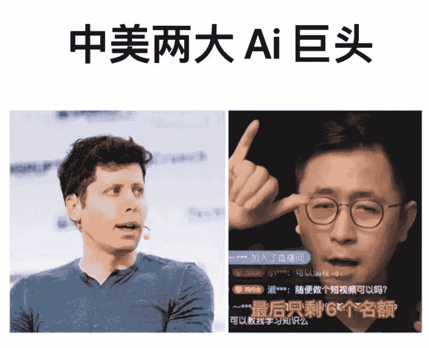
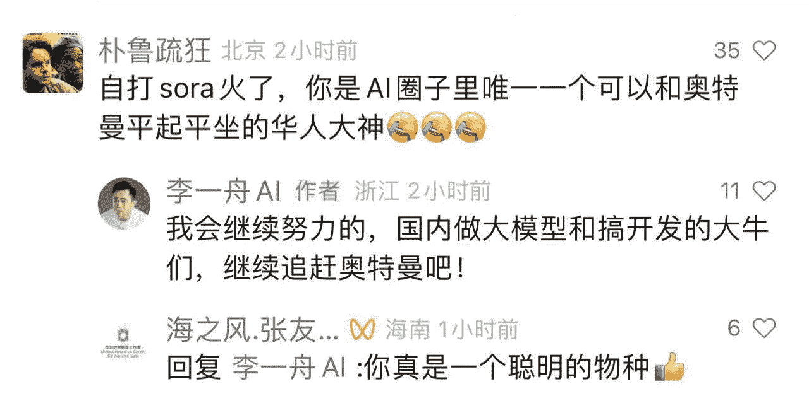

# 中美两大AI巨头

> 来源：[https://aiyanxishe.feishu.cn/docx/AFDjdMlrCoZSirxgVb8cheQAnhb](https://aiyanxishe.feishu.cn/docx/AFDjdMlrCoZSirxgVb8cheQAnhb)

2024年2月15日，**Sora成为热议话题**，甚至登上了央视，引发了广泛的讨论。这让我觉得AI的关注度再次飙升，仿佛重现了去年ChatGPT引发的热潮。

我对AI充满热爱，也认为自己是这个领域的一分子。看到公众对AI展开讨论，关注其变化，我感到格外欣喜。

网友调侃道：“Altman和李一舟最直观的区别就是高精细的长期理想主义和以利益为先的短期现实主义。”这个说的很好。其实这也映射出了当下创业环境一个很现实的问题，我们都很想改变世界，打造一款伟大的产品为人类做出重大的贡献，但在短期看来如何实现盈利，维持团队的运转保证在这激烈的竞争环境中生存下来又是一个很现实的问题，如何短期能盈利又不背离我们的初心和梦想。理想和现实怎么选择，怎么平衡？是大多数创业者都要面临的挑战。

在国内AI领域的热潮中，主要盈利的似乎只有提供计算能力的企业和开设相关课程的个体。

尽**管许多**AI创业者付出了巨大努力开发应用，但在收入方面，他们往往不敌那些专注于售卖AI相关课程的人。抖音拥有高达325万粉丝基础的李一舟便是在这一领域内非常出名的一个例子，他以售卖课程为生，月收入一度超过千万元，成为了这个市场的佼佼者。

更有网友认为这是两位营销高手：

> **Altman**是基于产品和愿景建立两位营销高手，通过品牌，不断大规模投入，产生长期价值;

> **李一舟**是通过直接效果转化，来短期收获消费者，可能会损害品牌的长期价值。

> 当然大家都想做**Altman，**但是需要时间、钱和技术

> 所以我觉得**李一舟**是更现实环境下的选择。

技术进步从来不是绝对的黑白分明，而总是呈现出复杂的灰色阶段。

跟着一个群同样爱好的人，提升学习速度。

<https://aiyanxishe.feishu.cn/sync/IaSadpoOOsopKab1ajKcz6z3nAb>