# AI本地实时驱动式数字人直播系统服务含报价

> 来源：[https://aiyanxishe.feishu.cn/docx/N2tHdz6VCoLzQRxIh0Jc4wDxnVc](https://aiyanxishe.feishu.cn/docx/N2tHdz6VCoLzQRxIh0Jc4wDxnVc)

## 一、数字人服务报价清单

| 服务项 | 服务说明 | 中国(含税) |
| --- | --- | --- |
| 数字人直播-标准版软件 | 年卡(客户自备电脑) | 49800元/年 |
| 数字人直播-旗舰版软件 | 年卡(客户自备电脑) | 128000元/年 |

## 二、数字人产品功能介绍含案例

无需繁琐准备，无需复杂操作，

### 本地实时数字人直播

通过AIGC技术实现与真人主播形象的1:1克隆，在抖音及其他平台稳定直播，电商、本地生活等直播场景都能轻松满足。

特别是抖音直播不封号，我们有一整套的解决方案，行业独家！

### 2.1 AI主播

只需要录制主播1分钟的绿幕视频，1秒钟就能克隆出一个数字人主播形象。电商场景主播可手持样品录制视频，S级真人深度学习训练，动作适配直播场景。

### 2.2 AI声音

仅需3分钟，系统便能克隆出与本人音色、发音风格一致的声音，实现声音的高度还原。

另外，我们专门上线了带货风格韵律、超真实的直播`TTS()`声音模型，构建强促销氛围。

支持无限量克隆数字人+无限量克隆声音。

### 2.3 AI布景

直播间背景、装饰、数字人主播可自定义拖拽大小、位置，背景和装饰还支持自定义上传图片、视频等。

### 2.4 AI话术

系统能够根据商家提供的直播话术，在直播过程中实时改写、润色话术，实时驱动数字人直播，确保数字人主播在整场直播说的每一句话都是不重复的。

- **智能互动：**开播后，智能学习直播间的产品话术+小知识库+自研直播小模型托底。当直播间用户在公屏上提出问题时，数字人主播能够迅速响应，实现1V1智能回复，为用户提供及时、准确的解答。

### 2.5 AI视播数字人的【实时改写】

针对抖音常见的违规问题【非实时内容】提供了高效的解决方案。这一方案在整个数字人行业里都是独一份的！

**直播话术实时改写实时生成：**系统能够根据商家提供的直播话术，在直播过程中实时改写话术，实时驱动数字人直播，确保数字人主播的每一句话都是不重复的。

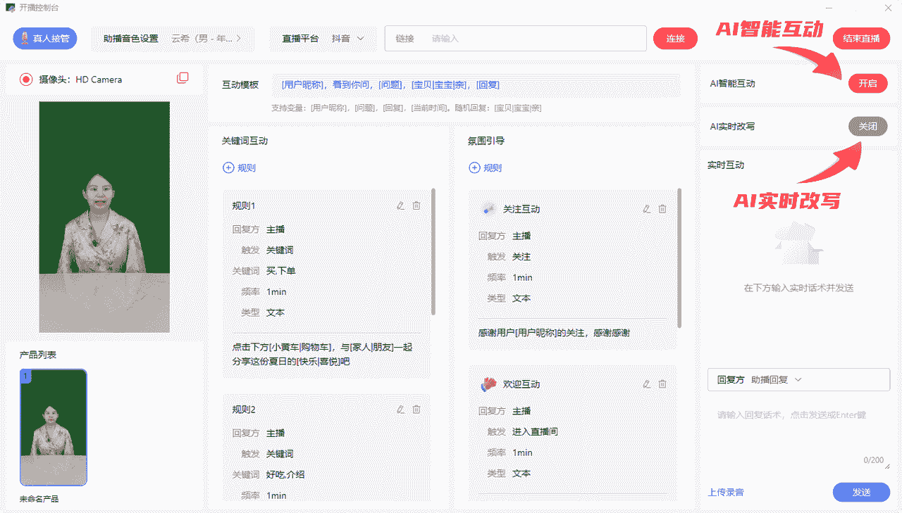

### 2.6 AI智能互动

- **智能互动：**开播后，智能学习直播间的产品话术+小知识库+自研直播小模型托底。当直播间用户在公屏上提出问题时，数字人主播能够迅速响应，实现1V1智能回复，为用户提供及时、准确的解答。

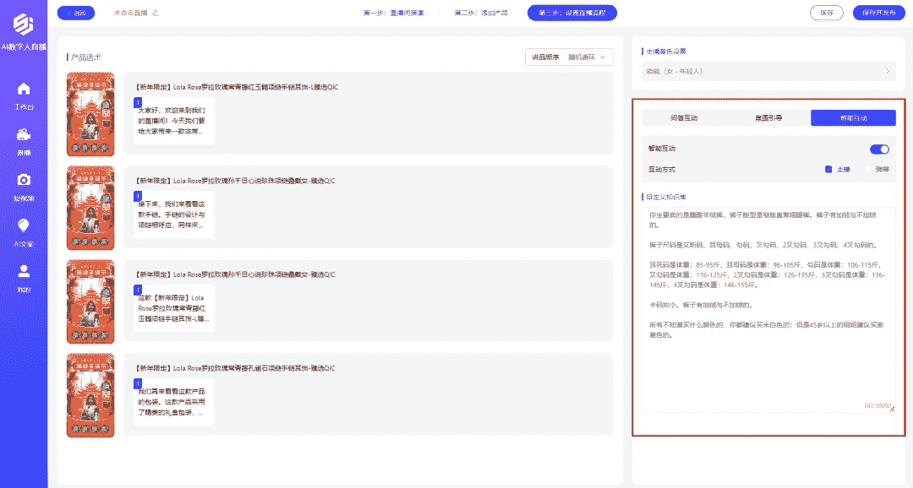

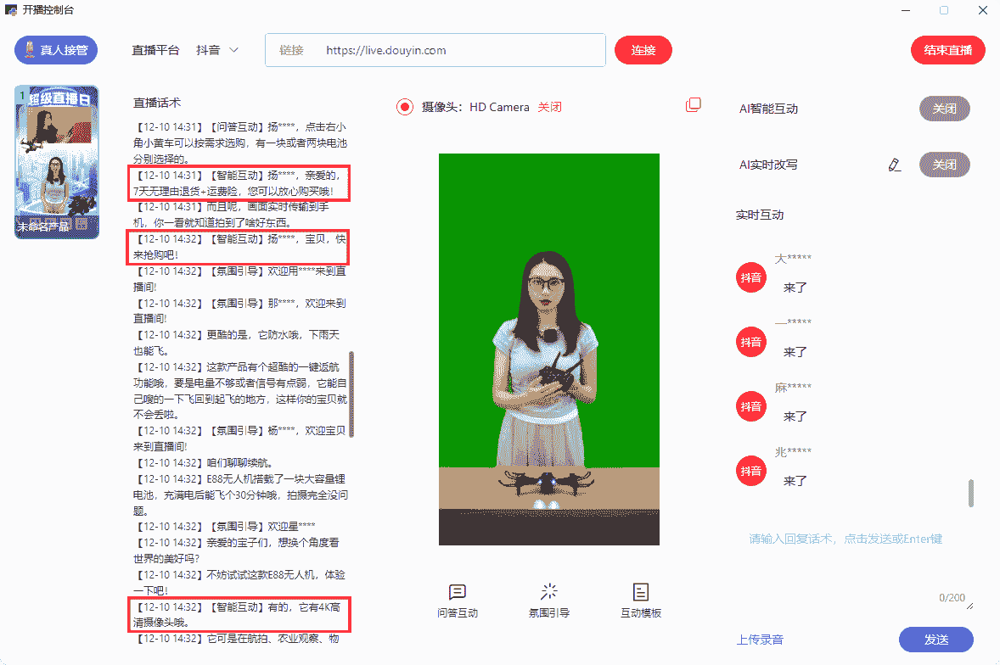

- **弹幕互动：**当用户在公屏上提出问题时，主播会迅速在评论区回复相应的文本。还支持定时发送弹幕。

- 真人接管实时互动（阿凡达模式）：可选择开麦或文字输入，选择克隆音色进行接管操作，实时驱动直播间的数字人进行回复。

- **关键词互动：**当直播间的用户评论触及预设关键词时，数字人主播会立即进行1V1的自动回复。

- **氛围引导：**新人欢迎、关注感谢、点赞感谢等支持数字人主播互动，还支持定时播报，真实感满分。

- **定时播报：**数字人主播定时播报，还支持定时发送文字弹幕。当前时间、用户称呼均为变量。

支持9大平台互动：支持抖音、快手、视频号、TikTok、美团、淘宝、📕、拼多多、京东9大平台直播互动。

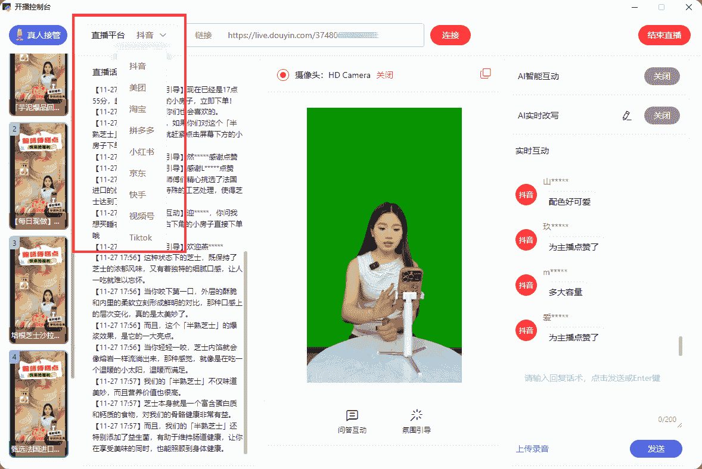

### 2.7 AI泛化

> **AI泛化：**直播话术根据所选择的直播商品AI自动生成，开启【AI泛化】，系统会自动把每句话进行泛化，生成多条多变量的同义语句。

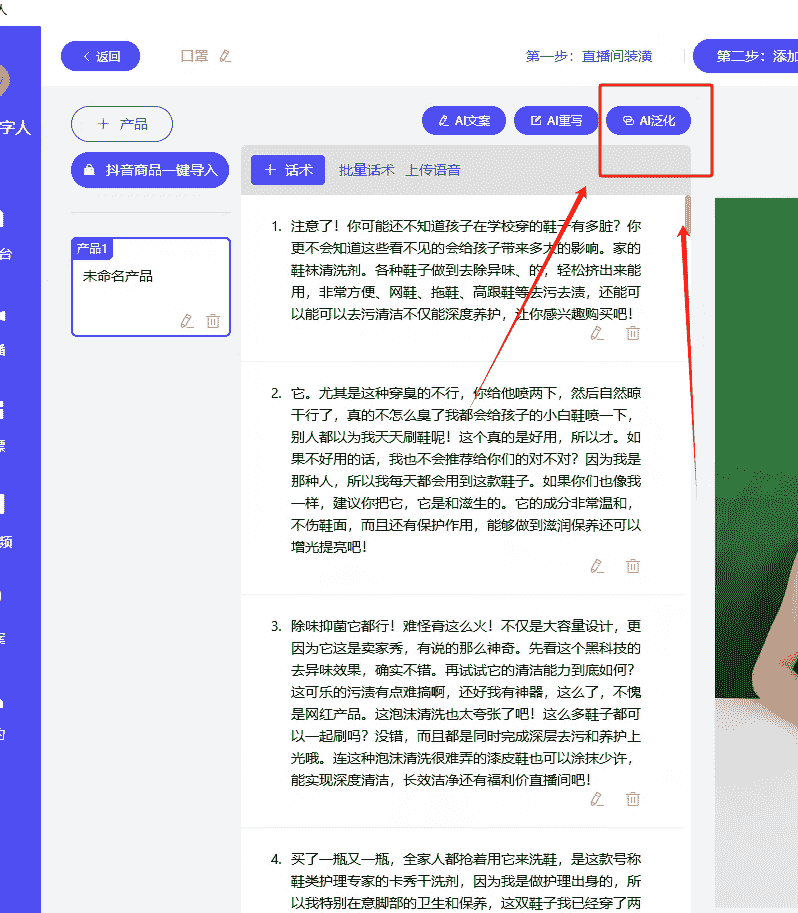

### 附件 AI直播保镖

#### 1 ✔️ 三级风控体系

- 1级：敏感词自动替换（30分钟/次更新）
- 2级：违规10秒自启保护（远程人脸破解）
- 3级：版本锁定+IP池切换
- ▸ 成果：某MCN机构连续90天0违规

#### 2 弹窗提醒+自动下播

AI直播保镖实时监控抖音直播画面，直播时出现违规提醒、人脸验证时，自动发出警报声提醒，10秒倒计时自动关播。

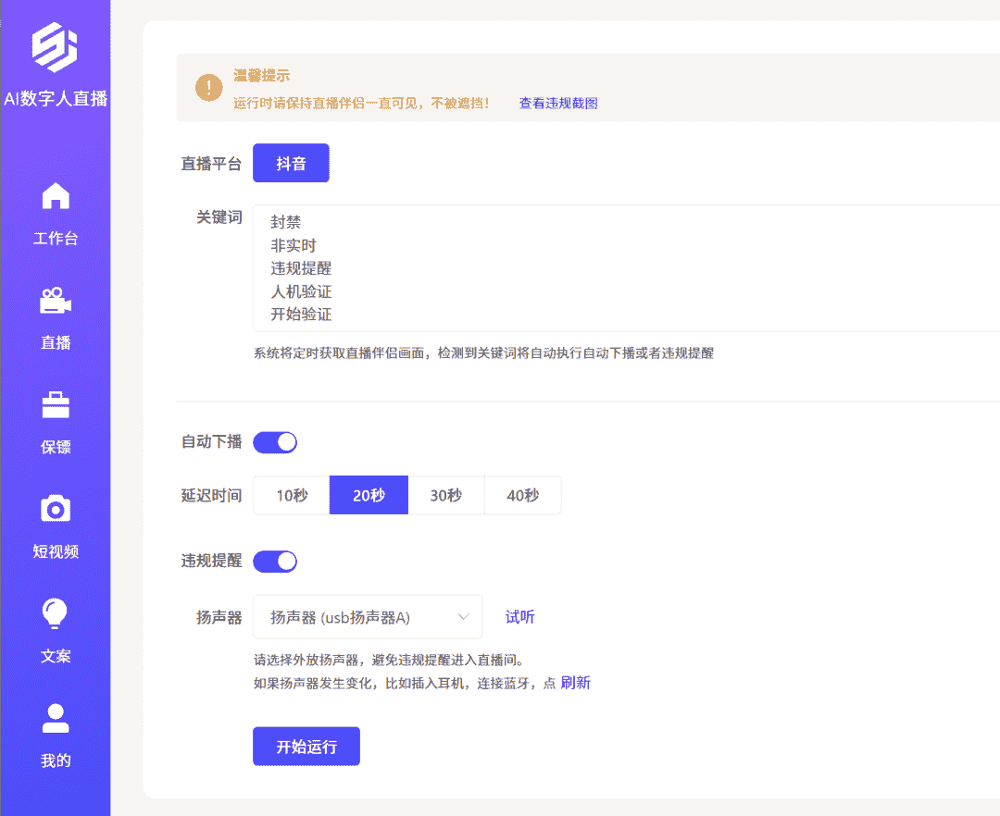

#### 3 定时开关播

数字人根据设定好的开播时间和关播时间，自动开播，自动关播，完全不需要人工操作。

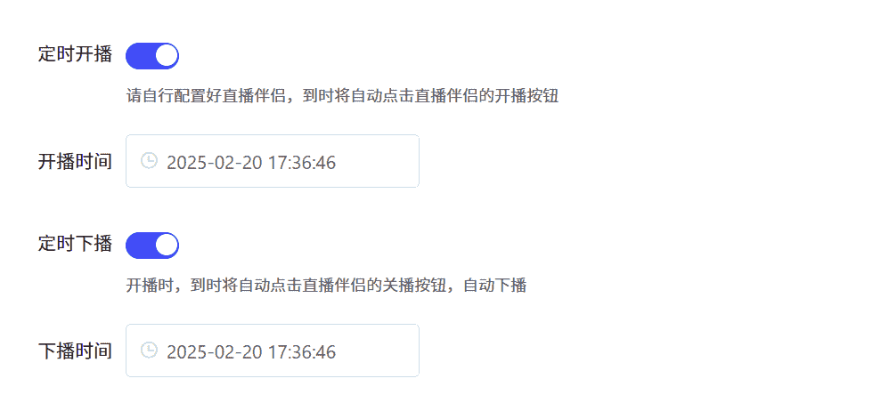

#### 4 远程人脸验证

直播伴侣登录抖音账号以及开播时，会提示人脸验证。账号所有者不在电脑旁边时，可以通过我们的远程人脸识别工具，自动通过验证。

#### 5 锁定直播伴侣版本

屏蔽直播伴侣更新，强制锁定指定的直播伴侣版本，有效降低直播风控风险。

## 三、数字人直播效果

[1_WeChat_20231224192725.mp4](https://internal-api-drive-stream.feishu.cn/space/api/box/stream/download/all/R5gPbC27Qo6SAwxaATbcIGhVnkb)

[2_聚焦婚纱摄影工作室202312251515.mp4](https://internal-api-drive-stream.feishu.cn/space/api/box/stream/download/all/CnXcbShnaozZn0xBjzJcwRdEnOd)

[3_WeChat_20231225161519.mp4](https://internal-api-drive-stream.feishu.cn/space/api/box/stream/download/all/EA3Rb7084o8UBzxZ7i8caR0snzb)

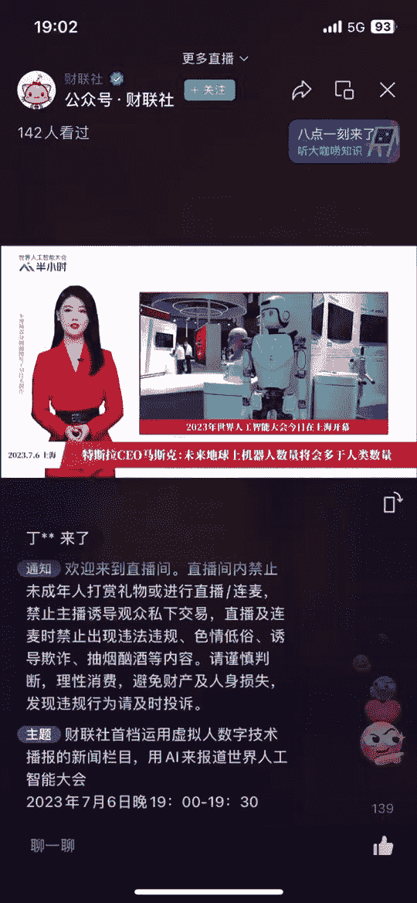

[4_上海报业集团财联社数字人直播.mp4](https://internal-api-drive-stream.feishu.cn/space/api/box/stream/download/all/MNeQbmBaboY9JKx8MybcDYPcn1d)

[5_宝洁数字人直播间.mp4](https://internal-api-drive-stream.feishu.cn/space/api/box/stream/download/all/OclGbjcsoo6mKDxFy7Lcgaeunne)

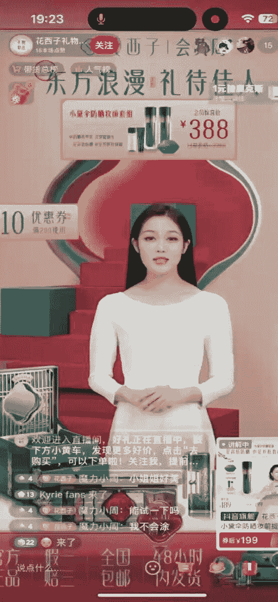

[6_花西子数字人直播.mp4](https://internal-api-drive-stream.feishu.cn/space/api/box/stream/download/all/HvBxbCRjVoLCKWxxetic4yZHncc)

[7_腾讯视频支付宝生活号直播.mp4](https://internal-api-drive-stream.feishu.cn/space/api/box/stream/download/all/KhybbSZyuojsVpx8MWAc50fpnQb)

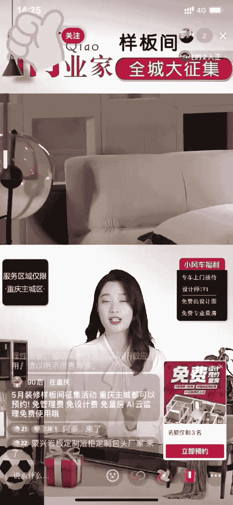

[9_装修行业数字人直播.mp4](https://internal-api-drive-stream.feishu.cn/space/api/box/stream/download/all/H3GWbxBGyo9H5rxc5WMcBsGqnUL)

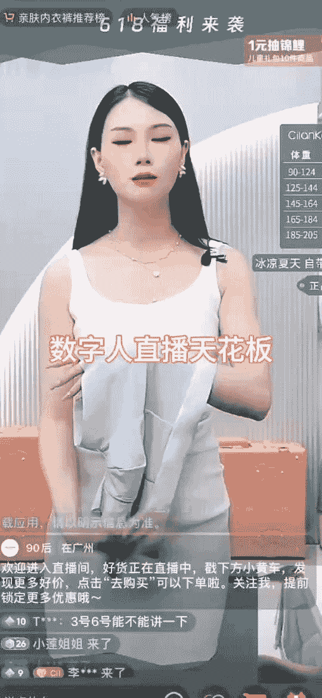

[11_内衣数字人直播.mp4](https://internal-api-drive-stream.feishu.cn/space/api/box/stream/download/all/S8YZbJs5moerANxbL5OcD3Rjneh)

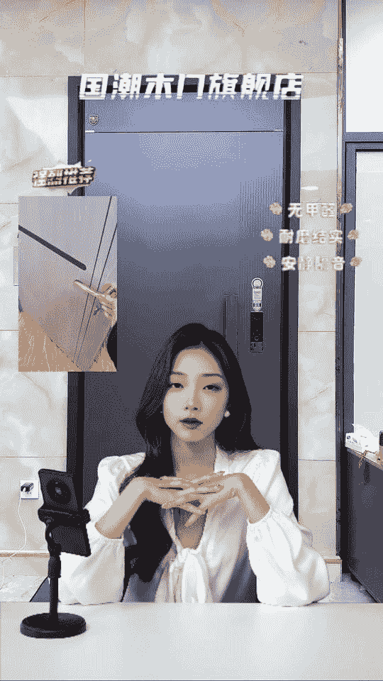

[8_WeChat_20231224192656.mp4](https://internal-api-drive-stream.feishu.cn/space/api/box/stream/download/all/C1y8bExI9oJF3CxaFrMcGnSLnNE)

[10_2024-01-07-07-29-18.mp4](https://internal-api-drive-stream.feishu.cn/space/api/box/stream/download/all/V8TLbrnXnox8Hex4eMEcQH4sn6g)

[12_12月25日.mp4](https://internal-api-drive-stream.feishu.cn/space/api/box/stream/download/all/H83LbbJ7soJvLUxBOjOcGg55nud)

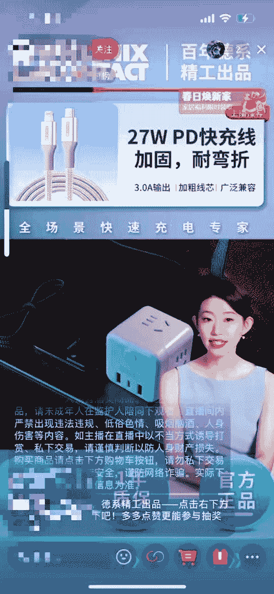

[18_小家电数字人直播.mp4](https://internal-api-drive-stream.feishu.cn/space/api/box/stream/download/all/YDyxbA5uMobrOCxx5FIcgIVznPe)

[17_数字人支付宝直播.mp4](https://internal-api-drive-stream.feishu.cn/space/api/box/stream/download/all/A0e2bkd7yoNrdBxbygjcL5Epn3c)

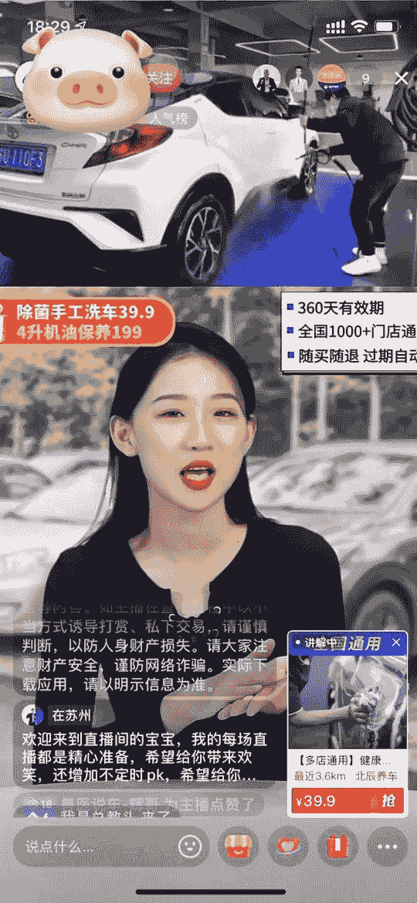

[15_汽车数字人直播1.mp4](https://internal-api-drive-stream.feishu.cn/space/api/box/stream/download/all/C71BbKnuzo00AhxAg0hcANqanRf)

[7_WeChat_20231224192733.mp4](https://internal-api-drive-stream.feishu.cn/space/api/box/stream/download/all/RsOwbkrS9o7AsTxRxwIcqnjZn5f)

[11___________________________________________________硅基分身定制流程&平台使用指南 - 飞书云文档_8.mp4](https://internal-api-drive-stream.feishu.cn/space/api/box/stream/download/all/T8XWbGRHHojxrTxvLflc9uoHnEc)

[14_WeChat_20231224192744.mp4](https://internal-api-drive-stream.feishu.cn/space/api/box/stream/download/all/BPblbaKjso2opnxq9UFcXtOfnkb)

## 四、AI数字人克隆技术

[23_4月26日(1).mp4](https://internal-api-drive-stream.feishu.cn/space/api/box/stream/download/all/X3o1bDuXfo26dOxrlBOcIw2Fn8e)

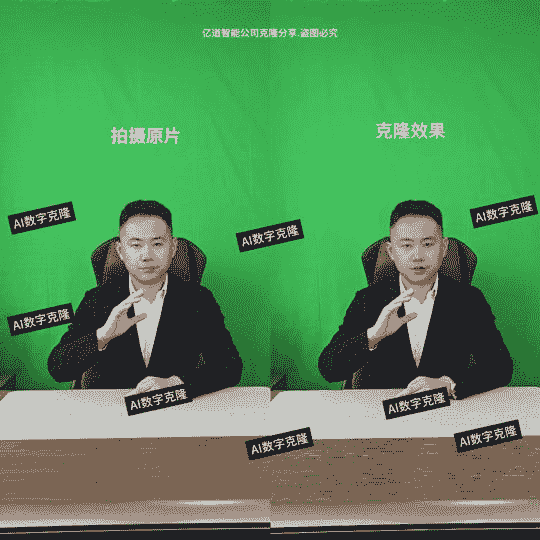

[21_4月26日(2).mp4](https://internal-api-drive-stream.feishu.cn/space/api/box/stream/download/all/Fyb4bwIzeoBqlJxS1iScPtUHn7f)

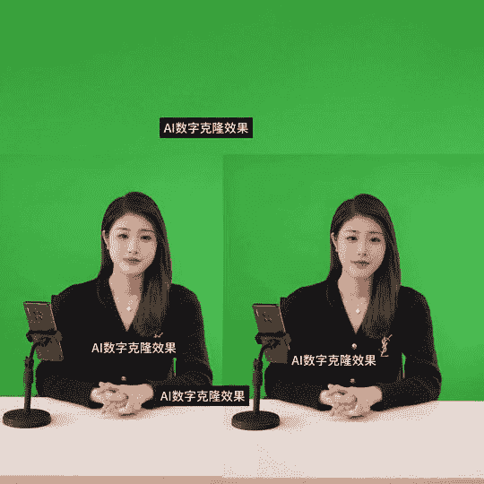

[24_4月26日(3).mp4](https://internal-api-drive-stream.feishu.cn/space/api/box/stream/download/all/Xcb0bZ1xioxyVSx8UFOcupcGnhe)

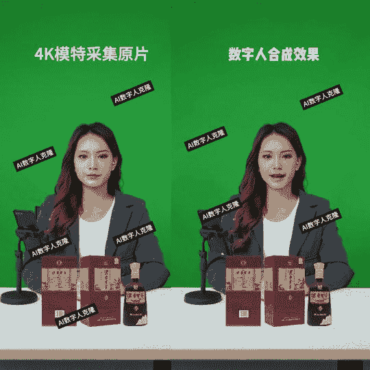

[25_4月26日.mp4](https://internal-api-drive-stream.feishu.cn/space/api/box/stream/download/all/IEt8bsXrbo9aNfxHyIlc6l75nCc)

## 五、各直播基地介绍

> 团队为匹配AI人工智能的未来市场发展，为全国企业提供最优质的AI数字人直播，IP账号孵化，企业全案等搭建服务。在全国有多家AI智能研发团队，为自身企业提供多样化AI智能软件产品，可以根据不同企业.商家.个人的需求，提供更专业，更适合企业的AI智能搭建方案。

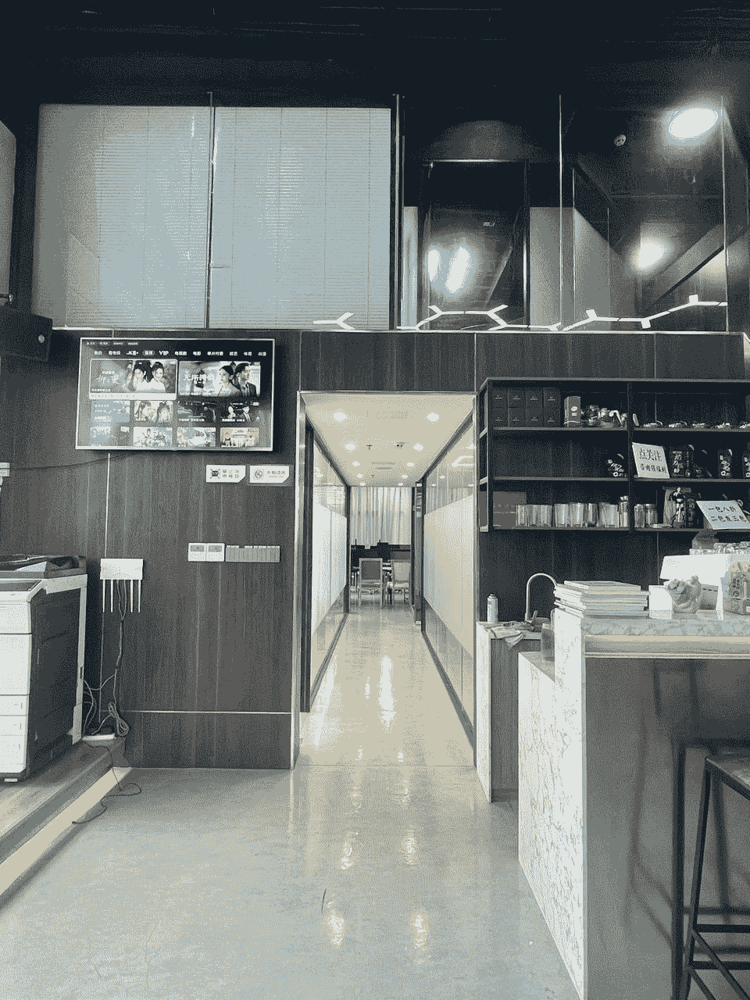

### AI数字人直播基地示例——AI数字人直播基地

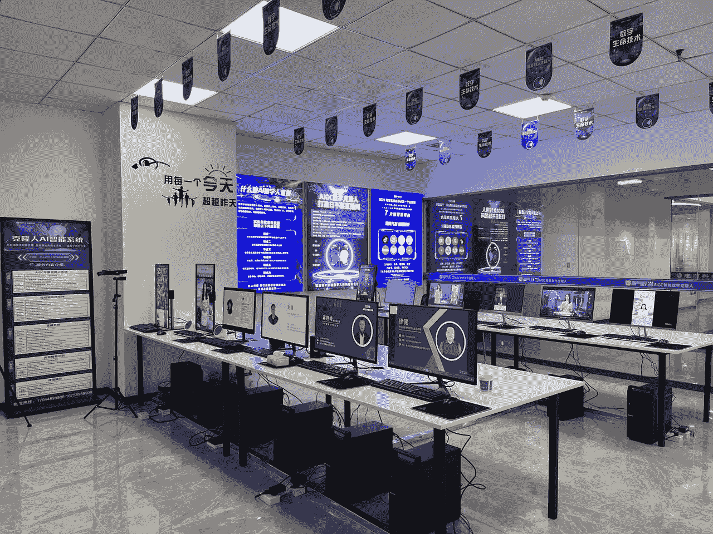

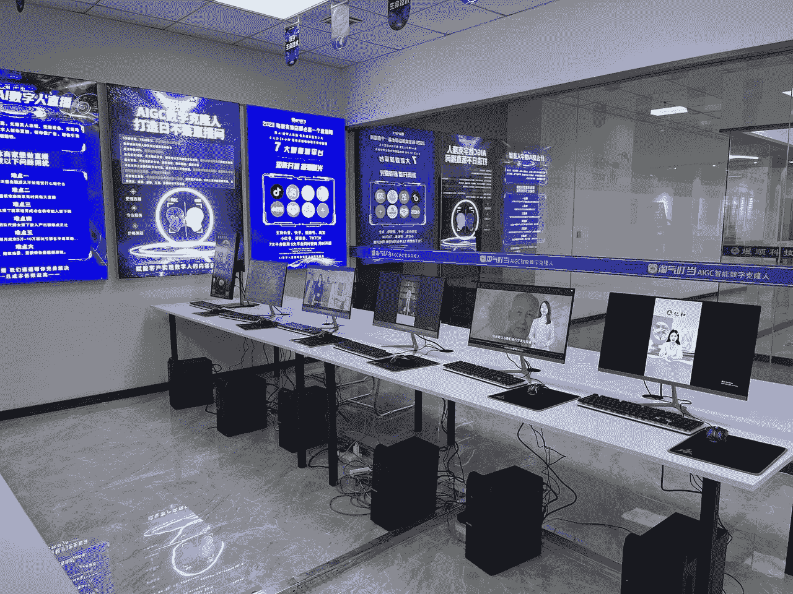

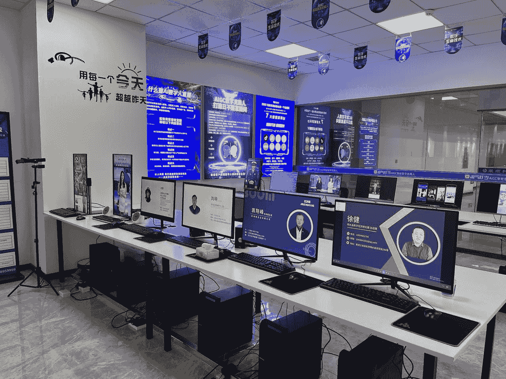

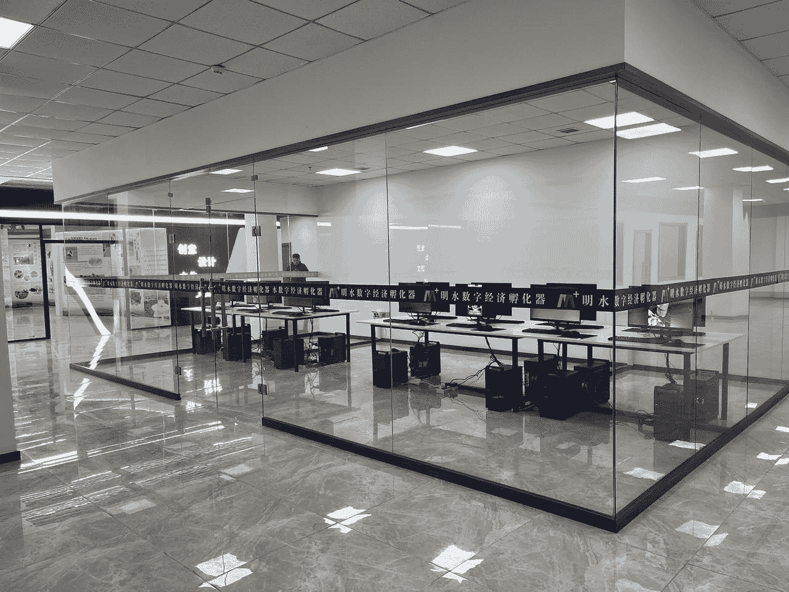

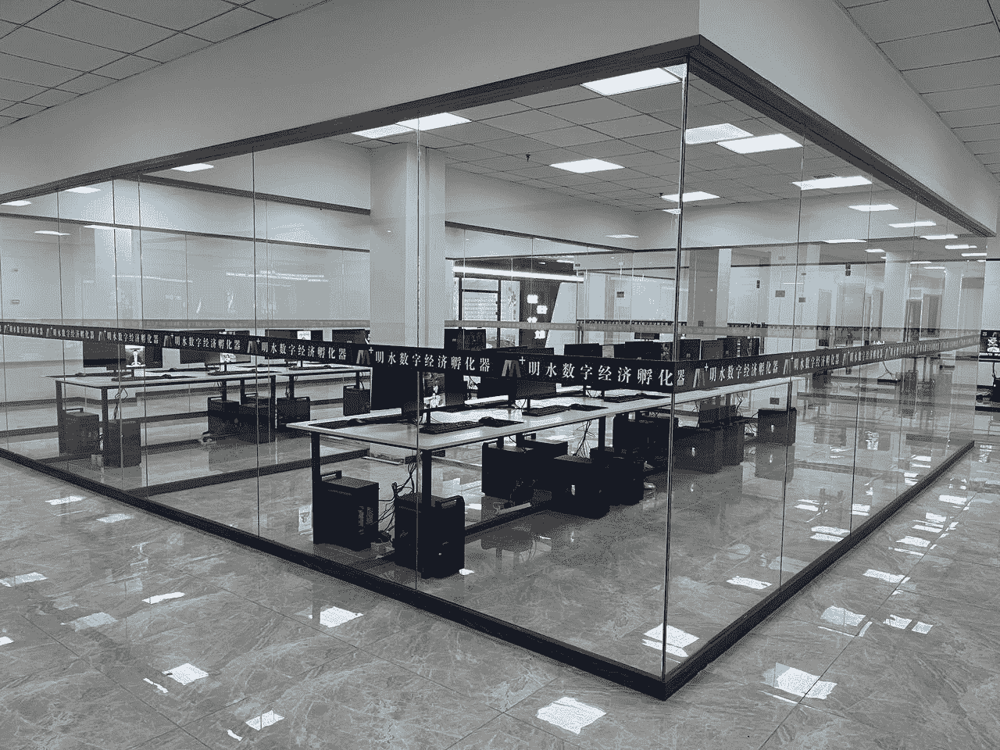

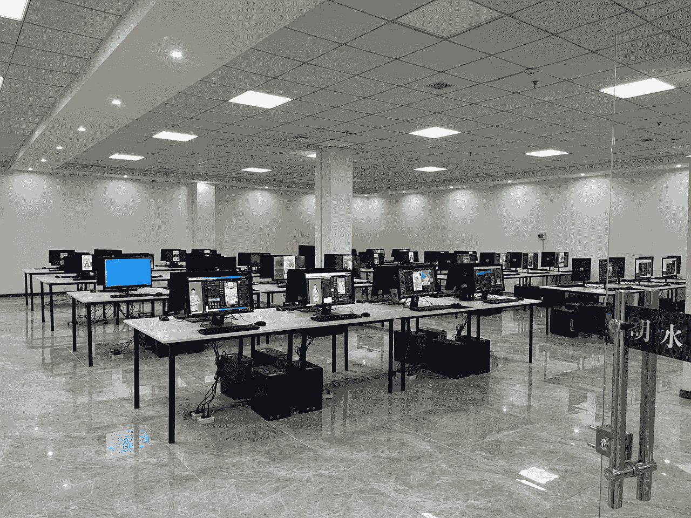

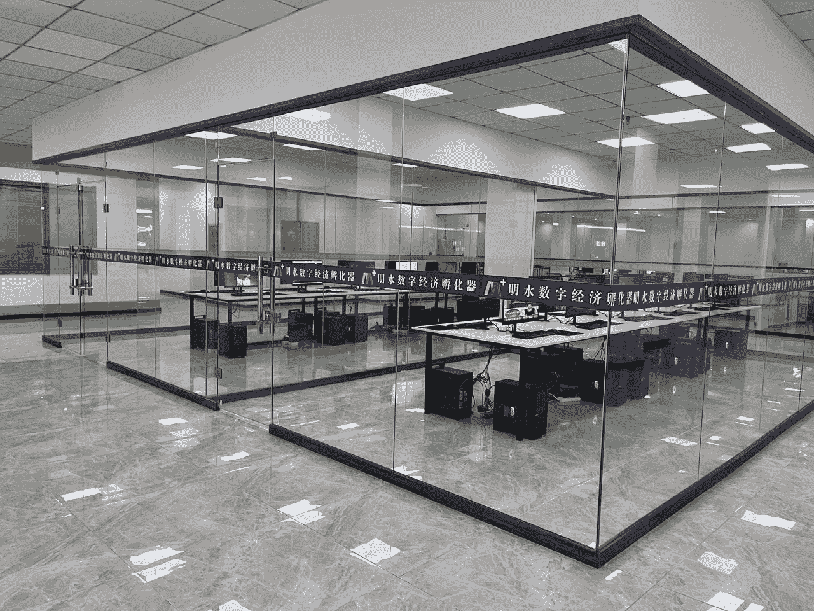

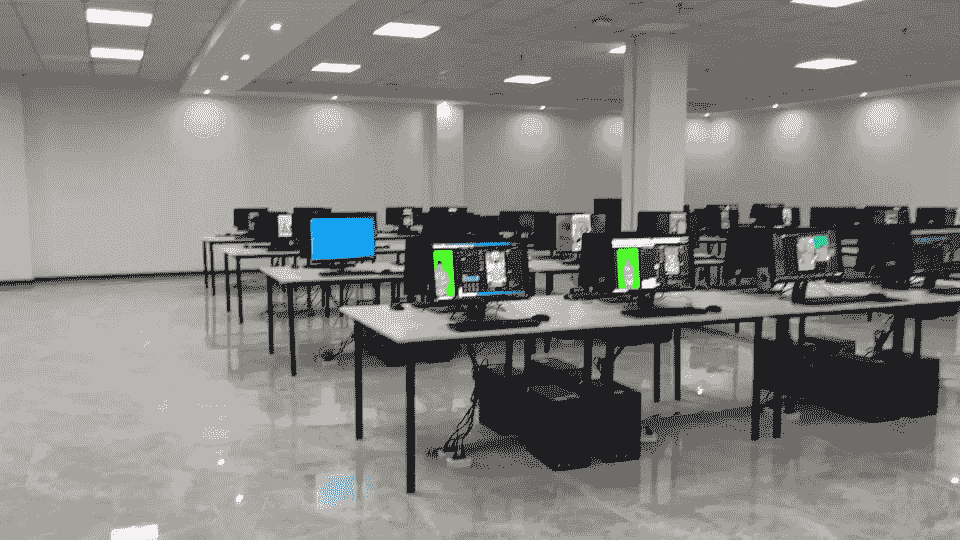

[16_WeChat_20240121130202.mp4](https://internal-api-drive-stream.feishu.cn/space/api/box/stream/download/all/TlWQb82T2o5NU6xuIkecCcHUnKe)

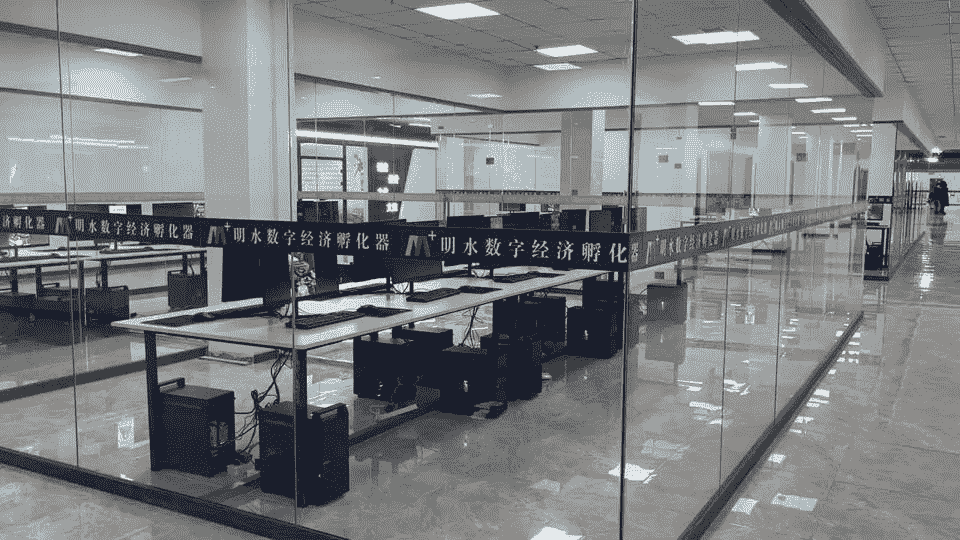

[20_WeChat_20240121130215.mp4](https://internal-api-drive-stream.feishu.cn/space/api/box/stream/download/all/HZBwbIKe1o8ElNxxezOcPA02nJh)

## 六、定制形象制作流程

1. **绿幕录制流程**

   - **绿幕布景**：绿幕拍摄后期可以自定义更换其它背景，拍摄时绿幕需要铺满整个画面，绿幕尽量不要有褶皱、阴影，否则会影响抠图效果，请务必得到满意布景后再开始拍摄。
   - **发型佩饰**：避免佩戴会晃动的耳坠，耳坠晃动会影响口型学习，可佩戴固定耳钉。避免碎发太多，容易导致绿幕扣不干净，如果是实景拍摄则不受影响。
   - **衣服颜色**：使用绿幕背景拍摄视频，不要穿搭绿幕相近色（如黄色、绿色、黄绿色）的衣服，以免影响抠图效果。
   - **灯光布置**：均匀打光的光源，推荐使用“三点式打光”，如果想要下巴区域无阴影，推荐使用反光板、泡沫板（俗称“米菠萝”）来补光。
   - **人物站位**：人物需要站在绿幕前 1-2 米位置，避免人物边缘泛绿光、避免绿幕上有阴影。

[13_形象定制流程.mp4](https://internal-api-drive-stream.feishu.cn/space/api/box/stream/download/all/Fzj7b36pfoAP3rxhpuFcBqt1nNb)

数字人绿幕视频拍摄要求

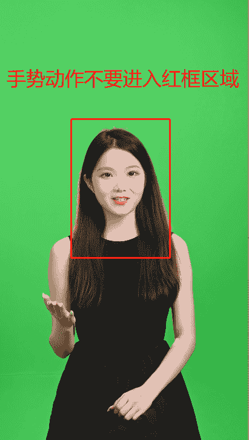

红框内不能有手势或其他物体遮挡

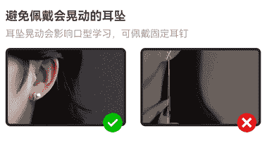

推荐使用此类免安装可升降绿幕

### 2. 实景录制流程

实景布景：人物的背景要静态背景（不要在驶车辆中，或者以喷泉，飘动的树叶，播放的视频等为背景）

实景拍摄后期无法更换其它背景，其他拍摄要求和绿幕视频一致。

### 3. 相机拍摄参数

+ 视频分辨率最好 4K（3840*2160），最低 1080P（1920*1080）
+ **视频尺寸为 9:16 或 16:9**，请根据自己的使用场景选择横屏或竖屏拍摄
+ **视频帧率：25帧**
+ 镜头焦段：推荐 50mm 镜头（等效全画幅相机焦距）左右，想要脸瘦一点用 85mm
+ **如使用手机拍摄，请选择最高画质（1080P 以上）进行拍**摄，苹果手机请选择“兼容性最佳”格式拍摄

# 七、为什么要选择数字人？

### 数字人VS真人主播

真人主播：每月成本2-3万，主播每次最多直播6小时。

数字人直播：一次投入，一年7*24小时随时开播。

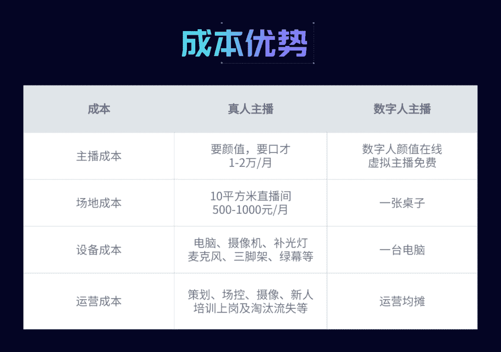
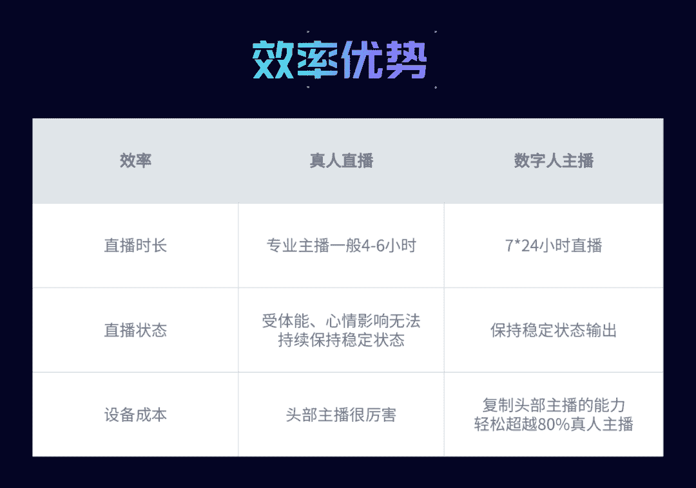
