# 阿里｜这是一只充满AI的牛牛! 看我们用AI发电

> 来源：[https://aiyanxishe.feishu.cn/docx/Q2syd7LkoozFvRxx1jUcwZuSnjh](https://aiyanxishe.feishu.cn/docx/Q2syd7LkoozFvRxx1jUcwZuSnjh)

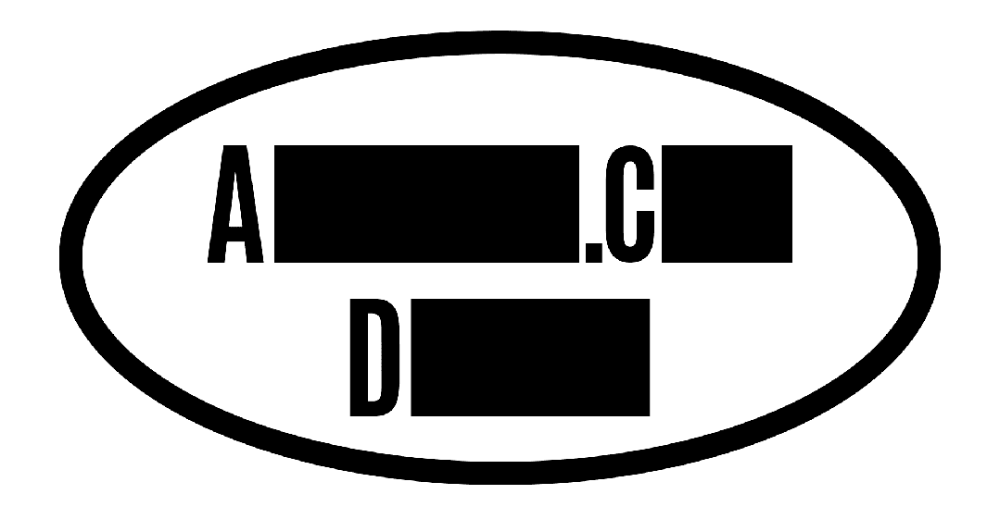

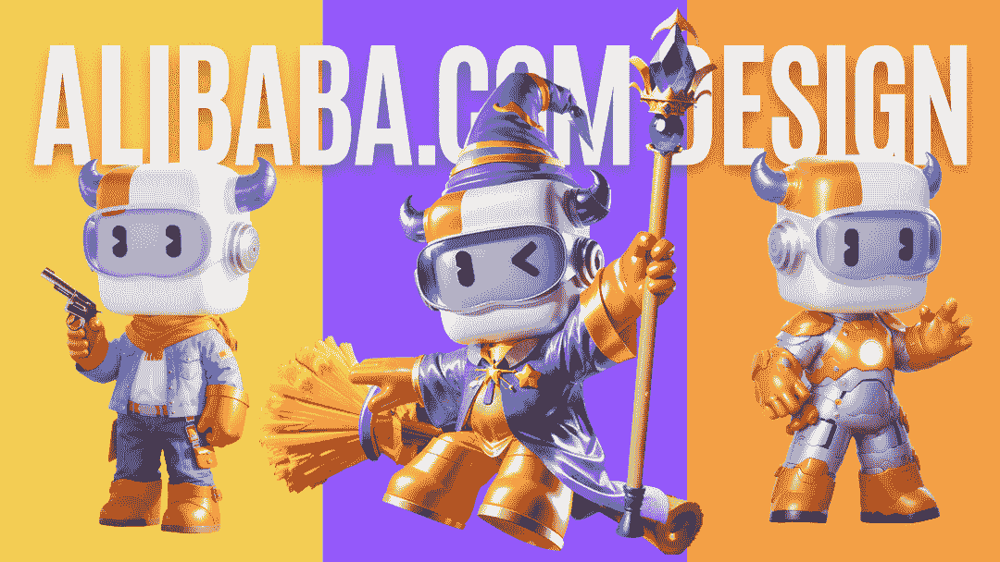

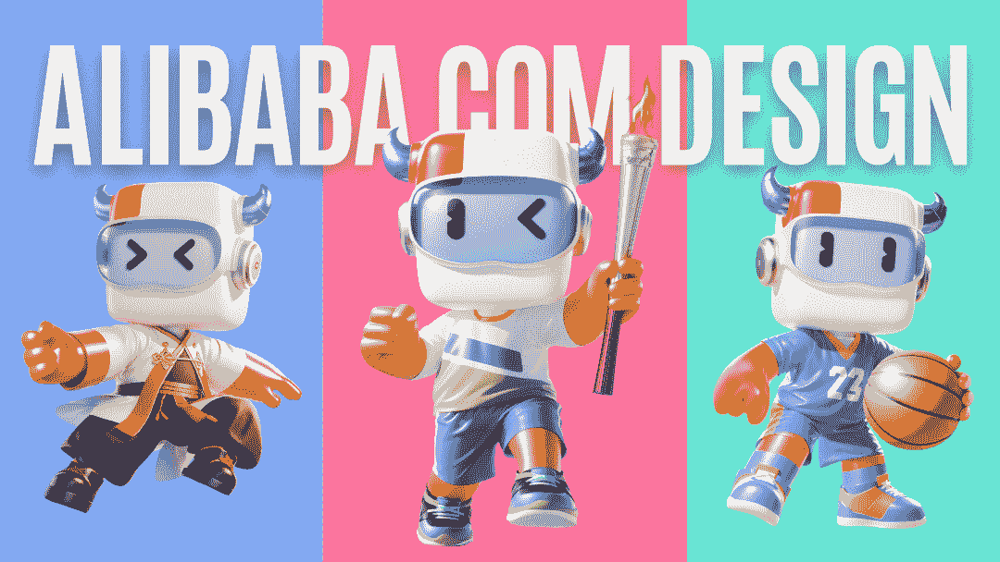

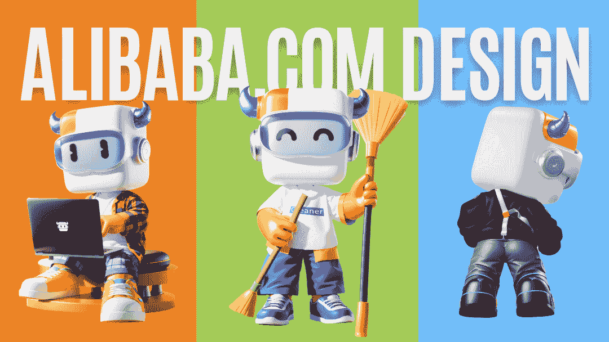

熟悉我们频道的老观众应该都对这只可爱的牛牛不陌生了，我们每逢佳节都会制作一张精美的阿牛节庆主题海报，可爱的阿牛搭配上精心制作的3D主题场景，获得了不少内外部小伙伴的好评，最近我们的阿牛同学也乘上了AIGC的东风；

今天我们就来看看可爱牛牛与AI能碰撞出什么样的火花吧！

---

# **#Introduction**** 阿牛是哪位**？

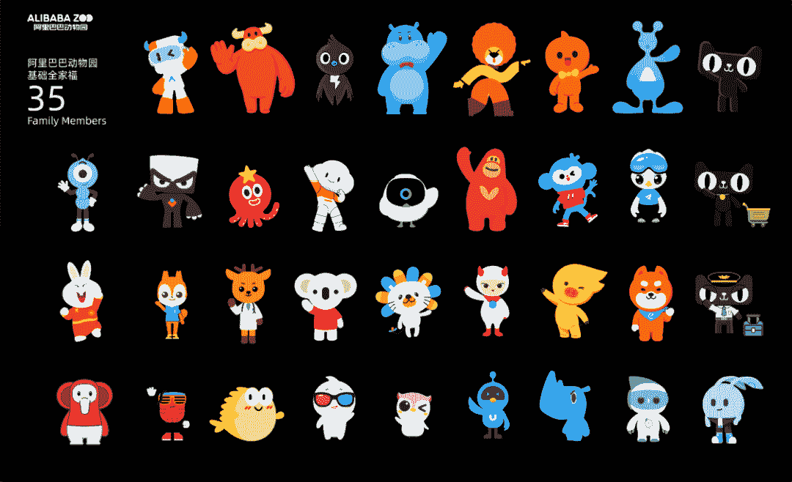

了解阿里巴巴的小伙伴应该都知道，我们阿里巴巴集团其实是个动物园，例如大家熟悉的天猫的猫天天、闲鱼、又或者是菜鸟、高德的高小德等，但是大家可能不知道阿牛才是阿里的第一只动物，按照辈分来说，阿牛应该算是阿里动物园的爷爷辈了

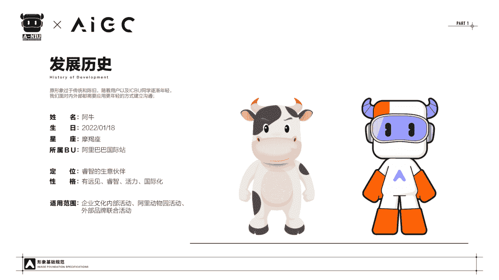

阿牛，隶属于阿里巴巴国际站，一位富有智慧的生意伙伴。随着用户和ICBU同仁逐渐年轻化，阿牛的形象也得以焕然一新。于2022年1月18日，阿牛以崭新的形象和定位正式亮相阿里巴巴国际站。阿牛以其睿智、富有远见和充满活力的特质而脱颖而出，在企业文化内部活动、外部品牌联动活动以及国际市场的访谈与交流等一系列活动和场合中，扮演着举足轻重的角色。作为一个令人难以忽视的角色，阿牛在不断演进的商业世界中为我们提供智慧和灵感，与我们共同塑造着未来。

---

**

#0****1阿牛AIGC海报大**赏

阿牛四季AIGC海报

---

**

#0****2AIGC探索三步**走

我们在今年年初那会儿就开始探索使用AI辅助设计阿牛，从最开始的浅尝辄止到如今的愈发成熟的真正落地，基本上可以分为三个阶段，接下来我们一起来看满满的干货吧！

AIGC1.0时代-Controlnet控制大法

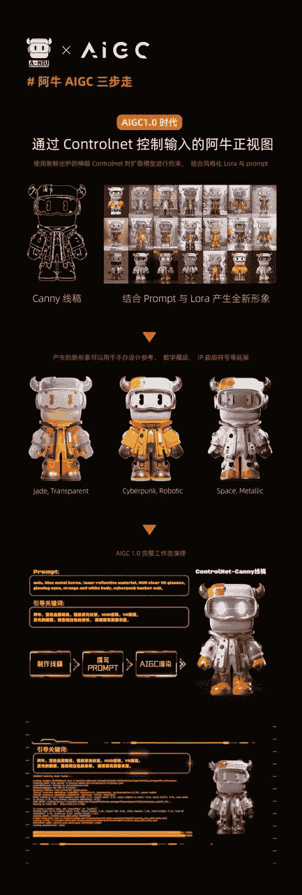

**小结**

在AIGC1.0时代，AIGC主要起到的是产生参考图像作用，仅仅使用controlnet无法精确控制阿牛本身的特征材质，例如橙色的身体部分、蓝色金属牛角等，具有一定的局限性，但是非常适合整体全身材质风格替换,不仅可以使用正视图作为参考输入，设计师也可以手绘线稿图输入controlnet进行控制；

---

AIGC2.0时代-基于SD1.5的Lora模型训练

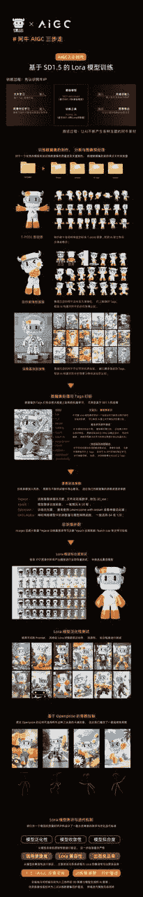

**小结**

在AIGC2.0时代，基于Stable diffusion的Lora模型训练已经可以做到直出较高质量的阿牛形象了，在无数轮的测试与回炉之后，模型具有了相对稳定的表现，对于一些要求不高的场景例如表情包，内部宣传画等基本可以做到画面直出可用。但是对于要求较高的节日节庆海报或者对外宣发，依然有着一些问题，例如四肢比例失调，手指多一只少一只的情况时有发生，这也属于SD1.5底层技术的老毛病了，不过好在随着SDXL大模型的更新，相信这些问题会在新的技术加持下解决；

---

AIGC3.0时代-多种AIGC工具实战应用

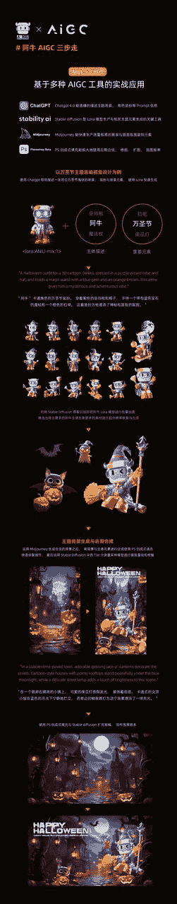

完整制作流程与最终版海报

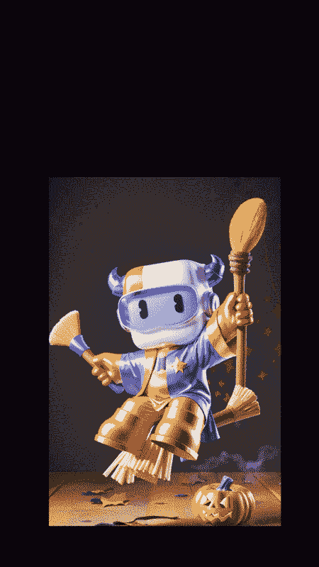

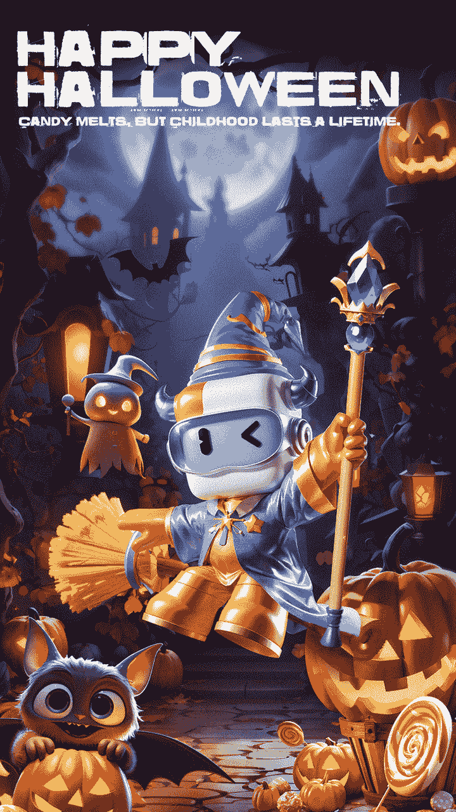

---

# **写在最后**

在过去，无论是制作3D、2D还是手绘的品牌IP形象海报和设计物料，我们都需要投入大量的人力，并面临不同设计师技能水平的差异，很难实现全方位的满足。但在AIGC时代，AI设计辅助工具的强大功能消除了这些差距，专业模型的训练大大降低了生产难度。这改变了设计的生产模式，不仅在设计初期的创意探索中，而且在设计实施过程中都极大地提高了设计师的工作效率。

不可否认，目前的AIGC工具仍然存在着许多问题，如在阿牛模型的训练中，头身比例与手指数量错误一直是一个老大难的问题，真正的完美落地仍然需要专业设计师的大量介入与修复，但是这并不是我们放弃AIGC的理由，我们相信随着时间与技术的更迭，这些问题都将得到解决或者缓解。

拥抱AI并不是要完全取代传统的设计方法或设计师，而是为设计师提供一个强大的辅助工具，帮助他们更高效地实现创意和思路，将更多时间和精力投入到真正的创意创新中，而不是重复性的基础设计工作。

<https://aiyanxishe.feishu.cn/sync/IaSadpoOOsopKab1ajKcz6z3nAb>