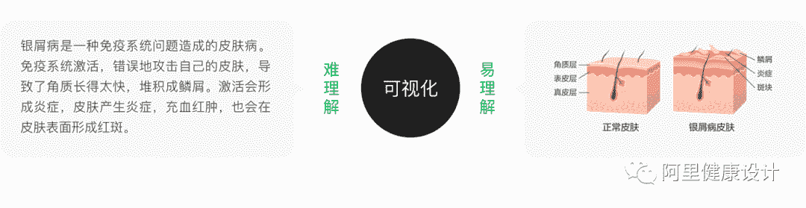
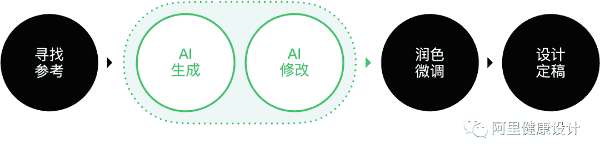
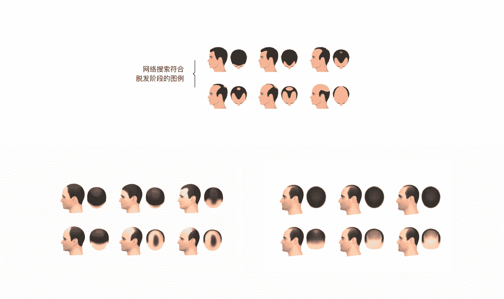
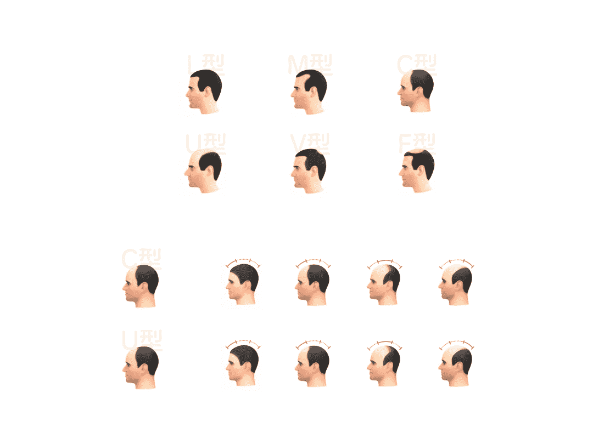
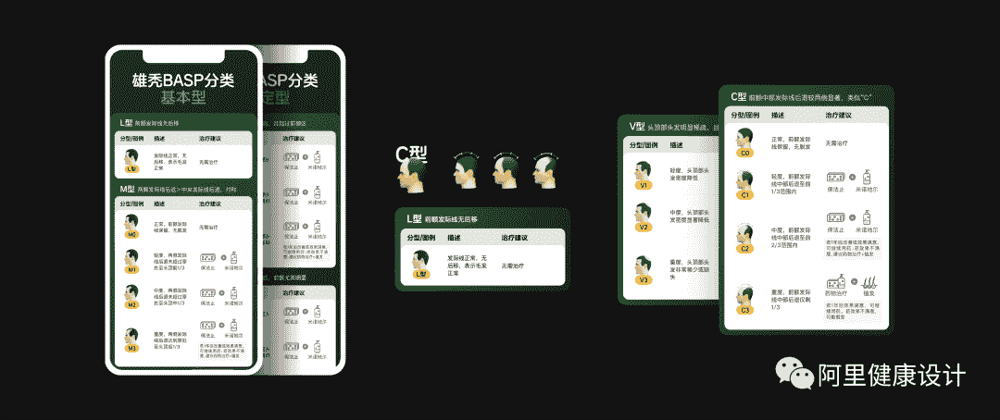
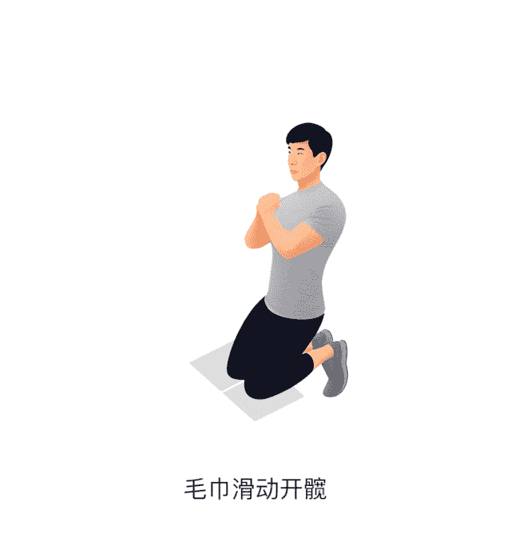

# 阿里｜AI让慢病科普变的更简单

> 来源：[https://aiyanxishe.feishu.cn/docx/PBvIdOZYIog9dAx2eImcoP8xnKg](https://aiyanxishe.feishu.cn/docx/PBvIdOZYIog9dAx2eImcoP8xnKg)

慢病患者用药的依从性，大部分原因来自于认知因素，疾病因素，年龄因素，心理因素。对于心理因素，疾病因素，年龄因素，很难通过外界作用提升。但是认知因素是可以被改变的。通过把线下医院，阿里健康大药房，互医，👸号等渠道的患者，通过电话，短信，DM单，购药链路的渗透等方式引导入群，通过患教良性提升患者。

### **通过可视化让慢病科普更加易懂**

慢病大部分用户为老年患者，需要通过可视化展示，让复杂、专业的医学知识更为人们所知、所感，提高医患沟通效率，以科技创新助力科普更有温度，让患者更加清晰地了解慢病起因和康复过程，对慢病康复有深刻认识。

### **AI让慢病科普变的更简单**

科普插画需要耗费设计师大量的设计时间和设计精力。现在通过AI参与慢病科普，我们只需找好类似图例，通过sd快速生成相同风格的图片组，然后进行设计微调。

举一个例子，如：脱发BASP分类，我们需要可视化脱发的类型。每个类型需要3-4严重程度的展示，总共6个类型，要输出20个张脱发图例。

### **寻找参考，AI生成**

参考选择至关重要，寻找参考图片需要考虑以下几个方面：1.参考图片的主题应该与设计方向相符；2.参考图片的风格也应该与设计风格相符；3.参考图片的质量也很重要，应该选择高质量的图片作为参考。

找到脱发的参考后，在模型库找到适合的模型，一个好的模型可以大大提升出图的质量，然后通过sd生成。经过几次的参数调整，生成出几组符合业务需求的图例。

### 细节微调 - 根据业务性质，微调设计

优化sd生成出来的图例，根据业务需求，调整出BASP6个类型的脱发过程，优化设计细节，让设计细节更加符合业务场景。

### 设计定稿 - 根据业务场景，完善设计

### 根据最后优化的脱发图例，融入到业务场景中去。原来需要5个工作日设计需求，在Ai的加持下，只需要1个工作日，在保障设计质量的情况下提升了设计效率。

### **其他**

如：序列图的生成，也可以使用sd一健生成。

+   END -

<https://aiyanxishe.feishu.cn/sync/IaSadpoOOsopKab1ajKcz6z3nAb>