# 阿里｜淘宝设计+AI购物，问问淘宝问问就“购”了

> 来源：[https://aiyanxishe.feishu.cn/docx/RBiKdFTfxo2roKxmhXpco3BLnGe](https://aiyanxishe.feishu.cn/docx/RBiKdFTfxo2roKxmhXpco3BLnGe)

如果我想买一款 “适合敏感肌的国货洗面奶”，需要怎么买到它呢？

打开手淘APP，在搜索框中搜索“敏感肌洗面奶”，你会得到海量的商品结果。为了挑选到最合适的商品，你可能会考虑不同品牌、价格、成分、评价等维度做挑选与对比，过程中也可能会改变主意，甚至因为看太多反而选择困难，挑选和对比时大脑CPU狂转，手指不停点击加购返回再点击。

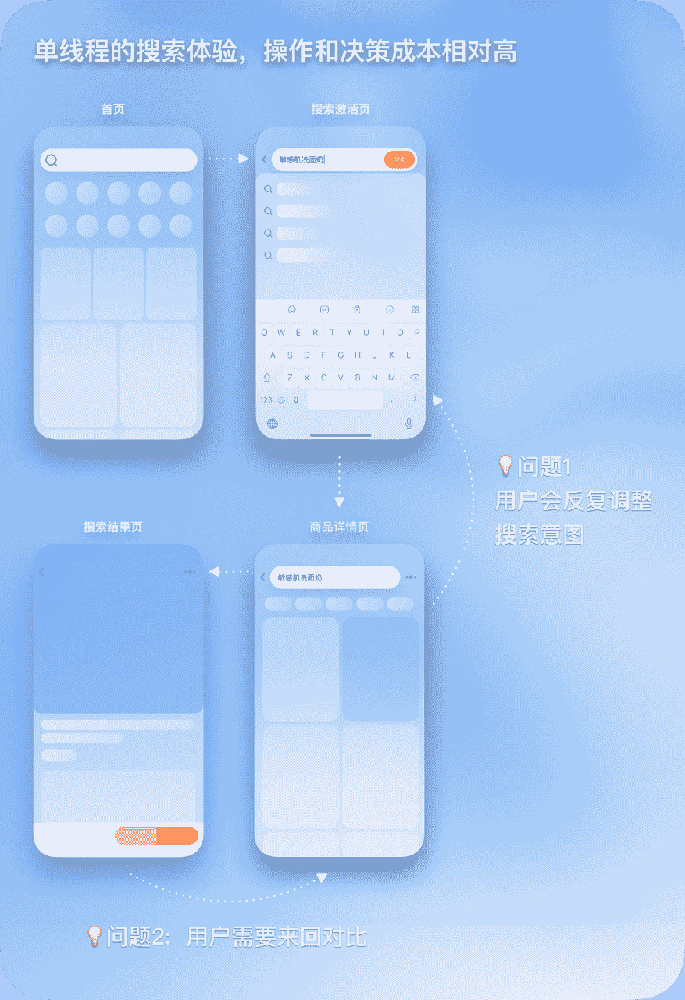

我们所习惯的移动端搜索方式，比较依赖自己对页面中信息的收集和判断，在判断焦虑时，会很希望有人对我的购买决策提供帮助。但在实际的交互操作上，我们发现用户就是在“搜索关键词时”和“在列表查看商品时”反复切换，操作成本和选择困难剧增。

# **#01**

# **新的可能**

# 我们所常用的搜索体验，是基于文本信息搜索引擎，快速检索相关商品、店铺、评价等内容。现在淘宝为用户推出智能导购助手“淘宝问问”，为用户在手淘更快地找到想买的东西、改善购物体验，创造了新的可能。

# 用户可以直接通过语音或者文字输入向“淘宝问问”自由提问，淘宝问问通过历史记录、购物偏好等因素综合考虑，给用户提供最适合的商品和个性化购物建议。这个能力与基础搜索互相补充，给用户有选择的导购体验。

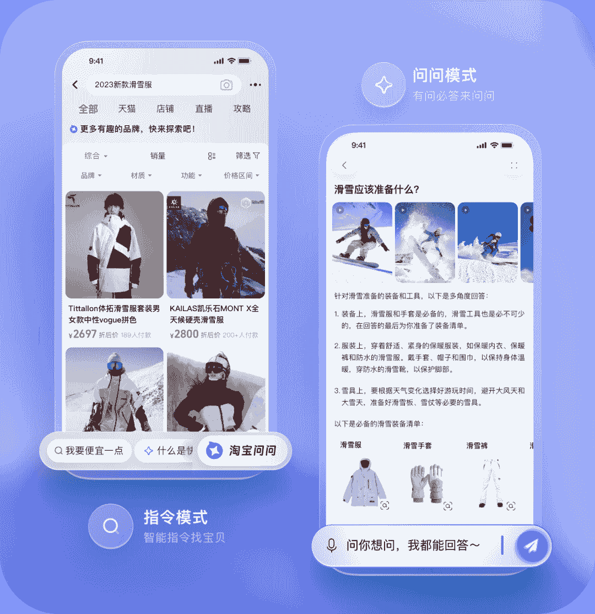

▲ 淘宝问问在手淘搜索内的两种模式：copilot模式与深度对话模式

# **#02**

# **对体验的挑战**

1.  区别于单一内容形态的生成模式，淘宝问问连接用户的自然语言与购物方案的生成，设计需要解决复合型购物解决方案的表达模式，建立完整的AI技术能力下的体验设计体系，以满足用户多样化的、随机的信息消费需求。在设计上我们主要考虑：
对话与导购间交互流转的顺畅衔接；
覆盖完整购物类型的模块单元（包含文字、图形、语音、视频等因子的基础单元）；
不同模块单元在随机生成中的无缝组合；

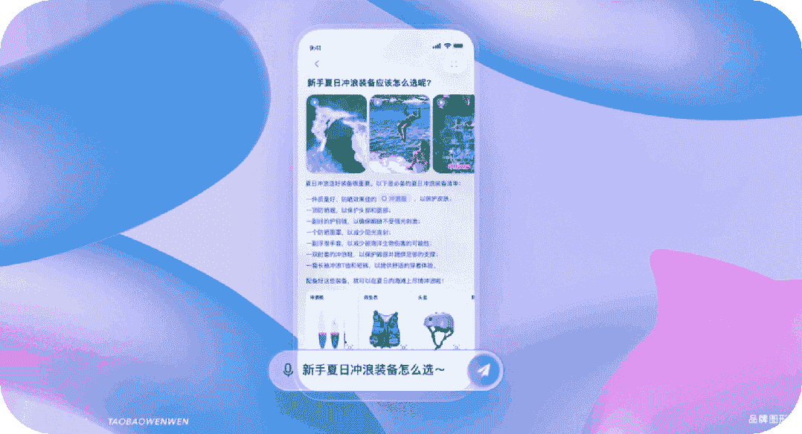

1.  **统一且可继承的深度导购基础框架**

淘宝问问作为搜索场景和能力的延伸，在框架层，设计上采用采用搜索式对话的结构，既能更好的承接和延续手淘搜索的场景心智，又能兼容手淘内丰富的内容类型。在需要更加垂直化的应用场景中，也在保证统一性框架的基础上，承接对话式的人设化应用。

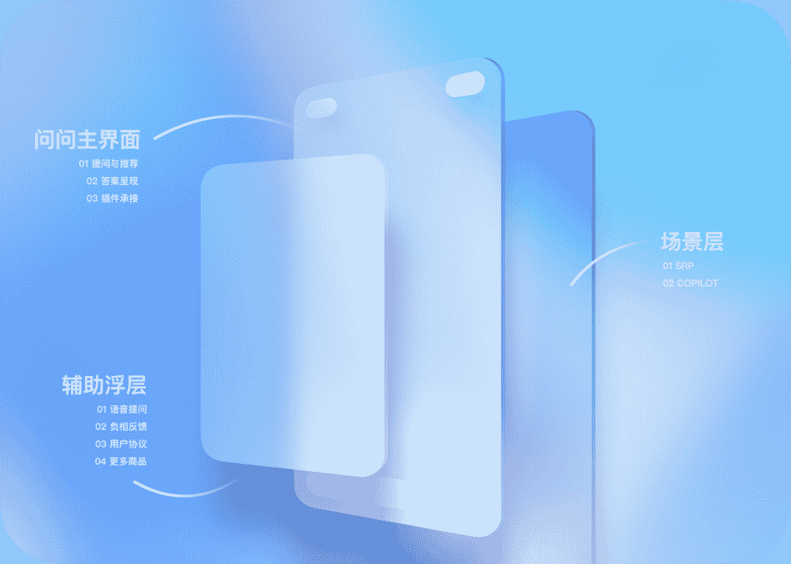

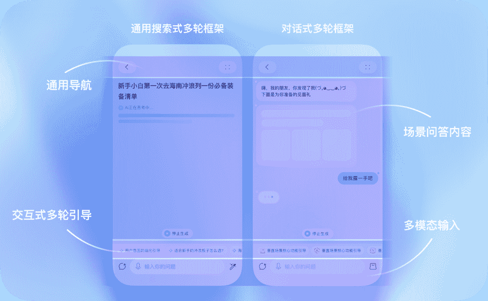

1.  **必要且互斥的基础模块单元**

问问作为搜索内全新的智能导购产品，需要覆盖的场景广泛且复杂，目前需要承接的内容模块数量有十余种，怎样在统一的体系中保持能力的差异性，将是首要解决的问题。

接下来将内容类型打散重组，可分为三种结构：小分子组合单元、大分子不可拆解单元、重组型聚合单元，以三种结构覆盖全部内容模块，并按照细分模块能力，定制结构内元素类型，得到统一且各异的基础模块单元。

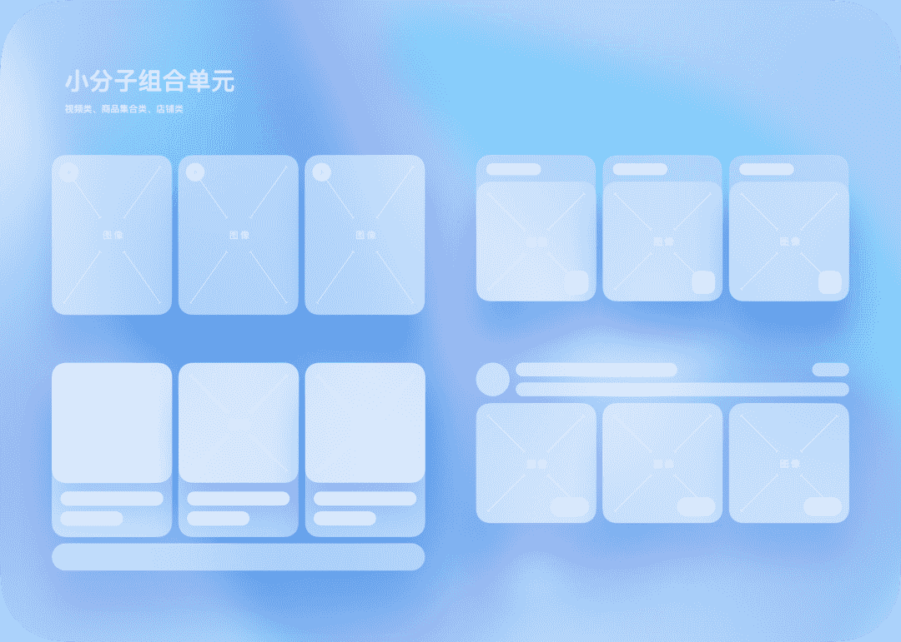

▲ 视频内容类、商品集合类、店铺集合类

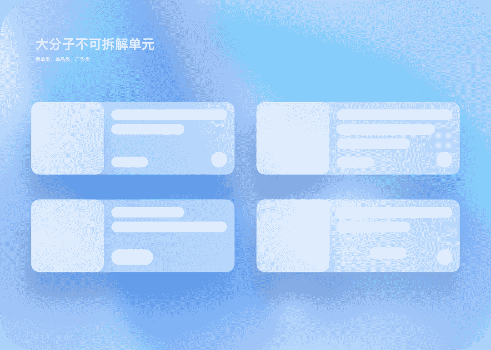

▲ 榜单类、单品解读类、广告能力承接

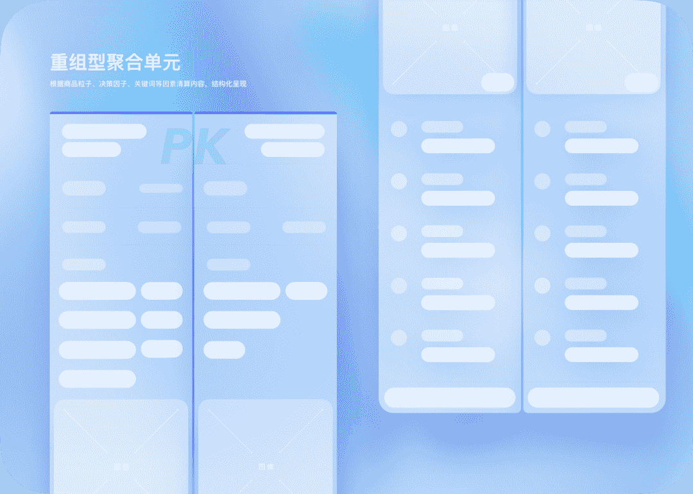

▲根据商品粒子、决策因子、关键词因素清算内容

1.  **
统一体系规则下的无缝组合体**验

在得到基础模块单元后，将其投放到页面结构中，利用6倍删格体系及严格的单元组织规则，配合具有衔接、跳转、延展等能力的元素，搭建简洁且具有规律性的页面组合，使各单元随意组合都能得到稳定且统一的浏览体验。

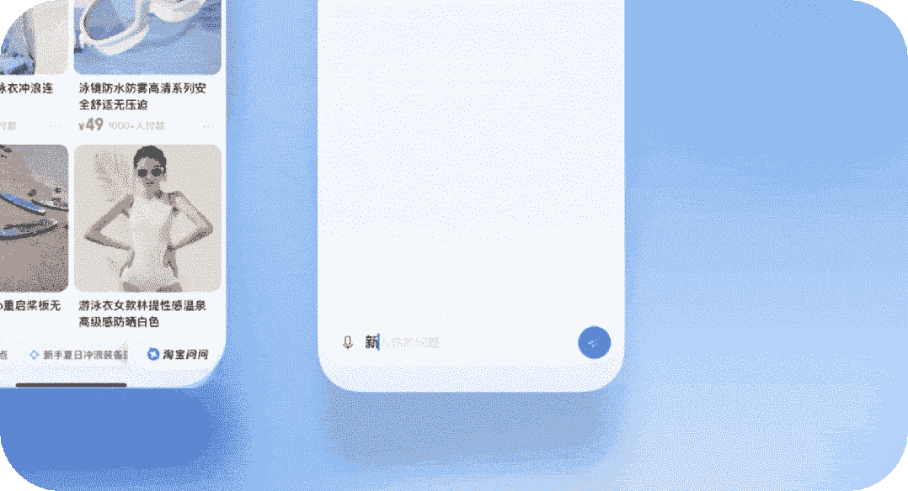

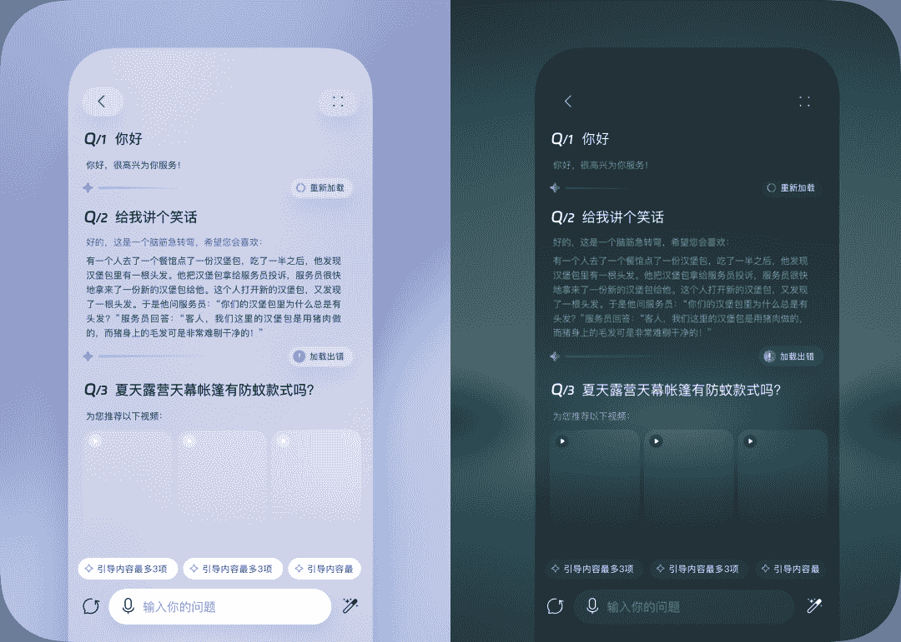

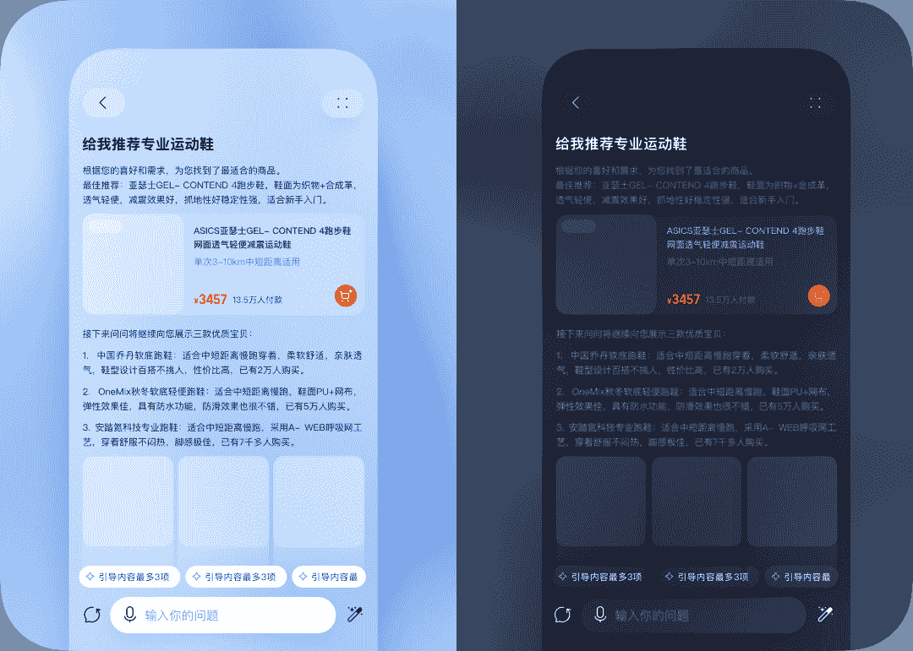

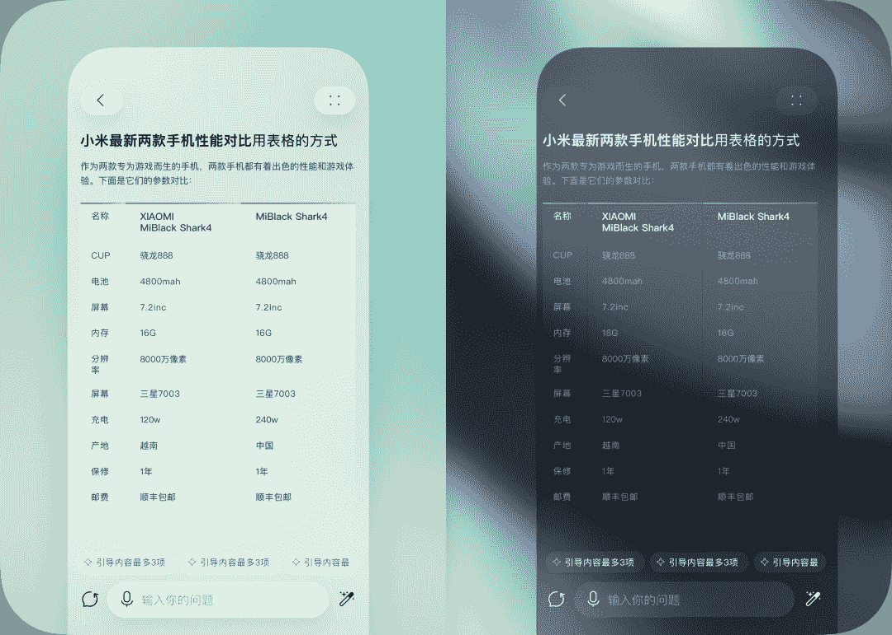

通过以上框架层和模块层的定义和体系建立，用户在问问内进行不同的类型的对话时，都能得到统一有序的导购和内容消费体验。

**

#0**3

# **更多期待**

淘宝问问目前只是手淘场景内、AI与导购的初步结合阶段，如何深度的理解AI式导购、理解用户对AI导购的期望、利用持续迭代的技术能力为前台的用户体验带来进步的提升，是我们在继续探索的方式，后续会有不同的小惊喜在过程中迭代推出。

大家对淘宝问问有任何期待，也欢迎和我们一起讨论~

<https://aiyanxishe.feishu.cn/sync/IaSadpoOOsopKab1ajKcz6z3nAb>