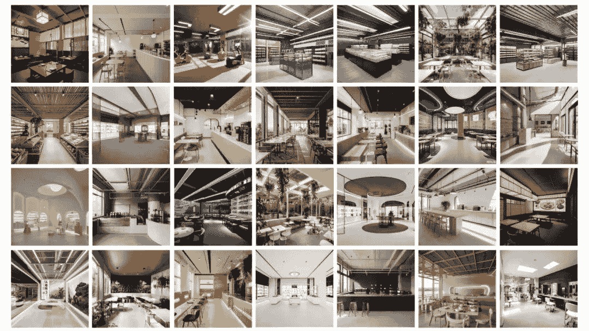
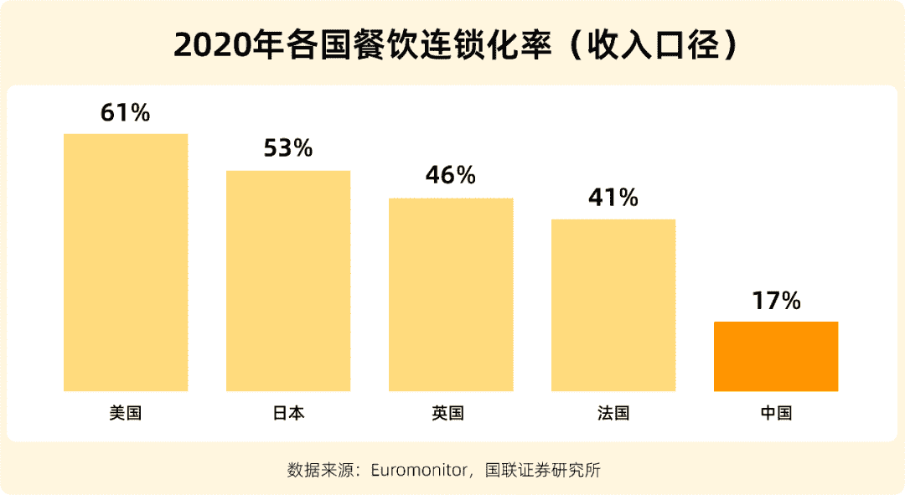
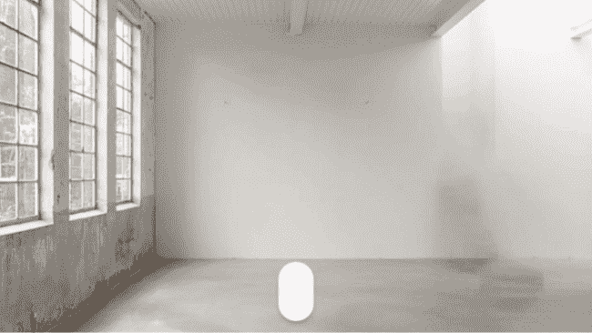

# 阿里｜AI 智能设计，品牌连锁拓展的全新打开方式

> 来源：[https://aiyanxishe.feishu.cn/docx/QGikd0auBoGQFIxqGc7cp2WFnjg](https://aiyanxishe.feishu.cn/docx/QGikd0auBoGQFIxqGc7cp2WFnjg)

AI 智能生成的店铺设计方案

在过去几年，零售餐饮等涉及民生的行业依然表现出了极强的韧性，**甚至有不少品牌逆势以成倍的速度快速拓张。相比**于个体经营，品牌连锁在用户心智、质量品控、成本采购、管理经营方面都有着极大优势。当前中国的连锁化率相较于国际发达的水平仍有不少差距，品牌连锁未来依然大有可为。

为了**能**在竞争激烈的市场中更好的发展，各个品牌在追求量的同时也更加注重质，不断向着更加精细化的管理模式前进。都说品牌连锁无小事，任何一个细节乘以连锁量级都会将成本、运营、效率等问题成倍放大。在人、货、场等不同的维度，已经有不少品牌连锁在数字化精益化方面进行了很多探索实践，而 AI 智能技术的迅速发展更是提供了更多的可能性。

## **AI 智能店铺设计**

既然品牌连锁有着高度标准化的设计与模式，从 1 到 N 的拓展复制过程中，是否有可能借助数字化和 AI 技术来实现企业的降本和提效呢？答案是肯定的。Alibaba Design 空间设计中心 正是基于这样的需求场景，结合行业经验与数字化技术能力， 为客户提供量身定制的智能化设计解决方案。

通**过前沿的数字化 **AI 技术，结合品牌自有的 SI 空间标准，只需输入设计要求和现状情况，就能立刻自动化的生成空间设计。包括设计布局（平面图），轴测，室内渲染效果，数据统计，造价预算等等过去需要花费数日，多部门来回协调的设计工作，现在都能够实时快速生成结果，并且是多个不同的布局方案，不同的风格效果偏好，以及相对应的不同的图纸数据统计信息，帮助更高效的业务判断与业务拓展。

只需输入设计需求，AI 智能自动化依照品牌空间标准生成多种风格多种方案供选择

有店铺需要设计？拍摄毛坯现状场景，描述你想要设计的店铺类型和具体要求，AI 智能就可以基于现状场景为你快速生成室内设计的效果（当前通过上上参谋App访问 AI店铺设计 功能，可免费体验）。在这里可以尽情放飞想象力，店铺适合什么样的风格，装修完成后的室内效果，都可以在这里快速找到答案。而除了对于ToC端通用化的风格生成，对于品牌连锁，也可以基于品牌自有的空间标准，定制化的训练专属 AI 模型，从而确保对于品牌用户生成出来的结果一定符合品牌视觉和设计要求的成果（当然我们也可以调整标准影响的权重，在尊重标准的同时保有灵活创意的自由发挥空间）。

输入毛坯照片，根据用户描述一键生成室内效果图

品牌连锁从前期设计到后续运营都有着一整套相对完整的规范和准则，以及相应可以参照的标准与数据，这正是进行 AI 智能化升级独特的优势**。通过对知识图谱的学习，关于品牌设计的标准、导则**等等信息都被整合在智能化的算法中。再结合具体场景需求的输入，即可快速生成多种不同符合要求的设计。这里的设计成果，既有空间效果的创意，也有平面图纸的精确，甚至BIM（建筑信息模型）的数据，都可以整合其中，并能够实现与整体数据管理平台的信息联动。

为天猫养车品牌定制化打造的自动设计工具，大幅提高拓店效率

天猫养车是阿里旗下智慧养车连锁品牌，Alibaba Design 空间设计中心从2021年与业务深度合作开始了智能工具的研发，通过新的智能**化设计可以大幅的提升设计与开店效率。过去人工需要8**小时以上来**完成的单店设计，现在仅需****要10分多种即可**完成，并且还能够提供多个不同的布局方案进行优劣势与成本造价的比选。相较于过去传统的模式，通过 AI 智能化设计将过去将过去平均单店设计周期缩短70%，整体设计费用节省超过500万，并能提供更多的设计成果和方案比选，实时的结果生成（三维效果实时渲染）和数据统计也使得业务之间的沟通更加便捷高效。

更复杂的建筑类型（如办公、产业园等等）也可以基于 AI 智能快速生成

除了常规的零售类品牌连锁，类似办公、产业园区、数据中心等等更多复杂的建筑类型也同样适用。不论是什么样的类型业态，只要有一定的品牌要求，有相应的标准和目标，就具备 AI 智能化的基础。根据业务场景的不同，Alibaba Design 空间设计中心 会针对性的提供相应数字化解决方案和工具产品，实现品牌业务拓展的快速提效。

## **AI 智能营销物料设计**

你可能已经听说过chatGPT或者AI图像生成的能力，既然复杂的三维空间都能搞定，开店后续日常运营中需要的二维平面和文字物料设计制作是否也有可能通过 AI 来完成呢？

AI 能力已经完全可以胜任这些工作，但同时我们也需要从实际应用的落地场景来具体分析。常规的 AI 可以生成效果极好的图片，但光有这一点还不够，生成的结果需要更加可控且符合品牌业务的实际场景需要。就好像空间设计中我们需要基于店铺实际大小和空间布局标准来进行设计一样，对于平面二维的物料设计，我们同样可以通过更加精细化的控制以及分层，来实现对结果内容的把控，让 AI 智能生成的内容真正可以落地使用而不仅仅只是停留在好看层面。

基于产品和关键词描述，可以快速生成一系列营销物料设计及不同尺寸的延展

**Alib**a**ba Design 的AI设计解决方案 鹿班AI，能够为电商平**台和商家提供图、文、短视频等内容的AI生成能力，同时辅助设计和创意，提高效率，扩展创意边界。帮助更多的商家用 AI 的能力找到商业的机会点，特别是用视觉的方式与用户沟通。

通过AI与大数据的结合，我们能生成最匹配、最美丽动人的画面和内容推送给目标用户，基于海量的视觉数据和人群数据可以做到场景的定制化快速生成，并更加准确的传递品牌的信息。AI 智能化带来的效能极大提升，可以使我们不光实现商品与消费者的千人千面 ，甚至从文案到图片到场景到人的千人千面，创建全新的营销模式。

## “未来已来，只是尚未平均分布”

AI** 的应用当然远不止列举的店铺设计与营销**物料设计，我们正处在一个快速变革的时代，无论是文字、二维图片还是三维空间（甚至还有短视频、音乐等等），AI 智能都有极大的应用潜力。“未来已来”，要真正发掘 AI 智能化的价值，就必须从业务本身出发，理解客户与业务场景需求。

Alibaba Design 空间设计中心 既拥有丰富的品牌行业服务经验，也有着雄厚的技术积累与研发能力，通过结合品牌业务自有的场景信息，能够提供综合的解决方案，定制化为业务进行 AI 智能化开发并交付可实际落地的成果，助力业务在 AI 时代中实现新的价值。

<https://aiyanxishe.feishu.cn/sync/IaSadpoOOsopKab1ajKcz6z3nAb>