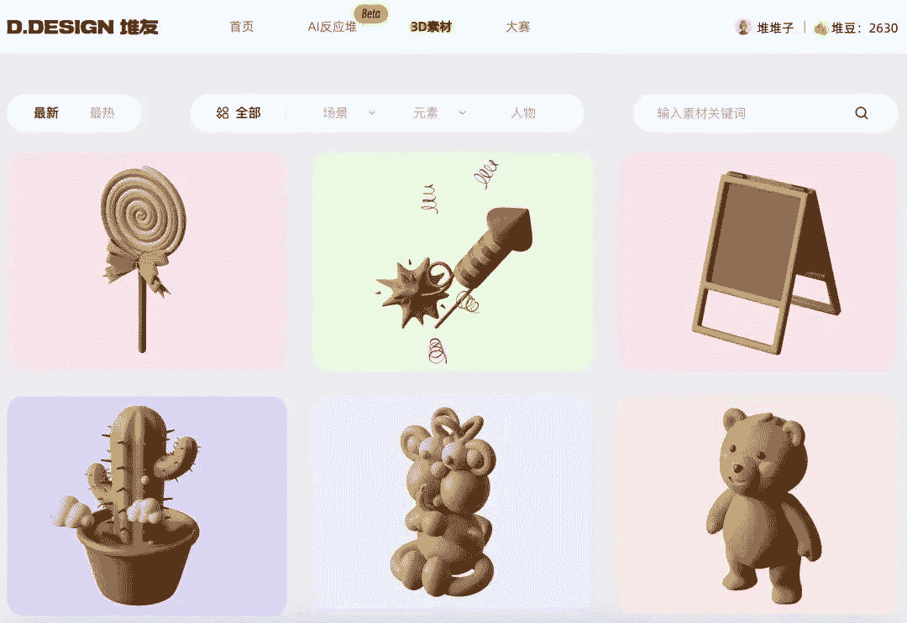
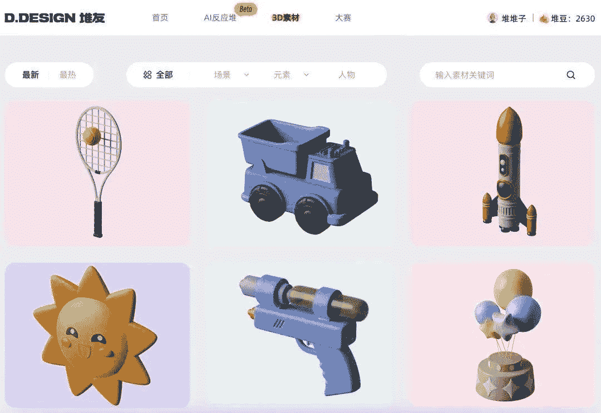
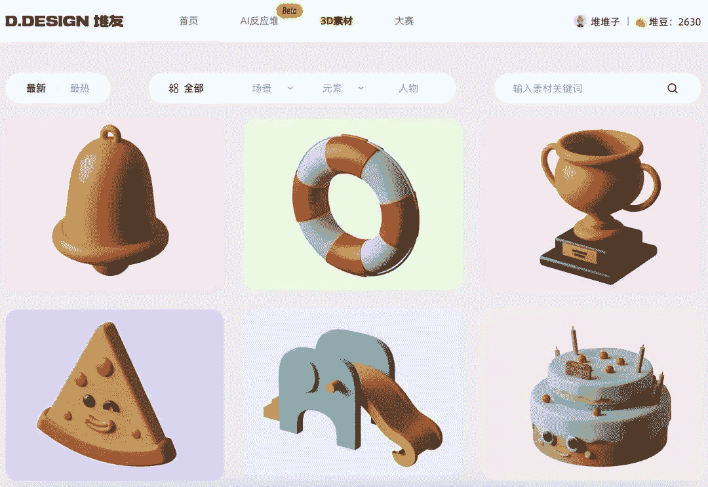
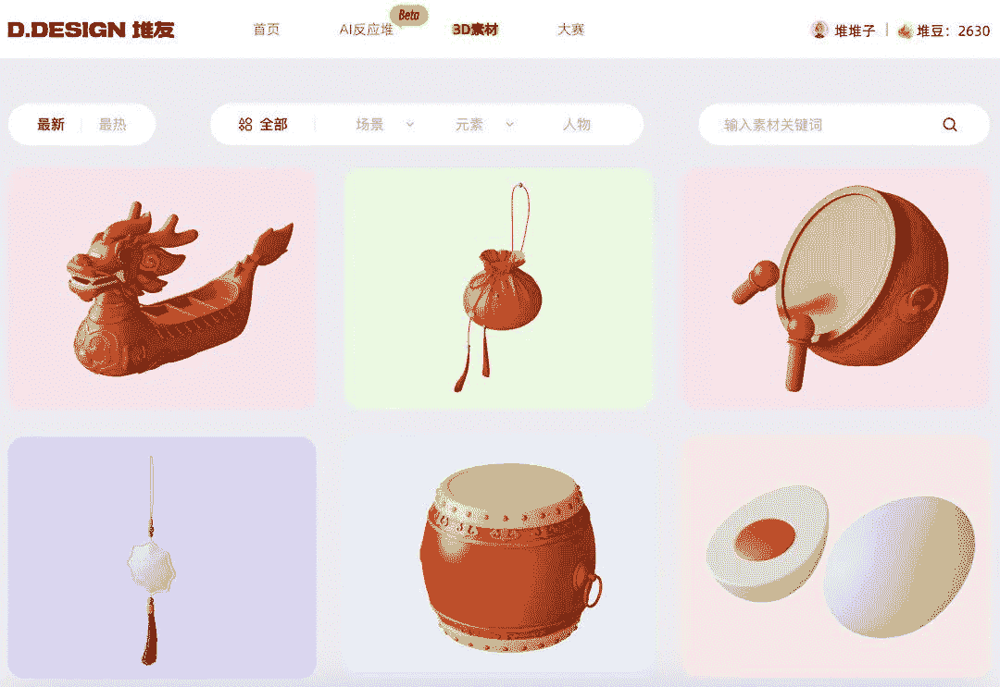
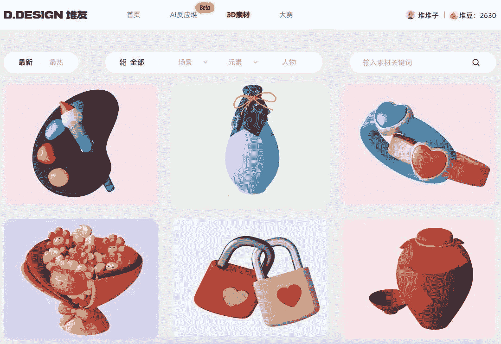
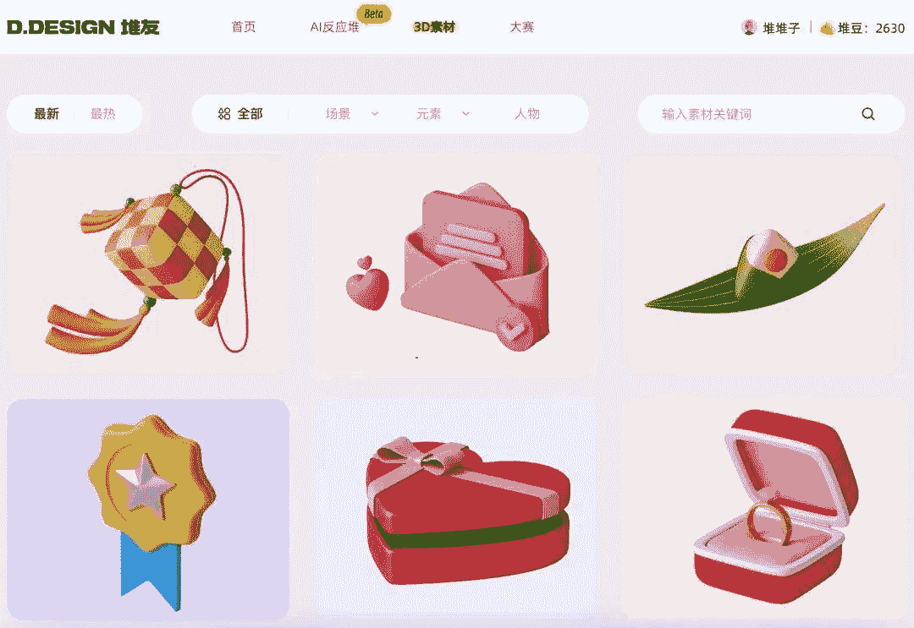

# 阿里｜免费商用3D素材狂上新+AI绘画利器咒语助手登场！

> 来源：[https://aiyanxishe.feishu.cn/docx/YCatdv5wcoVFClx0zu1cjnN7n3f](https://aiyanxishe.feishu.cn/docx/YCatdv5wcoVFClx0zu1cjnN7n3f)

随着AI反应堆热度飙升，每天**有不计其数的AI画**手在堆友挥洒创意。作为Alibaba Design旗下官方设计师服务平台，堆友上线时即让人眼前一亮的3D素材编辑器功能也在持续进化。

作为设计师找素材的神器，3D素材和AI绘画两手抓；这次，堆友又上新了哪些惊喜内容呢？来瞧瞧看！

**堆友×小仙科技 免费新素材上架**

高**品质3D素材上新****不能**停！继上期联合蚂蚁集团官方素材普惠之后，本期我们要隆重为友友们介绍一批新素材亮相，它们出自杭州八仙广告旗下的杭州小仙科技团队之手。堆友联手小仙科技，共同将这批高品质的免费可商用素材分享给大家。

▲部分新上线素材展示

堆友的神仙良心好队友是何方神圣呢？小仙科技是一支覆盖数字互动、视觉、营销的多领域业务团队，为中国平安、中免日上、浙江FM93交通之声等知名品牌提供服务，并与国内外200多家行业头部企业品牌保持深度合作关系。

其母公司杭州八仙广告有限公司聚焦全案数字营销一站式价值服务；致力于客户的业绩增长，赋能客户创造品牌价值；其也是阿里巴巴多年的的深度设计合作伙伴。

本期上架堆友的超百个3D素材由小仙团队的站酷老司机@FD粪豆带队创意，从PS进行素材设计到Blender三维软件执行建模、结构轮廓调整、纹样细节刻画、颜色材质质感测试、确保素材美观的整体过程严丝合缝，团队共耗时45天精心打磨而成。

友友们在堆友3D素材中心搜索“小仙素材”或“小仙”，即可查看这期素材的精彩内容，免费在线编辑商用——

这些素材已被成功运用在营销物料中，可适配端午中秋七夕节、西方浪漫的情人圣诞节，也能配合各种大小节庆宣传节点。只要你想得到，素材可以被随心DIY！

▲素材应用案例展示

如同堆友3D素材编辑器诞生的初衷，我们希望更多设计师伙伴能汲取堆友的免费优质供给，融入并孵化出精妙绝伦的设计作品，让每一个作品都能演绎出生动的故事。

若您的团队也有优质素材愿与堆友一同普惠，请在「堆友创意」公众号后台联系我们。

**AI反应堆咒语助手上线**

在设计的升级道路上，AI反应堆无疑也是友友们的AI设计好助手，已经有很多设计师运用AI反应堆高效生成出了他们心仪的设计素材！

如果你是新入门的AI绘画探索者，难免遇到不知如何下笔来描述关键词的窘境；如果你是成熟玩转AI绘画的专家，也可能会有词穷、灵感枯竭的放空期。这不，AI反应堆带着“咒语助手”来了！

▲咒语助手入口及部分提示词展示

目前，咒语助手涵盖了画质提高、镜头构图、人物及主体、场景道具、环境光照五大类目，罗列的都是较为常用且有效的关键词咒语。

在列表中点击心仪的关键词，即可自动输入进“画面描述”中，二次点击可取消输入。实现了“鼠标一点，生图立现”，灵感的加油站，懒人的福音，你还不来试试吗？

▲咒语助手操作展示

与其“想破脑袋”，不如点点咒语助手“借东风”，说不定有意外惊喜呢～别忘记一键发布分享到社区，让更多人领略你的大作！

**AI反应堆优秀作品鉴赏**

一周过去，AI反应堆又诞生了哪些新奇、亮眼的奇幻瑰丽大作？小堆这就奉上——

@AHang

@蛋蛋的忧伤

@SunXinYang

@诸葛闪闪亮

@鱼周

@ATbO0tdtiq

@蛋蛋的忧伤

@蛋蛋的忧伤

@vivi

@ZAKI

@小不北

@嘟嘟虫

@Lvago

@AIGC罗西

很快，**AI反应堆****又会有一项突破**你想象的新功能即将来袭；而在3D素材编辑器中，改善调节视觉效果的操作也蓄势待发。

<https://aiyanxishe.feishu.cn/sync/IaSadpoOOsopKab1ajKcz6z3nAb>