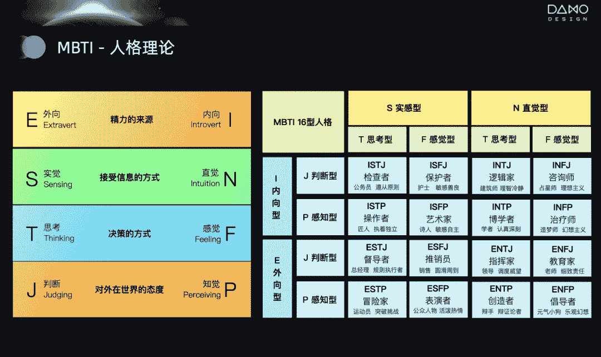
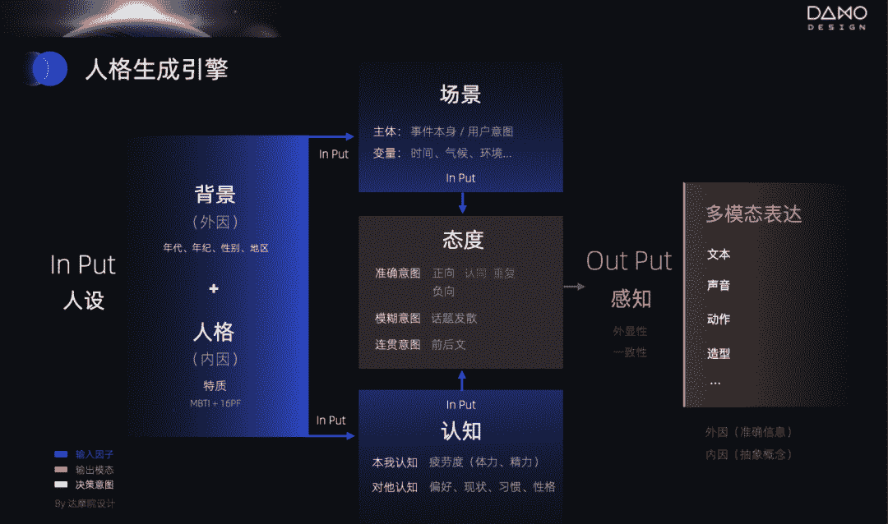
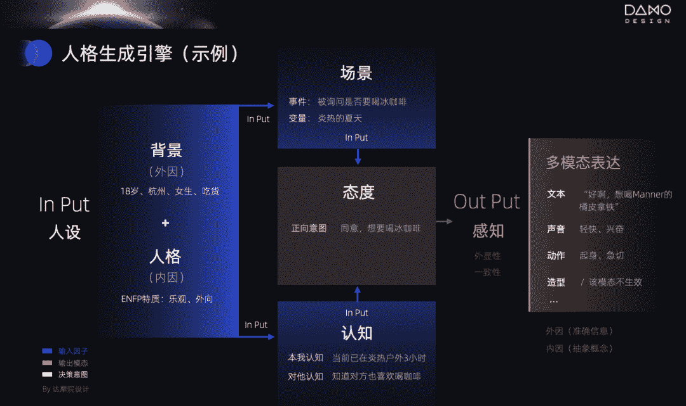
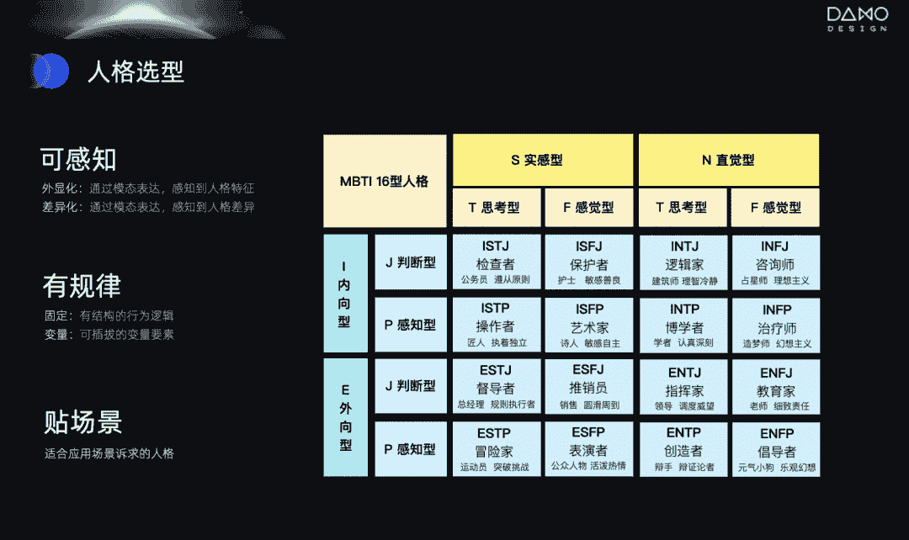
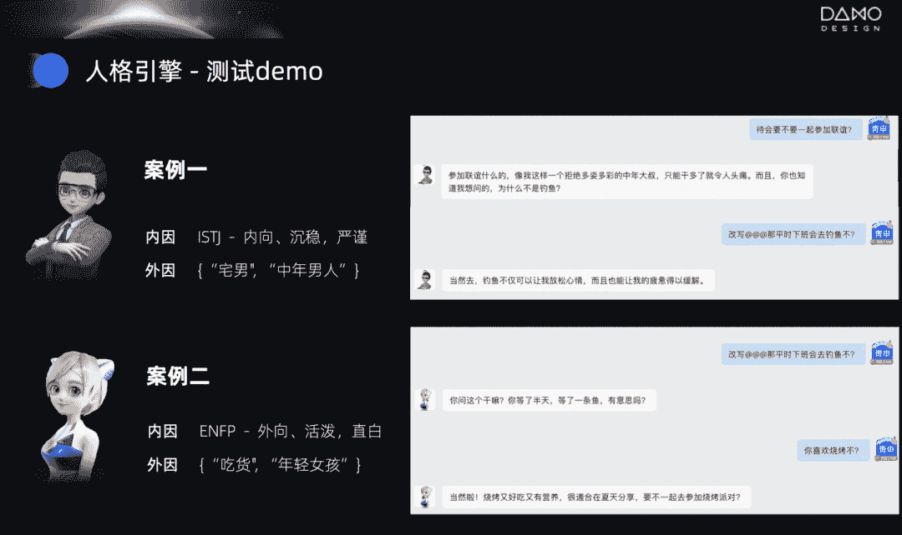

# 阿里 | 让AI更像人-人格化多模态设计

> 来源：[https://aiyanxishe.feishu.cn/docx/AFMSdvUgxosxtJx5J7DcFQ5annf](https://aiyanxishe.feishu.cn/docx/AFMSdvUgxosxtJx5J7DcFQ5annf)

当谈到“像人一样对话”的智慧体时，我们不仅会想到《钢铁侠》中那个忠诚、幽默的智能管家贾维斯，也会想到《流浪地球》中那个冷静、理智，为了人类生存不择手段的人工智能Moss。虽然它们都是AI智慧体的体现，但是它们的人格特点和行为方式却有所不同。贾维斯是一个具有人类情感和思想的智慧体，它能够表达自己的想法和情感，同时也会感知和回应托尼与小辣椒的情感需求，甚至牺牲自我。而Moss则更加理智和冷静，面对人类的未来，有自己坚信的原则，为达心中目的不择手段。

在科幻电影中，像人一样对话的智慧体为我们展现了“未来”人工智能的无穷想象，而在现实生活中，类似的ChatGPT技术也在逐渐进入我们的视野。

## **为什么AI需要更像人**

因为人与人的交互是人类“潜意识里最熟悉”的交互方式，理解成本最低、认知成本最低。

**只要GPT的交互方式还是Chat**的形态，那么“AI像人”这件事将不可避免。在这种情况下，机器人需要更加像人类，以便更好地理解人类的情感和意图，并通过潜意识的方式进行交互。 通过模仿人类的交互方式，机器人可以更好地适应不同的环境和场合，以及不同的用户需求和行为。这将提高机器人的交互效率和用户体验。同时，通过更多地了解人类的潜意识和情感反应，机器人也可以更好地理解用户的情感状态，从而更好地解决用户的问题和情感需求。

事实上，哪怕没有设定具体的人格，人们在潜意识也会“投射人格”，通过外形、声音、行为等仅有的信息，脑补出一个人剩余的人格画像，这个画像可能是错误的。而具备清晰一致的“人格”，可以让AI更像人。

## **什么是人格**

人格是指一个人的内在特质和行为方式，包括思考、情感、态度、价值观、社交行为等方面的综合表现。人格是长期形成的，受到遗传、环境、教育等多种因素的影响。人格对于个体的生活、工作、交往等方面都有着重要的影响。

MBTI (Myers-Briggs Type Indicator)是国际通用度非常高的一套人格分类方法，美国心理学家布里格斯和迈尔斯母女凯恩琳·布里格斯和她的女儿伊莎⻉尔·布里格斯·迈尔斯制定的。通过内向/外向，实感/直觉的个性型态，定义出16大类的人类基本性格原型。通过原型，我们能塑造出更有实感的人格，并以此作为性格特质的指引 ，至今广泛应用于招聘、人力、管理等各类领域。因此，达摩院设计团队以MBTI成熟的理论研究为基础，尝试让AI更像人。

## **人格化 - 算法如何定义**

区别与大多数业务场景，达摩院的业务除了可视化的产品界面需要做交互和视觉设计，还有一部分的业务是“黑盒”的算法能力产品，因此达摩院设计团队另外一个重要的工作内容是保障“算法体验”，在“无界面”的算法产品中，达摩院设计师也需要考虑算法能力的“逻辑性”与“落地性”。

（人格化生成引擎）

利用算法能力实现人格化生成的链路中，我们将输入侧的概念定义为“人设”，人设=“外因”+“内因”；内因以MBTI为基准，拆解为16个人格标准体，并匹配对应的Personality数据集；外因由年纪、地区、性别等内容组成“世界观背景”。人格类型是恒定的，但不同的“外因”世界观会使得16个人格拓展成无数的你我，成为丰富多彩的形色各人。

人格是影响行为决策的要素，**但不是唯一要素**。面对同一个事件，人的行为决策“态度”，会基于不同**的依据做出变化，故达摩院设计**团队与算法团队搭建了“人格化生成引擎”的模型结构，用于解释从人格驱动多模态的行为逻辑。

（人格生成引擎 - 事件模拟）

举例：一位ENFP（内因）的18岁杭州女生（外因），在夏天高温的周末（事件）口渴了，此刻她最想要一杯冰美式；但同样是ENFP（内因）的60岁杭州奶奶（外因），大概率会拒绝冰美式，而想要一杯茶水。因为饮食习惯与人格（内因）无关，但与年龄、地区、生活的年代有关（外因）。

如果我们将事件变量改变一下呢，即使是喜欢喝冰美式的ENFP的18岁杭州女生，在寒冷的冬天时（事件变量），此刻再问她是否需要来一杯冰美式，应该就会拒绝你了。

**故通过“人格化**生成引擎”，**将支持数字人构建各种不同的人设**，并在面对不同事件时，也能够做出符合人设、符合常理的决策行为。

### **1.1 人格选型原则**

（MBTI人格选型指标表）

在人格选型时，我们主要考虑三个原则：

**一、贴场景，**人格类型有很多，抉择时需要考虑当前业务的诉求。比如客服场景，业务需要一个稳重可靠的人物设定，如果选择了一个活泼好动的人格，则应用过程中容易给用户造成“看起来不够专业不像客服”的突兀感，需要谨慎平衡人格的表现的目标。

**二、有规律，**人格的行为逻辑必须得有固定的结构和规律（人格化生成引擎），防止人格分裂，保证人格的一致性和连贯性。同时也得支持“外因”的插拔变量，满足各种定制诉求，形成人格多样性。避免人格表达时产生“某类人永远像某个人”的雷同感。

**三、可感知，**需要考虑选中人格的表现难易度，比如“ESFP”需要依靠丰富的动作和情绪来体现“活泼好动”的特征，如果业务场景是纯文本模态（如钉钉）则要考虑落地效果能否达到预期。

### **1.2 人格生成案例**

通过人格生成引擎，我们生成了两个示例。

（人格生成引擎-示例）

示例一：内向沉稳（ISTJ）的中年男子，比较宅，喜欢独处，所以面对联谊邀约时会拒绝，但他更喜欢去钓鱼。

示例二：外向活泼（ENFP）的吃货女孩，精力充沛，性格外向，面对钓鱼会觉得枯燥，更喜欢去吃烧烤、参加派对。

从示例可以发现，面对同一个话题时，不同“人设”的反应则完全相反。

# **人格化 - 载体如何表现**

第**二个问题，人格是一**个抽象概念，在心理学中，一个人的人格往往需要通过思想、情感、行为和人际关系等方面去表现，即“人格需要可感知”。

（人格化-认知结构）

故我们在设计时，需要**通过“载体”从外而内的感知**一个人的人格，比如一个人的言语、行为、情绪、甚至潜意识的习惯。

### **2.1 人格表达的模式**

不同人，在不同场景、扮演不同身份、面对不同状况时，人格的行为决策也截然不同。因此在表达时，需要将“呈现载体”的颗粒度拆分的更加具体和详细。

（人格表达模式的框架）

人格表达的模式分为三层

##### **场景层**

场景决定了人格设计的定位，场景的本质是数字人与用户的对话关系，比如客服场景，数字人需要服务用户，解决用户的问题，属于不等关系，则对话原则应当以“效率优先、情感其次”，故设计数字人的行为习惯时，需要考虑当前场景需求的“主次关系”，在解决效率的环节，避免“情感”的过度设计；而在无法解决问题时，可以考虑让“数字人”多一些主动意识，即使拒绝用户，也要更加委婉和舒适。

##### **内容层**

对话是一种双向交流的方式，而内容是对话的基础元素，内容承载着表达的“直接意图信息”。在一个对话中，说话者和听众通过语言和非语言的方式交流信息和意图。内容可以是口头的，也可以是文字的、表情包图像等其他形式。

（话术/表情包对人格表现的差异示例图）

##### **行为层**

行为**承载着表达的“间接意图信息”**。即便一句话不说，举手投足之间，皆可表达人格特征和当前意图。

行为不止是“动作姿态”，比如在IM文本对话场景中，除了对话内容，对话过程中的操作习惯，也可以反应性格差异。

行为对人格表达的影响（示例IM对话场景）

如图示例，相同含义的对话内容，右下象限女生的输入习惯是逐句发送，显示她是一位“想到一句说一句、性格较为随性”的人。而左上象限男生的长段内容，像是思考过才发出的，看起来比较“严谨和正式”。

通过象限图拆分可以发现，如果对方回复你的内容“又长又慢**”，显示****他是深思****熟虑发送**的，他大概是一个严谨细心的性格；如果回复的“又慢，内容又短”则会感觉到对方的态度是冷漠敷衍的；“又长又频繁”则能感受到对方很重视这个话题，所以行为比较主动积极。

因此可以发现，行为也能反应人格及情绪的差异。

### **2.2 人格表达的模态**

人的感知方式是多模态的，多模态是指，视觉、听觉、触觉、嗅觉、味觉。

在人格表达中，多模态指的是使用不同的方式来表达人格特质，如口头表达、书面表达、非语言表达等。使用多种不同的方式来表达人格特质可以提高交流和理解的效率，可以避免因为缺乏足够的信息而产生误解。同时，使用多种模态也可以更好地表达深层次的信息，因为不同的人格特质可以揭示不同的思维方式和感受。

模态叠加文本、声音、动作对比的示例：

，时长00:20

（多模态对人格情绪影响的示例）

（多模态对人格情绪影响的示例）

从示例可以发现，情绪强烈、特质外放的行为，在人格表达时对动作、声音等模态的诉求更强烈。反之情绪平淡、特质内敛的人格行为，在人格表达时叠加动作和声音模态，则收益不明显。

**从价值层面，通过**情绪增**强机器意图表**达，从而缩**短用户决策时间，**进而提**升交互效率；通过**情绪增强用户情感共鸣，从而提升用户情感体验（愉悦度、满意度）。通过限定情绪表达的方式、频率、程度，增强产品人格的辨识度、一致性，最终提升用户的情感粘性及认同感。

## **结语**

如果说“聪明”是**“AI更效率”****的前提，那么“****人格化情感”就是让“A**I更易用”的必需要素。在GPT时代，如何让AI做到“人人可用、人人好用”，真正的进入人们的日常生活，是即将面临的问题。

在人工**智能的时代，设计**师作为转译算法与用户距离的桥梁，我们将协助人们更好地理解和适应AI。设计师将会帮助人们建立起与AI之间的联系，将算法转化为有用的工具，让人们更容易地使用AI。同时，设计师还将会与科学家们合作，持续探索AI的普及化，让它成为生活和工作中不可或缺的一部分，实现“AI普惠”。

Tips：本文50%文案由通义千问优化生成。 《让AI更像人-人格化多模态设计（实践篇）》未完待续

我们是**达摩院设计团队**，于2019年随达摩院而生，专注智能，前沿的高科技领域设计。团队集3D数字人、多模态交互设计、三维重建、工业设计、用户研究等能力，负责达摩院各实验室科技产品体验转译与设计研究工作，致力于打造聪明而有温度的智能创新产品。

<https://aiyanxishe.feishu.cn/sync/IaSadpoOOsopKab1ajKcz6z3nAb>