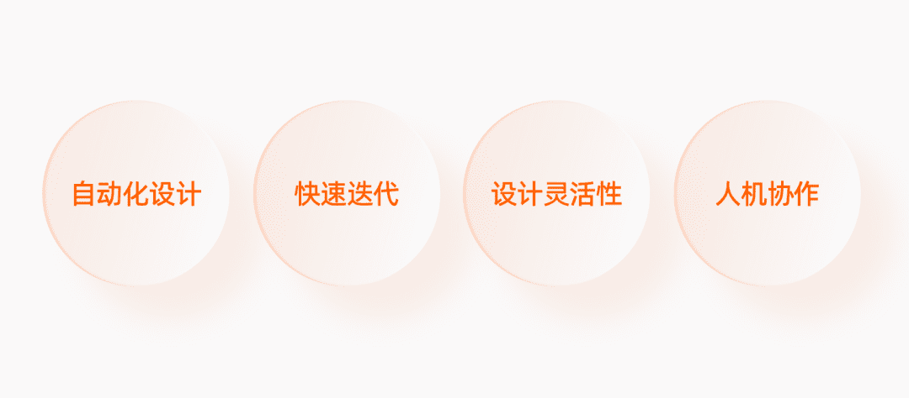
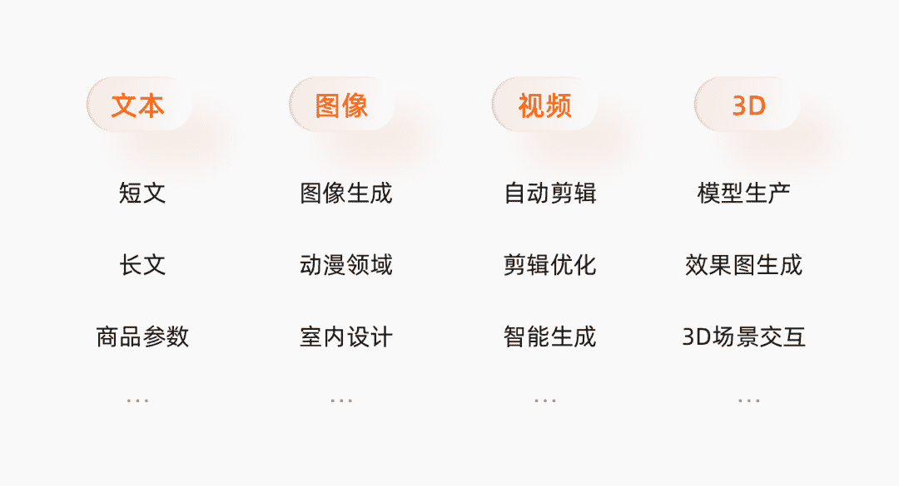
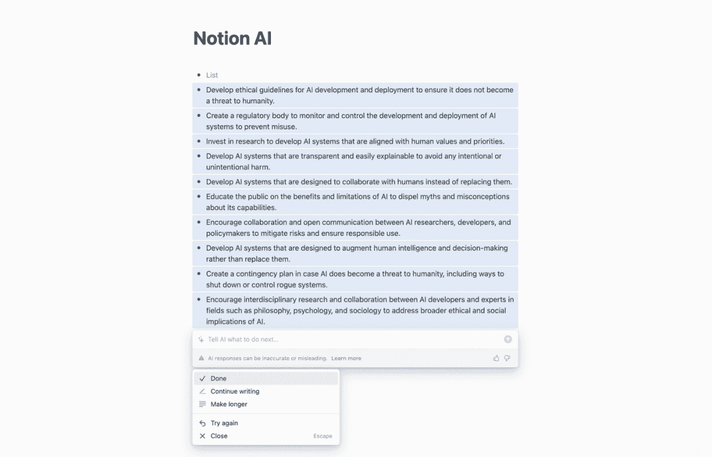

# 阿里 | 电商设计师视角下的AI解读与应用

> 来源：[https://aiyanxishe.feishu.cn/docx/Q5HtdEGpKoIlvLxLFDnckwBEnLb](https://aiyanxishe.feishu.cn/docx/Q5HtdEGpKoIlvLxLFDnckwBEnLb)

AIGC 作为一种新兴的技术，可以作为辅助提升设计的效率，也可以为设计师的创作提供更多的可能性。作为电商类产品的B端设计师，如何看待 AIGC 对于生产端：

**自动化设计：**自动生成设计方案，减少设计师劳动力成本。设计师可以将更多时间和精力集中于审查和优化设计。

**快速迭代：**能生成大量设计方案，且根据用户反馈和需求进行快速迭代。大大帮助设计师加快找到满足用户需求的最佳设计方案。

**设计灵活性：**为设计师提供灵活的设计元素，例如自动生成的图案或形状，这些元素可以用于设计，从而使设计更加多样化且易于定制。

**人机协作：**与设计师合作，提供创新的设计思路和灵感。可以通过技术合作，提高设计能力和效率。

小编从文本、图像、视频、3D四个领域结合分析，看看现在的AIGC能实际做些什么。

# **#01**

# **文本生成**

AIGC和ChatGPT是两个备受关注的模型，但他们的应用场景和生成内容的方式有所不同，AIGC有文本、音频、图像、视频及图像、视频、文本间的跨模态生成等；而ChatGPT目前只是文本生成。

ChatGPT是基于自然语言处理的人工智能对话模型，它可以模拟日常对话方式与用户进行交互，对问题进行语义理解和逻辑推理，最终生成与之匹配的回答。ChatGPT主要应用场景是智能客服、智能助手、智能语音交互等，可以提供更便捷、高效的服务。

仅以文本生成为例，分享几个AI文本写作类辅助工具。

# **01. ****Notion AI**

在Notion中通过空格键触发下拉框中的AI功能选项，功能大致可以被划分为三块：内容创作，基于已有内容的优化，个性化的内容生成。

当你拿到这个题目但完全不知道如何下笔之时，你可以选择Notion AI的“头脑风暴”的选项，它能够迅速帮你列出一些与这个主题相关的要点供你寻找灵感。

▲ Notion AI根据主题生成的头脑风暴要点

当然，你还可以用它来创作更多的其他的文字内容，包括写工作总结、一键制作表格、快速生成简历、邮件等等。当你选择不同的模式时，Notion AI给你的格式和语言模式也完全不同，并且速度非常快，通常在5-30秒之内就能完成文案的全部输出。

▲ Notion AI一键生成招聘职位描述

▲ 为双11大促营销活动写一段宣传语

# **02. ****阿里妈妈悉语智能文案**

悉语智能文案是阿里妈妈创意中心出品的一款一键生成商品营销文案的工具。可通过直接天猫或淘宝平台上的商品详情链接，可直接生成商品营销文案，种类包含场景化文案、内容营销文案和商品属性文案。

▲ 阿里妈妈悉语文案

# **03. ****COPY.AI**

社交营销文案写作助手，不仅是一款简单的文案写作工具，更是一个智能化的营销策略大师。它能够帮助轻松制定吸引人的营销文案和策略，让你的品牌更快速地传播。

▲ COPY.AI

# **#02**

# **图像生成**

智能生成图像在电商场景下已经应用多年。过去智能生成图像在电商场景主要应用在海报、banner的制作，制作非常依赖模版，对于提供的素材也只能简单的抠图处理。随着AIGC的发展，生成图像不再是对现有模版素材的组合替换，而是基于创作意图的重绘，生成结果甚至可以真实摄影的效果。

▲ 基于模版的生成 - Canva 可画

# **01. ****Midjourney**

值得一提的是Midjourney，在AI图像生成中，功能全面，生成速度快。在2022年，一名游戏设计师Jason Allen通过Midjourney创作画作《空间歌剧院（Théâtre D'opéra Spatial）》，在博览会的艺术比赛中获得第一名，当时的获奖也是冲上热搜，艺术家和艺术爱好者中引发强烈争议。但无论认可与否，新的艺术创造时代正在来临。

▲ Midjourney生成《Théâtre D'opéra Spatial》

**1）优化商品展示：**通过对图片进行算法优化，可以提升商品图的清晰度和氛围感，生成高质量的商品展示页面，展示商品的细节和特点，从而提高商品的吸引力和购买率；

▲ Midjourney生成一个香水的商品主图（来源于网络）

**2）虚拟模特试装：**上传服装平铺图片，使用虚拟人穿上服装并做多角度展示，减少使用模特的拍摄成本。

▲ Midjourney基于一件针织衫生成模特图（来源于网络）

**3）虚拟展示：**通过人工智能生成图片，可以在不需要真实展厅的情况下，为用户提供虚拟的产品展示和体验，让用户通过VR设备更加身临其境的感受。

▲ Midjourney生成（来源于网络）

**4）基于消费者的合成图片生成**：人工智能可以用于生成与消费者面部特征相似的虚拟合成图片，从而提高消费者的购物满意度和忠诚度。

**5）使用风格和趋势生成图像创作**：通过研究市场趋势和消费者喜好，确定新商品的主题和风格。

收集并整理关于新商品的信息，例如产品图片、文字描述、用户反馈等，构建产品数据集。使用深度学习，生成初始创意草图。调整创意草图：根据主题和风格的要求，对初始创意草图进行调整和修改，确定新商品的外观和设计。

# **02. **Stable Diffusion

是最流行的文本到图像的AI生成器。是一种开源模型，可宽安装在家用电脑上的AI绘图工具，可以在几秒钟生成高质量多图像的图像生成器。一些基础能力可以快速使用在日常设计工作中，比如它可以将低分辨率的图像提高四倍。

▲ Stable Diffusion提升分辨率（来源于网络）

通过现有图像，进行推理，对图像信息进行深度分析，创造新的可能性。新的模型会保持图像的原有结构，生成与之不同的表达。

▲ Stable Diffusion图像生成（来源于网络）

# **#03**

# **视频生成**

前面我们已经了解了及文本转图像模型的midjourney，而随着人工智能的不断升级，文本转视频的工具也被开发出来，meta和google等公司都在研究此项技术。AI视频工具的出现彻底颠覆了传统的视频制作和剪辑方式，视频创作者不再需要花费大量的精力寻找视频、滤镜、音效等素材，甚至可以凭空生成一段炫酷的视频。

# **01. ****RUNAWAY GEN-1**

人工智能视频编辑软件提供商RUNAWAY，近日发布了全新的AI模型“GEN-1”的相关信息，目前该模型可以实现五种不同类型的任务：

模式1 - Stylization风格化:用户上传一段视频并添加一张风格图像，该模型会根据上传的图像风格把原始视频转换为一段相似风格的动。

▲ Stylization风格化

模式2 - Storyboard故事板：把实物模型转换为任意风格的动画，这个功能和AI图像工具相似。

▲ Storyboard故事板

**模式3 - Mask面具：**只需输入一段文字指令即可实现文本修改视频的功能，如下图示意，可以直接将一直普通的小狗变成“斑点狗”。

▲ Mask面具

**模式4 - Render渲染：**上传文字和图像就可以轻松渲染出模型

▲ Render渲染

模式5 -Customization：上传一张图像就可以把视频中的人物替换成图像中的动画模型。

▲ Render渲染

# **02. **Google imagen Video

看完文本转视频的能力和应用场景，让我们欣赏一下影视特效级的AI视频作品。

这是来自Google imagen Video的案例，参考梵高的绘画风格生成小猫在吃东西的画面。梵高绘画本身属于印象派风格，当下AI生成视频精度还不是很高，生成为印象派作品生成恰恰能够掩盖掉一些瑕疵，使得作品看起来非常完美，还记得梵高那部电影吗？由此可以想象，如果希望把几位印象派大师的作品演绎为电影，在制作上将会变的非常高效。

▲ Google  imagen Video生成梵高风格视频

▲ 《梵高》电影画面

# **#04**

# **3D生成**

AI 生成的 3D 内容指的是使用人工智能算法来创建三维视觉内容。这项技术已被用于创建逼真的物体、环境和角色图像和视频，这些图像和视频看起来是三维的，用户可以与之交互。

AI 生成的 3D 内容有几个应用，包括视频游戏、虚拟现实和增强现实体验，以及电影和电视的计算机生成图像。AI 生成的内容还可以用于建筑、产品设计和工程等领域，在这些领域中，它可以帮助设计师和工程师在三维中可视化和测试他们的想法。

AI 生成的 3D 内容有可能彻底改变我们创建和与视觉媒体交互的方式，它的应用也会变得更加广泛。

# **01. ****Luma AI **

Luma AI 是一种人工智能图像编辑工具，它可以自动调整和优化照片中的亮度、颜色、对比度和其他方面，从而提高照片质量。这个工具使用了深度学习技术，能够自动识别照片中的物体、背景和光线条件，然后根据这些信息进行自适应的图像处理。与传统的图像编辑软件相比，Luma AI 更加智能化和高效化，可以在短时间内对大量照片进行批量处理。

Luma AI 可以在例如商品主图上传中去使用这样的新型AI技术来帮助更好的表达商品。

▲ 从多张图片生成3D模型的过程（来源于网络）

# **02. ****PifuHD **

PifuHD 是一种基于深度学习的三维重建工具，它可以将多个照片或视频中的物体重建成精细的三维模型。这个工具使用了深度神经网络技术，能够自动识别照片中的物体轮廓和纹理信息，并基于这些信息进行三维重建和纹理映射。PifuHD 可以应用于三维动画、虚拟现实和游戏开发等领域，为用户提供更加逼真和细致的三维模型和场景。

▲ 通过1张照片就能生成3D模型（来源于网络）

# **03. ****Dream Fusion**

Dream Fusion是一款基于深度学习技术的图像合成工具，它可以将多张图片或视频合成为一张高质量的图像，从而实现场景融合和背景替换。这个工具通过深度神经网络对图像进行语义分割和特征提取，然后通过图像合成算法将不同图像的特征融合在一起。Dream Fusion可以应用于电影制作、广告设计、艺术创作等领域，为用户提供更加自由和创新的图像处理和合成方式。除了图像合成功能，Dream Fusion还支持多种图像处理操作，包括去除水印、消除噪声、图像修复等。

▲ https://dreamfusion3d.github.io/ （可在线互动尝试）

# **04. ****Opus.ai **

Opus.ai 正在设计一款文本到游戏的工具。用户输入的文本描述越精准，3D场景内的细节越多，且生成的3D场景是可以直接进行交互的。

▲ 图片来源：Opus.ai 官网

# **最后**

需要注意的是，AIGC技术尚未完全取代设计师的作用，而是作为辅助工具和平台，帮助设计师更好地完成设计任务。作为设计师，在面对新技术时，需要不断学习和调整自己的思维方式和工作方式，以适应新技术所带来的变化。

<https://aiyanxishe.feishu.cn/sync/IaSadpoOOsopKab1ajKcz6z3nAb>