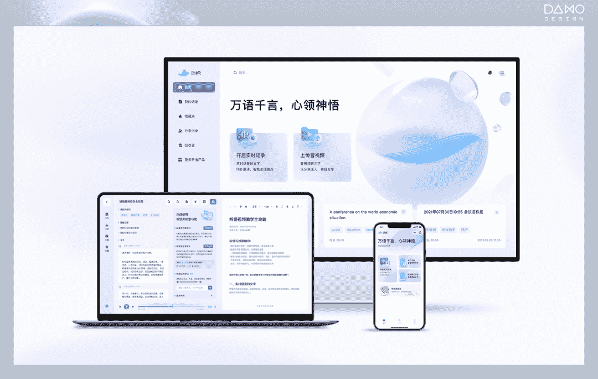
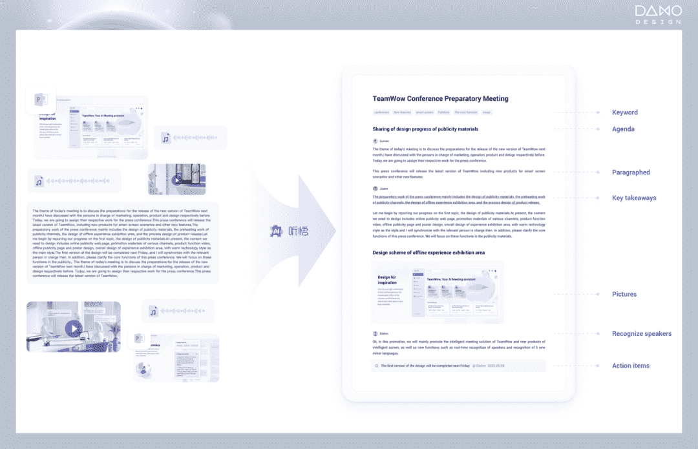
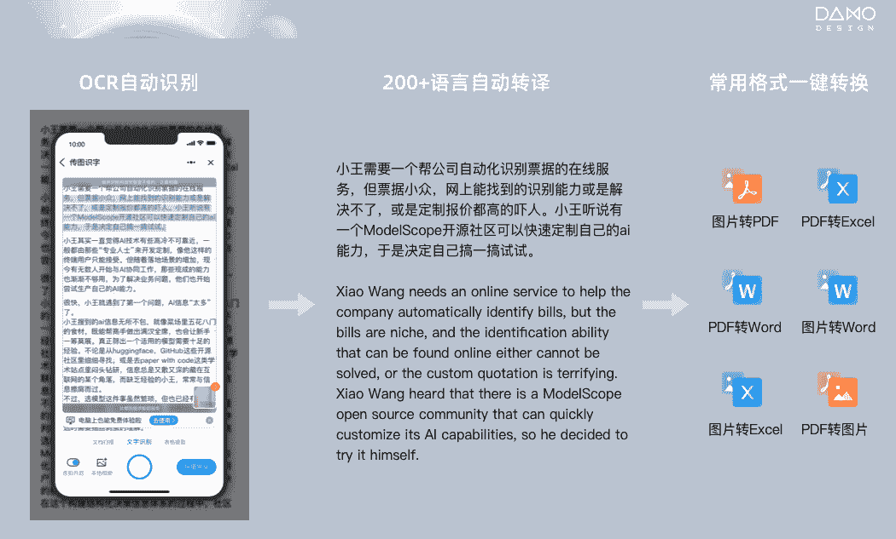
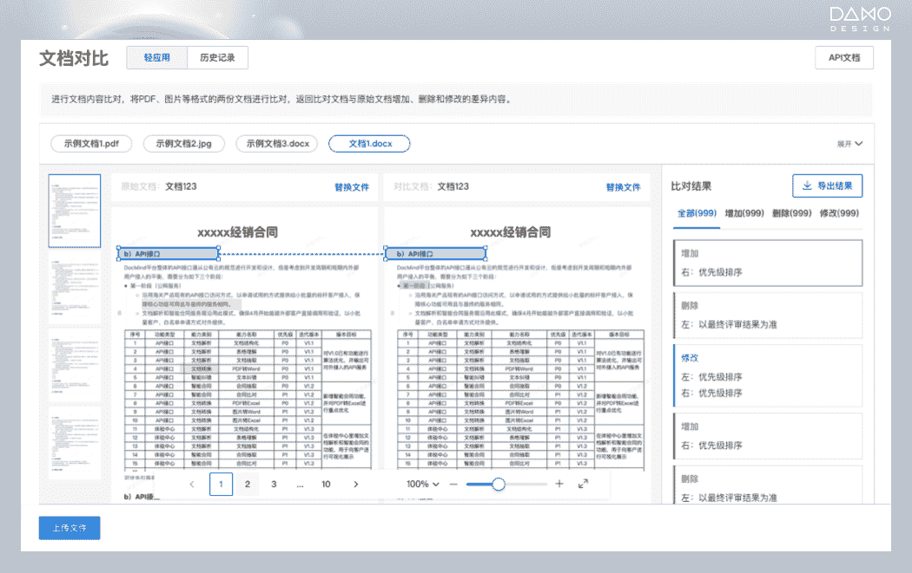

# 阿里 | AI引领，畅想未来办公的无限可能

> 来源：[https://aiyanxishe.feishu.cn/docx/DWAJdU9akoDc3sx3sFScaDiln2g](https://aiyanxishe.feishu.cn/docx/DWAJdU9akoDc3sx3sFScaDiln2g)

##

## **引言**

当原始人将树枝削尖，远远射中远方的猎物，以满足自身温饱，人类就开启了在大自然下的“工作”历史。走过狩猎的进程，穿梭在一簇簇麦田里，微风轻拂麦田，麦香飘散，人们在田野上开辟了自己的又一个工作空间。当工业时代随着瓦特制造出第一台蒸汽机猝不及防地来到人们身边，人们的工作，开始走进了一个个“小方格”，人与人之间的交流变得多了起来，而“工作”也从单向的“输入劳作”，慢慢升级为“沟通交流、传递信息“。

让我们把时针拨到现在，当信息化时代踏着无数串代码，以更加智能地方式来到我们的生活中，智能化产品被赋予了更多机会深入到人们的日常生活中。如今的信息化时代，人们在办公中需要解决的核心问题，不再仅仅只是向自然的探索、对机器的熟练掌握，而是让信息能够在人与人之间、人与物之间更有效的传递。

**当人们**身处不同办公空间，我们是否有机会可以打破空间的束缚，让信息自由流转在不同空间，让人们体验到跨空间的自然交流体验？当人们在工作中，被纷繁冗杂的信息所淹没，我们是否能够帮助人们将信息有效规整，减少重复性的耗时，让人们可以从机械性的信息处理中解放出来，直达工作核心？

达摩院设计团队从以下几个场景切入，以智能化为切人点，从**未来视角给大家提供未来办公设计的可能性。我们让智能产品能够更加深入地参与到未来办公的场景中，让用户在未来能够更加友好地和智能产**品合作，加快信息在不同媒介中的传输效率。打破空间束缚，提速信息处理，减少时间成本。让人们在办公中，能够享受高效流畅的信息传达，以构建一个更加高效的未来办公体验。

## **未来的沟通交流——便利且高效**

你是**否期待过，未来有一天，无论你的工作伙伴来自哪个国家，拥有什**么知识背景，相隔多远，你们都能以自己习惯的表达方式，表达自己的观点，而不用担心对方听不懂听不清看不懂看不清等问题？随着智能化产品来更多地参与进办公场景，达摩院希望可以为大家提供便利且高效的沟通体验，提升办公效率。

人们都希望可以通过沟通，达到彼此信息流畅传递、情感通畅、并最终达成共识。达摩院利用智能化套件，帮助大家打破距离、语言，无论人们从任何地方加入，都能在一个地方进行沟通。面对语言的不同，达摩院有200多种语言互译能力，同时为了沟通的及时性，我们也拥有实时翻译能力，让来自世界各地人们的沟通都便利且零障碍。而面对知识背景的不同，在沟通中配备个人助理，进行实时的词汇转译，让人们可以通过各种方式快速了解该内容的含义，减少因为知识背景带来的代沟。面对表达形式不同，无论是语言、肢体、画面、视频，都可以通过技术的转译，转变为对方习惯的形式去获取这些信息，确保双方的表达和获取信息的自由与效率。

听悟，你的会议AI助理（体验链接：https://tingwu.cn）

<https://v.qq.com/txp/iframe/player.html?origin=https%3A%2F%2Fmp.weixin.qq.com&containerId=js_tx_video_container_0.058754783070351646&vid=d3370pezcdh&width=677&height=380.8125&autoplay=false&allowFullScreen=true&chid=17&full=true&show1080p=false&isDebugIframe=false>

当拥有了信息交换的自由，达摩院也希望让大家更加高效地和伙伴们达到共识。我们能够帮助大家把交流中丰富的信息，更简要精准的提炼出来，让大家更快速的对齐彼此表达的观点是否在同一共识下。达摩院通过NLP技术，将对话中不同场景的关键内容进行抽取，在沟通中辅助大家逐渐集中到核心讨论点上，更快速的达成共识。

音视频文档智能整理（体验链接：https://tingwu.cn）

每一次的沟通其实都是为了推进事项的进展，定位每次沟通的结论和重点，达摩院利用智能化能力，将其集合起来，让办公中的沟通，信息沉淀为一个人、一个项目组、一个公司的知识，让人们可以在智能化产品的帮助下，拥有高效便利的沟通体验。

##

## **未来的文件处理——准确且轻松**

你是**否**期待过，未来有一天，面对大量纷繁复杂的文档文件、办公中的日常信息，一次轻轻的鼠标点击、一次简单的拖拽，所以难题迎刃而解？除了人与人之间的信息，在办公中，人们也需要从各种媒介中获取大量信息。达摩院利用智能化的文档AI，帮助人们将信息有效规整，通过减少重复性的耗时，让人们可以从机械性的信息处理中解放出来，直达工作核心。

办公中，所有复杂的信息往往通过一个个文档传输到人们眼前。未来，达摩院希望可以把人们从繁杂的信息中解放出来。我们让智能文档助理来到办公人的身边。它包含了图像识别和对应的后处理能力，能够使用OCR及语义理解等能力从多种媒介中自动化的提取信息，并进行格式转换，大纲提取，多语言翻译等多种后续处理，替代完成工作中大量的机械化整理工作，或让员工具备更多高阶技能。

AI文档，OCR 自动识别 （文档AI体验地址：钉钉搜“传图识字”小程序）

我们所提供的文档智能化处理对应大量碎片化AI能力，通过聚焦在OCR这个核心能力，在内容提取过程中引入其他能力分支，同步解决不同问题。让人们可以在简单的路径中，快速完成繁琐多线程的文档处理任务。同时，通过提供“载入-处理-看结果”的流畅框架操作路径，人们可以清晰清晰地了解目前所处的节点，在智能文档助手的帮助下，快速操作处理信息。

文档对比功能 （文档AI体验地址：钉钉搜“传图识字”小程序）

未来我们希望这一系列的文档智能能力，能够真的像助理一样分担日常工作，就像一个钉钉上的同事一样，发过去文件，拿回来结果，帮助员工办公时高效处理文档。

## **未来的信息获取——流畅且精准**

伴随着伙伴们轻松的沟通环境、对繁琐文档的简单处理，人们的办公体验将会得到飞跃般地提升。而随着企业规模的扩大，企业对员工的服务内容也更加繁琐。未来，**作**为企业员工之一，我们有机会只需要通过一句简单的问句，所有难题，都将快速得到回应。当员工们在企业内所需要的诉求越来越多，人们也不需要通过层层询问以获得这些信息。达摩院的智能机器人，让员工们在办公时遇到的问题，能够在智能产品的助力下，流畅且精准地获取信息，成为提高员工们获取信息效率的一个有力帮手。

我们为大家提供的智能对话机器人，通过整合语音通信、即时聊天、大数据能力等能力，为企业提供全触点智能服务管理，帮助企业降低服务成本，提升服务效率。通过智能对话机器人，员工们可以在自然流畅的对话交互链路中，从机器人中简单、快速地获取自己想要的信息。在自然的互动，流畅的体验中，人们不再担心获取信息的复杂度，问题可以轻松精准地被解决。

员工助理智能机器人

未来，我们相信越来越多的智能对话机器人可以成为企业的办公助理，回答员工的大部分咨询问题。在未来的办公场景中，人们在企业内部所遇到的繁琐问题，再也不需要人工的介入，机器人可自主回答。而智能机器人将成为企业员工最得力的助手，人们可以快速地获得自己需要的帮助，而企业也可以解放人力，让员工有机会去投入更有意义的工作中。

## **结语**

人们的办公，从森林到农田，从工厂到写字楼，每一次场景的升级都伴随着时代发展的进程。如今，人工智能正以超出我们想象的速度茁壮成长，而随着它逐渐融入我们的生活当中，在未来，办公场景中也必然会有**越来**越多的智能化产品的介入，并极大地提升办公效率。在以冗杂纷繁信息传递为核心的办公场景下，随着智能化的到来，达摩院更期待和所有设计师一起，以多种交互方式为切入点，结合多模态设计，将用户体验放在第一位。让用户能够更加友好地与智能产品进行合作，以提升办公效率。打破空间束缚，提速信息处理，减少时间成本。让人们在办公中，能够享受高效流畅的信息传达，以构建一个更加高效的未来办公体验。我们相信，在未来的办公场景中，人们可以在设计师的助力下，与智能产品建立更加亲密的合作，以享受到更加高效的办公体验。

我们是**达摩院设计团队**，于2019年随达摩院而生，专注智能，前沿的高科技领域设计。团队集3D数字人、多模态交互设计、三维重建、工业设计、用户研究等能力，负责达摩院各实验室科技产品体验转译与设计研究工作，致力于打造聪明而有温度的智能创新产品。

<https://aiyanxishe.feishu.cn/sync/IaSadpoOOsopKab1ajKcz6z3nAb>