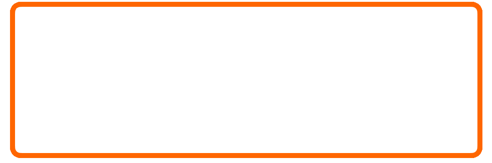
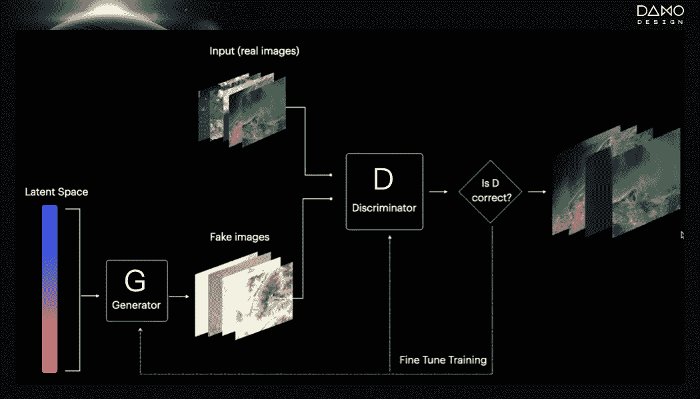
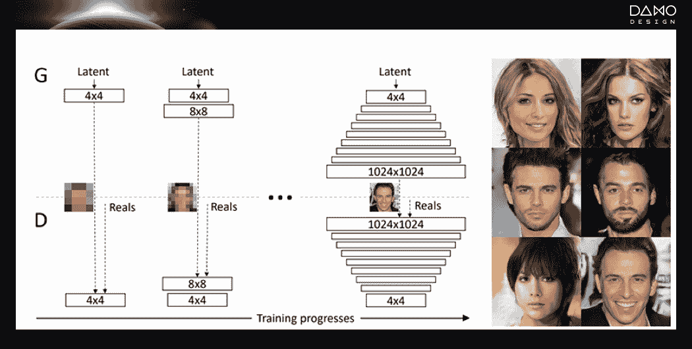
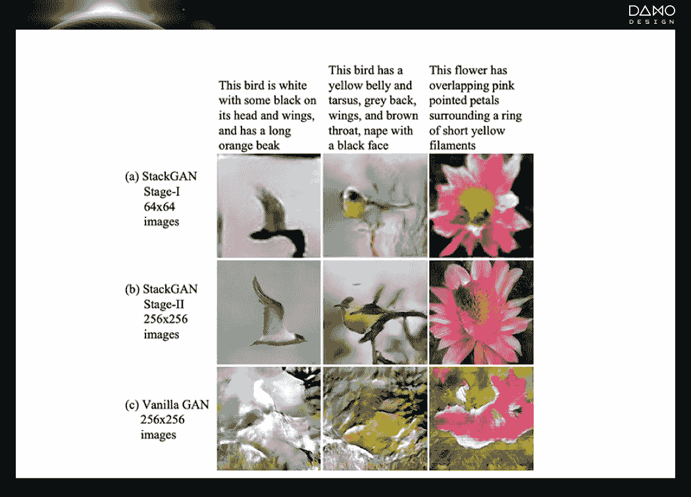
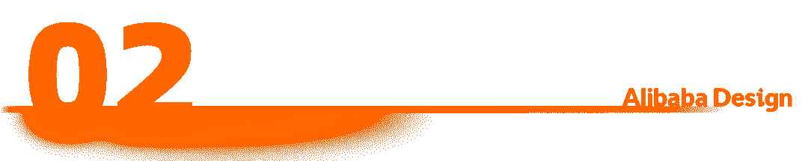

# 阿里｜当AI成为大众的新朋友

> 来源：[https://aiyanxishe.feishu.cn/docx/Mgxedz7lToiKbwxGk5zcmywGneh](https://aiyanxishe.feishu.cn/docx/Mgxedz7lToiKbwxGk5zcmywGneh)

# **引言**

当漫步于卢浮宫，我们穿梭于无数艺术画作中，你是否期待有这样一位画师，为你记录下独一无二的瞬间，让自己如同画中人一样，给这个世界留下一份凝视与回眸？当走进国家图书馆，我们打开书本跨越时空，面对万千世界的无垠知识，你是否期待有人可以读懂你的想法，陪伴你一同探索世界？当意外闯进J.K罗琳为我们创建的霍格沃茨魔法学校，你是否期待有人可以为你递上一根魔杖，如哈利波特一样，让所有平面之物跃然纸上？

这些曾经需要我们跨越时空去触达的历史、需要我们展开想象触碰到的未来，在人工智能的发展中，随着不断迭代的算法能力，悄然来到我们的身边。AI（Artificial Intelligence）, 这个由无数精准算法构建起的抽象能力，正慢慢具象化，成为了人们身边，拥有特殊技能的好朋友。它可以是画家，是作家、也可以是魔术师，与我们共同描绘着关于未来的无数可能性。

# **一、写实派画家——GAN**

还记得**维米尔笔下那位《带珍珠耳环的少女》给我们留下的那份**恬淡从容的微笑吗？那份回眸穿越历史的长河，轻轻敲开我们的心房。也许我们每个人都期待过成为那位少女，能够成为某位画家笔下的模特，将自己的模样融于画家的画布中，在世界上留下自己真实而美好的记忆。今天，GAN（生成对抗网络 / Generative Adversarial Networks），便像是我们这个时代的写实派的AI画家，只要将我们的照片提供给这位写实派AI画家，它便能基于我们的照片，结合画家的风格，模仿真实照片生成新照片，“画出”我们美好模样。什么是GAN呢？它由两个网络组成，Generator和Discriminator。首先，我们需要给GAN输入一系列来自真实数据的input。接着，它会利用latent space在Generator中生成假的图片，在第二个网络Discriminator中，和真的图片进行对比。起初，Discriminator很容易分别真图片和假图片，而Generator会不断通过Discriminator的反馈，优化自己生成的假图片。最终当Discriminator没办法识别真图片、假图片的时候，我们就可以提取出假图片作为最终的产物。

GAN算法原理示意图

我们可以把GAN想象成一个画家。Discriminator就如它的大脑，Generator就如它的画笔。首先，它需要大量的input作为自己的绘画灵感，将这些绘画灵感沉淀在自己的大脑（Discriminator）中。接下来，它会利用它的颜料（latent space），在Generator中完成创作。创作出来的假图片（fake image）会在Discriminator中和它脑海中收集到的灵感图片（input）进行对比。如果“画”出的图片和脑海（Discriminator）中的图片不匹配的话，GAN这个画家会继续用Generator“画出”假图片（fake image）。直到它的大脑（Discriminator）无法识别GAN自己画的图片和它原有的图片之后，GAN可以心满意足地提取出自己画出的图片，完成绘画的过程。这样一个具有强大能力的写实派画家，我们可以利用它来做些什么呢？GAN最“出圈”的功能便是可以生成人脸照片。除了人脸之外，其他类型的照片GAN也可以生成。比如，鸟类、花卉等。这些从真实照片中学习得来的图片，可以作为设计师们作为自己的图片素材库，更加轻松的完成素材的累积。

GAN生成的人脸图片 论文来源： Radford, A., Metz, L., & Chintala, S. (2015). Unsupervised representation learning with deep convolutional generative adversarial networks. arXiv preprint arXiv:1511.06434.

除了图片的生成，GAN也可以通过文本描述，生成接近真实的照片。设计师们可以向GAN提出自己的“需求”，生成对应的图片。比如利用StackGAN,可以从动物、植物等简单对象出发，生成对应的逼真图片。设计师们可以更加快速定向地获取自己的设计灵感来源。

GAN通过文字生成图片 论文来源：Zhang, H., Xu, T., Li, H., Zhang, S., Wang, X., Huang, X., & Metaxas, D. N. (2017). Stackgan: Text to photo-realistic image synthesis with stacked generative adversarial networks. In Proceedings of the IEEE international conference on computer vision (pp. 5907-5915).

# **二、印象派画家——VAE**遇见过维米尔的少女，让我们抬头仰望星空，还记得梵高笔下的《星月夜》吗？星空、黑夜，在画笔中交错融合，给平**静的天空泛起一串涟漪。今天，除了**G**AN这类“写实派画家”，可以从现实世界获取灵感进行创作；我们也有拥有“印象派画家”——VAE(变分自编码器/Variation**al Auto-encoder)。它如同我们时代下的“梵高”，可以基于现实世界的场景，经过自己的“思考”和“加工”，创造出更多具有想象力的画作。VAE是一种特殊的自编码器（autoencoder），它利用encoder（编码器），将所得到的图片进行编码，编码之后得到的latent space（隐空间）具有良好的规则，利用这些latent space（隐空间），它可以生成更有意义的新数据。对于VAE这个印象派画家来说，当我们给到它很多input（输入）图片作为灵感，不同于GAN希望创造与原数据集类似的数据，VAE会先用“取色器”encoder（编码器），提取出画面中的重要信息。但它并不着急直接使用这些信息，而是以这些信息为核心，围绕该核心信息拓展范围。例如，当VAE利用encoder（编码器）取色为“红色”，它会将“红色”这一信息扩大到“红色系的所有颜色”，再将这些扩大后的信息作为生成元素，生成新数据。聪明的VAE能够举一反三，进而创造出更多可能性的数据。

VAE算法原理示意图

那我们可以利用VAE这个更具有创造性的”画家“做些什么呢？和GAN类似，VAE被广泛用于多媒体生成，包括图像生成，音频合成等。但是由于VAE的举一反三的属性，它所生成的新数据扩展性、多样性更多。同时，我们也可以更加方便的对它生成的数据进行定向的调整，设计师们有机会获得更加准确符合自己预期的数据作为自己的素材库或者灵感来源。

# **三、语言课代表——BERT**驻足**过**博物馆，对于这个世界你是否依然充满着好奇？而我们每一次对这个世界的发问，是否都希望有一个人，能够透过语言直达我们内心？为我们答疑解惑，和我们一同对这个世界进行更深入的探究？BERT（Bidirectional Encoder Representations from Transformer），便是一类拥有“读懂语言”的算法，在纷繁复杂的语言世界中，梳理脉络、理解语言最深处的奥秘。正如机器理解图片，可以将图片的性质拆解为RGB等数值，进行编辑和运用。计算机对于文本的理解，也需要将其拆解成对应的向量。而BERT，这个理解语义的出色模型，就像班级里的“语言课代表”，可以对语言进行准确的理解，为人类社会提供帮助。BERT利用了机器学习中transformer模型中的encoder这一机制，将文本转化为向量，进行理解。那我们如何对BERT这一算法进行训练呢？主要分为两部分。我们可以将BERT理解为一个正在做英语试卷的考生，第一道题型为“MLM（MASKED LANGUAGE MODEL）”,类似于我们的完形填空。我们给BERT的语料库中，会随机遮挡15%的词语，让BERT根据上下文去猜测空缺部分的意思。通过第一类预训练，BERT能够更好地了解不同词语在不同语境下的内容，进而更准确的对语义做出了解。第二道题型为“NSP(NEST SENTENCE PREDICTION)”。我们会给到BERT成组的句子，让它去判断两个句子是否为连续的句子。通过NSP预训练可以让BERT更好地判断句子之间的关系。

BERT原理图 论文来源：Devlin, J., Chang, M. W., Lee, K., & Toutanova, K. (2018). Bert: Pre-training of deep bidirectional transformers for language understanding. arXiv preprint arXiv:1810.04805.

有了这些基本能力之后，当我们将BERT应用到不同场景时，只需要增加在输出层面的训练。这就像是BERT在“学有所成”之后，我们需要给到它一定职位和工作环境，让它能够有对应的输出。比如文本分类就增加了文本分类器，我们可以输入句子，BERT模型可以为我们输出类别。QA增加了“全链接层”，输入问题和文章，可以输出答案的位置。

诞生于2018年的BERT，已经算是NLP领域的“学霸”，依据它对文本精准的理解能力，**为我们的社会做出了不少的贡献。例如，当设计师希望能够为用**户设**计多轮对话等**场景时，BERT在Question Answer(QA，问答系统)与阅读理解、搜索与信息检索（IR）领域便可以为该场景提供快速的帮助。当用户提出问题时，BERT可以理解用户的回答，进而从系统大量文档中找到符合问题的语言片段进行回答。机器学会阅读理解，理解了每篇文章，然后对于用户的问题，直接返回答案。除此之外，在文本摘要中，BERT也可以利用它的理解学习能力，在长文本中提取出重点内容信息。

# 四、让二维变立体的神奇魔杖——NeRF

我们已经和AI一同穿越过历史、走进过现实，而或许我们每个人也曾幻想过在哈利波特的霍格沃滋魔法学校生活。拥有一根神奇魔杖，念出咒语轻轻一挥，美好的事物便悄然出现。如今，在3D领域，NeRF成为了瞩目之星。它就如哈利波特的魔杖，具有“点石成金”的能力，将画面中的二维图像变得立体。

NeRF（Neural Radiance Fields/神经辐射场)，是一项利用多目图像重建三维场景的技术。而对于这个魔杖来说，它的“咒语”是什么呢？简单来说，他可以实现从 【空间点位置 + 观测角度】 到 【空间点色彩+体密度】 的映射。我们需要给到NeRF一系列二维图像，而NeRF可以将图像拆解为五维向量: （物体）空间点的位 x=(x,y,z) 和 （相机）观测方向。通过NeRF，它可以依此输出体密度(volume density, 可以理解为透明度)和基于观测角度的物体的空间点色彩 。进而将二维图片转化为三维图片。这个“咒语” 可以让NeRF合成照片级别的新视角，重建的模型细节更加丰富。

NeRF原理图 论文来源 : Mildenhall, B., Srinivasan, P. P., Tancik, M., Barron, J. T., Ramamoorthi, R., & Ng, R. (2021). Nerf: Representing scenes as neural radiance fields for view synthesis. Communications of the ACM, 65(1), 99-106.

对于这样一个魔杖，在庞大的人类社会自然有着很多应用场景。对**于3D设计领域**，它能够帮助我们准确快速地建立数字化人体。例如在如今大火的虚拟数字人等领域，NeRF的出现，可以成为辅助设计师完成建立模型的重要工具，提升效率。

NeRF生成3D模型 论文来源： Mildenhall, B., Srinivasan, P. P., Tancik, M., Barron, J. T., Ramamoorthi, R., & Ng, R. (2021). Nerf: Representing scenes as neural radiance fields for view synthesis. Communications of the ACM, 65(1), 99-106.

同时，NeRF也有机会运用到**自动驾驶行业**中。通过NeRF的还原，可以让现实路况和虚拟情况进行实时融合。通过对道路情况进行天气、雨雪等模拟，给自动驾驶场景提供数据。让设计师在人车交互的探索中，更加准确地进行设计思考和发力。

# **结语**

当人工智能在无数行代码的迭代中不断成长，它正在以更加具象的形式，来到我们的身边，成为我们生活中拥有奇妙技能的可爱朋友。我们能够与它一同穿越艺术馆，留下对于每个瞬间的美好留念；我们能够与它一同跃入知识的海洋，探索世界的无限边界；我们甚至能够与它一同走进“魔法世界”，念出代码构建的“咒语”，以更加轻巧地姿态，创造更有趣的世界 :)

<https://aiyanxishe.feishu.cn/sync/IaSadpoOOsopKab1ajKcz6z3nAb>