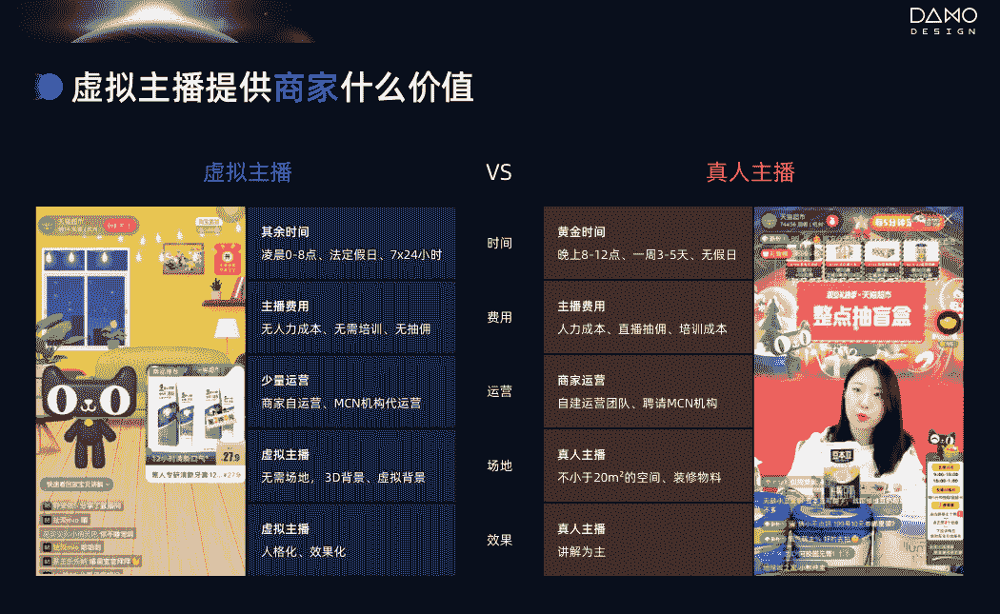
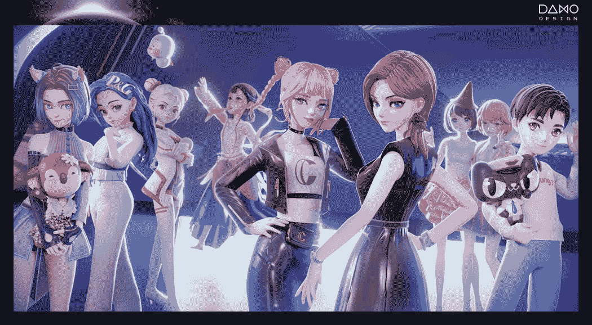
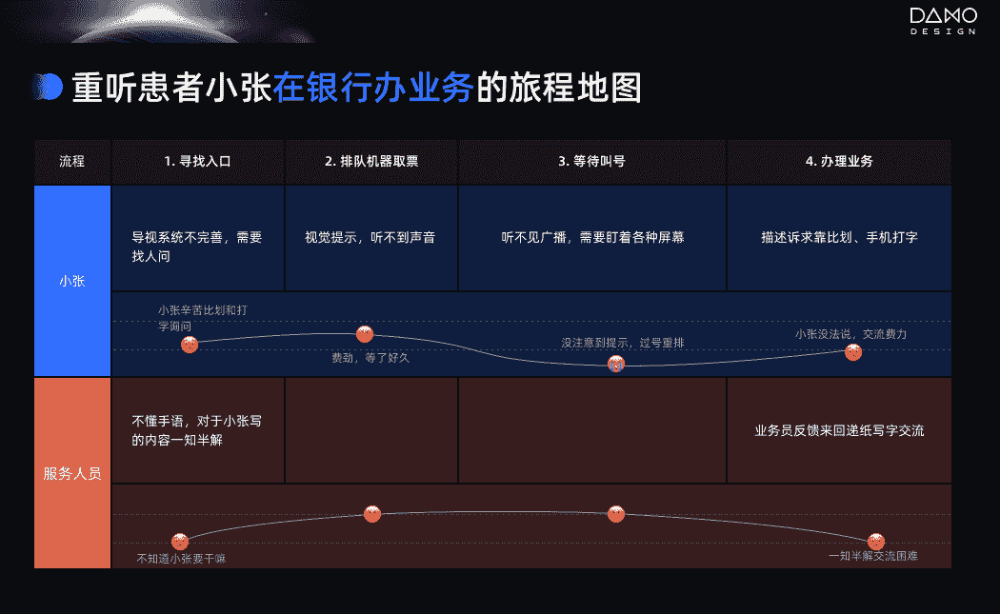
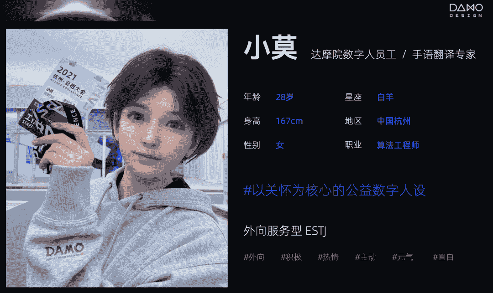

# 阿里｜AI新形态，数字人带你探索未来生活体验升级

> 来源：[https://aiyanxishe.feishu.cn/docx/CulZdDLE4otUZTxHfa3ckv5Anqe](https://aiyanxishe.feishu.cn/docx/CulZdDLE4otUZTxHfa3ckv5Anqe)

从30年前科幻小说《雪崩》中提出的「元宇宙」概念到如今人工智能和XR技术不断将「元宇宙」概念具像化，人类对于未来生活畅想和实践的脚步从未停止。即使当前科技尚不能完全触达，人类也会依靠想象力探索人类未来社会的新形态。

未来生活是电影是《头号玩家》中名为“绿洲”的虚拟现实游戏世界，也是《她》中温柔风趣的人工智能萨曼莎。无论未来以何种形态发生，人工智能始终是人类对未来生活遐想中不可或缺的要素，达摩院设计团队的设计师，希望通过可知可感的「数字人」链接「人工智能」与「生活场景」，打破虚拟与现实体验边界，重塑我们的现实生活。

## 1 科技以人为本，数字人生活服务普惠升级

面对日常生活，设计师尝试将智慧和人性赋予数字人，让数字人可以超越单纯的3D模型，成为有情感、有个性的「生命体」，在生活和工作中能够理解人类喜怒哀乐的情绪，在表达意图的同时还能够传递情绪价值，创造全新的人工智能互动模式。

在过去的一年中，达摩院设计师通过电商平台直播间的虚拟主播、听障人士的手语翻译官，以及社会活动的宣传大使等形式落地智慧数字人，向社会践行「科技服务生活」的理念。

### 1.1 「买它买它买它」，你的24小时智能主播----数字人虚拟主播

深夜，当你结束一天工作打开淘宝APP，发现商家的直播间中主播仍然热情的为你进行带货直播。这位主播非常娴熟的讲解着不同商品的卖点与差异，同时还能及时推荐今晚直播间的优惠活动，时不时给你来上一段当下最流行的舞蹈。

这位深夜还精力十足的「打工人」并非传统运营机构的签约主播，而是无需培训就可以面向直播间观众进行24小时不间断直播的虚拟主播，在夜晚或假期也能直播卖货，帮助商家降本提效。

虚拟主播为商家提供什么价值

为了区别真人主播的「传统艺能」，虚拟主播能够通过AI能力与互动玩法无缝衔接。结合直播场景下用户的购物决策路径，虚拟主播通过界面中商品展示+口播介绍，逐步引导观众了解“在讲解哪个商品？”“长什么样？”“如何使用？”，当引起用户兴趣后，面对用户的提问虚拟主播也能对答如流，最后虚拟主播“放出大招”，通过优惠活动与直播间哄抢氛围的营造，提示用户下单，完成一系列的标准带货动作。

在20**22年北京冬奥会期间，达摩院协同创造的数字人**冬冬也作为冬奥宣推官，在淘宝直播间进行了科技感满满的直播带货。当有观众进入直播间，冬冬会进行实时互动「欢迎新朋友进入直播间！」；奥运健儿夺冠了，冬冬会瞬间移动到奥运赛场模仿他们的经典动作来庆祝，在直播间重现奥运精彩瞬间。冬奥会期间，冬冬直播间不仅吸引了超过200万人次的观看，更是在短短时间内圈粉数十万。

<https://v.qq.com/txp/iframe/player.html?origin=https%3A%2F%2Fmp.weixin.qq.com&containerId=js_tx_video_container_0.2332294887133779&vid=s3370aluqd1&width=677&height=380.8125&autoplay=false&allowFullScreen=true&chid=17&full=true&show1080p=false&isDebugIframe=false>

冬奥宣推官--冬冬

目前虚拟主播已覆盖服务300多天猫商家，接入了包括三只松鼠、认养一头牛、猫超小叮当等IP形象，为商家搭建品销阵地提供AI助力。上线后，虚拟主播的新颖形式结合品牌IP形象，比真人直播间更具吸引力，为不少合作的商家直播间吸睛转粉，培养粉丝心智和粘性。

商家品牌虚拟主播IP形象

### 1.2 手语翻译，看得见的“声音”--数字人手语翻译官

在商业之外，达摩院的技术与体验同样关注公益与弱势族群，全中国大约有2700万听力障碍人群，在日常生活与机构办事的过程中存在大量沟通不畅、问询费劲的痛点。以办理银行业务为例，听障人群因为听不见广播，需要时刻盯着各种屏幕，十分紧张的等待，害怕错过叫号；办理业务时，往往需要通过辛苦比划和打字询问，而服务人员往往不懂手语，对于听障人群写的内容一知半解，不知道对方要做什么，来回递纸写字交流，交流过程不仅费时费力，沟通效果也不尽如人意。

重听患者小张在办事场景中的旅程地图

面对社会听力障碍人群，达摩院设计师通过手语公益数字人小莫的设计，联合语音与视觉技术构建手语翻译能力，通过手语翻译官小莫能实时为听障人群提供生活办事的协助，需要交流的双方只需按照自己的习惯正常表达，由小莫帮助双方将语音和手语做转译，整个交流过程无需操作、无需停顿，对话的起始和翻译节点均由算法来判断，让听障人群也能顺利办事。

此外在细节交互上，为了让小莫和听障用户互动的更好，设计师通过用研发现听障人群对视觉敏感的特点，从而强化视觉通道的反馈设计。当有人发言时，结合听障人群生活常见的信号灯隐喻，能快速将不同对话的角色分离，帮助听障人群识别当前发言的是自己还是对方；当听障人群手语输入完，需要翻译成语音时，由于语音播报的滞后性，语音播报的进度不被听障用户感知，因此设计师也在字幕的基础进行进度展示，提示听障人士可以适当断句表达，了解何时该继续手语，从而增加数字人翻译的流畅性。

<https://v.qq.com/txp/iframe/player.html?origin=https%3A%2F%2Fmp.weixin.qq.com&containerId=js_tx_video_container_0.6415957112459694&vid=n33705pf8s4&width=677&height=380.8125&autoplay=false&allowFullScreen=true&chid=17&full=true&show1080p=false&isDebugIframe=false>

手语翻译APP视觉隐喻设计

作为一名手语翻译官，小莫也在继续深耕自己的专业能力，在更大的舞台中为公益贡献力量。在亚残运会期间，“小莫”将充当健全人和听障人士的无障碍沟通桥梁，未来也将成为亚残运会的手语转播员。听障观众可以通过“小莫”更好地获取信息，享受无障碍的赛事服务。

<https://v.qq.com/txp/iframe/player.html?origin=https%3A%2F%2Fmp.weixin.qq.com&containerId=js_tx_video_container_0.9521823433624901&vid=y3370ncxqc7&width=677&height=380.8125&autoplay=false&allowFullScreen=true&chid=17&full=true&show1080p=false&isDebugIframe=false>

手语翻译官小莫参加亚残运会

**1.3 「欢迎来到阿里巴巴设计周，我是**你的数字体验官」----达摩院数字代言人

随着在Z世代群体成为互联网的中坚力量，他们的消费和审美习惯加速了数字代言人的诞生，数字人在品牌营销和社会服务的应用也日益多元，除了让数字人员工做为“服务者”，在特定的场景提供服务之外，数字人也可以是“代言人”，成为企业在「元宇宙」时代下具有人格化和生命力的内容载体，帮助品牌进行营销，扩大社会声量。

基于此，设计师将数字人小莫，摇身一变成为以「科技」之力展现智慧的公益大使，积极参与社会活动和公益事件，成为达摩院「技术公益」的对外窗口，和达摩院一同拓展技术与生活结合的体验边界。

达摩院数字人员工小莫设定

在2022年阿里巴巴设计设计周上，小莫也尝试以数字人体验官的身份为线上/线下百万观众展现设计周的魅力。一句“欢迎来到阿里巴巴设计周，我是数字体验官小莫”，小莫作为主持人助理，串起了观众对活动的热情。为了体现小莫的在我们身边的“真实感”，设计师结合美术与3D技术，深度刻画了数字人小莫的瞳孔与皮肤细节，令小莫产生灵动眼神传递活泼温暖的个性；动态上使用“模型换头”技术，复刻真人动作，增强动态细节的自然连贯性，让小莫可以以鲜活的姿态带领观众参与到设计周中。

<https://v.qq.com/txp/iframe/player.html?origin=https%3A%2F%2Fmp.weixin.qq.com&containerId=js_tx_video_container_0.9832139817561338&vid=w33701mmrn9&width=677&height=380.8125&autoplay=false&allowFullScreen=true&chid=17&full=true&show1080p=false&isDebugIframe=false>

阿里巴巴设计周数字体验官--小莫

春节前夕，小莫也受新华社邀请，代表阿里巴巴与大中华地区各数字人为大家拜年。小莫以短视频Up主的身份虚实融合的形式，为大家录制视频拜年，在全网获得百万网友关注，未来数字人将更深入我们的生活，连结更多科技带来不一样的融合数字世界。

<https://v.qq.com/txp/iframe/player.html?origin=https%3A%2F%2Fmp.weixin.qq.com&containerId=js_tx_video_container_0.897471061764892&vid=j3370x3ay7c&width=677&height=380.8125&autoplay=false&allowFullScreen=true&chid=17&full=true&show1080p=false&isDebugIframe=false>

小莫代表阿里巴巴与大中华地区各数字人为大家拜年

## 2 让数字人更像人，基于人格牵引的数字人设计

随着小莫以各种各样的身份在日常生活里出现，我们希望小莫的形象可以多多受到人们的喜爱。因此我们思考的下一个问题便是什么才是被用户接受喜爱的数字人呢？他们拥有怎样的特征可以「征服」大家的心？如何衡量数字人带给用户的体验？这是达摩院设计师和用户研究进一步思考的命题。

达摩院用研团队经过行业综合分析，并开展与大量用户、行业专家的深入访谈与共建，我们发现用户主要会基于数字人的外在表现（具备的类人外形、声音、行为）、互动性表现（与周围环境、人的互动性）、 自主性表现（自主的思维、情绪与个性特征的程度与表现）三方面来形成对数字人的整体印象，因此基于此三层，我们将数字人的整体表现力体验分为5个层级，构建出统一的评价标准。

数字人的整体表现力分级

在数字人表现力等级体系之下，我们希望以人格化的作为牵引，沉淀构建、声音、驱动、对话四大核心能力，让数字人小莫可以拥有专属个性特征与丰富情绪，通过多种方式与人们产生自然互动，赋予小莫由内而外的生命力。

基于人格情感牵引的数字人设计框架

首先，外形构建部分，针对数字人IP小莫“元气算法少女”的服务型人设，设计师通过“圆脸+中鼻梁+齐刘海+休闲装”的塑造小莫的日常感，并结合面部小雀斑等小瑕疵的特征，为小莫打造“不那么完美却亲切真实”的外形，让大家感觉小莫仿佛就是我们身边的朋友与同事。

小莫外貌设计过程

接着，通过动捕复刻和实时驱动方式，让小莫可以学习真人拥有喜怒哀乐的表情、眼神与肢体动作，呈现自然灵动的动态互动。

最后，我们通过音量、音调、语速、情感变化四个特征设计出符合小莫人设和情绪的声音，让小莫能够在主持、翻译的场合轻松应对。

<https://v.qq.com/txp/iframe/player.html?origin=https%3A%2F%2Fmp.weixin.qq.com&containerId=js_tx_video_container_0.7588597369466343&vid=f33702w9mua&width=677&height=380.8125&autoplay=false&allowFullScreen=true&chid=17&full=true&show1080p=false&isDebugIframe=false>

小莫声音画像设定

## **3 结语**

近年来，我们看到越来越多的数字人以各种各样的身份来到我们的生活、办公场景中，数字人们通过美观有趣的外形与创新的体验，构筑智能服务，为我们带来社会价值、商业价值、文化价值。尽管现阶段数字人存在一些不完美，达摩院设计团队仍持续努力走向未来，希望通过设计与技术结合的力量，让数字人不断进步，拥有真正的“灵魂”，与人们和谐共处，实现未来理想生活体验升级。

我们是**达摩院设计团队**，于2019年随达摩院而生，专注智能，前沿的高科技领域设计。团队集3D数字人、多模态交互设计、三维重建、工业设计、用户研究等能力，负责达摩院各实验室科技产品体验转译与设计研究工作，致力于打造聪明而有温度的智能创新产品。

<https://aiyanxishe.feishu.cn/sync/IaSadpoOOsopKab1ajKcz6z3nAb>