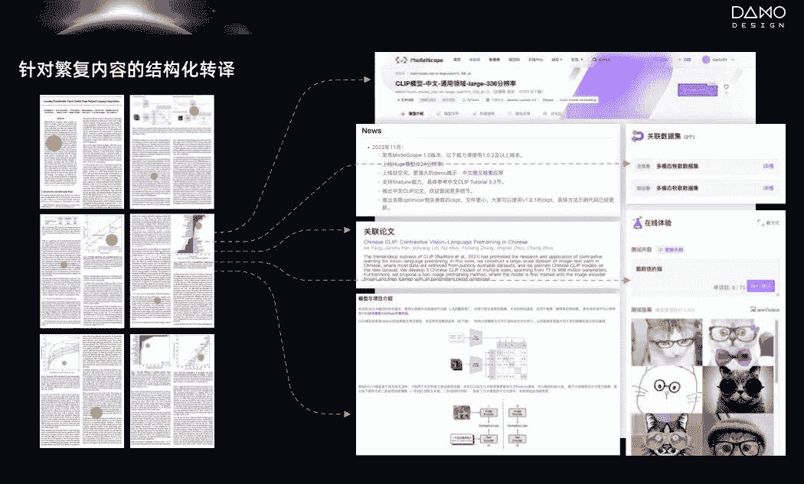
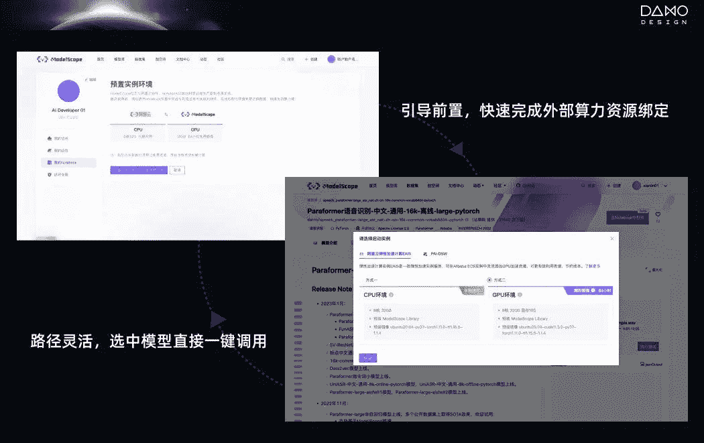

# 阿里 | 让AI模型更加平易近人｜ModelScope模型开源社区设计实践

> 来源：[https://aiyanxishe.feishu.cn/docx/O9bpdxx8LoKAvjxu4AQc5agnn0W](https://aiyanxishe.feishu.cn/docx/O9bpdxx8LoKAvjxu4AQc5agnn0W)

最近AIGC大火，爱好者小王手痒痒也想做一个自己的生成模型玩玩，看朋友圈说最近有一个ModelScope开源社区人气很旺，可以快速定制自己的ai能力，于是决定来试试。

#### **大众对普惠AI的诉求**

虽然小王研究AI有阵子了，但其实他一直觉得AI技术有些高冷不可靠近，一般都由那些真正的“专业人士”来开发定制，像他这样的爱好者难以插手。但随着落地场景的增加，现成的能力逐渐不够用，为了解决实际问题，他经常也需要动手调试自己的AI能力。

#### **普惠的信息-帮用户选到对的模型**

很快，小王就遇到了第一个问题，Ai信息“太多”了。

曾经，小王打开搜索引擎，输入“AIGC”，出现的信息无所不包，就像菜场里五花八门的食材，既能帮高手做出满汉全席，也会让新手一筹莫展。真正筛出一个适用的模型需要十足的经验。不论是从huggingface，GitHub这些开源社区里细细寻找，或是去paper with code这类学术站点里闷头钻研，信息总是又散又深的藏在某个角落，而缺乏经验的小王，常常与信息擦肩而过，不知如何下手。

但很快小王就发现，现在他不需再为这个问题苦恼了。针对这些繁杂的信息，ModelScope社区早已基于行业经验进行梳理，用稳定且结构化的方式展示在页面上，这可以帮助小王像老司机一样快速找到信息重点，降低决策门槛，加快决策过程，让一团乱麻的模型选择过程变得“有理有据”。

在这个构建结构化决策信息体系的过程中，ModelScope社区基于对学术用户和产业场景的理解，根据用途不同，对不同的决策因素进行分类侧重展示。

学术场景侧重对前人的探索进行验证和创新，使用过程中需要知其所以然并有所突破。所以模型对应的论文，作者，答疑，以及相关的训练集验证集测试集等就变得非常重要。

商业场景则更需要快速拿到业务结果，因此模型的可靠性，产出物与最终业务场景的匹配性则至关重要。决策链大致可归纳为：基础效果达标+可拓展性足够+商业案例背书可靠这三个部分

在ModelScope社区中，这些决策的关键信息通过标签，关联信息模块，demo等不同手段清晰布局在页面上，不同的模型都被置于相对统一的评价维度下供用户选择。小王通过浏览这些结构化信息，不需再依赖那些模棱两可的抽象经验就可以挑选到合适的模型，尽量消除了专业信息的壁垒。于是很顺利的，小王找到了一个可用的基础模型。

#### 普惠的算力和工具-帮模型顺畅的跑起来

选好模型，有了生产原材料，小王又遇到了难题，一直以来搭建调试环境最让他头大，而手头笔记本电脑的算力也不足以支持训练。

按照常规操作，解决这个问题需要小王对模型的环境和硬件依赖十分熟悉，按需配置合适的硬件和调试环境。但这需要花费大量的时间学习，俗话说调试才一天，环境搭三天，好几次他都被绕晕，干脆放弃。

但在ModelScope社区，小王惊喜的发现这里已经预先接入了云上运行调试环境和弹性算力，只需要一键引入代码，即可开始调试。小王这样的用户再也不用在意自己的显卡是3090还是2090，pytorch报错到底是版本太新还是太旧。

工具和算力接入的背后免不了复杂的技术实现过程，在这一方面，ModelScope社区主要解决两个体验问题，一是通过构建灵活的工具和算力使用路径，让弹性工具无处不在，用户在各处页面即可一键唤起对应工具进入调试。二是通过多维度的内外部衔接和预期管理，如前置提示，使用中说明和常驻使用文档等手段，多维度清晰的传递工具去哪里用，怎么用，有什么效果的核心信息，重点消除内容与服务衔接所带来的割裂感，使这些工具组合可以被零门槛使用，实现算力和工具的普惠。

通过构建这样无需学习的调用方式，使调用使云上算力和开发工具平等的覆盖每一个用户。开发者可以更聚焦模型生产的核心，只需要选定一个模型，模型文件打开即可调试，调完即可部署，部署即可调用。

于是在丰富的云上能力帮助下，小王只花了几天时间就顺利的完成了新模型的调试。

#### 让普惠回馈给更多人-协同云上能力加速能力沉淀

因为有了ModelScope。小王第一次上手就很顺利的调试出了好用的模型，效果不错自然很想展示给大家看看。ModelScope社区也提供了无门槛的展示场-创空间，以低代码的搭建过程配合Gradio的可视化组件库快速产出可体验的demo，小王可以轻松的把模型能力秀出来。

随着进一步与云上生态融合，以及后续加工工具的丰富，无数个小王这样的开发者都可以将模型能力轻松加工成在线服务，通过独立的管控台管理，或干脆进行商业化售卖的尝试。

#### **结语**

未来，对于千千万万小王这样的开发者，不论是专业研究，还是普通爱好，不论是想写出了不起的论文，还是只是解决简单的业务问题，ModelScope社区都希望能将经验平等的总结传递给他们，帮助他们扫清ai使用中的技术障碍，让繁琐的操作都靠边，开发者能够站到前人的肩膀上，心无旁骛的，快乐的选取、调用、调参、迭代开发自己的模型，让AI更高效更广泛地满足多样化的用户需求。

[AI研习社](https://zl49so8lbq.feishu.cn/wiki/wikcnu3kSXr75E50w8PFefhJMYf?from=from_copylink)果您也对AI模型感兴趣，欢迎来社区进一步体验

我们是**达摩院设计团队**，于2019年随达摩院而生，专注智能，前沿的高科技领域设计。团队集3D数字人、多模态交互设计、三维重建、工业设计、用户研究等能力，负责达摩院各实验室科技产品体验转译与设计研究工作，致力于打造聪明而有温度的智能创新产品。

<https://aiyanxishe.feishu.cn/sync/IaSadpoOOsopKab1ajKcz6z3nAb>