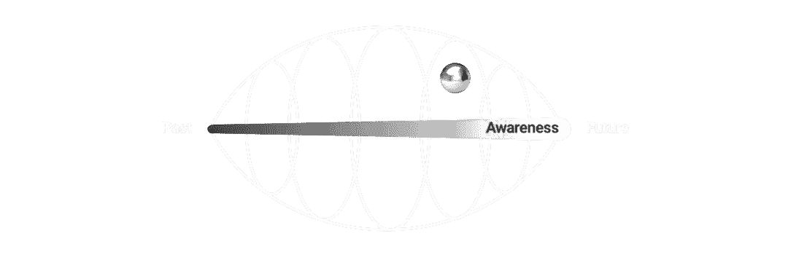
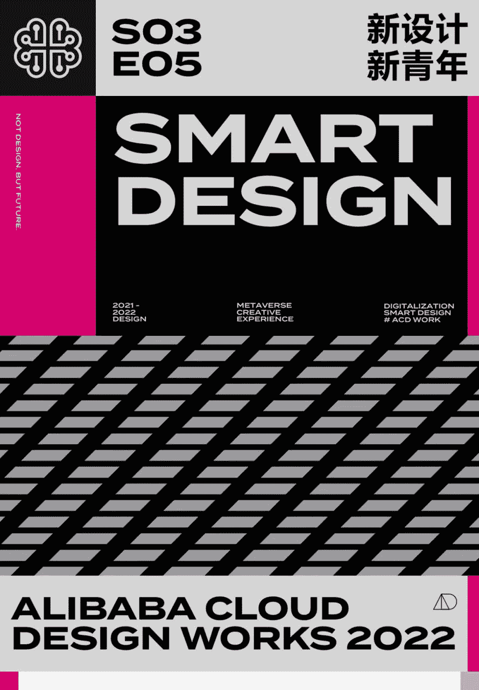
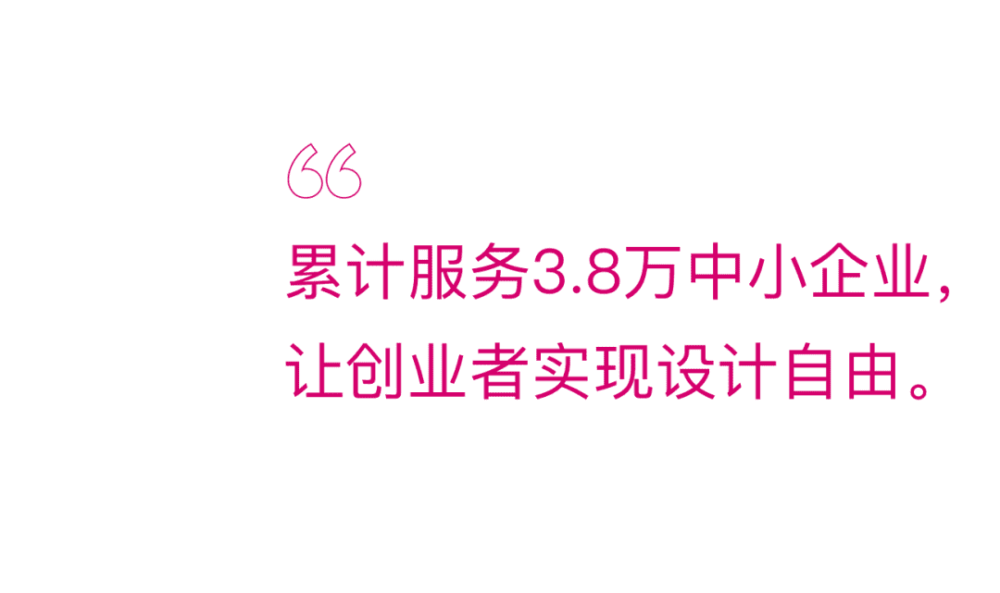
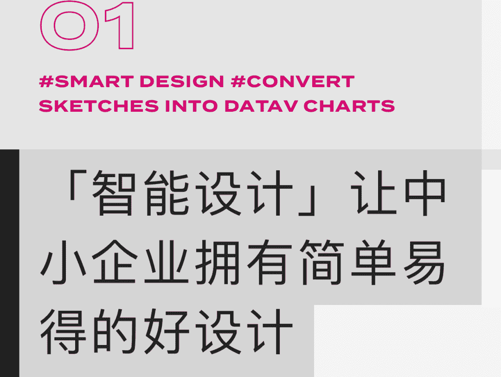

# 阿里｜阿里云设计中心年鉴

> 来源：[https://aiyanxishe.feishu.cn/docx/IBR2dOWxSoTT6ox3i2scAWeBnBb](https://aiyanxishe.feishu.cn/docx/IBR2dOWxSoTT6ox3i2scAWeBnBb)

人工智能技术常常被误解，一些科幻场景中，人工智能技术取代了人类大脑，人类沦为技术的奴隶。

而实际上，人工智能技术则是被应用在不同行业，有效的帮助人们提高了生产效率、降低生产成本，形成良性的人机协作关系。

我们设计中心将人工智能技术与自身的设计美学相结合，输出了一系列「智能设计」的产品，让优质的设计能力普及。

本篇内容介绍了我们在「智能设计」方面的一些实践和沉淀。

本文2322个字，阅读需要6分钟。

文末还有彩蛋🥚，你也可以先👀彩蛋～

根据国家小微企业名录数据显示，全国小微企业数量达到8000多万家，数量大约站到全国企业总数的70%左右，这些小微企业员工人数少，岗位职责边界弱，但均有个性化的设计服务需求，并且他们无法承担专业团队所需的费用。

而通过「智能设计」则可以快速收集和理解设计需求，以智能自动化的方式，为非设计专业用户以超低成本完成满意的设计结果，化解上述问题。

「智能设计」如何实现智能？

设计师在早期扮演系统的搭建和喂养角色，通过语义拆解、算法分析、设计规则进行人机共创。设计师的工作重点从方案输出，转变为结合AI智能的设计规则输出。

小到一个商标logo、创业者的名片、H5宣传海报、PPT模板、建站...过去需要几天设计的方案，通过智能设计一键生成符合用户需求的几百个方案。

「阿里云智能logo设计2.0」根据不同行业创业者需求，通过机器生成+智能推荐+用户编辑的设计生产方式，为用户智能生成logo方案。

「阿里云智能logo设计2.0」打破传统的1V1服务模式，从“模板化”向“智能化”改变着设计的生产方式，一键创造千人千面的设计方案。

我们不断优化算法，建立精准的语意解析，建立丰富的知识素材库，迭代设计规则，为创业者提供高质量的logo设计。

「阿里云智能logo设计2.0」产品目前已经累计服务3.8万+中小微企业用户。

「阿里云智能logo设计2.0」可以让千万创业者拥有自己的“品牌”。除此之外，中小企业们的日常设计需求量也是非常大的，从简单的ppt模版到企业名牌再到海报等等，都需要大量的素材和排版工作，阿里云智能海报产品即可满足这类需求。

#### 瞬间拥有海量素材库——ATOMs Design

ATOMs Design可以实现快速批量化生产高质量静态/动态图形素材。

基于巨量的素材资产库，大部分的工作皆可由机器完成，设计师只要起到监控和辅助的作用即可，有效降低设计师的劳动成本。

「ATOMs Design」可以基于用户的需求和喜好，产出适用各类场景的优质应用背景素材，并在直接进行二次编辑使用。

#### 让设计变得简单——POSTER在线编辑器

「POSTER在线编辑器」让没有设计基础的用户也可以轻松设计出各类海报物料。

我们根据不同场景需求，输出了海量精美模板，满足了小微企业的个性化设计需求。

#### 支持跨场景、跨风格的智能设计延展

从商标到海报，从名片到物料，再到日常营销、产品宣传、招聘、战报、发布会、活动大促等各个领域，智能设计已渗透到每个中小企业需要的各类场景。

我们希望通过「智能设计」的能力让上千万创业者真正拥有自己的“品牌”，拥有自己的设计能力。

数字时代下，数据可视化的需求越来越大，而数据大屏的可视化搭建，要求用户学习专业工具的操作、具备一定的综合的学术背景和设计能力，准入门槛较高。

在可视化产品设计中，如何运用设计师的经验和专业能力，让更多人以更低成本、更高效率完成数据可视化工作呢？这是我们一直思考的问题。

通过DataV数据可视化团队的合作，我们把智能化算法结合人机交互、融合用户意图和专业设计师的经验，将智能能力以工程化的形式输出，将设计师专业技能普惠大众。

智能的第一步是实现用户在工作链路中单点步骤的自动化。设计师将日常工作中积累的经验转化为机器可以理解的规律，将一些重复性的工作交给后台算法，减少用户的操作成本，提升产品的智能程度。

+   数据映射规则与产品化设计⟵ 向左滑动
在制作数据可视化时，理解和使用数据与图形之间的转换关于与编码规则，是设计师经常要进行的工作。

+   DataV自动数据映射器⟵ 向左滑动
DataV产品内预设的GUI映射器功能，能实现形状、尺寸、颜色三个主要的视觉通道的一键配置工作，大大降低了图表配置的操作流程。

+   图表X数据映射，展示多维信息

⟵ 向左滑动

+   图表X数据映射，展示多维信息⟵ 向左滑动

⟵ 向左滑动

智能的第二阶段是将设计师的经验规律化为综合性产品能力，帮助解决非设计师用户的使用困难。

面对视觉表达千万种可能性、以及产品灵活丰富的编辑能力，非设计师用户在数据可视化制作时反而会手足无措。我们和DataV产品研发团队一起，实现大屏部分风格设计的自动化能力集——马良，降低用户所需的专业设计技能，提供更多智能的可能性。

+   美化工具箱—自动完善大屏色彩、风格和布局细节

马良自动识图生成，基于深度学习的智能生成能力，能够迅速学习和识别手绘草图、信息图表、大屏截图等资料，并在编辑器内自动生成可配置的可视化应用。

+   智能生成——通过草图一键生层可视化大屏

⟵ 向左滑动

智能的第三个阶段是一定程度上代替人进行思考，DataV设计对用户行为和数据结果的提炼和整合，我们设计了产品的数据集分析能力，通过数据探索、图形表达和交互配置的自动设置和智能推荐，帮助用户轻松完成多维度的数据分析，以灵活、0代码、自动化的方式使用数据、分析数据、产出视图。

+   可视分析中的探索循环

+   智能数据分析产品设计

⟵ 向左滑动

智能数据分析，支持多数据集格式导入，通过自定义拖拽数据字段自动生成多维可视化分析展示，轻松完成数据分析工作，根据用户意愿辅助完成数据模型构建和在数据模型发生改变时自动化推荐样式配置。

+   智能数据分析产品设计

过去科技带来的人类能力的延展基本是物理性的，而大数据技术和智能革命带来的则是思维效率的提升。

智能革命重构人类的生产关系，创意设计的生产方式同样可以被优化，我们通过人机高效协同，不断降低设计美学的门槛和效率，让更多非设计专业用户靠智能设计受益。

感谢本篇内容的设计师们

十修/雅宋/不喜/

艺珊/本倪/筱箔/野一...

(排名部分先后）

是他们让人类

1秒拥有1个logo

10秒输出1张海报

5分钟拉出一个城市

👍🏻

接下来是虽然看厌但不得不看的彩蛋🥚

BOSS出场啦！（我看谁不转发🤭）

AlibabaCloudDesign

，赞332

阿里云设计中心一年一度的年鉴终于结束了！

感谢在年鉴中贡献作品得每一位同学，也感谢大家这5天来的收看，

明年同一时间再会～

新设计，新青年

2022

Goodbye！👋

---

About us

不设限，不追随，不为设计为未来

我们是阿里云设计中心

<https://aiyanxishe.feishu.cn/sync/IaSadpoOOsopKab1ajKcz6z3nAb>